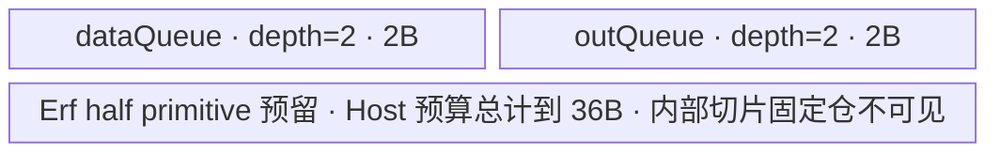
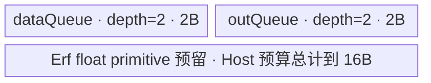
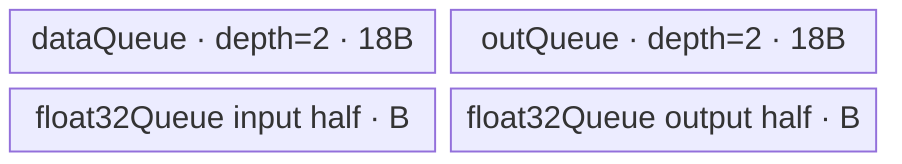

# ForeachErf A2/A3 ACLNN 算子知识

## 算子速览

| 项目 | 内容 |
|---|---|
| 实际入口 | 公开两段式 ACLNN：`aclnnForeachErfGetWorkspaceSize` + `aclnnForeachErf`；固定仓未出现其它公开版本。 |
| 计算语义 | 对 TensorList 中每个张量逐元素计算 `y_i[j] = erf(x_i[j])`。 |
| 输入输出 | `x`/`out` 均为 ND TensorList；每个列表内部 dtype 一致，支持 FLOAT16/FLOAT32/BFLOAT16；输出与对应输入同 dtype，公开接口要求输出 shape size 不小于输入。 |
| 执行类型 | 单 Kernel：`foreach_erf`，执行族为 `AIV_VECTOR`。 |
| Kernel 路线 | R-001 FLOAT16 直接 `Erf<half,false>`；R-002 FLOAT32 直接 `Erf<float,false>`；R-003 BFLOAT16 升至 FLOAT32 后 `Erf<float,false>`。 |
| 核心资源 | TensorList 地址表、GM 输入/输出、双缓冲 `dataQueue/outQueue`；BFLOAT16 另有单缓冲 `float32Queue`；Device 不消费 workspace。 |
| 来源闭包 | `source_closed`：公开 ACLNN 文档→生成式 ACLNN bridge/OpDef→`Tiling4ForeachErfTiling`→`ForeachCommonTiling`/`ForeachCommonTilingData`→`foreach_erf`→`ForeachTriangle`/`KernelForeachUnary`；`Erf` 为仓外 AscendC primitive 边界。 |
| 验证状态 | 已完成源码闭包检查；本次知识提取未执行编译、真机、数值或性能测试。 |

## 接口与语义

### 计算语义

输入为包含 `n` 个张量的列表 `x=[x_0,...,x_{n-1}]`，输出列表逐张量、逐元素满足：

\[
y_i[j]=\operatorname{erf}(x_i[j])=\frac{2}{\sqrt{\pi}}\int_0^{x_i[j]}e^{-t^2}\,dt.
\]

每个输出张量只写与对应输入相同的元素区间；若公开调用给出更大的输出 storage，超出输入元素数的区域不由本 Kernel 写入。

### 输入、输出与属性

| 参数 | shape/layout | dtype | 约束、默认值与语义 |
|---|---|---|---|
| `x` | TensorList；每个 Tensor 为 ND，0–8 维；允许零元素 Tensor；输入可非连续，由 OpDef 的 `AutoContiguous()` 进入框架连续化边界 | FLOAT16/FLOAT32/BFLOAT16 | 非空指针；列表内所有 Tensor dtype 一致；arch22 tiling 最多物化 50 个 Tensor 的 POD 项。 |
| `out` | TensorList；每个 Tensor 为 ND，0–8 维；公开契约不支持非连续输出 | 与 `x` 相同 | 非空指针；列表内 dtype 一致；对应输出 storage 元素数必须不小于输入。公共 infer-shape 路径把输出 shape 设为输入 shape。 |
| 属性 | N/A | N/A | 无算子属性。 |

### 入口与版本

固定 Commit 公开 `aclnnForeachErfGetWorkspaceSize(x,out,&workspaceSize,&executor)` 与 `aclnnForeachErf(workspace,workspaceSize,executor,stream)`。第一段完成接口校验、准备执行器并给出 Device workspace；第二段在指定 stream 上执行。固定仓未保存生成的 `aclnnop/aclnn_foreach_erf.h` 与 inner bridge 实体；`op_host/CMakeLists.txt` 以 `ACLNNTYPE aclnn` 生成接线，属于允许的框架边界，实际算子节点为 `ForeachErf`。README 与 API 文档均明确 A2、A3 支持，OpDef 注册 `ascend910b` 与 `ascend910_93`，无发布冲突。

## Host/Launcher 执行流程

### 参数校验与前处理

1. 公开 ACLNN 第一段拒绝 `x/out` 空指针、非 FLOAT16/FLOAT32/BFLOAT16、输入输出 dtype 不一致、列表内部 dtype 不一致、输出 shape size 小于输入以及超过 8 维的 Tensor。
2. OpDef 对动态输入和输出声明 ND 与 `AutoContiguous()`；公开契约只承诺输入非连续转换，不承诺非连续输出。生成式 bridge 的具体 `Contiguous` 节点与错误传播在固定仓不可见。
3. `ForeachCommonTiling::Init(FOREACH_ERF_OP_CODE)` 从动态输入依次取得 storage shape，冻结首个 dtype，累加 `totalDataCount` 与 `tensorDataCountList[0..49]`；不同 dtype 或缺失描述返回 `GRAPH_FAILED`。
4. `CheckOpInfo` 核对动态列表实例数、每个输入维数、输出 dtype/容量及列表内 dtype；失败时 tiling 终止，Kernel 不启动。

### 参数、Workspace 与生命周期

设平台 UB 字节数为 `U`，序列化 POD 大小为 `P=ForeachCommonTilingData::GetDataSize()`，元素字节数为 `s`，`E=32/s`。Host 计算 `blockCount=ceil(totalDataCount/E)`，`blockDim=min(max(blockCount,1), AIVCoreNum, 50)`，再按 32 B block 把扁平元素域分给各核并写入起止 Tensor/offset。

`inputsTensorUbSize=B` 按 dtype 计算并向下对齐：FLOAT32 为 `floor32((U-P)/16)`；FLOAT16 为 `floor32((U-P)/36)`；BFLOAT16 先将 `(U-P)` 整除 10，再按 half 路径除以 `9*4`，最后向下对齐 64 B。算子 tiling workspace slice 固定写 32 B，源码注释说明 Vector foreach 不需要 workspace；Kernel 将 `userWS` 置空并忽略入口 `workspace`。ACLNN 第一段返回的总 workspace 还可能包含生成式输入连续化等框架 slice，其公式固定仓不可见；调用者必须按总返回值持有到 stream 中相关节点执行完成。

### 启动图与失败传播

```text
aclnnForeachErfGetWorkspaceSize  # 生成式 ACLNN bridge，固定仓不可见
  -> ForeachErf OpDef/校验/连续化边界
  -> Tiling4ForeachErfTiling
     -> ForeachCommonTiling::Init(FOREACH_ERF_OP_CODE)
     -> ForeachCommonTiling::RunBigKernelTiling
  -> executor + workspaceSize(算子 slice=32 B；框架连续化 slice 固定仓不可见)
aclnnForeachErf(workspace, workspaceSize, executor, stream)
  -> 单节点 foreach_erf<<<blockDim, stream>>>(xList, yList, workspace, tiling)
```

算子自有的唯一 Device 节点 POD 是 `ForeachCommonTilingData`，输入/输出为 TensorList GM 地址表，算子 workspace slice 为 32 B 但不被 Device 读取。生成式输入连续化可在其前形成框架节点与临时边，具体图固定仓不可见；算子自有部分没有跨 Kernel 边。stream 是节点可见性与生命周期边界。任何第一段/tiling 失败都会阻断 launch；第二段 launch 状态按 ACLNN 框架返回，生成桥的具体实现固定仓不可见。

## Route 与参数设计

### 分核与资源计算

`Init` 按输入列表顺序形成逻辑拼接域。`AssignDataToEachCore` 先把总元素数向上取整到 32 B block，再令前 `blockCount % blockDim` 个核多处理一个 block；每核用 `tensorStartList/tensorStartOffsetList` 和 `tensorEndList/tensorEndOffsetList` 表示其可能跨多个 Tensor 的连续片段。Device 对每个片段再以 `maxDataCount` 分 tile，尾 tile 用字节型 `DataCopyPad`。

FLOAT16/FLOAT32 的 `maxDataCount=B/sizeof(T)`。BFLOAT16 的每个 data/out queue slot 为 `9B`，所以 `maxDataCount=9B/2`；FP32 分段长度 `maxCastDataCount=B/4`。

### Route 选择

| 顺序 | Route | Key/模板 | 精确选择条件与优先级 | 不适用去向 |
|---:|---|---|---|---|
| 1 | R-001 FLOAT16 Vector | key `1`; `ForeachTriangle<half,half,Erf<half,false>>` | `dataType == ge::DT_FLOAT16`，`GetTilingKeyByDtypeOnly` 返回 1 | 检查 key 2 |
| 2 | R-002 FLOAT32 Vector | key `2`; `ForeachTriangle<float,float,Erf<float,false>>` | `dataType == ge::DT_FLOAT`，返回 2 | 检查 key 4 |
| 3 | R-003 BFLOAT16→FLOAT32 Vector | key `4`; `ForeachTriangle<bfloat16_t,float,Erf<float,false>>` | `dataType == ge::DT_BF16`，返回 4；A2/A3 不命中 Kirin 编译排除宏 | 未知 key 无 body、无输出 |

```text
dtype FLOAT16 -> key 1 -> R-001
else dtype FLOAT32 -> key 2 -> R-002
else dtype BFLOAT16 -> key 4 -> R-003
else -> GetTilingKeyByDtypeOnly=0；公开/OpDef 已不支持，tiling/路由无有效实现
```

### 模板/实现执行矩阵

| Route | key/selector | dtype/shape/platform 完整命中条件 | 执行拓扑与 Kernel 节点 | 实际模板/body | 内存与同步特征 | tail/fallback |
|---|---|---|---|---|---|---|
| R-001 FLOAT16 Vector | 1 | FLOAT16、ND、每 Tensor ≤8 维、输出容量足够；A2/A3 | 单 `foreach_erf` | `ForeachTriangle<half,half,Erf<half,false>>::Process` | data/out 双缓冲；primitive 直接 half；Queue + `PIPE_V` barrier | 尾 tile 用 `DataCopyPad`；未知 key 不执行 |
| R-002 FLOAT32 Vector | 2 | FLOAT32，其余同上 | 单 `foreach_erf` | `ForeachTriangle<float,float,Erf<float,false>>::Process` | data/out 双缓冲；primitive 直接 float | 同上 |
| R-003 BFLOAT16→FLOAT32 Vector | 4 | BFLOAT16，其余同上；`__NPU_ARCH__` 非 3003/3113 | 单 `foreach_erf` | `ForeachTriangle<bfloat16_t,float,Erf<float,false>>::Process` | 9B data/out slot + 单缓冲 FP32；CAST_NONE/CAST_RINT；`PIPE_V` barrier | data tile 内再分 FP32 cast 尾段；编译排除时无 route |

### 隐藏性能 Guard

| Guard | Host/Tiling 条件 | Device/资源原因 | 影响 Route | 不满足时去向 | 源码符号 |
|---|---|---|---|---|---|
| 32 B 分核 | `E=32/dataTypeSize`; `blockCount=ceil(total/E)` | 普通 `DataCopy` 的完整 tile 以 block 对齐，尾部改用字节搬运 | 全部 | 零元素总域仍设 1 核；尾 tile 走 `DataCopyPad` | `ForeachCommonTiling::GetNeedCoreNum/AssignDataToEachCore` |
| 核数上限 | `blockDim <= min(AIVCoreNum,50)` | POD 的 per-core 数组仅 50 项 | 全部 | 截断到 50 核 | `RunBigKernelTiling` |
| Tensor 数上限 | `Init` 只遍历 `i<MAX_TENSOR_CONT(50)` | POD 的 tensor count 数组仅 50 项 | 全部 | 固定源码未显式拒绝第 51 项；超限不应依赖 | `ForeachCommonTiling::Init` |
| dtype UB 分母 | FLOAT32 `/16`；FLOAT16 `/36`；BF16 再 `/10` 且 `/36` | 为双缓冲和 `Erf` primitive 的 dtype 特定临时空间保留 UB | 各 dtype Route | 无备用小 tile Route；所得 B 直接进入 POD | `DivideUbMemory3` |
| BF16 编译 guard | `__CCE_AICORE__>=220 && __NPU_ARCH__ !=3003/3113` | BF16 Route 需要 FP32 cast queue 与 BF16 指令支持 | R-003 | 被排除平台无 key 4 body | `foreach_erf`; `InnerComputer<bfloat16_t,...>` |
| 输出容量 | `srcShape != dstShape && srcNumel > dstNumel` 时失败 | Kernel 按输入元素数写输出 | 全部 | `GRAPH_FAILED`，不 launch | `CheckOutputShapeAndDtype` |

### POD/ABI

`ForeachCommonTilingData` 由仓外 `BEGIN_TILING_DATA_DEF` 宏展开；固定仓可证明字段顺序、类型与数组长度，但宏生成类的最终 `sizeof/alignof/offsetof` 不可见，因此不伪造 ABI offset。

| 结构 | 字段 | 类型/位宽 | ABI 布局 | 单位 | Host/launcher producer | Device consumer | 边界 |
|---|---|---|---|---|---|---|---|
| `ForeachCommonTilingData` | `inputsTensorUbSize` | `uint64_t`/64 | 字段 1；精确 offset/总 sizeof 固定仓不可见 | 字节/queue 基准 B | `FillTilingData: set_inputsTensorUbSize(B)` | `KernelForeachBase::ParseTilingData`; 决定 queue 与 tile | 32 B/64 B 向下对齐 |
| 同上 | `tensorDataCountList` | `int64_t[50]`/每项64 | 字段 2 | 元素/张量 | `Init` 写 storage numel；`FillTilingData` 序列化 | `KernelForeachUnary::Process` 计算 Tensor 末端 | 仅前 `totalTensorCount` 项活动 |
| 同上 | `tensorStartList` | `uint16_t[50]`/每项16 | 字段 3 | Tensor 索引/核 | `AssignDataToEachCore` | `ParseTilingData[blockIdx]` | `blockDim<=50` |
| 同上 | `tensorEndList` | `uint16_t[50]`/每项16 | 字段 4 | Tensor 索引/核 | `AssignDataToEachCore` | `ParseTilingData[blockIdx]` | 含首尾 |
| 同上 | `tensorStartOffsetList` | `int64_t[50]`/每项64 | 字段 5 | 元素 offset/核 | `AssignDataToEachCore` | `Process` 的 `cursorStart` | 相对所属 Tensor |
| 同上 | `tensorEndOffsetList` | `int64_t[50]`/每项64 | 字段 6 | 元素 offset/核 | `AssignDataToEachCore` | `Process` 的 `cursorEnd` | 含末元素 |

### Route 源码闭包

| Route | Key/selector | Host/Tiling producer | POD/参数 | Kernel entry/router 节点 | Kernel body/直接依赖 | 构建接线 |
|---|---|---|---|---|---|---|
| R-001 | key 1 | `foreach_erf_tiling_arch22.cpp:Tiling4ForeachErfTiling`; `foreach_tiling_class.h:RunBigKernelTiling` | `ForeachCommonTilingData`, B 与 per-core arrays | `op_kernel/foreach_erf.cpp:foreach_erf` | `ForeachTriangle<half,...>`; `KernelForeachUnary`; `KernelForeachBase`; AscendC `Erf` primitive | `op_kernel/CMakeLists.txt:add_kernel_sources` for ascend910b/ascend910_93 |
| R-002 | key 2 | 同上 | 同上 | 同上 | `ForeachTriangle<float,...>` 及同一基类 | 同上 |
| R-003 | key 4 | 同上 | 同上，BF16 B/FP32 cast 分段 | 同上 | `ForeachTriangle<bfloat16_t,float,...>` 与 BF16 `InnerComputer` | 同上 |

## Kernel 实现

### 公共执行流程

`foreach_erf` 解析 POD 并按 key 实例化一个 `ForeachTriangle`。基类从 `GetBlockIdx()` 取得当前核的首尾 Tensor/offset；逐 Tensor 绑定 GM 地址，再按 `maxDataCount` 迭代：`CopyIn`→子类 `Compute`→`CopyOut`。完整 tile 用元素计数 `DataCopy`，尾 tile 用 `blockCount=1, blockLen=dataCount*sizeof(T)` 的 `DataCopyPad`。`TQue` 的 EnQue/DeQue/FreeTensor 管理搬运—计算—搬出依赖；数学 primitive 前后另有 `PipeBarrier<PIPE_V>()`。

### Route R-001：FLOAT16 Vector

#### 适用条件

##### 选择证据

| 层级 | 文件 | 符号 | 源码谓词/参数 | 结果/下一跳 |
|---|---|---|---|---|
| Host | `foreach_utils/op_host/common_dtype.h` | `GetTilingKeyByDtypeOnly` | `DT_FLOAT16` | key 1 |
| Tiling | `foreach_utils/op_host/foreach_tiling_class.h` | `DivideUbMemory3` | `dataTypeSize==2` | `B=floor32((U-P)/36)` |
| Router | `foreach_erf/op_kernel/foreach_erf.cpp` | `foreach_erf` | `TILING_KEY_IS(1)` | `ForeachTriangle<half,half,Erf<half,false>>` |

#### Device 数据流

##### 函数级调用链

```text
foreach_erf(xList,yList,workspace,tiling)
  -> ForeachTriangle<half,half,Erf<half,false>>::Init
  -> KernelForeachUnary::Process
     -> KernelForeachBase::GetTensorAddr
     -> KernelForeachUnary::CopyIn
     -> ForeachTriangle::Compute
        -> InnerComputer<half,half,...>::Compute -> Erf<half,false>
     -> KernelForeachUnary::CopyOut
```

##### 源码等价伪码

```text
# 伪码
for tensor i in [tensorStart, tensorEnd]:
  begin = (i==tensorStart ? tensorStartOffset : 0)
  end   = (i==tensorEnd ? tensorEndOffset : tensorDataCountList[i]-1)
  bind xGM/yGM to TensorList[i] + begin
  for tile k over (end-begin+1), tile <= B/2 elements:
    CopyIn half tile; tail uses byte-count DataCopyPad
    barrier; Erf<half,false>(outLocal, dataLocal, valid); barrier
    CopyOut valid half elements; tail uses byte-count DataCopyPad
```

#### 内存与数据搬运

##### 资源与搬运表

| 层级/缓冲区 | offset/地址公式 | extent/容量公式 | dtype/layout | producer | consumer | owner/lifetime | 对齐/复用 |
|---|---|---|---|---|---|---|---|
| GM x/y | `TensorListAddr(i)+cursorStart+k*(B/2)` | `min(B/2,remaining)` 元素 | half/ND contiguous storage | caller/CopyOut | CopyIn/caller | caller，覆盖整个 launch | full tile 32 B 对齐；tail 字节搬运 |
| `dataQueue` | queue slot | `2*B` 字节 | half | CopyIn | `Erf` | `TPipe`，每 tile Alloc→EnQue→DeQue→Free | depth 2 |
| `outQueue` | queue slot | `2*B` 字节 | half | `Erf` | CopyOut | 同上 | depth 2 |
| primitive reserve | source-visible queues 之外 | Host 总预算保守到 `P+36B<=U` | AscendC primitive 内部，固定仓不可见 | `Erf<half,false>` | 同 primitive | primitive 调用期 | 不得擅自缩成仅 4B |

##### 分层内存布局



##### 字节账与复用顺序

```text
B = floor32((U-P)/36)
source_visible_queues = 2B + 2B = 4B
Host_guarded_total = P + 36B <= U
dynamic_ub = N/A（AIV TPipe 路径）
workspace_total = 32 B（Device 未读取）
=> maxDataCount = B/2
```

| 复用子区 | 写入者 | 读取者/消费点 | 下一次覆盖 | 同步或释放依据 | 安全条件 |
|---|---|---|---|---|---|
| `dataQueue` slot | `CopyIn` | `Erf` | `FreeTensor` 后后续 tile | EnQue→DeQue→FreeTensor | depth 2 slot 未释放前不可覆盖 |
| `outQueue` slot | `Erf` | `CopyOut` | `FreeTensor` 后后续 tile | EnQue→DeQue→FreeTensor | CopyOut 完成后释放 |

#### 同步、精度与尾块

##### 同步与数值边界表

| 阶段 | primitive/机制 | producer | consumer/等待点 | 保护对象 | 精度/尾块 |
|---|---|---|---|---|---|
| GM→UB | `DataCopy`/`DataCopyPad` + VECIN queue | GM | `DeQue` | input slot | half 原精度；tail 仅搬有效字节 |
| 计算 | `PipeBarrier<PIPE_V>` + `Erf<half,false>` | input local | output EnQue | Vector pipeline | 固定仓只证明 half primitive，不可见内部近似 |
| UB→GM | VECOUT queue + `DataCopy`/`DataCopyPad` | output local | GM | output slot | 只写 `dataCount` 个有效元素 |

#### 关键实现

##### 符号证据表

| 阶段 | 文件 | 符号/模板实例 | 实现事实 |
|---|---|---|---|
| Host/Tiling producer | `foreach_utils/op_host/foreach_tiling_class.h` | `RunBigKernelTiling/DivideUbMemory3/FillTilingData` | key、分核、B、POD、workspace |
| Kernel entry/router | `foreach_erf/op_kernel/foreach_erf.cpp` | `foreach_erf`, key 1 | 路由到 half 模板 |
| Device body/helper | `foreach_utils/op_kernel/kernel_foreach_unary.h`; `foreach_triangle.h` | `KernelForeachUnary::Process`; `InnerComputer<half,...>` | tile、搬运、queue、Erf 与 tail |

### Route R-002：FLOAT32 Vector

#### 适用条件

##### 选择证据

| 层级 | 文件 | 符号 | 源码谓词/参数 | 结果/下一跳 |
|---|---|---|---|---|
| Host | `foreach_utils/op_host/common_dtype.h` | `GetTilingKeyByDtypeOnly` | `DT_FLOAT` | key 2 |
| Tiling | `foreach_utils/op_host/foreach_tiling_class.h` | `DivideUbMemory3` | `dataTypeSize==4` | `B=floor32((U-P)/16)` |
| Router | `foreach_erf/op_kernel/foreach_erf.cpp` | `foreach_erf` | `TILING_KEY_IS(2)` | `ForeachTriangle<float,float,Erf<float,false>>` |

#### Device 数据流

##### 函数级调用链

```text
foreach_erf -> ForeachTriangle<float,float,Erf<float,false>>::Init/Process
  -> CopyIn<float> -> InnerComputer<float>::Compute -> Erf<float,false>
  -> CopyOut<float>
```

##### 源码等价伪码

```text
# 伪码；分 Tensor/core 逻辑与 R-001 相同
for tile k with valid <= B/4 float elements:
  copy x[k] to dataQueue
  barrier; Erf<float,false>(outLocal,dataLocal,valid); barrier
  copy valid output to y[k]
```

#### 内存与数据搬运

##### 资源与搬运表

| 层级/缓冲区 | offset/地址公式 | extent/容量公式 | dtype/layout | producer | consumer | owner/lifetime | 对齐/复用 |
|---|---|---|---|---|---|---|---|
| GM x/y | `TensorListAddr(i)+cursorStart+k*(B/4)` | `min(B/4,remaining)` | float/ND | caller/CopyOut | CopyIn/caller | caller | tail 字节搬运 |
| `dataQueue` | slot | `2B` | float | CopyIn | Erf | TPipe/tile | depth 2 |
| `outQueue` | slot | `2B` | float | Erf | CopyOut | TPipe/tile | depth 2 |
| primitive reserve | source-visible queues 之外 | Host 总预算到 `P+16B<=U` | 内部布局固定仓不可见 | Erf | Erf | primitive 调用期 | 保留 3 倍输入空间/每 buffer 的 Host guard |

##### 分层内存布局



##### 字节账与复用顺序

```text
B = floor32((U-P)/16)
source_visible_queues = 4B
Host_guarded_total = P + 16B <= U
dynamic_ub = N/A
workspace_total = 32 B（Device 未读取）
=> maxDataCount = B/4
```

| 复用子区 | 写入者 | 读取者/消费点 | 下一次覆盖 | 同步或释放依据 | 安全条件 |
|---|---|---|---|---|---|
| data slot | CopyIn | Erf | FreeTensor 后 | VECIN queue | 与 R-001 相同 |
| out slot | Erf | CopyOut | FreeTensor 后 | VECOUT queue | 与 R-001 相同 |

#### 同步、精度与尾块

##### 同步与数值边界表

| 阶段 | primitive/机制 | producer | consumer/等待点 | 保护对象 | 精度/尾块 |
|---|---|---|---|---|---|
| CopyIn | DataCopy/DataCopyPad | GM | data DeQue | input | float；tail 有效字节 |
| Compute | PIPE_V barrier + `Erf<float,false>` | data local | out queue | Vector pipeline | FLOAT32 直接计算，primitive 内部不可见 |
| CopyOut | out queue + DataCopy/DataCopyPad | out local | GM | output | 写有效元素 |

#### 关键实现

##### 符号证据表

| 阶段 | 文件 | 符号/模板实例 | 实现事实 |
|---|---|---|---|
| Host/Tiling producer | `foreach_utils/op_host/foreach_tiling_class.h` | `DivideUbMemory3` | float `/16` B 公式 |
| Kernel entry/router | `foreach_erf/op_kernel/foreach_erf.cpp` | key 2 branch | float 模板 |
| Device body/helper | `foreach_triangle.h`; `kernel_foreach_unary.h` | `InnerComputer<float>`; `SingleTensorProcess` | 直接 float Erf 与 tile |

### Route R-003：BFLOAT16 升精度 Vector

#### 适用条件

##### 选择证据

| 层级 | 文件 | 符号 | 源码谓词/参数 | 结果/下一跳 |
|---|---|---|---|---|
| Host | `common_dtype.h` | `GetTilingKeyByDtypeOnly` | `DT_BF16` | key 4 |
| Tiling | `foreach_tiling_class.h` | `DivideUbMemory3` | BF16 先 `/10`，随后 2-byte `/9/4`，64 B 对齐 | BF16 B |
| Router | `foreach_erf/op_kernel/foreach_erf.cpp` | key 4 branch | key 4 且非 Kirin guard | BF16→float 模板 |

#### Device 数据流

##### 函数级调用链

```text
foreach_erf
  -> ForeachTriangle<bfloat16_t,float,Erf<float,false>>::Init/Process
  -> CopyIn<bfloat16_t>
  -> InnerComputer<bfloat16_t,float>::Compute
     -> ComputePerCast: Cast(CAST_NONE) -> Erf<float,false> -> Cast(CAST_RINT)
  -> CopyOut<bfloat16_t>
```

##### 源码等价伪码

```text
# 伪码
for BF16 tile with valid <= 9B/2 elements:
  CopyIn BF16
  for segment p with valid_p <= B/4 elements:
    Cast FP32[p=0..valid_p) <- BF16 segment, CAST_NONE
    Erf<float,false>(FP32 output half, FP32 input half, valid_p)
    Cast BF16 output segment <- FP32 result, CAST_RINT
  CopyOut valid BF16 elements
```

#### 内存与数据搬运

##### 资源与搬运表

| 层级/缓冲区 | offset/地址公式 | extent/容量公式 | dtype/layout | producer | consumer | owner/lifetime | 对齐/复用 |
|---|---|---|---|---|---|---|---|
| GM x/y | 同公共公式 | `min(9B/2,remaining)` | BF16/ND | caller/CopyOut | CopyIn/caller | caller | tail 字节搬运 |
| `dataQueue` | slot | `2*9B=18B` | BF16 | CopyIn | Cast | TPipe/tile | depth 2 |
| `outQueue` | slot | `18B` | BF16 | Cast | CopyOut | TPipe/tile | depth 2 |
| `float32Queue` | 单 slot；input at 0，output at offset `maxCastDataCount` floats | `2B` 字节 | float | Cast/Erf | Erf/Cast | Init 时 Alloc+EnQue，Process DeQue，结束 Free | depth 1；每 cast segment 复用 |

##### 分层内存布局



##### 字节账与复用顺序

```text
B = floor64(floor(floor((U-P)/10)/9)/4)
source_visible_queues = 18B + 18B + 2B = 38B
Host_capacity_guard = P + 360B <= U
Host formula在38B可见queue之外留下primitive保守余量；精确内部切片固定仓不可见
dynamic_ub = N/A
workspace_total = 32 B（Device 未读取）
=> maxDataCount=9B/2 BF16 elements; maxCastDataCount=B/4 FP32 elements
```

| 复用子区 | 写入者 | 读取者/消费点 | 下一次覆盖 | 同步或释放依据 | 安全条件 |
|---|---|---|---|---|---|
| FP32 input half | BF16→FP32 Cast | Erf | 下一 segment Cast | `PipeBarrier<PIPE_V>` | Erf 已读完 |
| FP32 output half | Erf | FP32→BF16 Cast | 下一 segment Erf | `PipeBarrier<PIPE_V>` | 降精度 Cast 已读完 |
| BF16 queue slots | CopyIn/Compute | Compute/CopyOut | FreeTensor 后 | queue 生命周期 | depth 2 |

#### 同步、精度与尾块

##### 同步与数值边界表

| 阶段 | primitive/机制 | producer | consumer/等待点 | 保护对象 | 精度/尾块 |
|---|---|---|---|---|---|
| 升精度 | `Cast(...,CAST_NONE)` + PIPE_V barrier | BF16 local | Erf | FP32 input half | 每段 ≤B/4 |
| Erf | `Erf<float,false>` + barrier | FP32 input | 降精度 Cast | FP32 output half | FLOAT32 计算 |
| 降精度 | `Cast(...,CAST_RINT)` + barrier | FP32 result | CopyOut | BF16 output | round-to-nearest-integer 模式名由源码给出；具体硬件舍入定义属 primitive |
| tail | DataCopyPad + cast remainder | GM/UB | 各下一阶段 | 有效 lane | `castTimesRemainder` 单独处理 |

#### 关键实现

##### 符号证据表

| 阶段 | 文件 | 符号/模板实例 | 实现事实 |
|---|---|---|---|
| Host/Tiling producer | `foreach_utils/op_host/foreach_tiling_class.h` | `DivideUbMemory3` | BF16 `/10`、half divider、64 B 对齐 |
| Kernel entry/router | `foreach_erf/op_kernel/foreach_erf.cpp` | key 4 branch | BF16 路由及编译 guard |
| Device body/helper | `foreach_triangle.h`; `kernel_foreach_unary.h`; `kernel_foreach_base.h` | BF16 `InnerComputer::ComputePerCast`; `Init` | 9B slots、FP32 queue、Cast/Erf/Cast |

## 算子特定优化

### Trick T-001：按 Erf 精度路径反推 tile，统一保留 primitive 临时空间

#### 触发与源码依据

- 适用 Route：R-001、R-002、R-003
- 触发条件：`opCode == FOREACH_ERF_OP_CODE`；分母随 `dataTypeSize` 与 BF16 分支变化。
- Golden 来源：[`foreach/foreach_utils/op_host/foreach_tiling_class.h:869-882`](../../../../../../../cann-ops-raw/ascendc/ops-nn/955f8b33985b6d72989ebff341bb9c2c564a51bc/foreach/foreach_utils/op_host/foreach_tiling_class.h#L869-L882)

**官方源码（固定 Commit 连续逐字摘录）**：

```cpp
        } else if (opCode == FOREACH_ERF_OP_CODE) {
            // foreach_erf
            uint32_t totalSize = uint32_t(ubSizePlatForm - tilingData.GetDataSize());
            if (dataType == ge::DT_BF16) {
                totalSize = totalSize / UB_DIVIDER_FOR_TEMP_CASTING;
            }
            // erf ascend C need 3 times for float or 8 times for half inputData size reserved for every buffer
            uint32_t canUseUbSize = totalSize / FOREACH_ERF_FLOAT_DIVIDER / FOREACH_ERF_BUFFER_DIVIDER;
            if (dataTypeSize == BYTE_LEN_2) {
                canUseUbSize = totalSize / FOREACH_ERF_HALF_DIVIDER / FOREACH_ERF_BUFFER_DIVIDER;
            }
            // 32 bytes align
            inputsTensorUbSize = (dataType == ge::DT_BF16) ? canUseUbSize / BYTE_BLOCK_FOR_BF16 * BYTE_BLOCK_FOR_BF16 :
                                                             canUseUbSize / BYTE_BLOCK * BYTE_BLOCK;
```

#### 机制与设计原因

Host 不以“输入队列能放多少”直接选 tile，而先扣 POD，再按 float 需要 3 倍、half 需要 8 倍输入空间的 primitive 约束和四个双缓冲槽反推 `B`；BF16 还额外除以 10 并按 64 B 对齐。这把仓外 `Erf` primitive 的临时空间约束前移到 Host，避免 Device 运行时发现 UB 不足；同时每条 Route 仍复用相同的 `KernelForeachUnary` 循环。

#### 迁移边界

- 适用：使用同一 AscendC `Erf<T,false>` primitive、双缓冲 input/output queue 的逐元素算子。
- 前提：POD 大小、平台 UB、primitive 临时空间倍数、queue depth 与 dtype cast 路径完全一致。
- 失效：改变 primitive、开启 source reuse、改变 queue depth 或 BF16 临时布局时必须重新推导分母，不能复用 `/16`、`/36`、额外 `/10`。
- 未验证：本次知识提取未执行编译、真机、数值或性能测试。

#### 错误做法

固定仓未提供可验证反例；但源码明确不能只按可见的 `2B+2B` queue 计算 tile，因为 Host 还为 `Erf` primitive 保留不可省略的临时空间。

## 模板与实现对比

| 对比维度 | R-001 FLOAT16 | R-002 FLOAT32 | R-003 BFLOAT16→FLOAT32 | 设计选择依据 |
|---|---|---|---|---|
| 命中条件/优先级 | key 1 | key 2 | key 4 + 编译 guard | dtype 唯一分发 |
| 模板与 dtype | half→half Erf | float→float Erf | BF16→float Erf→BF16 | BF16 显式升精度 |
| 循环与分核 | 32 B block；tile B/2 | 32 B block；tile B/4 | 32 B block；tile 9B/2，再按 B/4 cast | 元素宽度与 cast scratch |
| Queue/TBuf/寄存器/dynamic UB/通信 window | data/out depth2 | 同左 | data/out depth2 + FP32 depth1 | 无 TBuf/dynamic UB/通信 |
| 内存总占用与复用 | visible 4B；Host guard 36B | visible 4B；Host guard 16B | visible 38B + conservative slack | primitive 临时倍数不同 |
| 搬运/Vector/SIMT/NDDMA/通信 API | DataCopy(Pad)+half Erf | DataCopy(Pad)+float Erf | DataCopy(Pad)+Cast/float Erf/Cast | 全为 AIV Vector |
| 同步、精度与 tail | Queue + PIPE_V；half | Queue + PIPE_V；float | 每次 Cast/Erf/Cast 间 barrier；RINT | tail 均字节搬运 |
| fallback/失败边界 | 无备用 Route | 无备用 Route | Kirin 编译排除 | 未知 key 静默无 body |

## 平台差异

| 项目 | A2 | A3 | 950 |
|---|---|---|---|
| 支持状态 | 公开支持；`ascend910b` | 公开支持；`ascend910_93` | 公开支持，但使用独立 `_950` 卡 |
| Host/Launcher | 共用 arch22 `ForeachCommonTiling` | 共用 arch22 `ForeachCommonTiling` | arch35 独立 tiling，SIMT |
| Kernel/资源 | 共用 AIV Vector body，实际核数取平台 AIVCoreNum | 同左 | 不使用本卡 Vector body |

## 限制与失败边界

- 公开 ACLNN 允许输入非连续，但不支持非连续输出；shape 维数最多 8，支持零元素 Tensor，输出容量不得小于输入。
- arch22 POD 只有 50 个 Tensor 项与 50 个 core 项。Host 显式把核数限制为 50，但 `Init` 对第 51 个 Tensor 没有显式错误；调用方不得依赖超 50 项行为。
- `ForeachCommonTilingData` 宏的最终 ABI offset/sizeof、生成式 ACLNN bridge、AscendC `Erf` primitive 内部临时布局与近似公式在固定仓不可见；实现复用时必须使用同版本生成工具与 primitive，不得凭本卡补造。
- Host 写 32 B workspace，但 Device 忽略 `workspace`；未知 tiling key 的 entry 没有显式错误或 fallback。
- Host 的 UB 算术把 `uint64_t U-P` 窄化为 `uint32_t`，固定源码未给出 UB 小于 POD 或超过 32 位时的独立 guard。
- 本次知识提取未执行编译、真机、数值或性能测试。

## 源码索引

### 链路索引

| 链路阶段 | 文件 | 关键符号 | 支撑内容 |
|---|---|---|---|
| 入口声明/约束 | `foreach/foreach_erf/docs/aclnnForeachErf.md` | `aclnnForeachErfGetWorkspaceSize`; `aclnnForeachErf` | 公开原型、dtype/shape/错误与确定性 |
| 平台/语义 | `foreach/foreach_erf/README.md` | 产品支持表；公式 | A2/A3/950 公开支持与 erf 语义 |
| 入口实现边界 | `foreach/foreach_erf/op_host/foreach_erf_def.cpp` | `ops::ForeachErf`; `OP_ADD` | 动态 ND、dtype、AutoContiguous、平台注册 |
| Host/Tiling | `foreach/foreach_erf/op_host/arch22/foreach_erf_tiling_arch22.cpp` | `Tiling4ForeachErfTiling` | ForeachErf 到公共 tiling 接线 |
| Host/Tiling | `foreach/foreach_utils/op_host/foreach_tiling_class.h` | `ForeachCommonTiling` | 校验、分核、UB、POD、workspace |
| POD | `foreach/foreach_utils/op_host/foreach_tiling_def.h` | `ForeachCommonTilingData` | 字段、数组长度与注册 |
| key helper | `foreach/foreach_utils/op_host/common_dtype.h` | `GetTilingKeyByDtypeOnly` | dtype→key 1/2/4 |
| shape/dtype infer | `foreach/foreach_utils/op_host/foreach_infershape.cpp` | `InferShape4ForeachCommon`; `InferDataType4ForeachCommon`; `IMPL_OP_INFERSHAPE(ForeachErf)` | 输出列表数量、shape 与 dtype 传播 |
| Kernel body | `foreach/foreach_utils/op_kernel/kernel_foreach_base.h` | `KernelForeachBase` | POD 解析、TensorList 地址 |
| Kernel body | `foreach/foreach_utils/op_kernel/kernel_foreach_unary.h` | `KernelForeachUnary` | queue、tile、CopyIn/Out、tail |
| Kernel body | `foreach/foreach_utils/op_kernel/foreach_triangle.h` | `ForeachTriangle`; `InnerComputer` | Erf 调用、BF16 Cast 与 barrier |
| Kernel entry/body | `foreach/foreach_erf/op_kernel/foreach_erf.cpp` | `foreach_erf` | key→模板 router |
| ACLNN/Host 构建接线 | `foreach/foreach_erf/op_host/CMakeLists.txt` | `SUPPORT_COMPUTE_UNIT`; `SUPPORT_TILING_DIR`; `add_modules_sources` | A2/A3 arch22 与生成式 ACLNN 接线 |
| binary config | `foreach/foreach_erf/op_host/config/ascend910b/foreach_erf_binary.json` | `ForeachErf` 三 dtype entries | A2 binary 发布覆盖 |
| binary config | `foreach/foreach_erf/op_host/config/ascend910_93/foreach_erf_binary.json` | `ForeachErf` 三 dtype entries | A3 binary 发布覆盖 |
| 构建接线 | `foreach/foreach_erf/op_kernel/CMakeLists.txt` | `add_kernel_sources` | A2/A3 使用默认 Kernel 源 |

### 实现复用检查

| 检查项 | 可复用事实 | 不得改变的约束 | 源码符号 |
|---|---|---|---|
| ABI/POD | 六字段公共 POD 与数组语义 | 字段顺序、50 项上限、宏生成 ABI | `ForeachCommonTilingData`; `FillTilingData` |
| 调用顺序 | Init→Process→逐 Tensor/逐 tile CopyIn→Compute→CopyOut | key router 与 queue 生命周期 | `foreach_erf`; `KernelForeachUnary::Process` |
| workspace/内存 | 32 B workspace 未消费；B 由 dtype guard 产生 | primitive reserve、alignment、depth 2、BF16 9B slot | `RunBigKernelTiling`; `DivideUbMemory3`; `Init` |
| 同步 | Queue 协议与 PIPE_V barrier | Cast/Erf/Cast 间次序 | `InnerComputer::Compute/ComputePerCast` |
| 精度与尾块 | half/float 直接；BF16 升 FP32/RINT；tail 字节搬运 | dtype 模板、round mode、有效 dataCount | `InnerComputer`; `CopyIn/CopyOut` |
| 失败边界 | 校验失败阻断 launch；无 unknown-key fallback | ≤8 维、输出容量、≤50 项可依赖范围 | `CheckOpInfo`; `foreach_erf` |

- [Erf](../../../../apis/simd_api/adv_api/math_compute/erf_interface/erf.md)
