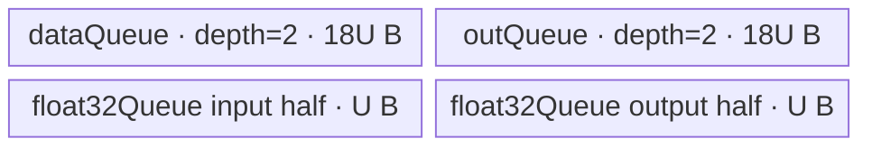

# ForeachErfc A2/A3 ACLNN 算子知识

## 算子速览

| 项目 | 内容 |
|---|---|
| 实际入口 | 公开两段式接口 `aclnnForeachErfcGetWorkspaceSize` + `aclnnForeachErfc`；内部算子类型 `ForeachErfc` |
| 计算语义 | 对列表中每个张量逐元素计算 `y_i[j] = erfc(x_i[j]) = 1 - erf(x_i[j])` |
| 输入输出 | 动态 TensorList；ND；FP16、FP32、BF16；同一列表及输入输出 dtype 一致；每项输出 storage size 不小于对应输入 |
| 执行类型 | 单 Kernel，唯一 Device 节点为 `AIV_VECTOR` |
| Kernel 路线 | R-001 FP16 原生；R-002 FP32 原生；R-003 BF16→FP32→BF16 |
| 核心资源 | TensorList 指针表 GM、输入/输出 GM、`dataQueue`/`outQueue` 双缓冲；BF16 另有 `float32Queue`；Kernel 不消费 user workspace |
| 来源闭包 | `source_closed`：公开 ACLNN 约束→`ForeachErfc` OpDef→arch22 Tiling→`ForeachCommonTilingData`→dtype router→`ForeachTriangle`/`KernelForeachUnary`→`Erfc` primitive→A2/A3 构建接线已闭合 |
| 验证状态 | 已完成源码闭包检查；本次知识提取未执行编译、真机、数值或性能测试。 |

## 接口与语义

### 计算语义

输入是长度为 `N` 的 TensorList。对第 `i` 个张量的每个有效元素 `j`，输出为

`y_i[j] = erfc(x_i[j]) = 2/sqrt(pi) * integral(x_i[j], +inf, exp(-t^2) dt)`。

各张量相互独立；Kernel 仅写与输入元素一一对应的前 `numel(x_i)` 个输出元素。公开约束允许 `out_i` 的 storage size 大于 `x_i`，多出的区域不由该 Kernel 写入。

### 输入、输出与属性

| 参数 | shape/layout | dtype | 约束、默认值与语义 |
|---|---|---|---|
| `x` | TensorList；每项 0–8 维；ND | FP16、FP32、BF16 | 非空列表指针；支持列表项为空 Tensor；输入可非连续，OpDef 标记 `AutoContiguous`；列表内 dtype 一致 |
| `out` | TensorList；每项 0–8 维；ND | 与 `x` 一致 | 非空列表指针；输出不支持非连续 Tensor；对应项 storage size 必须 `>= x_i`；列表内 dtype 一致 |
| `workspaceSize` | 标量输出 | `uint64_t` | 第一段接口返回；算子 Tiling 声明 32 B，但 Kernel 将 user workspace 置空且不读取；框架为非连续输入产生的额外 workspace 公式固定仓不可见 |
| `executor` | Host 对象 | `aclOpExecutor **` | 第一段产生并保存执行流程，第二段消费 |
| `workspace`/`stream` | Device 地址/运行时流 | N/A | 第二段按 executor 在指定 stream 发射单个 ForeachErfc Kernel |

### 入口与版本

固定仓公开且只记录这一版 `aclnnForeachErfc` 两段式接口。公开文档明确支持 Atlas A2 与 A3；`ForeachErfc` OpDef 将 `ascend910b`、`ascend910_93` 注册到 AICore，Host CMake 将两者映射到 `arch22`，Kernel CMake 为两者选择默认 `op_kernel/foreach_erfc.cpp`。固定仓未包含生成后的 `aclnnop/aclnn_foreach_erfc.h` 与 ACLNN C 桥接实现；其 executor 组装属于生成框架边界，算子自有 Host/Tiling/POD/Kernel 链路仍可闭合。

## Host/Launcher 执行流程

### 参数校验与前处理

公开第一段接口先拒绝 `x/out == nullptr`、不支持的 dtype、输入输出 dtype 不同、对应 shape size 不满足、列表内部 dtype 不一致及维数大于 8。进入 arch22 Tiling 后：

1. `ForeachCommonTiling::Init(FOREACH_ERFC_OP_CODE)` 从动态输入 0 开始扫描，最多保存 50 个列表项；以输入 0 描述符取得 dtype/字节数，累计每项 `GetShapeSize()` 与总元素数，并拒绝列表项 dtype 不一致。
2. `CheckOpInfo()` 校验动态输入列表规模、每项维数、输出描述符、输入输出 dtype、对应 storage size，以及所有列表项 dtype。
3. OpDef 对 `x/y` 均声明 ND 与 `AutoContiguous`；公开 ACLNN 明确输入可非连续、输出不可非连续。实际 Contiguous executor 节点由生成框架创建，固定仓不可见。

### 参数、Workspace 与生命周期

设 `s=sizeof(T)`，每 32 B block 元素数 `E=32/s`，总输入元素数 `M=sum_i numel(x_i)`：

- `needCoreNum = min(max(ceil(M/E), 1), platformAivCoreNum, 50)`；空数据仍发射 1 个 block。
- 按 `B=ceil(M/E)` 个 32 B block 分核：基础份额为 `floor(B/needCoreNum)*E`，前 `B mod needCoreNum` 个核多处理 `E` 个元素；每核用起止 tensor id 与两个包含式 offset 描述跨 TensorList 的连续逻辑区间。
- `workspaces[0]=32` B。源码注释说明 foreach vector 不需要 workspace，entry 将 `userWS=nullptr` 传给 body；这 32 B 由 executor/框架持有到 stream 工作结束，算子 Kernel 不读写。
- `x/y` TensorList 与其每项 Device buffer 必须覆盖异步执行期；第二段接口的 stream ordering 与 executor 失败传播由 ACLNN 框架保证，生成实现固定仓不可见。

### 启动图与失败传播

单节点启动图：`aclnnForeachErfc` executor → `foreach_erfc<<<needCoreNum>>>`。节点参数按 entry 顺序为 `xList, yList, workspace, tiling`；POD 为 `ForeachCommonTilingData`；输入输出直接在各自 GM buffer 交接，无跨 Kernel workspace 边。Tiling 中任何空描述符、shape/dtype/list 检查失败或 workspace 指针获取失败都返回 `GRAPH_FAILED`，因而阻断 Kernel 发射；entry 对未知 key 没有 fallback，也不写输出。

## Route 与参数设计

### 分核与资源计算

Host 先按上述 32 B block 公式生成每核 TensorList 区间，再按 UB 选择单 buffer 字节数 `U=inputsTensorUbSize`。设 `D=ForeachCommonTilingData::GetDataSize()`，`R=UB_platform-D`：

- FP32：`U=floor(floor(floor(R/8)/4)/32)*32`。
- FP16：`U=floor(floor(floor(R/17)/4)/32)*32`。
- BF16：先 `R'=floor(R/10)`，再 `U=floor(floor(floor(R'/17)/4)/64)*64`。

整数除法均向下取整。`U` 是每个基础 queue buffer 的字节数，不是元素数。FP16/FP32 的 `maxDataCount=U/s`；BF16 显式将输入/输出单 buffer 扩为 `9U`，故 `maxDataCount=9U/2`，并以 `maxCastDataCount=U/4` 个 FP32 元素分段 cast。

### Route 选择

| 顺序 | Route | Key/模板 | 精确选择条件与优先级 | 不适用去向 |
|---:|---|---|---|---|
| 1 | R-001 FP16 原生 | key 1；`ForeachTriangle<half, half, Erfc<half,false>>` | `dataType == DT_FLOAT16`，`GetTilingKeyByDtypeOnly` 返回 1 | 尝试 key 2 |
| 2 | R-002 FP32 原生 | key 2；`ForeachTriangle<float,float,Erfc<float,false>>` | `dataType == DT_FLOAT`，返回 2 | 尝试 key 4 |
| 3 | R-003 BF16 升精度 | key 4；`ForeachTriangle<bfloat16_t,float,Erfc<float,false>>` | `dataType == DT_BF16`，返回 4；A2/A3 编译 guard 允许该分支 | 未知 key：entry 结束且无输出 |

```text
ForeachCommonTiling::RunBigKernelTiling
  -> dataType FP16  -> key 1 -> R-001
  -> dataType FP32  -> key 2 -> R-002
  -> dataType BF16  -> key 4 -> R-003
  -> 其他 dtype 在公开接口/OpDef 校验失败；若仍到 entry，未知 key 不执行 body
```

### 模板/实现执行矩阵

| Route | key/selector | dtype/shape/platform 完整命中条件 | 执行拓扑与 Kernel 节点 | 实际模板/body | 内存与同步特征 | tail/fallback |
|---|---|---|---|---|---|---|
| R-001 FP16 原生 | 1 | FP16；每项 ≤8 维；输出 size≥输入；A2/A3 | 单 AIV_VECTOR Kernel | `ForeachTriangle<half,half,Erfc<half,false>>` | `dataQueue/outQueue` 各 depth 2；计算前后 `PIPE_V` barrier | 末 tile 用字节级 `DataCopyPad`；未知 key 无输出 |
| R-002 FP32 原生 | 2 | FP32；其余同上 | 单 AIV_VECTOR Kernel | `ForeachTriangle<float,float,Erfc<float,false>>` | 与 R-001 同字节布局，元素容量减半 | 同 R-001 |
| R-003 BF16 升精度 | 4 | BF16；其余同上；非 Kirin guard | 单 AIV_VECTOR Kernel | `ForeachTriangle<bfloat16_t,float,Erfc<float,false>>` | 输入/输出 queue 单 buffer `9U`；`float32Queue` 单 buffer `2U`；Cast/Erfc/Cast 间 barrier | BF16 tile 内再按 `U/4` 元素切分；尾搬运同上 |

### 隐藏性能 Guard

| Guard | Host/Tiling 条件 | Device/资源原因 | 影响 Route | 不满足时去向 | 源码符号 |
|---|---|---|---|---|---|
| 32 B 分核 | `E=32/sizeof(T)`；`needCore<=ceil(M/E)` | 防止生成只覆盖不足一个 DMA block 的额外核 | 全部 | 空数据仍为 1 核 | `GetNeedCoreNum` |
| 最多 50 核/50 Tensor | `MAX_CORE_CONT=MAX_TENSOR_CONT=50` | POD 数组固定长度 | 全部 | 第 51 个动态输入不进入 Init；公开边界不得超过固定容量 | `ForeachCommonTiling::Init/RunBigKernelTiling` |
| Erfc UB 预留 | FP32 分母 `8*4`；2 B 类型分母 `17*4` | 为 `Erfc` primitive 与双 queue 留出保守空间 | 全部 | 无更小 tile fallback；`U` 过小的失败检查固定仓不可见 | `DivideUbMemory5` |
| BF16 额外衰减 | `R=floor((UB-D)/10)` 且 `U` 向下 64 B 对齐 | 支持 9 倍 T queue 与 FP32 cast buffer | R-003 | 无 fallback | `DivideUbMemory5`、`KernelForeachBase::Init` |
| BF16 编译 guard | 排除 `__NPU_ARCH__==3003/3113` | 对应 Kirin 不支持 BF16；A2/A3 不命中排除值 | R-003 | 被排除平台无 BF16 body | `foreach_erfc`、`InnerComputer` specialization |

### POD/ABI

`BEGIN_TILING_DATA_DEF` 宏的展开定义来自仓外 CANN Host 头，因此固定仓能证明字段顺序、类型和数组长度，但不能证明最终 `sizeof/alignof/offsetof`；下表 ABI 布局据此明确标记。

| 结构 | 字段 | 类型/位宽 | ABI 布局 | 单位 | Host/launcher producer | Device consumer | 边界 |
|---|---|---|---|---|---|---|---|
| `ForeachCommonTilingData` | `inputsTensorUbSize` | `uint64_t`/64 | 第 1 字段；精确 offset/sizeof 固定仓不可见 | 字节/单基础 buffer | `FillTilingData: set_inputsTensorUbSize(U)` | `KernelForeachBase::ParseTilingData` | `U` 由 dtype 路线向下对齐 |
| 同上 | `tensorDataCountList[50]` | `int64_t[50]` | 第 2 字段；精确 offset 固定仓不可见 | 元素 | `Init` 写每项 `GetShapeSize()` | `Process` 计算默认 `cursorEnd` | 仅 `[0,totalTensorCount)` 有效；count 不单独入 POD |
| 同上 | `tensorStartList[50]` | `uint16_t[50]` | 第 3 字段；精确 offset 固定仓不可见 | TensorList 索引 | `AssignDataToEachCore` | 当前 block 的 `tensorStart` | blockDim≤50 |
| 同上 | `tensorEndList[50]` | `uint16_t[50]` | 第 4 字段；精确 offset 固定仓不可见 | 包含式 TensorList 索引 | `AssignDataToEachCore` | 当前 block 的 `tensorEnd` | blockDim≤50 |
| 同上 | `tensorStartOffsetList[50]` | `int64_t[50]` | 第 5 字段；精确 offset 固定仓不可见 | 元素 | `AssignDataToEachCore` | 首 Tensor 的 `cursorStart` | 相对该 Tensor 起点 |
| 同上 | `tensorEndOffsetList[50]` | `int64_t[50]` | 第 6 字段；精确 offset 固定仓不可见 | 包含式元素索引 | `AssignDataToEachCore` | 末 Tensor 的 `cursorEnd` | 空 Tensor 可为 -1，使 `dataCount=0` |

### Route 源码闭包

| Route | Key/selector | Host/Tiling producer | POD/参数 | Kernel entry/router 节点 | Kernel body/直接依赖 | 构建接线 |
|---|---|---|---|---|---|---|
| R-001 FP16 | key 1 | `foreach_erfc_tiling_arch22.cpp::Tiling4ForeachErfcTiling`；`ForeachCommonTiling` | `ForeachCommonTilingData` | `op_kernel/foreach_erfc.cpp::foreach_erfc` | `ForeachTriangle<half,...>`；`KernelForeachUnary` | Host/Kernel CMake：`ascend910b/ascend910_93`→arch22/default entry |
| R-002 FP32 | key 2 | 同上 | 同上 | 同上 | `ForeachTriangle<float,...>` | 同上 |
| R-003 BF16 | key 4 | 同上 | 同上 | 同上 | `InnerComputer<bfloat16_t,float,...>` | 同上 |

## Kernel 实现

### 公共执行流程

entry 解析 `ForeachCommonTilingData`，按 key 构造一个 `ForeachTriangle`，`Init` 绑定 TensorList GM、解析当前 block 的起止区间并初始化 queue，随后 `Process`。每核可能跨越多个 Tensor；对每个 Tensor 段设置输入/输出 GM base，再按 `maxDataCount` 切 tile，依次 `CopyIn→Compute→CopyOut`。TensorList GM ABI 的首个 `uint64_t` 是到指针表的字节偏移，右移 3 后定位指针表，第 `i` 项是实际 Tensor GM 地址。

### Route R-001：FP16 原生 Erfc

#### 适用条件

##### 选择证据

| 层级 | 文件 | 符号 | 源码谓词/参数 | 结果/下一跳 |
|---|---|---|---|---|
| Host | `foreach_utils/op_host/common_dtype.h` | `GetTilingKeyByDtypeOnly` | `DT_FLOAT16` | key 1 |
| Tiling | `foreach_utils/op_host/foreach_tiling_class.h` | `DivideUbMemory5` | `dataTypeSize==2` | `U=floor((UB-D)/17/4)` 后 32 B 对齐 |
| Router | `foreach_erfc/op_kernel/foreach_erfc.cpp` | `foreach_erfc` | `TILING_KEY_IS(1)` | `ForeachTriangle<half,half,Erfc<half,false>>` |

#### Device 数据流

##### 函数级调用链

```text
foreach_erfc(xList,yList,workspace,tiling)
  -> ForeachTriangle<half,half,Erfc<half,false>>::Init
    -> KernelForeachBase<half>::ParseTilingData
    -> InitBuffer(dataQueue/outQueue, depth=2, bytes=U)
  -> KernelForeachUnary::Process
    -> GetTensorAddr + SingleTensorProcess
      -> CopyIn -> ForeachTriangle::Compute -> InnerComputer::Compute
      -> CopyOut
```

##### 源码等价伪码

```text
block = GetBlockIdx()
for tensorId in [start[block], end[block]]:
  begin = tensorId==start ? startOffset[block] : 0
  last  = tensorId==end ? endOffset[block] : tensorNumel[tensorId]-1
  n = last-begin+1
  bind input/output GM to tensorPtr[tensorId]+begin
  for tile in ceil(n/(U/2)):
    valid = min(U/2, n-tile*(U/2))
    CopyIn valid half elements (tail uses DataCopyPad bytes)
    PipeBarrier(V); Erfc<half,false>(outUB,inUB,valid); PipeBarrier(V)
    CopyOut valid half elements (tail uses DataCopyPad bytes)
```

#### 内存与数据搬运

##### 资源与搬运表

| 层级/缓冲区 | offset/地址公式 | extent/容量公式 | dtype/layout | producer | consumer | owner/lifetime | 对齐/复用 |
|---|---|---|---|---|---|---|---|
| 输入 GM | `tensorPtr[i]+cursorStart+tile*U/2` | `valid` 元素 | FP16/ND | caller | `CopyIn` | caller，覆盖 stream 执行期 | 整 tile `DataCopy`；tail 字节搬运 |
| `dataQueue` | queue slot | depth 2 × `U` B | FP16 UB | `CopyIn` | `Compute` | `TPipe`；Free 后复用 | 双缓冲、32 B 对齐 |
| `outQueue` | queue slot | depth 2 × `U` B | FP16 UB | `Compute` | `CopyOut` | `TPipe`；Free 后复用 | 双缓冲、32 B 对齐 |
| 输出 GM | 同输入逻辑 offset | `valid` 元素 | FP16/ND | `CopyOut` | caller | caller | 不写输出多余区域 |

##### 分层内存布局


##### 字节账与复用顺序

```text
可见 UB_total = 2U + 2U = 4U
Erfc<half,false> primitive 内部临时空间 = 固定仓不可见；Host 以分母 17*4 保守约束 U
dynamic_ub = N/A
workspace_total = 32 B（Kernel 不消费）
```

| 复用子区 | 写入者 | 读取者/消费点 | 下一次覆盖 | 同步或释放依据 | 安全条件 |
|---|---|---|---|---|---|
| `dataQueue` slot | `CopyIn` | `Compute` DeQue | `FreeTensor` 后下一 tile | EnQue/DeQue/FreeTensor | 不得在 Erfc 消费前覆盖 |
| `outQueue` slot | `Compute` | `CopyOut` DeQue | `FreeTensor` 后下一 tile | EnQue/DeQue/FreeTensor | 不得在 GM copy 完成前覆盖 |

#### 同步、精度与尾块

##### 同步与数值边界表

| 阶段 | primitive/机制 | producer | consumer/等待点 | 保护对象 | 精度/尾块 |
|---|---|---|---|---|---|
| GM→UB | queue + `DataCopy/DataCopyPad` | GM | Compute DeQue | 当前输入 slot | tail 的 `blockLen=valid*2` B，无 padding 写入语义 |
| 计算 | `PipeBarrier<PIPE_V>` | CopyIn/Erfc | Erfc/EnQue | Vector pipeline | 直接 FP16 `Erfc<half,false>`；具体近似固定仓不可见 |
| UB→GM | queue + `DataCopy/DataCopyPad` | Compute | GM | 当前输出 slot | 仅提交 `valid` 元素 |

#### 关键实现

##### 符号证据表

| 阶段 | 文件 | 符号/模板实例 | 实现事实 |
|---|---|---|---|
| Host/Tiling producer | `foreach_utils/op_host/foreach_tiling_class.h` | `RunBigKernelTiling/AssignDataToEachCore/DivideUbMemory5` | key、blockDim、区间、U 与 32 B workspace |
| Kernel entry/router | `foreach_erfc/op_kernel/foreach_erfc.cpp` | `foreach_erfc` key 1 | 映射到 FP16 `ForeachTriangle` |
| Device body/helper | `foreach_utils/op_kernel/kernel_foreach_unary.h`；`foreach_triangle.h` | `SingleTensorProcess/CopyIn/Compute/CopyOut` | tile、queue、Erfc 与 tail |

### Route R-002：FP32 原生 Erfc

#### 适用条件

##### 选择证据

| 层级 | 文件 | 符号 | 源码谓词/参数 | 结果/下一跳 |
|---|---|---|---|---|
| Host | `foreach_utils/op_host/common_dtype.h` | `GetTilingKeyByDtypeOnly` | `DT_FLOAT` | key 2 |
| Tiling | `foreach_utils/op_host/foreach_tiling_class.h` | `DivideUbMemory5` | `dataTypeSize==4` | `U=floor((UB-D)/8/4)` 后 32 B 对齐 |
| Router | `foreach_erfc/op_kernel/foreach_erfc.cpp` | `foreach_erfc` | `TILING_KEY_IS(2)` | `ForeachTriangle<float,float,Erfc<float,false>>` |

#### Device 数据流

##### 函数级调用链

```text
foreach_erfc -> ForeachTriangle<float,float,Erfc<float,false>>::Init/Process
  -> KernelForeachUnary<float>::SingleTensorProcess
    -> CopyIn<float> -> InnerComputer<float,float>::Compute -> CopyOut<float>
```

##### 源码等价伪码

```text
沿用 R-001 的 block→Tensor→tile 三层循环
tileCapacity = U/4
CopyIn(valid*4 B); barrier; Erfc<float,false>(outUB,inUB,valid); barrier; CopyOut(valid*4 B)
```

#### 内存与数据搬运

##### 资源与搬运表

| 层级/缓冲区 | offset/地址公式 | extent/容量公式 | dtype/layout | producer | consumer | owner/lifetime | 对齐/复用 |
|---|---|---|---|---|---|---|---|
| 输入/输出 GM | `tensorPtr[i]+begin+tile*U/4` | `valid` | FP32/ND | caller/CopyOut | CopyIn/caller | caller | tail 按 `valid*4` B |
| `dataQueue` | slot | depth 2 × `U` B | FP32 UB | CopyIn | Erfc | TPipe | 32 B 对齐 |
| `outQueue` | slot | depth 2 × `U` B | FP32 UB | Erfc | CopyOut | TPipe | 32 B 对齐 |

##### 分层内存布局


##### 字节账与复用顺序

```text
可见 UB_total = 4U
Erfc<float,false> primitive scratch = 固定仓不可见；Host 分母 8*4 是可证明上界机制
dynamic_ub = N/A
workspace_total = 32 B（Kernel 不消费）
```

| 复用子区 | 写入者 | 读取者/消费点 | 下一次覆盖 | 同步或释放依据 | 安全条件 |
|---|---|---|---|---|---|
| 两个 queue slot | CopyIn/Compute | Compute/CopyOut | Free 后下一 tile | queue 生命周期与 `PIPE_V` barrier | 与 R-001 相同 |

#### 同步、精度与尾块

##### 同步与数值边界表

| 阶段 | primitive/机制 | producer | consumer/等待点 | 保护对象 | 精度/尾块 |
|---|---|---|---|---|---|
| CopyIn/Out | queue + DataCopy(Pad) | GM/UB | Compute/GM | 当前 slot | FP32；tail 按字节有效长度 |
| Compute | `Erfc<float,false>` + 两次 `PIPE_V` barrier | 输入 queue | 输出 queue | Vector pipeline | FP32 计算，无显式 cast |

#### 关键实现

##### 符号证据表

| 阶段 | 文件 | 符号/模板实例 | 实现事实 |
|---|---|---|---|
| Host/Tiling producer | `foreach_utils/op_host/foreach_tiling_class.h` | `DivideUbMemory5` | FP32 U 分母 8×4 |
| Kernel entry/router | `foreach_erfc/op_kernel/foreach_erfc.cpp` | key 2 branch | FP32 实例 |
| Device body/helper | `foreach_triangle.h` | `InnerComputer<float,float,...>::Compute` | 原生 FP32 Erfc 与 barrier |

### Route R-003：BF16 升精度 Erfc

#### 适用条件

##### 选择证据

| 层级 | 文件 | 符号 | 源码谓词/参数 | 结果/下一跳 |
|---|---|---|---|---|
| Host | `common_dtype.h` | `GetTilingKeyByDtypeOnly` | `DT_BF16` | key 4 |
| Tiling | `foreach_tiling_class.h` | `DivideUbMemory5` | BF16 | `(UB-D)/10/17/4`，64 B 对齐 |
| Router | `foreach_erfc.cpp` | key 4 branch | 非 arch 3003/3113 | `ForeachTriangle<bfloat16_t,float,Erfc<float,false>>` |

#### Device 数据流

##### 函数级调用链

```text
foreach_erfc -> ForeachTriangle<bfloat16_t,float,Erfc<float,false>>::Init/Process
  -> KernelForeachBase::Init(totalTensorUbSize=9U,maxDataCount=9U/2,maxCastDataCount=U/4)
  -> SingleTensorProcess
    -> CopyIn<bf16>
    -> InnerComputer<bfloat16_t,float>::Compute
      -> ComputePerCast: Cast BF16→FP32 -> Erfc<float,false> -> Cast FP32→BF16(CAST_RINT)
    -> CopyOut<bf16>
```

##### 源码等价伪码

```text
for each GM tile of at most 9U/2 BF16 elements:
  copy tile to BF16 dataQueue
  for chunk of at most U/4 elements:
    Cast(floatBuf[0], bf16In[chunkOffset], CAST_NONE, validChunk)
    barrier
    Erfc<float,false>(floatBuf[U/4], floatBuf[0], validChunk)
    barrier
    Cast(bf16Out[chunkOffset], floatBuf[U/4], CAST_RINT, validChunk)
    barrier
  copy valid BF16 outputs to GM
```

#### 内存与数据搬运

##### 资源与搬运表

| 层级/缓冲区 | offset/地址公式 | extent/容量公式 | dtype/layout | producer | consumer | owner/lifetime | 对齐/复用 |
|---|---|---|---|---|---|---|---|
| 输入/输出 GM | `tensorPtr+begin+tile*(9U/2)` | valid≤`9U/2` 元素 | BF16/ND | caller/CopyOut | CopyIn/caller | caller | tail 字节搬运 |
| `dataQueue` | slot | depth 2 × `9U` B | BF16 UB | CopyIn | Cast | TPipe | U 为 64 B 对齐 |
| `outQueue` | slot | depth 2 × `9U` B | BF16 UB | final Cast | CopyOut | TPipe | 同上 |
| `float32Queue` | `[0,U)` input；`[U,2U)` output | depth 1 × `2U` B | FP32 UB | Cast/Erfc | Erfc/Cast | Init 时 Alloc+EnQue，Process DeQue，结束 Free | 两半不别名；跨 chunk 覆盖 |

##### 分层内存布局



##### 字节账与复用顺序

```text
可见 UB_total = 18U + 18U + 2U = 38U
Erfc<float,false> primitive scratch = 固定仓不可见；Host 另以 /10 与 /17/4 收紧 U
dynamic_ub = N/A
workspace_total = 32 B（Kernel 不消费）
```

| 复用子区 | 写入者 | 读取者/消费点 | 下一次覆盖 | 同步或释放依据 | 安全条件 |
|---|---|---|---|---|---|
| float input half | BF16→FP32 Cast | Erfc source | 下一 cast chunk | 每步 `PIPE_V` barrier | Erfc 读取完成后才覆盖 |
| float output half | Erfc destination | FP32→BF16 Cast | 下一 Erfc chunk | 每步 `PIPE_V` barrier | 降精度 Cast 完成后才覆盖 |
| queue slots | CopyIn/final Cast | Cast/CopyOut | Free 后下一 GM tile | queue EnQue/DeQue/Free | 双缓冲协议 |

#### 同步、精度与尾块

##### 同步与数值边界表

| 阶段 | primitive/机制 | producer | consumer/等待点 | 保护对象 | 精度/尾块 |
|---|---|---|---|---|---|
| 升精度 | `Cast(...,CAST_NONE)` + barrier | BF16 queue | Erfc | float input half | 每 chunk≤`U/4` |
| 计算 | `Erfc<float,false>` + barrier | float input half | 降精度 Cast | float output half | FP32 计算 |
| 降精度 | `Cast(...,CAST_RINT)` + barrier | float output half | output queue | BF16 output | 舍入模式固定为 RINT |
| GM tail | DataCopyPad | queue/GM | 后续阶段 | 有效字节 | 只搬 `valid*2` B |

#### 关键实现

##### 符号证据表

| 阶段 | 文件 | 符号/模板实例 | 实现事实 |
|---|---|---|---|
| Host/Tiling producer | `foreach_tiling_class.h` | `DivideUbMemory5` | BF16 /10、/17、/4、64 B 对齐 |
| Kernel entry/router | `foreach_erfc.cpp` | key 4 branch | BF16→FP32 模板 |
| Device body/helper | `kernel_foreach_base.h`；`foreach_triangle.h` | BF16 specialization | 9U queue、U/4 cast chunk、RINT |

## 算子特定优化

### Trick T-001：按 32 B block 跨 TensorList 连续分核

#### 触发与源码依据

- 适用 Route：R-001、R-002、R-003
- 触发条件：任意通过校验的 TensorList；`needCoreNum>0`
- Golden 来源：[`foreach_tiling_class.h:651-703`](../../../../../../../cann-ops-raw/ascendc/ops-nn/955f8b33985b6d72989ebff341bb9c2c564a51bc/foreach/foreach_utils/op_host/foreach_tiling_class.h#L651-L703)

**官方源码（固定 Commit 连续逐字摘录）**：

```cpp
int64_t blockCount = CeilA2B(totalDataCount, elementsPerBlock);
int64_t tempPerCoreCount = blockCount / needCoreNum * static_cast<int64_t>(elementsPerBlock);
int64_t remainderCount = blockCount % needCoreNum;
```

#### 机制与设计原因

Host 不按 Tensor 个数分核，而把整个列表视为按 32 B block 拼接的逻辑元素流。每核用 `tensorStart/End` 和 offset 表示可能跨多个 Tensor 的区间，避免小 Tensor 固定占一核，并让除最后边界外的核份额以 DMA block 对齐；余数 block 分给前若干核。

#### 迁移边界

- 适用：多个同 dtype Tensor 的逐元素 unary 算子。
- 前提：TensorList GM ABI 相同、各项相互独立、可用起止 Tensor 与元素 offset 描述分区。
- 失效：需要跨 Tensor 归约、不同 dtype/layout 或输出项与输入项不一一对应时不能直接复用。
- 未验证：本次知识提取未执行编译、真机、数值或性能测试。

#### 错误做法

固定仓未提供可验证反例。

### Trick T-002：BF16 分块升精度并复用单个双区 FP32 buffer

#### 触发与源码依据

- 适用 Route：R-003
- 触发条件：dtype 为 BF16，key 4，且编译平台未命中 Kirin 排除 guard
- Golden 来源：[`foreach_triangle.h:64-75`](../../../../../../../cann-ops-raw/ascendc/ops-nn/955f8b33985b6d72989ebff341bb9c2c564a51bc/foreach/foreach_utils/op_kernel/foreach_triangle.h#L64-L75)

**官方源码（固定 Commit 连续逐字摘录）**：

```cpp
Cast(float32Tensor, x1Local[index * maxCastDataCount], RoundMode::CAST_NONE, dataCount);
PipeBarrier<PIPE_V>();
uint32_t offset = (paramsCount == 1) ? 0 : maxCastDataCount;
op(float32Tensor[offset], float32Tensor, dataCount);
PipeBarrier<PIPE_V>();
Cast(yLocal[index * maxCastDataCount], float32Tensor[offset], RoundMode::CAST_RINT, dataCount);
```

#### 机制与设计原因

BF16 输入只以 `maxCastDataCount=U/4` 元素为单位进入 FP32；同一 `2U` buffer 的前半作 Erfc 源，后半作目的，随后立即以 RINT 写回 BF16 output queue。该机制把 FP32 物化限制在一个 cast chunk，并通过 barrier 证明跨 chunk 覆盖安全，同时保留 FP32 `Erfc` 的计算顺序。

#### 迁移边界

- 适用：BF16 unary primitive 需要 FP32 实现、且结果可逐 chunk 独立回写。
- 前提：FP32 buffer 至少容纳两个 `U` 字节子区，cast chunk 与 `maxCastDataCount` 一致。
- 失效：primitive 需要跨 chunk 状态、原地 source/destination 语义或不同舍入规则时必须重做布局。
- 未验证：本次知识提取未执行编译、真机、数值或性能测试。

#### 错误做法

固定仓未提供可验证反例。

## 模板与实现对比

| 对比维度 | R-001 FP16 | R-002 FP32 | R-003 BF16 | 设计选择依据 |
|---|---|---|---|---|
| 命中条件/优先级 | key 1 | key 2 | key 4 | dtype 唯一决定 key，无运行时 fallback |
| 模板与 dtype | `<half,half,Erfc<half,false>>` | `<float,float,Erfc<float,false>>` | `<bfloat16_t,float,Erfc<float,false>>` | BF16 复用 FP32 primitive |
| 循环与分核 | 32 B block；tile U/2 | 32 B block；tile U/4 | 32 B block；GM tile 9U/2，cast tile U/4 | dtype 字节数及 cast 路线 |
| Queue/TBuf/寄存器/dynamic UB/通信 window | 两个 depth-2 queue | 同左 | 两个 depth-2 9U queue + depth-1 2U float queue | BF16 升精度 |
| 内存总占用与复用 | 可见 4U | 可见 4U | 可见 38U；float 双区跨 chunk 复用 | Host 采用不同 UB 衰减 |
| 搬运/Vector/SIMT/NDDMA/通信 API | DataCopy(Pad)+FP16 Erfc | DataCopy(Pad)+FP32 Erfc | DataCopy(Pad)+Cast/FP32 Erfc/Cast | 全部为 AIV_VECTOR |
| 同步、精度与 tail | Erfc 前后 barrier；FP16 | 同左；FP32 | 每次 Cast/Erfc 间 barrier；RINT | tail 均按有效字节 |
| fallback/失败边界 | 未知 key 无输出 | 同左 | Kirin guard 排除；A2/A3可达 | 无 Device fallback |

## 平台差异

| 项目 | A2 | A3 | 950 |
|---|---|---|---|
| 支持状态 | 支持 | 支持 | 支持；见独立 `_950` 卡 |
| Host/Launcher | `ascend910b`→arch22 公共 Tiling | `ascend910_93`→arch22 公共 Tiling | arch35 独立 SIMT Tiling |
| Kernel/资源 | 默认 AIV_VECTOR entry | 与 A2 共用默认 entry | 独立 arch35 entry，无 AIV queue，使用 SIMT VF |

## 限制与失败边界

- 公开接口支持 FP16/FP32/BF16、0–8 维、空 Tensor；输出不支持非连续 Tensor，且对应输出 storage size 不得小于输入。
- arch22 固定 POD 只容纳 50 个 Tensor 与 50 个核；固定源码没有对第 51 个输入的显式错误返回，工程复用不得扩大此边界。
- `tensorDataCountList` 不携带显式 tensor count；Device 仅依靠每核 start/end 数组。不得改变包含式 end offset 语义。
- Kernel 对未知 key 静默结束；正确性依赖 Host dtype 校验和 key 生产。
- 生成后的 ACLNN C 桥接、输入 Contiguous workspace 精确公式，以及 `Erfc<T,false>` primitive 内部近似与 scratch 分配固定仓不可见。
- 本次知识提取未执行编译、单元测试、真机、数值或性能测试。

## 源码索引

### 链路索引

| 链路阶段 | 文件 | 关键符号 | 支撑内容 |
|---|---|---|---|
| 入口声明/约束 | `foreach/foreach_erfc/docs/aclnnForeachErfc.md` | `aclnnForeachErfcGetWorkspaceSize/aclnnForeachErfc` | 公开原型、平台、dtype、shape、错误语义 |
| 入口声明/约束 | `foreach/foreach_erfc/README.md` | 产品支持表、`ForeachErfc` | A2/A3/950 公开支持 |
| 入口实现 | `foreach/foreach_erfc/op_host/foreach_erfc_def.cpp` | `ops::ForeachErfc` | ND/dtype/AutoContiguous 与平台注册 |
| Host/Tiling/Launcher | `foreach/foreach_erfc/op_host/arch22/foreach_erfc_tiling_arch22.cpp` | `Tiling4ForeachErfcTiling` | arch22 入口与 op code |
| Host/Tiling/Launcher | `foreach/foreach_utils/op_host/foreach_tiling_class.h` | `ForeachCommonTiling` | 校验、分核、UB、POD、workspace |
| Host/Tiling/Launcher | `foreach/foreach_utils/op_host/foreach_tiling_def.h` | `ForeachCommonTilingData` | POD 字段与注册 |
| Host/Tiling/Launcher | `foreach/foreach_utils/op_host/common_dtype.h` | `GetTilingKeyByDtypeOnly` | key 映射、dtype 字节数 |
| Kernel entry/body | `foreach/foreach_erfc/op_kernel/foreach_erfc.cpp` | `foreach_erfc` | key router 与模板实例 |
| Kernel entry/body | `foreach/foreach_utils/op_kernel/kernel_foreach_base.h` | `KernelForeachBase` | POD 消费与 TensorList 地址 ABI |
| Kernel entry/body | `foreach/foreach_utils/op_kernel/kernel_foreach_unary.h` | `KernelForeachUnary` | queue、循环、搬运与 tail |
| Kernel entry/body | `foreach/foreach_utils/op_kernel/foreach_triangle.h` | `ForeachTriangle/InnerComputer` | Erfc、BF16 cast 与 barrier |
| 构建接线 | `foreach/foreach_erfc/op_host/CMakeLists.txt` | `SUPPORT_COMPUTE_UNIT/SUPPORT_TILING_DIR` | A2/A3→arch22 Host |
| 构建接线 | `foreach/foreach_erfc/op_kernel/CMakeLists.txt` | `add_kernel_sources` | A2/A3→默认 Kernel entry |

### 实现复用检查

| 检查项 | 可复用事实 | 不得改变的约束 | 源码符号 |
|---|---|---|---|
| ABI/POD | 固定六字段 foreach POD | 数组长度 50、字段顺序、包含式 end offset | `ForeachCommonTilingData` |
| 调用顺序 | 单 Kernel；每 tile CopyIn→Compute→CopyOut | TensorList GM 首字偏移 ABI；未知 key 不可达 | `foreach_erfc/KernelForeachUnary::Process` |
| workspace/内存 | 32 B 声明但 Kernel 不消费；U 由 Host 生产 | queue depth、BF16 9U/2U 布局、对齐分母 | `RunBigKernelTiling/InitBuffer` |
| 同步 | queue 生命周期 + `PIPE_V` barrier | BF16 三阶段间不得省略 barrier | `InnerComputer::Compute` |
| 精度与尾块 | FP16/FP32 原生；BF16 经 FP32 与 RINT | tail 只按有效字节提交 | `ComputePerCast/CopyIn/CopyOut` |
| 失败边界 | Host 校验阻断 launch | 不得为未知 key 自造 fallback | `CheckOpInfo/foreach_erfc` |