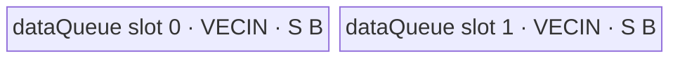

# ForeachExp A2/A3 ACLNN 算子知识

## 算子速览

| 项目 | 内容 |
|---|---|
| 实际入口 | 公开两段式 ACLNN：`aclnnForeachExpGetWorkspaceSize` → `aclnnForeachExp`；固定仓未提供生成式 inner bridge 源文件，`ForeachExp` OpDef 是可见的实际 Host 接线边界。 |
| 计算语义 | 对 TensorList 中第 `i` 个 Tensor 的每个有效元素计算 `y_i[j] = exp(x_i[j])`。 |
| 输入输出 | `x`/`out` 均为 ND TensorList；FLOAT16、FLOAT32、BFLOAT16；各 Tensor 0–8 维；输入可非连续并由 `AutoContiguous` 处理，输出必须连续。 |
| 执行类型 | 单 Kernel：`AIV_VECTOR`。 |
| Kernel 路线 | R-001 FLOAT16/FLOAT32 原 dtype 原地 UB 计算；R-002 BFLOAT16→FLOAT32→BFLOAT16 升精度计算。 |
| 核心资源 | TensorList GM 指针表、每核 GM 分片、`VECIN` 双缓冲；BFLOAT16 路线另有单深度 FLOAT32 Queue；无输出 Queue；Kernel 不消费 user workspace。 |
| 来源闭包 | `source_closed`：公开 ACLNN 文档 → 生成式 ACLNN/Executor 框架边界 → `ForeachExp` OpDef → arch22 Tiling → `ForeachCommonTilingData` → `foreach_exp` router → `ForeachImplictOutput`/直接基类 → 构建接线。 |
| 验证状态 | 已完成源码闭包检查；本次知识提取未执行编译、真机、数值或性能测试。 |

## 接口与语义

### 计算语义

令输入 TensorList 为 `x=[x_0,...,x_(n-1)]`，输出为 `y=[y_0,...,y_(n-1)]`。Kernel 对由 Tiling 分给当前 AIV core 的每个元素执行 `y_i[j]=e^(x_i[j])`。FLOAT16/FLOAT32 直接调用同 dtype Vector `Exp`；BFLOAT16 先转 FLOAT32、计算 FLOAT32 `Exp`，再以 `CAST_RINT` 转回 BFLOAT16。Kernel 只写与输入 `x_i` 元素数相同的前缀；公开接口允许 `out_i` 的 shape size 大于等于 `x_i`，额外输出区域不由该 Kernel 写入。

### 输入、输出与属性

| 参数 | shape/layout | dtype | 约束、默认值与语义 |
|---|---|---|---|
| `x` | TensorList；每个 Tensor 为 ND，0–8 维 | BFLOAT16、FLOAT16、FLOAT32；列表内一致 | 支持空 Tensor；允许非连续输入，OpDef 标记 `AutoContiguous()`。指针或 dtype 非法由第一段接口/Host 失败。 |
| `out` | TensorList；ND，0–8 维；每项 shape size ≥ 对应 `x` | 与 `x` 相同，列表内一致 | 支持空 Tensor；输出不支持非连续 Tensor；可见 infer-shape 路线默认复制输入 shape。 |
| `workspaceSize` | 标量输出 | `uint64_t*` | 第一段 ACLNN 返回 Executor 所需 Device workspace；算子 Tiling 预留 32 B，而 Kernel 明确将 `userWS=nullptr`。框架为非连续输入产生的 workspace 公式在固定仓不可见。 |
| `executor` | Host 句柄输出 | `aclOpExecutor**` | 第一段生成并持有执行流程，第二段消费。 |
| `workspace` | Device 地址 | `void*` | 第二段使用第一段返回的大小；owner 为调用者，至少活到该 stream 上执行完成。 |
| `stream` | Runtime stream | `aclrtStream` | 第二段在该 stream 上提交单个 ForeachExp Kernel 及可见框架前处理。 |

### 入口与版本

固定提交公开的最新入口为无版本后缀 `aclnnForeachExpGetWorkspaceSize`/`aclnnForeachExp`。文档明确支持 Atlas A2、A3，OpDef 注册 `ascend910b` 与 `ascend910_93`，Host CMake 将两者映射到 `arch22`，binary config 同时提供 FLOAT16/FLOAT32/BFLOAT16，Kernel CMake 也编译两 compute unit，平台证据一致。ACLNN inner bridge、Executor 装配及 `AutoContiguous` 实现由框架生成，固定仓不可见；不得把图接口另造为 ACLNN 实现。

## Host/Launcher 执行流程

### 参数校验与前处理

1. 第一段 ACLNN 检查 `x`/`out` 非空、支持 dtype 且二者 dtype 一致；公开错误还覆盖列表内 dtype 不一致、shape 不满足和维度大于 8。
2. `ForeachExp` OpDef 对动态输入/输出声明 FLOAT16/FLOAT32/BFLOAT16、ND，并为输入和输出声明 `AutoContiguous`；公开约束仍明确输出不得非连续。
3. `ForeachCommonTiling::Init(FOREACH_EXP_OP_CODE)` 依次读取最多 50 个动态输入实例，固定 `dataType`、`dataTypeSize`、每 32 B 元素数 `elementsPerBlock=32/dataTypeSize`、逐 Tensor storage numel 和总元素数。
4. `CheckOpInfo` 检查 TensorList 实例数、输入维度、输出 dtype/shape、列表内 dtype；ForeachExp 为单 TensorList 输入，不执行 scalar 分支。
5. 生成式 ACLNN bridge 的精确 `Contiguous` 调用、Executor 节点装配和返回码映射在固定仓不可见，作为框架边界保留。

### 参数、Workspace 与生命周期

Tiling 取平台 AIV core 数与 UB 容量。`needCoreNum=min(platformAivCoreNum, ceil(totalDataCount/elementsPerBlock), 50)`，总元素为 0 时强制 1；随后按 32 B block 将扁平元素域均匀分核，再映射回每核首尾 Tensor 与元素 offset。POD 保存所有 Tensor 元素数以及至多 50 核的首尾边界。Tiling workspace slot 固定为 32 B；Device entry 注释并实现为 `userWS=nullptr`，因此它不是 Kernel 数据边。ACLNN Executor/框架 workspace 由第一段接口拥有其计算结果，调用者分配，并保持至 stream 执行完成。

### 启动图与失败传播

```text
aclnnForeachExpGetWorkspaceSize(x, out)
  -> [生成式校验/AutoContiguous/Executor 装配：固定仓不可见]
  -> ForeachExp / Tiling4ForeachExpTiling
     -> ForeachCommonTiling::Init(26)
     -> ForeachCommonTiling::RunBigKernelTiling
  -> 返回 workspaceSize + executor
aclnnForeachExp(workspace, workspaceSize, executor, stream)
  -> K-001 foreach_exp<<<blockDim=needCoreNum, stream>>>(xList, yList, workspace, tiling)
```

K-001 是唯一 Device 节点：entry 为 `foreach_exp`，POD 为 `ForeachCommonTilingData`；输入、输出均通过 TensorList GM 指针表间接寻址。没有 Kernel 间边。相同 stream 提交保证框架前处理先于 K-001；生成式 bridge 的失败会阻断提交，Tiling 任一 null/shape/dtype/workspace 检查失败返回 `GRAPH_FAILED`。K-001 的 workspace 参数未被读取。

## Route 与参数设计

### 分核与资源计算

记 `N=sum_i numel(x_i)`，`E=32/sizeof(T)` 元素/32 B block，`B=ceil(N/E)`。`C=min(platformAivCoreNum,B,50)`，若 `B=0` 则 `C=1`。每核先得到 `floor(B/C)` 个 block，前 `B mod C` 核多一个 block，再由 `AssignDataToEachCore` 生成 `[tensorStart,tensorStartOffset]` 到 `[tensorEnd,tensorEndOffset]` 的闭区间。

POD 宏声明的字段负载总和为 `8 + 50*8 + 50*2 + 50*2 + 50*8 + 50*8 = 1408 B`；但 `BEGIN_TILING_DATA_DEF` 的生成/序列化宏实现不在固定仓，实际 `sizeof/alignof/offsetof` 及 `GetDataSize()` 是否含额外布局开销不可见。下文以 Host 实际返回的 `D=tilingData.GetDataSize()` 保留精确公式。令平台 UB 为 `U`，`S=inputsTensorUbSize`：

- FLOAT16/FLOAT32：`S=floor32((U-1024-D)/2)`；每个 `VECIN` slot 容量 `S`，depth=2，`maxDataCount=S/sizeof(T)`，`UB_total=2S`。
- BFLOAT16：先令 `Q=(U-1024-D)/10`，再 `S=floor64(Q/2)`；每个 dataQueue slot 容量 `9S`，depth=2，FLOAT32 Queue 容量 `S`，`UB_total=19S`；`maxDataCount=9S/2`，单次 cast 上限 `maxCastDataCount=S/4`。

### Route 选择

| 顺序 | Route | Key/模板 | 精确选择条件与优先级 | 不适用去向 |
|---:|---|---|---|---|
| 1 | R-001 原 dtype Vector Exp | key 1：`ForeachImplictOutput<half,half,Exp,2,1>`；key 2：`ForeachImplictOutput<float,float,Exp,2,1>` | `dataType==DT_FLOAT16` 得 key 1；否则 `dataType==DT_FLOAT` 得 key 2。 | BFLOAT16 进入 R-002；其它 dtype 的 key 为 0，entry 无匹配 body。 |
| 2 | R-002 BF16 升精度 Vector Exp | key 4：`ForeachImplictOutput<bfloat16_t,float,Exp,2,1>` | `dataType==DT_BF16`，且编译条件 `__CCE_AICORE__>=220` 且 NPU arch 不是 3003/3113。A2/A3 binary config 与 build 满足可达性。 | 不满足编译 guard 时无该分支；公开平台接线不发布这种组合。 |

```text
dtype FLOAT16 -> key 1 -> R-001<half>
else dtype FLOAT32 -> key 2 -> R-001<float>
else dtype BFLOAT16 -> key 4 -> R-002<bfloat16_t,float>
else -> key 0 / 无 router 分支 -> 无输出
```

### 模板/实现执行矩阵

| Route | key/selector | dtype/shape/platform 完整命中条件 | 执行拓扑与 Kernel 节点 | 实际模板/body | 内存与同步特征 | tail/fallback |
|---|---|---|---|---|---|---|
| R-001 原 dtype Vector Exp | 1 / 2 | A2/A3；ND；列表一致 FLOAT16/FLOAT32；每项 ≤8 维；输出 dtype 相同且 numel≥输入 | 单 K-001 AIV_VECTOR | `ForeachImplictOutput<T,T,Exp,2,1>` → `KernelForeachUnary` | `VECIN` depth 2；UB 内原地 `Exp`; `V_MTE3` 和 `MTE3_MTE2` event | 满 tile 用 `DataCopy`；最后不足 tile 用 byte-length `DataCopyPad`；无其它 fallback。 |
| R-002 BF16 升精度 Vector Exp | 4 | A2/A3；同上但 BFLOAT16；编译 guard 命中 | 单 K-001 AIV_VECTOR | `ForeachImplictOutput<bfloat16_t,float,Exp,2,1>` → BF16 `InnerComputer` specialization | BF16 dataQueue depth 2、每 slot `9S`；FLOAT32 Queue `S`；逐段 cast/Exp/cast 与 `PIPE_V` barrier | GM tail 同 R-001；cast 段尾由 `dataCount` 控制。 |

### 隐藏性能 Guard

| Guard | Host/Tiling 条件 | Device/资源原因 | 影响 Route | 不满足时去向 | 源码符号 |
|---|---|---|---|---|---|
| 32 B 分核 | `E=32/sizeof(T)`，`B=ceil(N/E)` | 让非尾核覆盖整 DMA block，只有每 Tensor/每核最终 tile 需要 pad copy | R-001/R-002 | `N=0` 强制 1 核且不进入 tile loop | `foreach_tiling_class.h::GetNeedCoreNum/AssignDataToEachCore` |
| Tensor/Core 固定上限 | `MAX_TENSOR_CONT=50`、`MAX_CORE_CONT=50` | POD 数组固定长，Device 以 `blockIdx` 直接索引 | R-001/R-002 | 核数截断为 50；固定源码对超过 50 个输入未见显式错误，只读取前 50 个 | `foreach_tiling_def.h`; `ForeachCommonTiling::Init` |
| UB 双缓冲上界 | 非 BF16 `S=floor32((U-1024-D)/2)`，`D=GetDataSize()` | 两个 dataQueue slot 必须同时容纳 tile | R-001 | 无独立 fallback；依赖有效平台 UB | `ForeachCommonTiling::DivideUbMemory8` |
| BF16 cast 空间 | BF16 `S=floor64(((U-1024-D)/10)/2)` | dataQueue 两个 `9S` slot，加 FLOAT32 Queue `S`，合计 `19S` | R-002 | 无 fallback | `DivideUbMemory8`; `KernelForeachBase::Init`; `KernelForeachUnary::Init` |
| BF16 编译 guard | `__CCE_AICORE__>=220 && arch!=3003/3113` | 该 specialization 需要 BF16 和 FLOAT32 cast 路径 | R-002 | router 不含 key 4 body | `op_kernel/foreach_exp.cpp::foreach_exp` |
| Vector 长度窄化 | tile `dataCount<=maxDataCount`，由 UB 容量限制 | `ImplictOutputOp` 的长度形参为 `const int32_t&`，而上层 tile count 为 `int64_t`；tail DMA byte length 又转 `uint32_t` | 两 Route | 无 fallback；复用时必须保持单 tile 长度在两种窄类型范围内 | `foreach_implict_output.h::ImplictOutputOp/InnerComputer::Compute`; `KernelForeachUnary::CopyIn` |
| 尾 tile | `dataCount % maxDataCount != 0` | GM byte数可非整 block，使用 pad-capable API 且只写有效字节 | 两 Route | `DataCopyPad`，无错误 | `KernelForeachUnary::CopyIn`; `ForeachImplictOutput::Compute` |

### POD/ABI

| 结构 | 字段 | 类型/位宽 | ABI 布局 | 单位 | Host/launcher producer | Device consumer | 边界 |
|---|---|---|---|---|---|---|---|
| `ForeachCommonTilingData` | `inputsTensorUbSize` | `uint64_t` / 64 | 宏声明第 1 字段，负载 8 B；实际 sizeof/alignof/offsetof 固定仓不可见 | 字节/单 slot 基准 `S` | `FillTilingData:set_inputsTensorUbSize(inputsTensorUbSize)` | `KernelForeachBase::ParseTilingData`; 推导 queue 与 tile 容量 | 非 BF16 32 B 向下对齐；BF16 64 B 向下对齐 |
| `ForeachCommonTilingData` | `tensorDataCountList` | `int64_t[50]` | 宏声明第 2 字段，负载 400 B；实际 offset 固定仓不可见 | 元素/每 Tensor | `Init: tensorDataCountList[i]=storageShape.GetShapeSize()` | `KernelForeachUnary::Process` 取得 Tensor 总元素 | 未读取的槽为 0；最多 50 |
| `ForeachCommonTilingData` | `tensorStartList` | `uint16_t[50]` | 宏声明第 3 字段，负载 100 B；实际 offset 固定仓不可见 | Tensor 索引/每 core | `AssignDataToEachCore` | `ParseTilingData[blockIdx]` | `blockIdx<blockDim≤50` |
| `ForeachCommonTilingData` | `tensorEndList` | `uint16_t[50]` | 宏声明第 4 字段，负载 100 B；实际 offset 固定仓不可见 | Tensor 索引/每 core | `AssignDataToEachCore` | `ParseTilingData[blockIdx]` | 闭区间终点 |
| `ForeachCommonTilingData` | `tensorStartOffsetList` | `int64_t[50]` | 宏声明第 5 字段，负载 400 B；实际 offset 固定仓不可见 | 元素/每 core | `AssignDataToEachCore` | `ParseTilingData[blockIdx]`；绑定 GM base | 非负起点 |
| `ForeachCommonTilingData` | `tensorEndOffsetList` | `int64_t[50]` | 宏声明第 6 字段，负载 400 B；实际 offset 固定仓不可见 | 元素/每 core | `AssignDataToEachCore` | `ParseTilingData[blockIdx]`；计算闭区间长度 | 空域可为 -1，使 `dataCount=0` |

### Route 源码闭包

| Route | Key/selector | Host/Tiling producer | POD/参数 | Kernel entry/router 节点 | Kernel body/直接依赖 | 构建接线 |
|---|---|---|---|---|---|---|
| R-001 | key 1/2 | `op_host/arch22/foreach_exp_tiling.cpp::Tiling4ForeachExpTiling`; `foreach_tiling_class.h::RunBigKernelTiling` | `ForeachCommonTilingData` | `op_kernel/foreach_exp.cpp::foreach_exp` | `ForeachImplictOutput::Compute`; `KernelForeachUnary::{Process,CopyIn}`; `KernelForeachBase::{Init,GetTensorAddr}` | `op_kernel/CMakeLists.txt::add_kernel_sources(ascend910b,ascend910_93)` |
| R-002 | key 4 | 同上；`common_dtype.h::GetTilingKeyByDtypeOnly` | 同结构；BF16 的 `inputsTensorUbSize` 公式不同 | `foreach_exp` 的 BF16 编译 guard 分支 | `InnerComputer<bfloat16_t,float>::{Compute,ComputePerCast}` 及同一基类 | 同上；两平台 binary config 含 BF16 |

## Kernel 实现

### 公共执行流程

entry 解包 POD，将 workspace 丢弃并按 key 构造 `ForeachImplictOutput`。`KernelForeachBase::Init` 用 `GetBlockIdx()` 读取本核首尾 Tensor/offset；TensorList 首字保存指针数组相对偏移，`GetTensorAddr` 右移 3 位换算成 `uint64_t` 索引，再取第 `i` 个真实 GM 地址。每核按 Tensor 顺序处理自己的闭区间；每个 Tensor 再以 `maxDataCount` 切 tile。每 tile 进入 dataQueue，`Exp` 原地覆盖同一 LocalTensor，经 `V_MTE3` event 后直接写 GM，再以 `MTE3_MTE2` event 防止下次 CopyIn 提前覆盖。单 Kernel、无 workspace 数据边。

### Route R-001：原 dtype Vector Exp

#### 适用条件

##### 选择证据

| 层级 | 文件 | 符号 | 源码谓词/参数 | 结果/下一跳 |
|---|---|---|---|---|
| ACLNN | `foreach/foreach_exp/docs/aclnnForeachExp.md` | `aclnnForeachExpGetWorkspaceSize/aclnnForeachExp` | FLOAT16/FLOAT32、ND、0–8 维 | 进入 ForeachExp Executor |
| Host | `foreach/foreach_utils/op_host/common_dtype.h` | `GetTilingKeyByDtypeOnly` | FLOAT16→1，FLOAT32→2 | 设置 TilingKey |
| Router | `foreach/foreach_exp/op_kernel/foreach_exp.cpp` | `foreach_exp` | `TILING_KEY_IS(1)` 或 `(2)` | 实例化 half 或 float body |

#### Device 数据流

##### 函数级调用链

```text
foreach_exp(xList, yList, workspace, tiling)
  -> ForeachImplictOutput<T,T,Exp,2,1>::Init
     -> KernelForeachUnary::Init -> KernelForeachBase::Init/ParseTilingData
  -> KernelForeachUnary::Process
     -> GetTensorAddr(x/y) -> SingleTensorProcess
        -> CopyIn -> ForeachImplictOutput::Compute
           -> InnerComputer<T,T,Exp,1>::Compute -> Exp(dataLocal,dataLocal,count)
           -> V_MTE3 event -> DataCopy/DataCopyPad GM -> MTE3_MTE2 event
```

##### 源码等价伪码

```text
# 源码等价伪码
core = GetBlockIdx()
load (tensorStart, tensorEnd, startOffset, endOffset) from POD[core]
for tensor i in inclusive [tensorStart, tensorEnd]:
    begin = (i == tensorStart) ? startOffset : 0
    end   = (i == tensorEnd) ? endOffset : tensorDataCountList[i]-1
    count = end-begin+1
    xGM = tensor_list_addr(xList,i)+begin
    yGM = tensor_list_addr(yList,i)+begin
    for tile in ceil(count/maxDataCount):
        valid = min(maxDataCount, count-tile*maxDataCount)
        local = dataQueue.AllocTensor<T>()
        CopyIn xGM[tile*maxDataCount : +valid]   # tail uses DataCopyPad bytes
        Exp(local, local, valid)
        event V_MTE3
        CopyOut local -> yGM[tile*maxDataCount : +valid]
        event MTE3_MTE2
        dataQueue.FreeTensor(local)
```

#### 内存与数据搬运

##### 资源与搬运表

| 层级/缓冲区 | offset/地址公式 | extent/容量公式 | dtype/layout | producer | consumer | owner/lifetime | 对齐/复用 |
|---|---|---|---|---|---|---|---|
| x TensorList GM | `base + (*(uint64*)base >> 3)`, then slot `i`; data `+cursorStart+tile*maxDataCount` | `valid` 元素 | T/ND | ACLNN caller/framework | CopyIn | caller；执行期间有效 | 满 tile 常规 copy；tail 按字节 |
| dataQueue slot 0/1 | TPipe 分配 | 每 slot `S` B，depth=2 | half 或 float/线性 | CopyIn | Vector `Exp`、CopyOut | Kernel；Alloc→EnQue→DeQue→Free | `Exp` 原地复用 input slot |
| y TensorList GM | 与 x 同指针表公式；`+cursorStart+tile*maxDataCount` | `valid` 元素 | T/ND | Kernel CopyOut | 下游/调用者 | caller | 仅有效输入前缀被写 |
| workspace | N/A | Kernel 0 B | N/A | N/A | N/A | entry 将 `userWS=nullptr` | Tiling slot 32 B 不参与数据流 |

##### 分层内存布局



##### 字节账与复用顺序

```text
S = floor32((platform_UB - 1024 - D) / 2), D=tilingData.GetDataSize()
UB_total = depth(2) * S = 2S
UB_total <= platform_UB - 1024 - POD_size
dynamic_ub = N/A（AIV TPipe 静态 UB 路径）
workspace_total(kernel-visible) = 0 B；Tiling workspace slot = 32 B
=> maxDataCount = S / sizeof(T)
```

| 复用子区 | 写入者 | 读取者/消费点 | 下一次覆盖 | 同步或释放依据 | 安全条件 |
|---|---|---|---|---|---|
| 当前 dataQueue slot | `CopyIn` | `Exp` 后由 MTE3 读出 | slot 下一次被 `AllocTensor` | `V_MTE3` 等待计算完成后 CopyOut；`MTE3_MTE2` 等待搬出后才释放/重载 | 不能在 MTE3 完成前重载；depth=2 按 Queue 生命周期轮换 |
| `dataLocal` 元素区 | CopyIn 输入 | `Exp` 同时作为 src/dst | `Exp` 原地写回，随后 CopyOut | Vector API 完成由 `V_MTE3` event 建立可见性 | src/dst 完全同址且有效长度均为 `dataCount` |

#### 同步、精度与尾块

##### 同步与数值边界表

| 阶段 | primitive/机制 | producer | consumer/等待点 | 保护对象 | 精度/尾块 |
|---|---|---|---|---|---|
| GM→UB | TQue EnQue/DeQue | MTE2 CopyIn | `ForeachImplictOutput::Compute` | 当前 slot | tail：`blockCount=1, blockLen=dataCount*sizeof(T)`，无 padding 写入结果 |
| UB 计算 | `Exp(dst=local,src=local,count)` | Vector | `SetFlag/WaitFlag<V_MTE3>` | 原地结果 | FLOAT16/FLOAT32 均在原 dtype 路径计算；无显式 cast |
| UB→GM | `V_MTE3` event | Vector `Exp` | MTE3 DataCopy | 结果 LocalTensor | tail 只搬有效字节 |
| slot 再用 | `MTE3_MTE2` event | CopyOut | 后续 CopyIn/Free | 同一物理 slot | 防止搬出尚未结束即覆盖 |

#### 关键实现

##### 符号证据表

| 阶段 | 文件 | 符号/模板实例 | 实现事实 |
|---|---|---|---|
| Host/Tiling producer | `foreach/foreach_utils/op_host/foreach_tiling_class.h` | `RunBigKernelTiling/AssignDataToEachCore/DivideUbMemory8` | 生产 key、blockDim、每核范围、S 与 32 B workspace |
| Kernel entry/router | `foreach/foreach_exp/op_kernel/foreach_exp.cpp` | `foreach_exp`; key 1/2 | 映射至 half/float `ForeachImplictOutput` |
| Device body/helper | `foreach/foreach_utils/op_kernel/foreach_implict_output.h` | `InnerComputer<T,T,Exp,1>::Compute`; `ForeachImplictOutput::Compute` | 原地 Exp、event 与直接 GM 输出 |
| Device body/helper | `foreach/foreach_utils/op_kernel/kernel_foreach_unary.h` | `Process/SingleTensorProcess/CopyIn` | core→Tensor→tile 循环和 tail DMA |

### Route R-002：BF16 升精度 Vector Exp

#### 适用条件

##### 选择证据

| 层级 | 文件 | 符号 | 源码谓词/参数 | 结果/下一跳 |
|---|---|---|---|---|
| ACLNN | `foreach/foreach_exp/docs/aclnnForeachExp.md` | 两段式入口 | BFLOAT16、ND、0–8 维，A2/A3 支持 | 进入 ForeachExp Executor |
| Host | `foreach/foreach_utils/op_host/common_dtype.h` | `GetTilingKeyByDtypeOnly` | `DT_BF16` | key 4 |
| Router | `foreach/foreach_exp/op_kernel/foreach_exp.cpp` | `foreach_exp` | key 4 且 `__CCE_AICORE__>=220 && arch!=3003/3113` | `ForeachImplictOutput<bfloat16_t,float,Exp,2,1>` |

#### Device 数据流

##### 函数级调用链

```text
foreach_exp -> ForeachImplictOutput<bfloat16_t,float,Exp,2,1>::Init/Process
  -> KernelForeachBase::Init (totalTensorUbSize=9S, maxCastDataCount=S/4)
  -> KernelForeachUnary::CopyIn
  -> InnerComputer<bfloat16_t,float,Exp,1>::Compute
     -> per cast segment: PIPE_V barrier -> Cast BF16→FLOAT32
        -> PIPE_V -> Exp(float32,float32,count)
        -> PIPE_V -> Cast FLOAT32→BF16(CAST_RINT) -> PIPE_V
  -> V_MTE3 event -> CopyOut -> MTE3_MTE2 event
```

##### 源码等价伪码

```text
# 源码等价伪码；core/Tensor/tile 地址循环同 R-001
S = POD.inputsTensorUbSize
maxDataCount = 9S / sizeof(bfloat16_t)
maxCastDataCount = S / sizeof(float)
for each GM tile of at most maxDataCount BF16 elements:
    DataCopy[Pad] BF16 -> dataLocal
    for castSeg in ceil(valid/maxCastDataCount):
        n = min(maxCastDataCount, valid-castSeg*maxCastDataCount)
        PIPE_V; Cast(floatTmp, dataLocal[castSeg*maxCastDataCount], CAST_NONE, n)
        PIPE_V; Exp(floatTmp, floatTmp, n)
        PIPE_V; Cast(dataLocal[castSeg*maxCastDataCount], floatTmp, CAST_RINT, n); PIPE_V
    event V_MTE3; DataCopy[Pad] dataLocal -> yGM; event MTE3_MTE2
```

#### 内存与数据搬运

##### 资源与搬运表

| 层级/缓冲区 | offset/地址公式 | extent/容量公式 | dtype/layout | producer | consumer | owner/lifetime | 对齐/复用 |
|---|---|---|---|---|---|---|---|
| x/y GM | 同 R-001 | 每 tile ≤`9S/2` 元素 | BF16/ND | caller/Kernel | Kernel/caller | caller | GM tail 按有效字节 |
| dataQueue slot 0/1 | TPipe | 每 slot `9S` B，depth=2 | BF16/线性 | CopyIn | cast 与 CopyOut | Kernel | 同一 BF16 slot 最终被 cast 结果原地覆盖 |
| float32Queue | TPipe | `S` B，depth=1 | FLOAT32/线性 | BF16 Cast | `Exp` 与回 cast | Kernel；Process 开始 DeQue，结束 Free | 每 cast segment 复用同一 `S` B |
| workspace | N/A | 0 B Kernel 可见 | N/A | N/A | N/A | N/A | 同 R-001 |

##### 分层内存布局


##### 字节账与复用顺序

```text
S = floor64(((platform_UB - 1024 - D) / 10) / 2), D=tilingData.GetDataSize()
UB_total = depth(2) * 9S + depth(1) * S = 19S
UB_total <= platform_UB - 1024 - D
dynamic_ub = N/A（AIV TPipe 静态 UB 路径）
workspace_total(kernel-visible) = 0 B；Tiling workspace slot = 32 B
=> maxDataCount=9S/2; maxCastDataCount=S/4
```

| 复用子区 | 写入者 | 读取者/消费点 | 下一次覆盖 | 同步或释放依据 | 安全条件 |
|---|---|---|---|---|---|
| float32Queue `S` B | BF16→FLOAT32 Cast | FLOAT32 `Exp`、FLOAT32→BF16 Cast | 下一 cast segment | 每个 Cast/Exp 之间 `PipeBarrier<PIPE_V>` | segment 元素数 ≤`S/4` |
| dataQueue 当前 BF16 segment | GM CopyIn | BF16→FLOAT32 Cast | FLOAT32→BF16 Cast 原地写回 | `PIPE_V` barriers | 回写 offset 与读取 segment 相同 |
| dataQueue slot | 同 R-001 | MTE3 CopyOut | 下一 tile | `V_MTE3`、`MTE3_MTE2` | 搬出完成后才释放 |

#### 同步、精度与尾块

##### 同步与数值边界表

| 阶段 | primitive/机制 | producer | consumer/等待点 | 保护对象 | 精度/尾块 |
|---|---|---|---|---|---|
| BF16→F32 | `PipeBarrier<PIPE_V>` + `Cast(...CAST_NONE)` | dataLocal | FLOAT32 Exp | float32Queue | 有效 `n`，segment tail 不读无效 lane |
| F32 Exp | `Exp(floatTmp,floatTmp,n)` | Cast | 回 Cast 前 `PIPE_V` | float32Queue | 指数在 FLOAT32 执行 |
| F32→BF16 | `Cast(...CAST_RINT)` | Exp | `PIPE_V` 后 V_MTE3 | dataLocal 对应 segment | 显式 round-to-nearest-integer 模式枚举 `CAST_RINT` |
| GM tail/slot | DataCopyPad + events | CopyIn/Vector | CopyOut/下一 CopyIn | 当前 tile | 只搬 `dataCount*sizeof(BF16)` 有效字节 |

#### 关键实现

##### 符号证据表

| 阶段 | 文件 | 符号/模板实例 | 实现事实 |
|---|---|---|---|
| Host/Tiling producer | `foreach/foreach_utils/op_host/foreach_tiling_class.h` | `DivideUbMemory8` BF16 分支 | 10 倍衰减、二分和 64 B 对齐生成 S |
| Kernel entry/router | `foreach/foreach_exp/op_kernel/foreach_exp.cpp` | key 4 branch | 编译 guard 与 BF16/FLOAT32 模板实参 |
| Device body/helper | `foreach/foreach_utils/op_kernel/kernel_foreach_base.h` | `KernelForeachBase<bfloat16_t>::Init` | `totalTensorUbSize=9S`、两类 tile 上限 |
| Device body/helper | `foreach/foreach_utils/op_kernel/foreach_implict_output.h` | BF16 `InnerComputer::ComputePerCast` | 四个 PIPE_V barrier、cast/Exp/cast 顺序与 RINT |

## 算子特定优化

### Trick T-001：输入 Queue 原地物化输出并直接搬回 GM

#### 触发与源码依据

- 适用 Route：R-001、R-002。
- 触发条件：所有公开 dtype；`ForeachImplictOutput` 固定以 `needCopyOut=false` 继承 `KernelForeachUnary`。
- Golden 来源：[`foreach/foreach_utils/op_kernel/foreach_implict_output.h:97-104`](https://gitcode.com/cann/ops-nn/blob/955f8b33985b6d72989ebff341bb9c2c564a51bc/foreach/foreach_utils/op_kernel/foreach_implict_output.h#L97-104)

**官方源码（固定 Commit 连续逐字摘录）**：

```cpp
        LocalTensor<T> dataLocal = Base::dataQueue.template DeQue<T>();
        InnerComputer<T, P, op, paramsCount> computer;
        computer.Compute(dataLocal, float32Tensor, Base::maxCastDataCount, dataCount);

        // Transport can be performed only after the Muls is complete.
        event_t eventIDVToMTE3 = static_cast<event_t>(GetTPipePtr()->FetchEventID(HardEvent::V_MTE3));
        SetFlag<HardEvent::V_MTE3>(eventIDVToMTE3);
        WaitFlag<HardEvent::V_MTE3>(eventIDVToMTE3);
```

#### 机制与设计原因

`InnerComputer` 将 `dataLocal` 同时作为 `Exp` 的 src/dst；BF16 路线也把降精度结果写回同一 BF16 segment。随后 body 不经过 `VECOUT` Queue，而在 `V_MTE3` 同步后直接从 dataQueue slot 搬到 GM。这样可从源码证明省去一个输出 Queue 和一次 UB 中间物化；`needCopyOut=false` 使基类 `InitBuffer(outQueue,...)` 在编译期不执行。

#### 迁移边界

- 适用：输出与输入逐元素一一对应、Vector API 允许 src/dst 同址、CopyOut 可在计算后直接消费输入 Queue 的 unary 算子。
- 前提：必须保留 `V_MTE3` 与 `MTE3_MTE2` 顺序，输出 dtype/长度与当前 tile 对应；BF16 还须完成所有 segment 回 cast。
- 失效：需要同时保留原输入、不同输出容量、多输出或不支持原地 Vector API 时必须分配独立输出存储。
- 未验证：本次知识提取未执行编译、真机、数值或性能测试。

#### 错误做法

固定仓未提供可验证反例；源码同步关系表明，在 `V_MTE3` 前搬出或在 `MTE3_MTE2` 前重载同一 slot 会破坏 producer/consumer 顺序。

### Trick T-002：BF16 分段升到 FLOAT32 复用单个临时区

#### 触发与源码依据

- 适用 Route：R-002。
- 触发条件：`T=bfloat16_t`，`P=float`，`paramsCount=1`。
- Golden 来源：[`foreach/foreach_utils/op_kernel/foreach_implict_output.h:65-71`](https://gitcode.com/cann/ops-nn/blob/955f8b33985b6d72989ebff341bb9c2c564a51bc/foreach/foreach_utils/op_kernel/foreach_implict_output.h#L65-71)

**官方源码（固定 Commit 连续逐字摘录）**：

```cpp
        PipeBarrier<PIPE_V>();
        Cast(float32Tensor, dataLocal[index * maxCastDataCount], RoundMode::CAST_NONE, dataCount);
        PipeBarrier<PIPE_V>();
        uint32_t offset = (paramsCount == 1) ? 0 : maxCastDataCount;
        op(float32Tensor[offset], float32Tensor, dataCount);
        PipeBarrier<PIPE_V>();
        Cast(dataLocal[index * maxCastDataCount], float32Tensor[offset], RoundMode::CAST_RINT, dataCount);
```

#### 机制与设计原因

一个 GM tile 可达 `9S/2` 个 BF16 元素，但 FLOAT32 临时区只有 `S` B；`maxCastDataCount=S/4` 将 tile 分段。每段依次 cast→Exp→cast 并复用同一 FLOAT32 Queue，因此无需为整个 BF16 tile 物化 FLOAT32 副本，同时保持指数计算为 FLOAT32。`paramsCount=1` 令 `offset=0`，Exp 也在临时区原地执行。

#### 迁移边界

- 适用：低精度输入、需要高精度 unary 计算、允许分段且各段独立的算子。
- 前提：Host 的 `S` 与 Device `maxCastDataCount` 公式一致；segment 之间保持 `PIPE_V` barrier；降精度 round 模式符合语义。
- 失效：需要跨 segment 归约/状态或无法原地回写时，必须扩大临时区或改变算法。
- 未验证：本次知识提取未执行编译、真机、数值或性能测试。

#### 错误做法

固定仓未提供可验证反例；删除 barrier 或以 BF16 直接执行该 specialization 都不符合固定源码的精度/生命周期协议。

## 模板与实现对比

| 对比维度 | R-001 原 dtype Vector Exp | R-002 BF16 升精度 Vector Exp | 设计选择依据 |
|---|---|---|---|
| 命中条件/优先级 | key 1 FLOAT16；key 2 FLOAT32 | key 4 BFLOAT16 + 编译 guard | 仅由 dtype 选择，无 shape fallback |
| 模板与 dtype | `<half,half>` / `<float,float>` | `<bfloat16_t,float>` | BF16 使用 FLOAT32 `Exp` |
| 循环与分核 | 32 B block 均匀分核，Tensor→tile | 同；tile 内再分 cast segment | BF16 临时区容量小于 BF16 tile |
| Queue/TBuf/寄存器/dynamic UB/通信 window | VECIN depth2，每 slot S；无 outQueue | VECIN depth2，每 slot 9S；FLOAT32 Queue S | 编译期 `needCopyOut=false` 消除输出 Queue |
| 内存总占用与复用 | 2S；dataLocal 原地 | 19S；dataLocal 与 FLOAT32 临时区都原地复用 | Host BF16 10 倍衰减保证上界 |
| 搬运/Vector/SIMT/NDDMA/通信 API | DataCopy/Pad、Vector Exp | DataCopy/Pad、Cast、Vector Exp、Cast | 均为 AIV_VECTOR |
| 同步、精度与 tail | V_MTE3/MTE3_MTE2；原 dtype；byte tail | 另加 PIPE_V；F32 计算/RINT；双层 tail | 精度路线不同 |
| fallback/失败边界 | 未知 key 无 body | guard 缺失则无 key4 body | Host 公共校验失败即终止 |

## 平台差异

| 项目 | A2 | A3 | 950 |
|---|---|---|---|
| 支持状态 | 支持；`ascend910b` | 支持；`ascend910_93` | 支持，但使用独立 `_950` 卡 |
| Host/Launcher | 共用 arch22 `ForeachCommonTiling` | 共用 arch22 `ForeachCommonTiling` | arch35 自定义 Tiling，最多 256 Tensor，workspace 0 |
| Kernel/资源 | 共用 AIV_VECTOR body | 共用 AIV_VECTOR body | SIMT，1024 threads/block，不使用 AIV Queue |

## 限制与失败边界

- 公开接口要求 `x`/`out` 非空指针、dtype 为 FLOAT16/FLOAT32/BFLOAT16 且相同、列表内 dtype 一致、每 Tensor ≤8 维；输出 shape size 不得小于输入，输出必须连续。
- arch22 POD 只能表达 50 个 Tensor 与 50 个 core。`Init` 循环在 50 停止，固定源码未见对第 51 个输入的显式拒绝；复用实现时不得假设更大列表已被安全覆盖。
- `AssignDataToEachCore`、POD 与 Device 地址采用 `int64_t` 元素计数，但 `maxDataCount` 为 `uint32_t`；tile 由 UB 限制，单 Tensor 总长通过多 tile 处理。
- Vector `Exp` 的函数指针长度类型是 `int32_t`，tail DMA byte length 显式窄化到 `uint32_t`；固定实现依赖 UB 限定单 tile 足够小，未提供超界 fallback。
- unknown/0 TilingKey 在 entry 中没有 `else` 错误分支，会静默不执行 body；公开 dtype 校验与 binary config 是防线。
- ACLNN 生成式 inner bridge、输入 Contiguous 临时空间的精确大小、Executor cleanup 和运行时 launch 错误映射在固定仓不可见；只将它们标作框架边界，不推测公式。
- 本次知识提取未执行编译、真机、数值或性能测试。

## 源码索引

### 链路索引

| 链路阶段 | 文件 | 关键符号 | 支撑内容 |
|---|---|---|---|
| 入口声明/约束 | `foreach/foreach_exp/docs/aclnnForeachExp.md` | `aclnnForeachExpGetWorkspaceSize/aclnnForeachExp` | 两段式原型、平台、dtype/shape/连续性与错误语义 |
| 入口实现 | `foreach/foreach_exp/op_host/foreach_exp_def.cpp` | `ops::ForeachExp`; `OP_ADD` | 动态输入输出、AutoContiguous、A2/A3 config |
| Host/Tiling/Launcher | `foreach/foreach_exp/op_host/arch22/foreach_exp_tiling.cpp` | `Tiling4ForeachExpTiling` | ForeachExp opcode 与公共 Tiling 入口 |
| Host/Tiling/Launcher | `foreach/foreach_utils/op_host/foreach_tiling_class.h` | `ForeachCommonTiling` | 校验、分核、UB、POD 与 workspace producer |
| Host/Tiling/Launcher | `foreach/foreach_utils/op_host/foreach_tiling_def.h` | `ForeachCommonTilingData`; registration | POD 字段与 ForeachExp 注册 |
| Host/Tiling/Launcher | `foreach/foreach_utils/op_host/common_dtype.h` | `GetTilingKeyByDtypeOnly` | dtype→key 与对齐常量 |
| Host/Tiling/Launcher | `foreach/foreach_utils/op_host/foreach_infershape.cpp` | `InferShape4ForeachCommon`; ForeachExp registration | 输出数匹配与逐项 shape/dtype 推导 |
| Kernel entry/body | `foreach/foreach_exp/op_kernel/foreach_exp.cpp` | `foreach_exp` | key→模板 router |
| Kernel entry/body | `foreach/foreach_utils/op_kernel/kernel_foreach_base.h` | `KernelForeachBase` | POD 解析、TensorList 间接寻址、BF16 容量 |
| Kernel entry/body | `foreach/foreach_utils/op_kernel/kernel_foreach_unary.h` | `KernelForeachUnary` | Queue 分配、Tensor/tile 循环和 CopyIn |
| Kernel entry/body | `foreach/foreach_utils/op_kernel/foreach_implict_output.h` | `ForeachImplictOutput`; `InnerComputer` | Exp、cast、同步、原地复用与直接 CopyOut |
| 构建接线 | `foreach/foreach_exp/op_host/CMakeLists.txt` | `SUPPORT_COMPUTE_UNIT/SUPPORT_TILING_DIR` | A2/A3 Host 均选择 arch22 Tiling |
| 构建接线 | `foreach/foreach_exp/op_host/config/ascend910b/foreach_exp_binary.json` | `ForeachExp` op_list | A2 三 dtype binary 条目 |
| 构建接线 | `foreach/foreach_exp/op_host/config/ascend910_93/foreach_exp_binary.json` | `ForeachExp` op_list | A3 三 dtype binary 条目 |
| 构建接线 | `foreach/foreach_exp/op_kernel/CMakeLists.txt` | `add_kernel_sources` | A2/A3 共用 Kernel source |

### 实现复用检查

| 检查项 | 可复用事实 | 不得改变的约束 | 源码符号 |
|---|---|---|---|
| ABI/POD | 用固定数组表达逐 Tensor numel 与逐核闭区间 | 字段顺序、50 长度、64/16 位宽和闭区间语义 | `ForeachCommonTilingData`; `ParseTilingData` |
| 调用顺序 | TensorList→每核 Tensor 区间→tile→CopyIn/Compute/CopyOut | key 先于模板实例；空域不得进入 DMA | `RunBigKernelTiling`; `KernelForeachUnary::Process` |
| workspace/内存 | 输入 Queue 原地输出；BF16 单临时区分段复用 | `S`、depth=2、BF16 `9S+S` 关系和 32/64 B 对齐 | `DivideUbMemory8`; `InitBuffer` |
| 同步 | Queue 生命周期加两类 hard event；BF16 加 PIPE_V | 不能删除 producer→consumer 等待 | `ForeachImplictOutput::Compute/ComputePerCast` |
| 精度与尾块 | half/float 原 dtype；BF16 走 F32+RINT；tail 按有效字节 | cast 顺序、round mode、`dataCount` 与 GM offset | `InnerComputer`; `CopyIn`; `Compute` |
| 失败边界 | Host 校验失败终止；unknown key 无 body | 不得依赖 silent no-op；不得越过 50 项 POD | `CheckOpInfo`; `foreach_exp` router |
