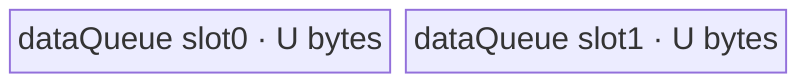

# ForeachExpm1 A2/A3 ACLNN 算子知识

## 算子速览

| 项目 | 内容 |
|---|---|
| 实际入口 | `aclnnForeachExpm1GetWorkspaceSize` + `aclnnForeachExpm1`，公开两段式 ACLNN；固定仓未见更高版本后缀。 |
| 计算语义 | 对列表中每个张量逐元素计算 `y_i[j] = exp(x_i[j]) - 1`。 |
| 输入输出 | `x`/`out` 为等长 TensorList；ND；各 Tensor dtype 一致且输入输出同 dtype，支持 FP16/FP32/BF16；输入支持非连续，输出必须连续；rank 0–8。 |
| 执行类型 | 单 Kernel，节点 K1 为 `AIV_VECTOR`。 |
| Kernel 路线 | R-001 FP16 原 dtype Vector；R-002 FP32 原 dtype Vector；R-003 BF16→FP32→BF16 Vector。 |
| 核心资源 | GM TensorList 指针表、`VECIN` 双缓冲 `dataQueue`；BF16 另有单缓冲 `float32Queue`；不分配 `VECOUT`；Tiling 声明 32 B workspace，但 Kernel 显式忽略。 |
| 来源闭包 | `source_closed`：公开 ACLNN 文档→框架生成的两段式 bridge 边界→`ForeachExpm1` OpDef/InferShape→arch22 Tiling/POD→`foreach_expm1` entry→公共 unary body/直接 helper→A2/A3 构建与 binary config 已闭合。 |
| 验证状态 | 已完成源码闭包检查；本次知识提取未执行编译、真机、数值或性能测试。 |

## 接口与语义

### 计算语义

设 `x=[x_0,...,x_{n-1}]`，对每个 Tensor `x_i` 的每个有效线性元素 `j`，输出 `y_i[j]=e^{x_i[j]}-1`。Kernel 按 storage shape 的元素数划分线性域，不改变 TensorList 顺序或 ND 逻辑 shape。A2/A3 的 FP16/FP32 路径在原 dtype 上调用 `Exp` 和 `Adds(-1)`；BF16 路径先升为 FP32，完成相同的原地两步计算，再用 `CAST_RINT` 降回 BF16。

### 输入、输出与属性

| 参数 | shape/layout | dtype | 约束、默认值与语义 |
|---|---|---|---|
| `x` | TensorList；每个 Tensor 为 ND，rank 0–8 | FP16、FP32、BF16 | 非空指针；支持空 Tensor；列表内所有 Tensor dtype 相同；OpDef `AutoContiguous()` 允许框架把非连续输入转连续。 |
| `out` | 与 `x` 对应的 TensorList；ND，rank 0–8 | 与 `x` 相同 | 非空指针；输出不支持非连续；公开 ACLNN 文档允许对应输出 shape size ≥ 输入，图模式 InferShape 则复制输入 shape；Kernel 只写输入元素数。 |
| `workspaceSize` | 标量输出 | `uint64_t*` | 第一段返回 executor 总 Device workspace；arch22 算子节点 slice 写 32 B，输入 Contiguous 等框架节点是否追加空间在固定仓生成层不可见。 |
| `executor` | 执行器输出 | `aclOpExecutor**` | 第一段构造，第二段消费。 |
| `workspace`/`stream` | Device 地址/流 | N/A | 第二段按同一 executor 和 `workspaceSize` 启动；Kernel 不消费用户 workspace，执行顺序由传入 stream 保证。 |

### 入口与版本

公开入口是无版本后缀的 `aclnnForeachExpm1GetWorkspaceSize`/`aclnnForeachExpm1`。固定仓公开文档给出原型、错误码和 A2/A3 产品支持；仓内未保存自动生成的 ACLNN inner bridge C++，该段作为框架边界，不补造实现。实际算子节点为 `ForeachExpm1`：OpDef 注册 `ascend910b` 与 `ascend910_93`，Host CMake 将二者都映射到 `arch22`，binary config 为三种公开 dtype 接线。

## Host/Launcher 执行流程

### 参数校验与前处理

1. 第一段 ACLNN 检查 `x`、`out` 非空，dtype 属于 FP16/FP32/BF16、输入输出同 dtype、列表内部 dtype 一致、rank ≤ 8，以及对应输出元素数不小于输入；错误分别落到公开文档列出的 `ACLNN_ERR_PARAM_NULLPTR`、`ACLNN_ERR_PARAM_INVALID` 或 `ACLNN_ERR_INNER_TILING_ERROR`。
2. OpDef 对动态输入/输出均声明 ND 与 `AutoContiguous()`；公开约束只允许输入非连续，输出必须连续。自动生成的 contiguous/executor bridge 在固定仓不可见。
3. 图侧 `InferShape4ForeachCommon` 要求动态输入实例数等于输出数，逐项复制 shape；`InferDataType4ForeachCommon` 逐项复制 dtype。
4. `Tiling4ForeachExpm1Tiling` 构造 `ForeachCommonTiling`，以 `ZERO_OP_CODE` 初始化并运行 `RunBigKernelTiling`；任一 shape/dtype/实例检查、workspace 指针获取失败均返回 `GRAPH_FAILED`。

### 参数、Workspace 与生命周期

Host 以每个输入 storage shape 的 `GetShapeSize()` 生成 `tensorDataCountList[i]` 与 `totalDataCount`，以首个输入 dtype 生成 `dataTypeSize` 和 `elementsPerBlock=32/dataTypeSize`。Tiling POD 随 executor 保持到 launch；输入、输出与调用者申请的 workspace 至少覆盖 stream 上 Kernel 完成时刻。算子节点 `workspaces[0]=32`，但 entry 将 `userWS=nullptr` 传给实现，所以这 32 B 不形成 K1 的读写边；ACLNN executor 若包含输入 Contiguous，公开总 workspace 还可能含框架 slice，其公式固定仓不可见。

### 启动图与失败传播

```text
aclnnForeachExpm1GetWorkspaceSize
  -> 生成/准备 ForeachExpm1 executor（固定仓框架边界）
  -> Tiling4ForeachExpm1Tiling -> ForeachCommonTiling::RunBigKernelTiling
aclnnForeachExpm1(workspace, workspaceSize, executor, stream)
  -> K1: foreach_expm1<<<blockDim=needCoreNum, stream>>>(xList, yList, workspace, tiling)
       -> ForeachImplictOutput<...>::Process
```

K1 是唯一 Device 节点，POD 为 `ForeachCommonTilingData`；输入边是 `x` TensorList 指针表及各 Tensor GM，输出边是 `out` 指针表及各 Tensor GM。没有 Kernel 间 workspace 边。Host/Tiling 失败阻断 launch；entry 对未知 key 没有显式报错分支，因此正确 key 必须由 Host 保证。`AUTO_SYNC false` 表示构建不插入自动同步，节点完成可见性依赖调用 stream；框架 launch 返回传播方式在固定仓生成层不可见。

## Route 与参数设计

### 分核与资源计算

令 `E=sum_i numel_i`，`s=sizeof(T)`，`epb=32/s`。Host 先算 `B=ceil(E/epb)` 个 32 B block，源码实际为 `needCoreNum=min(AIV_core_num,max(1,B),50)`；正常平台要求 `AIV_core_num>0`，固定函数未显式检查 0。每核基础元素数为 `floor(B/needCoreNum)*epb`，前 `B mod needCoreNum` 个核再多 `epb` 个元素；`AssignDataToEachCore` 将拼接线性域还原为每核 `[tensorStart,tensorEnd]` 及两端 offset。

令 `P=ForeachCommonTilingData::GetDataSize()`、`U=inputsTensorUbSize`。FP16/FP32：`U=floor32((UB-P)/2)`；BF16：先 `(UB-P)/10`，再除 2 并向下 64 B 对齐，即源码整数运算等价于 `U=floor64(floor((UB-P)/10)/2)`。每个 Tensor 段再按 `maxDataCount` 切 tile：原 dtype路径 `maxDataCount=U/s`；BF16 为 `maxDataCount=9U/2`、每次升精度子块 `maxCastDataCount=U/4`。所有除法均为整数向下取整。

### Route 选择

| 顺序 | Route | Key/模板 | 精确选择条件与优先级 | 不适用去向 |
|---:|---|---|---|---|
| 1 | R-001 FP16 原 dtype | key 1；`ForeachImplictOutput<half,half,Expm1Adapter<half>,2,1>` | Host `dataType==DT_FLOAT16`，`GetTilingKeyByDtypeOnly` 返回 1；entry 首个分支。 | 检查 key 2。 |
| 2 | R-002 FP32 原 dtype | key 2；`ForeachImplictOutput<float,float,Expm1Adapter<float>,2,1>` | Host `dataType==DT_FLOAT`，返回 2；entry 第二分支。 | 检查 key 4。 |
| 3 | R-003 BF16 升精度 | key 4；`ForeachImplictOutput<bfloat16_t,float,Expm1Adapter<float>,2,1>` | Host `dataType==DT_BF16`，返回 4；且编译 guard `__CCE_AICORE__>=220` 且 NPU arch 不是 3003/3113。 | 未命中时 entry 无动作；公开 A2/A3 构建必须保证 guard。 |

```text
dtype == FLOAT16 -> key 1 -> R-001
else dtype == FLOAT -> key 2 -> R-002
else dtype == BF16 -> key 4 -> R-003（受编译 guard）
else -> Host GetTilingKeyByDtypeOnly 返回 0；公开 OpDef/API 已在更外层排除
```

### 模板/实现执行矩阵

| Route | key/selector | dtype/shape/platform 完整命中条件 | 执行拓扑与 Kernel 节点 | 实际模板/body | 内存与同步特征 | tail/fallback |
|---|---|---|---|---|---|---|
| R-001 FP16 原 dtype | 1 | FP16；ND/rank≤8；A2/A3 arch22 接线 | 单 K1 AIV_VECTOR | `ForeachImplictOutput<half,half,Expm1Adapter<half>,2,1>` | `VECIN` depth 2；Exp→barrier→Adds；V→MTE3、MTE3→MTE2 event | 尾 tile 用 `DataCopyPad`，Vector count 仅为有效元素数。 |
| R-002 FP32 原 dtype | 2 | FP32；其余同上 | 单 K1 AIV_VECTOR | `ForeachImplictOutput<float,float,Expm1Adapter<float>,2,1>` | 与 R-001 同构，元素字节数为 4 | 同 R-001。 |
| R-003 BF16 升精度 | 4 | BF16；A2/A3；CCE≥220；排除 arch 3003/3113 | 单 K1 AIV_VECTOR | `InnerComputer<bfloat16_t,float,...>` 分块 Cast→adapter→Cast | `VECIN` depth 2、每块 9U；`float32Queue` depth 1、U；多次 `PIPE_V` barrier | 每个 9U/2 元素 tile 再按 U/4 元素升精度；末子块与末 tile均只处理有效 count。 |

### 隐藏性能 Guard

| Guard | Host/Tiling 条件 | Device/资源原因 | 影响 Route | 不满足时去向 | 源码符号 |
|---|---|---|---|---|---|
| 32 B 分核 | `epb=32/s`，`B=ceil(E/epb)` | 常规 `DataCopy` 以对齐 tile 工作，尾部改用 byte-count `DataCopyPad` | 全部 | 尾块路径 | `ForeachCommonTiling::GetNeedCoreNum/AssignDataToEachCore` |
| UB 双缓冲 | FP16/FP32 `U=floor32((UB-P)/2)` | `dataQueue` depth 2，每块 U bytes | R-001/002 | 无备用 Route；平台 UB/POD 获取失败导致 Tiling 失败 | `DivideUbMemory1`、`KernelForeachUnary::Init` |
| BF16 UB 放大 | BF16 `U=floor64(floor((UB-P)/10)/2)` | 两个 9U BF16 queue block 加一个 U FP32 block，总 19U | R-003 | 无备用 Route | `DivideUbMemory1`、`KernelForeachBase::Init`、`KernelForeachUnary::Init` |
| BF16 编译 guard | CCE≥220 且 arch≠3003/3113 | BF16 Cast/Vector specialization 只在该 guard 下存在 | R-003 | entry 无 BF16 分支 | `foreach_expm1`、`InnerComputer<bfloat16_t,...>` |
| 最大列表/核表 | `MAX_TENSOR_CONT=50`、`MAX_CORE_CONT=50` | POD 数组静态定长 | 全部 | 固定源码未见 `tensorNum>50` 的显式拒绝；不得依赖超限行为 | `ForeachCommonTiling::Init`、`ForeachCommonTilingData` |
| AIV core 正数 | `GetNeedCoreNum(coreNumPlatform)` 未单独拒绝 0 | core=0 会留下 blockDim=0，尽管分配 helper 局部改用1 | 全部 | 无 fallback；正常平台注册必须提供正 core 数 | `GetNeedCoreNum`/`RunBigKernelTiling` |
| dtype key | FP16→1、FP32→2、BF16→4 | entry 仅实例化三种模板 | 全部 | key 0/其它 key 在 entry 无动作 | `GetTilingKeyByDtypeOnly`、`foreach_expm1` |

### POD/ABI

| 结构 | 字段 | 类型/位宽 | ABI 布局 | 单位 | Host/launcher producer | Device consumer | 边界 |
|---|---|---|---|---|---|---|---|
| `ForeachCommonTilingData` | `inputsTensorUbSize` | `uint64_t`/64 | 序列化字段 #0；宏展开后的 `sizeof/alignof/offsetof` 位于仓外 CANN header，固定仓不可见 | bytes/queue block | `DivideUbMemory1`→`FillTilingData::set_inputsTensorUbSize(U)` | `KernelForeachBase::ParseTilingData`；决定 queue 与 tile 容量 | 32 B 对齐；BF16 64 B 对齐 |
| `ForeachCommonTilingData` | `tensorDataCountList[50]` | `int64_t[50]` | 字段 #1；精确 offset 固定仓不可见 | elements/Tensor | `Init`: `storageShape.GetShapeSize()` | `KernelForeachUnary::Process` 生成每个 Tensor 的末 offset | 仅前 `totalTensorCount` 项有效，计数未单独入 POD |
| `ForeachCommonTilingData` | `tensorStartList[50]` | `uint16_t[50]` | 字段 #2；精确 offset 固定仓不可见 | Tensor index/core | `AssignDataToEachCore` | `ParseTilingData[blockIdx]` | `needCoreNum≤50` |
| `ForeachCommonTilingData` | `tensorEndList[50]` | `uint16_t[50]` | 字段 #3；精确 offset 固定仓不可见 | Tensor index/core | `AssignDataToEachCore` | `ParseTilingData[blockIdx]` | 含首尾，Process 使用 `<=` |
| `ForeachCommonTilingData` | `tensorStartOffsetList[50]` | `int64_t[50]` | 字段 #4；精确 offset 固定仓不可见 | elements | `AssignDataToEachCore` | `ParseTilingData[blockIdx]` | 对首 Tensor 生效 |
| `ForeachCommonTilingData` | `tensorEndOffsetList[50]` | `int64_t[50]` | 字段 #5；精确 offset 固定仓不可见 | elements | `AssignDataToEachCore` | `ParseTilingData[blockIdx]` | 含首尾，对末 Tensor 生效 |

### Route 源码闭包

| Route | Key/selector | Host/Tiling producer | POD/参数 | Kernel entry/router 节点 | Kernel body/直接依赖 | 构建接线 |
|---|---|---|---|---|---|---|
| R-001 FP16 | key 1 | `arch22/foreach_expm1_tiling_arch22.cpp::Tiling4ForeachExpm1Tiling`；`foreach_tiling_class.h::RunBigKernelTiling` | `ForeachCommonTilingData`，U/分核数组 | `op_kernel/foreach_expm1.cpp::foreach_expm1` key 1 | `ForeachImplictOutput`、`KernelForeachUnary`、`KernelForeachBase`、`Expm1Adapter<half>` | op_host/op_kernel CMake；ascend910b/ascend910_93 binary config |
| R-002 FP32 | key 2 | 同上 | 同布局，U 按 FP32 | entry key 2 | 同公共 body，`Expm1Adapter<float>` | 同上 |
| R-003 BF16 | key 4 | 同上 | 同布局，U 按 BF16 除 10/2 | guarded entry key 4 | BF16 `InnerComputer` + float adapter | 同上 |

## Kernel 实现

### 公共执行流程

K1 从 TensorList GM 首字的 byte offset 定位 `uint64_t` 指针表，再按 Tensor index 取真实 GM 地址。每个 AIV core 从 POD 取得自己的首尾 Tensor 与元素 offset；对每个覆盖段按 `maxDataCount` 分 tile。`CopyIn` 分配 `dataQueue`，完整 tile 用 `DataCopy`，尾 tile 用 `DataCopyPad`；`ForeachImplictOutput::Compute` 原地计算并直接从同一 local tensor 写 GM，故 `needCopyOut=false` 且不物化 `outQueue`。写回前用 `V_MTE3` flag，写回后用 `MTE3_MTE2` flag，随后 `FreeTensor`，使双缓冲槽可安全复用。

### Route R-001：FP16 原 dtype Vector

#### 适用条件

##### 选择证据

| 层级 | 文件 | 符号 | 源码谓词/参数 | 结果/下一跳 |
|---|---|---|---|---|
| Host | `foreach_utils/op_host/common_dtype.h` | `GetTilingKeyByDtypeOnly` | `DT_FLOAT16` | key 1 |
| Tiling | `foreach_utils/op_host/foreach_tiling_class.h` | `DivideUbMemory1` | `opCode==ZERO_OP_CODE && dtype!=BF16` | `U=floor32((UB-P)/2)` |
| Router | `foreach_expm1/op_kernel/foreach_expm1.cpp` | `foreach_expm1` | `TILING_KEY_IS(1)` | half 模板 |

#### Device 数据流

##### 函数级调用链

```text
foreach_expm1(xList,yList,workspace,tiling)
  -> ForeachImplictOutput<half,half,Expm1Adapter<half>,2,1>::Init
  -> KernelForeachUnary::Process
    -> SingleTensorProcess -> CopyIn
    -> ForeachImplictOutput::Compute
      -> InnerComputer<half,...>::Compute -> Expm1Adapter<half>
    -> V_MTE3 -> DataCopy/DataCopyPad -> MTE3_MTE2 -> FreeTensor
```

##### 源码等价伪码

```text
core = GetBlockIdx()
for tensor in [start[core], end[core]]:
  lo = (tensor == start ? startOffset : 0)
  hi = (tensor == end ? endOffset : numel[tensor]-1)
  bind xGM/yGM to TensorList[tensor] + lo
  for tile over (hi-lo+1), capacity U/2 elements:
    local = dataQueue.alloc()
    CopyIn(valid); dataQueue.enque(local)
    local = dataQueue.deque()
    Exp(local, local, valid); PIPE_V barrier
    Adds(local, local, half(-1), valid)
    wait V_MTE3; CopyOut(valid); wait MTE3_MTE2
    dataQueue.free(local)
```

#### 内存与数据搬运

##### 资源与搬运表

| 层级/缓冲区 | offset/地址公式 | extent/容量公式 | dtype/layout | producer | consumer | owner/lifetime | 对齐/复用 |
|---|---|---|---|---|---|---|---|
| x GM | `TensorListPtr[t]+lo+tile*U/2` | `valid≤U/2` elements | FP16/ND linear | caller | CopyIn | caller 至 stream 完成 | tail 按 bytes |
| `dataQueue` | queue slot | 2 slots × U bytes | FP16/VECIN | CopyIn | Exp/Adds/CopyOut | `TPipe`; alloc→free | depth 2；计算结果原地覆盖输入 local |
| y GM | 同 Tensor/offset | 输入有效元素数 | FP16/ND linear | CopyOut | caller | caller | 不写输出多余元素 |
| workspace | N/A | Tiling 声明 32 B | opaque | caller | Kernel 不消费 | executor/caller | 不得当作数据边 |

##### 分层内存布局



##### 字节账与复用顺序

```text
UB_total = depth(2) * U = 2U
U = floor32((UB_platform - P)/2)
UB_total <= UB_platform - P
dynamic_ub = N/A（AIV TPipe 静态 queue）
operator_node_workspace = 32 B（K1 使用 0 B）；ACLNN executor 总 workspace 可能另含框架 slice
```

| 复用子区 | 写入者 | 读取者/消费点 | 下一次覆盖 | 同步或释放依据 | 安全条件 |
|---|---|---|---|---|---|
| 当前 `dataQueue` slot | CopyIn | Exp→Adds→CopyOut | slot 下一次 AllocTensor | DeQue；V_MTE3/MTE3_MTE2；FreeTensor | 必须完成 GM 写回后释放 |

#### 同步、精度与尾块

##### 同步与数值边界表

| 阶段 | primitive/机制 | producer | consumer/等待点 | 保护对象 | 精度/尾块 |
|---|---|---|---|---|---|
| Queue→Exp→Adds | `EnQue/DeQue` + Exp 前/后的 `PipeBarrier<PIPE_V>` | MTE2/`Exp` | `Exp`/`Adds` | 同一 local tensor | FP16 原 dtype，count=`valid` |
| Vector→CopyOut | `V_MTE3` flag | Adds | MTE3 | local 结果 | 尾 tile 仅写 `valid*2` bytes |
| CopyOut→复用 | `MTE3_MTE2` flag + `FreeTensor` | MTE3 | 下一 CopyIn | queue slot | 防止提前覆盖 |

#### 关键实现

##### 符号证据表

| 阶段 | 文件 | 符号/模板实例 | 实现事实 |
|---|---|---|---|
| Host/Tiling producer | `foreach_utils/op_host/foreach_tiling_class.h` | `RunBigKernelTiling/AssignDataToEachCore/DivideUbMemory1` | key、core 区间、U、workspace |
| Kernel entry/router | `foreach_expm1/op_kernel/foreach_expm1.cpp` | key 1 分支 | half 模板实例 |
| Device body/helper | `foreach_utils/op_kernel/foreach_implict_output.h` | `ForeachImplictOutput::Compute` | 原地 adapter、直接写回、events |
| Device body/helper | `foreach_utils/op_kernel/kernel_foreach_unary.h` | `Process/SingleTensorProcess/CopyIn` | Tensor/tile 循环与 tail 搬运 |

### Route R-002：FP32 原 dtype Vector

#### 适用条件

##### 选择证据

| 层级 | 文件 | 符号 | 源码谓词/参数 | 结果/下一跳 |
|---|---|---|---|---|
| Host | `foreach_utils/op_host/common_dtype.h` | `GetTilingKeyByDtypeOnly` | `DT_FLOAT` | key 2 |
| Tiling | `foreach_utils/op_host/foreach_tiling_class.h` | `DivideUbMemory1` | `ZERO_OP_CODE && dtype!=BF16` | `U=floor32((UB-P)/2)` |
| Router | `foreach_expm1/op_kernel/foreach_expm1.cpp` | `foreach_expm1` | `TILING_KEY_IS(2)` | float 模板 |

#### Device 数据流

##### 函数级调用链

```text
foreach_expm1 -> ForeachImplictOutput<float,float,Expm1Adapter<float>,2,1>
  -> KernelForeachUnary::Process -> CopyIn
  -> InnerComputer<float,...>::Compute -> Expm1Adapter<float>
  -> event-ordered direct CopyOut -> FreeTensor
```

##### 源码等价伪码

```text
沿 POD 指定的 Tensor/core 段，以 U/4 elements 分 tile；
每 tile: CopyIn -> Exp(local,local,valid) -> barrier
        -> Adds(local,local,-1.0f,valid) -> V_MTE3
        -> CopyOut(valid) -> MTE3_MTE2 -> free。
```

#### 内存与数据搬运

##### 资源与搬运表

| 层级/缓冲区 | offset/地址公式 | extent/容量公式 | dtype/layout | producer | consumer | owner/lifetime | 对齐/复用 |
|---|---|---|---|---|---|---|---|
| x/y GM | `TensorList[t]+coreOffset+tile*U/4` | `valid≤U/4` | FP32/ND linear | caller/CopyOut | CopyIn/caller | caller | tail `valid*4` bytes |
| `dataQueue` | queue slot | 2×U bytes | FP32/VECIN | CopyIn | Vector + CopyOut | TPipe | 原地复用 |
| workspace | N/A | 32 B declared | opaque | caller | 不消费 | caller | 无 K1 数据边 |

##### 分层内存布局


##### 字节账与复用顺序

```text
UB_total = 2U; U=floor32((UB_platform-P)/2); UB_total<=UB_platform-P
dynamic_ub = N/A
operator_node_workspace = 32 B declared / 0 B consumed by K1；ACLNN 总 workspace 含框架边界
```

| 复用子区 | 写入者 | 读取者/消费点 | 下一次覆盖 | 同步或释放依据 | 安全条件 |
|---|---|---|---|---|---|
| `dataQueue` slot | CopyIn | Exp/Adds/CopyOut | 下次 Alloc | events + FreeTensor | 同 R-001 |

#### 同步、精度与尾块

##### 同步与数值边界表

| 阶段 | primitive/机制 | producer | consumer/等待点 | 保护对象 | 精度/尾块 |
|---|---|---|---|---|---|
| Vector 链 | `PIPE_V` barrier | FP32 Exp | FP32 Adds | local | 无 cast；有效 count |
| 写回/复用 | V_MTE3、MTE3_MTE2 | Adds/MTE3 | CopyOut/下次 CopyIn | slot | tail 仅写有效 bytes |

#### 关键实现

##### 符号证据表

| 阶段 | 文件 | 符号/模板实例 | 实现事实 |
|---|---|---|---|
| Host/Tiling producer | `foreach_utils/op_host/common_dtype.h` | `GetTilingKeyByDtypeOnly` | FP32→2 |
| Kernel entry/router | `foreach_expm1/op_kernel/foreach_expm1.cpp` | key 2 | float 模板 |
| Device body/helper | `foreach_expm1/op_kernel/foreach_expm1.cpp` | `Expm1Adapter<float>` | Exp 后原地 Adds(-1) |
| Device body/helper | `foreach_utils/op_kernel/kernel_foreach_unary.h` | `SingleTensorProcess/CopyIn` | U/4 tile 与 tail |

### Route R-003：BF16 升精度 Vector

#### 适用条件

##### 选择证据

| 层级 | 文件 | 符号 | 源码谓词/参数 | 结果/下一跳 |
|---|---|---|---|---|
| Host | `foreach_utils/op_host/common_dtype.h` | `GetTilingKeyByDtypeOnly` | `DT_BF16` | key 4 |
| Tiling | `foreach_utils/op_host/foreach_tiling_class.h` | `DivideUbMemory1` | `dtype==BF16` | U 经 `/10`、`/2`、64 B 对齐 |
| Router | `foreach_expm1/op_kernel/foreach_expm1.cpp` | guarded key 4 | CCE≥220 且 arch≠3003/3113 | BF16/FP32 模板 |

#### Device 数据流

##### 函数级调用链

```text
foreach_expm1 -> ForeachImplictOutput<bfloat16_t,float,Expm1Adapter<float>,2,1>
  -> KernelForeachUnary::Process
  -> CopyIn(BF16 tile)
  -> InnerComputer<bfloat16_t,float>::Compute
    -> repeated ComputePerCast
      -> Cast(BF16->FP32, CAST_NONE)
      -> Expm1Adapter<float>: Exp -> Adds(-1)
      -> Cast(FP32->BF16, CAST_RINT)
  -> direct CopyOut(BF16) -> FreeTensor
```

##### 源码等价伪码

```text
for BF16 tile of at most 9U/2 elements:
  load BF16 tile into one 9U-byte queue slot
  for chunk of at most U/4 elements:
    f32[0:chunk] = Cast(bf16[chunkOffset:], CAST_NONE)
    f32 = exp(f32); barrier; f32 += -1
    bf16[chunkOffset:] = Cast(f32, CAST_RINT)
  wait V_MTE3; write valid BF16 bytes; wait MTE3_MTE2; free
```

#### 内存与数据搬运

##### 资源与搬运表

| 层级/缓冲区 | offset/地址公式 | extent/容量公式 | dtype/layout | producer | consumer | owner/lifetime | 对齐/复用 |
|---|---|---|---|---|---|---|---|
| x/y GM | TensorList address + core/tile offset | valid≤9U/2 elements | BF16/ND | caller/CopyOut | CopyIn/caller | caller | tail by bytes |
| `dataQueue` | 2 queue slots | 2×9U bytes | BF16/VECIN | CopyIn/Cast-back | Cast-up/CopyOut | TPipe | tile 内被最终结果原地覆盖 |
| `float32Queue` | 单 slot | U bytes | FP32/VECIN | Cast-up | Exp/Adds/Cast-back | 整个 Process；末尾 FreeTensor | 每 chunk 重复覆盖 |
| workspace | N/A | 32 B declared | opaque | caller | 不消费 | caller | 无 K1 数据边 |

##### 分层内存布局


##### 字节账与复用顺序

```text
UB_total = 2*(9U) + 1*U = 19U
U = floor64(floor((UB_platform-P)/10)/2)
UB_total <= UB_platform-P（源码预留按约 20U 计算）
dynamic_ub = N/A
operator_node_workspace = 32 B declared / 0 B consumed by K1；ACLNN 总 workspace 含框架边界
```

| 复用子区 | 写入者 | 读取者/消费点 | 下一次覆盖 | 同步或释放依据 | 安全条件 |
|---|---|---|---|---|---|
| `float32Queue` slot | Cast-up | Exp/Adds/Cast-back | 下一 chunk Cast-up | 每步 `PIPE_V` barrier | Cast-back 完成后才覆盖 |
| `dataQueue` slot | CopyIn/逐 chunk Cast-back | CopyOut | 下个 tile | V_MTE3、MTE3_MTE2、FreeTensor | 全部 chunk 完成后写回 |

#### 同步、精度与尾块

##### 同步与数值边界表

| 阶段 | primitive/机制 | producer | consumer/等待点 | 保护对象 | 精度/尾块 |
|---|---|---|---|---|---|
| BF16→FP32 | `PIPE_V` barrier | Cast-up | Exp | f32 buffer | `CAST_NONE` |
| FP32 计算 | `PIPE_V` barrier | Exp | Adds | f32 | FP32 `expm1` 分解为 Exp+Adds |
| FP32→BF16 | `PIPE_V` barrier | Adds/Cast-back | 下一 chunk/CopyOut | f32/BF16 local | `CAST_RINT`，chunk tail用真实 count |
| 写回/复用 | V_MTE3、MTE3_MTE2 | 末 Cast | GM/下一 CopyIn | queue slot | tile tail仅写有效 bytes |

#### 关键实现

##### 符号证据表

| 阶段 | 文件 | 符号/模板实例 | 实现事实 |
|---|---|---|---|
| Host/Tiling producer | `foreach_utils/op_host/foreach_tiling_class.h` | `DivideUbMemory1` | BF16 `/10`、双缓冲、64 B 对齐 |
| Kernel entry/router | `foreach_expm1/op_kernel/foreach_expm1.cpp` | guarded key 4 | BF16 storage/FP32 compute |
| Device body/helper | `foreach_utils/op_kernel/foreach_implict_output.h` | `InnerComputer<bfloat16_t,float>::ComputePerCast` | chunked Cast/FP32 op/Cast-back |
| Device body/helper | `foreach_utils/op_kernel/kernel_foreach_base.h` | `KernelForeachBase::Init` | 9U tile 与 U/4 cast chunk |

## 算子特定优化

### Trick T-001：在输入 Queue 上原地完成 Exp 与减一并直接写回

#### 触发与源码依据

- 适用 Route：R-001、R-002；R-003 的 FP32 chunk 内同样原地。
- 触发条件：`ForeachImplictOutput<..., paramsCount=1, needCopyOut=false>`，adapter 的 dst/src 指向同一 local tensor。
- Golden 来源：[`foreach/foreach_expm1/op_kernel/foreach_expm1.cpp:25-33`](../../../../../../../cann-ops-raw/ascendc/ops-nn/955f8b33985b6d72989ebff341bb9c2c564a51bc/foreach/foreach_expm1/op_kernel/foreach_expm1.cpp#L25-L33)

**官方源码（固定 Commit 连续逐字摘录）**：

```cpp
template <typename T>
__aicore__ void Expm1Adapter(const LocalTensor<T>& dstLocal, const LocalTensor<T>& srcLocal, const int32_t& uValue)
{
    T scalarVal = T(-1);
    PipeBarrier<PIPE_V>();
    Exp(dstLocal, srcLocal, uValue);
    PipeBarrier<PIPE_V>();
    Adds(dstLocal, srcLocal, scalarVal, uValue);
}
```

#### 机制与设计原因

`InnerComputer` 以同一个 `dataLocal` 同时传作 dst/src；因此 `Exp` 覆盖输入 local，barrier 后 `Adds` 读取的 `srcLocal` 已是指数结果，再原地减一。`needCopyOut=false` 使公共 unary 基类不分配 `outQueue`，派生类在 event 保护后直接从 `dataLocal` 写 GM，减少一个 UB 输出物化与一次 local 搬移。

#### 迁移边界

- 适用：逐元素一元链可在同 dtype/local 上安全原地覆盖的 Foreach。
- 前提：后续步骤不再需要原始输入；Vector API 支持 dst/src alias；写回前有 V→MTE3 顺序。
- 失效：需要同时保留输入、产生多输出或 API 不允许 alias 时，必须分配独立中间/输出 buffer。
- 未验证：本次知识提取未执行编译、真机、数值或性能测试。

#### 错误做法

固定仓未提供可验证反例。

### Trick T-002：BF16 大 tile 分成固定 FP32 小窗复用

#### 触发与源码依据

- 适用 Route：R-003。
- 触发条件：storage dtype 为 BF16，模板 compute dtype 为 FP32，`paramsCount=1`。
- Golden 来源：[`foreach/foreach_utils/op_kernel/foreach_implict_output.h:39-74`](../../../../../../../cann-ops-raw/ascendc/ops-nn/955f8b33985b6d72989ebff341bb9c2c564a51bc/foreach/foreach_utils/op_kernel/foreach_implict_output.h#L39-L74)

**官方源码（固定 Commit 连续逐字摘录）**：

```cpp
#if __CCE_AICORE__ >= 220
template <ImplictOutputOp<float>* op, uint8_t paramsCount>
class InnerComputer<bfloat16_t, float, op, paramsCount>
{
public:
    __aicore__ inline void Compute(
        LocalTensor<bfloat16_t>& dataLocal, LocalTensor<float>& float32Tensor, uint32_t maxCastDataCount,
        int64_t dataCount)
    {
        uint32_t castTimes = dataCount / maxCastDataCount;
        uint32_t castTimesRemainder = dataCount % maxCastDataCount;
```

#### 机制与设计原因

BF16 queue slot 可容纳 `9U/2` 元素，但只配置 U bytes FP32 临时窗，即每次 `U/4` 元素。循环对大 tile 分块升精度、计算并降精度，临时窗在 barrier 后复用；既保持 FP32 `Exp/Adds` 顺序，又避免为整个 BF16 tile 同时物化 FP32 副本。Host 的 `/10`、`/2` 预算与 Device 的 `18U+U` 实际 queue 字节账配套。

#### 迁移边界

- 适用：低精度存储、FP32 计算、各 chunk 独立的一元流水。
- 前提：CCE≥220、非排除 arch；chunk 间无跨元素依赖；Cast round 语义保持 `CAST_RINT`。
- 失效：存在跨 chunk 归约/邻域依赖时不能直接复用同一小窗；不满足编译 guard 时没有该 Route。
- 未验证：本次知识提取未执行编译、真机、数值或性能测试。

#### 错误做法

固定仓未提供可验证反例。

## 模板与实现对比

| 对比维度 | R-001 FP16 | R-002 FP32 | R-003 BF16 | 设计选择依据 |
|---|---|---|---|---|
| 命中条件/优先级 | key 1 | key 2 | key 4 + guard | dtype 唯一选择，无 fallback |
| 模板与 dtype | half→half | float→float | BF16 storage→float compute | BF16 升精度 |
| 循环与分核 | 32 B block；tile U/2 | 32 B block；tile U/4 | 64 B 对齐 U；tile 9U/2，再 chunk U/4 | 元素宽度/临时窗不同 |
| Queue/TBuf/寄存器/dynamic UB/通信 window | `dataQueue` depth2 | 同 | `dataQueue` depth2 + `float32Queue` depth1 | 无 TBuf/dynamic UB/通信 |
| 内存总占用与复用 | 2U，原地 | 2U，原地 | 19U，FP32 窗循环复用 | Host U 公式匹配 |
| 搬运/Vector/SIMT/NDDMA/通信 API | DataCopy(Pad), Exp, Adds | 同 | 另有 Cast | 全为 AIV Vector |
| 同步、精度与 tail | PIPE_V + 两类 hard event；FP16 | 同；FP32 | 更多 PIPE_V；CAST_RINT | tail 都用有效 count |
| fallback/失败边界 | 未知 key无动作 | 同 | guard 不满足无分支 | 外层必须保证 key/平台 |

## 平台差异

| 项目 | A2 | A3 | 950 |
|---|---|---|---|
| 支持状态 | 公开支持 | 公开支持 | 公开支持，见独立 `_950` 卡 |
| Host/Launcher | `ascend910b`→arch22 公共 Tiling | `ascend910_93`→同 arch22 Tiling | arch35 独立 Tiling，按总元素/1024 选核 |
| Kernel/资源 | AIV Vector 公共 body | 与 A2 同 | SIMT VF，1024 threads/block，无 AIV queue |

## 限制与失败边界

- 公开 ACLNN 限定 FP16/FP32/BF16、ND、rank≤8、输出连续；输出对应 shape size 不得小于输入，Kernel 只覆盖输入元素数，多余输出区保持调用前内容。
- arch22 POD 的 Tensor/Core 数组各固定 50 项；Host 最多扫描 50 个输入 Tensor，固定源码未见对更长列表的显式错误返回，超限行为不得依赖。
- BF16 Route 受 CCE/arch 编译 guard；unknown key 或 guard 不满足时 entry 没有显式失败写回。
- `ForeachCommonTilingData` 的序列化宏实现在仓外依赖中，固定仓可确认字段顺序、类型和 Host/Device 同名注册，但不能确认展开后的 `sizeof/alignof/offsetof`。
- 固定仓不包含自动生成 ACLNN inner bridge 和 launch 返回传播实现；其 Contiguous/executor 生命周期是框架边界。本次知识提取未执行编译、真机、数值或性能测试。

## 源码索引

### 链路索引

| 链路阶段 | 文件 | 关键符号 | 支撑内容 |
|---|---|---|---|
| 入口声明/约束 | `foreach/foreach_expm1/docs/aclnnForeachExpm1.md` | 两段式原型/产品表 | API、错误、shape/dtype/连续性、A2/A3 支持 |
| 入口实现 | `foreach/foreach_expm1/op_host/foreach_expm1_def.cpp` | `ForeachExpm1`/`OP_ADD` | OpDef、AutoContiguous、平台注册 |
| Host/Tiling/Launcher | `foreach/foreach_utils/op_host/foreach_infershape.cpp` | `InferShape4ForeachCommon` | 动态列表 shape/dtype 传播 |
| Host/Tiling/Launcher | `foreach/foreach_expm1/op_host/arch22/foreach_expm1_tiling_arch22.cpp` | `Tiling4ForeachExpm1Tiling` | ZERO_OP_CODE 与公共 Tiling 入口 |
| Host/Tiling/Launcher | `foreach/foreach_utils/op_host/foreach_tiling_class.h` | `ForeachCommonTiling` | 校验、分核、UB、workspace、POD producer |
| Host/Tiling/Launcher | `foreach/foreach_utils/op_host/common_dtype.h` | `GetTilingKeyByDtypeOnly` | dtype→key |
| Host/Tiling/Launcher | `foreach/foreach_utils/op_host/foreach_tiling_def.h` | `ForeachCommonTilingData` | POD 字段与注册 |
| Kernel entry/body | `foreach/foreach_expm1/op_kernel/foreach_expm1.cpp` | `foreach_expm1`/`Expm1Adapter` | router 与算术链 |
| Kernel entry/body | `foreach/foreach_utils/op_kernel/foreach_implict_output.h` | `ForeachImplictOutput`/`InnerComputer` | 原地写回与 BF16 升精度 |
| Kernel entry/body | `foreach/foreach_utils/op_kernel/kernel_foreach_unary.h` | `KernelForeachUnary` | queue、Tensor/tile 循环、搬运 |
| Kernel entry/body | `foreach/foreach_utils/op_kernel/kernel_foreach_base.h` | `KernelForeachBase` | POD 消费、TensorList 地址解析 |
| 构建接线 | `foreach/foreach_expm1/op_host/CMakeLists.txt` | `SUPPORT_COMPUTE_UNIT/SUPPORT_TILING_DIR` | A2/A3→arch22 |
| 构建接线 | `foreach/foreach_expm1/op_kernel/CMakeLists.txt` | `add_kernel_sources` | A2/A3 Kernel target，AUTO_SYNC false |
| 构建接线 | `foreach/foreach_expm1/op_host/config/ascend910b/foreach_expm1_binary.json` | `op_list` | A2 FP16/FP32/BF16 binary 条目 |
| 构建接线 | `foreach/foreach_expm1/op_host/config/ascend910_93/foreach_expm1_binary.json` | `op_list` | A3 FP16/FP32/BF16 binary 条目 |

### 实现复用检查

| 检查项 | 可复用事实 | 不得改变的约束 | 源码符号 |
|---|---|---|---|
| ABI/POD | 公共六字段 Tiling POD | 字段顺序、数组长度 50、元素/字节单位 | `ForeachCommonTilingData` |
| 调用顺序 | Init→Process→CopyIn→Compute→直接 CopyOut | TensorList 指针表首字 offset 协议 | `KernelForeachBase::GetTensorAddr` |
| workspace/内存 | FP/half 2U；BF16 19U | U 对齐、depth、9U 放大、32 B workspace 不被 K1 使用 | `DivideUbMemory1`/`KernelForeachUnary::Init` |
| 同步 | PIPE_V、V_MTE3、MTE3_MTE2 | 写回完成前不得释放 queue slot | `Expm1Adapter`/`ForeachImplictOutput::Compute` |
| 精度与尾块 | FP16/FP32 原 dtype；BF16 FP32 + CAST_RINT | API 顺序、cast mode、有效 count | `InnerComputer` |
| 失败边界 | Host 检查失败不 launch；entry只识别1/2/4 | 不得给 unknown key 自造 fallback | `RunBigKernelTiling`/`foreach_expm1` |