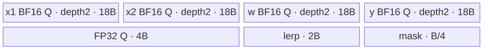

# ForeachLerpList A2/A3 ACLNN 算子知识

## 算子速览

| 项目 | 内容 |
|---|---|
| 实际入口 | `aclnnForeachLerpListGetWorkspaceSize` + `aclnnForeachLerpList`，公开两段式 ACLNN；固定仓未见带版本后缀的新入口。 |
| 计算语义 | 对三个等长 TensorList 的对应 Tensor 逐元素计算 `y=x1+weight*(x2-x1)`；实现根据 `abs(weight)<0.5` 在两个代数等价公式之间选择。 |
| 输入输出 | `x1/x2/weight/out` 为 ND TensorList，FP16/FP32/BF16；每个输入对应 Tensor shape 相同、全部 dtype 一致，输入可非连续、输出必须连续。 |
| 执行类型 | 单 Kernel；K1 为 `AIV_VECTOR`，无 Cube/AIC/MIX_CV。 |
| Kernel 路线 | R-001 FP16 升 FP32；R-002 FP32 原 dtype；R-003 BF16 升 FP32。 |
| 核心资源 | 四个 depth=2 的 `TQue`、`maskBuf`、双区 `lerpBuf`；FP16/BF16 另有一个 depth=1 的 FP32 Queue；TensorList GM 指针表；Kernel 不使用 user workspace。 |
| 来源闭包 | `source_closed`：公开 ACLNN 文档→自动生成两段式 bridge 边界→OpDef/InferShape→arch22 公共 Tiling/POD→entry→三 dtype Vector body/helper→A2/A3 构建和 binary config 已闭合。 |
| 验证状态 | 已完成源码闭包检查；本次知识提取未执行编译、真机、数值或性能测试。 |

## 接口与语义

### 计算语义

设 `x1=[x1_0,...,x1_{n-1}]`、`x2=[x2_0,...]`、`weight=[w_0,...]`。对每个列表位置 `i` 及其有效线性元素 `j`，数学结果为 `y_i[j]=x1_i[j]+w_i[j]*(x2_i[j]-x1_i[j])`。为减小权重靠近 1 时第一条表达式的消减误差，Device 同时求 `path1=x1+w*(x2-x1)` 与 `path2=x2-(x2-x1)*(1-w)`，按 `abs(w)<0.5` 取 path1，否则取 path2。FP16/BF16 路径先升为 FP32 完成两条路径与选择，再 `CAST_RINT` 回存储 dtype；FP32 路径在 FP32 上计算。

### 输入、输出与属性

| 参数 | shape/layout | dtype | 约束、默认值与语义 |
|---|---|---|---|
| `x1` | TensorList；每 Tensor 为 ND，rank 0–8 | FP16、FP32、BF16 | 非空；公开接口不支持空 Tensor；列表内 dtype 一致；输入可非连续，OpDef `AutoContiguous()` 形成框架前处理。 |
| `x2` | 与 `x1` 等长；对应 Tensor shape/format 相同 | 与 `x1` 相同 | 非空；列表内及四组参数间 dtype 一致；输入可非连续。 |
| `weight` | 与 `x1` 等长；对应 Tensor shape/format 相同 | 与 `x1` 相同 | 每元素为插值系数；没有把 weight 限制在 `[0,1]`。 |
| `out` | 与 `x1` 对应的 ND TensorList | 与 `x1` 相同 | 非空且必须连续；公开文档写对应输出 shape size≥输入，图侧 InferShape 直接复制输入 shape；Kernel 只写输入有效元素数。 |
| `workspaceSize`/`executor` | 第一段输出 | `uint64_t*`/`aclOpExecutor**` | 第一段返回 executor 总 workspace 和执行器；arch22 算子节点请求 32 B，但 K1 显式传 `nullptr` 给 body。 |
| `workspace`/`stream` | 第二段输入 | opaque/stream | 调用者按第一段结果申请并在 stream 上执行；框架 Contiguous 所需 slice 在固定仓生成层不可见。 |

### 入口与版本

实际公开入口为无版本后缀的 `aclnnForeachLerpListGetWorkspaceSize`/`aclnnForeachLerpList`。公开产品表明确支持 Atlas A2 与 A3；OpDef 注册 `ascend910b`、`ascend910_93`，Host CMake 将二者映射到 `arch22`，Kernel CMake 为二者选择默认 entry，两个 binary config 均含 FP16/FP32/BF16，因此公开支持与实现接线无冲突。仓内没有自动生成的 ACLNN inner bridge C++，按框架边界处理，不补造其内部符号。

## Host/Launcher 执行流程

### 参数校验与前处理

1. 公开第一段接口检查四个 TensorList 指针、支持 dtype、四组 dtype 一致、列表内部 dtype、对应 shape、rank≤8，并将失败映射到文档列出的 `ACLNN_ERR_PARAM_NULLPTR`、`ACLNN_ERR_PARAM_INVALID` 或 `ACLNN_ERR_INNER_TILING_ERROR`。
2. OpDef 为四个动态端口声明 FP16/FP32/BF16、ND 与 `AutoContiguous()`；输入非连续转换属于自动生成 bridge，输出非连续由公开约束排除。
3. 图侧 `InferShape4ForeachCommon` 要求 `x1` 实例数等于输出数并复制各项 shape；`InferDataType4ForeachCommon` 复制 dtype。
4. `Tiling4ForeachLerpListTiling` 以 `FOREACH_LERP_LIST_OP_CODE` 初始化 `ForeachCommonTiling`；`CheckOpInfo` 校验三个输入列表实例数、对应 storage shape、输出容量/dtype、所有 Tensor dtype。任一检查失败返回 `GRAPH_FAILED` 并阻断 launch。

### 参数、Workspace 与生命周期

Host 遍历 `x1` 的 storage shape，产生 `tensorDataCountList[i]` 与总元素数 `E`；首个 dtype 产生 `s=sizeof(T)` 和 `elementsPerBlock=32/s`。`AssignDataToEachCore` 把所有 Tensor 视作拼接线性域，产生每核首尾 Tensor index 与首尾元素 offset。POD 随 executor 保持到 launch，各 TensorList 的 GM 指针表及实际 Tensor 必须存活到 stream 上 K1 完成。算子节点 `workspaces[0]=32`，但 entry 注释说明 Vector foreach 不需要 workspace，并把 `userWS=nullptr` 交给实现；ACLNN executor 若插入 Contiguous，其总 workspace 可能大于 32 B，具体公式固定仓不可见。

### 启动图与失败传播

```text
aclnnForeachLerpListGetWorkspaceSize
  -> 自动生成 ForeachLerpList executor/Contiguous（固定仓框架边界）
  -> Tiling4ForeachLerpListTiling
       -> ForeachCommonTiling::Init/RunBigKernelTiling
aclnnForeachLerpList(workspace, workspaceSize, executor, stream)
  -> K1: foreach_lerp_list<<<blockDim=needCoreNum, stream>>>
       (x1List,x2List,weightList,yList,workspace,ForeachCommonTilingData)
       -> ForeachLerpListND<T>::Init -> Process
```

K1 是唯一 Device 节点，不存在 Kernel 间 workspace/GM 边。输入边是三个 TensorList 指针表及各 Tensor GM，输出边是 `out` 指针表及各 Tensor GM。Tiling/校验失败阻断 launch；entry 对未知 key 没有显式错误分支，正确 key 由 Host/OpDef 保证。`AUTO_SYNC false` 表示构建不插入额外自动同步；K1 内部通过 Queue、event 与 pipe barrier 排序，调用级可见性由 stream 保证。自动生成 bridge 的 launch 返回传播细节固定仓不可见。

## Route 与参数设计

### 分核与资源计算

令 `E=sum_i numel(x1_i)`、`s=sizeof(T)`、`epb=32/s`、平台 AIV 核数为 `C`。Host 计算 `blocks=ceil(E/epb)`，`needCoreNum=min(C,max(1,blocks),50)`；随后基础每核元素数为 `floor(blocks/needCoreNum)*epb`，前 `blocks mod needCoreNum` 个核多处理一个 `epb`。分核可跨 Tensor 边界，以 POD 中的 `[tensorStart,tensorStartOffset]` 到 `[tensorEnd,tensorEndOffset]` 描述闭区间。

令平台 UB 为 `UB`，序列化 POD 大小为 `P`，`B=inputsTensorUbSize`。FP32：`B=floor256(floor32((UB-P)/11))`。FP16/BF16：源码先把 `(UB-P)` 除 10，再除 11，并向下 64 B、最后 256 B 对齐，即 `B=floor256(floor64(floor((UB-P)/10)/11))`。FP32 tile 容量 `B/4` elements；FP16/BF16 的四个 IO Queue 单槽为 `9B` bytes，tile 容量 `9B/2` elements，再按 `B/4` elements 分 FP32 cast 子块。

### Route 选择

| 顺序 | Route | Key/模板 | 精确选择条件与优先级 | 不适用去向 |
|---:|---|---|---|---|
| 1 | R-001 FP16 升精度 | key 1；`ForeachLerpListND<half>` | Host `dataType==DT_FLOAT16`，`GetTilingKeyByDtypeOnly` 返回 1；entry 首分支。 | 检查 key 2。 |
| 2 | R-002 FP32 原 dtype | key 2；`ForeachLerpListND<float>` | Host `dataType==DT_FLOAT`，返回 2；entry 第二分支。 | 检查 key 4。 |
| 3 | R-003 BF16 升精度 | key 4；`ForeachLerpListND<bfloat16_t>` | Host `dataType==DT_BF16`；entry 编译 guard 为 `__CCE_AICORE__>=220` 且 NPU arch 非 3003/3113。 | 未命中时 entry 无动作。 |

```text
dtype FLOAT16 -> key 1 -> R-001
else dtype FLOAT -> key 2 -> R-002
else dtype BF16 -> key 4 -> R-003（受 entry 编译 guard）
else -> Host key 0；公开 OpDef/API 在外层排除
```

### 模板/实现执行矩阵

| Route | key/selector | dtype/shape/platform 完整命中条件 | 执行拓扑与 Kernel 节点 | 实际模板/body | 内存与同步特征 | tail/fallback |
|---|---|---|---|---|---|---|
| R-001 FP16 | 1 | FP16；三个列表等长/对应 shape 相同；ND/rank≤8；A2/A3 | 单 K1 AIV_VECTOR | `ForeachLerpListND<half>`→generic `InnerComputer<half>` | IO Queue depth2×9B，FP32 Queue 4B，mask B/4，lerp 2B；Queue+V/S/MTE event | tile 尾部 `DataCopyPad`；cast 子块与 Select repeat 均带有效 count。 |
| R-002 FP32 | 2 | FP32；其余同上 | 单 K1 AIV_VECTOR | `ForeachLerpListND<float>`→specialized `InnerComputer<float>` | IO Queue depth2×B，mask B/4，lerp 2B；x1/x2 local 被第二公式原地覆盖 | 同上；无 dtype fallback。 |
| R-003 BF16 | 4 | BF16；其余同上；CCE≥220且 arch 非 3003/3113 | 单 K1 AIV_VECTOR | `ForeachLerpListND<bfloat16_t>`→generic `InnerComputer` | 与 R-001 同构；FP32 升降精度，降精度 `CAST_RINT` | 同 R-001；guard 缺失时 entry 无动作。 |

### 隐藏性能 Guard

| Guard | Host/Tiling 条件 | Device/资源原因 | 影响 Route | 不满足时去向 | 源码符号 |
|---|---|---|---|---|---|
| 32 B 分核 | `epb=32/s`，`blocks=ceil(E/epb)` | 完整 tile 使用普通 `DataCopy`，尾段改 byte-count `DataCopyPad` | 全部 | 尾段路径 | `GetNeedCoreNum`、`AssignDataToEachCore`、`CopyIn/ComputeAndCopyOut` |
| UB 11 分之一 | FP32 `B=floor256(floor32((UB-P)/11))` | 四个 depth2 Queue、mask 与双区 lerp 的总量为 `10.25B` | R-002 | 无备用 Route；Tiling 资源不可用则失败 | `DivideUbMemory6`、`ForeachLerpListND::Init` |
| 半精度 UB 额外除 10 | FP16/BF16 先 `(UB-P)/10` | IO 单槽扩大到 9B，另有 4B FP32 Queue、mask和lerp，总显式量 `78.25B` | R-001/003 | 无备用 Route | 同上 |
| Select repeat | `repeatCount≤255`、每 repeat 64 FP32 elements | `Select(...,64,repeat,{1,1,1,8,8,8})` 的 L0 repeat 上限 | 全部 | 切成多个 16320-element batch，再处理 remainder | `InnerComputer::SelectBatch` |
| BF16 guard | `CCE>=220 && arch!=3003/3113` | BF16 body 只在该编译条件存在 | R-003 | entry 不执行任何 body | `foreach_lerp_list` key 4 分支 |
| 静态 POD 表 | Tensor/core 表均为 50 项，`needCoreNum≤50` | ABI 固定容量 | 全部 | 固定源码未见 `tensorNum>50` 显式拒绝；超限行为不可依赖 | `ForeachCommonTiling::Init`、`ForeachCommonTilingData` |
| AIV 核数 | `GetNeedCoreNum(coreNumPlatform)` 依赖平台返回正数 | blockDim 与 `blockIdx` 索引 POD 核表 | 全部 | 固定函数未单独拒绝 0；正常平台注册必须提供正 AIV core 数 | `GetNeedCoreNum`、`RunBigKernelTiling` |
| 空域 | 公开 API 不支持空 Tensor；`E==0` 仍把核数下限设 1 | Device `tensorEnd` 默认值可能形成无效闭区间 | 全部 | 接口层应拒绝；固定 Host 类未独立提供安全空域 Route | API 文档、`GetNeedCoreNum` |

### POD/ABI

| 结构 | 字段 | 类型/位宽 | ABI 布局 | 单位 | Host/launcher producer | Device consumer | 边界 |
|---|---|---|---|---|---|---|---|
| `ForeachCommonTilingData` | `inputsTensorUbSize` | `uint64_t`/64 | 序列化字段 #0；宏展开的 `sizeof/alignof/offsetof` 在仓外 CANN header，固定仓不可见 | bytes | `DivideUbMemory6`→`FillTilingData::set_inputsTensorUbSize(B)` | `ParseTilingData`；决定所有 Queue/TBuf/tile 容量 | 先按 dtype 向下 32/64 B，再统一向下 256 B |
| `ForeachCommonTilingData` | `tensorDataCountList[50]` | `int64_t[50]` | 字段 #1；精确 offset 固定仓不可见 | elements/Tensor | `Init`: `storageShape.GetShapeSize()` | `Process`: 各 Tensor 的 `cursorEnd` | 仅实际 Tensor 项活动；总 Tensor 数未单独写 POD |
| `ForeachCommonTilingData` | `tensorStartList[50]` | `uint16_t[50]` | 字段 #2；精确 offset 固定仓不可见 | Tensor index/core | `AssignDataToEachCore` | `ParseTilingData[blockIdx]` | `needCoreNum≤50` |
| `ForeachCommonTilingData` | `tensorEndList[50]` | `uint16_t[50]` | 字段 #3；精确 offset 固定仓不可见 | Tensor index/core | `AssignDataToEachCore` | `Process` 的包含式上界 | `j<=tensorEnd` |
| `ForeachCommonTilingData` | `tensorStartOffsetList[50]` | `int64_t[50]` | 字段 #4；精确 offset 固定仓不可见 | elements | `AssignDataToEachCore` | 首 Tensor 的 `cursorStart` | 包含式起点 |
| `ForeachCommonTilingData` | `tensorEndOffsetList[50]` | `int64_t[50]` | 字段 #5；精确 offset 固定仓不可见 | elements | `AssignDataToEachCore` | 末 Tensor 的 `cursorEnd` | 包含式终点 |

### Route 源码闭包

| Route | Key/selector | Host/Tiling producer | POD/参数 | Kernel entry/router 节点 | Kernel body/直接依赖 | 构建接线 |
|---|---|---|---|---|---|---|
| R-001 FP16 | key 1 | `arch22/foreach_lerp_list_tiling_arch22.cpp::Tiling4ForeachLerpListTiling`；`foreach_tiling_class.h::RunBigKernelTiling` | `ForeachCommonTilingData` | `op_kernel/foreach_lerp_list.cpp::foreach_lerp_list` key 1 | `ForeachLerpListND<half>`、generic `InnerComputer`、mask/select helper | Host/Kernel CMake；A2/A3 binary config |
| R-002 FP32 | key 2 | 同上 | 同布局，B 按 FP32 | entry key 2 | `ForeachLerpListND<float>`、specialized `InnerComputer<float>` | 同上 |
| R-003 BF16 | key 4 | 同上 | 同布局，B 按 BF16 | guarded entry key 4 | `ForeachLerpListND<bfloat16_t>`、generic `InnerComputer` | 同上 |

## Kernel 实现

### 公共执行流程

K1 用 TensorList GM 首字保存的 byte offset 定位 `uint64_t` 指针表，再按 Tensor index 取各真实 GM 地址。每个 AIV core 从 POD 取得自己的拼接域闭区间，逐 Tensor 绑定四个 GM，再按 `maxDataCount` 切 tile。完整 tile 用 `DataCopy`，尾 tile 用 `DataCopyPad`；三路输入分别 EnQue，计算端 DeQue 后在 UB 中生成两条 lerp 路径，以 mask `abs(weight)>=0.5` 选择第二条，否则保留第一条。结果 EnQue 到 yQueue，等待 V→MTE3 后写 GM，再等待 MTE3→MTE2 后释放槽，保证下一个 tile 不提前覆盖。

### Route R-001：FP16 升 FP32 Vector

#### 适用条件

##### 选择证据

| 层级 | 文件 | 符号 | 源码谓词/参数 | 结果/下一跳 |
|---|---|---|---|---|
| Host | `foreach_utils/op_host/common_dtype.h` | `GetTilingKeyByDtypeOnly` | `DT_FLOAT16` | key 1 |
| Tiling | `foreach_utils/op_host/foreach_tiling_class.h` | `DivideUbMemory6` | `opCode==FOREACH_LERP_LIST_OP_CODE && dtype==DT_FLOAT16` | `(UB-P)/10/11` 后对齐 B |
| Router | `foreach_lerp_list/op_kernel/foreach_lerp_list.cpp` | `foreach_lerp_list` | `TILING_KEY_IS(1)` | `ForeachLerpListND<half>` |

#### Device 数据流

##### 函数级调用链

```text
foreach_lerp_list -> ForeachLerpListND<half>::Init/Process
  -> SingleTensorProcess
    -> CopyIn -> x1/x2/weight Queue
    -> ComputeAndCopyOut
      -> InnerComputer<half>::Compute
        -> ComputePerCast -> ComputePerCastInner
        -> GenerateMask -> SyncVToS -> SelectBatch
        -> Cast(...,CAST_RINT)
      -> yQueue -> V_MTE3 -> DataCopy/Pad -> MTE3_MTE2
```

##### 源码等价伪码

```text
core = GetBlockIdx(); load B/start/end/offsets from POD
for t in [startTensor,endTensor]:
  [lo,hi] = this core's inclusive interval in tensor t
  bind x1/x2/w/y GM to TensorList[t] + lo
  for tile over hi-lo+1, capacity 9B/2 FP16 elements:
    CopyIn x1,x2,w(valid); enqueue/dequeue
    for castChunk over valid, capacity B/4 elements:
      cast x1,x2,w -> FP32 regions
      path1 = x1 + w*(x2-x1)
      path2 = x2 - (x2-x1)*(1-w)
      mask = abs(w) >= 0.5
      select(mask ? path2 : path1), batched at 255*64 elements
      cast_rint selected FP32 -> FP16 yLocal
    wait V_MTE3; CopyOut(valid); wait MTE3_MTE2; free queues
```

#### 内存与数据搬运

##### 资源与搬运表

| 层级/缓冲区 | offset/地址公式 | extent/容量公式 | dtype/layout | producer | consumer | owner/lifetime | 对齐/复用 |
|---|---|---|---|---|---|---|---|
| x1/x2/w GM | `TensorList[t]+lo+tile*(9B/2)` | `valid≤9B/2` elements | FP16/ND linear | caller | CopyIn | caller→stream完成 | tail 用 byte-count Pad |
| x1/x2/w Queue | 每个 queue 两槽 | each `2*9B` bytes | FP16/VECIN | CopyIn | InnerComputer | TPipe；Alloc→Free | depth2 |
| yQueue | 两槽 | `2*9B` bytes | FP16/VECOUT | Cast | CopyOut | TPipe | depth2 |
| float32Queue | 四个连续 region | `4B` bytes | FP32/VECIN | Cast/Vector | Cast-down | 整个 Process；一次 Alloc/DeQue 到末尾 Free | 四区原地复用 |
| maskBuf | offset 0 | `ceil((B/4)/32)*32=B/4` bytes | uint8 mask | Compare | Select | Process | Compare 结果，固定分配保守大于 bitmask需求 |
| lerpBuf | region0=0，region1=`B/4` float | `2B` bytes | FP32 | Duplicate/Abs | path2/mask | Process | 两个等长区 |
| y GM | `TensorList[t]+lo+tile*(9B/2)` | valid elements | FP16/ND | CopyOut | caller | caller | 只写有效范围 |

##### 分层内存布局


##### 字节账与复用顺序

```text
UB_total = 4 queues * depth2 * 9B + float32Queue(4B) + lerpBuf(2B) + maskBuf(B/4)
         = 78.25B
B = floor256(floor64(floor((UB_platform-P)/10)/11))
UB_total <= UB_platform-P（由 78.25/110 < 1 保守满足）
dynamic_ub = N/A（AIV TPipe）
operator_node_workspace = 32 B requested, K1 explicit use = 0 B
```

| 复用子区 | 写入者 | 读取者/消费点 | 下一次覆盖 | 同步或释放依据 | 安全条件 |
|---|---|---|---|---|---|
| FP32 region0..3 | Cast/两条公式 | Select/Cast-down | 下一 castChunk | `PIPE_V` barriers | chunk≤B/4，Select 后才能覆盖 |
| lerp region0/1 | Duplicate/Abs | path2/Compare | 下一 batch/chunk | `PIPE_V` + `SyncVToS` | Compare mask生成后才进入Select |
| IO Queue slot | CopyIn/Compute | Compute/CopyOut | 下次 AllocTensor | Queue + V_MTE3 + MTE3_MTE2 + FreeTensor | GM写回完成后释放 |

#### 同步、精度与尾块

##### 同步与数值边界表

| 阶段 | primitive/机制 | producer | consumer/等待点 | 保护对象 | 精度/尾块 |
|---|---|---|---|---|---|
| MTE2→V | `EnQue/DeQue` | CopyIn | Compute | 三个输入 Queue slot | tail Pad，只计算 valid |
| Vector 链 | `PipeBarrier<PIPE_V>` | Cast/Sub/Mul/Add/Duplicate/Abs/Compare | 下一 Vector op | FP32 regions/lerp/mask | 全部 FP32；Select按64元素repeat，最多255 repeats |
| V→S | `SetFlag/WaitFlag<HardEvent::V_S>` | Compare | scalar-side Select issue | mask | 保证mask可见 |
| V→MTE3 | `SetFlag/WaitFlag<V_MTE3>` | `CAST_RINT` | CopyOut | yQueue slot | FP32→FP16；有效 count |
| MTE3→MTE2 | event | GM write | 下轮 CopyIn/slot复用 | GM/queue lifecycle | 防止提前覆盖 |

#### 关键实现

##### 符号证据表

| 阶段 | 文件 | 符号/模板实例 | 实现事实 |
|---|---|---|---|
| Host/Tiling producer | `foreach_lerp_list/op_host/arch22/foreach_lerp_list_tiling_arch22.cpp`；`foreach_utils/op_host/foreach_tiling_class.h` | `Tiling4ForeachLerpListTiling`、`RunBigKernelTiling/DivideUbMemory6` | key、分核、B、POD、32 B workspace |
| Kernel entry/router | `foreach_lerp_list/op_kernel/foreach_lerp_list.cpp` | key 1 branch | half 实例与 null userWS |
| Device body/helper | `foreach_lerp_list/op_kernel/foreach_lerp_list.h` | `ForeachLerpListND<half>`、generic `InnerComputer`、`GenerateMask/SyncVToS` | tile、升精度、双公式、Select、tail与同步 |

### Route R-002：FP32 原 dtype Vector

#### 适用条件

##### 选择证据

| 层级 | 文件 | 符号 | 源码谓词/参数 | 结果/下一跳 |
|---|---|---|---|---|
| Host | `common_dtype.h` | `GetTilingKeyByDtypeOnly` | `DT_FLOAT` | key 2 |
| Tiling | `foreach_tiling_class.h` | `DivideUbMemory6` | lerp-list 且非 half/BF16 | `(UB-P)/11` 后 B 对齐 |
| Router | `foreach_lerp_list.cpp` | key 2 branch | `TILING_KEY_IS(2)` | `ForeachLerpListND<float>` |

#### Device 数据流

##### 函数级调用链

```text
foreach_lerp_list -> ForeachLerpListND<float>::Init/Process
  -> CopyIn
  -> InnerComputer<float>::Compute
       -> path1 in yLocal
       -> ComputeInner: path2 in x2Local, reusing x1Local
       -> GenerateMask -> SyncVToS -> SelectBatch into yLocal
  -> V_MTE3 -> CopyOut -> MTE3_MTE2
```

##### 源码等价伪码

```text
使用公共 core/tensor/tile 循环，tile capacity=B/4 FP32 elements
CopyIn x1,x2,w
path1(y) = x1 + w*(x2-x1)
lerp1 = 1-w
x1Local = x2-x1                 # 原地覆盖
x1Local = x1Local*lerp1
x2Local = x2-x1Local            # path2 原地覆盖 x2
mask = abs(w)>=0.5
y = select(mask ? x2Local : y)
CopyOut valid
```

#### 内存与数据搬运

##### 资源与搬运表

| 层级/缓冲区 | offset/地址公式 | extent/容量公式 | dtype/layout | producer | consumer | owner/lifetime | 对齐/复用 |
|---|---|---|---|---|---|---|---|
| x1/x2/w/y GM | `TensorList[t]+lo+tile*(B/4)` | valid≤B/4 | FP32/ND | caller/K1 | K1/caller | stream lifetime | tail Pad |
| x1/x2/w Queue | each depth2 | each `2B` bytes | FP32/VECIN | CopyIn | specialized InnerComputer | TPipe | x1/x2 local 被 path2 原地覆盖 |
| yQueue | depth2 | `2B` bytes | FP32/VECOUT | path1/Select | CopyOut | TPipe | path1直接物化到最终Queue |
| maskBuf | 0 | B/4 bytes | uint8 | Compare | Select | Process | mask复用 |
| lerpBuf | two FP32 regions | 2B bytes | FP32 | Duplicate/Abs | path2/Compare | Process | region1仅mask abs暂存 |
| float32Queue | N/A | 0 B | N/A | N/A | N/A | 未分配 | FP32不升精度 |

##### 分层内存布局


##### 字节账与复用顺序

```text
UB_total = 4*depth2*B + 2B + B/4 = 10.25B
B = floor256(floor32((UB_platform-P)/11))
UB_total <= UB_platform-P
dynamic_ub = N/A
operator_node_workspace = 32 B requested, explicit K1 use = 0 B
```

| 复用子区 | 写入者 | 读取者/消费点 | 下一次覆盖 | 同步或释放依据 | 安全条件 |
|---|---|---|---|---|---|
| x1Local | CopyIn | path1 first，随后 path2 | 下 tile CopyIn | Vector barriers + Queue Free | path1完成后才允许覆盖 |
| x2Local | CopyIn | path1与path2最终值 | 下 tile | Vector barriers | Select消费后释放 |
| yLocal | path1 | Select与CopyOut | 下 tile | barrier + V_MTE3 + Free | Select原地写最终结果 |

#### 同步、精度与尾块

##### 同步与数值边界表

| 阶段 | primitive/机制 | producer | consumer/等待点 | 保护对象 | 精度/尾块 |
|---|---|---|---|---|---|
| Queue/Vector | EnQue/DeQue + `PIPE_V` | CopyIn/每条Vector op | 下一op | x1/x2/w/y/lerp | FP32全程 |
| mask/select | V_S event + `Select(...64,repeat,{1,1,1,8,8,8})` | Compare | Select | mask与两条path | `abs(w)>=0.5`取path2；尾batch repeat=1但elementCount仅保护mask生成，Select mask为固定64 lane；无效lane不写GM |
| CopyOut | V_MTE3/MTE3_MTE2 | Select | GM write/slot复用 | yQueue | Pad仅提交 valid bytes |

#### 关键实现

##### 符号证据表

| 阶段 | 文件 | 符号/模板实例 | 实现事实 |
|---|---|---|---|
| Host/Tiling producer | `foreach_utils/op_host/foreach_tiling_class.h` | `RunBigKernelTiling/DivideUbMemory6` | key2、B、分核、POD |
| Kernel entry/router | `foreach_lerp_list/op_kernel/foreach_lerp_list.cpp` | key2 | float实例 |
| Device body/helper | `foreach_lerp_list/op_kernel/foreach_lerp_list.h` | `InnerComputer<float>::Compute/ComputeInner/SelectBatch` | 原地复用、双公式、mask与写回 |

### Route R-003：BF16 升 FP32 Vector

#### 适用条件

##### 选择证据

| 层级 | 文件 | 符号 | 源码谓词/参数 | 结果/下一跳 |
|---|---|---|---|---|
| Host | `common_dtype.h` | `GetTilingKeyByDtypeOnly` | `DT_BF16` | key 4 |
| Tiling | `foreach_tiling_class.h` | `DivideUbMemory6` | lerp-list 且 BF16 | 与 FP16 相同的除10/11和对齐 |
| Router | `foreach_lerp_list.cpp` | guarded key4 branch | CCE≥220且非arch3003/3113 | `ForeachLerpListND<bfloat16_t>` |

#### Device 数据流

##### 函数级调用链

```text
foreach_lerp_list guarded key4
  -> ForeachLerpListND<bfloat16_t>::Init/Process
  -> CopyIn -> generic InnerComputer<bfloat16_t>
  -> FP32 Cast -> dual lerp paths -> mask/Select -> CAST_RINT BF16
  -> CopyOut
```

##### 源码等价伪码

```text
与 R-001 的 core/tensor/tile/castChunk 完全同构；唯一存储类型替换为 BF16：
  load BF16 -> Cast(CAST_NONE) FP32
  compute/select in FP32
  Cast(CAST_RINT) FP32 -> BF16 -> valid-byte CopyOut
```

#### 内存与数据搬运

##### 资源与搬运表

| 层级/缓冲区 | offset/地址公式 | extent/容量公式 | dtype/layout | producer | consumer | owner/lifetime | 对齐/复用 |
|---|---|---|---|---|---|---|---|
| GM/四个 IO Queue | 同 R-001 | GM valid；每 Queue `2*9B` | BF16/ND与UB | caller/CopyIn/compute | compute/CopyOut/caller | stream/TPipe | 64/256B Host 对齐，tail Pad |
| float32Queue/lerp/mask | 同 R-001 | 4B/2B/B/4 | FP32/uint8 | Cast/Vector | Select/Cast | Process | 四FP32区与双lerp区复用 |
| workspace | N/A | K1 0 B | opaque | caller | 无 consumer | executor | Host节点声明32 B |

##### 分层内存布局



##### 字节账与复用顺序

```text
UB_total = 78.25B；B的Host上界与R-001相同
dynamic_ub = N/A
operator_node_workspace = 32 B requested, K1 use=0 B
```

| 复用子区 | 写入者 | 读取者/消费点 | 下一次覆盖 | 同步或释放依据 | 安全条件 |
|---|---|---|---|---|---|
| FP32/lerp/mask | Cast/Vector/Compare | Select/Cast-down | 下一chunk | PIPE_V + V_S | 同R-001 |
| IO slots | CopyIn/Cast-down | compute/CopyOut | 下一tile | Queue+events+Free | 同R-001 |

#### 同步、精度与尾块

##### 同步与数值边界表

| 阶段 | primitive/机制 | producer | consumer/等待点 | 保护对象 | 精度/尾块 |
|---|---|---|---|---|---|
| Cast-up/compute | `CAST_NONE` + PIPE_V | BF16 local | FP32公式 | FP32四区 | BF16输入精确映射FP32后计算 |
| Select | Compare/V_S/Select | 两条FP32 path | Cast-down | mask/result | `abs(w)>=0.5` |
| Cast-down/tail | `CAST_RINT`、V_MTE3、Pad | FP32 result | BF16 GM | y slot | 只提交valid bytes |

#### 关键实现

##### 符号证据表

| 阶段 | 文件 | 符号/模板实例 | 实现事实 |
|---|---|---|---|
| Host/Tiling producer | `foreach_utils/op_host/foreach_tiling_class.h` | key4/`DivideUbMemory6` | BF16选择与B |
| Kernel entry/router | `foreach_lerp_list/op_kernel/foreach_lerp_list.cpp` | guarded key4 | BF16实例 |
| Device body/helper | `foreach_lerp_list/op_kernel/foreach_lerp_list.h` | generic `InnerComputer<bfloat16_t>` | FP32升降、双公式、同步、tail |

## 算子特定优化

### Trick T-001：按权重幅值选择数值更稳的等价插值公式

#### 触发与源码依据

- 适用 Route：R-001、R-002、R-003。
- 触发条件：每个有效元素均计算两条路径；`abs(weight)>=0.5` 的 lane 以 mask 选择 path2，否则保留 path1。
- Golden 来源：[`foreach/foreach_lerp_list/op_kernel/foreach_lerp_list.h:187-195`](../../../../../../../cann-ops-raw/ascendc/ops-nn/955f8b33985b6d72989ebff341bb9c2c564a51bc/foreach/foreach_lerp_list/op_kernel/foreach_lerp_list.h#L187-L195)

**官方源码（固定 Commit 连续逐字摘录）**：

```cpp
GenerateMask(lerpLocal1, lerpLocal2, maskLocal,
    float32Tensor[maxCastDataCount * FACTOR_NUMBER_TWO + offset], elementCount);
SyncVToS();
Select(
    float32Tensor[maxCastDataCount * FACTOR_NUMBER_THREE + offset], maskLocal[0],
    float32Tensor[maxCastDataCount + offset],
    float32Tensor[maxCastDataCount * FACTOR_NUMBER_THREE + offset], SELMODE::VSEL_TENSOR_TENSOR_MODE,
    ELEMENT_PER_REPEAT, repeatCount, {1, 1, 1, 8, 8, 8});
PipeBarrier<PIPE_V>();
```

#### 机制与设计原因

`GenerateMask` 先生成 `abs(weight)>=0.5` 的 bit mask；path1 已位于目标区，path2 位于另一 FP32 区，`Select` 以每 repeat 64 elements、连续 block/repeat stride 1/8 把大幅权重 lane 替换为 path2。两条公式代数等价，但分别在 weight 靠近 0 和靠近 1 时避免从较大近似量中相减；FP16/BF16 还把整个选择放在 FP32 中，最后统一降精度。repeat超过255时拆 batch，tail只把有效字节写GM。

#### 迁移边界

- 适用：逐元素 lerp，且允许额外临时区同时保存两条等价公式的结果。
- 前提：FP32临时计算、可生成逐lane Compare mask、Select repeat/stride 与元素布局一致。
- 失效：若 UB 不足以保存两条路径，需要重做 Tiling/分块；不能删除其中一条公式而声称保持本实现的数值顺序。
- 未验证：本次知识提取未执行编译、真机、数值或性能测试。

#### 错误做法

固定仓未提供可验证反例；源码明确的迁移禁区是不能改变 `GE` mask 方向、0.5 阈值、两条 path 的对应关系或 FP16/BF16 的 `CAST_RINT` 降精度顺序。

## 模板与实现对比

| 对比维度 | R-001 FP16 | R-002 FP32 | R-003 BF16 | 设计选择依据 |
|---|---|---|---|---|
| 命中条件/优先级 | key1首分支 | key2次分支 | key4 guarded | dtype唯一决定 |
| 模板与 dtype | `ND<half>`+generic inner | `ND<float>`+specialization | `ND<bfloat16_t>`+generic inner | 低精度升FP32 |
| 循环与分核 | 拼接域→Tensor→tile→cast chunk | 拼接域→Tensor→tile | 同R-001 | 半精度9B大tile内再分B/4 cast块 |
| Queue/TBuf/寄存器/dynamic UB/通信 window | 78.25B；FP32 Q | 10.25B；无FP32 Q | 78.25B；FP32 Q | Host按dtype保守缩B |
| 内存总占用与复用 | 四FP32区、双lerp区 | x1/x2 local原地变path2 | 同R-001 | 减少额外path buffer |
| 搬运/Vector/SIMT/NDDMA/通信 API | DataCopy/Pad、Cast/Sub/Mul/Add/Compare/Select | DataCopy/Pad、Sub/Mul/Add/Compare/Select | 同R-001 | 全为AIV Vector |
| 同步、精度与 tail | PIPE_V/V_S/events；FP32→RINT | 同步同构；FP32原dtype | 同R-001 | tail仅写valid |
| fallback/失败边界 | 无dtype fallback | 无fallback | guard缺失无动作 | Host必须保证合法key/平台 |

## 平台差异

| 项目 | A2 | A3 | 950 |
|---|---|---|---|
| 支持状态 | 支持；公开产品表+ascend910b接线 | 支持；公开产品表+ascend910_93接线 | 支持，但使用独立 `_950` 卡 |
| Host/Launcher | arch22公共Tiling | 与A2共用arch22 | arch35独立Tiling/POD |
| Kernel/资源 | 默认AIV Vector entry | 与A2共用 | SIMT VF，无AIV Queue |

## 限制与失败边界

- 仅支持 ND FP16/FP32/BF16；三个输入列表等长且对应 shape 相同，四组 dtype 必须一致，rank≤8；输出必须连续；公开 ACLNN 不支持空 Tensor。
- arch22 静态表仅 50 Tensor/50 core；`needCoreNum` 显式截到50，但固定 `ForeachCommonTiling::Init` 未见对第51个 Tensor 的明确错误，超限行为不可依赖。
- POD 宏展开后的 `sizeof/alignof/offsetof`、自动生成 ACLNN bridge、executor 额外 workspace、launch错误传播细节固定仓不可见。
- entry 未提供 unknown-key 错误；BF16 受编译 guard。Host key、binary config 与目标平台必须一致。
- 本次知识提取未执行编译、真机、数值或性能测试。

## 源码索引

### 链路索引

| 链路阶段 | 文件 | 关键符号 | 支撑内容 |
|---|---|---|---|
| 入口声明/约束 | `foreach/foreach_lerp_list/docs/aclnnForeachLerpList.md` | 两段式原型/产品表/错误码 | 公开API、A2/A3支持、接口约束 |
| 入口声明/约束 | `foreach/foreach_lerp_list/README.md` | 产品支持/公式 | 语义、平台、dtype |
| 入口实现 | `foreach/foreach_lerp_list/op_host/foreach_lerp_list_def.cpp` | `ops::ForeachLerpList` | ND/dtype/AutoContiguous/平台注册 |
| 入口实现 | `foreach/foreach_utils/op_host/foreach_infershape.cpp` | `InferShape4ForeachCommon`/ForeachLerpList注册 | shape/dtype推导 |
| Host/Tiling/Launcher | `foreach/foreach_lerp_list/op_host/arch22/foreach_lerp_list_tiling_arch22.cpp` | `Tiling4ForeachLerpListTiling` | Host入口与op code |
| Host/Tiling/Launcher | `foreach/foreach_utils/op_host/foreach_tiling_class.h` | `ForeachCommonTiling` | 校验、分核、UB、POD/workspace |
| Host/Tiling/Launcher | `foreach/foreach_utils/op_host/foreach_tiling_def.h` | `ForeachCommonTilingData` | POD字段与注册 |
| Host/Tiling/Launcher | `foreach/foreach_utils/op_host/common_dtype.h` | `GetTilingKeyByDtypeOnly` | dtype→key |
| Kernel entry/body | `foreach/foreach_lerp_list/op_kernel/foreach_lerp_list.cpp` | `foreach_lerp_list` | key router/模板实例 |
| Kernel entry/body | `foreach/foreach_lerp_list/op_kernel/foreach_lerp_list.h` | `ForeachLerpListND`/`InnerComputer` | 全部Vector body/helper |
| 构建接线 | `foreach/foreach_lerp_list/op_host/CMakeLists.txt` | `SUPPORT_COMPUTE_UNIT/TILING_DIR` | A2/A3→arch22 |
| 构建接线 | `foreach/foreach_lerp_list/op_kernel/CMakeLists.txt` | `add_kernel_sources` | 默认entry选择 |
| 构建接线 | `foreach/foreach_lerp_list/op_host/config/ascend910b/foreach_lerp_list_binary.json` | `op_list` | A2三dtype binary |
| 构建接线 | `foreach/foreach_lerp_list/op_host/config/ascend910_93/foreach_lerp_list_binary.json` | `op_list` | A3三dtype binary |

每行只写一个文件，并确保该文件存在于 Frontmatter `sources`。

### 实现复用检查

| 检查项 | 可复用事实 | 不得改变的约束 | 源码符号 |
|---|---|---|---|
| ABI/POD | 公共6字段POD、每核闭区间 | 字段顺序/位宽/数组50项/元素单位 | `ForeachCommonTilingData`、`ParseTilingData` |
| 调用顺序 | CopyIn→双公式→mask→Select→CopyOut | Select前Compare和V_S；写回前V_MTE3 | `SingleTensorProcess`/`ComputeAndCopyOut` |
| workspace/内存 | K1不消费workspace；dtype特定B字节账 | depth、9B半精度槽、4B FP32区、2B lerp | `Init`、`DivideUbMemory6` |
| 同步 | Queue+PIPE_V+V_S+V_MTE3+MTE3_MTE2 | 不能在消费/写回前释放槽 | `GenerateMask/SyncVToS/ComputeAndCopyOut` |
| 精度与尾块 | 双公式阈值选择；低精度升FP32并RINT；Pad尾写 | 0.5阈值、GE方向、公式对应、valid bytes | `InnerComputer`、`CopyIn/CopyOut` |
| 失败边界 | Host校验与key必须先成功 | unknown key、BF16 guard、静态表上限无fallback | `CheckOpInfo`、entry router |