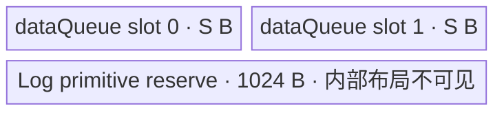
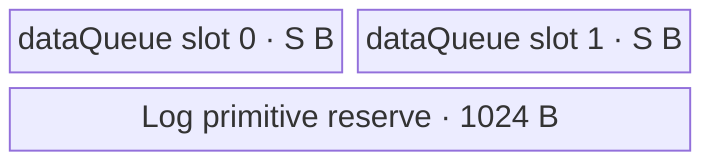

# ForeachLog A2/A3 ACLNN 算子知识

## 算子速览

| 项目 | 内容 |
|---|---|
| 实际入口 | `aclnnForeachLogGetWorkspaceSize` + `aclnnForeachLog`，公开 ACLNN 两段式接口 |
| 计算语义 | 对 TensorList 中每个张量逐元素计算 `y_i[j] = ln(x_i[j])` |
| 输入输出 | `x/out` 均为 ND TensorList；FP16、FP32、BF16；同一列表内及输入输出 dtype 一致；输出容量不小于对应输入 |
| 执行类型 | 单 Kernel，唯一节点为 `AIV_VECTOR` |
| Kernel 路线 | R-001 FP16 原生 Log；R-002 FP32 原生 Log；R-003 BF16→FP32 Log→BF16 |
| 核心资源 | TensorList GM 指针表、`dataQueue<VECIN,2>`；BF16 另有单槽 `float32Queue`；32 B 算子 workspace 不被 Kernel 使用 |
| 来源闭包 | `source_closed`：公开 ACLNN 文档→生成式 ACLNN 框架边界→`ForeachLog` OpDef/推形→arch22 Tiling→公共 POD→dtype router→公共 Vector body→A2/A3 构建接线闭合 |
| 验证状态 | 已完成源码闭包检查；本次知识提取未执行编译、真机、数值或性能测试。 |

## 接口与语义

### 计算语义

设输入列表 `x=[x_0,...,x_{n-1}]`，输出列表 `y=[y_0,...,y_{n-1}]`。对每个列表项和其输入有效元素域，`y_i[j]=log_e(x_i[j])`。Kernel 只按 `numel(x_i)` 写输出；若 `out_i` 容量更大，超出输入元素数的区域不由本算子写入。`Log` primitive 对零、负数、NaN/Inf 的具体数学边界属于同版本 AscendC primitive，固定仓未展开其近似实现。

### 输入、输出与属性

| 参数 | shape/layout | dtype | 约束、默认值与语义 |
|---|---|---|---|
| `x` | 每项 0～8 维，ND；列表项可为空 Tensor | FP16/FP32/BF16 | 非空指针；同一列表所有 Tensor dtype 一致；输入允许非连续，OpDef 标记 `AutoContiguous` |
| `out` | 每项 0～8 维，ND；对应项 shape size `>=x` | 与 `x` 一致 | 非空指针；输出不支持非连续 Tensor；Kernel 仅写与输入等量元素 |
| `workspaceSize` | 标量 | `uint64_t*` | 第一段返回；算子 Tiling slice 为 32 B，框架连续化临时空间的最终合计公式固定仓不可见 |
| `executor` | 执行器 | `aclOpExecutor**` | 第一段创建，第二段提交；内部生成代码固定仓不可见 |

### 入口与版本

固定提交公开的最新入口族是无版本后缀 `aclnnForeachLog`。文档明确 A2、A3 支持，OpDef 注册 `ascend910b/ascend910_93`，Host CMake 将二者映射至 `arch22`，Kernel CMake 和 binary JSON 同时接线三种 dtype。ACLNN inner bridge 由构建系统生成，固定仓没有可读的手写 `GetWorkspaceSize` 实现；它作为框架边界，不影响已闭合的算子 Host/Tiling/POD/Kernel 链。

## Host/Launcher 执行流程

### 参数校验与前处理

公开第一段先校验 `x/out` 非空、dtype 属于 FP16/FP32/BF16 且输入输出一致。生成式框架按 OpDef 的 `AutoContiguous` 处理输入；输出必须连续。进入 Tiling 后，`ForeachCommonTiling::Init` 扫描最多 50 个动态输入实例，记录 storage `numel`、统一 dtype、元素字节数与总元素数；`CheckOpInfo` 再检查列表实例数、每项维数不超过 8、输出 dtype 一致、输出容量不小于输入，并复核列表内 dtype。一项失败即返回 `GRAPH_FAILED`，不启动 Kernel。

### 参数、Workspace 与生命周期

令 `N=sum_i numel(x_i)`、`s=sizeof(T)`、`e=32/s`、平台 AIV 核数为 `Cplat`。Host 产生 `blockDim=min(max(1,ceil(N/e)),Cplat,50)`，将按列表顺序拼接的元素域按 32 B block 分给各核，并序列化每核包含式起止 Tensor/offset。Tiling 设置 `workspace[0]=32`；entry 显式把 `userWS` 置空，故这 32 B 没有 Device producer/consumer。调用者持有最终 ACLNN workspace 与 executor，至少覆盖第二段提交直至 stream 完成；连续化临时对象的精确 owner/cleanup 是生成框架边界。

### 启动图与失败传播

单节点启动图：`aclnnForeachLog` executor → `foreach_log<<<blockDim, stream>>>`。节点参数依次为 TensorList GM 描述 `x`、TensorList GM 描述 `y`、workspace、tiling；POD 为 `ForeachCommonTilingData`。不存在跨 Kernel 边。Tiling/序列化/launch 任一失败都阻断该节点或由第二段返回错误；未知 key 在 entry 中没有 fallback，因而不写输出。

## Route 与参数设计

### 分核与资源计算

Host 把所有列表项视作保持列表顺序的拼接域。`blockCount=ceil(N/e)`；前 `blockCount % blockDim` 个核多处理一个 32 B block，其余核处理 `floor(blockCount/blockDim)` 个 block。POD 用 `(tensorStart,tensorStartOffset)` 与 `(tensorEnd,tensorEndOffset)` 表示每核闭区间。设平台 UB 为 `U`，宏序列化 POD 大小为 `P`，`S=inputsTensorUbSize`：FP16/FP32 为 `S=floor32((U-1024-P)/2)`；BF16 为 `S=floor64(floor((U-1024-P)/10)/2)`。1024 B 是 Host 为 `Log` primitive 预留的不可见临时空间。

### Route 选择

| 顺序 | Route | Key/模板 | 精确选择条件与优先级 | 不适用去向 |
|---:|---|---|---|---|
| 1 | R-001 FP16 原生 Log | key 1；`ForeachImplictOutput<half,half,LogAdapter<half>,2,1>` | `dataType==DT_FLOAT16` | 检查 key 2 |
| 2 | R-002 FP32 原生 Log | key 2；`ForeachImplictOutput<float,float,LogAdapter<float>,2,1>` | `dataType==DT_FLOAT` | 检查 key 4 |
| 3 | R-003 BF16 升精度 Log | key 4；`ForeachImplictOutput<bfloat16_t,float,LogAdapter<float>,2,1>` | `dataType==DT_BF16` 且非 Kirin 编译 guard；A2/A3 可达 | 未知 key，无输出 |

```text
ForeachCommonTiling::RunBigKernelTiling
  -> key = GetTilingKeyByDtypeOnly(dataType)
     DT_FLOAT16 -> 1
     DT_FLOAT   -> 2
     DT_BF16    -> 4
     other      -> 0（接口/OpDef 已应拒绝）
  -> foreach_log router 按 1 -> 2 -> 4 顺序实例化；否则结束
```

### 模板/实现执行矩阵

| Route | key/selector | dtype/shape/platform 完整命中条件 | 执行拓扑与 Kernel 节点 | 实际模板/body | 内存与同步特征 | tail/fallback |
|---|---|---|---|---|---|---|
| R-001 | 1 | FP16，ND，维数≤8，输出容量≥输入，A2/A3 | 单 `AIV_VECTOR` | `InnerComputer<half,half>`→`Log<half>` | `dataQueue` depth 2，原地计算；V→MTE3、MTE3→MTE2 event | 尾 tile 用 `DataCopyPad`；无 key fallback |
| R-002 | 2 | FP32，其余同 R-001 | 单 `AIV_VECTOR` | `InnerComputer<float,float>`→`Log<float>` | 同上，元素宽 4 B | 同上 |
| R-003 | 4 | BF16，其余同 R-001 | 单 `AIV_VECTOR` | BF16 `InnerComputer`→FP32 Cast→`Log<float>`→BF16 Cast | `dataQueue` 每槽 `9S`，depth 2；`float32Queue` 单槽 `S`；四个 V barrier | BF16 cast 子块尾保护；无 key fallback |

### 隐藏性能 Guard

| Guard | Host/Tiling 条件 | Device/资源原因 | 影响 Route | 不满足时去向 | 源码符号 |
|---|---|---|---|---|---|
| 32 B 分核 | `e=32/s`，`ceil(N/e)` | 非尾 tile 使用按元素 `DataCopy`，核域按 DMA block 分配 | 全部 | 空域仍发 1 核；非法 shape 失败 | `GetNeedCoreNum`; `AssignDataToEachCore` |
| UB 与 Log reserve | `U>1024+P` 且所得 `S>0`（源码未显式检查） | 双缓冲和 primitive 临时空间必须容纳 | 全部 | 固定仓无显式 fallback，资源不足边界未防护 | `DivideUbMemory1` |
| BF16 64 B floor | `S=floor64(floor((U-1024-P)/10)/2)` | BF16 路线实际分配 `18S+S`，并需要 FP32 cast 区 | R-003 | 无低内存 Route | `DivideUbMemory1`; `KernelForeachUnary::Init` |
| 列表/core 固定数组 | `totalTensorCount<=50`、`blockDim<=50`；前者源码只以扫描上限体现 | POD 六个数组均为 50 项 | 全部 | 超过 50 项没有显式报错，不能视为受支持闭包 | `MAX_TENSOR_CONT/MAX_CORE_CONT`; `Init` |
| BF16 编译 guard | 非 `__NPU_ARCH__==3003/3113` | Kirin 不构建 BF16 分支；A2/A3 保留 | R-003 | Kirin 无 BF16；A2/A3 正常 | `foreach_log` key 4 guard |

### POD/ABI

`ForeachCommonTilingData` 由仓外 tiling-data 宏生成；固定仓可证明字段声明顺序、类型和数组长度，但宏展开后的 `sizeof/alignof/offsetof` 不可见，因此不按普通 C struct 推测。

| 结构 | 字段 | 类型/位宽 | ABI 布局 | 单位 | Host/launcher producer | Device consumer | 边界 |
|---|---|---|---|---|---|---|---|
| `ForeachCommonTilingData` | `inputsTensorUbSize` | `uint64_t`/64 | 字段 1；精确 offset/sizeof 不可见 | 字节/基础槽 `S` | `DivideUbMemory1`→`FillTilingData` | `KernelForeachBase::Init/ParseTilingData` | FP/BF16 公式不同，必须非零 |
| 同上 | `tensorDataCountList` | `int64_t[50]`/每项64 | 字段 2；精确 offset 不可见 | 元素/列表项 | `Init`: `storageShape.GetShapeSize()` | `Process` 生成每项有效区间 | 最多 50 项；空 Tensor 为 0 |
| 同上 | `tensorStartList` | `uint16_t[50]`/每项16 | 字段 3 | TensorList 下标/core | `AssignDataToEachCore` | `ParseTilingData[blockIdx]` | 包含式；core<50 |
| 同上 | `tensorEndList` | `uint16_t[50]`/每项16 | 字段 4 | TensorList 下标/core | 同上 | 同上 | 包含式 |
| 同上 | `tensorStartOffsetList` | `int64_t[50]`/每项64 | 字段 5 | 元素/core | 同上 | 首 Tensor GM base offset | 包含式起点 |
| 同上 | `tensorEndOffsetList` | `int64_t[50]`/每项64 | 字段 6 | 元素/core | 同上 | 尾 Tensor cursor end | 包含式终点；空域可能为 -1 |

### Route 源码闭包

| Route | Key/selector | Host/Tiling producer | POD/参数 | Kernel entry/router 节点 | Kernel body/直接依赖 | 构建接线 |
|---|---|---|---|---|---|---|
| R-001 | key 1 | `foreach_log_tiling_arch22.cpp::Tiling4ForeachLogTiling`; `ForeachCommonTiling` | `ForeachCommonTilingData` | `op_kernel/foreach_log.cpp::foreach_log` | `ForeachImplictOutput<half,...>`; `KernelForeachUnary/Base` | Host/Kernel CMake；ascend910b/ascend910_93 binary JSON |
| R-002 | key 2 | 同上 | 同上 | 同上 | `ForeachImplictOutput<float,...>` | 同上 |
| R-003 | key 4 | 同上 | 同上 | 同上 | BF16 `InnerComputer`; `LogAdapter<float>` | 同上 |

## Kernel 实现

### 公共执行流程

entry 用 `GET_TILING_DATA` 解析 POD，按 key 构造唯一模板对象，`Init` 读取当前 block 的列表闭区间并初始化 Queue，`Process` 逐 Tensor 段、逐 tile 执行。TensorList GM 描述首个 `uint64_t` 是指针表相对首地址的字节 offset；右移 3 定位指针表，第 `i` 项是实际 Tensor GM 地址。每 tile `CopyIn→Compute/直写 CopyOut`；模板参数 `needCopyOut=false`，因此通用 `outQueue` 不分配，结果从输入 Queue 的同一 LocalTensor 直接搬到输出 GM。

### Route R-001：FP16 原生 Log

#### 适用条件

##### 选择证据

| 层级 | 文件 | 符号 | 源码谓词/参数 | 结果/下一跳 |
|---|---|---|---|---|
| Host | `foreach_tiling_class.h` | `RunBigKernelTiling` | `GetTilingKeyByDtypeOnly(DT_FLOAT16)` | key 1 |
| Router | `foreach_log.cpp` | `foreach_log` | `TILING_KEY_IS(1)` | `ForeachImplictOutput<half,half,...,2,1>` |

#### Device 数据流

##### 函数级调用链

```text
foreach_log(xList,yList,workspace,tiling)
  -> ForeachImplictOutput<half,...>::Init
  -> KernelForeachUnary::Process
    -> SingleTensorProcess -> CopyIn
    -> ForeachImplictOutput::Compute
      -> InnerComputer::Compute -> LogAdapter<half> -> Log<half>
      -> V_MTE3 wait -> DataCopy[Pad] to y GM -> MTE3_MTE2 wait
```

##### 源码等价伪码

```text
for tensor i in [tensorStart, tensorEnd]:
  begin/end = POD 修正后的当前核闭区间
  bind x_i[begin], y_i[begin]
  for tile k over dataCount with capacity S/2:
    n = min(S/2, remaining)
    xLocal = CopyIn(x_i[k*S/2], n)       # tail: byte-count DataCopyPad
    Log<half>(xLocal, xLocal)
    wait V -> MTE3
    CopyOut(y_i[k*S/2], xLocal, n)       # tail: byte-count DataCopyPad
    wait MTE3 -> MTE2; FreeTensor(xLocal)
```

#### 内存与数据搬运

##### 资源与搬运表

| 层级/缓冲区 | offset/地址公式 | extent/容量公式 | dtype/layout | producer | consumer | owner/lifetime | 对齐/复用 |
|---|---|---|---|---|---|---|---|
| x/y GM | `tensorPtr[i]+cursorStart+k*maxDataCount` | 当前核对该 Tensor 的有效元素 | FP16/ND | ACLNN caller / CopyIn | CopyIn / CopyOut | stream 完成前有效 | tail 按真实字节数 |
| `dataQueue` slot | Queue 管理 | `S` B/slot，depth 2 | FP16 | MTE2 CopyIn | Vector Log、MTE3 CopyOut | tile 内，CopyOut 后释放 | 计算原地覆盖输入槽 |
| workspace | N/A | 32 B Tiling slice | opaque | caller | 无 Device consumer | executor/stream 生命周期 | 不参与计算 |

##### 分层内存布局



##### 字节账与复用顺序

```text
S = floor32((U - P - 1024)/2)
UB_visible = 2*S
UB_visible + P + 1024 <= U
dynamic_ub = N/A
workspace_total(算子 slice) = 32 B，但 Kernel 不读取
```

| 复用子区 | 写入者 | 读取者/消费点 | 下一次覆盖 | 同步或释放依据 | 安全条件 |
|---|---|---|---|---|---|
| `dataQueue` 当前 slot | `CopyIn` | `Log` 后 MTE3 CopyOut | slot 再次 Alloc | `V_MTE3`、`MTE3_MTE2` 与 `FreeTensor` | CopyOut 完成后才允许 MTE2 重用 |

#### 同步、精度与尾块

##### 同步与数值边界表

| 阶段 | primitive/机制 | producer | consumer/等待点 | 保护对象 | 精度/尾块 |
|---|---|---|---|---|---|
| MTE2→Vector | TQue EnQue/DeQue | `CopyIn` | `Compute` | 当前 slot | FP16 原生 Log |
| Vector→MTE3 | `V_MTE3` event | `Log` | CopyOut | 原地结果 | tail 仅 `n` 元素 |
| MTE3→MTE2 | `MTE3_MTE2` event | CopyOut | Free/reuse | 同一 slot | 防止提前覆盖 |

#### 关键实现

##### 符号证据表

| 阶段 | 文件 | 符号/模板实例 | 实现事实 |
|---|---|---|---|
| Host/Tiling producer | `foreach_tiling_class.h` | `GetNeedCoreNum/AssignDataToEachCore/DivideUbMemory1` | 32 B 分核、S 公式、key |
| Kernel entry/router | `foreach_log.cpp` | key 1 branch | FP16 模板映射 |
| Device body/helper | `foreach_implict_output.h`; `kernel_foreach_unary.h` | `InnerComputer`; `Compute`; `CopyIn` | 原地 Log、直写 GM、tail 与事件 |

### Route R-002：FP32 原生 Log

#### 适用条件

##### 选择证据

| 层级 | 文件 | 符号 | 源码谓词/参数 | 结果/下一跳 |
|---|---|---|---|---|
| Host | `foreach_tiling_class.h` | `RunBigKernelTiling` | `GetTilingKeyByDtypeOnly(DT_FLOAT)` | key 2 |
| Router | `foreach_log.cpp` | `foreach_log` | `TILING_KEY_IS(2)` | `ForeachImplictOutput<float,float,...,2,1>` |

#### Device 数据流

##### 函数级调用链

```text
foreach_log -> ForeachImplictOutput<float>::Init/Process
  -> KernelForeachUnary::CopyIn
  -> InnerComputer<float,float>::Compute -> Log<float>(local,local)
  -> V_MTE3 -> GM CopyOut -> MTE3_MTE2 -> FreeTensor
```

##### 源码等价伪码

```text
与 R-001 相同，但 maxDataCount=S/4，Log<float> 直接覆盖 FP32 local；
每核/每 Tensor/tile 的 GM offset 均以 FP32 元素计，tail 搬运 n*4 字节。
```

#### 内存与数据搬运

##### 资源与搬运表

| 层级/缓冲区 | offset/地址公式 | extent/容量公式 | dtype/layout | producer | consumer | owner/lifetime | 对齐/复用 |
|---|---|---|---|---|---|---|---|
| x/y GM | `tensorPtr[i]+cursorStart+k*(S/4)` | `n` 元素 | FP32/ND | caller/CopyIn | Log/CopyOut | stream | tail `n*4` B |
| `dataQueue` | Queue slot | `S` B×depth 2 | FP32 | MTE2 | Vector/MTE3 | tile | 原地覆盖 |

##### 分层内存布局



##### 字节账与复用顺序

```text
UB_visible=2*S; S=floor32((U-P-1024)/2); maxDataCount=S/4
dynamic_ub=N/A; workspace_total=32 B（不读取）
```

| 复用子区 | 写入者 | 读取者/消费点 | 下一次覆盖 | 同步或释放依据 | 安全条件 |
|---|---|---|---|---|---|
| `dataQueue` slot | CopyIn | Log/CopyOut | 下一 Alloc | Queue + 两组 event | 与 R-001 相同 |

#### 同步、精度与尾块

##### 同步与数值边界表

| 阶段 | primitive/机制 | producer | consumer/等待点 | 保护对象 | 精度/尾块 |
|---|---|---|---|---|---|
| Copy/compute/copy | Queue + `V_MTE3` + `MTE3_MTE2` | MTE2/Vector/MTE3 | 后继阶段 | 当前 slot | FP32 原生 Log；tail `DataCopyPad` |

#### 关键实现

##### 符号证据表

| 阶段 | 文件 | 符号/模板实例 | 实现事实 |
|---|---|---|---|
| Host/Tiling producer | `foreach_tiling_class.h` | `RunBigKernelTiling` | key 2、S、blockDim |
| Kernel entry/router | `foreach_log.cpp` | key 2 branch | FP32 实例 |
| Device body/helper | `foreach_implict_output.h` | generic `InnerComputer` | FP32 原地 Log 与直写 |

### Route R-003：BF16 升精度 Log

#### 适用条件

##### 选择证据

| 层级 | 文件 | 符号 | 源码谓词/参数 | 结果/下一跳 |
|---|---|---|---|---|
| Host | `foreach_tiling_class.h` | `RunBigKernelTiling` | `DT_BF16` | key 4；S 用 `/10`、`/2`、floor64 |
| Router | `foreach_log.cpp` | key 4 branch | `TILING_KEY_IS(4)` 且编译 guard 可达 | BF16/FP32 模板 |

#### Device 数据流

##### 函数级调用链

```text
foreach_log -> ForeachImplictOutput<bfloat16_t,float>::Init/Process
  -> CopyIn BF16 tile
  -> BF16 InnerComputer::Compute
    -> per cast chunk: Cast BF16->FP32 -> Log<float> in-place -> Cast FP32->BF16(CAST_RINT)
  -> V_MTE3 -> BF16 GM CopyOut -> MTE3_MTE2 -> FreeTensor
```

##### 源码等价伪码

```text
maxDataCount=9*S/2; maxCastDataCount=S/4
for each BF16 tile of at most maxDataCount:
  CopyIn to dataLocal
  for chunk c of at most S/4 elements:
    barrier V
    floatBuf[0:n] = Cast(dataLocal[c*S/4:c*S/4+n], CAST_NONE)
    barrier V; Log<float>(floatBuf,floatBuf,n); barrier V
    dataLocal[...] = Cast(floatBuf, CAST_RINT); barrier V
  wait V->MTE3; copy valid BF16 elements to GM; wait MTE3->MTE2
```

#### 内存与数据搬运

##### 资源与搬运表

| 层级/缓冲区 | offset/地址公式 | extent/容量公式 | dtype/layout | producer | consumer | owner/lifetime | 对齐/复用 |
|---|---|---|---|---|---|---|---|
| `dataQueue` slot | Queue | `9S` B/slot，depth 2 | BF16 | MTE2 | Cast/CopyOut | tile | BF16 输入与输出原地复用 |
| `float32Queue` slot | Queue | `S` B，depth 1 | FP32 | BF16 Cast | Log、回 Cast | 整个 Process 中持有 | 每 cast chunk 覆盖 |
| x/y GM | list pointer + element offset | 有效 BF16 count | BF16/ND | caller/CopyIn | CopyOut | stream | tail 真实字节数 |

##### 分层内存布局


##### 字节账与复用顺序

```text
S=floor64(floor((U-P-1024)/10)/2)
UB_visible=2*(9S)+S=19S
19S <= U-P-1024（由 Host 保守除法保证，另有整数 floor 余量）
dynamic_ub=N/A; workspace_total=32 B（不读取）
```

| 复用子区 | 写入者 | 读取者/消费点 | 下一次覆盖 | 同步或释放依据 | 安全条件 |
|---|---|---|---|---|---|
| `dataQueue` slot | BF16 CopyIn | Cast 与最终 CopyOut | 下一 tile | V barriers、V_MTE3、MTE3_MTE2 | 回 Cast 和 GM CopyOut 完成 |
| `float32Queue` | BF16→FP32 Cast | Log、FP32→BF16 Cast | 下一 cast chunk | 四个 `PipeBarrier<PIPE_V>` | 每 chunk 串行完成 |

#### 同步、精度与尾块

##### 同步与数值边界表

| 阶段 | primitive/机制 | producer | consumer/等待点 | 保护对象 | 精度/尾块 |
|---|---|---|---|---|---|
| BF16→FP32 | `Cast(...CAST_NONE)` + V barrier | BF16 local | FP32 Log | float buffer | 升精度 |
| FP32 Log | `Log<float>` + V barrier | Cast | 回 Cast | float buffer | FP32 计算 |
| FP32→BF16 | `Cast(...CAST_RINT)` + V barrier | Log | MTE3 | BF16 local | round-to-nearest integer mode；只处理 chunk 有效元素 |
| CopyOut/reuse | 两组 hard event | Vector/MTE3 | GM/MTE2 | data slot | tail `DataCopyPad` |

#### 关键实现

##### 符号证据表

| 阶段 | 文件 | 符号/模板实例 | 实现事实 |
|---|---|---|---|
| Host/Tiling producer | `foreach_tiling_class.h` | `DivideUbMemory1` | BF16 `/10`、`/2`、64 B floor |
| Kernel entry/router | `foreach_log.cpp` | key 4 branch | BF16 storage/FP32 compute |
| Device body/helper | `foreach_implict_output.h`; `kernel_foreach_base.h` | BF16 `InnerComputer`; `Init` | 9S 双槽、S FP32 槽、cast 循环与精度顺序 |

## 算子特定优化

### Trick T-001：输入 Queue 原地计算并直接提交输出

#### 触发与源码依据

- 适用 Route：R-001、R-002、R-003
- 触发条件：`ForeachImplictOutput` 以 `needCopyOut=false` 实例化，算子允许输入 LocalTensor 被结果覆盖。
- Golden 来源：[`foreach/foreach_utils/op_kernel/foreach_implict_output.h:94-115`](../../../../../../../cann-ops-raw/ascendc/ops-nn/955f8b33985b6d72989ebff341bb9c2c564a51bc/foreach/foreach_utils/op_kernel/foreach_implict_output.h#L94-L115)

**官方源码（固定 Commit 连续逐字摘录）**：

```cpp
LocalTensor<T> dataLocal = Base::dataQueue.template DeQue<T>();
InnerComputer<T, P, op, paramsCount> computer;
computer.Compute(dataLocal, float32Tensor, Base::maxCastDataCount, dataCount);

event_t eventIDVToMTE3 = static_cast<event_t>(GetTPipePtr()->FetchEventID(HardEvent::V_MTE3));
SetFlag<HardEvent::V_MTE3>(eventIDVToMTE3);
WaitFlag<HardEvent::V_MTE3>(eventIDVToMTE3);
if (isRemainder) {
    DataCopyExtParams copyParams{1, static_cast<uint32_t>(dataCount * sizeof(T)), 0, 0, 0};
    DataCopyPad(Base::outTensorsGM[index * Base::maxDataCount], dataLocal, copyParams);
} else {
    DataCopy(Base::outTensorsGM[index * Base::maxDataCount], dataLocal, dataCount);
}
```

#### 机制与设计原因

`InnerComputer` 把结果写回 `dataLocal`，随后 MTE3 直接从同一槽写输出 GM；模板因此不初始化 `outQueue`。这消除一份输出 UB 物化和一次 LocalTensor 间复制。`V_MTE3` 保证 Vector 完成后才能搬出，`MTE3_MTE2` 保证槽在输出完成后才由下一次输入搬运复用。BF16 路线仍保留单独 FP32 工作槽，但 BF16 存储槽同样原地回写。

#### 迁移边界

- 适用：逐元素 unary、输入 local 在计算后不再需要、输出布局与输入有效域一致。
- 前提：A2/A3、单 Kernel、结果可覆盖输入 UB；必须保留 V/MTE3/MTE2 事件。
- 失效：需要同时保留原输入、产生多输出或 output dtype 容量更大时，应分配独立输出区或改写生命周期。
- 未验证：本次知识提取未执行编译、真机、数值或性能测试。

#### 错误做法

固定仓未提供可验证反例；从源码协议可确定，删除 `V_MTE3` 或 `MTE3_MTE2` 等待会破坏同一槽的 producer/consumer 顺序。

### Trick T-002：BF16 分块升精度且复用单一 FP32 槽

#### 触发与源码依据

- 适用 Route：R-003
- 触发条件：`T=bfloat16_t,P=float`，每个 cast chunk 不超过 `maxCastDataCount=S/4`。
- Golden 来源：[`foreach/foreach_utils/op_kernel/foreach_implict_output.h:61-72`](../../../../../../../cann-ops-raw/ascendc/ops-nn/955f8b33985b6d72989ebff341bb9c2c564a51bc/foreach/foreach_utils/op_kernel/foreach_implict_output.h#L61-L72)

**官方源码（固定 Commit 连续逐字摘录）**：

```cpp
PipeBarrier<PIPE_V>();
Cast(float32Tensor, dataLocal[index * maxCastDataCount], RoundMode::CAST_NONE, dataCount);
PipeBarrier<PIPE_V>();
uint32_t offset = (paramsCount == 1) ? 0 : maxCastDataCount;
op(float32Tensor[offset], float32Tensor, dataCount);
PipeBarrier<PIPE_V>();
Cast(dataLocal[index * maxCastDataCount], float32Tensor[offset], RoundMode::CAST_RINT, dataCount);
PipeBarrier<PIPE_V>();
```

#### 机制与设计原因

大 BF16 tile 不物化等长 FP32 数组，而以 `S/4` 元素为上限循环复用一个 `S` 字节 FP32 slot；每块执行升精度、FP32 Log、受控降精度。这样 FP32 工作区与 BF16 tile 大小解耦，同时保持明确的 cast/round 顺序。Host 的 `/10` 与 `/2` 保守缩放覆盖 Device 的 `18S+S` 显式分配。

#### 迁移边界

- 适用：BF16 primitive 需要 FP32 计算且允许独立元素分块的 unary 运算。
- 前提：块间无依赖；FP32 slot、四个 V barrier、`CAST_RINT` 语义不可省略。
- 失效：跨元素归约、邻域或需保留多个 FP32 中间量时必须重新计算工作区与同步。
- 未验证：本次知识提取未执行编译、真机、数值或性能测试。

#### 错误做法

固定仓未提供可验证反例；不能把 `maxDataCount=9S/2` 误当成 FP32 slot 容量，后者只有 `S/4` 个元素。

## 模板与实现对比

| 对比维度 | R-001 FP16 | R-002 FP32 | R-003 BF16 | 设计选择依据 |
|---|---|---|---|---|
| 命中条件/优先级 | key 1 | key 2 | key 4 | dtype-only selector |
| 模板与 dtype | half→half | float→float | bf16 storage→float compute | BF16 需显式升精度 |
| 循环与分核 | 32 B block；tile S/2 | 32 B block；tile S/4 | 32 B block；tile 9S/2，内层 cast S/4 | dtype 宽度与工作区 |
| Queue/TBuf/寄存器/dynamic UB/通信 window | `dataQueue` 2S | `dataQueue` 2S | `dataQueue` 18S + FP32 S | 无 dynamic UB/通信 |
| 内存总占用与复用 | 2S，原地 | 2S，原地 | 19S，BF16/FP32 两层复用 | Host 分母对应分配 |
| 搬运/Vector/SIMT/NDDMA/通信 API | DataCopy[Pad]+Log | 同左 FP32 | Cast+Log+Cast | 均为 AIV Vector |
| 同步、精度与 tail | 两 hard event，FP16 | 两 hard event，FP32 | V barriers + hard events，CAST_RINT | tail 均只写有效字节 |
| fallback/失败边界 | 无 | 无 | 无 | 未知 key 不写输出 |

## 平台差异

| 项目 | A2 | A3 | 950 |
|---|---|---|---|
| 支持状态 | 公开支持 | 公开支持 | 公开支持；详见 `_950` 卡 |
| Host/Launcher | `ascend910b`→arch22 common Tiling | `ascend910_93`→同一 arch22 Tiling | 独立 arch35 Tiling，最多 256 Tensor，0 B 算子 workspace |
| Kernel/资源 | 公共 AIV Vector body | 同 A2 | SIMT 1024 threads/block，无显式 UB Queue |

## 限制与失败边界

- A2/A3 公共 POD 只有 50 个 Tensor 和 50 个 core 槽；源码对 `>50` TensorList 没有显式失败检查，因此不能外推支持，且不得把 950 的 256 项上限套到本实现。
- `U<=P+1024` 或整除后 `S==0` 没有显式 Guard/fallback；这是固定源码未防护的资源边界。
- 全零元素域仍设置至少 1 核；多个空 Tensor 在 `AssignDataToEachCore` 中的核区间推进没有单独空域路线，空 Tensor 组合的安全性未由固定源码闭合。
- ACLNN 生成 bridge、最终 workspace 合计、tiling 宏最终 ABI、AscendC `Log` primitive 内部近似/临时布局为固定仓不可见边界。
- 未知 key、非法 dtype 或 Host 检查失败均无 Device fallback；本次未执行运行验证。

## 源码索引

### 链路索引

| 链路阶段 | 文件 | 关键符号 | 支撑内容 |
|---|---|---|---|
| 入口声明/约束 | `foreach/foreach_log/docs/aclnnForeachLog.md` | `aclnnForeachLogGetWorkspaceSize/aclnnForeachLog` | 原型、dtype/shape/连续性、平台与错误 |
| 入口实现 | `foreach/foreach_log/op_host/foreach_log_def.cpp` | `ForeachLog::ForeachLog`; `OP_ADD` | OpDef、AutoContiguous、平台注册 |
| 入口实现 | `foreach/foreach_utils/op_host/foreach_infershape.cpp` | `InferShape4ForeachCommon`; `IMPL_OP_INFERSHAPE(ForeachLog)` | 图/框架层输出数量、shape 与 dtype 传播 |
| Host/Tiling/Launcher | `foreach/foreach_log/op_host/arch22/foreach_log_tiling_arch22.cpp` | `Tiling4ForeachLogTiling` | SOLO_LOG 路由与注册 |
| Host/Tiling/Launcher | `foreach/foreach_log/op_host/CMakeLists.txt` | `SUPPORT_COMPUTE_UNIT/SUPPORT_TILING_DIR` | A2/A3 到 arch22 的活动映射 |
| Host/Tiling/Launcher | `foreach/foreach_utils/op_host/foreach_tiling_class.h` | `ForeachCommonTiling` | 校验、分核、UB、workspace、POD producer |
| Host/Tiling/Launcher | `foreach/foreach_utils/op_host/foreach_tiling_def.h` | `ForeachCommonTilingData` | 六字段 POD 与 ForeachLog 注册 |
| Host/Tiling/Launcher | `foreach/foreach_utils/op_host/common_dtype.h` | `GetDataTypeSize/GetTilingKeyByDtypeOnly` | dtype 字节宽度、对齐与 key |
| Kernel entry/body | `foreach/foreach_log/op_kernel/foreach_log.cpp` | `foreach_log`; `LogAdapter` | key router 与 dtype 实例 |
| Kernel entry/body | `foreach/foreach_utils/op_kernel/foreach_implict_output.h` | `ForeachImplictOutput`; `InnerComputer` | 原地 Log、BF16 cast、事件、直写 |
| Kernel entry/body | `foreach/foreach_utils/op_kernel/kernel_foreach_unary.h` | `KernelForeachUnary` | Queue、Tensor/tile 循环、CopyIn/tail |
| Kernel entry/body | `foreach/foreach_utils/op_kernel/kernel_foreach_base.h` | `KernelForeachBase` | POD 解析、TensorList 指针解码、BF16 容量派生 |
| 构建接线 | `foreach/foreach_log/op_kernel/CMakeLists.txt` | `add_kernel_sources` | A2/A3 使用默认 Kernel 源 |
| 构建接线 | `foreach/foreach_log/op_host/config/ascend910b/foreach_log_binary.json` | `ForeachLog op_list` | A2 三 dtype binary |
| 构建接线 | `foreach/foreach_log/op_host/config/ascend910_93/foreach_log_binary.json` | `ForeachLog op_list` | A3 三 dtype binary |

### 实现复用检查

| 检查项 | 可复用事实 | 不得改变的约束 | 源码符号 |
|---|---|---|---|
| ABI/POD | 六字段表达 UB 槽与每核列表闭区间 | 字段顺序、位宽、50 项数组、宏序列化 ABI | `ForeachCommonTilingData`; `FillTilingData` |
| 调用顺序 | 每 Tensor、每 tile 的 CopyIn→Compute→直写 CopyOut | TensorList 指针表解码与包含式 offset | `Process`; `GetTensorAddr` |
| workspace/内存 | FP 2S；BF16 19S；32 B workspace 不读 | 1024 B reserve、对齐、depth 与 BF16 `/10` | `DivideUbMemory1`; `InitBuffer` |
| 同步 | Queue 加 V/MTE3/MTE2；BF16 四个 V barrier | 原地槽不得提前覆盖 | `ForeachImplictOutput::Compute/ComputePerCast` |
| 精度与尾块 | FP 原生；BF16→FP32 Log→CAST_RINT；tail 按真实字节 | cast 顺序、chunk 上限和有效元素数 | `InnerComputer`; `CopyIn` |
| 失败边界 | Host 失败阻断；未知 key 无输出 | 不得发明 fallback 或扩大 50 项上限 | `CheckOpInfo`; `foreach_log` |