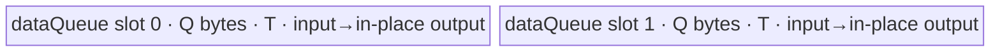

# ForeachLog10 A2/A3 ACLNN 算子知识

## 算子速览

| 项目 | 内容 |
|---|---|
| 实际入口 | `aclnnForeachLog10GetWorkspaceSize` + `aclnnForeachLog10`，CANN 9.1.0 的无版本后缀公开 ACLNN 两段式接口 |
| 计算语义 | 对列表中每个张量逐元素计算 `y_i[j] = log10(x_i[j])` |
| 输入输出 | 动态 TensorList；ND；FLOAT16/FLOAT32/BFLOAT16；输入可非连续，输出不支持非连续 |
| 执行类型 | 单 Kernel，`AIV_VECTOR` |
| Kernel 路线 | R-001 原生 FP16/FP32；R-002 BF16→FP32→BF16 |
| 核心资源 | GM TensorList 指针表、双缓冲 `VECIN`；BF16 另用单缓冲 FP32 Queue；Kernel 不使用用户 workspace |
| 来源闭包 | `source_closed`：公开 ACLNN 契约→OpDef/公共 infer→arch22 Tiling/POD→`foreach_log10` router→公共 unary body→构建及 A2/A3 binary config 已闭合；自动生成 ACLNN bridge 属于框架边界。 |
| 验证状态 | 已完成源码闭包检查；本次知识提取未执行编译、真机、数值或性能测试。 |

## 接口与语义

### 计算语义

令输入列表为 `x=[x_0,...,x_(n-1)]`，输出列表为 `y=[y_0,...,y_(n-1)]`。对每个列表位置 `i` 及该张量存储域中的有效线性元素 `j`，执行 `y_i[j]=log10(x_i[j])`。源码没有额外定义域修正：零、负数、NaN、Inf 的结果由 `Log10` primitive 对相应 dtype 的语义决定。

### 输入、输出与属性

| 参数 | shape/layout | dtype | 约束、默认值与语义 |
|---|---|---|---|
| `x` | TensorList；每个 Tensor 0–8 维，ND | FLOAT16/FLOAT32/BFLOAT16 | 非空指针；列表内 dtype 一致；支持空 Tensor；ACLNN 可接受非连续输入，OpDef `AutoContiguous()` 的具体复制由生成框架负责。 |
| `out` | TensorList；每个 Tensor 0–8 维，ND | 与 `x` 相同 | 非空指针；列表内 dtype 一致；公开契约要求每个输出 shape size 不小于对应输入，且输出不支持非连续；Kernel 只写输入元素数。 |
| `workspaceSize`/`executor` | 标量/执行器 | `uint64_t*`/`aclOpExecutor**` | 第一段接口返回；A2/A3 Tiling 报告 32 B workspace。 |
| `workspace`/`stream` | Device 地址/Stream | N/A | 第二段接口消费；workspace 由调用者持有到执行完成，Kernel 将其替换为 `nullptr` 而不访问。 |

### 入口与版本

固定仓仅公开无版本后缀的 `aclnnForeachLog10GetWorkspaceSize` 与 `aclnnForeachLog10`，未发现同语义的更高版本入口。README 和 ACLNN 文档明确支持 Atlas A2、A3；`ForeachLog10` OpDef 注册 `ascend910b`、`ascend910_93`，Host CMake 将二者映射到 `arch22`，Kernel CMake 与两个 binary config 均有 FLOAT16/FLOAT32/BFLOAT16 接线。两段式 inner bridge 未以手写 `.cpp` 提交，其参数校验、executor 编排和 `AutoContiguous` 是明确的生成框架边界，算子自有 Host/Tiling 与 Kernel 已继续闭合。

## Host/Launcher 执行流程

### 参数校验与前处理

1. ACLNN 第一段检查 `x/out` 非空、支持 dtype、输入输出 dtype 相同、列表内 dtype 一致、维数不超过 8、输出 shape 容量约束；失败返回公开文档列出的 `161001`、`161002` 或 `561002`。
2. OpDef 将输入与输出声明为动态 ND TensorList，并标记 `AutoContiguous()`；输入非连续转换的具体临时对象在固定仓不可见。公共 infer 要求动态输入实例数等于输出数，并把每个输出的 shape/dtype 设为对应输入。
3. `Tiling4ForeachLog10Tiling` 构造 `ForeachCommonTiling`，以 `SOLO_LOG_OP_CODE=2` 初始化，再运行 `RunBigKernelTiling()`；任一步失败返回 `GRAPH_FAILED`。
4. `ForeachCommonTiling::Init` 最多枚举 `MAX_TENSOR_CONT=50` 个输入，记录各 storage shape 元素数、总元素数和统一 dtype。随后 `CheckOpInfo` 检查输出 dtype/容量、维数、列表 dtype 一致性。

### 参数、Workspace 与生命周期

设 `s=sizeof(dtype)`，`e=32/s`（每个 32 B block 的元素数），`N=sum_i numel(x_i)`，平台 AIV 核数为 `C`，Tiling POD 序列化字节数为 `D`，UB 容量为 `U`。

- `blockDim=min(max(1,ceil(N/e)), C, 50)`。
- 先将 `ceil(N/e)` 个 32 B block 均分给 `blockDim` 个核；前 `ceil(N/e) mod blockDim` 个核多一个 block。Host 再把每核区间翻译成起止张量编号与张量内闭区间 offset。
- FP16/FP32：`inputsTensorUbSize=floor32((U-1024-D)/2)`。
- BF16：先令 `total=floor((U-1024-D)/10)`，再令 `inputsTensorUbSize=floor256(total/2)`；256 B 对齐来自 `BYTE_BLOCK_FOR_BF16`。
- Tiling 报告 `workspaces[0]=32`；Device entry 明确令 `userWS=nullptr`，因此 32 B 不形成 Kernel 数据边。executor 与可能的输入连续化临时量由 ACLNN 框架持有，并在传入 stream 上启动单 Kernel。

### 启动图与失败传播

```text
aclnnForeachLog10GetWorkspaceSize(x, out)
  -> [生成框架：校验/可能的输入 Contiguous/executor]
  -> Tiling4ForeachLog10Tiling
     -> ForeachCommonTiling::Init(SOLO_LOG_OP_CODE)
     -> ForeachCommonTiling::RunBigKernelTiling
  -> workspaceSize = 32 B
aclnnForeachLog10(workspace, 32, executor, stream)
  -> foreach_log10<<<blockDim, stream>>>(xList, yList, workspace, tiling)
     -> R-001 或 R-002
```

唯一 Device 节点的输入为 GM TensorList 描述地址 `x/y` 与 `ForeachCommonTilingData`；输出为各 `y_i` 的前 `numel(x_i)` 个元素。没有 Kernel 间 workspace 边。Tiling、executor 建图或 launch 失败都会阻断该节点；固定仓未提交生成 bridge 的清理细节。

## Route 与参数设计

### 分核与资源计算

Host 把列表视为按元素数拼接的一条逻辑流，但边界仍以 `(tensor index, offset)` 写入 POD。核的份额按 32 B block 均分，因此非最后核的额定长度为整 block；最后核以真实张量末尾截断。Device 对每个分到的张量片段，再以 `maxDataCount` 切 tile。FP16/FP32 的 `maxDataCount=inputsTensorUbSize/s`；BF16 的 `maxDataCount=9*inputsTensorUbSize/2`，每个大 tile 再以 `maxCastDataCount=inputsTensorUbSize/4` 做 FP32 分段转换。

### Route 选择

| 顺序 | Route | Key/模板 | 精确选择条件与优先级 | 不适用去向 |
|---:|---|---|---|---|
| 1 | R-001 原生 | key 1：`ForeachImplictOutput<half,half,...,2,1>`；key 2：`<float,float,...,2,1>` | Host `GetTilingKeyByDtypeOnly`: FLOAT16→1，FLOAT32→2；entry 依次判断 key 1、2 | BF16 进入 R-002；其它 dtype 在 OpDef/API 或 Tiling 校验失败 |
| 2 | R-002 BF16 升精度 | key 4：`ForeachImplictOutput<bfloat16_t,float,...,2,1>` | dtype=BFLOAT16 且编译目标不是 `__NPU_ARCH__` 3003/3113；A2/A3 binary config 提供 key 4 dtype 实例 | 编译 guard 不成立则无 key 4 body；公开 A2/A3 构建接线未命中该 guard |

```text
dtype == FLOAT16 -> key 1 -> R-001<half>
else dtype == FLOAT32 -> key 2 -> R-001<float>
else dtype == BFLOAT16 -> key 4 -> R-002<bfloat16_t,float>
else -> GRAPH_FAILED / ACLNN 参数错误
```

### 模板/实现执行矩阵

| Route | key/selector | dtype/shape/platform 完整命中条件 | 执行拓扑与 Kernel 节点 | 实际模板/body | 内存与同步特征 | tail/fallback |
|---|---|---|---|---|---|---|
| R-001 原生 | 1 / 2 | A2/A3；FLOAT16/FLOAT32；Host 校验通过 | 单 `foreach_log10` AIV Kernel | `ForeachImplictOutput<T,T,Log10Adapter<T>,2,1>`→`KernelForeachUnary`→`InnerComputer<T,T>::Compute` | `VECIN` 双缓冲；LocalTensor 原地 `Log10`；V→MTE3 与 MTE3→MTE2 event | 尾 tile 用 `DataCopyPad` 按有效字节读写；无其它 fallback |
| R-002 BF16 升精度 | 4 | A2/A3；BFLOAT16；非 3003/3113 编译 guard；Host 校验通过 | 单 `foreach_log10` AIV Kernel | `ForeachImplictOutput<bfloat16_t,float,Log10Adapter<float>,2,1>`→BF16 `InnerComputer` | 18Q 的 BF16 Queue 字节加 Q 的 FP32 Queue；每段 BF16→FP32→Log10→RINT BF16 | 大 tile 与 cast 子段均有 remainder；最终 GM 仅写有效字节 |

### 隐藏性能 Guard

| Guard | Host/Tiling 条件 | Device/资源原因 | 影响 Route | 不满足时去向 | 源码符号 |
|---|---|---|---|---|---|
| TensorList 固定容量 | 公共 Tiling 仅循环 `i<MAX_TENSOR_CONT(50)` | POD 各张量数组只有 50 项 | 全部 | 固定仓无显式 `>50` 报错；不得把超过 50 项视为已闭合支持 | `foreach_tiling_def.h::MAX_TENSOR_CONT`; `ForeachCommonTiling::Init` |
| UB 预留与对齐 | 原生 `floor32((U-1024-D)/2)`；BF16 `floor256(((U-1024-D)/10)/2)` | 双缓冲、Log10 primitive 1024 B 预留；BF16 cast 扩容 | R-001/R-002 | 无资源 fallback；公式下溢/零 tile 的显式保护固定仓不可见 | `ForeachCommonTiling::DivideUbMemory1` |
| 分核上限 | `min(ceil(N/e), coreNumAiv, 50)`，零元素取 1 | POD per-core 数组仅 50 项 | 全部 | 无更多核 Route | `GetNeedCoreNum`; `RunBigKernelTiling` |
| BF16 编译 guard | `__CCE_AICORE__>=220` 且非 NPU arch 3003/3113 | 需要 BF16 与 FP32 Cast/Log10 路径 | R-002 | guard 不成立则 router 不含 key 4 | `foreach_log10`; `KernelForeachBase::Init` |
| 尾 tile | `dataCount % maxDataCount != 0` | 非 32 B 整块 GM 尾部必须按字节搬运 | 全部 | `DataCopyPad`，不读取/写出无效 GM lane | `KernelForeachUnary::CopyIn`; `ForeachImplictOutput::Compute` |

### POD/ABI

`ForeachCommonTilingData` 由仓内 `BEGIN_TILING_DATA_DEF` 宏声明；宏实现属于外部 Host 框架，因此固定仓不能验证最终 `sizeof/alignof/offsetof`，但字段顺序、元素类型、数组长度、Host producer 和 Device member 读取均闭合。

| 结构 | 字段 | 类型/位宽 | ABI 布局 | 单位 | Host/launcher producer | Device consumer | 边界 |
|---|---|---|---|---|---|---|---|
| `ForeachCommonTilingData` | `inputsTensorUbSize` | `uint64_t`/64 | 第 1 字段；精确 offset/总 sizeof 固定仓不可见 | 字节/Queue slot | `FillTilingData`: `set_inputsTensorUbSize(inputsTensorUbSize)` | `KernelForeachBase::ParseTilingData`; 计算 Queue 容量和 tile | 必须非零且满足 Route UB 公式；源码未显式检查 |
| 同上 | `tensorDataCountList` | `int64_t[50]` | 第 2 字段 | 元素 | `Init` 从每个 input storage shape 写入 | `Process` 计算每个张量的 `cursorEnd` | 未使用项为 0；最多 50 项 |
| 同上 | `tensorStartList` | `uint16_t[50]` | 第 3 字段 | 张量编号 | `AssignDataToEachCore` | 当前 block 的 `tensorStart` | blockIdx 必须小于 blockDim≤50 |
| 同上 | `tensorEndList` | `uint16_t[50]` | 第 4 字段 | 张量编号 | `AssignDataToEachCore` | 当前 block 的 `tensorEnd` | 闭区间 |
| 同上 | `tensorStartOffsetList` | `int64_t[50]` | 第 5 字段 | 元素 | `AssignDataToEachCore` | 首张量起始 GM offset | 相对该张量首元素 |
| 同上 | `tensorEndOffsetList` | `int64_t[50]` | 第 6 字段 | 元素 | `AssignDataToEachCore` | 末张量结束 offset | 闭区间；空片段可为 -1 的行为未单独编码 |

### Route 源码闭包

| Route | Key/selector | Host/Tiling producer | POD/参数 | Kernel entry/router 节点 | Kernel body/直接依赖 | 构建接线 |
|---|---|---|---|---|---|---|
| R-001 原生 | key 1/2 | `foreach_log10_tiling_arch22.cpp::Tiling4ForeachLog10Tiling`; `foreach_tiling_class.h::RunBigKernelTiling` | `ForeachCommonTilingData` | `op_kernel/foreach_log10.cpp::foreach_log10` | `kernel_foreach_base.h`; `kernel_foreach_unary.h`; `foreach_implict_output.h`; `Log10Adapter` | Host/Kernel CMake；ascend910b/ascend910_93 binary JSON |
| R-002 BF16 | key 4 | 同上；`DivideUbMemory1` BF16 分支 | 同上 | 同上 key 4 分支 | 同上；`InnerComputer<bfloat16_t,float>::Compute/ComputePerCast` | 同上 BFLOAT16 binary 条目 |

## Kernel 实现

### 公共执行流程

入口解析 POD 后按 key 构造对应 `ForeachImplictOutput`。`KernelForeachBase::Init` 读取 blockIdx 对应的张量起止边界并确定 tile 容量；`KernelForeachUnary::Process` 逐张量片段绑定 GM 地址，再逐 tile 执行 `CopyIn→Compute`。模板参数 `needCopyOut=false` 消除了 `outQueue`；`ForeachImplictOutput::Compute` 直接在输入 Queue 的 `dataLocal` 上计算并搬到 GM 输出。TensorList 地址解析协议是：描述首个 `uint64_t` 给出指针数组相对描述首址的字节 offset，右移 3 转为 `uint64_t` 索引，再读取第 `i` 个实际 GM 指针。

### Route R-001：原生 FP16/FP32

#### 适用条件

##### 选择证据

| 层级 | 文件 | 符号 | 源码谓词/参数 | 结果/下一跳 |
|---|---|---|---|---|
| API/OpDef | `foreach_log10_def.cpp` | `ForeachLog10::ForeachLog10` | dtype∈{FLOAT16,FLOAT32,BFLOAT16}，A2/A3 config | 进入 arch22 Host |
| Host/Tiling | `foreach_tiling_class.h` | `RunBigKernelTiling` | `GetTilingKeyByDtypeOnly(FLOAT16/FLOAT32)` | key 1/key 2 |
| Router | `op_kernel/foreach_log10.cpp` | `foreach_log10` | `TILING_KEY_IS(1)` / `TILING_KEY_IS(2)`，按源码顺序 | `ForeachImplictOutput<half,half,...>` / `<float,float,...>` |

#### Device 数据流

##### 函数级调用链

```text
foreach_log10(xList,yList,workspace,tiling)
  -> ForeachImplictOutput<T,T,Log10Adapter<T>,2,1>::Init
     -> KernelForeachUnary::Init -> KernelForeachBase::Init/ParseTilingData
  -> KernelForeachUnary::Process
     -> GetTensorAddr + SingleTensorProcess
        -> CopyIn -> DataCopy/DataCopyPad -> dataQueue.EnQue
        -> ForeachImplictOutput::Compute
           -> dataQueue.DeQue -> InnerComputer::Compute
           -> Log10Adapter -> Log10<T>(dataLocal,dataLocal)
           -> V_MTE3 wait -> DataCopy/DataCopyPad to y -> MTE3_MTE2 wait -> FreeTensor
```

##### 源码等价伪码

```text
# 伪码
range = POD[blockIdx] 的 (tensorStart,startOffset)..(tensorEnd,endOffset)
for tensor i in range:
  begin = i==start ? startOffset : 0
  end   = i==end   ? endOffset   : tensorNumel[i]-1
  count = end-begin+1
  xGM = tensor_addr(xList,i)+begin; yGM = tensor_addr(yList,i)+begin
  for tile in ceil(count/maxDataCount):
    valid = min(maxDataCount,count-tile*maxDataCount)
    dataLocal = CopyIn(xGM+tile*maxDataCount, valid)  # 尾块按字节 DataCopyPad
    Log10<T>(dataLocal,dataLocal)                    # uValue/valid 未传入 primitive
    wait V->MTE3
    CopyOut(yGM+tile*maxDataCount,dataLocal,valid)   # 只提交有效字节
    wait MTE3->MTE2; free dataLocal
```

#### 内存与数据搬运

##### 资源与搬运表

| 层级/缓冲区 | offset/地址公式 | extent/容量公式 | dtype/layout | producer | consumer | owner/lifetime | 对齐/复用 |
|---|---|---|---|---|---|---|---|
| GM `x_i` | `tensor_addr(xList,i)+cursorStart+tile*maxDataCount` | `valid` 元素 | T/ND 线性存储 | caller | `CopyIn` | caller；Kernel 只读 | 整 tile `DataCopy`，尾 tile 按 `valid*s` 字节 |
| `dataQueue` | Queue slot | 每 slot `Q=inputsTensorUbSize` B，depth=2 | T | `CopyIn` | `InnerComputer`/GM CopyOut | `TPipe`；Alloc→EnQue→DeQue→Free | 同一 LocalTensor 原地覆写输入为输出 |
| GM `y_i` | 与输入逻辑 offset 相同 | `valid` 元素 | T/ND | `Compute` 后 DMA | caller | caller；stream 完成后可读 | 只写输入有效域 |
| workspace | N/A | Host 报告 32 B | N/A | caller | 无 Device consumer | caller/executor | entry 强制 `userWS=nullptr` |

##### 分层内存布局



##### 字节账与复用顺序

```text
Q = floor32((U - 1024 - D) / 2)
UB_total = 2 * Q
UB_total <= U - 1024 - D <= U
dynamic_ub = N/A
workspace_total = 32 B（Kernel 数据路径实际使用 0 B）
=> maxDataCount = Q / sizeof(T)
```

| 复用子区 | 写入者 | 读取者/消费点 | 下一次覆盖 | 同步或释放依据 | 安全条件 |
|---|---|---|---|---|---|
| 当前 `dataQueue` slot | `CopyIn` | `Log10<T>`，随后 MTE3 CopyOut | `FreeTensor` 后的后续 tile | Queue EnQue/DeQue；`V_MTE3`；`MTE3_MTE2`；FreeTensor | CopyOut 完成前不得被下一次 MTE2 覆盖 |

#### 同步、精度与尾块

##### 同步与数值边界表

| 阶段 | primitive/机制 | producer | consumer/等待点 | 保护对象 | 精度/尾块 |
|---|---|---|---|---|---|
| GM→UB | TQue + MTE2 | `DataCopy/Pad` | `dataQueue.DeQue` | 当前 input slot | 尾块 `blockCount=1, blockLen=valid*s`，无 padding 写入 |
| Vector | `Log10<T>(dst,src)` | DeQue 后 LocalTensor | `V_MTE3` wait | 原地 LocalTensor | FP16/FP32 原生 dtype；源码的 `uValue=dataCount` 被 adapter 忽略，primitive mask/repeat 是库内部边界 |
| UB→GM | `V_MTE3`、`MTE3_MTE2` | Vector / MTE3 | CopyOut / 下一次 MTE2 | 输出有效字节及 slot 复用 | 尾块仅复制 `valid*s` 字节 |

#### 关键实现

##### 符号证据表

| 阶段 | 文件 | 符号/模板实例 | 实现事实 |
|---|---|---|---|
| Host/Tiling producer | `foreach_tiling_class.h` | `RunBigKernelTiling`; `AssignDataToEachCore`; `DivideUbMemory1` | key、分核、UB、POD、32 B workspace |
| Kernel entry/router | `foreach_log10/op_kernel/foreach_log10.cpp` | `foreach_log10`; key 1/2 | dtype key 到原生模板映射 |
| Device body/helper | `kernel_foreach_unary.h`; `foreach_implict_output.h` | `Process/CopyIn`; `InnerComputer::Compute`; `ForeachImplictOutput::Compute` | 逐张量/tile 循环、原地 Log10、同步与尾搬运 |

### Route R-002：BF16 升精度

#### 适用条件

##### 选择证据

| 层级 | 文件 | 符号 | 源码谓词/参数 | 结果/下一跳 |
|---|---|---|---|---|
| API/OpDef | `foreach_log10_def.cpp` | `ForeachLog10::ForeachLog10` | BFLOAT16 且 A2/A3 | 进入 arch22 Host |
| Host/Tiling | `foreach_tiling_class.h` | `RunBigKernelTiling`; `DivideUbMemory1` | BF16→key 4；`total=(U-1024-D)/10` | BF16 POD 与 UB 容量 |
| Router | `op_kernel/foreach_log10.cpp` | `foreach_log10` | `TILING_KEY_IS(4)` 且非 arch 3003/3113 | `ForeachImplictOutput<bfloat16_t,float,...,2,1>` |

#### Device 数据流

##### 函数级调用链

```text
foreach_log10 key4
  -> KernelForeachBase<bfloat16_t>::Init (totalTensorUbSize=9Q,maxCastDataCount=Q/4)
  -> KernelForeachUnary::Init (BF16 dataQueue depth2 + FP32 queue depth1)
  -> Process/CopyIn
  -> InnerComputer<bfloat16_t,float>::Compute
     -> repeated ComputePerCast
        -> Cast BF16→FP32(CAST_NONE)
        -> Log10<float>(float32Tensor,float32Tensor)
        -> Cast FP32→BF16(CAST_RINT)
  -> V_MTE3 wait -> GM CopyOut -> MTE3_MTE2 wait
```

##### 源码等价伪码

```text
# 伪码；分核/逐张量同 R-001
Q = POD.inputsTensorUbSize
maxDataCount = 9*Q/2          # BF16 元素
maxCastDataCount = Q/4        # FP32 元素
for each big tile of at most maxDataCount:
  BF16 dataLocal = CopyIn(valid)
  for cast chunk c of at most maxCastDataCount:
    barrier V
    fp32 = Cast(dataLocal[c], CAST_NONE, chunkValid)
    barrier V
    fp32 = Log10<float>(fp32)
    barrier V
    dataLocal[c] = Cast(fp32, CAST_RINT, chunkValid)
    barrier V
  wait V->MTE3; CopyOut only valid BF16 bytes; wait MTE3->MTE2; free
```

#### 内存与数据搬运

##### 资源与搬运表

| 层级/缓冲区 | offset/地址公式 | extent/容量公式 | dtype/layout | producer | consumer | owner/lifetime | 对齐/复用 |
|---|---|---|---|---|---|---|---|
| GM `x_i/y_i` | 同 R-001 | 每 tile 最多 `9Q/2` 元素，尾部 `valid` | BF16/ND | caller/Kernel | Kernel/caller | caller | GM 尾部按字节搬运 |
| `dataQueue` | 2 个 slot | 每 slot `9Q` B | BF16 | CopyIn | Cast/最终 CopyOut | TPipe；每 tile一个 slot | BF16 输入与最终结果原地复用 |
| `float32Queue` | 单 slot | `Q` B=`Q/4` FP32 元素 | FLOAT32 | BF16 Cast | Log10、回 Cast | 整个 Process 期间 Alloc，一次 DeQue，结束 Free | 每个 cast chunk 覆盖同一 FP32 子区 |

##### 分层内存布局


##### 字节账与复用顺序

```text
Q = floor256(floor((U - 1024 - D) / 10) / 2)
UB_total = 2 * 9Q + 1 * Q = 19Q
19Q <= 20Q <= U - 1024 - D <= U
dynamic_ub = N/A
workspace_total = 32 B（Kernel 使用 0 B）
=> maxDataCount=9Q/2 BF16 elements; maxCastDataCount=Q/4 FP32 elements
```

| 复用子区 | 写入者 | 读取者/消费点 | 下一次覆盖 | 同步或释放依据 | 安全条件 |
|---|---|---|---|---|---|
| BF16 `dataQueue` slot | CopyIn / FP32→BF16 Cast | BF16→FP32 Cast / GM CopyOut | MTE3 完成后下一 tile | Vector barriers + V_MTE3 + MTE3_MTE2 + FreeTensor | 当前 chunk 回写不能覆盖尚未读取的其它 chunk；offset 按 `c*maxCastDataCount` |
| FP32 scratch | BF16→FP32 Cast | `Log10<float>` 与回 Cast | 下一 cast chunk | 四个 `PIPE_V` barrier | paramsCount=1 令输出 offset=0，原地 Log10 |

#### 同步、精度与尾块

##### 同步与数值边界表

| 阶段 | primitive/机制 | producer | consumer/等待点 | 保护对象 | 精度/尾块 |
|---|---|---|---|---|---|
| BF16→FP32 | `Cast(...CAST_NONE)` + `PIPE_V` | BF16 LocalTensor | FP32 Log10 | FP32 scratch | cast chunk 尾部用真实 `dataCount` |
| FP32 Log10 | `Log10<float>` 原地 | FP32 Cast | FP32→BF16 Cast | scratch | 计算在 FP32 完成 |
| FP32→BF16 | `Cast(...CAST_RINT)` + barrier | Log10 | GM CopyOut | BF16 dataLocal | round-to-nearest-integer mode `CAST_RINT`；只提交有效尾字节 |
| Queue/DMA | Queue + V_MTE3 + MTE3_MTE2 | CopyIn/Vector | Vector/CopyOut/下一 CopyIn | 双缓冲 slot | 防止计算前读取和写回前覆盖 |

#### 关键实现

##### 符号证据表

| 阶段 | 文件 | 符号/模板实例 | 实现事实 |
|---|---|---|---|
| Host/Tiling producer | `foreach_tiling_class.h` | `DivideUbMemory1`; `FillTilingData` | BF16 `/10` 衰减、`/2` 与 256 B 对齐 |
| Kernel entry/router | `foreach_log10/op_kernel/foreach_log10.cpp` | key 4 branch | BF16 storage、FP32 compute 模板 |
| Device body/helper | `kernel_foreach_base.h`; `kernel_foreach_unary.h`; `foreach_implict_output.h` | BF16 `Init`; `InnerComputer<bfloat16_t,float>` | 9Q BF16 slot、Q FP32 scratch、分段 cast/round/barrier |

## 算子特定优化

### Trick T-001：输入 Queue 原地生成输出并直接回写 GM

#### 触发与源码依据

- 适用 Route：R-001、R-002
- 触发条件：模板实例固定 `needCopyOut=false`，`ForeachImplictOutput::Compute` 接管回写。
- Golden 来源：[`foreach/foreach_utils/op_kernel/foreach_implict_output.h:94-115`](../../../../../../../cann-ops-raw/ascendc/ops-nn/955f8b33985b6d72989ebff341bb9c2c564a51bc/foreach/foreach_utils/op_kernel/foreach_implict_output.h)

**官方源码（固定 Commit 连续逐字摘录）**：

```cpp
LocalTensor<T> dataLocal = Base::dataQueue.template DeQue<T>();
InnerComputer<T, P, op, paramsCount> computer;
computer.Compute(dataLocal, float32Tensor, Base::maxCastDataCount, dataCount);

event_t eventIDVToMTE3 = static_cast<event_t>(GetTPipePtr()->FetchEventID(HardEvent::V_MTE3));
SetFlag<HardEvent::V_MTE3>(eventIDVToMTE3);
WaitFlag<HardEvent::V_MTE3>(eventIDVToMTE3);
```

#### 机制与设计原因

`InnerComputer` 的 dst/src 都是 `dataLocal`，因此输入 Queue slot 在 Vector 阶段直接变成输出；随后在同一函数完成 UB→GM，不分配 `VECOUT` Queue，也不物化额外 LocalTensor。`V_MTE3` 保证 Vector 完成后才搬出，`MTE3_MTE2` 保证同一 slot 在写回完成前不会被新输入覆盖。该机制降低一份输出 Queue 占用并省去 UB 内中间复制；未执行性能测量。

#### 迁移边界

- 适用：逐元素、输入读取完成后可安全原地覆盖且输出 dtype/容量与 LocalTensor 兼容的 unary foreach。
- 前提：保留 `needCopyOut=false`、V→MTE3→MTE2 事件顺序及尾块有效字节搬运；BF16 还须保留 FP32 scratch。
- 失效：需要同时保留原输入、产生多输出或输出布局不同的实现必须使用独立输出缓冲/Route。
- 未验证：本次知识提取未执行编译、真机、数值或性能测试。

#### 错误做法

固定仓未提供可验证反例。

## 模板与实现对比

| 对比维度 | R-001 原生 | R-002 BF16 升精度 | 设计选择依据 |
|---|---|---|---|
| 命中条件/优先级 | key 1 FP16；key 2 FP32 | key 4 BF16 | dtype-only selector |
| 模板与 dtype | `<T,T,...,2,1>` | `<bfloat16_t,float,...,2,1>` | BF16 借助 FP32 primitive |
| 循环与分核 | 32 B block 均核；单层 tile | 相同外层；tile 内再分 cast chunk | FP32 scratch 小于 BF16 data slot |
| Queue/TBuf/寄存器/dynamic UB/通信 window | `VECIN` depth2；无 outQueue | `VECIN` depth2 + FP32 Queue depth1 | 条件分配 |
| 内存总占用与复用 | `2Q`，输入 slot 原地输出 | `19Q`，BF16 slot 原地输出，FP32 scratch 循环复用 | Host 对 BF16 Q 做 `/10` 衰减 |
| 搬运/Vector/SIMT/NDDMA/通信 API | DataCopy/Pad + `Log10<T>` | DataCopy/Pad + Cast + `Log10<float>` + Cast | BF16 精度路径 |
| 同步、精度与 tail | Queue、V_MTE3、MTE3_MTE2；原生精度 | 另有 PIPE_V barriers，回写 CAST_RINT | 两者 GM tail 都按有效字节 |
| fallback/失败边界 | 无运行时 fallback | 编译 guard 不含 key4 时不可达 | 非支持 dtype 失败 |

## 平台差异

| 项目 | A2 | A3 | 950 |
|---|---|---|---|
| 支持状态 | 公开支持 | 公开支持 | 公开支持，见独立 `_950` 卡 |
| Host/Launcher | `ascend910b`→arch22 公共 Tiling | `ascend910_93`→同一 arch22 Tiling | arch35 专用 Tiling，workspace 0 |
| Kernel/资源 | 默认 `op_kernel/foreach_log10.cpp` AIV；POD 最多 50 张量 | 与 A2 共用 | arch35 SIMT；最多 256 张量；不使用 AIV Queue |

## 限制与失败边界

- 公共 arch22 Tiling/POD 仅有 50 个张量槽，且 `Init` 没有显式拒绝输入实例数大于 50；固定仓无法证明框架在更早阶段封顶，因此复用时必须把 `TensorList<=50` 作为边界。
- 输入/输出 dtype、列表内 dtype、维数、输出容量不满足约束时失败；公共 infer 要求输入输出实例数相等。输出额外容量不被 Kernel 写入。
- `inputsTensorUbSize` 的计算对 `U<=1024+D`、窄化到 `uint32_t` 或结果为 0 没有显式失败分支；这些极小 UB 情况不属于已闭合可用域。
- 空 Tensor 的 tile 循环次数为 0；整个空 TensorList 的生成 bridge/描述指针安全性固定仓不可见，不能从“支持空 Tensor”外推为“支持空列表”。
- `Log10Adapter` 不把有效长度传给二参数 `Log10` primitive；primitive 的内部 mask/repeat 及异常值细节不在固定仓，只有 GM 尾部的有效字节提交可由算子源码证明。
- 本次知识提取未执行编译、真机、数值或性能测试。

## 源码索引

### 链路索引

| 链路阶段 | 文件 | 关键符号 | 支撑内容 |
|---|---|---|---|
| 入口声明/约束 | `foreach/foreach_log10/docs/aclnnForeachLog10.md` | `aclnnForeachLog10GetWorkspaceSize`; `aclnnForeachLog10` | 公开原型、约束、错误码、两段式生命周期 |
| 平台/语义 | `foreach/foreach_log10/README.md` | 产品支持表、公式 | A2/A3/950 公开支持与语义 |
| OpDef | `foreach/foreach_log10/op_host/foreach_log10_def.cpp` | `ForeachLog10` | dtype/layout、AutoContiguous、平台注册 |
| infer | `foreach/foreach_utils/op_host/foreach_infershape.cpp` | `InferShape4ForeachCommon`; `InferDataType4ForeachCommon`; ForeachLog10 注册 | 输出数量/shape/dtype |
| Host wrapper | `foreach/foreach_log10/op_host/arch22/foreach_log10_tiling_arch22.cpp` | `Tiling4ForeachLog10Tiling` | SOLO_LOG 公共 Tiling 入口 |
| Host/Tiling | `foreach/foreach_utils/op_host/foreach_tiling_class.h` | `ForeachCommonTiling` | 校验、分核、UB、key、workspace、POD producer |
| POD | `foreach/foreach_utils/op_host/foreach_tiling_def.h` | `ForeachCommonTilingData` | 字段、数组上限、注册 |
| Kernel entry | `foreach/foreach_log10/op_kernel/foreach_log10.cpp` | `foreach_log10`; `Log10Adapter` | key→模板及 primitive |
| Kernel base | `foreach/foreach_utils/op_kernel/kernel_foreach_base.h` | `KernelForeachBase` | POD consumer、TensorList 地址、BF16 容量 |
| Kernel loop | `foreach/foreach_utils/op_kernel/kernel_foreach_unary.h` | `KernelForeachUnary` | Queue、逐张量/tile、CopyIn/tail |
| Kernel compute | `foreach/foreach_utils/op_kernel/foreach_implict_output.h` | `InnerComputer`; `ForeachImplictOutput` | 原地输出、BF16 Cast、同步、CopyOut |
| Host 构建 | `foreach/foreach_log10/op_host/CMakeLists.txt` | `SUPPORT_COMPUTE_UNIT`; `SUPPORT_TILING_DIR`; `ACLNNTYPE aclnn` | A2/A3 arch22 与 ACLNN 生成接线 |
| Kernel 构建 | `foreach/foreach_log10/op_kernel/CMakeLists.txt` | `add_kernel_sources` | A2/A3 默认 Kernel、AUTO_SYNC false |
| A2 binary | `foreach/foreach_log10/op_host/config/ascend910b/foreach_log10_binary.json` | `ForeachLog10` op_list | 三 dtype 二进制实例 |
| A3 binary | `foreach/foreach_log10/op_host/config/ascend910_93/foreach_log10_binary.json` | `ForeachLog10` op_list | 三 dtype 二进制实例 |

### 实现复用检查

| 检查项 | 可复用事实 | 不得改变的约束 | 源码符号 |
|---|---|---|---|
| ABI/POD | 六字段公共 POD 与每核闭区间 | 字段顺序/类型、50 项数组、元素单位 | `ForeachCommonTilingData`; `ParseTilingData` |
| 调用顺序 | Init→Process→逐张量→逐 tile→CopyIn→Compute/CopyOut | key router 和闭区间地址公式 | `foreach_log10`; `KernelForeachUnary::Process` |
| workspace/内存 | Host 32 B、Kernel不使用；原生2Q/BF16 19Q | Q 的对齐/衰减与 BF16 9Q/Q 分区 | `RunBigKernelTiling`; `DivideUbMemory1`; `InitBuffer` |
| 同步 | Queue + V_MTE3 + MTE3_MTE2；BF16 PIPE_V | 不能提前复用 slot/scratch | `ForeachImplictOutput::Compute`; `ComputePerCast` |
| 精度与尾块 | 原生 dtype 或 BF16→FP32→RINT；GM 尾按字节 | cast 顺序、round mode、有效字节数 | `InnerComputer`; `CopyIn`; `Compute` |
| 失败边界 | dtype/shape/维数/UB/TensorList 上限 | 不得给无源码 fallback；>50 不得视为闭合 | `CheckOpInfo`; `ForeachCommonTiling::Init` |