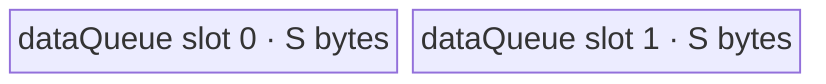

# ForeachLog1p A2/A3 ACLNN 算子知识

## 算子速览

| 项目 | 内容 |
|---|---|
| 实际入口 | 公开两段式 `aclnnForeachLog1pGetWorkspaceSize` / `aclnnForeachLog1p`，固定仓未公开版本后缀 |
| 计算语义 | 对列表中每个张量逐元素计算 `y_i[j] = ln(x_i[j] + 1)` |
| 输入输出 | 动态 TensorList；ND；FP16、FP32、BF16；输出与对应输入 dtype 相同，输出元素容量不得小于输入 |
| 执行类型 | 单 Kernel `AIV_VECTOR` |
| Kernel 路线 | R-001：FP16/FP32 原 dtype Vector；R-002：BF16→FP32→BF16 Vector |
| 核心资源 | GM TensorList 指针表、`VECIN` 双缓冲 `dataQueue`；BF16 另有单缓冲 `float32Queue`；算子不使用 workspace 数据 |
| 来源闭包 | `source_closed`：公开 ACLNN 文档→`ACLNNTYPE aclnn` 生成边界→`ForeachLog1p` OpDef→arch22 Tiling/POD→key router→公共 Foreach Kernel body→A2/A3 构建接线闭合 |
| 验证状态 | 已完成源码闭包检查；本次知识提取未执行编译、真机、数值或性能测试。 |

## 接口与语义

### 计算语义

令输入列表为 `x=[x_0,...,x_(n-1)]`。对每个列表项及其有效元素 `j`，输出为 `y_i[j]=log_e(x_i[j]+1)`。A2/A3 的 FP16、FP32 路线先在原 dtype 的 UB tensor 上执行 `Adds(..., 1)`，再原地执行 `Log`；BF16 路线把分片转为 FP32，按相同顺序计算，再以 `CAST_RINT` 转回 BF16。源码不额外裁剪定义域，`x<-1`、`x=-1` 和 NaN/Inf 的具体结果沿用 Vector primitive 语义。

### 输入、输出与属性

| 参数 | shape/layout | dtype | 约束、默认值与语义 |
|---|---|---|---|
| `x` | TensorList；每项 0–8 维；ND；输入可非连续并由 `AutoContiguous` 处理 | FP16、FP32、BF16 | 列表内所有 Tensor dtype 必须一致；支持零元素 Tensor；公共 Tiling 的定长表最多记录 50 项 |
| `out` | TensorList；每项 ND，列表项数由公共 infer-shape 要求与输入相同 | 与 `x` 相同 | 不支持非连续输出；对应输出 storage shape 不相同时，输出元素数必须不小于输入元素数；Kernel 只写输入元素覆盖的前缀 |
| `workspaceSize` | 标量输出 | `uint64_t` | 第一段接口返回；算子拥有的 Tiling 固定请求 32 B，但 Kernel 把 `userWS` 设为 `nullptr`；生成框架为非连续输入准备的额外 workspace 公式固定仓不可见 |
| `executor` | Host 对象 | `aclOpExecutor**` | 第一段接口产生并持有计算流程，第二段接口消费 |
| `workspace` / `stream` | Device 地址 / runtime stream | — | 第二段接口提交执行；workspace 生命周期覆盖提交，stream 决定执行次序 |

### 入口与版本

固定 Commit 公开的最新入口名为无版本后缀 `aclnnForeachLog1p`。文档明确支持 Atlas A2、A3，OpDef 注册 `ascend910b` 与 `ascend910_93`，Host CMake 将两者都映射到 `arch22`，Kernel CMake 为两者编译公共 `op_kernel/foreach_log1p.cpp`。固定仓未保存生成后的 ACLNN inner bridge 函数体；`add_modules_sources(... ACLNNTYPE aclnn ...)` 是该框架生成边界，算子拥有的 OpDef、校验、Tiling、POD、router 和 body 均已闭合。

## Host/Launcher 执行流程

### 参数校验与前处理

1. ACLNN 第一段接口校验 `x/out` 非空、dtype 属于 FP16/FP32/BF16 且输入输出一致；文档将 shape、列表内 dtype 和维数错误归为 inner tiling error。
2. OpDef 对动态输入、动态输出声明 ND 与 `AutoContiguous`；因此非连续输入在框架边界连续化，输出必须连续。
3. `ForeachCommonTiling::Init(SOLO_LOG_OP_CODE)` 最多枚举 50 个输入 Tensor，记录 storage 元素数、总元素数、首项 dtype 和 dtype 字节数。
4. `CheckOpInfo` 依次检查动态列表规模、每项维数不超过 8、输出 dtype、输出容量和列表内 dtype 一致性；任一步失败返回 `GRAPH_FAILED`。
5. 公共 infer-shape 将每个输出 shape、dtype复制为对应输入；其输入列表项数与输出数不一致时失败。

### 参数、Workspace 与生命周期

`RunBigKernelTiling` 从平台读取 AIV 核数与 UB 容量，按总元素的 32 B block 数选择核数，把展平列表连续分配给各核，再产生每核首尾 Tensor/offset 与每个 Tensor 元素数。Tiling POD 由 runtime 复制给 Device，在 Kernel 完成前有效。Tiling 将算子节点的 `workspace[0]` 设为 32 B；Kernel entry 明确丢弃传入的 workspace 并将 `userWS=nullptr`，所以这 32 B 是 Host/框架预留，不是节点间数据边。`AutoContiguous` 可能在生成 executor 中为非连续输入增加框架节点和 workspace；其生成函数体与总量公式不在固定仓内。

### 启动图与失败传播

```text
aclnnForeachLog1pGetWorkspaceSize(x, out)
  -> 生成 ACLNN bridge / ForeachLog1p OpDef
  -> Tiling4ForeachLog1pTiling
     -> ForeachCommonTiling::Init(SOLO_LOG_OP_CODE)
     -> ForeachCommonTiling::RunBigKernelTiling
  -> executor + workspaceSize
aclnnForeachLog1p(workspace, workspaceSize, executor, stream)
  -> [同一 stream，单节点] foreach_log1p<<<blockDim=needCoreNum>>>(xList, yList, workspace, tiling)
```

算子拥有的唯一节点 entry 为 `foreach_log1p`，POD 为 `ForeachCommonTilingData`，输入/输出是 TensorList GM 指针表，无被消费的 workspace slice；非连续输入的框架 `Contiguous` 节点属于固定仓明确不可见的生成边界。Tiling/launch 失败会阻断算子节点提交；Kernel 内无后继节点、event 边或 cleanup 节点。输出 GM 由调用者持有，提交完成前不得释放或覆盖。

## Route 与参数设计

### 分核与资源计算

设 dtype 字节数 `B`，`E=32/B` 个元素/32 B block，所有输入元素总数为 `N`，平台 AIV 核数为 `C`：

```text
blocks = ceil(N / E)
needCoreNum = min(max(blocks, 1), C, 50)
baseElements = floor(blocks / needCoreNum) * E
前 blocks % needCoreNum 个核再多处理 E 个元素
```

每核区间可跨 Tensor，POD 以 `tensorStart/End` 与 inclusive `tensorStartOffset/EndOffset` 表示。令 `P=ForeachCommonTilingData::GetDataSize()`（按声明字段推得 1408 B），平台 UB 为 `U`。FP16/FP32 的 `S=floor32((U-1024-P)/2)`；BF16 的 `S=floor64(((U-1024-P)/10)/2)`。`S` 是 `inputsTensorUbSize` 字节数，不是元素数。

### Route 选择

| 顺序 | Route | Key/模板 | 精确选择条件与优先级 | 不适用去向 |
|---:|---|---|---|---|
| 1 | R-001 原 dtype Vector | key 1：`ForeachImplictOutput<half,half,...,2,1>`；key 2：`<float,float,...,2,1>` | `GetTilingKeyByDtypeOnly` 对 FP16/FP32 分别产生 1/2，router 按 `if`/`else if` 顺序命中 | key 4 或无执行 |
| 2 | R-002 BF16 升精度 Vector | key 4：`ForeachImplictOutput<bfloat16_t,float,...,2,1>` | dtype=BF16；A2/A3 不命中排除 BF16 的 Kirin `__NPU_ARCH__` guard | 未知 key 无 body、无输出 |

```text
dtype == FP16 -> key 1 -> R-001<half>
else dtype == FP32 -> key 2 -> R-001<float>
else dtype == BF16 -> key 4 -> R-002<bfloat16_t,float>
else -> Host OpDef/校验拒绝；若异常 key 到达 entry，则不执行任何分支
```

### 模板/实现执行矩阵

| Route | key/selector | dtype/shape/platform 完整命中条件 | 执行拓扑与 Kernel 节点 | 实际模板/body | 内存与同步特征 | tail/fallback |
|---|---|---|---|---|---|---|
| R-001 原 dtype Vector | 1/2 | FP16/FP32；ND；每项≤8维；A2/A3 | 单 AIV Kernel | `ForeachImplictOutput<T,T,Log1pAdapter<T>,2,1>::Process` | `VECIN` depth=2；原地 Adds→Log；V→MTE3、MTE3→MTE2 event | 整 tile 用 `DataCopy`；尾 tile 用精确字节 `DataCopyPad` |
| R-002 BF16 升精度 Vector | 4 | BF16；同 shape 条件；A2/A3 | 单 AIV Kernel | `ForeachImplictOutput<bfloat16_t,float,Log1pAdapter<float>,2,1>::Process` | BF16 `VECIN` depth=2，单缓冲 FP32 scratch；每段 Cast→Adds→Log→Cast | 分片再按 FP32 scratch 容量切段；尾搬运同 R-001 |

### 隐藏性能 Guard

| Guard | Host/Tiling 条件 | Device/资源原因 | 影响 Route | 不满足时去向 | 源码符号 |
|---|---|---|---|---|---|
| 列表上限 | `Init` 循环 `i < 50` | POD 的 Tensor 数组固定 50 项 | 全部 | 固定实现未显式报“超过 50”；后续项不可由此 POD 表达，调用方不得超过 | `foreach_tiling_class.h::ForeachCommonTiling::Init` |
| 维数上限 | 每项 `GetDimNum() <= 8` | API 约束 | 全部 | `GRAPH_FAILED` | `CheckInputTensorlistShape` |
| block 分核与 tile 对齐 | `elementsPerBlock=32/B`；FP16/FP32 的 S 向下对齐32 B，BF16 的 S 向下对齐64 B | 分核按32 B DMA block；BF16 cast路线使用专门的64 B buffer粒度 | 全部 | 尾部由 `DataCopyPad` 处理 | `common_dtype.h` / `GetNeedCoreNum` / `DivideUbMemory1` |
| UB 容量 | FP 路线 `2S <= U-1024-P`；BF16 路线 `19S <= U-1024-P`（Host `/10` 后再 `/2` 保守满足） | 双缓冲和 BF16 cast scratch 必须同时驻留 | 全部 | 固定源码未提供更小 tile fallback；`S=0` 会令 Device 分片除零，平台 UB 必须满足正容量 | `DivideUbMemory1` / `KernelForeachUnary::Init` |
| BF16 编译 guard | 非 `__NPU_ARCH__==3003/3113` | 这两 Kirin 架构不支持 BF16 | R-002 | A2/A3 可达；被排除架构无 key 4 body | `foreach_log1p.cpp::foreach_log1p` |
| unknown key | key 非 1/2/4 | entry 没有 fallback | 全部 | 无计算、无输出提交 | `foreach_log1p` |

### POD/ABI

Host 与 Device 共用 `ForeachCommonTilingData` 注册定义。以下 offset/size 由固定字段顺序、标准自然对齐推得；宏展开后的 `sizeof/alignof/offsetof` 未在仓中显式打印。

| 结构 | 字段 | 类型/位宽 | ABI 布局 | 单位 | Host/launcher producer | Device consumer | 边界 |
|---|---|---|---|---|---|---|---|
| `ForeachCommonTilingData` | `inputsTensorUbSize` | `uint64_t`/64 | offset 0；结构推得 size 1408、align 8 | 字节 | `DivideUbMemory1`→`FillTilingData` | `KernelForeachBase::Init` 计算 tile 与队列容量 | 必须>0；FP16/FP32按32 B、BF16按64 B对齐 |
| 同上 | `tensorDataCountList` | `int64_t[50]` | offset 8，400 B | 元素/每 Tensor | `Init` | `KernelForeachUnary::Process` 计算 Tensor 末端 | 仅已枚举项有效 |
| 同上 | `tensorStartList` | `uint16_t[50]` | offset 408，100 B | Tensor 索引/每核 | `AssignDataToEachCore` | `ParseTilingData` | blockIdx 对应项有效 |
| 同上 | `tensorEndList` | `uint16_t[50]` | offset 508，100 B | inclusive Tensor 索引/每核 | `AssignDataToEachCore` | `ParseTilingData` | 同上 |
| 同上 | `tensorStartOffsetList` | `int64_t[50]` | offset 608，400 B | 元素/每核 | `AssignDataToEachCore` | `Process` 的 `cursorStart` | inclusive 起点 |
| 同上 | `tensorEndOffsetList` | `int64_t[50]` | offset 1008，400 B | 元素/每核 | `AssignDataToEachCore` | `Process` 的 `cursorEnd` | inclusive 终点 |

### Route 源码闭包

| Route | Key/selector | Host/Tiling producer | POD/参数 | Kernel entry/router 节点 | Kernel body/直接依赖 | 构建接线 |
|---|---|---|---|---|---|---|
| R-001 原 dtype Vector | 1/2 | `arch22/foreach_log1p_tiling_arch22.cpp::Tiling4ForeachLog1pTiling`；`foreach_tiling_class.h::RunBigKernelTiling` | `ForeachCommonTilingData` | `op_kernel/foreach_log1p.cpp::foreach_log1p` | `Log1pAdapter`；`KernelForeachUnary`；`ForeachImplictOutput` | `op_kernel/CMakeLists.txt::add_kernel_sources(ascend910b,ascend910_93)` |
| R-002 BF16 升精度 Vector | 4 | 同上 | 同上 | 同上 key 4 分支 | `InnerComputer<bfloat16_t,float>` 及公共 base | 同上 |

## Kernel 实现

### 公共执行流程

entry 解析 POD 后按 key 实例化一个 `ForeachImplictOutput`。`KernelForeachBase` 用 `GetBlockIdx()` 选择该核的列表区间；TensorList GM 对象的首个 `uint64_t` 给出指针表相对偏移，随后按 Tensor 索引读取真实数据指针。每核逐 Tensor、逐 tile 执行 GM→`dataQueue`→原地 Vector 计算→GM。`needCopyOut=false` 消除了 `outQueue`，派生类在 `Compute` 内直接搬出。

### Route R-001：FP16/FP32 原 dtype Vector

#### 适用条件

##### 选择证据

| 层级 | 文件 | 符号 | 源码谓词/参数 | 结果/下一跳 |
|---|---|---|---|---|
| Host/Tiling | `foreach/foreach_utils/op_host/foreach_tiling_class.h` | `RunBigKernelTiling` | `SetTilingKey(GetTilingKeyByDtypeOnly(dataType))` | FP16→1、FP32→2 |
| Router | `foreach/foreach_log1p/op_kernel/foreach_log1p.cpp` | `foreach_log1p` | `TILING_KEY_IS(1)`，否则 `TILING_KEY_IS(2)` | 实例化 half 或 float 模板 |
| Body | `foreach/foreach_utils/op_kernel/foreach_implict_output.h` | `ForeachImplictOutput<T,T,...>` | 通用 `InnerComputer<T,T>` | 原 dtype 原地计算 |

#### Device 数据流

##### 函数级调用链

```text
foreach_log1p(xList, yList, workspace, tiling)
  -> ForeachImplictOutput<T,T,Log1pAdapter<T>,2,1>::Init
     -> KernelForeachBase<T>::Init / ParseTilingData
     -> InitBuffer(dataQueue, depth=2, S)
  -> KernelForeachUnary::Process
     -> SingleTensorProcess
        -> CopyIn
        -> ForeachImplictOutput::Compute
           -> InnerComputer<T,T>::Compute
              -> Log1pAdapter<T>: Adds(+1) -> PipeBarrier<V> -> Log
           -> V_MTE3 event -> CopyOut -> MTE3_MTE2 event
```

##### 源码等价伪码

```text
block = GetBlockIdx()
for tensorId in [tensorStart[block], tensorEnd[block]]:
    begin = (first tensor ? tensorStartOffset[block] : 0)
    end   = (last tensor ? tensorEndOffset[block] : tensorNumel[tensorId]-1)
    bind inputGM/outputGM to tensor pointer + begin
    for tile in ceil((end-begin+1) / maxDataCount):
        valid = min(maxDataCount, remaining)
        dataLocal = AllocTensor(dataQueue)
        GM->UB: full DataCopy(valid elements), tail DataCopyPad(valid*sizeof(T) bytes)
        EnQue; DeQue same dataLocal
        Adds(dataLocal, dataLocal, T(1), valid)
        PipeBarrier<PIPE_V>()
        Log<T>(dataLocal, dataLocal)  # 源码该重载未显式传valid
        SetFlag/WaitFlag<V_MTE3>
        UB->GM at tile*maxDataCount, exact valid range
        SetFlag/WaitFlag<MTE3_MTE2>; FreeTensor(dataLocal)
```

#### 内存与数据搬运

##### 资源与搬运表

| 层级/缓冲区 | offset/地址公式 | extent/容量公式 | dtype/layout | producer | consumer | owner/lifetime | 对齐/复用 |
|---|---|---|---|---|---|---|---|
| 输入 GM | `TensorAddr(xList,tensorId)+begin+tile*maxDataCount` | `valid` 元素 | T/ND展平 | 调用者 | `CopyIn` | 调用者；Kernel期间只读 | full tile 32 B 对齐，tail 精确字节 |
| `dataQueue` | TPipe 分配 | depth 2 × `S` B | T | `CopyIn` | Vector 与 `Compute` 内 CopyOut | Kernel；Alloc→EnQue→DeQue→Free | 同一 tensor 原地 Adds/Log；双缓冲 |
| 输出 GM | `TensorAddr(yList,tensorId)+begin+tile*maxDataCount` | `valid` 元素 | T/ND展平 | `Compute` | 调用者 | 调用者 | 只写输入有效前缀 |
| workspace | N/A | Host 预留 32 B，Device 使用 0 B | — | framework | 无 | executor/调用者 | entry 强制 `userWS=nullptr` |

##### 分层内存布局



##### 字节账与复用顺序

```text
S = floor32((U - 1024 - 1408) / 2)
UB_total = depth(2) * S = 2S <= U - 1024 - 1408
dynamic_ub = N/A
operator_workspace = 32 B reserved; 0 B consumed by Kernel
executor_total_workspace = operator reserve + framework preprocessing workspace（生成公式固定仓不可见）
=> maxDataCount = S / sizeof(T)
```

| 复用子区 | 写入者 | 读取者/消费点 | 下一次覆盖 | 同步或释放依据 | 安全条件 |
|---|---|---|---|---|---|
| 当前 `dataQueue` slot | `CopyIn` | `Adds`→`Log`→MTE3 CopyOut | `FreeTensor` 后的后续 tile | Queue EnQue/DeQue；V_MTE3；MTE3_MTE2；FreeTensor | MTE3 完成前不得回收，下一次 MTE2 覆盖前等待 MTE3_MTE2 |

#### 同步、精度与尾块

##### 同步与数值边界表

| 阶段 | primitive/机制 | producer | consumer/等待点 | 保护对象 | 精度/尾块 |
|---|---|---|---|---|---|
| 加一→对数 | `PipeBarrier<PIPE_V>` | `Adds` | `Log` | 原地 dataLocal | `Adds` 显式长度=`valid`；`Log` 重载未显式传长度，只有有效前缀会搬出 |
| Vector→搬出 | `V_MTE3` flag/wait | `Log` | `DataCopy(Pad)` | 当前 slot | 防止未完成结果被搬出 |
| 搬出→复用 | `MTE3_MTE2` flag/wait | MTE3 | `FreeTensor`/后续 CopyIn | 当前 slot | tail 用 `valid*sizeof(T)`，不写 padding lane |

#### 关键实现

##### 符号证据表

| 阶段 | 文件 | 符号/模板实例 | 实现事实 |
|---|---|---|---|
| Host/Tiling producer | `foreach/foreach_utils/op_host/foreach_tiling_class.h` | `Init` / `RunBigKernelTiling` / `AssignDataToEachCore` / `DivideUbMemory1` | dtype key、分核、POD、S 与 32 B workspace |
| Kernel entry/router | `foreach/foreach_log1p/op_kernel/foreach_log1p.cpp` | `foreach_log1p` key 1/2 | key→half/float 模板 |
| Device body/helper | `foreach/foreach_utils/op_kernel/kernel_foreach_unary.h` | `Process` / `SingleTensorProcess` / `CopyIn` | 跨 Tensor、分 tile、tail DMA |
| Device body/helper | `foreach/foreach_utils/op_kernel/foreach_implict_output.h` | `ForeachImplictOutput::Compute` | 原地计算、同步、直接搬出 |
| Device body/helper | `foreach/foreach_log1p/op_kernel/foreach_log1p.cpp` | `Log1pAdapter<T>` | `Adds(1)` 后 `Log` |

### Route R-002：BF16 升精度 Vector

#### 适用条件

##### 选择证据

| 层级 | 文件 | 符号 | 源码谓词/参数 | 结果/下一跳 |
|---|---|---|---|---|
| Host/Tiling | `foreach_tiling_class.h` | `RunBigKernelTiling` | dtype BF16→key 4；`DivideUbMemory1` 对 BF16 先 `/10` | 产生保守 S |
| Router | `foreach_log1p.cpp` | `foreach_log1p` | key 4 且非 Kirin arch guard | `ForeachImplictOutput<bfloat16_t,float,...>` |
| Body | `foreach_implict_output.h` | `InnerComputer<bfloat16_t,float>` | `dataCount` 按 `maxCastDataCount` 分段 | FP32 计算再 RINT 回 BF16 |

#### Device 数据流

##### 函数级调用链

```text
foreach_log1p key 4
  -> ForeachImplictOutput<bfloat16_t,float,Log1pAdapter<float>,2,1>::Init
     -> dataQueue(depth=2, each 9S B)
     -> float32Queue(depth=1, S B)
  -> Process / SingleTensorProcess / CopyIn
  -> InnerComputer<bfloat16_t,float>::Compute
     -> ComputePerCast: Cast BF16->FP32 -> Adds(+1)->Log -> Cast FP32->BF16(CAST_RINT)
  -> V_MTE3 -> direct CopyOut -> MTE3_MTE2 -> FreeTensor
```

##### 源码等价伪码

```text
for each core-owned Tensor interval and each BF16 tile of maxDataCount=9S/2 elements:
    CopyIn BF16 tile to dataLocal
    for segment in ceil(valid / (S/4)):
        count = min(S/4, remaining)
        barrier V
        Cast(floatScratch, dataLocal[segment*S/4], CAST_NONE, count)
        barrier V
        Adds(floatScratch, floatScratch, 1.0f, count)
        barrier V; Log<float>(floatScratch, floatScratch)  # Log重载未显式传count
        barrier V
        Cast(dataLocal[segment*S/4], floatScratch, CAST_RINT, count)
        barrier V
    V_MTE3; CopyOut exact BF16 valid range; MTE3_MTE2; FreeTensor
```

#### 内存与数据搬运

##### 资源与搬运表

| 层级/缓冲区 | offset/地址公式 | extent/容量公式 | dtype/layout | producer | consumer | owner/lifetime | 对齐/复用 |
|---|---|---|---|---|---|---|---|
| 输入/输出 GM | 与 R-001 相同 | `valid` BF16 元素 | BF16/ND展平 | 调用者/Kernel | Kernel/调用者 | 调用者 | tail 精确字节 |
| `dataQueue` | TPipe 分配 | depth 2 × `9S` B | BF16 | CopyIn / 回写 Cast | Cast / CopyOut | Kernel | 18S B；每个 slot 原地恢复 BF16结果 |
| `float32Queue` | TPipe 分配 | depth 1 × `S` B | FP32 | BF16→FP32 Cast | Adds/Log/FP32→BF16 Cast | 整个 Process 期间 DeQue 一次 | 每段覆盖同一 scratch；`paramsCount=1` 故 offset=0 |
| workspace | N/A | 预留32 B、消费0 B | — | framework | 无 | 调用者 | 不参与数据流 |

##### 分层内存布局


##### 字节账与复用顺序

```text
S = floor64(((U - 1024 - 1408) / 10) / 2)
UB_total = 2 * 9S + 1 * S = 19S <= U - 1024 - 1408（Host /20 留出至少一份 S 余量）
maxDataCount = 9S / sizeof(bfloat16_t)
maxCastDataCount = S / sizeof(float)
dynamic_ub = N/A
operator_workspace = 32 B reserved; 0 B consumed
executor_total_workspace = operator reserve + framework preprocessing workspace（生成公式固定仓不可见）
```

| 复用子区 | 写入者 | 读取者/消费点 | 下一次覆盖 | 同步或释放依据 | 安全条件 |
|---|---|---|---|---|---|
| `float32Queue` 单 slot | BF16→FP32 Cast | Adds→Log→FP32→BF16 Cast | 下一 segment | 每步前后的 `PipeBarrier<PIPE_V>` | 回写 BF16 完成后才可覆盖 scratch |
| `dataQueue` slot | CopyIn / 分段回写 Cast | CopyOut | FreeTensor 后下一 tile | V_MTE3、MTE3_MTE2 | 所有 cast segment 完成且 MTE3 搬出完成 |

#### 同步、精度与尾块

##### 同步与数值边界表

| 阶段 | primitive/机制 | producer | consumer/等待点 | 保护对象 | 精度/尾块 |
|---|---|---|---|---|---|
| BF16→FP32 | `PipeBarrier<PIPE_V>` | CopyIn/前段回写 | Cast | dataLocal/scratch | `CAST_NONE`，每段≤S/4元素 |
| FP32 log1p | Vector barriers | Cast/Adds | Adds/Log | float scratch | `Adds` 显式count；`Log` 无显式count；仅count个结果会Cast回BF16 |
| FP32→BF16 | `CAST_RINT` + V barrier | Log | 回写/下一段 | dataLocal | 固定使用源码指定的 `CAST_RINT` 模式 |
| 搬出/复用 | V_MTE3、MTE3_MTE2 | 最后 Cast / CopyOut | MTE3 / 后续 MTE2 | dataQueue slot | 尾部仅提交有效 BF16 字节 |

#### 关键实现

##### 符号证据表

| 阶段 | 文件 | 符号/模板实例 | 实现事实 |
|---|---|---|---|
| Host/Tiling producer | `foreach_tiling_class.h` | `DivideUbMemory1` | BF16 `/10` 与 `/2`、64 B 对齐 |
| Kernel entry/router | `foreach_log1p.cpp` | key 4 分支 | BF16 storage + FP32 compute 模板 |
| Device body/helper | `kernel_foreach_base.h` | `KernelForeachBase::Init` | `totalTensorUbSize=9S`、cast 容量 |
| Device body/helper | `kernel_foreach_unary.h` | `Init` | dataQueue 与 float32Queue 分配 |
| Device body/helper | `foreach_implict_output.h` | `InnerComputer<bfloat16_t,float>::ComputePerCast` | 分段 cast、原地 FP32 log1p、RINT 回写 |

## 算子特定优化

### Trick T-001：复用输入 Queue 并在 Compute 内直接搬出

#### 触发与源码依据

- 适用 Route：R-001、R-002
- 触发条件：模板继承把 `needCopyOut` 固定为 `false`，`ForeachImplictOutput::Compute` 从 `dataQueue` 取同一 tensor，原地计算后直接写 GM。
- Golden 来源：[`foreach/foreach_utils/op_kernel/foreach_implict_output.h:94-116`](../../../../../../../cann-ops-raw/ascendc/ops-nn/955f8b33985b6d72989ebff341bb9c2c564a51bc/foreach/foreach_utils/op_kernel/foreach_implict_output.h#L94-L116)

**官方源码（固定 Commit 连续逐字摘录）**：

```cpp
LocalTensor<T> dataLocal = Base::dataQueue.template DeQue<T>();
InnerComputer<T, P, op, paramsCount> computer;
computer.Compute(dataLocal, float32Tensor, Base::maxCastDataCount, dataCount);

event_t eventIDVToMTE3 = static_cast<event_t>(GetTPipePtr()->FetchEventID(HardEvent::V_MTE3));
SetFlag<HardEvent::V_MTE3>(eventIDVToMTE3);
WaitFlag<HardEvent::V_MTE3>(eventIDVToMTE3);
if (isRemainder) {
    DataCopyExtParams copyParams{1, static_cast<uint32_t>(dataCount * sizeof(T)), 0, 0, 0};
    DataCopyPad(Base::outTensorsGM[index * Base::maxDataCount], dataLocal, copyParams);
} else {
    DataCopy(Base::outTensorsGM[index * Base::maxDataCount], dataLocal, dataCount);
}
```

#### 机制与设计原因

`InnerComputer` 的 dst/src 都指向 `dataLocal`，因此 Adds、Log 和 BF16 回写都复用输入 Queue slot；模板的 `needCopyOut=false` 又使基类不分配 `outQueue`。V_MTE3 event 保证 Vector 完成才直写输出。相较物化独立输出 Queue，这一实现从真实分配中消除 `depth×bufferSize` 的输出 UB，并减少一次 UB 内结果转交。

#### 迁移边界

- 适用：逐元素、输入消费后即可被结果覆盖且输出布局与输入有效区一致的 unary 算子。
- 前提：Vector primitive 支持 src/dst 别名；MTE3 等待最后一个 Vector 写；输入与输出是不同 GM 对象或即使别名也不破坏尚未读取 tile。
- 失效：需要同时保留输入与输出、改变输出布局或 primitive 不支持原地时，必须恢复独立输出缓冲。
- 未验证：本次知识提取未执行编译、真机、数值或性能测试。

#### 错误做法

删除 V_MTE3 等待会让 CopyOut 可能读到未完成的 Vector 结果；固定仓未提供其它可验证反例。

### Trick T-002：BF16 用单个 FP32 scratch 分段升精度

#### 触发与源码依据

- 适用 Route：R-002
- 触发条件：`T=bfloat16_t`、`P=float`，每个 BF16 tile 大于 `maxCastDataCount` 时循环复用同一 FP32 scratch。
- Golden 来源：[`foreach/foreach_utils/op_kernel/foreach_implict_output.h:48-72`](../../../../../../../cann-ops-raw/ascendc/ops-nn/955f8b33985b6d72989ebff341bb9c2c564a51bc/foreach/foreach_utils/op_kernel/foreach_implict_output.h#L48-L72)

**官方源码（固定 Commit 连续逐字摘录）**：

```cpp
uint32_t castTimes = dataCount / maxCastDataCount;
uint32_t castTimesRemainder = dataCount % maxCastDataCount;

for (uint32_t i = 0; i < castTimes; i++) {
    ComputePerCast(dataLocal, float32Tensor, maxCastDataCount, i, maxCastDataCount);
}

if (castTimesRemainder > 0) {
    ComputePerCast(dataLocal, float32Tensor, maxCastDataCount, castTimes, castTimesRemainder);
}
```

#### 机制与设计原因

BF16 输入 tile 可占 `9S` B，而 FP32 scratch 仅 `S` B；代码以 `maxCastDataCount=S/4` 分段，逐段 Cast、计算和回写，使一份 scratch 服务整个大 tile。这样既保留 FP32 的 `Adds+Log` 顺序，又不需要为完整 BF16 tile 配置等量 FP32 中间区。

#### 迁移边界

- 适用：可按独立元素分段、升精度中间结果不跨段依赖的 unary 计算。
- 前提：每段长度不超过 scratch 容量，回写完成后才覆盖 scratch，Host 的 `/10` 容量模型与 Device 的 `9S+S` 分配一致。
- 失效：跨段归约、邻域依赖或需要保留所有 FP32 中间量时不能使用该复用方式。
- 未验证：本次知识提取未执行编译、真机、数值或性能测试。

#### 错误做法

把 `dataCount` 一次性 Cast 到仅 `S` B 的 scratch 会越界；固定仓未提供其它可验证反例。

## 模板与实现对比

| 对比维度 | R-001 原 dtype Vector | R-002 BF16 升精度 Vector | 设计选择依据 |
|---|---|---|---|
| 命中条件/优先级 | key 1/2，FP16/FP32 | key 4，BF16 | Host dtype key |
| 模板与 dtype | `<T,T,...,2,1>` | `<bfloat16_t,float,...,2,1>` | BF16 的 Log 在 FP32 中执行 |
| 循环与分核 | 32 B block 分核，按 S/B 分 tile | 同分核；大 BF16 tile 再按 S/4 分 cast 段 | scratch 容量不同 |
| Queue/TBuf/寄存器/dynamic UB/通信 window | dataQueue depth2 | dataQueue depth2 + float32Queue depth1 | BF16 升精度中间区 |
| 内存总占用与复用 | 2S，原地 | 19S，BF16/FP32分段复用 | Host 分别 `/2` 与 `/20` |
| 搬运/Vector/SIMT/NDDMA/通信 API | DataCopy(Pad), Adds, Log | 另加 Cast(CAST_NONE/RINT) | 精度路线 |
| 同步、精度与 tail | T 内计算；V/MTE event；精确 tail | FP32 内计算再 BF16；更多 V barrier；相同 tail | 防止 scratch 提前覆盖 |
| fallback/失败边界 | unknown key 无执行 | Kirin guard 排除；A2/A3可达 | 无 Device fallback |

## 平台差异

| 项目 | A2 | A3 | 950 |
|---|---|---|---|
| 支持状态 | 公开支持 | 公开支持 | 公开支持，另见 `_950` 卡 |
| Host/Launcher | ascend910b→arch22 公共 Foreach Tiling | ascend910_93→arch22 公共 Foreach Tiling | arch35 专用 Tiling，累计 offset + grid-stride |
| Kernel/资源 | AIV Vector、双缓冲 UB | 与 A2 共用实现 | SIMT、512 threads、直接 GM，不分配 AIV Queue |

## 限制与失败边界

- 输入列表项维数必须≤8，列表内 dtype 必须一致，输出 dtype 必须一致；输出 storage shape 若不同，元素数不得小于输入。Kernel 只写输入元素数对应的输出前缀。
- 公共 POD 只有 50 个 Tensor/核槽位，且分核上限 50；固定实现没有对“输入项数超过 50”给出显式失败，因此该场景不可安全迁移。
- Tiling 的 UB 算术先转 `uint32_t`，未显式检查 `U > 1024 + P`；必须保证 `S>0`，否则 Device 的分片除法无有效定义。
- 总元素数使用 `int64_t` 累加，固定源码未做溢出检查。未知 tiling key 在 Kernel 中静默不执行。
- 固定仓未保存自动生成的 ACLNN bridge 函数体；Contiguous/executor 细节属于明确的框架边界。本次知识提取未执行编译、真机、数值或性能测试。

## 源码索引

### 链路索引

| 链路阶段 | 文件 | 关键符号 | 支撑内容 |
|---|---|---|---|
| 入口声明/约束 | `foreach/foreach_log1p/docs/aclnnForeachLog1p.md` | `aclnnForeachLog1p*` | 公开接口、平台、dtype、错误语义 |
| 入口实现 | `foreach/foreach_log1p/op_host/CMakeLists.txt` | `add_modules_sources(... ACLNNTYPE aclnn ...)` | ACLNN 生成边界、arch22 映射 |
| Host/OpDef | `foreach/foreach_log1p/op_host/foreach_log1p_def.cpp` | `ops::ForeachLog1p` | dtype/layout/AutoContiguous/平台注册 |
| Host/Tiling | `foreach/foreach_log1p/op_host/arch22/foreach_log1p_tiling_arch22.cpp` | `Tiling4ForeachLog1pTiling` | SOLO_LOG 路线注册 |
| Host/Tiling | `foreach/foreach_utils/op_host/foreach_tiling_class.h` | `ForeachCommonTiling` | 校验、分核、UB、POD、workspace |
| POD | `foreach/foreach_utils/op_host/foreach_tiling_def.h` | `ForeachCommonTilingData` | ABI 字段与注册 |
| Host/helper | `foreach/foreach_utils/op_host/common_dtype.h` | `GetDataTypeSize` / `GetTilingKeyByDtypeOnly` | dtype字节数、key、32/64 B对齐常量 |
| Host/infer | `foreach/foreach_utils/op_host/foreach_infershape.cpp` | `InferShape4ForeachCommon` / `InferDataType4ForeachCommon` | 输出项数、shape与dtype传播 |
| Kernel entry/body | `foreach/foreach_log1p/op_kernel/foreach_log1p.cpp` | `foreach_log1p` / `Log1pAdapter` | key router 与核心计算 |
| Kernel body | `foreach/foreach_utils/op_kernel/kernel_foreach_base.h` | `KernelForeachBase` | POD解析、TensorList 地址、tile容量 |
| Kernel body | `foreach/foreach_utils/op_kernel/kernel_foreach_unary.h` | `KernelForeachUnary` | Queue、循环、CopyIn、tail |
| Kernel body | `foreach/foreach_utils/op_kernel/foreach_implict_output.h` | `ForeachImplictOutput` / `InnerComputer` | 原地计算、BF16 cast、直接搬出 |
| 构建接线 | `foreach/foreach_log1p/op_kernel/CMakeLists.txt` | `add_kernel_sources` | A2/A3 公共 Kernel 编译 |

### 实现复用检查

| 检查项 | 可复用事实 | 不得改变的约束 | 源码符号 |
|---|---|---|---|
| ABI/POD | 展平 TensorList 后以每核首尾索引/offset 表达区间 | 六字段顺序、数组长度50、offset单位和 inclusive end | `ForeachCommonTilingData` / `ParseTilingData` |
| 调用顺序 | CopyIn→Adds→Log→CopyOut | Adds/Log 原地别名及 barrier 顺序 | `Log1pAdapter` / `SingleTensorProcess` |
| workspace/内存 | Kernel 无 workspace；Queue 按 S 分配 | 32 B Host预留、depth=2、BF16 9S+S 公式 | `RunBigKernelTiling` / `KernelForeachUnary::Init` |
| 同步 | Queue + V_MTE3 + MTE3_MTE2 | MTE3 完成前不能 Free/覆盖 slot | `ForeachImplictOutput::Compute` |
| 精度与尾块 | FP16/FP32原 dtype；BF16升FP32；tail精确字节 | BF16 `CAST_RINT`、有效长度、full/tail分支 | `InnerComputer` / `CopyIn` |
| 失败边界 | Host拒绝 dtype/shape/list不一致 | unknown key无fallback、列表/POD上限、S>0 | `CheckOpInfo` / `foreach_log1p` |