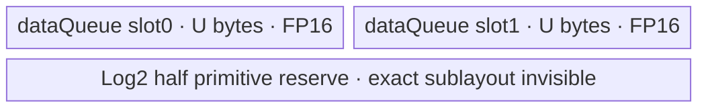
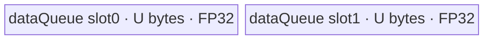

# ForeachLog2 A2/A3 ACLNN 算子知识

## 算子速览

| 项目 | 内容 |
|---|---|
| 实际入口 | `aclnnForeachLog2GetWorkspaceSize` + `aclnnForeachLog2`，无版本后缀的公开 ACLNN 两段式接口 |
| 计算语义 | 对列表中每个张量逐元素计算 `y_i[j] = log2(x_i[j])` |
| 输入输出 | 动态 TensorList；各 Tensor 为 ND；`FLOAT16/FLOAT32/BFLOAT16`；同一列表及输入输出 dtype 一致；输出元素容量不小于对应输入 |
| 执行类型 | 单 Kernel，唯一 Device 节点为 `AIV_VECTOR`；无 Cube/AIC/MIX_CV |
| Kernel 路线 | R-001 FP16 原地 Vector；R-002 FP32 原地 Vector；R-003 BF16→FP32→BF16 Vector |
| 核心资源 | GM TensorList 指针表、`VECIN` 双缓冲队列、BF16 路线额外 FP32 Queue、Vector pipe event；算子节点 workspace 固定 32 B 但 Kernel 不读取 |
| 来源闭包 | `source_closed`：公开 ACLNN 文档/OpDef → arch22 Tiling → `ForeachCommonTilingData` → `foreach_log2` router → 公共 Unary/ImplicitOutput body → A2/A3 构建与 binary config 已闭合；自动生成 ACLNN bridge 与 AscendC `Log2` primitive 内部作为框架边界 |
| 验证状态 | 已完成源码闭包检查；本次知识提取未执行编译、真机、数值或性能测试。 |

## 接口与语义

### 计算语义

设输入列表 `x=[x_0,...,x_{n-1}]`，输出列表 `y=[y_0,...,y_{n-1}]`。对每个列表位置 `i` 以及输入张量存储域内的每个线性下标 `j`，计算 `y_i[j]=log2(x_i[j])`。Kernel 只写输入元素数覆盖的前缀；Host 允许对应输出的 storage shape 元素数大于输入。公开文档声明默认确定性实现。固定仓未给出 NaN、负数、零和无穷值的额外改写，数值语义由所调用的 AscendC `Log2<T, false>` primitive 决定。

### 输入、输出与属性

| 参数 | shape/layout | dtype | 约束、默认值与语义 |
|---|---|---|---|
| `x` | TensorList；每个 Tensor 0–8 维，ND | FP16/FP32/BF16 | 非空指针；支持空 Tensor；同一列表所有 Tensor dtype 一致；输入可非连续，OpDef 以 `AutoContiguous()` 接入框架连续化边界 |
| `out` | TensorList；每个 Tensor 0–8 维，ND | 与 `x` 相同 | 非空指针；列表项按输入对应；输出不支持非连续；每项 storage 元素数须不小于输入对应项；图侧公共 infer-shape 直接复制输入 shape |
| `workspaceSize` | 标量输出 | `uint64_t*` | 第一段接口返回执行器所需总 workspace；底层 ForeachLog2 节点请求 32 B，输入连续化等 executor 聚合开销在固定仓自动生成 bridge 中不可见 |
| `executor` | 执行器输出 | `aclOpExecutor**` | 保存第一段构造的计算流程，供第二段使用 |
| `workspace` | Device 地址 | `void*` | 第二段传入；Kernel 将用户 workspace 强制置为 `nullptr`，不读取该地址 |
| `stream` | Runtime stream | `aclrtStream` | 第二段在该 stream 上提交 executor；同步由调用者决定 |

### 入口与版本

固定 Commit 公开且仅公开无后缀版本 `aclnnForeachLog2GetWorkspaceSize/aclnnForeachLog2`，因此它是 A2/A3 实际支持的最新版本族。文档给出接口声明、错误码和 A2/A3 支持表；`ForeachLog2` OpDef 把 `x/y` 注册为动态 ND TensorList，并注册 `ascend910b`、`ascend910_93`。仓内未保存自动生成的 ACLNN C bridge，其“校验 ACL 对象、创建 executor、提交 OpDef 节点”的胶水作为明确框架边界；算子自有的校验、Tiling、POD、router、body 和构建均已继续闭合。

## Host/Launcher 执行流程

### 参数校验与前处理

公开第一段接口先拒绝 `x/out` 空指针、非支持 dtype 或输入输出 dtype 不同；Tiling 的 `ForeachCommonTiling::Init` 最多读取 50 个动态输入 Tensor，保存每项 storage 元素数并确认 dtype 一致。`CheckOpInfo` 再检查动态列表规模关系、每项维数不超过 8、输出 dtype 与输入相同、输出 storage 元素数不少于输入以及列表内 dtype 一致。公共 infer-shape 要求动态输出个数等于输入实例数，并把每个输入 shape/dtype 复制到输出。输入的非连续视图通过 OpDef `AutoContiguous()` 落在框架边界；输出本身必须连续。

### 参数、Workspace 与生命周期

Host 将列表的总元素数 `N=sum_i n_i`、平台 AIV 核数 `Cplat`、dtype 字节数 `B` 和 UB 容量用于生成分核表与单核 UB 容量。底层节点写 `workspace[0]=32` B；Kernel entry 明确把 `userWS=nullptr`，所以这 32 B 不属于 Device body 的数据交接。第一段 ACLNN 返回的 workspace/executor 由框架拥有到第二段执行完成；若输入连续化需要附加 workspace，其确切切片与聚合公式在固定仓不可见。第二段使用调用者提供的 stream；单 Kernel 无跨节点 workspace 边。

### 启动图与失败传播

```text
aclnnForeachLog2GetWorkspaceSize(x, out)
  -> 自动生成 ACLNN bridge（固定仓不可见）
  -> ForeachLog2 OpDef / AutoContiguous
  -> Tiling4ForeachLog2Tiling
     -> ForeachCommonTiling::Init(SOLO_LOG2_OP_CODE)
     -> ForeachCommonTiling::RunBigKernelTiling
  -> executor 保存单节点 launch
aclnnForeachLog2(workspace, workspaceSize, executor, stream)
  -> foreach_log2<<<blockDim=needCoreNum, stream>>>(xList, yList, workspace, tiling)
```

唯一节点的 POD 为 `ForeachCommonTilingData`，输入/输出是框架 TensorList GM 对象，workspace slice 无 Device consumer。Tiling/校验失败时第一段不能产生有效执行计划；第二段由 executor/stream 提交状态向调用方返回。不存在 producer→consumer Kernel 边，也不存在跨 Kernel event。

## Route 与参数设计

### 分核与资源计算

令 `B=sizeof(dtype)`，`epb=32/B` 元素，`N=sum_i n_i`。Host 计算 `needCoreNum=max(1,min(Cplat,ceil(N/epb),50))`，把拼接后的列表线性域按 32 B block 均分：前 `ceil(N/epb) mod needCoreNum` 个核多拿一个 block；POD 为每核记录起止 Tensor 下标和两端 Tensor 内元素 offset。Kernel 在每个 Tensor 片段内再按 `maxDataCount` 切 tile。

设 `S=ForeachCommonTilingData::GetDataSize()`、`UB=平台 UB 字节数`。Host 对 Log2 使用 `E(B)=1024 * (B==4 ? 0 : 4) * B`，即 FP32 为 0、FP16/BF16 为 8192 B：

```text
FP32: U = floor32((UB - S) / 2)
FP16: U = floor32((UB - S) / 2 - 8192)
BF16: U = floor64(floor((UB - S) / 10) / 2 - 8192)
```

`U` 写入 `inputsTensorUbSize`。FP16/FP32 的 `maxDataCount=U/B`；BF16 的 data queue 单槽为 `9U`，所以 `maxDataCount=9U/2`，而每次升精度窗口 `maxCastDataCount=U/4`。源码未对减法下溢或 `U==0` 增设失败 Guard。

### Route 选择

| 顺序 | Route | Key/模板 | 精确选择条件与优先级 | 不适用去向 |
|---:|---|---|---|---|
| 1 | R-001 FP16 原地 Vector | key `1`; `ForeachImplictOutput<half,half,Log2Adapter<half>,2,1>` | `dataType==DT_FLOAT16`；router 首先判断 `TILING_KEY_IS(1)` | key 2 |
| 2 | R-002 FP32 原地 Vector | key `2`; `ForeachImplictOutput<float,float,Log2Adapter<float>,2,1>` | `dataType==DT_FLOAT`；router 第二分支判断 `TILING_KEY_IS(2)` | key 4 |
| 3 | R-003 BF16 升精度 Vector | key `4`; `ForeachImplictOutput<bfloat16_t,float,Log2Adapter<float>,2,1>` | `dataType==DT_BF16`；仅在非 `__NPU_ARCH__==3003/3113` 构建分支存在 | 未知 key 无 body、无写出 |

```text
if dtype == FP16: key=1 -> R-001
else if dtype == FP32: key=2 -> R-002
else if dtype == BF16: key=4 -> R-003
else: Tiling key=0，OpDef/公开接口已限制该情况

router: key 1 -> R-001; else key 2 -> R-002; else guarded key 4 -> R-003; else no-op
```

### 模板/实现执行矩阵

| Route | key/selector | dtype/shape/platform 完整命中条件 | 执行拓扑与 Kernel 节点 | 实际模板/body | 内存与同步特征 | tail/fallback |
|---|---|---|---|---|---|---|
| R-001 FP16 | 1 | FP16，A2/A3，动态列表校验通过 | 单 `foreach_log2` AIV_VECTOR | `ForeachImplictOutput<half,half,...,2,1>` → `Log2<half,false>` | `VECIN` depth 2，原地覆盖；`V_MTE3`、`MTE3_MTE2` | 最后 tile 用 `DataCopyPad` 精确字节搬入/搬出；无 router fallback |
| R-002 FP32 | 2 | FP32，A2/A3，动态列表校验通过 | 单 `foreach_log2` AIV_VECTOR | `ForeachImplictOutput<float,float,...,2,1>` → `Log2<float,false>` | 同 R-001，但无需 Host 预留 Log2 half scratch | 同 R-001 |
| R-003 BF16 | 4 | BF16，A2/A3，且编译 guard 允许 | 单 `foreach_log2` AIV_VECTOR | `ForeachImplictOutput<bfloat16_t,float,...,2,1>` → 分窗 Cast/FP32 Log2/Cast | BF16 data queue depth 2 + FP32 queue；每个 cast stage 有 `PIPE_V` barrier；输出仍原地复用 data queue | 外层 tile 与内层 cast window 均保护余数；无 router fallback |

### 隐藏性能 Guard

| Guard | Host/Tiling 条件 | Device/资源原因 | 影响 Route | 不满足时去向 | 源码符号 |
|---|---|---|---|---|---|
| TensorList 容量 | `Init` 循环上限 `MAX_TENSOR_CONT=50` | POD 的逐 Tensor 数组仅 50 项 | 全部 | 固定源码未显式拒绝第 51 项；不能安全外推支持 | `foreach_tiling_def.h::MAX_TENSOR_CONT`; `ForeachCommonTiling::Init` |
| 核数容量 | `needCoreNum<=MAX_CORE_CONT=50` | POD 每核数组仅 50 项 | 全部 | 截断到 50 核 | `ForeachCommonTiling::RunBigKernelTiling` |
| 32 B 分核 | `epb=32/B`，按 `ceil(N/epb)` 分配 | 全 tile 使用普通 `DataCopy`，两端需以元素 offset 描述 | 全部 | 尾 tile 转 `DataCopyPad` |
| Log2 scratch | FP16/BF16 `E=8192`；FP32 `E=0` | `Log2` primitive 的半精度路径需要额外保留空间 | R-001/R-003 | 缩小 `U`；源码无显式失败回退 |
| BF16 扩容/缩窗 | dtype BF16 时先把可用量除 10、`U` 向下 64 B 对齐 | data queue 每槽 `9U`，另有 FP32 queue `U` | R-003 | 非 BF16 不分配这些 buffer |
| BF16 构建 guard | 非 `__NPU_ARCH__==3003/3113` | 这两个 NPU arch 不实例化 BF16 router 分支 | R-003 | 对应 Kirin 配置仅发布 FP16/FP32；A2/A3 配置发布 BF16 |
| 空域 | `N==0` 时 `needCoreNum=1` | 保证合法 blockDim；分核表保持零初始化 | 全部 | Kernel 的 Tensor 循环不产生有效 tile/写出 |

### POD/ABI

| 结构 | 字段 | 类型/位宽 | ABI 布局 | 单位 | Host/launcher producer | Device consumer | 边界 |
|---|---|---|---|---|---|---|---|
| `ForeachCommonTilingData` | `inputsTensorUbSize` | `uint64_t`/64 | 宏生成结构首字段；固定仓不含 `tilingdata_base.h` 展开，`sizeof/alignof/offsetof` 精确值不可见 | 字节/单槽基准 `U` | `DivideUbMemory2` → `FillTilingData::set_inputsTensorUbSize` | `KernelForeachBase::ParseTilingData`，决定 Queue 容量与 tile 元素数 | FP16/FP32 32 B 对齐；BF16 64 B 对齐 |
| `ForeachCommonTilingData` | `tensorDataCountList[50]` | `int64_t[50]` | 第二字段；宏展开后的精确 offset 不可见 | 元素/张量 | `Init`: `storageShape.GetShapeSize()` | `KernelForeachUnary::Process` 决定各 Tensor 末下标 | 仅前 `totalTensorCount` 项活动；POD 不携带 count |
| `ForeachCommonTilingData` | `tensorStartList[50]` | `uint16_t[50]` | 第三字段；精确 offset 不可见 | Tensor 下标/核 | `AssignDataToEachCore` | `ParseTilingData[blockIdx]` | `blockIdx<needCoreNum<=50` |
| `ForeachCommonTilingData` | `tensorEndList[50]` | `uint16_t[50]` | 第四字段；精确 offset 不可见 | Tensor 下标/核 | `AssignDataToEachCore` | `ParseTilingData[blockIdx]` | 两端均包含 |
| `ForeachCommonTilingData` | `tensorStartOffsetList[50]` | `int64_t[50]` | 第五字段；精确 offset 不可见 | 元素/核 | `AssignDataToEachCore` | `ParseTilingData[blockIdx]` | 在 `tensorStart` 内的包含式起点 |
| `ForeachCommonTilingData` | `tensorEndOffsetList[50]` | `int64_t[50]` | 第六字段；精确 offset 不可见 | 元素/核 | `AssignDataToEachCore` | `ParseTilingData[blockIdx]` | 在 `tensorEnd` 内的包含式终点；空数组保持零初始化 |

### Route 源码闭包

| Route | Key/selector | Host/Tiling producer | POD/参数 | Kernel entry/router 节点 | Kernel body/直接依赖 | 构建接线 |
|---|---|---|---|---|---|---|
| R-001 FP16 | key 1 | `arch22/foreach_log2_tiling_arch22.cpp::Tiling4ForeachLog2Tiling`; `ForeachCommonTiling::{Init,RunBigKernelTiling}` | `ForeachCommonTilingData`; `U`、每 Tensor 元素数、每核边界 | `op_kernel/foreach_log2.cpp::foreach_log2`, key 1 | `KernelForeachBase`; `KernelForeachUnary`; `ForeachImplictOutput`; `Log2Adapter<half>` | host CMake→arch22；kernel CMake→ascend910b/ascend910_93；binary FP16 项 |
| R-002 FP32 | key 2 | 同上 | 同上，FP32 `U` 公式 | 同 entry，key 2 | 同公共 body；`Log2Adapter<float>` | 同上；binary FP32 项 |
| R-003 BF16 | key 4 | 同上 | 同上，BF16 `U`/cast 窗口 | 同 entry，guarded key 4 | `InnerComputer<bfloat16_t,float>` 分窗升/降精度 | 同上；binary BF16 项 |

## Kernel 实现

### 公共执行流程

三条 Route 都只启动一个 AIV Kernel。entry 解析同一 POD，按 key 实例化 `ForeachImplictOutput`。基类用 TensorList 首个 `uint64_t` 作为指针表相对偏移：`table=dataAddr+(offset>>3)`，再取 `table[index]` 得到 Tensor GM 地址。每个 block 读取自己的包含式 Tensor/offset 区间；每个 Tensor 片段按 `maxDataCount` 分 tile，搬入 `dataQueue`，在同一 LocalTensor 上执行 `Log2`，等待 Vector→MTE3 后直接写输出，再等待 MTE3→MTE2 才释放并允许队列槽被下一轮覆盖。无跨核归约、Atomic、workspace 交接或多 Kernel 同步。

### Route R-001：FP16 原地 Vector

#### 适用条件

##### 选择证据

| 层级 | 文件 | 符号 | 源码谓词/参数 | 结果/下一跳 |
|---|---|---|---|---|
| API/OpDef | `foreach/foreach_log2/op_host/foreach_log2_def.cpp` | `ForeachLog2::ForeachLog2` | dtype 列表包含 `DT_FLOAT16`；ND、dynamic、AutoContiguous | 进入 arch22 Tiling |
| Host/Tiling | `foreach/foreach_utils/op_host/common_dtype.h` | `GetTilingKeyByDtypeOnly` | `dataType==DT_FLOAT16` | key 1 |
| Router | `foreach/foreach_log2/op_kernel/foreach_log2.cpp` | `foreach_log2` | `TILING_KEY_IS(1)` 首分支 | `ForeachImplictOutput<half,half,...,2,1>` |

#### Device 数据流

##### 函数级调用链

```text
foreach_log2(xList,yList,workspace,tiling)
  -> ForeachImplictOutput<half,half,Log2Adapter<half>,2,1>::Init
     -> KernelForeachBase<half>::Init/ParseTilingData
  -> KernelForeachUnary::Process
     -> GetTensorAddr -> SingleTensorProcess
       -> CopyIn -> ForeachImplictOutput::Compute
          -> InnerComputer<half,half>::Compute -> Log2Adapter<half> -> Log2<half,false>
          -> V_MTE3 event -> direct CopyOut -> MTE3_MTE2 event -> FreeTensor
```

##### 源码等价伪码

```text
# 伪码
core = GetBlockIdx()
[ts,to,te,eo] = POD.core_boundary[core]
for tensor i in [ts,te]:
  begin = (i==ts ? to : 0)
  end   = (i==te ? eo : tensorElements[i]-1)
  bind input/output GM at tensor_ptr(i)+begin
  for tile in ceil((end-begin+1)/(U/2)):
    valid = min(U/2, remaining)
    local = dataQueue.AllocTensor<half>()
    CopyIn valid half elements (tail uses 1 block DataCopyPad with valid*2 bytes)
    dataQueue.EnQue/DeQue(local)
    Log2<half,false>(local, local)  # uValue/valid 未传入 primitive
    wait V_MTE3; copy only valid elements to output
    wait MTE3_MTE2; dataQueue.FreeTensor(local)
```

#### 内存与数据搬运

##### 资源与搬运表

| 层级/缓冲区 | offset/地址公式 | extent/容量公式 | dtype/layout | producer | consumer | owner/lifetime | 对齐/复用 |
|---|---|---|---|---|---|---|---|
| GM `x_i` | `tensor_ptr(x,i)+coreTensorOffset+tile*(U/2)` | `valid<=U/2` 元素 | FP16/ND 线性 storage | 调用者/连续化框架 | `CopyIn` | 调用者；执行期间只读 | full tile 普通 `DataCopy`，tail 精确字节 `DataCopyPad` |
| `dataQueue` slot 0/1 | Queue 管理 | 每槽 `U` B，depth 2 | FP16 LocalTensor | MTE2 `CopyIn` | `Log2` 后 MTE3 | Kernel `TPipe`；Alloc→EnQue→DeQue→Free | 计算原地覆盖输入槽；MTE3 完成后复用 |
| GM `y_i` | 与输入同线性 offset | `valid` 元素 | FP16/ND | MTE3 direct CopyOut | 调用者 | 调用者；stream 完成后可见 | 只写有效前缀 |
| Log2 primitive scratch | primitive 内部地址不可见 | Host 预留模型每双缓冲预算 `2*8192` B | 固定仓不可见 | `Log2<half,false>` | 同 primitive | primitive 调用期 | 不与显式 Queue 声称 alias |
| workspace | N/A | 节点请求 32 B | byte | executor | 无 Device consumer | executor/caller | Kernel 置 `userWS=nullptr` |

##### 分层内存布局



##### 字节账与复用顺序

```text
U = floor32((UB - S)/2 - 8192)
visible_queue = 2U
Host reserve relation: 2U + 2*8192 <= UB - S
dynamic_ub = N/A
workspace_total(node) = 32 B; Device-consumed workspace = 0 B
=> maxDataCount = U/2 FP16 elements
```

| 复用子区 | 写入者 | 读取者/消费点 | 下一次覆盖 | 同步或释放依据 | 安全条件 |
|---|---|---|---|---|---|
| 当前 `dataQueue` 槽 | `CopyIn` | `Log2` 原地读写，随后 MTE3 CopyOut | 后续 tile 的 `CopyIn` | `V_MTE3` 后启动写出；`MTE3_MTE2` 完成后 `FreeTensor` | 不得在输出搬运完成前重用槽 |

#### 同步、精度与尾块

##### 同步与数值边界表

| 阶段 | primitive/机制 | producer | consumer/等待点 | 保护对象 | 精度/尾块 |
|---|---|---|---|---|---|
| MTE2→Vector | `TQue EnQue/DeQue` | `CopyIn` | `Compute` DeQue | 当前 FP16 tile | Queue 协议建立可见性 |
| Vector compute | `Log2<half,false>` | LocalTensor | 原地 LocalTensor | 有效与 padding lane | FP16 路线无显式升精度；adapter 的 `uValue` 未使用 |
| Vector→MTE3 | `SetFlag/WaitFlag<V_MTE3>` | `Log2` | direct CopyOut | 原地结果 | 防止计算未完成即写 GM |
| MTE3→MTE2 | `SetFlag/WaitFlag<MTE3_MTE2>` | CopyOut | Free/下轮 CopyIn | 同一 Queue 槽 | 防止提前覆盖 |
| tail | `DataCopyPad`，`blockCount=1`,`blockLen=valid*2` B，stride 0，输入 pad disabled | GM/UB | Vector/GM | 最后一 tile | primitive 可能触达 LocalTensor 无效 lane，但只搬出 `valid` 元素 |

#### 关键实现

##### 符号证据表

| 阶段 | 文件 | 符号/模板实例 | 实现事实 |
|---|---|---|---|
| Host/Tiling producer | `foreach/foreach_utils/op_host/foreach_tiling_class.h` | `RunBigKernelTiling`, `AssignDataToEachCore`, `DivideUbMemory2` | key、核边界、U、workspace=32 |
| Kernel entry/router | `foreach/foreach_log2/op_kernel/foreach_log2.cpp` | `foreach_log2`, key 1 | 映射到 FP16 模板 |
| Device body/helper | `foreach/foreach_utils/op_kernel/{kernel_foreach_base.h,kernel_foreach_unary.h,foreach_implict_output.h}` | `Process/CopyIn/Compute`; `InnerComputer<half,half>` | TensorList 解址、tile 循环、原地 Log2、事件与 tail |

### Route R-002：FP32 原地 Vector

#### 适用条件

##### 选择证据

| 层级 | 文件 | 符号 | 源码谓词/参数 | 结果/下一跳 |
|---|---|---|---|---|
| API/OpDef | `foreach/foreach_log2/op_host/foreach_log2_def.cpp` | `ForeachLog2::ForeachLog2` | dtype 列表包含 `DT_FLOAT` | 进入 arch22 Tiling |
| Host/Tiling | `foreach/foreach_utils/op_host/common_dtype.h` | `GetTilingKeyByDtypeOnly` | `dataType==DT_FLOAT` | key 2 |
| Router | `foreach/foreach_log2/op_kernel/foreach_log2.cpp` | `foreach_log2` | key 1 未命中后 `TILING_KEY_IS(2)` | `ForeachImplictOutput<float,float,...,2,1>` |

#### Device 数据流

##### 函数级调用链

```text
foreach_log2 -> ForeachImplictOutput<float,float,Log2Adapter<float>,2,1>
  -> KernelForeachBase<float>::Init
  -> KernelForeachUnary::Process/SingleTensorProcess/CopyIn
  -> InnerComputer<float,float>::Compute
     -> Log2Adapter<float> -> Log2<float,false> (same LocalTensor)
  -> V_MTE3 -> direct CopyOut -> MTE3_MTE2 -> FreeTensor
```

##### 源码等价伪码

```text
# 伪码；分核/Tensor 循环与 R-001 相同
tileCapacity = U/4
for each assigned tensor segment, for each tile:
  valid=min(tileCapacity,remaining)
  local=CopyIn<float>(valid)
  Log2<float,false>(local,local)
  wait V_MTE3
  CopyOut<float>(valid)
  wait MTE3_MTE2; FreeTensor(local)
```

#### 内存与数据搬运

##### 资源与搬运表

| 层级/缓冲区 | offset/地址公式 | extent/容量公式 | dtype/layout | producer | consumer | owner/lifetime | 对齐/复用 |
|---|---|---|---|---|---|---|---|
| GM `x_i/y_i` | `tensor_ptr(i)+coreOffset+tile*(U/4)` | `valid<=U/4` | FP32/ND | caller/MTE3 | MTE2/caller | caller | tail `blockLen=valid*4` B |
| `dataQueue` | Queue 管理 | depth 2，每槽 `U` B | FP32 | CopyIn | Log2/CopyOut | `TPipe` | 原地覆盖，事件后复用 |
| workspace | N/A | 节点 32 B | byte | executor | 无 | executor/caller | 不被 Kernel 读取 |

##### 分层内存布局



##### 字节账与复用顺序

```text
U = floor32((UB-S)/2)
UB_visible = 2U <= UB-S
dynamic_ub = N/A
workspace_total(node)=32 B; Device-consumed=0 B
=> maxDataCount=U/4 FP32 elements
```

| 复用子区 | 写入者 | 读取者/消费点 | 下一次覆盖 | 同步或释放依据 | 安全条件 |
|---|---|---|---|---|---|
| 当前 dataQueue 槽 | CopyIn | 原地 FP32 Log2、CopyOut | 后续 tile CopyIn | V_MTE3 + MTE3_MTE2 + FreeTensor | 输出 DMA 完成后才能复用 |

#### 同步、精度与尾块

##### 同步与数值边界表

| 阶段 | primitive/机制 | producer | consumer/等待点 | 保护对象 | 精度/尾块 |
|---|---|---|---|---|---|
| Queue | EnQue/DeQue | MTE2 | Vector | tile | FP32 原精度 |
| Compute | `Log2<float,false>` | FP32 input | FP32 output | 同一 LocalTensor | 无 cast/round |
| CopyOut/复用 | V_MTE3、MTE3_MTE2 | Vector/MTE3 | CopyOut/下轮 | 同一 Queue 槽 | tail 仅写 `valid` 元素 |

#### 关键实现

##### 符号证据表

| 阶段 | 文件 | 符号/模板实例 | 实现事实 |
|---|---|---|---|
| Host/Tiling producer | `foreach/foreach_utils/op_host/foreach_tiling_class.h` | `DivideUbMemory2` | FP32 scratch factor 0，U 平分 UB |
| Kernel entry/router | `foreach/foreach_log2/op_kernel/foreach_log2.cpp` | key 2 | FP32 模板实例 |
| Device body/helper | `foreach/foreach_utils/op_kernel/foreach_implict_output.h` | primary `InnerComputer<float,float>` | `op(dataLocal,dataLocal,dataCount)` 原地计算 |

### Route R-003：BF16 升精度 Vector

#### 适用条件

##### 选择证据

| 层级 | 文件 | 符号 | 源码谓词/参数 | 结果/下一跳 |
|---|---|---|---|---|
| API/OpDef | `foreach/foreach_log2/op_host/foreach_log2_def.cpp` | `ForeachLog2::ForeachLog2` | dtype 包含 `DT_BF16`，A2/A3 配置未覆盖 dtype | 进入 arch22 Tiling |
| Host/Tiling | `foreach/foreach_utils/op_host/common_dtype.h` | `GetTilingKeyByDtypeOnly` | `DT_BF16` | key 4 |
| Router | `foreach/foreach_log2/op_kernel/foreach_log2.cpp` | `foreach_log2` | 非 NPU arch 3003/3113 且 `TILING_KEY_IS(4)` | BF16 storage、FP32 compute 模板 |

#### Device 数据流

##### 函数级调用链

```text
foreach_log2 -> ForeachImplictOutput<bfloat16_t,float,Log2Adapter<float>,2,1>
  -> KernelForeachBase<bfloat16_t>::Init (totalTensorUbSize=9U,maxCastDataCount=U/4)
  -> KernelForeachUnary::Init (dataQueue depth2*9U,float32Queue depth1*U)
  -> Process -> SingleTensorProcess -> CopyIn BF16 tile
  -> InnerComputer<bfloat16_t,float>::Compute
     -> loop ComputePerCast
        -> PIPE_V -> Cast BF16→FP32(CAST_NONE)
        -> PIPE_V -> Log2<float,false> in-place
        -> PIPE_V -> Cast FP32→BF16(CAST_RINT)
        -> PIPE_V
  -> V_MTE3 -> direct BF16 CopyOut -> MTE3_MTE2 -> FreeTensor
```

##### 源码等价伪码

```text
# 伪码
tileCapacity=9U/2 BF16 elements; castCapacity=U/4 float elements
for each assigned tensor tile:
  valid=min(tileCapacity,remaining)
  bf=CopyIn<bfloat16_t>(valid)
  for window in ceil(valid/castCapacity):
    n=min(castCapacity,remaining)
    barrier V
    fp32[0:n]=Cast(bf[window*castCapacity:][0:n],CAST_NONE)
    barrier V
    fp32[0:n]=Log2<float,false>(fp32[0:n])
    barrier V
    bf[window*castCapacity:][0:n]=Cast(fp32[0:n],CAST_RINT)
    barrier V
  wait V_MTE3; CopyOut only valid BF16; wait MTE3_MTE2; free bf slot
```

#### 内存与数据搬运

##### 资源与搬运表

| 层级/缓冲区 | offset/地址公式 | extent/容量公式 | dtype/layout | producer | consumer | owner/lifetime | 对齐/复用 |
|---|---|---|---|---|---|---|---|
| GM `x_i/y_i` | `tensor_ptr(i)+coreOffset+tile*(9U/2)` | `valid<=9U/2` | BF16/ND | caller/MTE3 | MTE2/caller | caller | tail `valid*2` B |
| `dataQueue` | Queue 管理 | depth 2，每槽 `9U` B | BF16 | CopyIn | cast/CopyOut | TPipe | 同一槽按 cast window 覆盖为结果 |
| `float32Queue` | 单一 Queue LocalTensor | `U` B，depth 1 | FP32 | BF16→FP32 Cast | FP32 Log2→BF16 Cast | 从 Process 开始 DeQue，到全部 Tensor 完成才 Free | 所有 tile/window 串行复用同一物理区 |
| workspace | N/A | 节点 32 B | byte | executor | 无 | executor/caller | Kernel 不读取 |

##### 分层内存布局


##### 字节账与复用顺序

```text
U=floor64(floor((UB-S)/10)/2-8192)
visible_queue=2*(9U)+U=19U
Log2 primitive scratch exact sublayout=fixed repo invisible
dynamic_ub=N/A
workspace_total(node)=32 B; Device-consumed=0 B
=> tileCapacity=9U/2 BF16 elements; castCapacity=U/4 FP32 elements
```

| 复用子区 | 写入者 | 读取者/消费点 | 下一次覆盖 | 同步或释放依据 | 安全条件 |
|---|---|---|---|---|---|
| BF16 dataQueue 当前槽 | CopyIn，随后 FP32→BF16 Cast 分窗回写 | CopyOut | 下个 tile CopyIn | 每个 window `PIPE_V`；末尾 V_MTE3/MTE3_MTE2 | cast 与输出 DMA 完成前不得覆盖 |
| FP32 queue | BF16→FP32 Cast | 原地 Log2、降精度 Cast | 下个 cast window | 四个 `PipeBarrier<PIPE_V>` | `paramsCount==1` 使 Log2 dst offset=0；窗口串行 |

#### 同步、精度与尾块

##### 同步与数值边界表

| 阶段 | primitive/机制 | producer | consumer/等待点 | 保护对象 | 精度/尾块 |
|---|---|---|---|---|---|
| 升精度 | `Cast(...,CAST_NONE,n)` + `PIPE_V` | BF16 local | FP32 Log2 | FP32 queue window | BF16 精确扩展至 FP32 |
| 计算 | `Log2<float,false>` | FP32 window | 降精度 Cast | FP32 queue | 以 FP32 计算 |
| 降精度 | `Cast(...,CAST_RINT,n)` + `PIPE_V` | FP32 result | BF16 data slot | BF16 window | 降精度模式由源码显式指定为 `CAST_RINT`；不外推其仓外实现细节 |
| 写出与复用 | V_MTE3、MTE3_MTE2 | Vector/MTE3 | CopyOut/下轮 | BF16 data slot | 外层 tail 精确写 `valid`；内层窗口精确传 `n` |

#### 关键实现

##### 符号证据表

| 阶段 | 文件 | 符号/模板实例 | 实现事实 |
|---|---|---|---|
| Host/Tiling producer | `foreach/foreach_utils/op_host/foreach_tiling_class.h` | `DivideUbMemory2`, `GetLog2TmpBufferFactorSize` | `/10` 缩窗、8192 B reserve、64 B 对齐 |
| Kernel entry/router | `foreach/foreach_log2/op_kernel/foreach_log2.cpp` | guarded key 4 | BF16 storage/FP32 compute 实例 |
| Device body/helper | `foreach/foreach_utils/op_kernel/{kernel_foreach_base.h,kernel_foreach_unary.h,foreach_implict_output.h}` | BF16 specialization | `9U` 双槽、`U` FP32 queue、分窗 cast/barrier/log2/cast |

## 算子特定优化

### Trick T-001：在输入 Queue 槽上原地计算并直接写出

#### 触发与源码依据

- 适用 Route：R-001、R-002、R-003。
- 触发条件：`ForeachImplictOutput<...,bufferNum=2,paramsCount=1>`，其 Unary 基类模板参数 `needCopyOut=false`；Compute 从 `dataQueue` DeQue 后让结果回写同一 LocalTensor。
- Golden 来源：[`foreach/foreach_utils/op_kernel/foreach_implict_output.h:94-115`](../../../../../../../cann-ops-raw/ascendc/ops-nn/955f8b33985b6d72989ebff341bb9c2c564a51bc/foreach/foreach_utils/op_kernel/foreach_implict_output.h#L94-L115)

**官方源码（固定 Commit 连续逐字摘录）**：

```cpp
LocalTensor<T> dataLocal = Base::dataQueue.template DeQue<T>();
InnerComputer<T, P, op, paramsCount> computer;
computer.Compute(dataLocal, float32Tensor, Base::maxCastDataCount, dataCount);

event_t eventIDVToMTE3 = static_cast<event_t>(GetTPipePtr()->FetchEventID(HardEvent::V_MTE3));
SetFlag<HardEvent::V_MTE3>(eventIDVToMTE3);
WaitFlag<HardEvent::V_MTE3>(eventIDVToMTE3);
if (isRemainder) {
    DataCopyExtParams copyParams{1, static_cast<uint32_t>(dataCount * sizeof(T)), 0, 0, 0};
    DataCopyPad(Base::outTensorsGM[index * Base::maxDataCount], dataLocal, copyParams);
} else {
    DataCopy(Base::outTensorsGM[index * Base::maxDataCount], dataLocal, dataCount);
}
event_t eventIDMTE3ToMTE2 = static_cast<event_t>(GetTPipePtr()->FetchEventID(HardEvent::MTE3_MTE2));
SetFlag<HardEvent::MTE3_MTE2>(eventIDMTE3ToMTE2);
WaitFlag<HardEvent::MTE3_MTE2>(eventIDMTE3ToMTE2);

Base::dataQueue.FreeTensor(dataLocal);
```

#### 机制与设计原因

`InnerComputer` 的普通实例调用 `op(dataLocal,dataLocal,...)`，BF16 specialization 也把最终 cast 回写 `dataLocal`。因此不初始化 `outQueue`，结果直接从输入 Queue 槽由 MTE3 写回 GM，省去一个等容量输出队列和一次 UB 内结果物化。`V_MTE3` 确保 Vector 完成后才读取结果，`MTE3_MTE2` 确保输出 DMA 结束后槽才被下一轮 CopyIn 复用；tail 仅以 `dataCount*sizeof(T)` 写出有效前缀。

#### 迁移边界

- 适用：逐元素 unary 算子，输入 LocalTensor 在计算后不再需要且 primitive 支持 dst/src alias。
- 前提：Vector primitive 的原地语义成立；Queue 槽生命周期可由 V→MTE3→MTE2 event 闭合；tail 可按有效字节写出。
- 失效：需要保留原输入、中间值与输出同时存活，或 primitive 不允许 dst/src alias 时，必须恢复独立 output Queue。
- 未验证：本次知识提取未执行编译、真机、数值或性能测试。

#### 错误做法

若在 MTE3 完成前释放/复用 `dataLocal`，下一轮 MTE2 会覆盖尚未写出的结果；源码用 `MTE3_MTE2` 明确阻止该行为。

### Trick T-002：BF16 用固定 FP32 窗口串行升精度

#### 触发与源码依据

- 适用 Route：R-003。
- 触发条件：`T=bfloat16_t,P=float,paramsCount=1`，数据 tile 可大于 FP32 Queue 容量。
- Golden 来源：[`foreach/foreach_utils/op_kernel/foreach_implict_output.h:61-72`](../../../../../../../cann-ops-raw/ascendc/ops-nn/955f8b33985b6d72989ebff341bb9c2c564a51bc/foreach/foreach_utils/op_kernel/foreach_implict_output.h#L61-L72)

**官方源码（固定 Commit 连续逐字摘录）**：

```cpp
__aicore__ inline void ComputePerCast(
    LocalTensor<bfloat16_t>& dataLocal, LocalTensor<float>& float32Tensor, uint32_t maxCastDataCount,
    uint32_t index, int64_t dataCount)
{
    PipeBarrier<PIPE_V>();
    Cast(float32Tensor, dataLocal[index * maxCastDataCount], RoundMode::CAST_NONE, dataCount);
    PipeBarrier<PIPE_V>();
    uint32_t offset = (paramsCount == 1) ? 0 : maxCastDataCount;
    op(float32Tensor[offset], float32Tensor, dataCount);
    PipeBarrier<PIPE_V>();
    Cast(dataLocal[index * maxCastDataCount], float32Tensor[offset], RoundMode::CAST_RINT, dataCount);
    PipeBarrier<PIPE_V>();
}
```

#### 机制与设计原因

Host/Init 让 BF16 data Queue 单槽达到 `9U`，但只分配一个 `U` 字节 FP32 Queue；Device 以 `maxCastDataCount=U/4` 分窗，反复复用该 FP32 区完成 BF16→FP32、FP32 Log2、FP32→BF16。这样不会为整个 BF16 tile 同时物化 FP32 副本。`paramsCount=1` 令结果仍在 FP32 Queue offset 0 原地生成；四个 Vector barrier 固定阶段依赖。

#### 迁移边界

- 适用：低精度存储、FP32 计算的逐元素算子，且分窗彼此独立。
- 前提：Host 按 BF16 buffer 倍数和 scratch 预算约束 tile；每窗 cast 数不超过 `U/4`；降精度接受 `CAST_RINT`。
- 失效：跨窗口归约、邻域依赖或必须同时保留多个 FP32 参数时，需要扩大/拆分 FP32 buffer 并调整 `paramsCount` offset。
- 未验证：本次知识提取未执行编译、真机、数值或性能测试。

#### 错误做法

固定仓提供的真实边界是：删除 `PIPE_V` barrier 会破坏 Cast→Log2→Cast 的同 pipe 顺序；把 `paramsCount` 改大却仍使用 offset 0 会改变源/目的区关系。

## 模板与实现对比

| 对比维度 | R-001 FP16 | R-002 FP32 | R-003 BF16 | 设计选择依据 |
|---|---|---|---|---|
| 命中条件/优先级 | key 1，router 首分支 | key 2，第二分支 | key 4，第三且有编译 guard | dtype 唯一决定 Route |
| 模板与 dtype | `<half,half,...,2,1>` | `<float,float,...,2,1>` | `<bfloat16_t,float,...,2,1>` | BF16 显式选 FP32 compute type |
| 循环与分核 | 32 B block 分核；tile U/2 | 同；tile U/4 | 同；tile 9U/2 + cast window U/4 | dtype 字节数与 UB 模型 |
| Queue/TBuf/寄存器/dynamic UB/通信 window | dataQueue depth2 | dataQueue depth2 | dataQueue depth2*9U + FP32 queue U | BF16 升精度窗口 |
| 内存总占用与复用 | 2U + primitive reserve；原地 | 2U；原地 | 可见 19U + primitive 内部；双层复用 | 避免 output Queue/整 tile FP32 物化 |
| 搬运/Vector/SIMT/NDDMA/通信 API | DataCopy(Pad)+FP16 Log2 | DataCopy(Pad)+FP32 Log2 | DataCopy(Pad)+Cast+FP32 Log2+Cast | 精度路径差异 |
| 同步、精度与 tail | Queue + 两个 HardEvent；FP16 | 同；FP32 | 另加 PIPE_V barrier；BF16→FP32→BF16 | 保证原地槽与 cast window 生命周期 |
| fallback/失败边界 | 未知 key no-op | 未知 key no-op | 构建 guard 不满足时无 BF16 body | Host/OpDef 应先阻止不支持配置 |

## 平台差异

| 项目 | A2 | A3 | 950 |
|---|---|---|---|
| 支持状态 | 公开 README/API 表支持 | 公开 README/API 表支持 | 公开表支持，但使用独立 `_950` 卡 |
| Host/Launcher | `ascend910b`/arch22 公共 Tiling，固定仓未给营销名与 compute unit 的更细映射 | `ascend910_93`/arch22 公共 Tiling，逻辑同 A2 | arch35 独立 POD/Tiling，单 SIMT Kernel |
| Kernel/资源 | AIV_VECTOR，双缓冲 UB，节点 workspace 32 B | 与 A2 共用源码；实际 UB/核数由平台查询 | 无显式 AIV Queue，1024 threads/block，节点 workspace 0 |

## 限制与失败边界

- 公开 ACLNN 约束为 FP16/FP32/BF16、ND、每 Tensor 0–8 维；输入可非连续、输出不可非连续；空 Tensor 可用，但固定源码未说明空 TensorList。
- arch22 POD 只容纳 50 个 Tensor 和 50 个 core；`Init` 对超过 50 项没有显式报错而是停止枚举，因此不得把公开列表能力外推到 50 以上。
- 输出 storage 元素数可大于输入，Kernel 只写输入元素数对应前缀；多余输出区域保持调用前内容，固定仓没有清零语义。
- `AssignDataToEachCore`、总元素累加和多处 `uint32_t` UB 计算没有额外溢出/下溢 Guard；极端 shape/UB 边界不得凭源码推断为安全。
- 未知 TilingKey 的 router 没有显式错误或 fallback，只是不执行任何模板；正常 Host 路径只生成 1/2/4。
- 自动生成 ACLNN bridge、executor workspace 聚合、AscendC `Log2` primitive 内部 mask/repeat/scratch 布局固定仓不可见；本文不推测补齐。
- 本次知识提取未执行编译、真机、数值或性能测试。

## 源码索引

### 链路索引

| 链路阶段 | 文件 | 关键符号 | 支撑内容 |
|---|---|---|---|
| 入口声明/约束 | `foreach/foreach_log2/docs/aclnnForeachLog2.md` | `aclnnForeachLog2GetWorkspaceSize`, `aclnnForeachLog2` | 两段式原型、dtype/shape/连续性、错误语义、A2/A3/950 支持 |
| 入口声明/约束 | `foreach/foreach_log2/README.md` | 产品支持表、公式 | 算子语义与平台公开性 |
| 入口实现 | `foreach/foreach_log2/op_host/foreach_log2_def.cpp` | `ops::ForeachLog2` | 动态 TensorList、dtype/format、AutoContiguous、平台注册 |
| Host/Tiling/Launcher | `foreach/foreach_log2/op_host/arch22/foreach_log2_tiling_arch22.cpp` | `Tiling4ForeachLog2Tiling` | 选择公共 Tiling，op code=6 |
| Host/Tiling/Launcher | `foreach/foreach_utils/op_host/foreach_tiling_class.h` | `ForeachCommonTiling` | 校验、分核、UB、POD、workspace |
| POD | `foreach/foreach_utils/op_host/foreach_tiling_def.h` | `ForeachCommonTilingData` | 六字段 POD 与容量 |
| Host selector | `foreach/foreach_utils/op_host/common_dtype.h` | `GetTilingKeyByDtypeOnly` | dtype→1/2/4 |
| Kernel entry/body | `foreach/foreach_log2/op_kernel/foreach_log2.cpp` | `foreach_log2`, `Log2Adapter` | key router 与三实例 |
| Kernel body | `foreach/foreach_utils/op_kernel/kernel_foreach_base.h` | `KernelForeachBase` | POD 解析、TensorList 解址 |
| Kernel body | `foreach/foreach_utils/op_kernel/kernel_foreach_unary.h` | `KernelForeachUnary` | Queue、Tensor/tile 循环、搬入搬出 |
| Kernel body | `foreach/foreach_utils/op_kernel/foreach_implict_output.h` | `ForeachImplictOutput`, `InnerComputer` | 原地 Log2、BF16 cast、同步、tail |
| 构建接线 | `foreach/foreach_log2/op_host/config/ascend910b/foreach_log2_binary.json` | `op_list` 三 dtype 项 | ascend910b 的 FP16/FP32/BF16 binary 实例 |
| 构建接线 | `foreach/foreach_log2/op_host/config/ascend910_93/foreach_log2_binary.json` | `op_list` 三 dtype 项 | ascend910_93 的 FP16/FP32/BF16 binary 实例 |
| 构建接线 | `foreach/foreach_log2/op_host/CMakeLists.txt` | `SUPPORT_COMPUTE_UNIT`, `SUPPORT_TILING_DIR` | A2/A3 选择 arch22 |
| 构建接线 | `foreach/foreach_log2/op_kernel/CMakeLists.txt` | `add_kernel_sources` | ascend910b/ascend910_93 编译默认 Kernel |

### 实现复用检查

| 检查项 | 可复用事实 | 不得改变的约束 | 源码符号 |
|---|---|---|---|
| ABI/POD | 六字段描述列表元素数和每核两端 | 字段顺序、50 项容量、字节/元素单位、包含式 end | `ForeachCommonTilingData`; `FillTilingData`; `ParseTilingData` |
| 调用顺序 | Init→Process→CopyIn→Compute→direct CopyOut | 原地输出必须保持 V_MTE3→MTE3_MTE2 顺序 | `ForeachImplictOutput::Compute` |
| workspace/内存 | 节点 workspace 与 Device 算法解耦；Queue 原地复用 | A2/A3 节点仍声明 32 B；BF16 9U/U 配比不可脱离 Host 公式修改 | `RunBigKernelTiling`; `KernelForeachUnary::Init` |
| 同步 | Queue 管 MTE2→V，HardEvent 管 V→MTE3→MTE2 | 不得提前 Free/复用 data Queue；BF16 窗口 barrier 不可删 | `KernelForeachUnary`; `InnerComputer`; `ForeachImplictOutput` |
| 精度与尾块 | FP16/FP32 原 dtype；BF16 FP32 计算、RINT 回写 | tail 搬运只提交 valid 字节；BF16 cast window `U/4` | `Log2Adapter`; `InnerComputer::ComputePerCast`; `CopyIn` |
| 失败边界 | Host 正常只生成 1/2/4 | 未知 key 无 fallback；Tensor/core POD 容量 50；输出额外区域不写 | `GetTilingKeyByDtypeOnly`; `foreach_log2`; `MAX_*_CONT` |