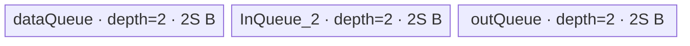
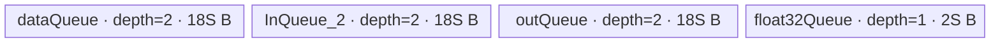

# ForeachMaximumList A2/A3 ACLNN 算子知识

## 算子速览

| 项目 | 内容 |
|---|---|
| 实际入口 | `aclnnForeachMaximumListGetWorkspaceSize` + `aclnnForeachMaximumList`，公开 ACLNN 基础版本（固定仓未出现带版本后缀的更新入口） |
| 计算语义 | 对两个等长 TensorList 的同位置 Tensor 逐元素计算 `y_i[j] = max(x1_i[j], x2_i[j])` |
| 输入输出 | `x1/x2/out` 均为 ND TensorList；FLOAT16、FLOAT32、INT32、BFLOAT16；逐位置输入 shape 相同，输出元素容量不小于输入 |
| 执行类型 | 单 Kernel；唯一 Device 节点为 `AIV_VECTOR` |
| Kernel 路线 | R-001 原生类型 Max（FLOAT16/FLOAT32/INT32）；R-002 BF16→FP32 Max→BF16 |
| 核心资源 | TensorList GM 描述符、三组 depth=2 的 `TQue`；BF16 额外一组 depth=1 FP32 Queue；算子 tiling workspace 固定 32 B 但 Kernel 明确不使用 |
| 来源闭包 | source_closed：公开 ACLNN 文档→生成式 ACLNN/连续化框架边界→`ForeachMaximumList` OpDef→arch22 Tiling→公共 foreach POD→Kernel entry/router→公共 Queue/Vector body→binary/CMake 接线闭合 |
| 验证状态 | 已完成源码闭包检查；本次知识提取未执行编译、真机、数值或性能测试。 |

## 接口与语义

### 计算语义

令 `x1=[x1_0,...,x1_(n-1)]`、`x2=[x2_0,...,x2_(n-1)]`。对每个列表位置 `i` 和该 Tensor 的有效元素下标 `j`，输出 `y_i[j]=max(x1_i[j],x2_i[j])`。Host 只允许同位置的两个输入 storage shape 完全相等；Kernel 仅写与输入元素数相同的前缀，因此当输出 storage size 更大时，多出的元素不由本算子写入。

### 输入、输出与属性

| 参数 | shape/layout | dtype | 约束、默认值与语义 |
|---|---|---|---|
| `x1` | TensorList；每个 Tensor 为 ND、0–8 维 | FLOAT16/FLOAT32/INT32/BFLOAT16 | 非空指针；支持零元素 Tensor；列表内 dtype 一致；可为非连续 Tensor，OpDef 标记 `AutoContiguous` |
| `x2` | 与 `x1` 等长；逐位置 storage shape 与 `x1` 相等；ND、0–8 维 | 与 `x1` 相同 | 非空指针；列表内 dtype 一致；可为非连续 Tensor，OpDef 标记 `AutoContiguous` |
| `out` | 与输入列表逐位置对应；storage size ≥ `x1`；ND、0–8 维 | 与 `x1` 相同 | 非空指针；公开 ACLNN 文档明确不支持非连续输出 |
| `workspaceSize` | 标量输出 | `uint64_t*` | 第一段接口返回；包含框架连续化/executor 所需空间以及算子节点 workspace |
| `executor` | Host 对象输出 | `aclOpExecutor**` | 第一段接口创建，封装参数检查、可能的输入连续化和算子任务 |
| `workspace/workspaceSize/executor/stream` | 第二段执行参数 | 指针/整数/stream | 在指定 stream 上提交 executor；workspace 由调用者按第一段结果持有到任务完成 |

### 入口与版本

固定 Commit `955f8b33985b6d72989ebff341bb9c2c564a51bc` 的公开文档只声明无后缀的 `aclnnForeachMaximumListGetWorkspaceSize`/`aclnnForeachMaximumList`，因此它是 A2/A3 的实际最新公开版本。README 与 ACLNN 文档均明确支持 Atlas A2、A3 训练/推理系列；`foreach_maximum_list_def.cpp` 注册 `ascend910b` 与 `ascend910_93`，Host CMake 将二者映射到 `arch22`，binary config 也列出四种 dtype，未见公开性或平台冲突。

两段式 ACLNN 的自动生成 inner bridge 在固定源码中不可见；这是框架边界。算子拥有的 `AutoContiguous` 声明、Host/Tiling、POD、Kernel 和构建接线均在固定仓闭合，不能据此假定未展示的 executor 内部 offset 公式。

## Host/Launcher 执行流程

### 参数校验与前处理

1. 公开第一段接口检查 `x1/x2/out` 指针、支持 dtype 与三者 dtype 一致性；文档列出的失败为 `ACLNN_ERR_PARAM_NULLPTR`、`ACLNN_ERR_PARAM_INVALID` 和内部 Tiling 错误。
2. OpDef 对三组动态 Tensor 声明 ND、FLOAT16/FLOAT32/INT32/BFLOAT16，并对输入启用 `AutoContiguous`；输入非连续时，具体 View/Contiguous 节点由不可见的生成式 ACLNN 框架创建。
3. `ForeachCommonTiling::Init(FOREACH_MAXIMUM_LIST_OP_CODE)` 最多读取 `MAX_TENSOR_CONT=50` 个 `x1` Tensor，锁定首个 dtype、`dataTypeSize`、每 32 B 元素数 `elementsPerBlock=32/dataTypeSize`，并记录每个 storage numel 与总元素数。
4. `CheckOpInfo` 按顺序校验两个动态输入列表长度相等、逐位置 shape 相同且维数 ≤8、输出 dtype 相同且容量不小于输入、两组输入列表内所有 dtype 与首 Tensor 一致；失败直接返回 `GRAPH_FAILED`，不启动 Kernel。
5. 第一段返回 workspace 与 executor；第二段在用户传入 stream 上提交任务。公开文档没有暴露生成式 bridge 的逐节点返回码映射。

### 参数、Workspace 与生命周期

设 `N=sum_i numel(x1_i)`、`E=32/sizeof(T)`、平台 AIV 核数为 `Cplat`：

- `needCoreNum=min(max(ceil(N/E),1), Cplat, 50)`；其中 50 来自 `MAX_CORE_CONT`。
- 将 `ceil(N/E)` 个 32 B block 尽量均分到 `needCoreNum` 核，前 `remainder=blockCount % needCoreNum` 核多处理一个 block；`AssignDataToEachCore` 再把每核连续的扁平范围映射成起止 Tensor 索引与元素 offset。
- Tiling key 仅由 dtype 产生：FLOAT16→1、FLOAT32→2、INT32→3、BFLOAT16→4。
- 设平台 UB 字节数为 `U`，`P=ForeachCommonTilingData::GetDataSize()`，原生类型 `S=floor32((U-P)/6)`；BF16 为 `S=floor64(((U-P)/10)/6)`。`S` 写入 `inputsTensorUbSize`。
- 算子 Tiling 节点写 `workspaces[0]=32`，但 Kernel entry 将传入 workspace 替换为 `nullptr`，Device body 不消费这 32 B。ACLNN 输入连续化可能增加 executor workspace，固定仓未公开其精确公式。
- executor 与用户 workspace 由调用者持有，至少保持到 stream 中该任务完成；TensorList 元数据和数据指针在 Device 执行期间必须有效。

### 启动图与失败传播

```text
aclnnForeachMaximumListGetWorkspaceSize(x1, x2, out)
  -> 生成式 ACLNN 校验/输入 AutoContiguous（框架边界）
  -> ForeachMaximumList / Tiling4ForeachMaximumListTiling
  -> ForeachCommonTiling::RunBigKernelTiling
aclnnForeachMaximumList(workspace, workspaceSize, executor, stream)
  -> [K-001] foreach_maximum_list<<<blockDim=needCoreNum, stream>>>
       inputs_1 + inputs_2 + outputs + ForeachCommonTilingData
       -> GM outputs
```

| 节点/边 | producer | consumer | offset/extent、dtype/layout | ordering 与 owner/lifetime | 失败传播 |
|---|---|---|---|---|---|
| ACLNN→K-001 参数 | executor/框架 | `foreach_maximum_list` | 三个 TensorList Device 描述符；每项指向 ND Tensor 数据 | 同一 executor/stream；调用者持有 Tensor 与 workspace | 第一段校验或 Tiling 失败时不提交 K-001 |
| K-001 输出 | `ForeachNoScalarBinary::Process` | 用户/后续 stream 任务 | 每个 `y_i` 的前 `numel(x1_i)` 元素 | Queue 完成 CopyOut 后可见；stream 顺序保证后继任务观察结果 | Kernel launch/runtime 错误由 ACLNN 执行返回路径处理，固定生成代码不可见 |
| 节点 workspace | Tiling 写 32 B | 无 Device consumer | 32 B，dtype/layout N/A | executor/调用者所有；Kernel entry 令 `userWS=nullptr` | 不参与计算交接 |

## Route 与参数设计

### 分核与资源计算

`ForeachCommonTiling` 先把所有 Tensor 在逻辑上首尾拼成长度 `N` 的一维域，再按 32 B block 分核。每核范围用 `{tensorStart,tensorEnd,tensorStartOffset,tensorEndOffset}` 表达，因此一个核可以跨越多个 Tensor，一个 Tensor 也可被核边界切开。每个 Tensor 内再按 `maxDataCount` 切 tile：原生类型 `maxDataCount=S/sizeof(T)`；BF16 `maxDataCount=9S/2`，每个 BF16 tile 内又按 `maxCastDataCount=S/4` 分段升精度。

### Route 选择

| 顺序 | Route | Key/模板 | 精确选择条件与优先级 | 不适用去向 |
|---:|---|---|---|---|
| 1 | R-001 原生类型 Max | key 1 `ForeachNoScalarBinary<half,half,Max>`；key 2 `<float,float,Max>`；key 3 `<int,int,Max>` | `dataType` 依次映射为 FLOAT16/FLOAT32/INT32；entry 按 key 1→2→3 判断 | BF16 去 R-002；其它 dtype 的 OpDef/API 校验或未命中 entry |
| 2 | R-002 BF16 升精度 Max | key 4 `ForeachNoScalarBinary<bfloat16_t,float,Max>` | `dataType==DT_BF16` 且 `__CCE_AICORE__>=220`，并排除 `__NPU_ARCH__==3003/3113` | 不满足编译 guard 时无 BF16 body；平台公开配置需与活动编译目标一致 |

```text
dtype == FLOAT16 -> key 1 -> R-001<half, half>
dtype == FLOAT32 -> key 2 -> R-001<float, float>
dtype == INT32   -> key 3 -> R-001<int, int>
dtype == BF16    -> key 4 -> R-002<bfloat16_t, float>（编译 guard 成立）
otherwise        -> Tiling key 0 / API 或 OpDef 不支持，失败
```

### 模板/实现执行矩阵

| Route | key/selector | dtype/shape/platform 完整命中条件 | 执行拓扑与 Kernel 节点 | 实际模板/body | 内存与同步特征 | tail/fallback |
|---|---|---|---|---|---|---|
| R-001 原生类型 Max | 1/2/3 | A2/A3；FLOAT16/FLOAT32/INT32；两输入列表等长、逐位置 shape/dtype 相同、输出 dtype 相同且容量足够 | 单 K-001 AIV_VECTOR | `ForeachNoScalarBinary<T,T,Max>`→`InnerComputer<T,T,Max>::Compute` | 3 个 depth=2 Queue，总计 `6S`；`PIPE_V` barrier 包围 `Max` | 完整 tile 用 `DataCopy`；最后不足 tile 用 `DataCopyPad` 精确字节；无其它 Route fallback |
| R-002 BF16 升精度 Max | 4 | A2/A3；BF16；相同列表/shape/output 条件；CCE guard 成立 | 单 K-001 AIV_VECTOR | `ForeachNoScalarBinary<bfloat16_t,float,Max>`→BF16 specialization | 三个 depth=2、单 buffer `9S` 的 BF16 Queue + depth=1、`2S` 的 FP32 Queue；分段 Cast/Max/Cast 与 `PIPE_V` barrier | tile tail 用 padded DMA；cast tail 用实际 `dataCount`；guard 不成立无合法 body |

### 隐藏性能 Guard

| Guard | Host/Tiling 条件 | Device/资源原因 | 影响 Route | 不满足时去向 | 源码符号 |
|---|---|---|---|---|---|
| TensorList 上限 | `Init` 循环仅 `i<MAX_TENSOR_CONT(50)` | POD 只有 50 项 Tensor 长度 | 两 Route | 固定 Host 未显式拒绝第 51 项；不得假定其被处理 | `foreach_tiling_def.h::MAX_TENSOR_CONT`；`ForeachCommonTiling::Init` |
| 核数上限 | `needCoreNum=min(...,MAX_CORE_CONT=50)` | POD 每核数组仅 50 项 | 两 Route | 限制并行核数，不切 Route | `RunBigKernelTiling` |
| 32 B 分核 | `E=32/sizeof(T)`，按 `ceil(N/E)` 分 block | 正常 DMA tile 与核边界按 block 对齐 | 两 Route | 末尾由 `DataCopyPad` 处理 | `GetNeedCoreNum`、`AssignDataToEachCore` |
| 六分 UB | 原生 `S=floor32((U-P)/6)` | 三个 Queue 均 depth=2 | R-001 | 无 fallback；S 过小时固定 Host 未给单独错误 | `DivideUbMemory8` |
| BF16 十倍折减 | `totalSize=(U-P)/10`，再六分且 64 B 向下对齐 | 三个 9S BF16 Queue 与 2S FP32 scratch，总账 56S | R-002 | 无 fallback | `DivideUbMemory8`、`KernelForeachBase::Init`、两级 `Init` |
| BF16 编译 guard | `__CCE_AICORE__>=220 && arch!=3003/3113` | 依赖 BF16→FP32 Cast 路线 | R-002 | key 4 无 entry body | `foreach_maximum_list`、`KernelForeachUnary::Init/Process` |
| 空 Tensor | 某 Tensor `dataCount=0` | `copyTimes=0`，不分配/搬运该 Tensor tile | 两 Route | 继续下一个 Tensor | `SingleTensorProcess` |

### POD/ABI

固定仓通过 `BEGIN_TILING_DATA_DEF` 宏生成 ABI；未提供宏展开后的 `sizeof/alignof/offsetof`，所以下表不猜测具体 offset，只保留声明顺序、字段宽度和两端精确使用。

| 结构 | 字段 | 类型/位宽 | ABI 布局 | 单位 | Host/launcher producer | Device consumer | 边界 |
|---|---|---|---|---|---|---|---|
| `ForeachCommonTilingData` | `inputsTensorUbSize` | `uint64_t`/64 | 第 1 字段；具体 offset/总大小固定仓不可见 | 字节/Queue 单 buffer 基准 | `DivideUbMemory8`→`FillTilingData` | `KernelForeachBase::ParseTilingData`，派生 `maxDataCount/maxCastDataCount` 与 InitBuffer 容量 | BF16 的 S 是折减后的基准，不是实际 BF16 Queue 容量 |
| 同上 | `tensorDataCountList[50]` | `int64_t[50]` | 第 2 字段；offset 不可见 | 元素 | `Init` 逐 Tensor 写 storage numel | `Process` 计算各 Tensor cursor end | 只声明 50 项 |
| 同上 | `tensorStartList[50]` | `uint16_t[50]` | 第 3 字段；offset 不可见 | Tensor 索引 | `AssignDataToEachCore` | `ParseTilingData`→`Process` 起始循环索引 | 核数与 Tensor 索引均窄化到 16 位，但实际上限 50 |
| 同上 | `tensorEndList[50]` | `uint16_t[50]` | 第 4 字段；offset 不可见 | Tensor 索引（含） | `AssignDataToEachCore` | `ParseTilingData`→`Process` 终止循环索引 | 同上 |
| 同上 | `tensorStartOffsetList[50]` | `int64_t[50]` | 第 5 字段；offset 不可见 | 元素 | `AssignDataToEachCore` | `Process` 设置首 Tensor `cursorStart` | 含起点 |
| 同上 | `tensorEndOffsetList[50]` | `int64_t[50]` | 第 6 字段；offset 不可见 | 元素 | `AssignDataToEachCore` | `Process` 设置尾 Tensor `cursorEnd` | 含终点；空初始化为 0 |

### Route 源码闭包

| Route | Key/selector | Host/Tiling producer | POD/参数 | Kernel entry/router 节点 | Kernel body/直接依赖 | 构建接线 |
|---|---|---|---|---|---|---|
| R-001 原生类型 Max | dtype key 1/2/3 | `op_host/arch22/foreach_maximum_list_tiling_arch22.cpp::Tiling4ForeachMaximumListTiling`；`foreach_tiling_class.h::RunBigKernelTiling` | `ForeachCommonTilingData`，`foreach_tiling_def.h` | `op_kernel/foreach_maximum_list.cpp::foreach_maximum_list` | `foreach_no_scalar_binary.h::ForeachNoScalarBinary/InnerComputer`；`kernel_foreach_unary.h`；`kernel_foreach_base.h` | `op_kernel/CMakeLists.txt` 默认源→ascend910b/ascend910_93；ascend910b binary config |
| R-002 BF16 升精度 Max | dtype key 4 + compile guard | 同上 | 同上 | 同上 key 4 guard | `InnerComputer<bfloat16_t,float,Max>` 及公共基类 | 同上，binary config 包含 BF16 |

## Kernel 实现

### 公共执行流程

两条 Route 均为单 Kernel。entry 解析 `ForeachCommonTilingData`、丢弃 workspace，按 key 实例化 `ForeachNoScalarBinary`。`KernelForeachBase` 从 TensorList Device 描述符首项读取数据地址表偏移，再按 Tensor 索引取得实际 GM 指针。每核依次遍历其 `[tensorStart,tensorEnd]`，对首尾 Tensor 应用 offset，对每段执行双输入 CopyIn→Max→CopyOut。Queue 的 `EnQue/DeQue/FreeTensor` 管理 DMA/Vector 的生产消费与跨 tile 复用。

### Route R-001：原生类型 Max

#### 适用条件

##### 选择证据

| 层级 | 文件 | 符号 | 源码谓词/参数 | 结果/下一跳 |
|---|---|---|---|---|
| API/OpDef | `foreach_maximum_list_def.cpp` | `ForeachMaximumList::ForeachMaximumList` | dtype ∈ {FLOAT16,FLOAT,INT32,BF16}，ND，动态输入输出 | A2/A3 config 后进入 arch22 Tiling |
| Host/Tiling | `foreach_tiling_class.h`、`common_dtype.h` | `RunBigKernelTiling`、`GetTilingKeyByDtypeOnly` | FLOAT16/FLOAT/INT32 | key 1/2/3 |
| Router | `op_kernel/foreach_maximum_list.cpp` | `foreach_maximum_list` | `TILING_KEY_IS(1/2/3)`，按源码顺序 | `ForeachNoScalarBinary<half/float/int, same, Max>` |

#### Device 数据流

##### 函数级调用链

```text
foreach_maximum_list(inputs_1, inputs_2, outputs, workspace, tiling)
  -> ForeachNoScalarBinary<T,T,Max>::Init
    -> KernelForeachUnary::Init -> KernelForeachBase::Init/ParseTilingData
    -> InitBuffer(dataQueue/outQueue/InQueue_2, depth=2, S)
  -> KernelForeachUnary::Process
    -> per assigned tensor: ProcessPlusInLoop -> SingleTensorProcess
      -> CopyIn(x1) + CopyInPlus(x2)
      -> ForeachNoScalarBinary::Compute
        -> InnerComputer<T,T,Max>::Compute -> PipeBarrier -> Max -> PipeBarrier
      -> KernelForeachUnary::CopyOut
```

##### 源码等价伪码

```text
# 伪码；所有 offset 均为元素
core = GetBlockIdx()
load S, tensor sizes, start/end tensor and offsets from POD[core]
for t in [tensorStart, tensorEnd]:
    begin = (t == tensorStart) ? tensorStartOffset : 0
    end   = (t == tensorEnd) ? tensorEndOffset : tensorDataCountList[t]-1
    count = end-begin+1
    bind x1GM/x2GM/yGM = list_address(t) + begin
    tiles = ceil(count / (S/sizeof(T)))
    for k in [0, tiles):
        valid = min(S/sizeof(T), count-k*S/sizeof(T))
        x1Local = x1GM[k*maxDataCount : +valid]  # tail: DataCopyPad exact bytes
        x2Local = x2GM[k*maxDataCount : +valid]
        barrier(PIPE_V)
        outLocal[0:valid] = Max(x1Local, x2Local, valid)
        barrier(PIPE_V)
        yGM[k*maxDataCount : +valid] = outLocal[0:valid]  # tail exact bytes
```

#### 内存与数据搬运

##### 资源与搬运表

| 层级/缓冲区 | offset/地址公式 | extent/容量公式 | dtype/layout | producer | consumer | owner/lifetime | 对齐/复用 |
|---|---|---|---|---|---|---|---|
| x1 GM | `GetTensorAddr(t,inputs_1)+cursorStart+k*maxDataCount` | `valid` 元素 | T/ND flatten | ACLNN input | `CopyIn` | 用户 Tensor；Kernel 期间有效 | full tile `DataCopy`；tail `DataCopyPad`, `blockLen=valid*sizeof(T)` |
| x2 GM | 同式，基址 `inputs_2` | `valid` | T/ND flatten | ACLNN input | `CopyInPlus` | 同上 | 同上 |
| y GM | 同式，基址 `outputs` | `valid` | T/ND flatten | `CopyOut` | 用户 | 用户 output | full tile DataCopy；tail exact-byte DataCopyPad |
| `dataQueue` | Queue allocator | depth 2 × 每 buffer S B | T | CopyIn(x1) | Compute | `TPipe`，FreeTensor 后可复用 | 32 B 基准对齐 |
| `InQueue_2` | Queue allocator | depth 2 × S B | T | CopyIn(x2) | Compute | 同上 | 同上 |
| `outQueue` | Queue allocator | depth 2 × S B | T | Max | CopyOut | 同上 | 同上 |
| 寄存器 | Vector primitive 内部 | 固定仓不可见 | T | `Max` | `Max` | 单次指令生命周期 | 不计入可证明 UB |
| workspace | N/A | Tiling 32 B；Device 0 B | N/A | Host | 无 | executor/用户 | entry 强制 `userWS=nullptr` |

##### 分层内存布局



##### 字节账与复用顺序

```text
S = floor32((U - P) / 6)
UB_total = 2S + 2S + 2S = 6S <= U - P
dynamic_ub = N/A（AIV Queue 路线）
workspace_total = 32 B（Host 声明）/ 0 B（Device 实际消费）
=> maxDataCount = S / sizeof(T)
```

| 复用子区 | 写入者 | 读取者/消费点 | 下一次覆盖 | 同步或释放依据 | 安全条件 |
|---|---|---|---|---|---|
| `dataQueue` 当前 slot | `CopyIn` | `Compute::DeQue` | 后续 tile `AllocTensor` | EnQue→DeQue→FreeTensor | Compute 完成后才 Free |
| `InQueue_2` 当前 slot | `CopyInPlus` | `Compute::DeQue` | 后续 tile | 同上 | 同上 |
| `outQueue` 当前 slot | `Compute::AllocTensor/EnQue` | `CopyOut::DeQue` | 后续 tile | EnQue→DeQue→FreeTensor | CopyOut 完成后才 Free |

#### 同步、精度与尾块

##### 同步与数值边界表

| 阶段 | primitive/机制 | producer | consumer/等待点 | 保护对象 | 精度/尾块 |
|---|---|---|---|---|---|
| GM→UB | TQue EnQue/DeQue | CopyIn | Compute | 两个输入 Queue slot | tail 只搬 `valid*sizeof(T)`，padding 不作为有效 lane |
| Vector | `PipeBarrier<PIPE_V>` | 两输入 DeQue | `Max` 与后续 EnQue | Vector 读写次序 | 在 T 本身精度执行；`dataCount=valid` 限定有效 lane |
| UB→GM | outQueue EnQue/DeQue | Compute | CopyOut | 输出 Queue slot | tail 用 exact-byte `DataCopyPad`，只写有效前缀 |

#### 关键实现

##### 符号证据表

| 阶段 | 文件 | 符号/模板实例 | 实现事实 |
|---|---|---|---|
| Host/Tiling producer | `foreach_utils/op_host/foreach_tiling_class.h` | `RunBigKernelTiling`、`AssignDataToEachCore`、`DivideUbMemory8` | key、核范围、S 和 32 B workspace |
| Kernel entry/router | `foreach_maximum_list/op_kernel/foreach_maximum_list.cpp` | `foreach_maximum_list` key 1/2/3 | dtype→模板实例 |
| Device body/helper | `foreach_utils/op_kernel/foreach_no_scalar_binary.h` | `ForeachNoScalarBinary<T,T,Max>` | 第二输入 Queue 与原生 `Max` |
| Device body/helper | `foreach_utils/op_kernel/kernel_foreach_unary.h` | `Process/SingleTensorProcess/CopyIn/CopyOut` | Tensor/Tile 循环、Queue 生命周期和 tail DMA |
| Device body/helper | `foreach_utils/op_kernel/kernel_foreach_base.h` | `ParseTilingData/GetTensorAddr` | POD 消费与 TensorList 地址解析 |

### Route R-002：BF16 升精度 Max

#### 适用条件

##### 选择证据

| 层级 | 文件 | 符号 | 源码谓词/参数 | 结果/下一跳 |
|---|---|---|---|---|
| API/OpDef | `foreach_maximum_list_def.cpp` | `ForeachMaximumList` | BF16 位于公开 dtype 列表和 A2/A3 config | arch22 Tiling |
| Host/Tiling | `common_dtype.h`、`foreach_tiling_class.h` | `GetTilingKeyByDtypeOnly`、`DivideUbMemory8` | `dataType==DT_BF16` | key 4，S 先除 10 再除 6 并按 64 B 对齐 |
| Router | `op_kernel/foreach_maximum_list.cpp` | `foreach_maximum_list` | CCE≥220 且 arch 非 3003/3113，`TILING_KEY_IS(4)` | `ForeachNoScalarBinary<bfloat16_t,float,Max>` |

#### Device 数据流

##### 函数级调用链

```text
foreach_maximum_list key 4
  -> ForeachNoScalarBinary<bfloat16_t,float,Max>::Init
    -> KernelForeachUnary::Init / KernelForeachBase::Init
    -> 3 × depth-2 BF16 Queue(capacity=9S each buffer)
    -> float32Queue(depth=1, capacity=2S)
  -> common per-core/per-tensor/per-tile Process
    -> InnerComputer<bfloat16_t,float,Max>::Compute
      -> per cast chunk: Cast(x1 BF16->FP32), Cast(x2 BF16->FP32), Max FP32, Cast FP32->BF16 RINT
    -> CopyOut
```

##### 源码等价伪码

```text
# 伪码；核/Tensor/tile 选择同 R-001
S = floor64(((U-P)/10)/6)
maxDataCount = 9S / 2
maxCastDataCount = S / 4
for each BF16 tile with valid elements:
    copy x1/x2 valid BF16 values into separate 9S-byte Queue buffers
    for c in [0, ceil(valid/maxCastDataCount)):
        n = min(maxCastDataCount, valid-c*maxCastDataCount)
        fp32[0:n] = Cast(x1[c*maxCastDataCount:], CAST_NONE, n)
        fp32[maxCastDataCount : +n] = Cast(x2[...], CAST_NONE, n)
        fp32[0:n] = Max(fp32[0:n], fp32[maxCastDataCount:+n], n)  # 原地覆盖第一片
        outBF16[c*maxCastDataCount:+n] = Cast(fp32[0:n], CAST_RINT, n)
    copy exactly valid BF16 outputs to GM
```

#### 内存与数据搬运

##### 资源与搬运表

| 层级/缓冲区 | offset/地址公式 | extent/容量公式 | dtype/layout | producer | consumer | owner/lifetime | 对齐/复用 |
|---|---|---|---|---|---|---|---|
| x1/x2/y GM | 同 R-001 | 每 tile ≤`9S/2` 元素 | BF16/ND flatten | ACLNN/CopyOut | CopyIn/用户 | Tensor 生命周期 | tail exact-byte padded DMA |
| `dataQueue` | Queue allocator | depth 2 × 9S B | BF16 | x1 CopyIn | cast | TPipe | 64 B 基准 S；slot 生命周期同 R-001 |
| `InQueue_2` | Queue allocator | depth 2 × 9S B | BF16 | x2 CopyIn | cast | TPipe | 同上 |
| `outQueue` | Queue allocator | depth 2 × 9S B | BF16 | FP32→BF16 Cast | CopyOut | TPipe | 同上 |
| `float32Queue` | 单 LocalTensor 分为 `[0,maxCastDataCount)` 与 `[maxCastDataCount,2*maxCastDataCount)` | depth 1 × 2S B | FP32 | 两次 Cast；Max 原地覆盖前片 | Max/回写 Cast | 整个 Process DeQue，末尾 Free | 两片各 S B；跨 cast chunk 复用 |
| workspace | N/A | Host 32 B；Device 0 B | N/A | Host | 无 | executor | 不参与计算 |

##### 分层内存布局



##### 字节账与复用顺序

```text
S = floor64(((U - P) / 10) / 6)
UB_total = 2*(9S) + 2*(9S) + 2*(9S) + 1*(2S) = 56S <= U - P
dynamic_ub = N/A（AIV Queue 路线）
workspace_total = 32 B Host / 0 B Device consumer
maxDataCount = 9S/2 BF16 elements
maxCastDataCount = S/4 FP32 elements
```

| 复用子区 | 写入者 | 读取者/消费点 | 下一次覆盖 | 同步或释放依据 | 安全条件 |
|---|---|---|---|---|---|
| FP32 前片 | x1 Cast | `Max` src1，随后同一 `Max` dst | 下一 cast chunk 的 x1 Cast | 各阶段 `PIPE_V` barrier | Max 消费完成后才覆盖；dst/src1 原地合法性由官方调用证明 |
| FP32 后片 | x2 Cast | `Max` src2 | 下一 cast chunk x2 Cast | Cast 后、Max 前 barrier | 当前 Max 完成前不可覆盖 |
| 三组 BF16 Queue slot | 同 R-001 | cast/CopyOut | 后续 tile | EnQue/DeQue/FreeTensor | 同 R-001 |

#### 同步、精度与尾块

##### 同步与数值边界表

| 阶段 | primitive/机制 | producer | consumer/等待点 | 保护对象 | 精度/尾块 |
|---|---|---|---|---|---|
| BF16→FP32 | `Cast(...,CAST_NONE,n)` + PIPE_V barrier | BF16 Queue | Max | FP32 两片 | `n` 为当前 cast chunk 实际元素数 |
| FP32 Max | `Max(fp32,fp32,fp32+offset,n)` + barrier | 两次 Cast | BF16 Cast | FP32 前片原地结果 | 比较在 FP32 进行 |
| FP32→BF16 | `Cast(...,CAST_RINT,n)` | Max | outQueue/CopyOut | BF16 输出 | 舍入模式固定 RINT；最终 tile 和 cast chunk 都只处理有效 n |

#### 关键实现

##### 符号证据表

| 阶段 | 文件 | 符号/模板实例 | 实现事实 |
|---|---|---|---|
| Host/Tiling producer | `foreach_utils/op_host/foreach_tiling_class.h` | `DivideUbMemory8` | BF16 `/10`、六分和 64 B 对齐 |
| Kernel entry/router | `foreach_maximum_list/op_kernel/foreach_maximum_list.cpp` | key 4 branch | BF16→float 模板与编译 guard |
| Device body/helper | `foreach_utils/op_kernel/kernel_foreach_base.h` | BF16 branch in `Init` | 9S tile buffer、S/4 cast chunk |
| Device body/helper | `foreach_utils/op_kernel/kernel_foreach_unary.h` | BF16 branch in `Init/Process` | 2S FP32 Queue 生命周期 |
| Device body/helper | `foreach_utils/op_kernel/foreach_no_scalar_binary.h` | `InnerComputer<bfloat16_t,float,Max>` | 分段 Cast/Max/RINT 与 FP32 前片原地复用 |

## 算子特定优化

### Trick T-001：跨 Tensor 扁平分核，避免一 Tensor 一核的负载碎片

#### 触发与源码依据

- 适用 Route：R-001、R-002
- 触发条件：任意非失败输入；`needCoreNum` 由总元素对应的 32 B block 数决定，单核范围可跨 Tensor 边界。
- Golden 来源：[`foreach_tiling_class.h:651-704`](../../../../../../../cann-ops-raw/ascendc/ops-nn/955f8b33985b6d72989ebff341bb9c2c564a51bc/foreach/foreach_utils/op_host/foreach_tiling_class.h#L651-L704)

**官方源码（固定 Commit 连续逐字摘录）**：

```cpp
int64_t blockCount = CeilA2B(totalDataCount, elementsPerBlock);
int64_t tempPerCoreCount = blockCount / needCoreNum * static_cast<int64_t>(elementsPerBlock);
int64_t remainderCount = blockCount % needCoreNum;
```

#### 机制与设计原因

Host 先按所有 Tensor 的总元素数计算 32 B block，再把连续扁平区间均分到核；随后才编码每核跨越的 Tensor 起止索引与 offset。这样大量小 Tensor 可以由同一核连续处理，大 Tensor 也能被多个核切分，不受 TensorList 项数直接限制并行粒度；前 `remainderCount` 个核多取一个 block，源码可证明核间 block 数差至多一。

#### 迁移边界

- 适用：TensorList 中各项地址独立、但计算为逐元素且项间无依赖的算子。
- 前提：Host 能生成每核起止 Tensor 与 offset；Device 必须通过列表地址表逐项重绑定 GM。
- 失效：存在跨 Tensor 归约/顺序依赖，或 POD 无法容纳起止映射时不能直接迁移。
- 未验证：本次知识提取未执行编译、真机、数值或性能测试。

#### 错误做法

固定仓未提供可验证反例。

### Trick T-002：BF16 双片 FP32 scratch 原地复用

#### 触发与源码依据

- 适用 Route：R-002
- 触发条件：BF16 key 4，且 CCE/架构编译 guard 成立。
- Golden 来源：[`foreach_no_scalar_binary.h:68-75`](../../../../../../../cann-ops-raw/ascendc/ops-nn/955f8b33985b6d72989ebff341bb9c2c564a51bc/foreach/foreach_utils/op_kernel/foreach_no_scalar_binary.h#L68-L75)

**官方源码（固定 Commit 连续逐字摘录）**：

```cpp
PipeBarrier<PIPE_V>();
Cast(float32Tensor, inLocal_1[index * maxCastDataCount], RoundMode::CAST_NONE, dataCount);
PipeBarrier<PIPE_V>();
Cast(float32Tensor[maxCastDataCount], inLocal_2[index * maxCastDataCount], RoundMode::CAST_NONE, dataCount);
PipeBarrier<PIPE_V>();
op(float32Tensor, float32Tensor, float32Tensor[maxCastDataCount], dataCount);
PipeBarrier<PIPE_V>();
Cast(outLocal[index * maxCastDataCount], float32Tensor, RoundMode::CAST_RINT, dataCount);
```

#### 机制与设计原因

单个 `2S` FP32 Queue 被固定切为两个 `S` 子片，分别容纳 x1/x2 的升精度数据；`Max` 直接把结果覆盖到第一片，再立即降回输出 BF16 Queue。它避免第三个 FP32 结果片的物化。`maxCastDataCount=S/4` 使每片恰容纳对应数量的 FP32 元素，四个 PIPE_V barrier 明确保护连续覆盖顺序。

#### 迁移边界

- 适用：二元逐元素操作允许 dst 与 src1 原地别名，且输出需降精度的路线。
- 前提：Vector API 支持该别名；两片容量、cast chunk 和 barrier 次序保持不变。
- 失效：操作需要保留 src1、需要第三输入或禁止 dst/src 别名时，必须增加独立结果区。
- 未验证：本次知识提取未执行编译、真机、数值或性能测试。

#### 错误做法

固定仓未提供可验证反例。

## 模板与实现对比

| 对比维度 | R-001 原生类型 Max | R-002 BF16 升精度 Max | 设计选择依据 |
|---|---|---|---|
| 命中条件/优先级 | key 1/2/3 | key 4 + compile guard | dtype 唯一决定 |
| 模板与 dtype | `<half/float/int, same, Max>` | `<bfloat16_t,float,Max>` | BF16 比较转 FP32 |
| 循环与分核 | 扁平 32 B 分核；每 Tensor 按 S/sizeof(T) tile | 相同分核；tile=9S/2，内部 cast chunk=S/4 | BF16 scratch 容量约束 |
| Queue/TBuf/寄存器/dynamic UB/通信 window | 3×depth2 Queue；无 TBuf/dynamic UB/通信 | 3×depth2 BF16 Queue + depth1 FP32 Queue | BF16 升精度 |
| 内存总占用与复用 | 6S；Queue slot 复用 | 56S；FP32 前片原地结果、两片跨 chunk 复用 | Host BF16 `/10` 保守折减 |
| 搬运/Vector/SIMT/NDDMA/通信 API | DataCopy/DataCopyPad + Max | 同 GM 搬运 + Cast/Max/Cast | 都是 AIV_VECTOR 单 Kernel |
| 同步、精度与 tail | Queue + Max 前后 barrier；本类型精度 | 多 PIPE_V barrier；FP32 比较，RINT 回 BF16 | tail 均传实际元素数 |
| fallback/失败边界 | 未支持 dtype 不命中 | guard 不成立无 BF16 body | 无运行时 fallback Route |

## 平台差异

| 项目 | A2 | A3 | 950 |
|---|---|---|---|
| 支持状态 | 公开支持（Atlas A2 训练/推理；不含文档明确不支持的 200I/500 A2） | 公开支持 | 公开支持，见独立 `_950` 卡 |
| Host/Launcher | `ascend910b`→arch22 公共 Tiling | `ascend910_93`→arch22 公共 Tiling | 独立 arch35 Tiling |
| Kernel/资源 | AIV Queue/Vector body | 与 A2 共用 | SIMT 直接 GM body；无 AIV Queue |

## 限制与失败边界

- 公共 arch22 POD 只容纳 50 个 Tensor 和 50 个核。`Init` 读取循环也只到 50；固定 Host 未对第 51 个 Tensor 给出显式失败，因此不能声称超过 50 项会被正确处理。
- 所有输入 Tensor 维数须 ≤8；两个列表长度相同、逐位置 storage shape 相同；输出 dtype 相同且 storage size 不小于输入。Kernel 只写输入长度前缀。
- `totalDataCount` 与各 Tensor numel 使用 `int64_t` 累加，固定源码没有显式溢出检查；Host 的部分 UB 计算窄化为 `uint32_t`，也未见独立 underflow/过小 UB 错误分支。
- BF16 必须命中 CCE≥220 且非 arch 3003/3113 的编译 guard；A2/A3 活动构建和 binary config 提供 BF16 接线。
- R-001 调用 AscendC `Max` primitive；该 primitive 的内部 NaN/tie 规则不在固定 `ops-nn` 源码中，卡片不把 950 SIMT 的显式 NaN 分支反推到 A2/A3。
- 公开 ACLNN 的自动生成实现、输入 Contiguous 节点的精确 workspace slice、launch wrapper 和返回码映射在固定仓不可见；这些是允许的框架边界，不应推测。
- 本次知识提取未执行编译、真机、数值或性能测试。

## 源码索引

### 链路索引

| 链路阶段 | 文件 | 关键符号 | 支撑内容 |
|---|---|---|---|
| 入口声明/约束 | `foreach/foreach_maximum_list/docs/aclnnForeachMaximumList.md` | 两段式原型、参数与错误表 | 公开 ACLNN、平台、dtype/shape/连续性约束 |
| 平台声明 | `foreach/foreach_maximum_list/README.md` | 产品支持表 | A2/A3 公开支持 |
| OpDef/入口实现边界 | `foreach/foreach_maximum_list/op_host/foreach_maximum_list_def.cpp` | `ForeachMaximumList` | dtype/ND/AutoContiguous 与平台 config |
| Host/Tiling | `foreach/foreach_maximum_list/op_host/arch22/foreach_maximum_list_tiling_arch22.cpp` | `Tiling4ForeachMaximumListTiling` | op code→公共 Tiling |
| Host/Tiling | `foreach/foreach_utils/op_host/foreach_tiling_class.h` | `ForeachCommonTiling` | 校验、分核、UB、workspace、POD producer |
| POD | `foreach/foreach_utils/op_host/foreach_tiling_def.h` | `ForeachCommonTilingData` | 字段声明与注册 |
| dtype key | `foreach/foreach_utils/op_host/common_dtype.h` | `GetTilingKeyByDtypeOnly` | key 映射与类型字节数 |
| Kernel entry/body | `foreach/foreach_maximum_list/op_kernel/foreach_maximum_list.cpp` | `foreach_maximum_list` | key router 与模板实例 |
| Kernel body | `foreach/foreach_utils/op_kernel/foreach_no_scalar_binary.h` | `ForeachNoScalarBinary`、`InnerComputer` | Max、BF16 cast、第二输入 Queue |
| Kernel body | `foreach/foreach_utils/op_kernel/kernel_foreach_unary.h` | `KernelForeachUnary` | Process、tile、DMA、Queue 生命周期 |
| Kernel body | `foreach/foreach_utils/op_kernel/kernel_foreach_base.h` | `KernelForeachBase` | POD 解析、TensorList 地址、BF16 容量 |
| 构建接线 | `foreach/foreach_maximum_list/op_host/config/ascend910b/foreach_maximum_list_binary.json` | `ForeachMaximumList` op_list | A2 四 dtype binary 实例；A3 同构 config |
| 构建接线 | `foreach/foreach_maximum_list/op_kernel/CMakeLists.txt` | `add_kernel_sources` | 默认 Kernel 编译到 ascend910b/ascend910_93 |

### 实现复用检查

| 检查项 | 可复用事实 | 不得改变的约束 | 源码符号 |
|---|---|---|---|
| ABI/POD | 扁平区间可由六字段公共 POD 表达 | 字段顺序/位宽、50 项上限、offset 为元素且 end 为含端点 | `ForeachCommonTilingData`、`ParseTilingData` |
| 调用顺序 | 单 Kernel；逐 Tensor、逐 tile CopyIn→Compute→CopyOut | TensorList 地址解析和首尾 offset 应先于 tile 计算 | `KernelForeachUnary::Process` |
| workspace/内存 | 原生六分 UB；BF16 56S 实占模型 | Queue depth=2、BF16 9S/2S 容量与 Host S 公式 | `DivideUbMemory8`、各 `InitBuffer` |
| 同步 | Queue 生命周期与 PIPE_V barrier 可复用 | EnQue/DeQue/FreeTensor、BF16 四段 barrier 不得删改 | `InnerComputer::Compute` |
| 精度与尾块 | 原生类型 Max；BF16 FP32 Max+RINT | BF16 cast 顺序、实际 dataCount、tail exact-byte DMA | `ComputePerCast`、`CopyIn/CopyOut` |
| 失败边界 | 校验失败阻断 launch | 列表/shape/dtype/output、50 项和 BF16 编译 guard | `CheckOpInfo`、entry guard |