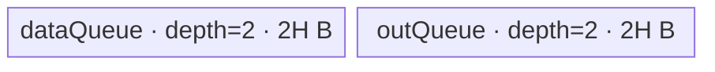

# ForeachMaximumScalar A2/A3 ACLNN 算子知识

## 算子速览

| 项目 | 内容 |
|---|---|
| 实际入口 | 公开两段式 ACLNN：`aclnnForeachMaximumScalarV2GetWorkspaceSize` / `aclnnForeachMaximumScalarV2`；V2 是本平台版本族中提取的最新公开版本。 |
| 计算语义 | 对列表中每个张量逐元素计算 `y_i[j] = max(x_i[j], scalar)`。 |
| 输入输出 | `x/out` 为 ND TensorList，元素 dtype 为 FLOAT16/FLOAT32/INT32/BFLOAT16；V2 的 `scalar` 是 `aclScalar`，经 API 转成单元素 Tensor。 |
| 执行类型 | 单 Kernel、AIV_VECTOR；未发现 Cube/AIC 或 MIX_CV 可达节点。 |
| Kernel 路线 | R-001：FLOAT16/FLOAT32/INT32 直接 `Maxs`；R-002：BFLOAT16 经 FP32 分段计算。 |
| 核心资源 | GM TensorList、双缓冲 VECIN/VECOUT Queue；BFLOAT16 另有单深度 FP32 Queue；算子 Tiling workspace 为 32 B。 |
| 来源闭包 | source_closed：ACLNN V2→Contiguous/标量转 Tensor 框架边界→L0 launcher→arch22 Tiling/POD→AIV entry→公共 Foreach body/helper→构建接线闭合。 |
| 验证状态 | 已完成源码闭包检查；本次知识提取未执行编译、真机、数值或性能测试。 |

## 接口与语义

### 计算语义

令 `x=[x_0,...,x_(n-1)]`，输出列表与输入逐位置对应；对每个有效元素 `j`，结果为 `y_i[j]=max(x_i[j], scalar)`。V2 源码先把 `aclScalar` 转成一个 Device Tensor：BFLOAT16 输入对应 FP32 scalar Tensor，其余输入对应同 dtype scalar Tensor。输出只写各输入张量的有效元素域。

### 输入、输出与属性

| 参数 | shape/layout | dtype | 约束、默认值与语义 |
|---|---|---|---|
| `x` | TensorList；每个 Tensor 0–8 维、ND | FLOAT16/FLOAT32/INT32/BFLOAT16，列表内一致 | 列表可为空；V2 文档将非连续输入标为不支持，但 API 实现仍建立 `Contiguous` 框架节点。 |
| `scalar` | `aclScalar`，无 Tensor shape | 对 FLOAT/BF16 输入支持 FLOAT/DOUBLE；FLOAT16 支持 FLOAT16/DOUBLE；INT32 支持 INT32/INT64 | 值必须落入目标 Tensor dtype 范围；之后转换为 1 元素 scalar Tensor。 |
| `out` | TensorList；源码 API 要求与 `x` 对应 shape 相等；ND | 与 `x` 一致 | 非连续输出不支持。公开文档写“shape size 大于等于 x”，但 V2 `CheckShapeValid` 实际调用 `OP_CHECK_SHAPE_NOT_EQUAL`，固定源码按精确相等校验。 |

### 入口与版本

公开文档同时列出 `aclnnForeachMaximumScalar` 与 `aclnnForeachMaximumScalarV2`；V2 明确把 scalar 从 `aclTensor` 改为 `aclScalar`，且产品表对 A2、A3 均为支持，因此本卡逐架构只选择 V2。第一段构造 executor 并返回聚合 workspace，第二段由 `CommonOpExecutorRun` 在调用者 stream 上执行。旧接口不进入 Route 正文。

## Host/Launcher 执行流程

### 参数校验与前处理

`ExecForeachMaximumScalarV2GetWorkspaceSize` 依次：创建 executor；检查 `x/scalar/out` 非空；平台必须是 DAV_2201 或 regbase；检查列表 dtype 一致、输出 dtype 与输入一致、scalar dtype 配对；检查每个输入不超过 8 维且输入/输出 shape 相等；拒绝私有格式。空 TensorList 直接返回 `workspaceSize=0`，不添加 Kernel。非空时逐 Tensor 添加 `l0op::Contiguous` 节点，检查 scalar 数值范围，再用 `ConvertToTensor` 生成目标 dtype 的单元素 Tensor，最后添加 `ForeachMaximumScalar` AICore launcher。

### 参数、Workspace 与生命周期

ACLNN executor 持有 Contiguous 结果、转换后的 scalar Tensor 和 launcher，`GetWorkspaceSize()` 返回这些节点的聚合 workspace；该框架聚合公式在固定仓不可见。算子 Tiling 固定写 `workspaces[0]=32` B，但 Device entry 明确令 `userWS=nullptr`，公共 body 不消费该 32 B。调用者必须保持第一段返回的 executor 与 workspace 有效至第二段 stream 任务提交完成。

### 启动图与失败传播

非空列表只有一个核心 Device 节点：`ForeachMaximumScalarV2` 调 `ADD_TO_LAUNCHER_LIST_AICORE(ForeachMaximumScalar, OP_INPUT(x, scalarTensor), OP_OUTPUT(out))`；运行时执行 arch22 Tiling，再以 `blockDim=needCoreNum` 启动 `foreach_maximum_scalar(inputs, scalar, outputs, workspace, tiling)`。Contiguous/标量转换是 executor 中的前置框架节点，和主 Kernel 使用同一 executor/stream 顺序；任一空指针、校验、转换或 launcher 添加失败均立即返回并阻断主 Kernel。固定仓未暴露 executor 内部临时 workspace slice offset，不能进一步给出其 extent/owner 细节。

## Route 与参数设计

### 分核与资源计算

Tiling 扫描至多 `MAX_TENSOR_CONT=50` 个输入实例，记录每个 storage shape 元素数并求 `totalDataCount`。令 `E=32/sizeof(T)`，`needCoreNum=min(AIV核数, ceil(totalDataCount/E), 50)`，零总元素时先钳为 1。`AssignDataToEachCore` 以 32 B block 平分扁平列表域，余数 block 给较小 core index，并生成每核首/尾 Tensor index 及元素 offset。

令 `P=ForeachCommonTilingData::GetDataSize()`，`U=平台 UB 字节数`。非 BF16：`H=floor32((U-P)/4)`；BF16：`H=floor64((((U-P)/10)/4))`。`H` 写入 `inputsTensorUbSize`。非 BF16 tile 上限为 `H/sizeof(T)` 元素；BF16 拷贝 tile 上限为 `9H/2` 元素，内部每次最多 cast `H/4` 个元素。

### Route 选择

| 顺序 | Route | Key/模板 | 精确选择条件与优先级 | 不适用去向 |
|---:|---|---|---|---|
| 1 | R-001 直接 Maxs | key 1→`half/half`；2→`float/float`；3→`int/int` | `GetTilingKeyByDtypeOnly` 按 FLOAT16/FLOAT32/INT32 返回 1/2/3，entry 按 `if/else if` 同序实例化。 | dtype 为 BF16 进入 R-002；其它 dtype 的 Host key 为 0 且 entry 无分支。 |
| 2 | R-002 BF16 升精度 | key 4→`bfloat16_t/float` | dtype=BFLOAT16，且编译 guard `__CCE_AICORE__ >= 220` 并排除 NPU_ARCH 3003/3113。 | guard 不成立时不存在 BF16 body。 |

```text
FLOAT16 -> key 1 -> ForeachOneScalarBinary<half, half, MaxsAdapter<half>, 2>
FLOAT32 -> key 2 -> ForeachOneScalarBinary<float, float, MaxsAdapter<float>, 2>
INT32   -> key 3 -> ForeachOneScalarBinary<int, int, MaxsAdapter<int>, 2>
BF16    -> key 4 -> [CCE>=220 且非 3003/3113] ForeachOneScalarBinary<bfloat16_t, float, MaxsAdapter<float>, 2>
其它    -> Host/API 失败或 entry 无匹配分支
```

### 模板/实现执行矩阵

| Route | key/selector | dtype/shape/platform 完整命中条件 | 执行拓扑与 Kernel 节点 | 实际模板/body | 内存与同步特征 | tail/fallback |
|---|---|---|---|---|---|---|
| R-001 直接 Maxs | 1/2/3 | A2/A3；非空列表；FLOAT16/FLOAT32/INT32；API/Tiling 校验通过 | 单 AIV Kernel | `ForeachOneScalarBinary<T,T,MaxsAdapter<T>,2>`→`KernelForeachUnary` | VECIN/VECOUT 各 depth 2；`Maxs` 前后 `PIPE_V` barrier | 整 tile 用 `DataCopy`；尾 tile 用 `DataCopyPad` 且计算/回写仅 `dataCount`。 |
| R-002 BF16 升精度 | 4 | A2/A3；BF16 x/out、FP32 scalar Tensor；编译 guard 成立 | 单 AIV Kernel | `ForeachOneScalarBinary<bfloat16_t,float,MaxsAdapter<float>,2>` + `InnerComputer` specialization | 双缓冲 BF16 Queue + FP32 Queue；BF16→FP32→Maxs→BF16，步骤间 `PIPE_V` barrier | tile 再按 `maxCastDataCount` 分段；末段与尾 tile 都用精确元素数。 |

### 隐藏性能 Guard

| Guard | Host/Tiling 条件 | Device/资源原因 | 影响 Route | 不满足时去向 | 源码符号 |
|---|---|---|---|---|---|
| Tensor 数上限 | `Init` 最多扫描 50 个动态实例 | POD 各 Tensor 数组长度为 50 | 两 Route | 超出部分不会进入扫描；API 未单独声明 50 上限，固定仓无更强显式报错 | `foreach_tiling_def.h::MAX_TENSOR_CONT`、`ForeachCommonTiling::Init` |
| 32 B 分核 | `E=32/sizeof(T)` | 普通 DMA 整 tile 要按 block 分配 | 两 Route | 尾部使用 pad 搬运 | `GetNeedCoreNum`、`AssignDataToEachCore` |
| UB 上界 | 非 BF16 `H=floor32((U-P)/4)` | 两个 depth-2 Queue 合计 `4H` | R-001 | U/P 异常未见显式 guard | `DivideUbMemory3` |
| BF16 UB 上界 | `H=floor64(((U-P)/10)/4)` | 复制区按 9 倍放大，另需两段 FP32 临时区 | R-002 | 不回退到其它 Route | `DivideUbMemory3`、`KernelForeachBase::Init` |
| BF16 编译条件 | CCE≥220 且 arch 非 3003/3113 | BF16 Cast 与 specialization 仅在该 guard 下编译 | R-002 | entry 无 key 4 body | `foreach_maximum_scalar.cpp`、`kernel_foreach_unary.h` |

### POD/ABI

| 结构 | 字段 | 类型/位宽 | ABI 布局 | 单位 | Host/launcher producer | Device consumer | 边界 |
|---|---|---|---|---|---|---|---|
| `ForeachCommonTilingData` | `inputsTensorUbSize` | uint64_t/64 | 宏生成结构；固定仓未展开 `sizeof/alignof/offsetof` | 字节 | `FillTilingData` ← `DivideUbMemory3` | `KernelForeachBase::ParseTilingData`，生成 Queue 容量/tile | 32 B 或 64 B 向下对齐 |
| 同上 | `tensorDataCountList` | int64_t[50] | 同上；声明顺序第 2 字段 | 元素 | `Init` 从各 storage shape 写入 | `Process` 计算各 Tensor 首尾 | 每项可为 0 |
| 同上 | `tensorStartList` | uint16_t[50] | 同上；声明顺序第 3 字段 | Tensor index | `AssignDataToEachCore` | `ParseTilingData` | 以 blockIdx 取值 |
| 同上 | `tensorEndList` | uint16_t[50] | 同上；声明顺序第 4 字段 | Tensor index | `AssignDataToEachCore` | `ParseTilingData` | 含首尾 |
| 同上 | `tensorStartOffsetList` | int64_t[50] | 同上；声明顺序第 5 字段 | 元素 offset | `AssignDataToEachCore` | `ParseTilingData` | 首元素 offset |
| 同上 | `tensorEndOffsetList` | int64_t[50] | 同上；声明顺序第 6 字段 | 元素 offset | `AssignDataToEachCore` | `ParseTilingData` | 含末元素；全空域可出现负终点，固定仓未给专门 Device guard |

### Route 源码闭包

| Route | Key/selector | Host/Tiling producer | POD/参数 | Kernel entry/router 节点 | Kernel body/直接依赖 | 构建接线 |
|---|---|---|---|---|---|---|
| R-001 直接 Maxs | key 1/2/3 | `foreach_maximum_scalar_tiling_arch22.cpp::Tiling4ForeachMaximumScalarTiling`；`foreach_tiling_class.h::RunBigScalarKernelTiling` | `ForeachCommonTilingData` | `op_kernel/foreach_maximum_scalar.cpp::foreach_maximum_scalar` | `ForeachOneScalarBinary::Compute`；`KernelForeachUnary::{Process,CopyIn,CopyOut}` | `op_kernel/CMakeLists.txt::add_kernel_sources` for ascend910b/ascend910_93 |
| R-002 BF16 升精度 | key 4 | 同上 | 同上 | 同上 key 4 guard | `InnerComputer<bfloat16_t,float>::ComputePerCast`；公共 Base | 同上 |

## Kernel 实现

### 公共执行流程

entry 解析 POD 后按 key 构造模板对象，`Init` 解析当前 AIV core 的 Tensor 起止范围、绑定 scalar GM 并初始化 Queue，`Process` 对本核覆盖的每个 Tensor 分 tile 执行 CopyIn→Compute→CopyOut。TensorList GM 首字存放指针表相对偏移，`GetTensorAddr` 右移 3 位定位 uint64 指针表，再取第 i 个数据地址。单 Kernel 无跨 Kernel workspace 边。

### Route R-001：直接 Maxs

#### 适用条件

##### 选择证据

| 层级 | 文件 | 符号 | 源码谓词/参数 | 结果/下一跳 |
|---|---|---|---|---|
| API | `op_host/op_api/aclnn_foreach_maximum_scalar_v2.cpp` | `CheckDtypeValid` | x dtype 为 FLOAT16/FLOAT32/INT32，scalar dtype 配对 | 转为同 dtype scalar Tensor |
| Tiling | `foreach_utils/op_host/common_dtype.h` | `GetTilingKeyByDtypeOnly` | dtype switch | key 1/2/3 |
| Router | `op_kernel/foreach_maximum_scalar.cpp` | `foreach_maximum_scalar` | `TILING_KEY_IS(1/2/3)` 顺序判断 | `half/float/int` 模板实例 |

#### Device 数据流

##### 函数级调用链

```text
ADD_TO_LAUNCHER_LIST_AICORE(ForeachMaximumScalar)
  -> foreach_maximum_scalar(inputs, scalarTensor, outputs, workspace, tiling)
    -> ForeachOneScalarBinary<T,T,MaxsAdapter<T>,2>::Init
      -> KernelForeachUnary::Init -> KernelForeachBase::Init/ParseTilingData
    -> KernelForeachUnary::Process
      -> SingleTensorProcess -> CopyIn -> ForeachOneScalarBinary::Compute
      -> InnerComputer::Compute -> MaxsAdapter -> Maxs -> CopyOut
```

##### 源码等价伪码

```text
core = GetBlockIdx(); 读取本核 tensorStart/end 与首尾 offset
for tensor i in [tensorStart, tensorEnd]:
  cursor = 由首尾 POD 修剪后的有效区间
  inGM/outGM = DecodeTensorList(i) + cursorStart
  for tile k, tileLen <= H/sizeof(T):
    尾 tile: DataCopyPad(GM -> VECIN, tileLen*sizeof(T)); 否则 DataCopy
    PIPE_V barrier; Maxs(outLocal, dataLocal, scalarVal, tileLen); PIPE_V barrier
    尾 tile: DataCopyPad(VECOUT -> GM, tileLen*sizeof(T)); 否则 DataCopy
```

#### 内存与数据搬运

##### 资源与搬运表

| 层级/缓冲区 | offset/地址公式 | extent/容量公式 | dtype/layout | producer | consumer | owner/lifetime | 对齐/复用 |
|---|---|---|---|---|---|---|---|
| GM x/y Tensor | `Decode(list,i)+cursorStart+k*maxDataCount` | tile 有效 `dataCount` | T/ND | API 输入、CopyOut | CopyIn、API 输出 | 调用者；Kernel 期间有效 | 整 tile普通 DMA，尾 tile pad API |
| `dataQueue` | Queue 管理 | depth 2 × H B | T/VECIN | CopyIn | Compute DeQue | TPipe；每 tile Free | 双缓冲 |
| `outQueue` | Queue 管理 | depth 2 × H B | T/VECOUT | Compute EnQue | CopyOut | TPipe；回写后 Free | 双缓冲 |
| scalar GM | element 0 | 1×sizeof(T) | T | `ConvertToTensor` | `ForeachOneScalarBinary::Init` | executor | 每核读取一次 |

##### 分层内存布局



##### 字节账与复用顺序

```text
H = floor32((U - P) / 4)
UB_total = 2H + 2H = 4H <= U - P
dynamic_ub = N/A
workspace_total = 32 B（Tiling 声明；Device userWS=nullptr）+ executor 框架临时量（固定仓公式不可见）
=> maxDataCount = H / sizeof(T)
```

| 复用子区 | 写入者 | 读取者/消费点 | 下一次覆盖 | 同步或释放依据 | 安全条件 |
|---|---|---|---|---|---|
| dataQueue 当前 slot | `CopyIn` | `Compute` DeQue | `FreeTensor` 后下一 tile | EnQue→DeQue→FreeTensor | depth=2，不可在消费前覆盖 |
| outQueue 当前 slot | `Compute` | `CopyOut` DeQue | 回写并 `FreeTensor` 后 | EnQue→DeQue→FreeTensor | GM 回写完成后才能复用 |

#### 同步、精度与尾块

##### 同步与数值边界表

| 阶段 | primitive/机制 | producer | consumer/等待点 | 保护对象 | 精度/尾块 |
|---|---|---|---|---|---|
| 搬入→计算 | Queue EnQue/DeQue | CopyIn | Compute | dataQueue slot | 尾部仅复制有效字节，padding lane 不进入 `dataCount` |
| Vector 计算 | `PipeBarrier<PIPE_V>` | 输入就绪/Maxs | Maxs/回写 | Vector pipeline | T dtype 原精度；`Maxs` 的 NaN/±0 primitive 细节在固定仓外 |
| 计算→搬出 | Queue EnQue/DeQue | Compute | CopyOut | outQueue slot | CopyOut 只写 `dataCount*sizeof(T)` |

#### 关键实现

##### 符号证据表

| 阶段 | 文件 | 符号/模板实例 | 实现事实 |
|---|---|---|---|
| Host/Tiling producer | `foreach_utils/op_host/foreach_tiling_class.h` | `RunBigScalarKernelTiling` / `AssignDataToEachCore` / `DivideUbMemory3` | key、blockDim、每核域、H 与 32 B workspace |
| Kernel entry/router | `foreach_maximum_scalar/op_kernel/foreach_maximum_scalar.cpp` | `foreach_maximum_scalar` key 1/2/3 | key 到模板实例映射 |
| Device body/helper | `foreach_utils/op_kernel/kernel_foreach_unary.h` | `Process` / `CopyIn` / `CopyOut` | tile 循环、DMA、Queue 生命周期与 tail |

### Route R-002：BF16 升精度

#### 适用条件

##### 选择证据

| 层级 | 文件 | 符号 | 源码谓词/参数 | 结果/下一跳 |
|---|---|---|---|---|
| API | `op_host/op_api/aclnn_foreach_maximum_scalar_v2.cpp` | `CheckDtypeValid` / `ConvertToTensor` | x=BF16；scalar=FLOAT/DOUBLE 且值在 BF16 范围 | FP32 scalar Tensor |
| Tiling | `foreach_utils/op_host/common_dtype.h` | `GetTilingKeyByDtypeOnly` | dtype=BF16 | key 4 |
| Router | `op_kernel/foreach_maximum_scalar.cpp` | `foreach_maximum_scalar` | CCE≥220 且非 arch 3003/3113，`TILING_KEY_IS(4)` | BF16/FP32 模板 |

#### Device 数据流

##### 函数级调用链

```text
foreach_maximum_scalar key 4
  -> ForeachOneScalarBinary<bfloat16_t,float,MaxsAdapter<float>,2>::Init
    -> KernelForeachUnary::Init（BF16 Queue + float32Queue）
  -> KernelForeachUnary::Process/SingleTensorProcess
    -> CopyIn(BF16)
    -> InnerComputer<bfloat16_t,float>::Compute
      -> ComputePerCast: Cast BF16->FP32 -> Maxs FP32 -> Cast FP32->BF16
    -> CopyOut(BF16)
```

##### 源码等价伪码

```text
对每个 BF16 tile（最多 9H/2 元素）:
  CopyIn 到 BF16 dataQueue
  for segment q of at most H/4 elements:
    Cast(floatBuf[0], bf16Input[q], CAST_NONE)
    Maxs(floatBuf[H/4], floatBuf[0], fp32Scalar, segmentLen)
    Cast(bf16Output[q], floatBuf[H/4], CAST_RINT)
  CopyOut 有效 BF16 元素
```

#### 内存与数据搬运

##### 资源与搬运表

| 层级/缓冲区 | offset/地址公式 | extent/容量公式 | dtype/layout | producer | consumer | owner/lifetime | 对齐/复用 |
|---|---|---|---|---|---|---|---|
| `dataQueue` | Queue 管理 | depth 2 × 9H B | BF16 | CopyIn | Cast | TPipe | 双缓冲、H 以 64 B 对齐 |
| `outQueue` | Queue 管理 | depth 2 × 9H B | BF16 | FP32→BF16 Cast | CopyOut | TPipe | 双缓冲 |
| `float32Queue` | `[0,H)` 输入段；`[H,2H)` 输出段 | depth 1 × 2H B | FP32 | 两次 Cast/Maxs | Maxs/Cast | 整个 Process 持有 | 同一 TBuf 两个不重叠子区 |

##### 分层内存布局


##### 字节账与复用顺序

```text
H = floor64((((U - P) / 10) / 4))
UB_total = 18H + 18H + 2H = 38H <= U - P（Host 的 /40 预算留有舍入余量）
dynamic_ub = N/A
workspace_total = 32 B + executor 框架临时量（固定仓公式不可见）
=> maxDataCount = 9H / 2；maxCastDataCount = H / 4
```

| 复用子区 | 写入者 | 读取者/消费点 | 下一次覆盖 | 同步或释放依据 | 安全条件 |
|---|---|---|---|---|---|
| FP32 `[0,H)` | BF16→FP32 Cast | FP32 Maxs | 下一 segment Cast | Cast 后 `PIPE_V` barrier | Maxs 读完前不得覆盖 |
| FP32 `[H,2H)` | FP32 Maxs | FP32→BF16 Cast | 下一 segment Maxs | Maxs 后 `PIPE_V` barrier | `paramsCount=2` 保证输入/输出不别名 |

#### 同步、精度与尾块

##### 同步与数值边界表

| 阶段 | primitive/机制 | producer | consumer/等待点 | 保护对象 | 精度/尾块 |
|---|---|---|---|---|---|
| BF16→FP32 | Cast + PIPE_V barrier | dataQueue | Maxs | FP32 输入段 | `CAST_NONE`，segmentLen 精确 |
| 最大值 | Maxs + PIPE_V barrier | FP32 输入/FP32 scalar | 降精度 Cast | FP32 输出段 | FP32 计算 |
| FP32→BF16 | Cast `CAST_RINT` | Maxs | CopyOut | BF16 outQueue | 尾 segment 仅转换 remainder |

#### 关键实现

##### 符号证据表

| 阶段 | 文件 | 符号/模板实例 | 实现事实 |
|---|---|---|---|
| Host/Tiling producer | `foreach_utils/op_host/foreach_tiling_class.h` | `DivideUbMemory3` | BF16 的 /10、/4 与 64 B 对齐 |
| Kernel entry/router | `foreach_maximum_scalar/op_kernel/foreach_maximum_scalar.cpp` | key 4 branch | 编译 guard 与 BF16/float 模板 |
| Device body/helper | `foreach_utils/op_kernel/foreach_one_scalar_binary.h` | `InnerComputer<bfloat16_t,float>::ComputePerCast` | 分段升精度、双 FP32 子区、RINT 降精度 |

## 算子特定优化

### Trick T-001：BF16 分段升精度复用单个 FP32 Queue

#### 触发与源码依据

- 适用 Route：R-002
- 触发条件：T=BF16、P=FP32、`paramsCount=2`，且 key 4 编译 guard 成立。
- Golden 来源：[`foreach_one_scalar_binary.h:69-75`](../../../../../../../cann-ops-raw/ascendc/ops-nn/955f8b33985b6d72989ebff341bb9c2c564a51bc/foreach/foreach_utils/op_kernel/foreach_one_scalar_binary.h#L69-L75)

**官方源码（固定 Commit 连续逐字摘录）**：

```cpp
PipeBarrier<PIPE_V>();
Cast(float32Tensor, dataLocal[index * maxCastDataCount], RoundMode::CAST_NONE, dataCount);
PipeBarrier<PIPE_V>();
uint32_t offset = (paramsCount == 1) ? 0 : maxCastDataCount;
op(float32Tensor[offset], float32Tensor, scalarVal, dataCount);
PipeBarrier<PIPE_V>();
Cast(outLocal[index * maxCastDataCount], float32Tensor[offset], RoundMode::CAST_RINT, dataCount);
```

#### 机制与设计原因

大 BF16 tile 不一次性物化为完整 FP32 tile，而按 `maxCastDataCount=H/4` 分段；同一 `float32Queue` 前 H 字节保存 FP32 输入、后 H 字节保存 FP32 输出。这样保留 FP32 比较语义，同时将 FP32 临时量固定为 2H，Vector barrier 明确三阶段依赖。

#### 迁移边界

- 适用：需要 BF16 存储、FP32 elementwise 计算且可独立分段的单输出算子。
- 前提：CCE≥220；输入输出分段无跨段依赖；UB 能容纳双缓冲 BF16 Queue 与 2H FP32 Queue。
- 失效：编译 guard 不成立时 key 4 无 Device body；需要跨段状态时不能直接复用该分段结构。
- 未验证：本次知识提取未执行编译、真机、数值或性能测试。

#### 错误做法

固定仓未提供可验证反例。

## 模板与实现对比

| 对比维度 | R-001 直接 Maxs | R-002 BF16 升精度 | 设计选择依据 |
|---|---|---|---|
| 命中条件/优先级 | key 1/2/3 | key 4 + 编译 guard | 输入 dtype |
| 模板与 dtype | T=P=half/float/int | T=BF16、P=float | BF16 Vector 最大值在 FP32 执行 |
| 循环与分核 | 32 B block 分核，H/sizeof(T) tile | 同分核，tile 内再按 H/4 分段 | FP32 临时区容量 |
| Queue/TBuf/寄存器/dynamic UB/通信 window | 双 VECIN/VECOUT Queue | 双 BF16 Queue + 单 FP32 Queue | BF16 cast 链 |
| 内存总占用与复用 | 4H | 38H；FP32 前后半区复用 | Host 分别用 /4 与 /40 预算 |
| 搬运/Vector/SIMT/NDDMA/通信 API | DataCopy(Pad)+Maxs | DataCopy(Pad)+Cast+Maxs+Cast | dtype 精度路径 |
| 同步、精度与 tail | Queue + PIPE_V；T 精度 | Queue + 3 个 PIPE_V；FP32 计算、RINT 降精度 | specialization |
| fallback/失败边界 | 无其它 dtype fallback | guard 失败无 key 4 body | 编译/平台约束 |

## 平台差异

| 项目 | A2 | A3 | 950 |
|---|---|---|---|
| 支持状态 | V2 公开支持 | V2 公开支持 | V2 公开支持，但不属于本卡 |
| Host/Launcher | arch22 公共 Tiling | arch22 公共 Tiling | arch35 独立 Tiling |
| Kernel/资源 | AIV Vector、公共 Queue body | 同 A2 | SIMT，详见 `_950` 卡 |

## 限制与失败边界

- V2 API 固定源码实际要求 `x/out` 对应 shape 精确相等，与公开文档“out shape size 大于等于 x”表述不完全一致；复用时按源码校验实现。
- Tiling POD 只容纳 50 个 Tensor 和 50 个 core 的边界数组；API 文档未公开该 50 Tensor 上限。
- A2/A3 Tiling 声明 32 B workspace，但 Device body 不消费；ACLNN 返回值还可能包含 Contiguous/标量转换框架临时量，固定仓未给聚合 offset/extent。
- 全空元素列表的 API 仅在列表长度为 0 时短路；非空但各 Tensor 都为空时，arch22 `AssignDataToEachCore` 的负尾 offset 没有专门说明，固定仓缺少运行验证结论。
- `Maxs` primitive 内部 NaN、有符号零语义及硬件指令细节不在固定仓；不得从 950 的显式 `SimtMaximum` 反推本卡。

## 源码索引

### 链路索引

| 链路阶段 | 文件 | 关键符号 | 支撑内容 |
|---|---|---|---|
| 入口声明/约束 | `foreach/foreach_maximum_scalar/docs/aclnnForeachMaximumScalarV2.md` | V2 原型/产品表 | A2/A3 支持、接口约束、版本差异 |
| 入口实现 | `foreach/foreach_maximum_scalar/op_host/op_api/aclnn_foreach_maximum_scalar_v2.cpp` | `ExecForeachMaximumScalarV2GetWorkspaceSize` | 校验、Contiguous、scalar 转 Tensor、executor |
| 入口实现 | `foreach/foreach_maximum_scalar/op_host/op_api/foreach_maximum_scalar_v2.cpp` | `ForeachMaximumScalarV2` | launcher 添加 |
| Host/Tiling/Launcher | `foreach/foreach_maximum_scalar/op_host/arch22/foreach_maximum_scalar_tiling_arch22.cpp` | `Tiling4ForeachMaximumScalarTiling` | arch22 接入公共 Tiling |
| Host/Tiling/Launcher | `foreach/foreach_utils/op_host/foreach_tiling_class.h` | `RunBigScalarKernelTiling` | 校验、分核、UB、POD、workspace |
| Host/Tiling/Launcher | `foreach/foreach_utils/op_host/foreach_tiling_def.h` | `ForeachCommonTilingData` | POD 字段和上限 |
| Host/Tiling/Launcher | `foreach/foreach_utils/op_host/common_dtype.h` | `GetTilingKeyByDtypeOnly` | dtype 到 key 1/2/3/4 的映射 |
| Kernel entry/body | `foreach/foreach_maximum_scalar/op_kernel/foreach_maximum_scalar.cpp` | `foreach_maximum_scalar` / `MaxsAdapter` | key router 和 Maxs entry |
| Kernel entry/body | `foreach/foreach_utils/op_kernel/foreach_one_scalar_binary.h` | `ForeachOneScalarBinary` / `InnerComputer` | scalar 读取、直接/BF16 计算 |
| Kernel entry/body | `foreach/foreach_utils/op_kernel/kernel_foreach_unary.h` | `KernelForeachUnary` | Queue、tile、CopyIn/Out、tail |
| Kernel entry/body | `foreach/foreach_utils/op_kernel/kernel_foreach_base.h` | `KernelForeachBase` | POD 解析、TensorList 指针解码 |
| 构建接线 | `foreach/foreach_maximum_scalar/op_kernel/CMakeLists.txt` | `add_kernel_sources` | A2/A3 使用公共 kernel source |
| 构建接线 | `foreach/foreach_maximum_scalar/op_host/CMakeLists.txt` | `SUPPORT_COMPUTE_UNIT` / `SUPPORT_TILING_DIR` | ascend910b/ascend910_93 映射 arch22 Tiling |

### 实现复用检查

| 检查项 | 可复用事实 | 不得改变的约束 | 源码符号 |
|---|---|---|---|
| ABI/POD | 六字段公共 POD 与逐核首尾域 | 数组长度 50、字段顺序/位宽、Host/Device 同宏 | `ForeachCommonTilingData` |
| 调用顺序 | CopyIn→Compute→CopyOut | Queue EnQue/DeQue/Free 顺序 | `KernelForeachUnary::SingleTensorProcess` |
| workspace/内存 | 非 BF16 4H；BF16 38H | depth=2、BF16 9H 复制区、FP32 2H 区 | `KernelForeachUnary::Init` |
| 同步 | Queue 同步与 PIPE_V barrier | Cast/Maxs/Cast barrier 不可删 | `InnerComputer::ComputePerCast` |
| 精度与尾块 | BF16 FP32 计算并 RINT；尾部精确字节回写 | `maxCastDataCount`、dataCount、pad API | `InnerComputer` / `CopyOut` |
| 失败边界 | API、Tiling 任一失败阻断 Kernel | key 4 编译 guard、50 Tensor/POD 上限 | `CheckParams` / `RunBigScalarKernelTiling` |

- [Maxs](../../../../apis/simd_api/basic_api/memory_vector_compute/basic_arithmetic/maxs.md)
