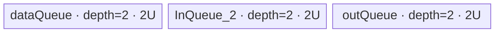
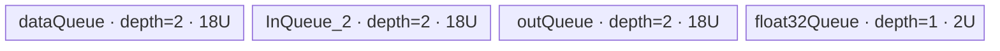

# ForeachMinimumList A2/A3 ACLNN 算子知识

## 算子速览

| 项目 | 内容 |
|---|---|
| 实际入口 | `aclnnForeachMinimumListGetWorkspaceSize` + `aclnnForeachMinimumList`，公开两段式 ACLNN；固定仓只公开一个无版本后缀的版本族。 |
| 计算语义 | 对等长张量列表逐位置、逐元素计算 `y_i[e] = min(x1_i[e], x2_i[e])`。 |
| 输入输出 | `x1`、`x2`、`out` 为 ND TensorList；逐列表位置 shape、dtype 一致；支持 FP16、FP32、INT32、BF16，输入可非连续并由 OpDef `AutoContiguous` 处理，输出必须连续。 |
| 执行类型 | 单 Kernel、单 AIV_VECTOR 节点；R-001 直接 `Min`，R-002 BF16→FP32→`Min`→BF16。 |
| Kernel 路线 | R-001：key 1/2/3 的 FP16/FP32/INT32；R-002：key 4 的 BF16 升精度实现。 |
| 核心资源 | 三个 depth=2 的 VECIN/VECOUT Queue；BF16 另有一个 depth=1 FP32 Queue；32-byte（BF16 为 64-byte）Host 分配粒度；Device 不使用用户 workspace。 |
| 来源闭包 | source_closed：公开 ACLNN 文档→框架生成 ACLNN bridge 边界→`ForeachMinimumList` OpDef→arch22 Tiling→`ForeachCommonTilingData`→kernel router→公共 Foreach body→活动构建接线已闭合。 |
| 验证状态 | 已完成源码闭包检查；本次知识提取未执行编译、真机、数值或性能测试。 |

## 接口与语义

### 计算语义

设列表长度为 `n`，第 `i` 对输入张量形状相同，元素域为 `0 <= e < numel(x1_i)`：

```text
x1 = [x1_0, ..., x1_(n-1)]
x2 = [x2_0, ..., x2_(n-1)]
y_i[e] = min(x1_i[e], x2_i[e])
```

不同列表成员不拼接为可见输出；Host 仅把所有成员的元素数串联成逻辑一维域来分核，Device 再通过 tensor-list 地址表恢复成员边界。A2/A3 的 FP16/FP32/INT32 路线直接调用 AscendC `Min`；BF16 先把两路各自转为 FP32，在 FP32 上调用 `Min`，再用 `RoundMode::CAST_RINT` 转回 BF16。固定仓未展开 AscendC `Min` primitive 内部对 NaN、signed-zero 的指令级规则，因此移植时不得自行替换成未经等价性证明的比较表达式。

### 输入、输出与属性

| 参数 | shape/layout | dtype | 约束、默认值与语义 |
|---|---|---|---|
| `x1` | TensorList；每个 Tensor 为 ND，rank 0–8 | FP16/FP32/INT32/BF16；列表内一致 | 支持空 Tensor；可非连续，OpDef 标记 `AutoContiguous()`；与 `x2` 列表长度相同且同位置 storage shape 相同。 |
| `x2` | 与 `x1` 同位置 Tensor 的 ND shape 相同 | 与 `x1` 完全一致 | 支持空 Tensor；可非连续，框架连续化；逐元素作为 `Min` 第二输入。 |
| `out` | TensorList、ND；公开接口要求同位置 shape size 不小于 `x1`，公共推形实际复制 `x1` shape | 与 `x1` 完全一致 | 输出不支持非连续 Tensor；kernel 只写与 `x1_i` 等长的前缀。公开 API 的正常推形得到完全相同 shape。 |
| `workspaceSize` | 标量输出 | `uint64_t` | 第一段接口返回 Device workspace 字节数；Tiling 写 32 字节框架 workspace，但 kernel 明确将用户 workspace 置空且不消费。 |
| `executor` | Host 执行器 | `aclOpExecutor**` | 第一段接口创建并持有计算流程，第二段消费。 |
| `workspace` / `stream` | Device 地址 / ACL stream | N/A | 第二段必须使用第一段返回的 size/executor；在给定 stream 上异步提交。 |

### 入口与版本

固定仓公开文档只声明 `aclnnForeachMinimumListGetWorkspaceSize` 与 `aclnnForeachMinimumList`，没有 V2 或更高版本，因此这是 A2/A3 的最新公开版本。文档产品表明确支持 Atlas A2、Atlas A3；`foreach_minimum_list_def.cpp` 注册 `ascend910b` 与 `ascend910_93`，`op_host/CMakeLists.txt` 将两者都映射到 `arch22`，`op_kernel/CMakeLists.txt` 也为两者构建通用 kernel，证据一致。

固定仓未保存自动生成的 `aclnn_foreach_minimum_list.h/.cpp` inner bridge。该 bridge 作为 Skill 允许的框架边界：公开原型、错误语义和 executor 生命周期来自 API 文档；算子拥有的 OpDef、Tiling、POD、router/body 与构建接线均已继续追到底。输入 `AutoContiguous` 来自 OpDef；输出虽然也有该标记，公开 ACLNN 文档仍明确标成“不支持非连续”，以公开约束为准。

## Host/Launcher 执行流程

### 参数校验与前处理

1. 第一段接口检查 `x1/x2/out/workspaceSize/executor` 所需指针；文档列出的空指针错误为 `ACLNN_ERR_PARAM_NULLPTR(161001)`。
2. ACLNN/框架检查三列表 dtype 位于 FP16/FP32/INT32/BF16 且互相一致；失败为 `ACLNN_ERR_PARAM_INVALID(161002)`。输入 `x1/x2` 按 OpDef `AutoContiguous()` 进入连续存储边界，输出必须由调用者提供连续 Tensor。
3. 公共推形 `InferShape4ForeachCommon` 要求动态输入 0 的实例数等于输出数，并逐项令 `yShape=x1Shape`；推 dtype 同样逐项复制 `x1` dtype。
4. `ForeachCommonTiling::Init(BINARY_LIST_OP_CODE)` 最多扫描 `MAX_TENSOR_CONT=50` 个 `x1` Tensor，收集 storage numel，冻结首个 dtype、`sizeof(dtype)` 与每 32 字节元素数；公共检查随后验证 `x1/x2` 列表实例数、同位置 shape、列表内和列表间 dtype、输出 dtype/容量及 rank≤8。
5. 任一 desc/shape/platform/workspace 指针缺失、列表长度或 shape/dtype 不一致均返回 `GRAPH_FAILED`，对应公开接口的 inner tiling error 边界。

### 参数、Workspace 与生命周期

令 `N=sum_i numel(x1_i)`、`E=32/sizeof(T)`、平台 AIV 核数为 `Cplat`：

```text
needCoreNum = min(max(1, ceil(N / E)), Cplat, 50)
blockCount  = ceil(N / E)
baseElems   = floor(blockCount / needCoreNum) * E
前 blockCount % needCoreNum 个核覆盖 baseElems + E，其余覆盖 baseElems
```

`AssignDataToEachCore` 将每核串联域重新编码为起止 Tensor 索引和闭区间 offset。Tiling 数据跟随 executor 保存，kernel launch 时只读；输入、输出 TensorList GM 地址表与用户 Tensor 存储由调用者/框架持有到 stream 完成。`RunBigKernelTiling` 将 `workspaces[0]=32`；kernel entry 直接 `GM_ADDR userWS=nullptr`，所以该 32 字节不形成算子语义中间边，属于框架保留空间。

UB 参数 `U=inputsTensorUbSize`：非 BF16 为 `floor32((UBplatform - POD_bytes)/6)`；BF16 先除以 10，再除以 6，最后向下到 64 字节，即 `floor64(floor((UBplatform-POD_bytes)/10)/6)`。`POD_bytes=ForeachCommonTilingData::GetDataSize()`，其确切数值由外部 tilingdata 宏展开，固定仓不可见。

### 启动图与失败传播

```text
aclnnForeachMinimumListGetWorkspaceSize
  -> generated ACLNN bridge（固定仓不可见的框架边界）
  -> ForeachMinimumList OpDef / AutoContiguous / infer shape+dtype
  -> Tiling4ForeachMinimumListTiling
     -> ForeachCommonTiling::Init(BINARY_LIST_OP_CODE)
     -> ForeachCommonTiling::RunBigKernelTiling
  -> executor 保存 key、ForeachCommonTilingData、blockDim、workspaceSize

aclnnForeachMinimumList(workspace, size, executor, stream)
  -> 单节点 foreach_minimum_list<<<blockDim, stream>>>(x1List, x2List, yList, workspace, tiling)
```

| 节点/边 | producer / consumer | 交接介质 | ordering | owner/lifetime | 失败传播 |
|---|---|---|---|---|---|
| Host→K0 | Tiling / `foreach_minimum_list` | `ForeachCommonTilingData`、key、blockDim；输入输出为 TensorList 地址表 | executor 在第二段指定 stream 上提交 K0 | executor 持有 launch 参数；Tensor/地址表须活到 stream 完成 | Tiling 任一步 `GRAPH_FAILED` 阻止 executor 成功执行；第二段 launch 错误返回 ACLNN status。 |
| workspace | 第一段 / 框架 | 32 字节 workspace，无语义 slice | 同一 executor/stream | 调用者按返回 size 分配；K0 不读写 | size/executor 不匹配属于框架错误边界。 |
| K0→输出 | K0 / 后续 stream 工作 | 各 `y_i` GM 前 `numel(x1_i)` 元素 | 同一 stream 顺序；节点内 Queue/Pipe 同步 | 输出由调用者持有 | K0 为唯一节点，无下游算子私有 cleanup。 |

## Route 与参数设计

### 分核与资源计算

Host 先把所有 Tensor 的 numel 串联。每核边界按 32-byte block 分配，因此除全局尾部外，核覆盖量按 `E` 对齐；一核可跨多个 Tensor，`tensorStart/End` 与 offsets 将串联范围恢复为每个 Tensor 的片段。Device 对每个片段再以 `maxDataCount` 切 tile：非 BF16 `maxDataCount=U/sizeof(T)`；BF16 `maxDataCount=9U/2`，每个大 tile 内又以 `maxCastDataCount=U/4` 分批升精度。

非 BF16 的 Queue 总账为 `2U(x1)+2U(x2)+2U(y)=6U`。BF16 为 `18U+18U+18U+2U=56U`；Host 以 `(UB-POD)/60` 附近的保守 `U` 使其低于可用 UB。每个完整 tile 使用 `DataCopy`；最后不满 tile 使用 `DataCopyPad`，传输有效字节恰为 `dataCount*sizeof(T)`，padding 不写回 GM。

### Route 选择

| 顺序 | Route | Key/模板 | 精确选择条件与优先级 | 不适用去向 |
|---:|---|---|---|---|
| 1 | R-001 直接 Min | key 1: `ForeachNoScalarBinary<half,half,Min>`；key 2: `<float,float,Min>`；key 3: `<int,int,Min>` | `GetTilingKeyByDtypeOnly` 按 FP16→1、FP32→2、INT32→3；router 按 1→2→3 顺序检查 | dtype 为 BF16 去 R-002；其他 dtype 在 OpDef/Host 失败。 |
| 2 | R-002 BF16 升精度 Min | key 4: `ForeachNoScalarBinary<bfloat16_t,float,Min>` | dtype 为 BF16，且编译条件 `__CCE_AICORE__>=220` 且不是 NPU arch 3003/3113；A2/A3 构建满足该公开路线 | 不满足编译条件时无 BF16 body；公开 A2/A3 配置与 binary 均包含 BF16。 |

```text
dtype == FP16  -> key 1 -> R-001<half, half>
dtype == FP32  -> key 2 -> R-001<float, float>
dtype == INT32 -> key 3 -> R-001<int, int>
dtype == BF16  -> key 4 -> R-002<bfloat16_t, float>（受编译 guard）
otherwise      -> key 0 / 无 router body；正常公开入口在此前拒绝
```

### 模板/实现执行矩阵

| Route | key/selector | dtype/shape/platform 完整命中条件 | 执行拓扑与 Kernel 节点 | 实际模板/body | 内存与同步特征 | tail/fallback |
|---|---|---|---|---|---|---|
| R-001 直接 Min | 1/2/3 | FP16/FP32/INT32；两输入同位置 shape、全列表 dtype 一致；A2/A3 | 单 K0 AIV_VECTOR | `ForeachNoScalarBinary<T,T,Min>::Process`→公共 `KernelForeachUnary` | x1/x2/y 各 depth=2、容量 U；Queue + `PIPE_V` barrier | 核尾由闭区间 offset；tile 尾用 `DataCopyPad`；无其他 fallback。 |
| R-002 BF16 升精度 Min | 4 | BF16；同样 shape/dtype guard；A2/A3 且 BF16 编译 guard 有效 | 单 K0 AIV_VECTOR | `ForeachNoScalarBinary<bfloat16_t,float,Min>` + `InnerComputer` BF16 specialization | 三 Queue 各 depth=2、单 buffer 9U；FP32 scratch depth=1、2U；每 cast 段用 `PIPE_V` barrier | 大 tile 尾用 `DataCopyPad`；cast 尾由 remainder 分段；无低精度 fallback。 |

### 隐藏性能 Guard

| Guard | Host/Tiling 条件 | Device/资源原因 | 影响 Route | 不满足时去向 | 源码符号 |
|---|---|---|---|---|---|
| Tensor 数上限 | `Init` 循环 `i<MAX_TENSOR_CONT(50)` | POD 的 tensor/count/core 数组都只有 50 项 | 全部 | 固定仓未显式报 `>50`；复用方必须在外层保持≤50，否则后续成员不进入 Tiling | `foreach_tiling_class.h::Init` |
| rank | 每个输入 storage rank≤8 | 公开接口和公共 shape 检查边界 | 全部 | `GRAPH_FAILED` / ACLNN inner tiling error | `ForeachCommonTiling::CheckInputTensorlistShape` |
| 核数 | `min(max(1,ceil(N/E)),AIVCoreNum,50)` | 每核边界数组 50 项，并避免空核 | 全部 | 无备用 Route | `GetNeedCoreNum`、`RunBigKernelTiling` |
| UB 非 BF16 | `U=floor32((UB-POD)/6)` | 三个 depth=2 Queue 总计 6U | R-001 | 无 fallback；平台 UB/POD 必须使 U>0 | `DivideUbMemory1` |
| UB BF16 | `U=floor64(floor((UB-POD)/10)/6)` | BF16 的 3×18U Queue + 2U FP32 scratch 总计 56U | R-002 | 无低精度 fallback | `DivideUbMemory1`、`KernelForeachBase::Init` |
| BF16 编译 guard | `__CCE_AICORE__>=220 && arch!=3003/3113` | 需要 BF16↔FP32 Cast specialization | R-002 | guard 关闭则 router 没有 key4 body | `foreach_minimum_list.cpp`、`foreach_no_scalar_binary.h` |
| DMA 尾 | `copyTimesRemainder>0` | 非整 tile 字节数不能走常规整块 `DataCopy` | 全部 | 同 Route 改用 `DataCopyPad` | `KernelForeachUnary::CopyIn/CopyOut`、`ForeachNoScalarBinary::CopyInPlus` |

### POD/ABI

`ForeachCommonTilingData` 由 `BEGIN_TILING_DATA_DEF` 宏生成；固定仓包含字段顺序、类型和 producer/consumer，但宏实现位于外部 CANN 头，因此 `sizeof/alignof/offsetof` 固定仓不可见。

| 结构 | 字段 | 类型/位宽 | ABI 布局 | 单位 | Host/launcher producer | Device consumer | 边界 |
|---|---|---|---|---|---|---|---|
| `ForeachCommonTilingData` | `inputsTensorUbSize` | `uint64_t`/64 | 第 1 字段；精确 offset/总大小固定仓不可见 | 字节/单 Queue buffer 基准 U | `DivideUbMemory1` 计算；`FillTilingData::set_inputsTensorUbSize` | `KernelForeachBase::ParseTilingData`；决定 `maxDataCount/maxCastDataCount` 与 `InitBuffer` | 非 BF16 32B 对齐，BF16 64B 对齐。 |
| 同上 | `tensorDataCountList` | `int64_t[50]` | 第 2 字段；精确 offset 固定仓不可见 | 元素/各 Tensor | `Init`: `storageShape.GetShapeSize()` | `KernelForeachUnary::Process` 计算成员末 offset | 只填实际扫描成员；上限 50。 |
| 同上 | `tensorStartList` | `uint16_t[50]` | 第 3 字段；精确 offset 固定仓不可见 | Tensor 索引/核 | `AssignDataToEachCore` | `ParseTilingData[blockIdx]` | 未激活核项为初始化零；blockDim 只启动有效核。 |
| 同上 | `tensorEndList` | `uint16_t[50]` | 第 4 字段；精确 offset 固定仓不可见 | Tensor 索引/核，闭区间 | `AssignDataToEachCore` | `KernelForeachUnary::Process` 的 `i<=tensorEnd` | 必须与 start/offset 同时迁移。 |
| 同上 | `tensorStartOffsetList` | `int64_t[50]` | 第 5 字段；精确 offset 固定仓不可见 | 元素/核起始 Tensor | `AssignDataToEachCore` | `Process` 设置首 Tensor `cursorStart` | 0-based。 |
| 同上 | `tensorEndOffsetList` | `int64_t[50]` | 第 6 字段；精确 offset 固定仓不可见 | 元素/核末 Tensor，闭区间 | `AssignDataToEachCore` 写 `cursorPosition-1` 或末 Tensor `numel-1` | `Process` 设置末 Tensor `cursorEnd` | 空 Tensor 可产生 -1，使 `dataCount=0`。 |

### Route 源码闭包

| Route | Key/selector | Host/Tiling producer | POD/参数 | Kernel entry/router 节点 | Kernel body/直接依赖 | 构建接线 |
|---|---|---|---|---|---|---|
| R-001 直接 Min | 1/2/3 | `op_host/arch22/foreach_minimum_list_tiling_arch22.cpp::Tiling4ForeachMinimumListTiling`；`foreach_tiling_class.h::RunBigKernelTiling` | `ForeachCommonTilingData`，U/边界五数组 | `op_kernel/foreach_minimum_list.cpp::foreach_minimum_list` | `foreach_no_scalar_binary.h::ForeachNoScalarBinary/InnerComputer<T,T,Min>`；`kernel_foreach_unary.h` | `op_kernel/CMakeLists.txt::add_kernel_sources(ascend910b,ascend910_93)` |
| R-002 BF16 升精度 Min | 4 | 同上，BF16 UB 分支 | 同一 POD；U 为 BF16 64B 对齐值 | 同一 entry 的 guarded key4 分支 | `InnerComputer<bfloat16_t,float,Min>::Compute/ComputePerCast` | 同一 target；A2/A3 binary config 均列 BF16 |

## Kernel 实现

### 公共执行流程

K0 entry 解析 `ForeachCommonTilingData`，忽略传入 workspace；key 选择模板后依次 `Init`、`Process`。`KernelForeachBase::GetTensorAddr` 解析 list-tensor GM 元数据：读取首个 `uint64_t` 作为地址表相对偏移，再取第 `i` 个真实 Tensor 指针。每个 AIV 核只遍历 POD 指定的 `[tensorStart,tensorEnd]`，对每个成员片段绑定 x1/x2/y GM base，然后按 UB 容量分 tile。每 tile 严格执行两路 CopyIn→DeQue/Min/EnQue→CopyOut；Queue 生命周期承担 MTE/V 的 producer-consumer 顺序。

### Route R-001：FP16/FP32/INT32 直接 Min

#### 适用条件

##### 选择证据

| 层级 | 文件 | 符号 | 源码谓词/参数 | 结果/下一跳 |
|---|---|---|---|---|
| API | `docs/aclnnForeachMinimumList.md` | 两段式原型 | dtype 属于 FP16/FP32/INT32/BF16，shape/list 约束成立 | 进入 `ForeachMinimumList` executor。 |
| Host | `foreach_utils/op_host/common_dtype.h` | `GetTilingKeyByDtypeOnly` | FP16/FP32/INT32 | key 1/2/3。 |
| Tiling | `foreach_tiling_class.h` | `RunBigKernelTiling` | `CheckOpInfo()==GRAPH_SUCCESS` | 写 key、U、core slice、blockDim。 |
| Router | `op_kernel/foreach_minimum_list.cpp` | `foreach_minimum_list` | `TILING_KEY_IS(1/2/3)` | 实例化 `<half,half>` / `<float,float>` / `<int,int>`。 |

#### Device 数据流

##### 函数级调用链

```text
Tiling4ForeachMinimumListTiling
  -> ForeachCommonTiling::Init(BINARY_LIST_OP_CODE)
  -> ForeachCommonTiling::RunBigKernelTiling
foreach_minimum_list(x1List,x2List,yList,workspace,tiling)
  -> ForeachNoScalarBinary<T,T,Min>::Init
     -> KernelForeachUnary::Init -> KernelForeachBase::Init/ParseTilingData
  -> KernelForeachUnary::Process
     -> ProcessPlusInLoop（绑定 x2 当前 Tensor）
     -> SingleTensorProcess
        -> CopyIn(x1) -> CopyInPlus(x2)
        -> ForeachNoScalarBinary::Compute -> InnerComputer<T,T,Min>::Compute
        -> KernelForeachUnary::CopyOut
```

##### 源码等价伪码

```text
# 伪码；区间和循环顺序与源码一致
core = GetBlockIdx()
startTensor,endTensor,startOff,endOff = POD arrays[core]
for t in [startTensor, endTensor]:
    begin = (t==startTensor ? startOff : 0)
    end   = (t==endTensor ? endOff : tensorDataCountList[t]-1)
    count = end-begin+1
    bind x1GM=addr(x1List,t)+begin, x2GM=addr(x2List,t)+begin, yGM=addr(yList,t)+begin
    loops=ceil(count/maxDataCount)
    for tile in [0,loops):
        valid = last_partial ? count%maxDataCount : maxDataCount
        x1Local = Alloc(dataQueue); DMA x1[tile*maxDataCount : +valid]; EnQue
        x2Local = Alloc(InQueue_2); DMA x2[tile*maxDataCount : +valid]; EnQue
        x1Local=DeQue; x2Local=DeQue; outLocal=Alloc(outQueue)
        PipeBarrier<V>; Min(outLocal,x1Local,x2Local,valid); PipeBarrier<V>
        Free x1Local,x2Local; EnQue(outLocal)
        outLocal=DeQue; DMA valid elements to y[tile*maxDataCount]; Free(outLocal)
```

#### 内存与数据搬运

##### 资源与搬运表

| 层级/缓冲区 | offset/地址公式 | extent/容量公式 | dtype/layout | producer | consumer | owner/lifetime | 对齐/复用 |
|---|---|---|---|---|---|---|---|
| x1 GM | `GetTensorAddr(t,x1List)+cursorStart+tile*maxDataCount` | `valid` 元素 | T/ND contiguous | 调用者/框架 | `CopyIn` | 调用者持有至 stream 完成 | full tile `DataCopy`；tail `DataCopyPad`。 |
| x2 GM | 同式，地址表为 x2 | `valid` | T/ND contiguous | 调用者/框架 | `CopyInPlus` | 同上 | 同上。 |
| `dataQueue` | UB 独立子区 | depth 2 × U bytes | T | MTE2 `CopyIn` | V `Compute` | `Alloc→EnQue→DeQue→Free`/tile | double buffer。 |
| `InQueue_2` | UB 独立子区 | depth 2 × U bytes | T | MTE2 `CopyInPlus` | V `Compute` | 同上 | double buffer。 |
| `outQueue` | UB 独立子区 | depth 2 × U bytes | T | V `Min` | MTE3 `CopyOut` | `Alloc→EnQue→DeQue→Free`/tile | double buffer。 |
| y GM | `GetTensorAddr(t,yList)+cursorStart+tile*maxDataCount` | `valid` | T/ND contiguous | `CopyOut` | 调用者/后续 stream 节点 | 调用者 | 只写有效元素。 |
| workspace | N/A | kernel 使用 0 字节 | N/A | N/A | N/A | framework 仍返回 32 字节保留区 | 不得用作中间值。 |

##### 分层内存布局



##### 字节账与复用顺序

```text
U = floor32((UBplatform - POD_bytes) / 6)
UB_total = 2U + 2U + 2U = 6U <= UBplatform - POD_bytes
dynamic_ub = N/A（AIV Queue 静态初始化）
workspace_total = 0（算子语义）；框架 workspaceSize = 32 bytes
=> maxDataCount = U / sizeof(T)
```

| 复用子区 | 写入者 | 读取者/消费点 | 下一次覆盖 | 同步或释放依据 | 安全条件 |
|---|---|---|---|---|---|
| `dataQueue` 当前 slot | `CopyIn` | `Compute` | `FreeTensor(dataLocal)` 后的后续 tile | EnQue→DeQue，随后 Free | depth=2；不得在 V 消费前复用。 |
| `InQueue_2` 当前 slot | `CopyInPlus` | `Compute` | `FreeTensor(inLocal_2)` 后 | EnQue→DeQue + Free | 同上。 |
| `outQueue` 当前 slot | `Min` | `CopyOut` | `FreeTensor(outLocal)` 后 | EnQue→DeQue + Free | CopyOut 完成前不可覆盖。 |

#### 同步、精度与尾块

##### 同步与数值边界表

| 阶段 | primitive/机制 | producer | consumer/等待点 | 保护对象 | 精度/尾块 |
|---|---|---|---|---|---|
| x1/x2 搬入 | `TQue` EnQue/DeQue | MTE2 | V Compute | 两个输入 slot | tail `DataCopyPad` 只搬 `valid*sizeof(T)`。 |
| 计算 | `PipeBarrier<PIPE_V>`→`Min`→barrier | 两路 DeQue | out EnQue/MTE3 | Vector pipe 和 outLocal | T 原精度直接最小值；`dataCount=valid` 限制尾 lane。 |
| 搬出 | out Queue + `DataCopy/DataCopyPad` | V | MTE3 | y 当前片段 | tail 仅写有效字节，不写 padding。 |

#### 关键实现

##### 符号证据表

| 阶段 | 文件 | 符号/模板实例 | 实现事实 |
|---|---|---|---|
| Host/Tiling producer | `foreach_utils/op_host/foreach_tiling_class.h` | `RunBigKernelTiling`、`AssignDataToEachCore`、`DivideUbMemory1` | key、blockDim、闭区间 core slice、U 和 32B workspace。 |
| Kernel entry/router | `foreach/foreach_minimum_list/op_kernel/foreach_minimum_list.cpp` | `foreach_minimum_list` key 1/2/3 | dtype key 到三个模板实例。 |
| Device body/helper | `foreach_utils/op_kernel/foreach_no_scalar_binary.h` | `InnerComputer<T,T,Min>::Compute` | 两个 barrier 包围原 dtype `Min`。 |
| Device body/helper | `foreach_utils/op_kernel/kernel_foreach_unary.h` | `Process/SingleTensorProcess/CopyIn/CopyOut` | TensorList 遍历、tile、Queue 生命周期和 tail DMA。 |

### Route R-002：BF16 升精度 Min

#### 适用条件

##### 选择证据

| 层级 | 文件 | 符号 | 源码谓词/参数 | 结果/下一跳 |
|---|---|---|---|---|
| API/OpDef | `op_host/foreach_minimum_list_def.cpp` | `ForeachMinimumList` | dtype BF16；平台 ascend910b/ascend910_93 | 允许进入 A2/A3 Tiling。 |
| Host | `common_dtype.h` | `GetTilingKeyByDtypeOnly` | `DT_BF16` | key 4。 |
| Tiling | `foreach_tiling_class.h` | `DivideUbMemory1` | `opCode==BINARY_LIST_OP_CODE && dataType==DT_BF16` | U 先 /10，再 /6，向下 64B 对齐。 |
| Router | `op_kernel/foreach_minimum_list.cpp` | guarded key4 | `TILING_KEY_IS(4)` 且编译 guard 成立 | `<bfloat16_t,float,Min>`。 |

#### Device 数据流

##### 函数级调用链

```text
foreach_minimum_list(..., key=4)
  -> ForeachNoScalarBinary<bfloat16_t,float,Min>::Init
     -> KernelForeachUnary::Init（x1/y 各 9U buffer；FP32 Queue=2U）
     -> InitBuffer(InQueue_2, depth=2, 9U)
  -> KernelForeachUnary::Process/SingleTensorProcess
     -> CopyIn x1 + CopyInPlus x2
     -> InnerComputer<bfloat16_t,float,Min>::Compute
        -> repeated ComputePerCast
           -> Cast(x1 BF16→FP32)
           -> Cast(x2 BF16→FP32)
           -> Min(FP32)
           -> Cast(FP32→BF16, CAST_RINT)
     -> CopyOut BF16
```

##### 源码等价伪码

```text
# 伪码；外层 core/Tensor/tile 逻辑与 R-001 相同
U = POD.inputsTensorUbSize
maxDataCount = 9U / sizeof(bfloat16)
maxCastDataCount = U / sizeof(float)
for each BF16 tile with valid elements:
    DMA x1,x2 -> BF16 queues（full=DataCopy, tail=DataCopyPad）
    castTimes = valid / maxCastDataCount
    castRemainder = valid % maxCastDataCount
    for each full cast segment and optional remainder:
        barrier; fp32[0:m] = Cast(x1Segment, CAST_NONE)
        barrier; fp32[maxCastDataCount:maxCastDataCount+m] = Cast(x2Segment, CAST_NONE)
        barrier; fp32[0:m] = Min(fp32[0:m], fp32[maxCastDataCount:...], m)  # 原地覆盖 x1 scratch
        barrier; outBF16[segment] = Cast(fp32[0:m], CAST_RINT)
    DMA valid BF16 results -> y
```

#### 内存与数据搬运

##### 资源与搬运表

| 层级/缓冲区 | offset/地址公式 | extent/容量公式 | dtype/layout | producer | consumer | owner/lifetime | 对齐/复用 |
|---|---|---|---|---|---|---|---|
| x1/x2/y GM | 与 R-001 相同 | `valid` BF16 | BF16/ND | 调用者、CopyOut | CopyIn/调用者 | stream 生命周期 | tail 精确字节 DMA。 |
| `dataQueue` | UB 子区 | depth 2 × 9U bytes | BF16 | x1 CopyIn | Cast | Queue/tile | 9 倍空间支持更大的 BF16 tile。 |
| `InQueue_2` | UB 子区 | depth 2 × 9U bytes | BF16 | x2 CopyIn | Cast | Queue/tile | 同上。 |
| `outQueue` | UB 子区 | depth 2 × 9U bytes | BF16 | FP32→BF16 Cast | CopyOut | Queue/tile | 同上。 |
| `float32Queue` | UB 子区；第二输入起点为 `maxCastDataCount` | depth 1 × 2U bytes | FP32，一维两段 | 两次 Cast；`Min` 原地写第一段 | `Min`、降精度 Cast | Process 开始 DeQue，所有 Tensor 完成后 Free | 第一段复用为 x1/result，第二段保存 x2。 |
| workspace | N/A | 0 | N/A | N/A | N/A | framework reserve only | 32B 不消费。 |

##### 分层内存布局



##### 字节账与复用顺序

```text
U = floor64(floor((UBplatform - POD_bytes) / 10) / 6)
UB_total = 18U + 18U + 18U + 2U = 56U
56U <= UBplatform - POD_bytes（Host 的 /60 级保守切分并向下对齐）
dynamic_ub = N/A
workspace_total = 0（framework reserve 32 bytes）
maxDataCount=9U/2; maxCastDataCount=U/4
```

| 复用子区 | 写入者 | 读取者/消费点 | 下一次覆盖 | 同步或释放依据 | 安全条件 |
|---|---|---|---|---|---|
| FP32 scratch 第一段 | x1 Cast | FP32 `Min`；随后 BF16 Cast | 下一 cast segment 的 x1 Cast | 每阶段 `PipeBarrier<PIPE_V>` | `Min` 可原地覆盖第一输入；降精度 Cast 完成后才重写。 |
| FP32 scratch 第二段 | x2 Cast | FP32 `Min` 第二输入 | 下一 cast segment 的 x2 Cast | barrier | 第一段/第二段不得重叠；各为 U bytes。 |
| BF16 Queue slots | DMA/Cast | Cast/DMA | Free 后下一 tile | Queue EnQue/DeQue/Free | 三 Queue 均 depth=2。 |

#### 同步、精度与尾块

##### 同步与数值边界表

| 阶段 | primitive/机制 | producer | consumer/等待点 | 保护对象 | 精度/尾块 |
|---|---|---|---|---|---|
| BF16 搬入 | Queue | MTE2 | V Cast | BF16 input slots | tail `valid*sizeof(BF16)`。 |
| 升精度 | `Cast(...CAST_NONE)` + `PIPE_V` barriers | x1/x2 BF16 | FP32 `Min` | FP32 两段 scratch | `m=maxCastDataCount` 或最后 remainder。 |
| 最小值 | `Min(float32Tensor,float32Tensor,float32Tensor[offset],m)` | 两次 Cast | 降精度 Cast | scratch 第一段原地结果 | FP32 比较，不在 BF16 上直接运算。 |
| 降精度 | `Cast(...CAST_RINT)` | FP32 Min | BF16 CopyOut | outQueue | 明确 RINT；最后 cast 段仅处理 remainder。 |

#### 关键实现

##### 符号证据表

| 阶段 | 文件 | 符号/模板实例 | 实现事实 |
|---|---|---|---|
| Host/Tiling producer | `foreach_utils/op_host/foreach_tiling_class.h` | `DivideUbMemory1` | BF16 /10、/6、64B 对齐的 U。 |
| Kernel entry/router | `foreach/foreach_minimum_list/op_kernel/foreach_minimum_list.cpp` | guarded key4 | BF16→FP32 模板实例。 |
| Device body/helper | `foreach_utils/op_kernel/kernel_foreach_base.h` | `KernelForeachBase<bfloat16_t>::Init` | `totalTensorUbSize=9U`、`maxDataCount=9U/2`、`maxCastDataCount=U/4`。 |
| Device body/helper | `foreach_utils/op_kernel/foreach_no_scalar_binary.h` | BF16 `InnerComputer::ComputePerCast` | 两次升精度、原地 FP32 Min、RINT 降精度。 |

## 算子特定优化

### Trick T-001：按串联元素域分核、按 Tensor 边界恢复地址

#### 触发与源码依据

- 适用 Route：R-001、R-002。
- 触发条件：输入列表通过长度/shape/dtype 检查；`needCoreNum` 已按 32-byte block 总数产生。
- Golden 来源：[`foreach_utils/op_host/foreach_tiling_class.h:648-703`](../../../../../../../cann-ops-raw/ascendc/ops-nn/955f8b33985b6d72989ebff341bb9c2c564a51bc/foreach/foreach_utils/op_host/foreach_tiling_class.h#L648-L703)

**官方源码（固定 Commit 连续逐字摘录）**：

```cpp
int64_t blockCount = CeilA2B(totalDataCount, elementsPerBlock);
int64_t tempPerCoreCount = blockCount / needCoreNum * static_cast<int64_t>(elementsPerBlock);
int64_t remainderCount = blockCount % needCoreNum;
```

#### 机制与设计原因

Host 不按 Tensor 数简单分核，而是按所有成员的总 32-byte block 数均分；大 Tensor 可跨核，小 Tensor 可由同一核连续处理。五个 POD 数组把每个核的串联区间还原成首末 Tensor 和闭区间 offset。这样减少因列表成员大小不均造成的静态核间工作量差异，同时 Device 仍通过地址表逐 Tensor 搬运，没有把列表物化成连续 workspace。

#### 迁移边界

- 适用：TensorList 中成员大小差异明显、但可用同一逐元素 body 的算子。
- 前提：成员数≤50、相同 dtype、同位置 shape 已验证；分核基本单位必须与 DMA 32-byte block 对齐。
- 失效：成员超过 POD 容量或需要跨成员状态时，必须扩大 ABI 并同步修改 Host/Device，不能只改循环上限。
- 未验证：本次知识提取未执行编译、真机、数值或性能测试。

#### 错误做法

固定仓未提供可验证反例；从 ABI 可证明的禁区是只复制 `tensorStart/End` 而丢失 offsets，这会使跨核切开的 Tensor 重复或漏算。

### Trick T-002：BF16 双段 FP32 scratch 原地复用

#### 触发与源码依据

- 适用 Route：R-002。
- 触发条件：dtype=BF16、key4 且 BF16 编译 guard 成立。
- Golden 来源：[`foreach_utils/op_kernel/foreach_no_scalar_binary.h:64-76`](../../../../../../../cann-ops-raw/ascendc/ops-nn/955f8b33985b6d72989ebff341bb9c2c564a51bc/foreach/foreach_utils/op_kernel/foreach_no_scalar_binary.h#L64-L76)

**官方源码（固定 Commit 连续逐字摘录）**：

```cpp
Cast(float32Tensor, inLocal_1[index * maxCastDataCount], RoundMode::CAST_NONE, dataCount);
PipeBarrier<PIPE_V>();
Cast(float32Tensor[maxCastDataCount], inLocal_2[index * maxCastDataCount], RoundMode::CAST_NONE, dataCount);
PipeBarrier<PIPE_V>();
op(float32Tensor, float32Tensor, float32Tensor[maxCastDataCount], dataCount);
PipeBarrier<PIPE_V>();
Cast(outLocal[index * maxCastDataCount], float32Tensor, RoundMode::CAST_RINT, dataCount);
```

#### 机制与设计原因

一个 `2U` FP32 Queue 被切成等长两段：第一段先装 x1，第二段装 x2，`Min` 直接把结果覆盖第一段，随后立刻降精度写到 out Queue。它避免第三段 FP32 result buffer；四个 Vector 阶段之间的 barrier 明确保证原地覆盖和下一 cast segment 的复用顺序。`maxCastDataCount=U/4` 同时确保每段正好 U 字节。

#### 迁移边界

- 适用：两个低精度输入需要在 FP32 上完成逐元素二元运算并立刻降精度输出。
- 前提：Vector primitive 支持 dst 与第一 src 原地别名；scratch 两段各至少 `m*sizeof(float)`；保持 `CAST_NONE`→FP32 compute→`CAST_RINT` 顺序。
- 失效：若计算需要同时保留 x1、x2 和 result，或 primitive 不允许别名，必须增加独立结果区并重算 Host UB divider。
- 未验证：本次知识提取未执行编译、真机、数值或性能测试。

#### 错误做法

固定仓未提供可验证反例；不得删除 `PIPE_V` barrier 后继续原地覆盖，也不得把第二输入起点从 `maxCastDataCount` 改成当前尾长，否则连续 cast segment 的地址布局不再稳定。

## 模板与实现对比

| 对比维度 | R-001 直接 Min | R-002 BF16 升精度 Min | 设计选择依据 |
|---|---|---|---|
| 命中条件/优先级 | FP16/FP32/INT32，key1/2/3 | BF16，key4 + compile guard | Host dtype selector 唯一决定。 |
| 模板与 dtype | `<T,T,Min>` | `<bfloat16_t,float,Min>` | BF16 用 FP32 计算类型。 |
| 循环与分核 | 串联域分核，按 U/sizeof(T) tile | 同分核；按 9U/2 大 tile，再按 U/4 cast segment | BF16 扩大搬运 tile，同时限制 FP32 scratch。 |
| Queue/TBuf/寄存器/dynamic UB/通信 window | 三个 depth2 Queue | 三个 depth2×9U Queue + depth1 FP32 Queue | 仅 BF16 需要升精度 scratch。 |
| 内存总占用与复用 | 6U | 56U，FP32 第一段原地 result | Host divider 分别为 6 和 60 级。 |
| 搬运/Vector/SIMT/NDDMA/通信 API | DataCopy(Pad)+Min | DataCopy(Pad)+Cast+Min+Cast | 均为 AIV_VECTOR，无 SIMT/NDDMA/通信。 |
| 同步、精度与 tail | Queue + 两个 V barrier；原 dtype | 每 cast 阶段 barrier；FP32 compute、RINT | tail 都只读写有效元素。 |
| fallback/失败边界 | 无备用 body | 无 BF16 低精度 fallback | dtype/shape/资源错误直接失败。 |

## 平台差异

| 项目 | A2 | A3 | 950 |
|---|---|---|---|
| 支持状态 | 支持；公开文档与 `ascend910b` 注册/config 一致 | 支持；公开文档与 `ascend910_93` 注册/config 一致 | 支持，但使用独立 arch35 SIMT 实现，见 `_950` 卡。 |
| Host/Launcher | arch22 `ForeachCommonTiling` | 与 A2 共用 arch22 | arch35 自定义 Tiling，POD/分核公式不同。 |
| Kernel/资源 | 通用 AIV_VECTOR Queue kernel | 与 A2 同一源码与 key | 512-thread SIMT VF，无显式 Queue/workspace。 |

## 限制与失败边界

- 公开接口：FP16/FP32/INT32/BF16、ND、rank≤8；两输入列表等长、同位置 shape 一致、全列表 dtype 一致；输出必须连续。输入非连续处理细节位于框架 `AutoContiguous` 边界。
- 公共 A2/A3 POD 容量为 50 个 Tensor 和 50 个核；`Init` 只扫描前 50 项却未显式拒绝更长列表，工程复用必须外层约束 `tensorNum<=50`，不能把静默截断当作支持。
- `tensorDataCountList` 与 offset 使用 `int64_t`，但 tail DMA 的 `dataCount*sizeof(T)` 窄化到 `uint32_t`；Host 通过 UB tile 限制单次 DMA，复制公式时必须保留切 tile 顺序。
- Tiling 返回 32-byte workspace，但 kernel 将 `userWS=nullptr`，固定源码证明算子不消费该空间；其框架保留含义与自动生成 ACLNN bridge 的具体实现固定仓不可见。
- `ForeachCommonTilingData` 的宏展开 `sizeof/alignof/offsetof`、ACLNN inner bridge 源码、AscendC `Min/DataCopy/TQue` primitive 内部实现固定仓不可见；本卡不对这些边界作推测。
- 未知 key 不执行任何 body；正常公开入口依赖 OpDef/Host dtype 校验保证不会到达。无 runtime fallback、无多 Kernel 中间边。
- 本次知识提取未执行编译、单元测试、真机、数值或性能测试。

## 源码索引

### 链路索引

| 链路阶段 | 文件 | 关键符号 | 支撑内容 |
|---|---|---|---|
| 入口声明/约束 | `foreach/foreach_minimum_list/docs/aclnnForeachMinimumList.md` | 两段式 API 原型、产品/参数/错误表 | 公开性、A2/A3 支持、接口语义和错误边界。 |
| 入口实现 | `foreach/foreach_minimum_list/op_host/foreach_minimum_list_def.cpp` | `ops::ForeachMinimumList`、`OP_ADD` | dtype/layout、AutoContiguous、ascend910b/910_93 注册。 |
| Host/Tiling/Launcher | `foreach/foreach_minimum_list/op_host/arch22/foreach_minimum_list_tiling_arch22.cpp` | `Tiling4ForeachMinimumListTiling` | BINARY_LIST op code 与公共 Tiling 入口。 |
| Host/Tiling/Launcher | `foreach/foreach_utils/op_host/foreach_tiling_class.h` | `ForeachCommonTiling` | 校验、分核、UB、workspace、POD producer。 |
| Host/Tiling/Launcher | `foreach/foreach_utils/op_host/foreach_tiling_def.h` | `ForeachCommonTilingData`、registration | POD 字段与 ForeachMinimumList 绑定。 |
| Host/Tiling/Launcher | `foreach/foreach_utils/op_host/common_dtype.h` | `GetDataTypeSize`、`GetTilingKeyByDtypeOnly` | dtype size、key 1/2/3/4 映射。 |
| Host/Tiling/Launcher | `foreach/foreach_utils/op_host/foreach_infershape.cpp` | `InferShape4ForeachCommon`、`InferDataType4ForeachCommon` | 输出数量检查与 shape/dtype 复制。 |
| Kernel entry/body | `foreach/foreach_minimum_list/op_kernel/foreach_minimum_list.cpp` | `foreach_minimum_list` | key router、模板实例与 BF16 guard。 |
| Kernel entry/body | `foreach/foreach_utils/op_kernel/foreach_no_scalar_binary.h` | `ForeachNoScalarBinary`、`InnerComputer` | 二输入 Min、BF16 cast pipeline、x2 Queue。 |
| Kernel entry/body | `foreach/foreach_utils/op_kernel/kernel_foreach_unary.h` | `KernelForeachUnary` | Tensor/tile 循环、x1/y Queue、DMA tail。 |
| Kernel entry/body | `foreach/foreach_utils/op_kernel/kernel_foreach_base.h` | `KernelForeachBase` | POD consumer、TensorList 地址解析、BF16 tile/cast 容量。 |
| 构建接线 | `foreach/foreach_minimum_list/op_host/CMakeLists.txt` | `SUPPORT_COMPUTE_UNIT/TILING_DIR` | ascend910b/910_93 到 arch22 Host 的映射。 |
| 构建接线 | `foreach/foreach_minimum_list/op_kernel/CMakeLists.txt` | `add_kernel_sources` | A2/A3 使用通用 kernel、`AUTO_SYNC false`。 |
| 构建接线 | `foreach/foreach_minimum_list/op_host/config/ascend910b/foreach_minimum_list_binary.json` | `op_list` | A2 四种 dtype binary 接线。 |
| 构建接线 | `foreach/foreach_minimum_list/op_host/config/ascend910_93/foreach_minimum_list_binary.json` | `op_list` | A3 四种 dtype binary 接线。 |

### 实现复用检查

| 检查项 | 可复用事实 | 不得改变的约束 | 源码符号 |
|---|---|---|---|
| ABI/POD | U + Tensor numel + 每核起止 Tensor/offset 足以描述串联分片 | 六字段顺序、位宽、50 项容量及闭区间 end offset | `ForeachCommonTilingData`、`FillTilingData`、`ParseTilingData` |
| 调用顺序 | 每 Tensor、每 tile 两路 CopyIn→Compute→CopyOut | x2 必须在 Compute 前 EnQue；out 在 CopyOut 后才能 Free | `KernelForeachUnary::SingleTensorProcess` |
| workspace/内存 | 非 BF16 三个 2U Queue；BF16 三个 18U Queue+2U scratch | depth 必须计入；修改 buffer 大小须同步 Host divider/maxDataCount | `DivideUbMemory1`、各 `InitBuffer` |
| 同步 | Queue 管 MTE/V 顺序，Compute 内用 `PIPE_V` barrier | BF16 原地 scratch 的四阶段 barrier 不可删除 | `InnerComputer::Compute/ComputePerCast` |
| 精度与尾块 | 直接 T `Min`；BF16 升 FP32、RINT 回写；tail 用 Pad DMA | 不得把 BF16 降为原精度 Min；只写 valid 元素 | `InnerComputer`、`CopyIn/CopyOut` |
| 失败边界 | Host 拒绝 shape/dtype/list 不一致；无 fallback | `tensorNum<=50` 须由复用方显式保证；未知 key 不可达 | `CheckOpInfo`、entry router |