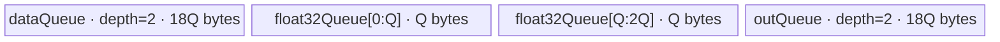

# ForeachMinimumScalar A2/A3 ACLNN 算子知识

## 算子速览

| 项目 | 内容 |
|---|---|
| 实际入口 | `aclnnForeachMinimumScalarV2GetWorkspaceSize` / `aclnnForeachMinimumScalarV2`，公开 ACLNN V2 两段式接口；A2/A3 上取版本族中最新公开版本 V2。 |
| 计算语义 | 对列表中第 `t` 个 Tensor 的每个有效元素计算 `y_t[i] = min(x_t[i], scalar)`。 |
| 输入输出 | `x`/`out` 为 ND TensorList，逐项 shape 相同；dtype 为 FP16/FP32/INT32/BF16。`aclScalar` 允许按目标 dtype 规则传入 DOUBLE/INT64，并在 Host 转成单元素 Tensor；BF16 路线的标量 Tensor 为 FP32。 |
| 执行类型 | 单 Kernel `AIV_VECTOR`：所有 Route 都是 GM→双缓冲 `VECIN`→`Mins`（BF16 先升 FP32）→双缓冲 `VECOUT`→GM。 |
| Kernel 路线 | R-001：FP16/FP32/INT32 直接 `Mins`；R-002：BF16 分片升 FP32、`Mins<float>`、`CAST_RINT` 回 BF16。 |
| 核心资源 | TensorList GM 指针表、单元素 scalar GM、每核输入/输出双队列；BF16 另有单深度 FP32 Queue。算子 Kernel 丢弃 user workspace，Tiling 仍声明 32 B。 |
| 来源闭包 | `source_closed`：V2 ACLNN 校验/转换、L0 launcher、arch22 Tiling、公共 POD、四个 dtype key、Kernel entry、公共基类 body、UB/同步/tail 与 A2/A3 构建接线均已闭合。 |
| 验证状态 | 已完成源码闭包检查；本次知识提取未执行编译、真机、数值或性能测试。 |

## 接口与语义

### 计算语义

令 `x=[x_0,...,x_{N-1}]`。对每个列表项 `t` 及其存储域中的元素 `i`，输出为 `y_t[i]=min(x_t[i], scalar)`。公开 V2 接口接收 `aclScalar`；Host 将其转换为与 `x` 相同的 Tensor dtype，唯独 `x=BF16` 时转换为 FP32 Tensor，Device 再执行 BF16→FP32→BF16 管线。输出由调用者提供，公开文档要求与对应输入同 dtype/格式，源码 API 层要求逐项 shape 相等，Tiling 层还检查输出存储元素数不得小于输入。

### 输入、输出与属性

| 参数 | shape/layout | dtype | 约束、默认值与语义 |
|---|---|---|---|
| `x` | TensorList；每项 ND、0–8 维 | FP16/FP32/INT32/BF16，列表内一致 | 必选；公开文档称支持空 TensorList。源码在排队前为每项调用 `l0op::Contiguous`，但文档的“非连续 Tensor”列为不支持，工程复用应遵守公开约束。 |
| `scalar` | `aclScalar`，无 Tensor shape/layout | `x=FP32/BF16` 时 FP32/DOUBLE；`x=FP16` 时 FP16/DOUBLE；`x=INT32` 时 INT32/INT64 | Host 检查转换值落入目标 dtype 的有限范围；随后转换成单元素 Tensor，BF16 目标对应 FP32 Tensor。NaN 的范围比较不会触发上下界错误。 |
| `out` | TensorList；每项 ND、0–8 维 | 与 `x` 一致 | 必选、列表内一致；API `CheckShape` 要求对应 shape 相等，输出不支持非连续 Tensor。源码没有独立的 TensorList 数量相等检查，依赖对应索引可访问。 |
| `workspaceSize` | 标量 Host 输出 | `uint64_t` | 来自 executor 全图；可能包含 `Contiguous`/scalar 转 Tensor 的框架节点。核心 Foreach Kernel 自身的 Tiling workspace 为 32 B，但 entry 将 `userWS` 置空。 |
| `executor` / `workspace` / `stream` | 两段式执行资源 | 框架类型 | 第一段生成 executor，第二段 `CommonOpExecutorRun` 在给定 stream 上提交；失败立即返回，不继续执行。 |

### 入口与版本

公开版本族包含 `aclnnForeachMinimumScalar`（scalar 是 `aclTensor`）和 `aclnnForeachMinimumScalarV2`（scalar 是 `aclScalar`）。V2 文档明确支持 Atlas A2、A3 训练/推理产品，且是该架构实际支持的最新公开版本，因此本卡只描述 V2。V2 第一段最终调用 `l0op::ForeachMinimumScalarV2`，该函数注册并排队内部算子 `ForeachMinimumScalar`；V2 没有第二套 Device body。

## Host/Launcher 执行流程

### 参数校验与前处理

`ExecForeachMinimumScalarV2GetWorkspaceSize` 的真实顺序是：创建 executor；`CheckNull` 检查三指针；`CheckDtypeValid` 根据当前架构只接受 RegBase 或 `DAV_2201`，检查 TensorList dtype 一致、out dtype 匹配及 scalar dtype 组合；`CheckShape` 检查 x 每项不超过 8 维并与 out 对应项 shape 相等；`CheckFormat` 排除私有存储格式。随后源码意图对空 `x` 返回 `workspaceSize=0`，但 `CheckDtypeValid` 在 `x->Size()==0` 判断之前读取 `(*x)[0]`，空列表访问语义取决于固定仓外的 `aclTensorList::operator[]`，不能由本仓证明。

非空列表逐项执行 `l0op::Contiguous` 并组装 executor 所有的临时 TensorList；再检查 scalar 值范围，调用 `ConvertToTensor`，其中 BF16 x 强制生成 FP32 scalar Tensor；最后排队 `ForeachMinimumScalar`。任一检查、分配、转换或 launcher 返回非成功，第一段立即返回对应错误。

### 参数、Workspace 与生命周期

临时连续 Tensor 和 scalar Tensor 由 `uniqueExecutor` 持有，`ReleaseTo(executor)` 后其生命周期随返回的 executor 延续到第二段运行完成。`*workspaceSize=uniqueExecutor->GetWorkspaceSize()` 是整个执行图所需字节数，不能用核心 Tiling 的 32 B 替代。内部 Tiling 写 `workspaces[0]=32`，但 Kernel entry 明确令 `userWS=nullptr`，公共 Kernel body不读 workspace；这 32 B 是 Host ABI 保留量。第二段把用户提供的 workspace、大小、executor 和 stream 原样交给 `CommonOpExecutorRun`，框架负责同一 stream 内前处理节点与核心节点顺序及失败传播。

### 启动图与失败传播

```text
aclnnForeachMinimumScalarV2GetWorkspaceSize
  -> [每个 x 项可选] l0op::Contiguous（executor 临时 Tensor）
  -> ConvertToTensor(aclScalar, target dtype)
  -> ADD_TO_LAUNCHER_LIST_AICORE(ForeachMinimumScalar)
aclnnForeachMinimumScalarV2(workspace, executor, stream)
  -> CommonOpExecutorRun
     -> 单节点 foreach_minimum_scalar<<<blockDim=needCoreNum, stream>>>
```

核心节点输入是连续化 TensorList GM 描述、单元素 scalar Tensor GM、调用者 out TensorList GM；POD 为 `ForeachCommonTilingData`。没有核心节点间 workspace 边。前处理临时对象由 executor 拥有，核心节点只在提交 stream 上消费；任一前序节点失败由 executor 运行返回并阻断后续节点。框架生成的具体 Contiguous workspace offset、extent 与事件实现不在固定仓，属于允许的框架边界。

## Route 与参数设计

### 分核与资源计算

Host 将列表按存储元素数逻辑拼接。`dataTypeSize=sizeof(T)`，`elementsPerBlock=32/dataTypeSize`；`blockCount=ceil(totalDataCount/elementsPerBlock)`，`needCoreNum=min(AIV核数, max(1, blockCount), 50)`。每核先分得 `floor(blockCount/needCoreNum)` 个 32 B block，前 `blockCount % needCoreNum` 核多一个 block；`AssignDataToEachCore` 将这段拼接区间反解为 `tensorStart/End` 与两端元素 offset，使一个核可以跨多个 Tensor，但从不跨越其分配的拼接区间。

令 POD 序列化字节数为 `P`，平台 UB 为 `U_B`。R-001 的 `B=floor(((U_B-P)/4)/32)*32`，输入、输出各有 depth=2、单槽 `B` 字节，总计 `4B<=U_B-P`。R-002 先令 `Q=floor((((U_B-P)/10)/4)/64)*64`；每个 BF16 输入/输出槽实际分配 `9Q`，另有 `2Q` 的 FP32 Queue，因此 `UB_total=2*9Q+2*9Q+2Q=38Q<=U_B-P`（Host 的 `/40` 留出约 `2Q` 余量）。

### Route 选择

| 顺序 | Route | Key/模板 | 精确选择条件与优先级 | 不适用去向 |
|---:|---|---|---|---|
| 1 | R-001 直接 Vector | key 1=`half`，2=`float`，3=`int`；`ForeachOneScalarBinary<T,T,MinsAdapter<T>,2>` | `GetTilingKeyByDtypeOnly(dataType)` 对 FP16/FP32/INT32 分别返回 1/2/3；entry 按 `TILING_KEY_IS` 顺序匹配。 | key 4 进入 R-002；其它 key entry 无 body。 |
| 2 | R-002 BF16 升精度 Vector | key 4；`ForeachOneScalarBinary<bfloat16_t,float,MinsAdapter<float>,2>` | `dataType==DT_BF16` 且编译条件 `__CCE_AICORE__>=220`，并排除 `__NPU_ARCH__` 3003/3113。 | Host 不支持 dtype 在 API/Tiling 失败；编译 guard 不成立时 key 4 无执行分支。 |

```text
dtype FP16 -> key 1 -> R-001<half>
else dtype FP32 -> key 2 -> R-001<float>
else dtype INT32 -> key 3 -> R-001<int>
else dtype BF16 -> key 4 -> R-002<bfloat16_t,float>（受编译 guard）
else -> API/Tiling 失败
```

### 模板/实现执行矩阵

| Route | key/selector | dtype/shape/platform 完整命中条件 | 执行拓扑与 Kernel 节点 | 实际模板/body | 内存与同步特征 | tail/fallback |
|---|---|---|---|---|---|---|
| R-001 直接 Vector | 1/2/3 | V2 API 架构为 RegBase 或 DAV_2201；dtype 为 FP16/FP32/INT32；列表/shape/format 校验通过 | 单 AIV Kernel | `ForeachOneScalarBinary<T,T,MinsAdapter<T>,2>::Process`→`Mins<T>` | input/output Queue 各 depth 2；Queue、`PIPE_V` barrier | 完整 tile 用 `DataCopy`；末 tile用 `DataCopyPad`，仅提交有效字节。 |
| R-002 BF16 升精度 Vector | 4 | 同上且 dtype BF16、scalar 转 FP32，编译 guard 成立 | 单 AIV Kernel | `InnerComputer<bfloat16_t,float,...>::ComputePerCast` | 2×9Q BF16 input、2×9Q BF16 output、1×2Q FP32；cast/Mins/cast 间 `PIPE_V` | 每 tile 再按 `maxCastDataCount=Q/4` 分片；末 cast 和末 DMA均显式计数。 |

### 隐藏性能 Guard

| Guard | Host/Tiling 条件 | Device/资源原因 | 影响 Route | 不满足时去向 | 源码符号 |
|---|---|---|---|---|---|
| TensorList 上限 | `Init` 仅扫描 `i<MAX_TENSOR_CONT(50)`；POD 数组长度也为 50 | 分核端点和元素数是定长数组 | 全部 | 第 51 项不会进入 Tiling 清单；公开 API 未显式检查该上限，不能安全扩大 | `foreach_tiling_class.h::Init` |
| 核数上限 | `needCoreNum=min(...,MAX_CORE_CONT=50)` | POD 每核数组仅 50 项 | 全部 | 截断到 50 核 | `RunBigScalarKernelTiling` |
| 32 B 分核 | `elementsPerBlock=32/sizeof(T)` | 完整 DMA和核间边界按 block 切分 | 全部 | 末端由元素 offset/tail DMA处理 | `Init/GetNeedCoreNum/AssignDataToEachCore` |
| BF16 编译 guard | `__CCE_AICORE__>=220 && arch!=3003/3113` | 需要 BF16及 FP32 Cast body | R-002 | key 4 无 Device 分支，必须由平台构建避免 | `foreach_minimum_scalar.cpp::foreach_minimum_scalar` |
| UB 对齐 | R-001 向下 32 B；R-002 向下 64 B | Queue 分配和 BF16 cast 子块需满足对齐 | 全部 | tile 变小；源码没有 `B/Q==0` 显式失败检查 | `ForeachCommonTiling::DivideUbMemory3` |
| 空总域 | `blockCount=0` 时 `needCoreNum=1` | 保持合法 launch | 全部 | Device 每个零长 Tensor 的 `copyTimes=0`；公开空列表仍受 API 先访问 `[0]` 的外部语义限制 | `GetNeedCoreNum` / `SingleTensorProcess` |

### POD/ABI

| 结构 | 字段 | 类型/位宽 | ABI 布局 | 单位 | Host/launcher producer | Device consumer | 边界 |
|---|---|---|---|---|---|---|---|
| `ForeachCommonTilingData` | `inputsTensorUbSize` | `uint64_t`/64 | 宏声明的第 1 字段；外部 `tilingdata_base.h` 未在固定仓展开，`sizeof/alignof/offsetof` 固定仓不可见 | 字节/Queue 单槽基准 | `DivideUbMemory3`→`set_inputsTensorUbSize` | `KernelForeachBase::ParseTilingData`，导出 `maxDataCount/maxCastDataCount` | R-001 为 B；R-002 为 Q，均向下对齐 |
| `ForeachCommonTilingData` | `tensorDataCountList` | `int64_t[50]` | 第 2 字段；精确 offset 固定仓不可见 | 元素/列表项 | `Init` 取各 storage shape size | `KernelForeachUnary::Process` 取当前 Tensor 末端 | 未使用槽为初始化零 |
| `ForeachCommonTilingData` | `tensorStartList` | `uint16_t[50]` | 第 3 字段；精确 offset 固定仓不可见 | Tensor 索引/核 | `AssignDataToEachCore` | `ParseTilingData[blockIdx]` | 索引受 TensorList≤50 |
| `ForeachCommonTilingData` | `tensorEndList` | `uint16_t[50]` | 第 4 字段；精确 offset 固定仓不可见 | Tensor 索引/核 | `AssignDataToEachCore` | `ParseTilingData[blockIdx]` | 闭区间 |
| `ForeachCommonTilingData` | `tensorStartOffsetList` | `int64_t[50]` | 第 5 字段；精确 offset 固定仓不可见 | 元素/核 | `AssignDataToEachCore` | `ParseTilingData[blockIdx]` | 相对 start Tensor |
| `ForeachCommonTilingData` | `tensorEndOffsetList` | `int64_t[50]` | 第 6 字段；精确 offset 固定仓不可见 | 元素/核 | `AssignDataToEachCore` | `ParseTilingData[blockIdx]` | 相对 end Tensor、闭区间 |

### Route 源码闭包

| Route | Key/selector | Host/Tiling producer | POD/参数 | Kernel entry/router 节点 | Kernel body/直接依赖 | 构建接线 |
|---|---|---|---|---|---|---|
| R-001 直接 Vector | key 1/2/3 | `op_host/arch22/foreach_minimum_scalar_tiling_arch22.cpp::Tiling4ForeachMinimumScalarTiling`；`foreach_tiling_class.h::RunBigScalarKernelTiling` | `foreach_tiling_def.h::ForeachCommonTilingData` | `op_kernel/foreach_minimum_scalar.cpp::foreach_minimum_scalar` | `foreach_one_scalar_binary.h::ForeachOneScalarBinary/InnerComputer`；`kernel_foreach_unary.h`；`kernel_foreach_base.h` | `op_host/CMakeLists.txt` arch22；`op_kernel/CMakeLists.txt` ascend910b/ascend910_93 |
| R-002 BF16 升精度 Vector | key 4 | 同 R-001，`DivideUbMemory3` 的 BF16 分支 | 同 POD，`inputsTensorUbSize=Q` | 同 entry 的 key 4 编译分支 | `InnerComputer<bfloat16_t,float>::ComputePerCast` 及公共基类 | 同上 |

## Kernel 实现

### 公共执行流程

entry 用 `GET_TILING_DATA` 解析 POD，显式将 `userWS=nullptr`，再按 key 构造模板并依次调用 `Init/Process`。`KernelForeachBase::ParseTilingData` 用 `GetBlockIdx()` 取本核 Tensor 起止与 offset；`GetTensorAddr` 按 TensorList 首个 `uint64_t` 给出的指针表偏移定位第 `i` 个 GM 地址。每核遍历闭区间 `[tensorStart,tensorEnd]`，将端点 offset 裁入当前 Tensor；每个 Tensor 片段再按 `maxDataCount` 切 tile。完整 tile 用对齐 `DataCopy`，尾 tile 用 byte-length `DataCopyPad`；Queue 的 EnQue/DeQue/FreeTensor 形成搬运与计算生命周期。

### Route R-001：FP16/FP32/INT32 直接 Vector

#### 适用条件

##### 选择证据

| 层级 | 文件 | 符号 | 源码谓词/参数 | 结果/下一跳 |
|---|---|---|---|---|
| API | `op_host/op_api/aclnn_foreach_minimum_scalar_v2.cpp` | `GetDtypeSupportList/CheckDtypeValid` | RegBase 或 DAV_2201，x dtype∈FP16/FP32/INT32且列表/out/scalar匹配 | 排队 `ForeachMinimumScalar`，否则返回错误 |
| Tiling | `foreach_utils/op_host/common_dtype.h` | `GetTilingKeyByDtypeOnly` | FP16→1、FP32→2、INT32→3 | 对应 key |
| Router | `op_kernel/foreach_minimum_scalar.cpp` | `foreach_minimum_scalar` | `TILING_KEY_IS(1/2/3)` | 实例化 half/float/int；否则尝试 key 4 |

#### Device 数据流

##### 函数级调用链

```text
ADD_TO_LAUNCHER_LIST_AICORE(ForeachMinimumScalar)
  -> foreach_minimum_scalar(inputs, scalar, outputs, workspace, tiling)
    -> ForeachOneScalarBinary<T,T,MinsAdapter<T>,2>::Init
      -> KernelForeachUnary::Init -> KernelForeachBase::Init/ParseTilingData
    -> KernelForeachUnary::Process
      -> SingleTensorProcess -> CopyIn
      -> ForeachOneScalarBinary::Compute -> InnerComputer<T,T>::Compute -> MinsAdapter<T> -> Mins
      -> KernelForeachUnary::CopyOut
```

##### 源码等价伪码

```text
# 源码等价伪码
core = GetBlockIdx()
load POD[core]: tensorStart, tensorEnd, startOffset, endOffset
B = inputsTensorUbSize; maxDataCount = B / sizeof(T)
scalarVal = T(*(DTYPE_SCALAR*)scalar)
for tensor in [tensorStart, tensorEnd]:
  begin = tensor==tensorStart ? startOffset : 0
  end   = tensor==tensorEnd ? endOffset : tensorDataCount[tensor]-1
  bind xGM/yGM = TensorListPtr[tensor] + begin
  valid = end-begin+1
  for tile in ceil(valid/maxDataCount):
    n = min(maxDataCount, valid-tile*maxDataCount)
    CopyIn xGM[tile*maxDataCount : +n] -> dataQueue  # tail uses DataCopyPad bytes
    outLocal = Alloc(outQueue); dataLocal = DeQue(dataQueue)
    PipeBarrier(V); Mins(outLocal, dataLocal, scalarVal, n); PipeBarrier(V)
    Free dataLocal; EnQue outLocal
    CopyOut outLocal -> yGM[tile*maxDataCount : +n]  # tail writes n*sizeof(T)
    Free outLocal
```

#### 内存与数据搬运

##### 资源与搬运表

| 层级/缓冲区 | offset/地址公式 | extent/容量公式 | dtype/layout | producer | consumer | owner/lifetime | 对齐/复用 |
|---|---|---|---|---|---|---|---|
| x TensorList GM | `*(ptrTable+i)+cursorStart+tile*maxDataCount` | `n` 元素 | T/ND | caller/Contiguous | `CopyIn` | caller或executor；Kernel 全程只读 | 指针表 offset 右移 3 转 `uint64_t` 索引 |
| scalar GM | element 0 | 1 元素 | T | `ConvertToTensor` | `Init` 读一次/核 | executor 到 Kernel 消费 | 无 tile 重读 |
| `dataQueue` | Queue 槽 | depth 2 × B 字节 | T | `CopyIn` | `Compute` | `Alloc→EnQue→DeQue→Free`/tile | 完整 DMA对齐；tail Pad |
| `outQueue` | Queue 槽 | depth 2 × B 字节 | T | `Compute` | `CopyOut` | `Alloc→EnQue→DeQue→Free`/tile | 仅写有效 n 元素 |
| y TensorList GM | 对应 x 的地址公式 | `n` 元素 | T/ND | `CopyOut` | caller | caller | tail 仅写 `n*sizeof(T)` |
| workspace | N/A | Host Tiling 32 B；Device 0 B | N/A | Host ABI | 无 consumer | user workspace 不绑定 | `userWS=nullptr` |

##### 分层内存布局


##### 字节账与复用顺序

```text
B = floor(((platform_UB - POD_bytes) / 4) / 32) * 32
UB_total = 2*B(dataQueue) + 2*B(outQueue) = 4B
UB_total <= platform_UB - POD_bytes
dynamic_ub = N/A
workspace_total = 32 B Host ABI reserve；核心 Device body使用 0 B
=> maxDataCount = B / sizeof(T)
```

| 复用子区 | 写入者 | 读取者/消费点 | 下一次覆盖 | 同步或释放依据 | 安全条件 |
|---|---|---|---|---|---|
| `dataQueue` 某槽 | `CopyIn` | `Compute` 的 `DeQue` | `FreeTensor` 后后续 tile | Queue EnQue/DeQue/Free | depth=2，未 Free 不复用 |
| `outQueue` 某槽 | `Mins` | `CopyOut` 的 `DeQue` | `FreeTensor` 后后续 tile | Queue EnQue/DeQue/Free | GM DMA消费完才 Free |

#### 同步、精度与尾块

##### 同步与数值边界表

| 阶段 | primitive/机制 | producer | consumer/等待点 | 保护对象 | 精度/尾块 |
|---|---|---|---|---|---|
| GM→VECIN | Queue + `DataCopy/DataCopyPad` | DMA | `DeQue` | input槽 | tail `blockCount=1, blockLen=n*sizeof(T)`，padding关闭 |
| VEC计算 | `PipeBarrier<PIPE_V>` | CopyIn/前序 Vector | `Mins`及后序 | `dataLocal/outLocal` | 以 T 原生精度执行；固定仓未展开 `Mins` primitive 对 NaN/有符号零的内部规则 |
| VECOUT→GM | Queue + `DataCopy/DataCopyPad` | `Mins`/EnQue | CopyOut | output槽 | tail 只写有效字节，不提交 padding lane |

#### 关键实现

##### 符号证据表

| 阶段 | 文件 | 符号/模板实例 | 实现事实 |
|---|---|---|---|
| Host/Tiling producer | `foreach_utils/op_host/foreach_tiling_class.h` | `RunBigScalarKernelTiling/AssignDataToEachCore/DivideUbMemory3` | key、核域、B及 POD |
| Kernel entry/router | `foreach_minimum_scalar/op_kernel/foreach_minimum_scalar.cpp` | key 1/2/3 分支 | dtype到模板实例 |
| Device body/helper | `foreach_utils/op_kernel/kernel_foreach_unary.h` | `Process/SingleTensorProcess/CopyIn/CopyOut` | Tensor遍历、tile、DMA、Queue生命周期 |
| Device body/helper | `foreach_utils/op_kernel/foreach_one_scalar_binary.h` | `InnerComputer<T,T>::Compute` | barrier→`Mins`→barrier |

### Route R-002：BF16 升精度 Vector

#### 适用条件

##### 选择证据

| 层级 | 文件 | 符号 | 源码谓词/参数 | 结果/下一跳 |
|---|---|---|---|---|
| API | `op_host/op_api/aclnn_foreach_minimum_scalar_v2.cpp` | `CheckDtypeValid/Exec...` | x BF16；scalar FP32/DOUBLE并在 BF16范围内 | `ConvertToTensor(...,DT_FLOAT)` |
| Tiling | `foreach_utils/op_host/common_dtype.h` | `GetTilingKeyByDtypeOnly` | `DT_BF16` | key 4 |
| Router | `op_kernel/foreach_minimum_scalar.cpp` | key 4 guard | `__CCE_AICORE__>=220 && arch!=3003/3113` | `ForeachOneScalarBinary<bfloat16_t,float,...>` |

#### Device 数据流

##### 函数级调用链

```text
foreach_minimum_scalar
  -> ForeachOneScalarBinary<bfloat16_t,float,MinsAdapter<float>,2>::Init
  -> KernelForeachUnary::Process/SingleTensorProcess
    -> CopyIn BF16 tile
    -> InnerComputer<bfloat16_t,float>::Compute
      -> repeated ComputePerCast
         -> Cast BF16->FP32(first half float32Queue)
         -> Mins<float>(second half, first half, scalarVal)
         -> Cast FP32->BF16(CAST_RINT) into outQueue
    -> CopyOut BF16 tile
```

##### 源码等价伪码

```text
# 源码等价伪码；分核/Tensor/tile 外层同 R-001
Q = inputsTensorUbSize
maxDataCount = 9Q / sizeof(bfloat16_t)
maxCastDataCount = Q / sizeof(float)
float32Tensor = DeQue(float32Queue)  # 两个连续 Q-byte 子区
for each BF16 tile of n elements:
  CopyIn -> dataQueue
  for castChunk in [0, ceil(n/maxCastDataCount)):
    m = min(maxCastDataCount, remaining)
    Cast(float32[0], dataLocal[chunk*maxCastDataCount], CAST_NONE, m)
    PipeBarrier(V)
    Mins(float32[maxCastDataCount], float32[0], scalarVal, m)
    PipeBarrier(V)
    Cast(outLocal[chunk*maxCastDataCount], float32[maxCastDataCount], CAST_RINT, m)
  CopyOut only n BF16 elements
free float32Tensor after all tensors
```

#### 内存与数据搬运

##### 资源与搬运表

| 层级/缓冲区 | offset/地址公式 | extent/容量公式 | dtype/layout | producer | consumer | owner/lifetime | 对齐/复用 |
|---|---|---|---|---|---|---|---|
| x/y GM | 同 R-001 | 每 tile≤`9Q/2` 元素 | BF16/ND | caller、CopyOut | CopyIn、caller | 调用期 | tail byte DMA |
| scalar GM | element 0 | 4 B | FP32 | `ConvertToTensor` | `Init` 读一次/核 | executor | BF16不读取 scalar BF16 |
| `dataQueue` | 两槽 | depth 2 × 9Q | BF16 | CopyIn | Cast | tile Queue生命周期 | 64 B 基准 Q |
| `outQueue` | 两槽 | depth 2 × 9Q | BF16 | final Cast | CopyOut | tile Queue生命周期 | 只提交有效 n |
| `float32Queue` first half | byte 0 | Q | FP32 | BF16→FP32 Cast | `Mins<float>` | Process全程持有 | 每 cast chunk覆盖 |
| `float32Queue` second half | byte Q | Q | FP32 | `Mins<float>` | FP32→BF16 Cast | Process全程持有 | `paramsCount=2` 使 offset=`maxCastDataCount` |
| workspace | N/A | Device 0 B | N/A | N/A | N/A | N/A | entry丢弃 |

##### 分层内存布局



##### 字节账与复用顺序

```text
Q = floor(((((platform_UB - POD_bytes) / 10) / 4) / 64)) * 64
UB_total = 2*(9Q) + 2*(9Q) + 1*(2Q) = 38Q
UB_total <= platform_UB - POD_bytes
dynamic_ub = N/A
workspace_total = 32 B Host ABI reserve；Device使用 0 B
=> maxDataCount=9Q/2，maxCastDataCount=Q/4
```

| 复用子区 | 写入者 | 读取者/消费点 | 下一次覆盖 | 同步或释放依据 | 安全条件 |
|---|---|---|---|---|---|
| FP32 first Q | BF16→FP32 Cast | `Mins<float>` | 下一 cast chunk | Cast后 `PIPE_V` barrier | Mins完成前不得覆盖 |
| FP32 second Q | `Mins<float>` | FP32→BF16 Cast | 下一 cast chunk | Mins后 `PIPE_V` barrier | `offset=maxCastDataCount`，与输入子区不别名 |
| BF16 queues | CopyIn/final Cast | Cast/CopyOut | Free后下一 tile | Queue协议 | 同 R-001 |

#### 同步、精度与尾块

##### 同步与数值边界表

| 阶段 | primitive/机制 | producer | consumer/等待点 | 保护对象 | 精度/尾块 |
|---|---|---|---|---|---|
| BF16输入 | Queue DMA | GM | BF16→FP32 Cast | `dataLocal` | tile tail按 n 个 BF16有效元素 |
| 升精度 | `Cast(...,CAST_NONE)` + barrier | BF16 local | `Mins<float>` | FP32 first half | 每片最多 Q/4 元素 |
| 比较 | `Mins<float>` + barrier | first half/scalar FP32 | final Cast | second half | 比较在 FP32执行；primitive内部 NaN/零 tie 规则固定仓不可见 |
| 降精度 | `Cast(...,CAST_RINT)` | FP32 result | CopyOut | BF16 outLocal | round-to-nearest integer模式名为 `CAST_RINT`；只转换 m 个有效元素 |

#### 关键实现

##### 符号证据表

| 阶段 | 文件 | 符号/模板实例 | 实现事实 |
|---|---|---|---|
| Host/Tiling producer | `foreach_utils/op_host/foreach_tiling_class.h` | `DivideUbMemory3` BF16分支 | `/10`、`/4`、64 B对齐得到 Q |
| Kernel entry/router | `foreach_minimum_scalar/op_kernel/foreach_minimum_scalar.cpp` | key 4 | BF16/FP32模板与编译 guard |
| Device body/helper | `foreach_utils/op_kernel/kernel_foreach_base.h` | `Init` BF16分支 | 9Q tile容量、Q/4 cast容量 |
| Device body/helper | `foreach_utils/op_kernel/foreach_one_scalar_binary.h` | `InnerComputer<bfloat16_t,float>::ComputePerCast` | 两子区复用与 Cast/Mins/Cast顺序 |

## 算子特定优化

### Trick T-001：跨 Tensor 拼接分核而不逐 Tensor 启动

#### 触发与源码依据

- 适用 Route：R-001、R-002
- 触发条件：非空 TensorList 通过 Host 校验；所有项的 storage 元素数参与 `totalDataCount`。
- Golden 来源：[`foreach/foreach_utils/op_host/foreach_tiling_class.h:651-703`](../../../../../../../cann-ops-raw/ascendc/ops-nn/955f8b33985b6d72989ebff341bb9c2c564a51bc/foreach/foreach_utils/op_host/foreach_tiling_class.h#L651-L703)

**官方源码（固定 Commit 连续逐字摘录）**：

```cpp
int64_t blockCount = CeilA2B(totalDataCount, elementsPerBlock);
int64_t tempPerCoreCount = blockCount / needCoreNum * static_cast<int64_t>(elementsPerBlock);
int64_t remainderCount = blockCount % needCoreNum;
```

#### 机制与设计原因

Host 先把不同 Tensor 的元素数逻辑拼接，再按 32 B block 平衡到 AIV 核；POD 仅存每核首尾 Tensor与首尾 offset。这样一个 Kernel launch 可覆盖整个列表，小 Tensor 可以由同一核连续处理，同时仍以 TensorList 指针表恢复真实 GM 地址。该机制减少逐 Tensor launch 和大量小任务的核闲置；收益方向由源码结构可证明，但未做实测。

#### 迁移边界

- 适用：TensorList 元素操作彼此独立、可由首尾 offset 描述核域的算子。
- 前提：列表≤50、每项元素计数和总和可装入 `int64_t`，核间无需归约。
- 失效：需要跨 Tensor 状态、全局归约或列表超过 POD 定长数组时必须更换分核/POD。
- 未验证：本次知识提取未执行编译、真机、数值或性能测试。

#### 错误做法

固定仓未提供可验证反例；不可把 `tensorStart/End` 当作每核只处理一个 Tensor，源码允许一核跨多个 Tensor。

### Trick T-002：BF16 的双子区 FP32 复用

#### 触发与源码依据

- 适用 Route：R-002
- 触发条件：dtype BF16，key 4 编译 guard 成立，`paramsCount=2`。
- Golden 来源：[`foreach/foreach_utils/op_kernel/foreach_one_scalar_binary.h:64-75`](../../../../../../../cann-ops-raw/ascendc/ops-nn/955f8b33985b6d72989ebff341bb9c2c564a51bc/foreach/foreach_utils/op_kernel/foreach_one_scalar_binary.h#L64-L75)

**官方源码（固定 Commit 连续逐字摘录）**：

```cpp
Cast(float32Tensor, dataLocal[index * maxCastDataCount], RoundMode::CAST_NONE, dataCount);
PipeBarrier<PIPE_V>();
uint32_t offset = (paramsCount == 1) ? 0 : maxCastDataCount;
op(float32Tensor[offset], float32Tensor, scalarVal, dataCount);
```

#### 机制与设计原因

一个 depth=1 的 FP32 Queue被分成输入与输出两个 Q-byte 子区：前半承载升精度值，后半承载 `Mins<float>` 结果。每个 cast chunk完成降精度后覆盖同一子区，避免按完整 `9Q` BF16 tile物化同等规模 FP32中间量；两道 `PIPE_V` barrier保护写后读。`maxCastDataCount=Q/4`、`offset=maxCastDataCount` 均直接来自 POD Q与 FP32字节宽度。

#### 迁移边界

- 适用：低精度输入需在 FP32逐块计算且结果可立即降精度的逐元素算子。
- 前提：两个 FP32子区不别名、每片≤Q/4、Vector primitive允许给定有效计数。
- 失效：若计算需保留多个跨片中间量或跨片依赖，不能覆盖这两个子区。
- 未验证：本次知识提取未执行编译、真机、数值或性能测试。

#### 错误做法

固定仓未提供可验证反例；将 offset 改为 0 会让 `Mins` 输出覆盖仍作为 src 的前半区，源码没有提供原地安全保证。

## 模板与实现对比

| 对比维度 | R-001 直接 Vector | R-002 BF16 升精度 Vector | 设计选择依据 |
|---|---|---|---|
| 命中条件/优先级 | key 1/2/3 | key 4 + 编译 guard | dtype唯一决定 |
| 模板与 dtype | `<T,T,MinsAdapter<T>,2>` | `<bfloat16_t,float,MinsAdapter<float>,2>` | BF16在 FP32比较 |
| 循环与分核 | 拼接分核，B/sizeof(T)一 tile | 同分核，9Q/2一 tile、Q/4一 cast片 | 控制 FP32中间量 |
| Queue/TBuf/寄存器/dynamic UB/通信 window | input/output各 depth2 | 同队列但槽9Q，另 depth1 FP32 Queue | BF16升精度 |
| 内存总占用与复用 | 4B | 38Q，FP32双子区逐片复用 | Host分别用 `/4` 与约 `/40` |
| 搬运/Vector/SIMT/NDDMA/通信 API | `DataCopy(Pad)` + `Mins<T>` | `DataCopy(Pad)` + Cast/Mins/Cast | 无 SIMT/NDDMA/通信 |
| 同步、精度与 tail | Queue + Mins前后 barrier；原生T | 额外 Cast间 barrier；FP32后`CAST_RINT` | 均只提交有效 tail |
| fallback/失败边界 | 未知 key无 body | guard不成立无 body | Host/构建必须与 key集合一致 |

## 平台差异

| 项目 | A2 | A3 | 950 |
|---|---|---|---|
| 支持状态 | V2公开支持 | V2公开支持 | V2公开支持；旧版公开不支持 |
| Host/Launcher | arch22公共 `ForeachCommonTiling` | 与 A2 共用 arch22 | 独立 arch35 Tiling；TensorList≤256、按总元素/1024定 blockDim |
| Kernel/资源 | AIV Vector、双队列；BF16升 FP32 | 与 A2相同 | SIMT VF grid-stride，无 AIV Queue；见 `_950` 卡 |

## 限制与失败边界

- A2/A3 Tiling/POD只容纳 50 个 Tensor与50个核；API层没有显式暴露该上限。总元素数使用 `int64_t` 累加，固定源码没有溢出检查。
- V2 文档声明支持空 TensorList，但 `CheckDtypeValid` 在 `Size()==0` 分支前读取 `(*self)[0]`；固定仓不含 `aclTensorList::operator[]` 实现，空列表能否安全到达早退不可见。
- 文档把 x 非连续标为不支持，源码仍调用 `l0op::Contiguous`。本卡按公开约束不承诺非连续 x；框架 Contiguous 的具体 workspace切片固定仓不可见。
- `ForeachCommonTilingData` 的字段序列和位宽可见，但生成宏来自固定仓外 SDK，精确 `sizeof/alignof/offsetof` 不可见；Host与Device使用同名 schema/序列化宏。
- A2/A3 的 `Mins` primitive内部 NaN与有符号零规则固定仓不可见，不能套用 950自定义 `SimtMinimum` 的语义。
- 核心 Kernel不使用 workspace，Tiling仍写 32 B；公开 API返回的是整个 executor图 workspace，二者不可互换。
- 本次知识提取未执行编译、真机、数值或性能测试。

## 源码索引

### 链路索引

| 链路阶段 | 文件 | 关键符号 | 支撑内容 |
|---|---|---|---|
| 入口声明/约束 | `foreach/foreach_minimum_scalar/docs/aclnnForeachMinimumScalarV2.md` | V2函数原型/产品表 | 公开性、版本、A2/A3支持与参数约束 |
| 入口声明/约束 | `foreach/foreach_minimum_scalar/op_host/op_api/aclnn_foreach_minimum_scalar_v2.h` | `aclnnForeachMinimumScalarV2*` | C ABI |
| 入口实现 | `foreach/foreach_minimum_scalar/op_host/op_api/aclnn_foreach_minimum_scalar_v2.cpp` | `Exec.../Check*/aclnnForeachMinimumScalarV2` | 校验、Contiguous、scalar转换、executor |
| 入口实现 | `foreach/foreach_minimum_scalar/op_host/op_api/foreach_minimum_scalar_v2.cpp` | `l0op::ForeachMinimumScalarV2` | L0 AICore排队 |
| Host/Tiling/Launcher | `foreach/foreach_minimum_scalar/op_host/arch22/foreach_minimum_scalar_tiling_arch22.cpp` | `Tiling4ForeachMinimumScalarTiling` | opcode/input type与公共 Tiling入口 |
| Host/Tiling/Launcher | `foreach/foreach_utils/op_host/foreach_tiling_class.h` | `ForeachCommonTiling` | 校验、分核、UB、POD producer |
| Host/Tiling/Launcher | `foreach/foreach_utils/op_host/foreach_tiling_def.h` | `ForeachCommonTilingData` | POD字段与注册 |
| Host/Tiling/Launcher | `foreach/foreach_utils/op_host/common_dtype.h` | `GetTilingKeyByDtypeOnly` | key映射、对齐常量 |
| Kernel entry/body | `foreach/foreach_minimum_scalar/op_kernel/foreach_minimum_scalar.cpp` | `foreach_minimum_scalar/MinsAdapter` | router与Vector primitive |
| Kernel entry/body | `foreach/foreach_utils/op_kernel/foreach_one_scalar_binary.h` | `ForeachOneScalarBinary/InnerComputer` | scalar读取、直接/BF16计算 |
| Kernel entry/body | `foreach/foreach_utils/op_kernel/kernel_foreach_unary.h` | `KernelForeachUnary` | Queue、循环、DMA、tail |
| Kernel entry/body | `foreach/foreach_utils/op_kernel/kernel_foreach_base.h` | `KernelForeachBase` | POD解析、指针表、tile容量 |
| 构建接线 | `foreach/foreach_minimum_scalar/op_host/foreach_minimum_scalar_def.cpp` | `ForeachMinimumScalar` | dtype/ND与A2/A3注册 |
| 构建接线 | `foreach/foreach_minimum_scalar/op_host/CMakeLists.txt` | `SUPPORT_COMPUTE_UNIT/SUPPORT_TILING_DIR` | ascend910b/910_93→arch22 |
| 构建接线 | `foreach/foreach_minimum_scalar/op_kernel/CMakeLists.txt` | `add_kernel_sources` | A2/A3主 Kernel源 |

每行只写一个文件，并确保该文件存在于 Frontmatter `sources`。

### 实现复用检查

| 检查项 | 可复用事实 | 不得改变的约束 | 源码符号 |
|---|---|---|---|
| ABI/POD | 拼接域可用首尾 Tensor/offset描述 | 六字段顺序、50槽、64/16位宽和元素/字节单位 | `ForeachCommonTilingData` |
| 调用顺序 | V2 scalar先转换 Tensor再排队同一内部 op | Contiguous→ConvertToTensor→launcher；BF16 scalar必须 FP32 | `ExecForeachMinimumScalarV2GetWorkspaceSize` |
| workspace/内存 | 核心 Kernel可零 workspace | Tiling 32 B ABI、Queue depth和 B/Q公式；不能把 executor workspace写死为32 B | `RunBigScalarKernelTiling` / entry |
| 同步 | Queue协议与 `PIPE_V` barrier | Cast/Mins/Cast及 Free顺序不得交换 | `KernelForeachUnary` / `InnerComputer` |
| 精度与尾块 | BF16按 Q/4分片升 FP32 | `CAST_NONE`→Mins<float>→`CAST_RINT`；tail只写有效字节 | `ComputePerCast` / `CopyOut` |
| 失败边界 | 不支持 dtype/shape/format在 Host失败 | key 4编译 guard、50 Tensor/核上限、空列表外部语义 | `CheckParams` / `foreach_minimum_scalar` |
