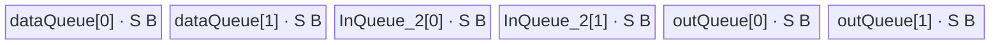

# ForeachMulList A2/A3 ACLNN 算子知识

## 算子速览

| 项目 | 内容 |
|---|---|
| 实际入口 | `aclnnForeachMulListGetWorkspaceSize` + `aclnnForeachMulList`，无版本后缀的公开两段式 ACLNN |
| 计算语义 | 对同位置 Tensor 逐元素计算 `y_i[j] = x1_i[j] * x2_i[j]` |
| 输入输出 | 两个动态 TensorList 输入和一个动态 TensorList 输出；ND；FP16/FP32/INT32/BF16；单 Tensor 0～8 维 |
| 执行类型 | 单节点 `AIV_VECTOR`；无 Cube/AIC 计算与 `MIX_CV` 可达节点 |
| Kernel 路线 | R-001 FP16/FP32/INT32 原 dtype Vector Mul；R-002 BF16→FP32→BF16 |
| 核心资源 | TensorList GM 描述符；三组 depth=2 的 `TQue`；BF16 额外一组 depth=1 FP32 Queue；Tiling 申请 32 B workspace 但 Device body 不读它 |
| 来源闭包 | `source_closed`：公开 ACLNN 约束→OpDef/InferShape→arch22 Tiling/POD→dtype router→公共 Vector body→A2/A3 构建接线闭合；生成式 ACLNN inner bridge 是框架边界 |
| 验证状态 | 已完成源码闭包检查；本次知识提取未执行编译、真机、数值或性能测试。 |

## 接口与语义

### 计算语义

令两个列表长度均为 `n`，第 `i` 个 Tensor 的元素数为 `N_i`。算子只对同位置、同 shape 的 Tensor 做逐元素乘法：`y_i[j]=x1_i[j]×x2_i[j]`，`0<=i<n`、`0<=j<N_i`。Kernel 按所有 Tensor 顺序拼接后的扁平元素域分核，但地址提交仍回到各 Tensor 自己的 GM 指针；Tensor 之间不拼接存储。

### 输入、输出与属性

| 参数 | shape/layout | dtype | 约束、默认值与语义 |
|---|---|---|---|
| `x1` | TensorList；每个 Tensor 0～8 维；ND | FP16/FP32/INT32/BF16 | 支持空 Tensor；列表内 dtype 一致；输入由 OpDef `AutoContiguous()` 归一化 |
| `x2` | 与 `x1` 列表长度相同且逐 Tensor shape 相同；ND | 与 `x1` 相同 | 支持空 Tensor；列表内 dtype 一致；输入由 OpDef `AutoContiguous()` 归一化 |
| `out` | TensorList；公开 ACLNN 允许对应输出 shape size 不小于 `x1`；ND | 与 `x1` 相同 | 输出不支持用户传入非连续 Tensor；Kernel 只写对应输入元素数；公共 InferShape 在图模式把每个输出 shape 直接设为 `x1` shape |

无算子属性。动态输入列表、动态输出列表实例数必须匹配；arch22 公共 POD 的数组上限是 50，Tiling 的输入枚举也最多读取 50 个 Tensor。

### 入口与版本

固定仓公开的是无版本后缀 `aclnnForeachMulList`，未出现同语义的更高版本 ACLNN。第一段返回 workspace 大小和 executor，第二段在指定 stream 上执行。接口声明/inner bridge 由 ACLNN 框架生成，固定仓没有其逐行实现；算子自有的 OpDef、InferShape、Tiling、POD、Kernel 和构建接线均可见。公开产品表明确支持 Atlas A2、A3，OpDef 的 `ascend910b`/`ascend910_93` 注册以及 Host/Kernel CMake 与之相符。

## Host/Launcher 执行流程

### 参数校验与前处理

1. 第一段 ACLNN 检查 `x1/x2/out` 非空、dtype 属于四种支持类型且三者一致；文档把失败映射到 `ACLNN_ERR_PARAM_NULLPTR` 或 `ACLNN_ERR_PARAM_INVALID`。
2. OpDef 对两个输入和输出声明动态 ND TensorList 与 `AutoContiguous()`；输入非连续 Tensor 的具体临时缓冲分配由框架生成代码完成，固定仓不可见。
3. 公共 InferShape 要求动态输出数等于 `x1` 实例数，并逐项复制 `x1` shape/dtype。
4. `ForeachCommonTiling::Init(BINARY_LIST_OP_CODE)` 从 `x1` 枚举 `N_i`、统一 dtype、元素字节数 `d` 和总元素数 `N=ΣN_i`；`CheckOpInfo` 再验证两输入列表长度、逐 Tensor shape/dtype，以及输出 dtype/容量。
5. 任一描述符/shape 缺失、维数大于 8、列表长度/shape/dtype 不一致或输出容量不足，Tiling 返回 `GRAPH_FAILED`，对应 ACLNN 文档的 inner tiling error 边界。

### 参数、Workspace 与生命周期

`GetWorkspaceSizes(1)[0]` 被 Tiling 固定写为 32 B；Kernel entry 明确把 `userWS` 设为 `nullptr`，故算子 Device body 不消费这 32 B。若 `AutoContiguous()` 需要额外框架 workspace，其精确切片与 owner 在固定仓不可见；调用者必须使用第一段返回的总 `workspaceSize`，并保持 workspace 与 executor 有效到第二段 stream 提交完成。

Tiling 数据由 `ForeachCommonTilingData::SaveToBuffer` 写入 runtime 管理的 tiling buffer，单次 Kernel launch 期间只读。输入、输出 TensorList 的 GM 描述对象由 executor 持有；Kernel 通过描述区首个偏移定位指针表，再按 Tensor 下标取得实际数据地址。

### 启动图与失败传播

```text
aclnnForeachMulListGetWorkspaceSize
  -> 框架参数校验/必要的输入连续化（生成代码固定仓不可见）
  -> ForeachMulList / Tiling4ForeachMulListTiling
     -> ForeachCommonTiling::Init(BINARY_LIST_OP_CODE)
     -> ForeachCommonTiling::RunBigKernelTiling
  -> executor 记录一个 foreach_mul_list launch

aclnnForeachMulList(workspace, workspaceSize, executor, stream)
  -> node-1 foreach_mul_list<<<blockDim=needCoreNum, stream>>>
     inputs_1, inputs_2, outputs, workspace(不读), tiling
```

这是单 Kernel 图，无 Kernel 间 workspace 边。Tiling 或 executor 构造失败时不会生成/启动节点；第二段 launch 失败由 ACLNN 返回码传播。单一 stream 提交保证框架前处理先于本 Kernel，具体内部 event/清理实现属于生成框架边界。

## Route 与参数设计

### 分核与资源计算

设元素字节数 `d∈{2,4}`，32 B block 的元素数 `E=32/d`，总 block 数 `B=ceil(N/E)`：

```text
C0 = max(1, min(B, platformAivCoreNum))
C  = min(C0, 50)
base = floor(B/C) * E
前 B%C 个 core 覆盖 base+E 个元素，其余覆盖 base 个元素
```

`AssignDataToEachCore` 把该扁平份额转成每核首/末 Tensor 下标与首/末元素 offset。设平台 UB 为 `U`，POD 序列化大小为 `D=tilingData.GetDataSize()`：非 BF16 的单 queue buffer 容量 `S=floor((U-D)/6, 32B)`；BF16 先把 `U-D` 除以 10，再六分并向下 64 B 对齐。`maxDataCount=S/d`，但 BF16 三组数据 queue 的实际单 buffer 是 `9S`，故 BF16 `maxDataCount=9S/2`，每次 cast 的 FP32 分片是 `S/4` 个元素。

### Route 选择

| 顺序 | Route | Key/模板 | 精确选择条件与优先级 | 不适用去向 |
|---:|---|---|---|---|
| 1 | R-001 原 dtype Vector Mul | key 1 `half,half,Mul`；key 2 `float,float,Mul`；key 3 `int,int,Mul` | `dataType` 分别为 FP16、FP32、INT32；`GetTilingKeyByDtypeOnly` 直接映射 | BF16 去 R-002；其它 dtype 得到 key 0，入口无分支且接口约束不支持 |
| 2 | R-002 BF16 升精度 | key 4 `bfloat16_t,float,Mul` | `dataType==DT_BF16` 且编译目标满足 `__CCE_AICORE__>=220`，并非 NPU arch 3003/3113 | 不满足编译 guard 时无 BF16 body；A2/A3 构建目标命中该 guard |

```text
dtype == FP16  -> key 1 -> R-001<half, half, Mul>
dtype == FP32  -> key 2 -> R-001<float, float, Mul>
dtype == INT32 -> key 3 -> R-001<int, int, Mul>
dtype == BF16  -> key 4 -> R-002<bfloat16_t, float, Mul>
else -> Tiling/ACLNN 失败
```

### 模板/实现执行矩阵

| Route | key/selector | dtype/shape/platform 完整命中条件 | 执行拓扑与 Kernel 节点 | 实际模板/body | 内存与同步特征 | tail/fallback |
|---|---|---|---|---|---|---|
| R-001 原 dtype Vector Mul | 1/2/3 | FP16/FP32/INT32；列表与 shape/dtype 校验通过；A2/A3 | 单 `foreach_mul_list` AIV node | `ForeachNoScalarBinary<T,T,Mul>::Process`→`InnerComputer<T,T,Mul>` | 三个 depth=2 Queue；Queue producer/consumer + Mul 前后 `PIPE_V` barrier | 整 tile 用 `DataCopy`；尾 tile 用字节长度 `DataCopyPad`；无其它 fallback |
| R-002 BF16 升精度 | 4 | BF16；同上；A2/A3 编译 guard | 单 `foreach_mul_list` AIV node | `ForeachNoScalarBinary<bfloat16_t,float,Mul>`→BF16 specialized `InnerComputer` | 三个 depth=2、单 buffer `9S` 的 BF16 Queue；一个 depth=1、`2S` 的 FP32 Queue；逐 cast barrier | tile 内再按 `S/4` 元素切分；最后 cast 分片与 DMA 尾块分别保护 |

### 隐藏性能 Guard

| Guard | Host/Tiling 条件 | Device/资源原因 | 影响 Route | 不满足时去向 | 源码符号 |
|---|---|---|---|---|---|
| Tensor 数上限 | `Init` 循环 `i<MAX_TENSOR_CONT(50)` | POD 所有 Tensor/core 数组长度均为 50 | 全部 | 固定源码没有显式 `>50` 拒绝；不得假设第 51 个及以后可处理 | `foreach_tiling_class.h::Init`、`foreach_tiling_def.h` |
| 32 B 分核 | `E=32/d`，`B=ceil(N/E)` | 非尾 DMA 使用 block 对齐，避免给非末份额生成非对齐长度 | 全部 | 总元素为 0 时仍 launch 1 core | `GetNeedCoreNum`、`AssignDataToEachCore` |
| UB 六分 | `S=floor((U-D)/6,alignment)` | 两输入与一输出各 depth=2，共六个 buffer | R-001 | `S` 由平台 UB 决定；固定仓无另一 Route | `DivideUbMemory1` |
| BF16 衰减与 64 B 对齐 | `total=(U-D)/10`，再 `/6`、向下 64 B | BF16 三个 queue 扩为 `9S`，并需 `2S` FP32 临时区 | R-002 | 无 BF16 fallback | `DivideUbMemory1`、`KernelForeachUnary::Init` |
| BF16 编译 guard | `__CCE_AICORE__>=220` 且 arch 非 3003/3113 | BF16 cast body 和 key 4 受条件编译保护 | R-002 | 不生成 BF16 body | `foreach_mul_list.cpp`、`foreach_no_scalar_binary.h` |

### POD/ABI

| 结构 | 字段 | 类型/位宽 | ABI 布局 | 单位 | Host/launcher producer | Device consumer | 边界 |
|---|---|---|---|---|---|---|---|
| `ForeachCommonTilingData` | `inputsTensorUbSize` | `uint64_t`/64 | 宏生成结构的精确 `sizeof/alignof/offsetof` 定义在仓外 runtime 头；固定仓不可见 | 字节/单基础 buffer | `FillTilingData`: `inputsTensorUbSize` | `KernelForeachBase::ParseTilingData`，计算 queue 容量、`maxDataCount`/`maxCastDataCount` | 已按 32 B 或 BF16 64 B 向下对齐 |
| 同上 | `tensorDataCountList` | `int64_t[50]` | 同上；声明顺序位于 `inputsTensorUbSize` 后 | 元素/每 Tensor | `Init`: `shape.GetShapeSize()` | `KernelForeachUnary::Process` 计算各 Tensor 末 offset | 只初始化已枚举 Tensor；最大 50 |
| 同上 | `tensorStartList` | `uint16_t[50]` | 同上 | Tensor 下标/每 core | `AssignDataToEachCore` | `ParseTilingData[blockIdx]` | `blockDim<=50` |
| 同上 | `tensorEndList` | `uint16_t[50]` | 同上 | Tensor 下标/每 core | `AssignDataToEachCore` | `ParseTilingData[blockIdx]` | 包含式结束下标 |
| 同上 | `tensorStartOffsetList` | `int64_t[50]` | 同上 | 元素 offset/每 core | `AssignDataToEachCore` | `ParseTilingData[blockIdx]` | 相对首 Tensor |
| 同上 | `tensorEndOffsetList` | `int64_t[50]` | 同上 | 元素 offset/每 core | `AssignDataToEachCore` | `ParseTilingData[blockIdx]` | 包含式 offset；空域细节固定源码未单独特化 |

### Route 源码闭包

| Route | Key/selector | Host/Tiling producer | POD/参数 | Kernel entry/router 节点 | Kernel body/直接依赖 | 构建接线 |
|---|---|---|---|---|---|---|
| R-001 原 dtype Vector Mul | 1/2/3 | `arch22/foreach_mul_list_tiling_arch22.cpp::Tiling4ForeachMulListTiling`；`foreach_tiling_class.h::RunBigKernelTiling` | `ForeachCommonTilingData` | `op_kernel/foreach_mul_list.cpp::foreach_mul_list` | `ForeachNoScalarBinary`；`KernelForeachUnary`；`KernelForeachBase` | `op_kernel/CMakeLists.txt::add_kernel_sources(ascend910b,ascend910_93)` |
| R-002 BF16 升精度 | 4 | 同上 + `DivideUbMemory1` BF16 分支 | 同一 POD，BF16 `S` 与 cast 分片 | 同一 entry 的 key 4 guard | `InnerComputer<bfloat16_t,float,Mul>::ComputePerCast` | 同上，A2/A3 target |

## Kernel 实现

### 公共执行流程

entry 解析 POD，以 key 实例化一个 `ForeachNoScalarBinary`。`Base::Init` 读取当前 `blockIdx` 对应的 Tensor 起止范围，绑定两输入/输出 TensorList 描述符。每核顺序遍历自己覆盖的 Tensor 片段，每片按 `maxDataCount` 分 tile；两个 `CopyIn` 分别送入 VECIN queue，`Compute` 送入 VECOUT queue，`CopyOut` 回写对应 Tensor 的相同 offset。单 Kernel 无跨节点 workspace、event 或 atomic。

### Route R-001：原 dtype Vector Mul

#### 适用条件

##### 选择证据

| 层级 | 文件 | 符号 | 源码谓词/参数 | 结果/下一跳 |
|---|---|---|---|---|
| API | `docs/aclnnForeachMulList.md` | 参数表 | dtype 为 FP16/FP32/INT32 | 进入公开支持域 |
| Host/Tiling | `foreach_utils/op_host/common_dtype.h` | `GetTilingKeyByDtypeOnly` | FP16→1、FP32→2、INT32→3 | 设置 key |
| Router | `op_kernel/foreach_mul_list.cpp` | `foreach_mul_list` | `TILING_KEY_IS(1/2/3)` | 实例化 `half/float/int` + `Mul` |

#### Device 数据流

##### 函数级调用链

```text
Tiling4ForeachMulListTiling
  -> ForeachCommonTiling::Init(BINARY_LIST_OP_CODE)
  -> RunBigKernelTiling
foreach_mul_list(key 1/2/3)
  -> ForeachNoScalarBinary<T,T,Mul>::Init
     -> KernelForeachUnary::Init -> KernelForeachBase::Init/ParseTilingData
  -> KernelForeachUnary::Process
     -> SingleTensorProcess
        -> CopyIn(x1) -> ForeachNoScalarBinary::CopyInPlus(x2)
        -> ForeachNoScalarBinary::Compute -> InnerComputer::Compute -> Mul
        -> KernelForeachUnary::CopyOut(y)
```

##### 源码等价伪码

```text
# 伪码；i/tile 均按源码顺序
range = POD[blockIdx] = (tensorStart, startOff, tensorEnd, endOff)
for i in tensorStart..tensorEnd:
    begin = (i==tensorStart ? startOff : 0)
    end   = (i==tensorEnd ? endOff : tensorDataCount[i]-1)
    bind x1GM/x2GM/yGM = TensorListPtr(i) + begin
    count = end-begin+1
    for tile in 0..ceil(count/maxDataCount)-1:
        valid = min(maxDataCount, count-tile*maxDataCount)
        CopyIn x1 and x2; tail uses DataCopyPad(blockCount=1, blockLen=valid*sizeof(T))
        DeQue x1/x2; Alloc out
        PipeBarrier<V>; Mul(out,x1,x2,valid); PipeBarrier<V>
        Free x1/x2; EnQue out
        DeQue out; CopyOut valid; tail uses DataCopyPad; Free out
```

#### 内存与数据搬运

##### 资源与搬运表

| 层级/缓冲区 | offset/地址公式 | extent/容量公式 | dtype/layout | producer | consumer | owner/lifetime | 对齐/复用 |
|---|---|---|---|---|---|---|---|
| `x1` GM | `GetTensorAddr(i,inputs_1)+cursorStart+tile*M` | `valid` 元素 | T/ND contiguous | ACLNN/framework | `CopyIn` | 调用者；launch 期间只读 | 整 tile对齐；尾按字节搬运 |
| `x2` GM | 同上，描述符为 `inputs_2` | `valid` | T/ND contiguous | ACLNN/framework | `CopyInPlus` | 调用者；只读 | 同上 |
| `dataQueue` VECIN | Queue 管理 | depth 2 × `S` B | T | `CopyIn` | `Compute` | `TPipe`；逐 tile Alloc→EnQue→DeQue→Free | double buffer |
| `InQueue_2` VECIN | Queue 管理 | depth 2 × `S` B | T | `CopyInPlus` | `Compute` | 同上 | double buffer |
| `outQueue` VECOUT | Queue 管理 | depth 2 × `S` B | T | `Compute` | `CopyOut` | 同上 | 结果直接进入输出 queue |
| `y` GM | `GetTensorAddr(i,outputs)+cursorStart+tile*M` | `valid` | T/ND | `CopyOut` | 用户 | 调用者；完成后有效 | 只写输入有效域 |
| workspace | N/A | Tiling 32 B | 未使用 | runtime | 无 Device consumer | executor/runtime | Kernel 将 `userWS=nullptr` |

##### 分层内存布局



##### 字节账与复用顺序

```text
D = ForeachCommonTilingData::GetDataSize()  # 宏展开大小固定仓不可见
S = floor((U-D)/6, 32 B)
UB_total(queue) = 2S + 2S + 2S = 6S
UB_total(queue)+D <= U
dynamic_ub = N/A（AIV TPipe 静态分配）
workspace_total = 32 B（Device body 使用 0 B）
=> maxDataCount = S/sizeof(T)
```

| 复用子区 | 写入者 | 读取者/消费点 | 下一次覆盖 | 同步或释放依据 | 安全条件 |
|---|---|---|---|---|---|
| `dataQueue` 当前槽 | `CopyIn` | `Compute` | `FreeTensor` 后的后续 tile | EnQue→DeQue→Free | 不得在 DeQue 前覆盖 |
| `InQueue_2` 当前槽 | `CopyInPlus` | `Compute` | Free 后 | 同上 | 两输入 tile 的 index/valid 必须一致 |
| `outQueue` 当前槽 | `Compute` | `CopyOut` | Free 后 | EnQue→DeQue→Free | CopyOut 完成后才可复用 |

#### 同步、精度与尾块

##### 同步与数值边界表

| 阶段 | primitive/机制 | producer | consumer/等待点 | 保护对象 | 精度/尾块 |
|---|---|---|---|---|---|
| GM→VECIN | TQue EnQue/DeQue | `CopyIn`/`CopyInPlus` | `Compute` | 两输入 queue 槽 | 尾 DMA 的 `blockLen=valid*sizeof(T)` |
| Mul | `PipeBarrier<PIPE_V>` 前后 | 两次 DeQue | `Mul`/后续 EnQue | Vector pipeline | FP16/FP32/INT32 原 dtype；`count=valid` 遮蔽无效 lane |
| VECOUT→GM | TQue + `DataCopyPad` | `Compute` | `CopyOut` | 输出槽与有效 GM 区 | 尾部仅写 `valid*sizeof(T)` |

#### 关键实现

##### 符号证据表

| 阶段 | 文件 | 符号/模板实例 | 实现事实 |
|---|---|---|---|
| Host/Tiling producer | `foreach_utils/op_host/foreach_tiling_class.h` | `RunBigKernelTiling`/`AssignDataToEachCore`/`DivideUbMemory1` | key、blockDim、扁平分核、UB 六分、32 B workspace |
| Kernel entry/router | `foreach_mul_list/op_kernel/foreach_mul_list.cpp` | `foreach_mul_list` key 1/2/3 | key 到 `ForeachNoScalarBinary<T,T,Mul>` |
| Device body/helper | `foreach_utils/op_kernel/kernel_foreach_unary.h` | `Process`/`SingleTensorProcess`/`CopyIn`/`CopyOut` | Tensor 跨核切片、tile、tail DMA、Queue 生命周期 |
| Device body/helper | `foreach_utils/op_kernel/foreach_no_scalar_binary.h` | `InnerComputer<T,T,Mul>::Compute` | Vector Mul 及 PIPE_V barrier |

### Route R-002：BF16 升精度

#### 适用条件

##### 选择证据

| 层级 | 文件 | 符号 | 源码谓词/参数 | 结果/下一跳 |
|---|---|---|---|---|
| API | `docs/aclnnForeachMulList.md` | 参数表/产品表 | BF16 + A2/A3 | 公开支持 |
| Host/Tiling | `common_dtype.h` | `GetTilingKeyByDtypeOnly` | `DT_BF16` | key 4 |
| Router | `op_kernel/foreach_mul_list.cpp` | key 4 guard | CCE>=220 且非 arch 3003/3113 | `ForeachNoScalarBinary<bfloat16_t,float,Mul>` |

#### Device 数据流

##### 函数级调用链

```text
foreach_mul_list(key 4)
  -> ForeachNoScalarBinary<bfloat16_t,float,Mul>::Init
     -> KernelForeachUnary::Init（3组 BF16 queue + FP32 queue）
  -> KernelForeachUnary::Process/SingleTensorProcess
     -> CopyIn(x1 BF16), CopyInPlus(x2 BF16)
     -> InnerComputer<bfloat16_t,float,Mul>::Compute
        -> ComputePerCast: Cast x1 -> FP32[0:F]
        -> Cast x2 -> FP32[F:2F]
        -> Mul FP32 原地写 FP32[0:F]
        -> Cast RINT -> BF16 outQueue
     -> CopyOut BF16
```

##### 源码等价伪码

```text
# 外层分核/Tensor/tile 与 R-001 相同；BF16 tile 最大 M=9S/2 元素
for castChunk in 0..ceil(valid/F)-1, F=S/4:
    c = min(F, valid-castChunk*F)
    barrier V; cast fp32[0:c] = bf16_x1[chunk] (CAST_NONE)
    barrier V; cast fp32[F:F+c] = bf16_x2[chunk] (CAST_NONE)
    barrier V; Mul(fp32[0:c], fp32[0:c], fp32[F:F+c], c)  # 原地覆盖 x1 cast
    barrier V; cast bf16_out[chunk] = fp32[0:c] (CAST_RINT)
enqueue BF16 out and copy only valid elements to GM
```

#### 内存与数据搬运

##### 资源与搬运表

| 层级/缓冲区 | offset/地址公式 | extent/容量公式 | dtype/layout | producer | consumer | owner/lifetime | 对齐/复用 |
|---|---|---|---|---|---|---|---|
| 三组 BF16 queue | Queue 管理 | 每组 depth 2 × `9S` B | BF16 | CopyIn/Compute | Compute/CopyOut | `TPipe` | Host 先衰减 UB；double buffer |
| `float32Queue` | `[0,F)` 与 `[F,2F)` | depth 1 × `2S` B，即可容纳两段各 `S/4` FP32 元素 | FP32 | 两次 Cast | FP32 Mul/降精度 Cast | 整个 Process DeQue，一次持有 | 第一段在 Mul 中原地覆盖；第二段只读 |
| GM x1/x2/y | 与 R-001 相同 | `valid` BF16 元素 | BF16/ND | framework/CopyOut | Kernel/user | launch 生命周期 | DMA tail 与 cast tail 独立保护 |

##### 分层内存布局


##### 字节账与复用顺序

```text
S = floor(((U-D)/10)/6, 64 B)
UB_total = 2*9S + 2*9S + 2*9S + 2S = 56S
UB_total + D <= U  # Host 的 /10 留出足够余量
dynamic_ub = N/A
workspace_total = 32 B（不读）
maxDataCount = 9S/2 BF16 elements
maxCastDataCount = S/4 FP32 elements
```

| 复用子区 | 写入者 | 读取者/消费点 | 下一次覆盖 | 同步或释放依据 | 安全条件 |
|---|---|---|---|---|---|
| FP32 `[0,F)` | x1 Cast | FP32 Mul 的 src1；同一 Mul 写 dst | 下一个 cast chunk 的 x1 Cast | 每步 `PipeBarrier<PIPE_V>` | Mul 必须允许 dst 与 src1 原地别名；源码按此调用 |
| FP32 `[F,2F)` | x2 Cast | FP32 Mul src2 | 下一个 chunk | barrier | 当前 Mul 完成前不可覆盖 |
| BF16 output queue | 降精度 Cast | CopyOut | Free 后 | Queue 协议 | `CAST_RINT` 完成后提交 |

#### 同步、精度与尾块

##### 同步与数值边界表

| 阶段 | primitive/机制 | producer | consumer/等待点 | 保护对象 | 精度/尾块 |
|---|---|---|---|---|---|
| BF16→FP32 | `Cast(...CAST_NONE)` + PIPE_V barrier | BF16 queue | Mul | 两段 FP32 临时区 | 每分片 `c<=S/4` |
| FP32 Mul | 原地 `Mul` + barrier | 两次 Cast | BF16 Cast | FP32 result | FP32 乘法 |
| FP32→BF16 | `Cast(...CAST_RINT)` | Mul | outQueue/CopyOut | BF16 output | RINT；最后 cast 分片用 remainder |
| DMA tail | `DataCopyPad` | GM/UB | UB/GM | 最后 tile | 只搬运/写回有效 BF16 字节 |

#### 关键实现

##### 符号证据表

| 阶段 | 文件 | 符号/模板实例 | 实现事实 |
|---|---|---|---|
| Host/Tiling producer | `foreach_utils/op_host/foreach_tiling_class.h` | `DivideUbMemory1` BF16 分支 | `/10` 衰减、六分、64 B 对齐 |
| Kernel entry/router | `foreach_mul_list/op_kernel/foreach_mul_list.cpp` | key 4 | BF16 模板与编译 guard |
| Device body/helper | `foreach_utils/op_kernel/kernel_foreach_base.h` | `KernelForeachBase<bfloat16_t>::Init` | `9S` queue 单 buffer、`S/4` cast 分片 |
| Device body/helper | `foreach_utils/op_kernel/foreach_no_scalar_binary.h` | BF16 `ComputePerCast` | 双输入 Cast、FP32 原地 Mul、RINT 降精度 |

## 算子特定优化

### Trick T-001：用六等分 UB 精确匹配三组双缓冲 Queue

#### 触发与源码依据

- 适用 Route：R-001；R-002 在六分前额外做 BF16 衰减。
- 触发条件：`opCode == BINARY_LIST_OP_CODE`。
- Golden 来源：[`foreach/foreach_utils/op_host/foreach_tiling_class.h:761-770`](../../../../../../../cann-ops-raw/ascendc/ops-nn/955f8b33985b6d72989ebff341bb9c2c564a51bc/foreach/foreach_utils/op_host/foreach_tiling_class.h#L761-L770)

**官方源码（固定 Commit 连续逐字摘录）**：

```cpp
        } else if (opCode == BINARY_LIST_OP_CODE) {
            // The remaining UB size is split in six, double buffer enabled, and rounded down 32 bytes.
            // foreach_div_list/minimum_list/mul_list/sub_list
            uint32_t totalSize = uint32_t(ubSizePlatForm - tilingData.GetDataSize());
            if (dataType == ge::DT_BF16) {
                totalSize = totalSize / UB_DIVIDER_FOR_TEMP_CASTING;
            }
            uint32_t canUseUbSize = totalSize / BINARY_LIST_UB_DIVIDER;
            inputsTensorUbSize = (dataType == ge::DT_BF16) ? canUseUbSize / BYTE_BLOCK_FOR_BF16 * BYTE_BLOCK_FOR_BF16 :
                                                             canUseUbSize / BYTE_BLOCK * BYTE_BLOCK;
```

#### 机制与设计原因

`BINARY_LIST_UB_DIVIDER=6` 对应 x1、x2、y 三组 Queue 各 depth=2，因此 Host 直接产生每个物理槽的容量 `S`，避免 Device 再动态分割。32 B 向下对齐满足整 tile `DataCopy`，BF16 则提升到 64 B 并预留 cast 空间。它改变的是 UB 容量规划与搬运流水深度，不是普通模板封装。

#### 迁移边界

- 适用：两个等长输入、一个输出的 AIV tile pipeline。
- 前提：三组 Queue 均为 depth=2，POD 大小从 UB 中先扣除，DMA 对齐不低于 32 B。
- 失效：增加临时 buffer、改变 queue depth 或原地输出时必须重新计算 divisor；不能照搬 6。
- 未验证：本次知识提取未执行编译、真机、数值或性能测试。

#### 错误做法

固定仓未提供可验证反例。

### Trick T-002：BF16 双输入共享一块 FP32 临时区并原地覆盖

#### 触发与源码依据

- 适用 Route：R-002。
- 触发条件：模板 `T=bfloat16_t,P=float`，每次分片不超过 `maxCastDataCount`。
- Golden 来源：[`foreach/foreach_utils/op_kernel/foreach_no_scalar_binary.h:68-75`](../../../../../../../cann-ops-raw/ascendc/ops-nn/955f8b33985b6d72989ebff341bb9c2c564a51bc/foreach/foreach_utils/op_kernel/foreach_no_scalar_binary.h#L68-L75)

**官方源码（固定 Commit 连续逐字摘录）**：

```cpp
        PipeBarrier<PIPE_V>();
        Cast(float32Tensor, inLocal_1[index * maxCastDataCount], RoundMode::CAST_NONE, dataCount);
        PipeBarrier<PIPE_V>();
        Cast(float32Tensor[maxCastDataCount], inLocal_2[index * maxCastDataCount], RoundMode::CAST_NONE, dataCount);
        PipeBarrier<PIPE_V>();
        op(float32Tensor, float32Tensor, float32Tensor[maxCastDataCount], dataCount);
        PipeBarrier<PIPE_V>();
        Cast(outLocal[index * maxCastDataCount], float32Tensor, RoundMode::CAST_RINT, dataCount);
```

#### 机制与设计原因

两路 BF16 分别占 FP32 临时区的前后半，Mul 把结果原地覆盖前半，随后直接降精度到 output Queue；因此无需第三块 FP32 result buffer。四个 Vector 阶段之间的 barrier 是该别名安全的必要顺序依据。

#### 迁移边界

- 适用：二元逐元素计算支持 dst/src1 原地别名、并需要 BF16 升精度的场景。
- 前提：FP32 临时区至少容纳 `2*maxCastDataCount`，Vector primitive 允许该原地形式，降精度模式保持 `CAST_RINT`。
- 失效：不允许原地 dst/src、需要保留输入 FP32 值或计算含额外中间量时必须增加缓冲。
- 未验证：本次知识提取未执行编译、真机、数值或性能测试。

#### 错误做法

固定仓未提供可验证反例。

## 模板与实现对比

| 对比维度 | R-001 原 dtype Vector Mul | R-002 BF16 升精度 | 设计选择依据 |
|---|---|---|---|
| 命中条件/优先级 | key 1/2/3 | key 4 + 编译 guard | dtype 唯一决定 |
| 模板与 dtype | `<half,half>`/`<float,float>`/`<int,int>` | `<bfloat16_t,float>` | BF16 计算提升到 FP32 |
| 循环与分核 | 32 B block 扁平分核、按 `S/d` tile | 相同外层，tile 内再按 `S/4` cast chunk | BF16 临时区容量 |
| Queue/TBuf/寄存器/dynamic UB/通信 window | 三组 depth=2 Queue | 三组扩容 Queue + depth=1 FP32 Queue | Cast 需要双输入 FP32 staging |
| 内存总占用与复用 | `6S` | `56S`；FP32 前半原地复用 | Host BF16 `/10` 衰减保证上界 |
| 搬运/Vector/SIMT/NDDMA/通信 API | DataCopy(Pad)+Mul | DataCopy(Pad)+Cast+Mul+Cast | 无 SIMT/NDDMA/通信 |
| 同步、精度与 tail | Queue + Mul 前后 barrier；原 dtype | 每个 Cast/Mul 间 barrier；FP32 Mul/RINT | 两级 tail：DMA tile 与 cast chunk |
| fallback/失败边界 | 无其它 key fallback | 编译 guard 不满足则无 body | ACLNN/Host 先限制 dtype/platform |

## 平台差异

| 项目 | A2 | A3 | 950 |
|---|---|---|---|
| 支持状态 | 公开支持 | 公开支持 | 公开支持，但见独立 `_950` 卡 |
| Host/Launcher | `ascend910b`→arch22 公共 Tiling | `ascend910_93`→同一 arch22 Tiling | arch35 专用 Tiling |
| Kernel/资源 | 公共 AIV Vector Kernel | 同一公共 AIV Vector Kernel | 专用 SIMT、直接 GM、0 B workspace |

## 限制与失败边界

- 公开接口支持 FP16/FP32/INT32/BF16、ND、0～8 维；两输入列表长度、逐 Tensor shape/dtype 必须一致，输出 dtype 必须一致且容量不小于输入。
- arch22 `MAX_TENSOR_CONT=50`；固定源码没有对第 51 个 Tensor 给出显式拒绝逻辑，因此工程复用不能把公开文档未声明的更大列表当作已闭合支持域。
- 公共 Tiling 对总空域选择 1 core；API 文档声明支持空 Tensor，但多个空 Tensor 在 `AssignDataToEachCore` 中的逐项 offset 行为没有专用分支，固定仓未提供额外契约。
- Tiling 申请 32 B workspace，而 Kernel 不读；ACLNN 自动连续化可能增加总 workspace，但生成 bridge 的精确公式固定仓不可见。
- INT32 乘法溢出语义未在固定仓公开文档中单独定义；不得外推饱和或异常行为。
- POD 宏的展开实现来自仓外 runtime 头，因此精确 `sizeof/alignof/offsetof` 固定仓不可见；字段、类型、producer 和 consumer 已闭合。

## 源码索引

### 链路索引

| 链路阶段 | 文件 | 关键符号 | 支撑内容 |
|---|---|---|---|
| 入口声明/约束 | `foreach/foreach_mul_list/docs/aclnnForeachMulList.md` | 两段式原型、产品/参数表 | 公开 API、平台、dtype/shape、错误边界 |
| 入口实现 | `foreach/foreach_mul_list/op_host/foreach_mul_list_def.cpp` | `ForeachMulList::ForeachMulList` | 动态 TensorList、dtype、AutoContiguous、平台注册 |
| 入口实现 | `foreach/foreach_utils/op_host/foreach_infershape.cpp` | `InferShape4ForeachCommon`/`InferDataType4ForeachCommon` | 输出实例数、shape/dtype 推导 |
| Host/Tiling/Launcher | `foreach/foreach_mul_list/op_host/arch22/foreach_mul_list_tiling_arch22.cpp` | `Tiling4ForeachMulListTiling` | BINARY_LIST 入口与公共 Tiling 注册 |
| Host/Tiling/Launcher | `foreach/foreach_utils/op_host/foreach_tiling_class.h` | `ForeachCommonTiling` | 校验、分核、UB、POD、workspace |
| Host/Tiling/Launcher | `foreach/foreach_utils/op_host/foreach_tiling_def.h` | `ForeachCommonTilingData` | POD 字段与数组上限 |
| Host/Tiling/Launcher | `foreach/foreach_utils/op_host/common_dtype.h` | `GetTilingKeyByDtypeOnly` | dtype→key 映射与 dtype 字节数 |
| Host/Tiling/Launcher | `foreach/foreach_mul_list/op_host/CMakeLists.txt` | `SUPPORT_COMPUTE_UNIT`/`SUPPORT_TILING_DIR` | A2/A3 选择 arch22 Tiling |
| Kernel entry/body | `foreach/foreach_mul_list/op_kernel/foreach_mul_list.cpp` | `foreach_mul_list` | key router 与模板实例 |
| Kernel entry/body | `foreach/foreach_utils/op_kernel/foreach_no_scalar_binary.h` | `ForeachNoScalarBinary`/`InnerComputer` | 第二输入、Mul、BF16 cast |
| Kernel entry/body | `foreach/foreach_utils/op_kernel/kernel_foreach_unary.h` | `KernelForeachUnary` | Queue、循环、DMA/tail、CopyOut |
| Kernel entry/body | `foreach/foreach_utils/op_kernel/kernel_foreach_base.h` | `KernelForeachBase` | POD 解析、TensorList 地址解析、BF16 tile/cast 容量 |
| 构建接线 | `foreach/foreach_mul_list/op_kernel/CMakeLists.txt` | `add_kernel_sources` | A2/A3 使用公共 Kernel |
| 构建接线 | `foreach/foreach_mul_list/op_host/config/ascend910b/foreach_mul_list_binary.json` | `ForeachMulList` op_list | A2 四 dtype 二进制实例 |
| 构建接线 | `foreach/foreach_mul_list/op_host/config/ascend910_93/foreach_mul_list_binary.json` | `ForeachMulList` op_list | A3 四 dtype 二进制实例 |

### 实现复用检查

| 检查项 | 可复用事实 | 不得改变的约束 | 源码符号 |
|---|---|---|---|
| ABI/POD | 六字段足以描述每核跨 Tensor 片段 | 数组长度 50、字段位宽/单位和包含式 end offset | `ForeachCommonTilingData` |
| 调用顺序 | Init→Process；每 tile 两次 CopyIn→Compute→CopyOut | 两输入 tile index/valid 必须一致 | `KernelForeachUnary::SingleTensorProcess` |
| workspace/内存 | 非 BF16 六等分；BF16 衰减后扩容并加 FP32 queue | depth、`S` 对齐、BF16 `9S`/`2S` 公式 | `DivideUbMemory1`、各 `InitBuffer` |
| 同步 | Queue 生命周期 + PIPE_V barriers | 原地 FP32 Mul 前后 barrier 不可删除 | `InnerComputer::Compute` |
| 精度与尾块 | 原 dtype路线；BF16 FP32 Mul + RINT；DMA tail 按字节 | cast 顺序、round mode、valid count | `ComputePerCast`、`CopyIn/CopyOut` |
| 失败边界 | Host 拒绝列表/shape/dtype/维数错误 | 不得把未知 dtype/key 或 >50 Tensor 推成 fallback | `CheckOpInfo`、entry router |