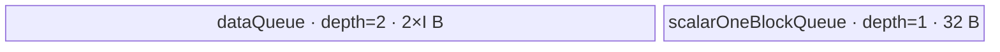
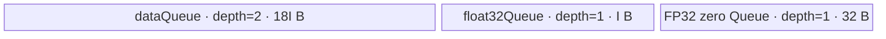

# ForeachNeg A2/A3 ACLNN 算子知识

## 算子速览

| 项目 | 内容 |
|---|---|
| 实际入口 | `aclnnForeachNegGetWorkspaceSize` + `aclnnForeachNeg`，公开 ACLNN 两段式接口，无显式版本后缀 |
| 计算语义 | 对 TensorList 中每个元素求相反数：`y[i][j] = -x[i][j]` |
| 输入输出 | 动态 TensorList；每个 Tensor 为 ND，支持 FP16/FP32/INT32/BF16；同一列表内 dtype 一致，输出 dtype 与输入一致 |
| 执行类型 | 单 Kernel：`AIV_VECTOR` |
| Kernel 路线 | R-001 FP16/FP32/INT32 原 dtype Vector；R-002 BF16→FP32→BF16 Vector |
| 核心资源 | GM TensorList 指针表、双缓冲 `dataQueue`、32 B 零常量 Queue；BF16 另有单缓冲 `float32Queue`；算子 Kernel 不消费用户 workspace |
| 来源闭包 | `source_closed`：公开 ACLNN 文档与 `ACLNNTYPE aclnn` OpDef 生成边界，闭合到 arch22 Tiling、`ForeachCommonTilingData`、`foreach_neg` router、公共 Unary body/helper 和 A2/A3 构建接线 |
| 验证状态 | 已完成源码闭包检查；本次知识提取未执行编译、真机、数值或性能测试。 |

## 接口与语义

### 计算语义

输入为 `x=[x_0,...,x_(n-1)]`，输出为 `y=[y_0,...,y_(n-1)]`。对每个 Tensor 的存储元素域执行 `y_i[j]=0-x_i[j]`。Kernel 不改变 shape 或 layout；公共推导函数把每个输出 shape/dtype 设为对应输入的 shape/dtype。空 Tensor 的元素数为 0，不产生 GM 搬运或 Vector 计算。

### 输入、输出与属性

| 参数 | shape/layout | dtype | 约束、默认值与语义 |
|---|---|---|---|
| `x` | TensorList；每个 Tensor 0～8 维、ND | FLOAT16、FLOAT32、INT32、BFLOAT16 | 非空指针；支持非连续输入，由 OpDef 的 `AutoContiguous()` 进入框架连续化边界；列表内所有 Tensor dtype 必须一致 |
| `out` | TensorList；每个 Tensor 0～8 维、ND | 与 `x` 一致 | 非空指针；公开接口不支持非连续输出；同位置输出的 storage shape size 不小于输入，Kernel 只写输入元素数 |
| `workspaceSize` | 标量 | `uint64_t` | 第一段接口返回。核心 Tiling 固定登记 32 B，但 Kernel 将 `userWS` 设为 `nullptr`；ACLNN 连续化所需空间由生成 executor 管理，固定仓未暴露其精确公式 |
| `executor` | 不适用 | `aclOpExecutor**` / `aclOpExecutor*` | 第一段创建、第二段消费，封装连续化、Tiling 与 Kernel launch |
| `workspace` | Device 地址 | `void*` | 第二段传入；核心 Kernel 的 `workspace` 参数不读 |
| `stream` | Runtime stream | `aclrtStream` | 第二段在该 stream 上提交 executor |

### 入口与版本

固定仓只公开无后缀 `aclnnForeachNegGetWorkspaceSize`/`aclnnForeachNeg`，不存在更高版本入口。`op_host/CMakeLists.txt` 以 `ACLNNTYPE aclnn` 收集 `foreach_neg_def.cpp`，由仓内统一 opbuild 流程生成两段式 API 源码；生成文件不在固定源码树中，属于允许的 ACLNN inner/executor 框架边界。公开文档和 README 均明确支持 Atlas A2、A3，OpDef、`SUPPORT_COMPUTE_UNIT`、binary config 与 Kernel CMake 分别接入 `ascend910b`、`ascend910_93`，不存在公开“不支持”冲突。

## Host/Launcher 执行流程

### 参数校验与前处理

1. 公开 ACLNN 第一段检查 `x/out/workspaceSize/executor` 指针与文档声明的 dtype、维度和列表一致性；生成桥本体在固定仓不可见。
2. OpDef 把 `x`、`y` 声明为动态 ND TensorList，允许 FP16/FP32/INT32/BF16，并对输入、输出声明 `AutoContiguous()`；公开约束仍禁止非连续输出。
3. `InferShape4ForeachCommon` 要求输入实例数等于输出数，并逐项复制 shape；`InferDataType4ForeachCommon` 逐项复制 dtype。
4. `Tiling4ForeachNegTiling` 以 `SOLO_NEG_OP_CODE` 初始化 `ForeachCommonTiling`。`Init` 最多扫描 50 个输入 Tensor，记录 storage 元素数、总元素数、首个 dtype 和每 32 B 的元素数。
5. `CheckOpInfo` 依次检查动态列表数量、输入维度不超过 8、输出 dtype/shape size、列表内 dtype 一致性；失败返回 `GRAPH_FAILED`，阻断 launch。

### 参数、Workspace 与生命周期

设 `N=sum_i numel(x_i)`、`s=sizeof(T)`、`E=32/s`、平台 AIV 核数为 `Cplat`：

```text
blockCount = ceil(N / E)
blockDim = min(max(1, blockCount), Cplat, 50)
q = floor(blockCount / blockDim) * E
r = blockCount mod blockDim
第 c 核目标覆盖 = q + (c < r ? E : 0) 个元素，末核以真实 Tensor 终点截断
```

Host 把每核覆盖域编码为首/末 Tensor 索引与首/末元素 offset。核心 Tiling 登记 `workspaces[0]=32`，但 entry 明确令 `userWS=nullptr`，Device body 不读取 workspace；这 32 B 不是节点间交换边。ACLNN executor、框架连续化临时区及其 owner/lifetime 属于生成边界，调用者按第一段返回值分配并保持到第二段提交完成。

### 启动图与失败传播

```text
aclnnForeachNegGetWorkspaceSize(x, out)
  -> 生成 executor：参数检查 / 必要的 input contiguous
  -> ForeachNeg Tiling4ForeachNegTiling
     -> ForeachCommonTiling::Init(SOLO_NEG_OP_CODE)
     -> ForeachCommonTiling::RunBigKernelTiling
aclnnForeachNeg(workspace, workspaceSize, executor, stream)
  -> 单节点 K0: foreach_neg<<<blockDim, stream>>>(xList, yList, workspace, tiling)
```

K0 的 entry 为 `foreach_neg`，执行族为 AIV_VECTOR，POD 为 `ForeachCommonTilingData`，输入/输出介质均为各 Tensor 的 GM 地址。无 Kernel 间 workspace 边、event 或中间 owner。Tiling/校验失败时 executor 不提交 K0；launch/runtime 错误由第二段 ACLNN 状态返回。单 stream 保证框架前处理先于 K0，生成 bridge 的具体 launch 包装在固定仓不可见。

## Route 与参数设计

### 分核与资源计算

非 BF16 令 `D=tilingData.GetDataSize()`、`U=平台 UB 字节数`：

```text
I = floor((floor((U-D)/2) - 32) / 32) * 32     # inputsTensorUbSize，字节
maxDataCount = I / sizeof(T)                    # 每 tile 元素数
```

BF16：

```text
I = floor((floor(floor((U-D)/10)/2) - 32) / 64) * 64
totalTensorUbSize = 9 * I
maxDataCount = 9*I / 2                          # BF16 元素
maxCastDataCount = I / 4                        # 每次 FP32 cast 元素
```

每核按 Tiling 给出的 Tensor 首末区间遍历；每个 Tensor 子区再按 `maxDataCount` 分 tile，最后一 tile 取余数。Host 的 32 B 分核粒度与 Device 的尾块 `DataCopyPad` 配合，避免把向上取整的无效元素写到输出。

### Route 选择

| 顺序 | Route | Key/模板 | 精确选择条件与优先级 | 不适用去向 |
|---:|---|---|---|---|
| 1 | R-001 原 dtype Vector | key 1：`<half,half,Sub,2,1>`；key 2：`<float,float,Sub,2,1>`；key 3：`<int,int,Sub,2,1>` | `dataType` 分别为 FP16、FP32、INT32；Host `GetTilingKeyByDtypeOnly` 依次映射 1/2/3 | 继续检查 key 4；其它 key entry 无 body |
| 2 | R-002 BF16 FP32 Vector | key 4：`<bfloat16_t,float,Sub,2,1>` | `dataType==DT_BF16` 且编译 guard `__CCE_AICORE__ >= 220 && NPU_ARCH != 3003/3113` | guard 不成立时无 BF16 Device 分支；公开 A2/A3 构建要求该实例可达 |

```text
dtype == FLOAT16  -> key 1 -> R-001
else dtype == FLOAT -> key 2 -> R-001
else dtype == INT32 -> key 3 -> R-001
else dtype == BF16  -> key 4 -> R-002（受编译 guard）
else -> TilingKey 0 / 不受 OpDef 支持，失败
```

### 模板/实现执行矩阵

| Route | key/selector | dtype/shape/platform 完整命中条件 | 执行拓扑与 Kernel 节点 | 实际模板/body | 内存与同步特征 | tail/fallback |
|---|---|---|---|---|---|---|
| R-001 原 dtype Vector | 1/2/3 | FP16/FP32/INT32；ND；维度≤8；列表 dtype 一致；A2/A3 | 单 K0 `foreach_neg` | `ForeachImplictOutputLevelZeroApi<T,T,Sub,2,1>` → `KernelForeachUnary` → `InnerComputer` | `dataQueue` depth 2，零常量 Queue depth 1；Queue 同步 + `V_MTE3`、`MTE3_MTE2` event | 完整 tile 用 `DataCopy`，余 tile 用精确字节 `DataCopyPad`；其它 dtype 失败 |
| R-002 BF16 FP32 Vector | 4 | BF16；同上；编译 guard 成立 | 单 K0 `foreach_neg` | `ForeachImplictOutputLevelZeroApi<bfloat16_t,float,Sub,2,1>` → BF16 `InnerComputer` specialization | `dataQueue` depth 2、`float32Queue` depth 1、零常量 Queue；Cast 前后 `PIPE_V` barrier | 每 `I/4` 元素 Cast；余 cast/repeat/tile 单独处理；guard 不成立无 fallback |

### 隐藏性能 Guard

| Guard | Host/Tiling 条件 | Device/资源原因 | 影响 Route | 不满足时去向 | 源码符号 |
|---|---|---|---|---|---|
| TensorList 容量 | `i < MAX_TENSOR_CONT(50)` | POD 各 Tensor 数组固定 50 项 | 全部 | 第 51 项以后不进入 Tiling；公开层未给出更宽上限 | `ForeachCommonTiling::Init` |
| 核数容量 | `blockDim <= MAX_CORE_CONT(50)` | POD 每核数组固定 50 项 | 全部 | Host 截断为 50 核 | `RunBigKernelTiling` |
| 32 B 分核 | `E=32/sizeof(T)` | 完整 DMA 与每核边界按 data block 分配 | 全部 | 末端用真实元素数截断并走 pad copy | `GetNeedCoreNum`、`AssignDataToEachCore` |
| UB 上界 | 非 BF16 `I=floor((floor((U-D)/2)-32)/32)*32` | depth-2 input Queue 加 32 B 常量 Queue | R-001 | 固定仓没有资源 fallback；过小 UB 的减法无显式保护 | `DivideUbMemory2` |
| BF16 UB 上界 | BF16 先 `(U-D)/10`，再除 2、减 32、按 64 B 对齐 | 9 倍 BF16 data buffer、FP32 cast buffer 与常量 Queue | R-002 | 无其它 BF16 Route | `DivideUbMemory2`、`KernelForeachBase::Init` |
| Vector repeat | 单批 repeat≤255，单 repeat `256/sizeof(P)` 元素 | level-zero API 的 repeat 上限和 256 B repeat 宽度 | 全部 | 外层 repeat batch；最后 mask 为 `remain` | `InnerComputer::Compute` |
| BF16 编译 guard | `__CCE_AICORE__>=220 && NPU_ARCH!=3003/3113` | BF16 specialization 与 entry 仅在该 guard 下实例化 | R-002 | 无 Device fallback | `foreach_neg`、`KernelForeachUnary::Init` |
| 空域 | `N==0 -> blockDim=1` | 保持合法 launch；tile `copyTimes=0` | 全部 | 不搬运、不计算；空 TensorList 本身的地址表边界固定仓未单独校验 | `GetNeedCoreNum`、`SingleTensorProcess` |

### POD/ABI

`ForeachCommonTilingData` 由 `BEGIN_TILING_DATA_DEF` 宏生成。固定仓给出字段顺序与位宽，但宏实现属于外部框架，因此精确 `sizeof/alignof/offsetof` 不在固定仓可见；Host `SaveToBuffer` 与 Device `GET_TILING_DATA` 使用同一注册结构。

| 结构 | 字段 | 类型/位宽 | ABI 布局 | 单位 | Host/launcher producer | Device consumer | 边界 |
|---|---|---|---|---|---|---|---|
| `ForeachCommonTilingData` | `inputsTensorUbSize` | `uint64_t`/64 | 第 1 字段；精确 offset 固定仓不可见 | 字节 | `DivideUbMemory2 -> set_inputsTensorUbSize(I)` | `KernelForeachBase::ParseTilingData`，生成 `maxDataCount/maxCastDataCount` | 32 B 对齐；BF16 为 64 B 对齐 |
| 同上 | `tensorDataCountList` | `int64_t[50]` | 第 2 字段；精确 offset 固定仓不可见 | 元素 | `Init: storageShape.GetShapeSize()` | `Process` 计算每 Tensor 默认 `cursorEnd` | 最多 50 项；可为 0 |
| 同上 | `tensorStartList` | `uint16_t[50]` | 第 3 字段；精确 offset 固定仓不可见 | Tensor 索引 | `AssignDataToEachCore` | `ParseTilingData -> tensorStart` | 仅 `[0,blockDim)` 活跃 |
| 同上 | `tensorEndList` | `uint16_t[50]` | 第 4 字段；精确 offset 固定仓不可见 | Tensor 索引 | `AssignDataToEachCore` | `ParseTilingData -> tensorEnd` | 仅 `[0,blockDim)` 活跃 |
| 同上 | `tensorStartOffsetList` | `int64_t[50]` | 第 5 字段；精确 offset 固定仓不可见 | 元素 offset | `AssignDataToEachCore` | `Process` 修正首 Tensor 起点 | 仅当前核首 Tensor 读取 |
| 同上 | `tensorEndOffsetList` | `int64_t[50]` | 第 6 字段；精确 offset 固定仓不可见 | 元素 offset，含尾 | `AssignDataToEachCore` | `Process` 修正末 Tensor 终点 | 仅当前核末 Tensor 读取；空域可为 -1 |

### Route 源码闭包

| Route | Key/selector | Host/Tiling producer | POD/参数 | Kernel entry/router 节点 | Kernel body/直接依赖 | 构建接线 |
|---|---|---|---|---|---|---|
| R-001 原 dtype Vector | 1/2/3 | `foreach_neg_tiling_arch22.cpp::Tiling4ForeachNegTiling`；`foreach_tiling_class.h::RunBigKernelTiling` | `ForeachCommonTilingData` | `op_kernel/foreach_neg.cpp::foreach_neg` | `kernel_foreach_base.h::KernelForeachBase`；`kernel_foreach_unary.h::KernelForeachUnary`；`foreach_implict_output_level_zero_api.h::InnerComputer/ForeachImplictOutputLevelZeroApi` | `op_host/CMakeLists.txt` arch22；`op_kernel/CMakeLists.txt` A2/A3 默认源 |
| R-002 BF16 FP32 Vector | 4 | 同上，BF16 UB 分支 | 同上 | 同上 key 4 编译分支 | 同上，BF16 `InnerComputer<bfloat16_t,float,...>` specialization | 同上；BF16 binary config 与 OpDef dtype 列表 |

## Kernel 实现

### 公共执行流程

两条 Route 都是单节点 K0。entry 解析 Tiling 后按 key 实例化 `ForeachImplictOutputLevelZeroApi`，把零作为第二个 `Sub` 源并调用 `Init/Process`。`KernelForeachBase` 根据 `GetBlockIdx()` 取当前核的 Tensor 区间；TensorList GM 首字保存指针表相对偏移，随后第 `i` 个 64 位项给出 Tensor 数据地址。每核遍历分配到的 Tensor 子区，每个子区按 UB 容量切 tile：GM→`dataQueue`→原地 `Sub(0,x)`→同一 LocalTensor 直接写 GM。没有第二 Kernel 或跨节点 workspace。

### Route R-001：FP16/FP32/INT32 原 dtype Vector

#### 适用条件

##### 选择证据

| 层级 | 文件 | 符号 | 源码谓词/参数 | 结果/下一跳 |
|---|---|---|---|---|
| API/OpDef | `foreach/foreach_neg/op_host/foreach_neg_def.cpp` | `ForeachNeg::ForeachNeg` | dtype∈{FP16,FP32,INT32,BF16}，ND，dynamic list | 进入 ForeachNeg Host |
| Host | `foreach/foreach_utils/op_host/common_dtype.h` | `GetTilingKeyByDtypeOnly` | FP16/FP32/INT32 | key 1/2/3 |
| Tiling | `foreach/foreach_utils/op_host/foreach_tiling_class.h` | `RunBigKernelTiling` | `opCode=SOLO_NEG_OP_CODE` | 生成 blockDim、POD、32 B workspace |
| Router | `foreach/foreach_neg/op_kernel/foreach_neg.cpp` | `foreach_neg` | `TILING_KEY_IS(1/2/3)` | 实例化 half/float/int 模板；未知 key 无计算 |

#### Device 数据流

##### 函数级调用链

```text
Tiling4ForeachNegTiling
  -> ForeachCommonTiling::Init(SOLO_NEG_OP_CODE)
  -> ForeachCommonTiling::RunBigKernelTiling
Host launch K0: foreach_neg(xList, yList, workspace, tiling)
  -> ForeachImplictOutputLevelZeroApi<T,T,Sub,2,1>::Init
     -> KernelForeachUnary::Init -> KernelForeachBase::Init/ParseTilingData
  -> KernelForeachUnary::Process
     -> SingleTensorProcess
        -> CopyIn
        -> ForeachImplictOutputLevelZeroApi::Compute
           -> InnerComputer<T,T,Sub,1>::Compute
        -> direct CopyOut in Compute
```

##### 源码等价伪码

```text
# 伪码
core = GetBlockIdx()
for tensor in [tensorStart[core], tensorEnd[core]]:
    begin = tensor == first ? tensorStartOffset[core] : 0
    end   = tensor == last  ? tensorEndOffset[core] : tensorNumel[tensor]-1
    bind xGM/yGM to TensorList[tensor] + begin
    count = end-begin+1
    for tile in ceil(count / maxDataCount):
        valid = min(maxDataCount, count-tile*maxDataCount)
        dataLocal = dataQueue.AllocTensor()
        if valid == maxDataCount: DataCopy(dataLocal, xGM[tile*maxDataCount], valid)
        else: DataCopyPad(dataLocal, xGM[tile*maxDataCount], valid*sizeof(T), pad=false)
        dataQueue.EnQue/DeQue(dataLocal)
        for repeat batches of at most 255:
            Sub(dataLocal[offset], zeroBlock, dataLocal[offset],
                mask=min(256/sizeof(T), remaining),
                repeat, strides={1,0,1,8,0,8})
        wait V_MTE3
        copy exactly valid elements dataLocal -> yGM[tile*maxDataCount]
        wait MTE3_MTE2
        dataQueue.FreeTensor(dataLocal)
```

#### 内存与数据搬运

##### 资源与搬运表

| 层级/缓冲区 | offset/地址公式 | extent/容量公式 | dtype/layout | producer | consumer | owner/lifetime | 对齐/复用 |
|---|---|---|---|---|---|---|---|
| GM TensorList pointer table | `base + ((*uint64(base)) >> 3) + i` | 每项 8 B 地址 | `uint64` | ACLNN TensorList marshal | `GetTensorAddr(i, ptr)` | executor/调用者；覆盖整个 K0 | 首字偏移按 8 B 解释 |
| GM input slice | `xAddr[i] + cursorStart + tile*maxDataCount` | `valid` 元素 | T/ND storage | 调用者 | `CopyIn` | 调用者，K0 只读 | 完整 tile 常规 copy，尾 tile 精确字节 pad copy |
| `dataQueue` | Queue 内部 | depth 2 × `I` B | T | `CopyIn` | `InnerComputer`、GM CopyOut | `TPipe`；Alloc→EnQue→DeQue→Free | 同一 LocalTensor 原地覆写为输出 |
| `scalarOneBlockQueue` | Queue 内部 | depth 1 × 32 B | T | `Duplicate(0)` | `Sub` 的 `src0` | 整个 Process；BeforeProcess DeQue，AfterProcess Free | 所有 repeat 广播复用 |
| GM output slice | `yAddr[i] + cursorStart + tile*maxDataCount` | `valid` 元素 | T/ND storage | direct CopyOut | 下游 | 调用者 | 只写输入有效元素数；out 多余尾部不写 |
| workspace | N/A | Tiling 登记 32 B，Device 使用 0 B | N/A | Host | 无 | executor | `userWS=nullptr` |

##### 分层内存布局



##### 字节账与复用顺序

```text
I = floor((floor((U-D)/2)-32)/32)*32
dataQueue = 2*I
scalarOneBlockQueue = 32
outQueue = 0（needCopyOut=false）
UB_total = 2*I + 32 <= U-D
dynamic_ub = N/A
workspace_total(core op) = 32 B reserved, 0 B consumed
=> maxDataCount = I/sizeof(T)
```

| 复用子区 | 写入者 | 读取者/消费点 | 下一次覆盖 | 同步或释放依据 | 安全条件 |
|---|---|---|---|---|---|
| `dataQueue` 当前 slot | `CopyIn` | `InnerComputer::Compute` 与 direct CopyOut | 双缓冲下一次轮转 | Queue EnQue/DeQue；`V_MTE3` 后写 GM；`MTE3_MTE2` 后 Free | 不得在 MTE3 完成前重新用于 MTE2 |
| `dataLocal` 有效区 | GM CopyIn | `Sub` | `Sub` 原地覆盖 | Vector 数据依赖 | `Sub` 的 `src1` 与 dst 允许同址 |
| 32 B 零块 | `Duplicate` | 所有 `Sub` repeat | Process 结束释放 | Queue DeQue/Free | 必须覆盖一个 32 B data block |

#### 同步、精度与尾块

##### 同步与数值边界表

| 阶段 | primitive/机制 | producer | consumer/等待点 | 保护对象 | 精度/尾块 |
|---|---|---|---|---|---|
| GM→UB | `dataQueue` EnQue/DeQue | MTE2 CopyIn | Vector Compute | 当前 Queue slot | 尾块 `blockLen=valid*sizeof(T)`、pad=false |
| Vector | `Sub(dst, zero, src)` | DeQue 后的输入 | MTE3 CopyOut | `dataLocal` | FP16/FP32/INT32 原 dtype；repeat≤255；尾 mask=`remain` |
| UB→GM | `V_MTE3` flag | Vector `Sub` | `WaitFlag<V_MTE3>` | 原地结果 | 精确写 `valid` 元素 |
| slot 回收 | `MTE3_MTE2` flag | MTE3 CopyOut | `WaitFlag<MTE3_MTE2>` 后 Free | 双缓冲 slot | 防止下一次 CopyIn 提前覆盖 |
| 数值边界 | 无额外 guard | `Sub(0,x)` | 输出 | 标量值 | 固定源码未对 INT32_MIN 溢出或浮点 signed-zero 位级语义单独处理 |

#### 关键实现

##### 符号证据表

| 阶段 | 文件 | 符号/模板实例 | 实现事实 |
|---|---|---|---|
| Host/Tiling producer | `foreach/foreach_utils/op_host/foreach_tiling_class.h` | `RunBigKernelTiling`、`AssignDataToEachCore`、`DivideUbMemory2` | key、blockDim、每核范围、UB 与 workspace |
| Kernel entry/router | `foreach/foreach_neg/op_kernel/foreach_neg.cpp` | `foreach_neg` key 1/2/3 | dtype→完整模板实例 |
| Device body/helper | `foreach/foreach_utils/op_kernel/kernel_foreach_unary.h` | `Process/SingleTensorProcess/CopyIn` | Tensor/Tile 循环和尾搬运 |
| Device body/helper | `foreach/foreach_utils/op_kernel/foreach_implict_output_level_zero_api.h` | `InnerComputer::Compute`、`ForeachImplictOutputLevelZeroApi::Compute` | level-zero Sub 参数、原地写回、event 与直接 GM 输出 |

### Route R-002：BF16→FP32→BF16 Vector

#### 适用条件

##### 选择证据

| 层级 | 文件 | 符号 | 源码谓词/参数 | 结果/下一跳 |
|---|---|---|---|---|
| API/OpDef | `foreach/foreach_neg/op_host/foreach_neg_def.cpp` | `ForeachNeg::ForeachNeg` | dtype=BF16，A2/A3 config | 进入 ForeachNeg Host |
| Host | `foreach/foreach_utils/op_host/common_dtype.h` | `GetTilingKeyByDtypeOnly` | `DT_BF16` | key 4 |
| Tiling | `foreach/foreach_utils/op_host/foreach_tiling_class.h` | `DivideUbMemory2` | `dataType==DT_BF16` | UB 先除 10，`I` 按 64 B 对齐 |
| Router | `foreach/foreach_neg/op_kernel/foreach_neg.cpp` | `foreach_neg` | key 4 且编译 guard 成立 | `ForeachImplictOutputLevelZeroApi<bfloat16_t,float,Sub,2,1>` |

#### Device 数据流

##### 函数级调用链

```text
Host launch K0: foreach_neg(...), key 4
  -> ForeachImplictOutputLevelZeroApi<bfloat16_t,float,Sub,2,1>::Init
     -> KernelForeachUnary::Init（dataQueue + float32Queue）
  -> KernelForeachUnary::Process/SingleTensorProcess/CopyIn
  -> InnerComputer<bfloat16_t,float,Sub,1>::Compute
     -> ComputePerCast
        -> Cast(BF16 -> FP32, CAST_NONE)
        -> Sub(FP32 zero, FP32 x) in-place
        -> Cast(FP32 -> BF16, CAST_RINT)
  -> direct BF16 CopyOut
```

##### 源码等价伪码

```text
# 伪码；分核、Tensor 循环和 GM 尾搬运同 R-001
for BF16 tile of at most 9*I/2 elements:
    CopyIn tile -> BF16 dataLocal
    for castChunk of at most I/4 elements:
        PipeBarrier(V)
        Cast(floatBuf, dataLocal[chunk*I/4], CAST_NONE, validChunk)
        for FP32 repeat batches <=255, 64 elements/repeat:
            PipeBarrier(V)
            Sub(floatBuf[offset], floatZeroBlock, floatBuf[offset], mask, repeat,
                strides={1,0,1,8,0,8})
        PipeBarrier(V)
        Cast(dataLocal[chunk*I/4], floatBuf, CAST_RINT, validChunk)
        PipeBarrier(V)
    wait V_MTE3
    CopyOut exactly valid BF16 elements
    wait MTE3_MTE2; Free dataLocal
```

#### 内存与数据搬运

##### 资源与搬运表

| 层级/缓冲区 | offset/地址公式 | extent/容量公式 | dtype/layout | producer | consumer | owner/lifetime | 对齐/复用 |
|---|---|---|---|---|---|---|---|
| GM input/output | 同 R-001 | 当前 tile `valid` BF16 | BF16/ND | 调用者/Kernel | Kernel/下游 | 调用者 | 尾 tile 精确字节 CopyPad |
| `dataQueue` | Queue 内部 | depth 2 × `9I` B | BF16 | CopyIn | Cast、最终 CopyOut | `TPipe` tile 生命周期 | 每 slot 同时容纳 `9I/2` 个 BF16；原地回写 |
| `float32Queue` | Queue 内部 | depth 1 × `I` B | FP32 | BF16 Cast | FP32 Sub、BF16 Cast | 整个 Process 只分配一次 | 逐 castChunk 覆盖复用，容量 `I/4` 元素 |
| `scalarOneBlockQueue` | Queue 内部 | depth 1 × 32 B | FP32 | `Duplicate(float(0))` | FP32 `Sub` | 整个 Process | 64 个 FP32 lane 的一个 data block |
| workspace | N/A | 32 B reserved，0 B consumed | N/A | Host | 无 | executor | 无节点间边 |

##### 分层内存布局



##### 字节账与复用顺序

```text
I = floor((floor(floor((U-D)/10)/2)-32)/64)*64
dataQueue = 2*(9I) = 18I
float32Queue = I
scalarOneBlockQueue = 32
UB_total = 19I + 32 <= U-D
dynamic_ub = N/A
workspace_total(core op) = 32 B reserved, 0 B consumed
=> BF16 tile = 9I/2 elements；FP32 cast chunk = I/4 elements
```

| 复用子区 | 写入者 | 读取者/消费点 | 下一次覆盖 | 同步或释放依据 | 安全条件 |
|---|---|---|---|---|---|
| `dataQueue` slot | BF16 CopyIn | BF16→FP32 Cast、最终 GM CopyOut | 双缓冲下一 tile | Queue + V_MTE3/MTE3_MTE2 | 当前 tile CopyOut 完成后才 Free |
| `float32Queue` | `Cast(...CAST_NONE)` | FP32 `Sub`、回 Cast | 下一 castChunk | 每步 `PipeBarrier<PIPE_V>` | 回 Cast 完成后才覆盖 |
| `dataLocal` 当前 chunk | CopyIn | 首次 Cast | FP32→BF16 `CAST_RINT` 原地写回 | Vector barrier | chunk 地址为 `index*maxCastDataCount` |

#### 同步、精度与尾块

##### 同步与数值边界表

| 阶段 | primitive/机制 | producer | consumer/等待点 | 保护对象 | 精度/尾块 |
|---|---|---|---|---|---|
| BF16→FP32 | `Cast(...CAST_NONE)` + `PIPE_V` | BF16 dataLocal | FP32 Sub | float32Queue | 每块≤`I/4` 元素 |
| FP32 negate | level-zero `Sub` + `PIPE_V` | FP32 Cast | BF16 Cast | float32Queue | 64 FP32 元素/repeat，repeat≤255，余数 mask |
| FP32→BF16 | `Cast(...CAST_RINT)` + `PIPE_V` | FP32 Sub | MTE3 CopyOut | dataLocal | 明确 round-to-nearest-integer 模式 `CAST_RINT` |
| GM 尾块 | `DataCopyPad` | MTE2/MTE3 | Vector/GM | 有效字节 | 只搬运 `valid*sizeof(bfloat16_t)` |
| slot 回收 | `V_MTE3`、`MTE3_MTE2` | Vector/MTE3 | CopyOut/下一 CopyIn | dataQueue slot | 同 R-001 |

#### 关键实现

##### 符号证据表

| 阶段 | 文件 | 符号/模板实例 | 实现事实 |
|---|---|---|---|
| Host/Tiling producer | `foreach/foreach_utils/op_host/foreach_tiling_class.h` | `DivideUbMemory2` BF16 分支 | UB `/10`、`/2-32` 与 64 B 对齐 |
| Kernel entry/router | `foreach/foreach_neg/op_kernel/foreach_neg.cpp` | key 4 template | BF16 输入、FP32 compute 类型与编译 guard |
| Device body/helper | `foreach/foreach_utils/op_kernel/kernel_foreach_base.h` | `KernelForeachBase::Init` | `totalTensorUbSize=9I`、两种 tile 上限 |
| Device body/helper | `foreach/foreach_utils/op_kernel/kernel_foreach_unary.h` | `KernelForeachUnary::Init/Process` | BF16 dataQueue/float32Queue 分配与生命周期 |
| Device body/helper | `foreach/foreach_utils/op_kernel/foreach_implict_output_level_zero_api.h` | BF16 `InnerComputer::ComputePerCast` | Cast/Sub/Cast 顺序、barrier、round 与余数 |

## 算子特定优化

### Trick T-001：输入 Queue 原地求负并直接回写 GM

#### 触发与源码依据

- 适用 Route：R-001、R-002
- 触发条件：所有 key；模板固定 `needCopyOut=false`
- Golden 来源：[`foreach/foreach_utils/op_kernel/foreach_implict_output_level_zero_api.h:171-194`](https://gitcode.com/cann/ops-nn/blob/955f8b33985b6d72989ebff341bb9c2c564a51bc/foreach/foreach_utils/op_kernel/foreach_implict_output_level_zero_api.h#L171-194)

**官方源码（固定 Commit 连续逐字摘录）**：

```cpp
    __aicore__ inline void Compute(
        uint32_t index, int64_t dataCount, LocalTensor<float>& float32Tensor, bool isRemainder)
    {
        LocalTensor<T> dataLocal = Base::dataQueue.template DeQue<T>();

        InnerComputer<T, P, op, paramsCount> computer;
        computer.Compute(
            dataLocal, float32Tensor, Base::maxCastDataCount, dataCount, scalarOneBlockUB, elementsPerRepeat);

        // Transport can be performed only after the Muls is complete.
        event_t eventIDVToMTE3 = static_cast<event_t>(GetTPipePtr()->FetchEventID(HardEvent::V_MTE3));
        SetFlag<HardEvent::V_MTE3>(eventIDVToMTE3);
        WaitFlag<HardEvent::V_MTE3>(eventIDVToMTE3);
        if (isRemainder) {
            DataCopyExtParams copyParams{1, static_cast<uint32_t>(dataCount * sizeof(T)), 0, 0, 0};
            DataCopyPad(Base::outTensorsGM[index * Base::maxDataCount], dataLocal, copyParams);
        } else {
            DataCopy(Base::outTensorsGM[index * Base::maxDataCount], dataLocal, dataCount);
        }
        event_t eventIDMTE3ToMTE2 = static_cast<event_t>(GetTPipePtr()->FetchEventID(HardEvent::MTE3_MTE2));
        SetFlag<HardEvent::MTE3_MTE2>(eventIDMTE3ToMTE2);
        WaitFlag<HardEvent::MTE3_MTE2>(eventIDMTE3ToMTE2);

        Base::dataQueue.FreeTensor(dataLocal);
```

#### 机制与设计原因

`InnerComputer` 的 `Sub` 将输入 LocalTensor 同时作为 `src1` 和 dst，结果留在原 `dataQueue` slot；随后在 `V_MTE3` 依赖满足后直接写 GM。模板不分配 `outQueue`，因此相较于物化独立输出 LocalTensor，源码可证明少一个输出 Queue 和一次 UB 内部转移。32 B 零块只初始化一次并供所有 tile/repeat 广播复用。

#### 迁移边界

- 适用：结果可安全原地覆盖输入 LocalTensor、且输出可在同一 Compute 阶段直接提交 GM 的逐元素 unary 算子。
- 前提：Vector primitive 支持 dst 与相应 src 同址；必须保留 Queue 生命周期和 `V_MTE3`/`MTE3_MTE2` 依赖。
- 失效：需要保留原输入、需要独立输出 Queue、或后续步骤仍读取原值时不可复用该布局。
- 未验证：本次知识提取未执行编译、真机、数值或性能测试。

#### 错误做法

固定仓未提供可验证反例。

### Trick T-002：BF16 以固定 FP32 scratch 分块升精度

#### 触发与源码依据

- 适用 Route：R-002
- 触发条件：`T=bfloat16_t`，`P=float`，编译 guard 支持 BF16
- Golden 来源：[`foreach/foreach_utils/op_kernel/foreach_implict_output_level_zero_api.h:103-142`](https://gitcode.com/cann/ops-nn/blob/955f8b33985b6d72989ebff341bb9c2c564a51bc/foreach/foreach_utils/op_kernel/foreach_implict_output_level_zero_api.h#L103-142)

**官方源码（固定 Commit 连续逐字摘录）**：

```cpp
    __aicore__ inline void ComputePerCast(
        LocalTensor<bfloat16_t>& dataLocal, LocalTensor<float>& float32Tensor, uint32_t maxCastDataCount,
        uint32_t index, int64_t dataCount, LocalTensor<float> oneBlockData, uint64_t elementsPerRepeat)
    {
        PipeBarrier<PIPE_V>();
        Cast(float32Tensor, dataLocal[index * maxCastDataCount], RoundMode::CAST_NONE, dataCount);

        uint32_t totalRepeatCnt = dataCount / elementsPerRepeat;
        uint32_t totalRepeatCntRemainder = dataCount % elementsPerRepeat; // should calc
        uint32_t repeatBatchCnt = totalRepeatCnt / MAX_REPEATS;           // limit by L0 API, should calc
        uint32_t repeatBatchCntRemainder = totalRepeatCnt % MAX_REPEATS;  // should calc
```

#### 机制与设计原因

一个 BF16 tile 可大于 FP32 scratch；源码按 `maxCastDataCount=I/4` 循环复用同一 `float32Queue`，执行 BF16→FP32、FP32 `Sub`、FP32→BF16，而不是为整个 tile 物化 FP32 副本。这样以固定 `I` 字节 scratch 覆盖 `9I/2` 个 BF16 元素的 tile，并明确使用 `CAST_RINT` 回写。

#### 迁移边界

- 适用：BF16 unary 计算需要 FP32 primitive 或希望固定升精度 scratch 上界。
- 前提：UB 账必须同时容纳 depth-2 的 `9I` data slot、`I` FP32 scratch 和 32 B 常量；保留每步 `PIPE_V` barrier。
- 失效：平台不满足 BF16 编译 guard 时没有本 Route 的 Device fallback。
- 未验证：本次知识提取未执行编译、真机、数值或性能测试。

#### 错误做法

固定仓未提供可验证反例。

## 模板与实现对比

| 对比维度 | R-001 原 dtype Vector | R-002 BF16 FP32 Vector | 设计选择依据 |
|---|---|---|---|
| 命中条件/优先级 | key 1/2/3 | key 4 + 编译 guard | dtype 唯一决定 |
| 模板与 dtype | `<T,T,Sub,2,1>` | `<bfloat16_t,float,Sub,2,1>` | BF16 使用 FP32 compute 类型 |
| 循环与分核 | 32 B 分核；每 tile `I/s` 元素 | 同分核；每 tile `9I/2`，内层 cast chunk `I/4` | BF16 以更大 data slot 配合 scratch 复用 |
| Queue/TBuf/寄存器/dynamic UB/通信 window | depth-2 dataQueue + 32 B zero Queue | 再加 depth-1 FP32 Queue | 均无 dynamic UB/通信 window |
| 内存总占用与复用 | `2I+32`，dataLocal 原地 | `19I+32`，dataLocal 与 FP32 scratch 分层复用 | Host 分别用 `/2` 与 `/10` 预算 |
| 搬运/Vector/SIMT/NDDMA/通信 API | DataCopy(Pad) + level-zero Sub | DataCopy(Pad) + Cast/Sub/Cast | 均为 AIV_VECTOR |
| 同步、精度与 tail | Queue + 两类 hard event；原 dtype；repeat/tile tail | 另有 PIPE_V；FP32 中间、CAST_RINT；cast/repeat/tile tail | BF16 多一层精度与余数边界 |
| fallback/失败边界 | 未知 key 无 body | guard 不成立无 fallback | Host/OpDef 仅发布支持实例 |

## 平台差异

| 项目 | A2 | A3 | 950 |
|---|---|---|---|
| 支持状态 | 公开支持 | 公开支持 | 公开支持，但由独立 `_950` 卡覆盖 |
| Host/Launcher | `ascend910b`→arch22 | `ascend910_93`→arch22 | 本卡不覆盖 |
| Kernel/资源 | 共用 AIV_VECTOR entry/body | 共用 AIV_VECTOR entry/body | 本卡不覆盖 |

## 限制与失败边界

- 公开 dtype 仅 FP16/FP32/INT32/BF16，Tensor 维度不超过 8；列表内 dtype 必须一致，输出 dtype 与输入一致，输出 storage shape size 不得小于输入。
- `ForeachCommonTilingData` 的 Tensor 与 core 数组均为 50 项；Host 扫描最多 50 个 Tensor、最多使用 50 个 AIV core。公开文档未声明 TensorList 长度上限，固定源码也没有显式报告“超过 50”错误，迁移时不得假定更大列表安全。
- 核心 Tiling 的 32 B workspace 不被 Kernel 消费；公开 ACLNN 返回的总 workspace 还可能包含 input contiguous 临时区，其精确公式与生成 executor 源码在固定仓不可见。
- 非 BF16/BF16 的 UB 减法均未显式检查 `U` 是否小于 POD/常量预算；公开平台的实际 UB 满足是发布前提，固定仓无资源 fallback。
- `Sub(0,x)` 未对 INT32_MIN 溢出、NaN payload 或浮点 signed-zero 位级结果提供额外约束；知识卡只承诺公开的数学相反数语义。
- 空 Tensor 不产生 tile；完全空 TensorList 的 marshal/address-table 行为在生成 ACLNN bridge 中不可见，不从 Kernel 代码推测补齐。
- 本次知识提取未执行编译、真机、数值或性能测试。

## 源码索引

### 链路索引

| 链路阶段 | 文件 | 关键符号 | 支撑内容 |
|---|---|---|---|
| 入口声明/约束 | `foreach/foreach_neg/docs/aclnnForeachNeg.md` | `aclnnForeachNegGetWorkspaceSize`、`aclnnForeachNeg` | 公开接口、平台、参数、错误与确定性 |
| 入口实现 | `foreach/foreach_neg/op_host/foreach_neg_def.cpp` | `ForeachNeg`、`OP_ADD` | ACLNN codegen 输入、dtype/layout、AutoContiguous 与平台 config |
| 入口实现 | `foreach/foreach_utils/op_host/foreach_infershape.cpp` | `InferShape4ForeachCommon`、`InferDataType4ForeachCommon`、ForeachNeg 注册 | 输出逐项 shape/dtype 推导 |
| Host/Tiling/Launcher | `foreach/foreach_neg/op_host/arch22/foreach_neg_tiling_arch22.cpp` | `Tiling4ForeachNegTiling` | ForeachNeg 到公共 Tiling 的接线 |
| Host/Tiling/Launcher | `foreach/foreach_utils/op_host/foreach_tiling_class.h` | `ForeachCommonTiling` | 校验、key、分核、UB、workspace、POD producer |
| Host/Tiling/Launcher | `foreach/foreach_utils/op_host/foreach_tiling_def.h` | `ForeachCommonTilingData` | POD 字段与 ForeachNeg 注册 |
| Host/Tiling/Launcher | `foreach/foreach_utils/op_host/common_dtype.h` | `GetDataTypeSize`、`GetTilingKeyByDtypeOnly` | dtype size、key 映射与对齐常量 |
| Kernel entry/body | `foreach/foreach_neg/op_kernel/foreach_neg.cpp` | `foreach_neg` | key router 与模板实例 |
| Kernel entry/body | `foreach/foreach_utils/op_kernel/kernel_foreach_base.h` | `KernelForeachBase` | POD parse、TensorList 地址与 BF16 tile 参数 |
| Kernel entry/body | `foreach/foreach_utils/op_kernel/kernel_foreach_unary.h` | `KernelForeachUnary` | Queue、Tensor/tile 循环、GM CopyIn |
| Kernel entry/body | `foreach/foreach_utils/op_kernel/foreach_implict_output_level_zero_api.h` | `InnerComputer`、`ForeachImplictOutputLevelZeroApi` | Sub、Cast、repeat、同步、direct CopyOut |
| 构建接线 | `foreach/foreach_neg/op_host/CMakeLists.txt` | `SUPPORT_COMPUTE_UNIT`、`SUPPORT_TILING_DIR`、`add_modules_sources` | A2/A3 arch22 Host 与 ACLNN codegen |
| 构建接线 | `foreach/foreach_neg/op_kernel/CMakeLists.txt` | `add_kernel_sources` | A2/A3 默认 Kernel 源接线 |

### 实现复用检查

| 检查项 | 可复用事实 | 不得改变的约束 | 源码符号 |
|---|---|---|---|
| ABI/POD | 六字段公共 POD 可复用 | 字段顺序、位宽、50 项数组、字节/元素单位必须一致 | `ForeachCommonTilingData`、`ParseTilingData` |
| 调用顺序 | Init→Process→Tensor→tile→CopyIn→Compute/direct CopyOut | key 到模板、首末 Tensor offset 顺序不可交换 | `foreach_neg`、`KernelForeachUnary::Process` |
| workspace/内存 | 核心不使用 workspace；input Queue 原地复用 | depth 2、32 B zero Queue、BF16 `9I`/`I` 布局与 owner/lifetime | `DivideUbMemory2`、各 `InitBuffer` |
| 同步 | Queue + V_MTE3 + MTE3_MTE2；BF16 另有 PIPE_V | Free/覆盖必须发生在 consumer 完成后 | `ForeachImplictOutputLevelZeroApi::Compute`、BF16 `ComputePerCast` |
| 精度与尾块 | 原 dtype Sub；BF16 Cast/Sub/Cast；精确字节 tail | repeat≤255、stride `{1,0,1,8,0,8}`、BF16 `CAST_RINT` | `InnerComputer::Compute` |
| 失败边界 | Host 校验失败阻断 launch；未知 key 无 body | Tensor/core 容量、BF16 编译 guard、UB 上界不得外推 | `CheckOpInfo`、`foreach_neg` |