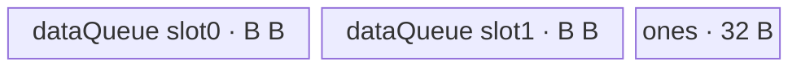

# ForeachReciprocal A2/A3 ACLNN 算子知识

## 算子速览

| 项目 | 内容 |
|---|---|
| 实际入口 | `aclnnForeachReciprocalGetWorkspaceSize` + `aclnnForeachReciprocal`，公开 ACLNN、两段式、无编号版本 |
| 计算语义 | 对 TensorList 的每个有效元素执行 `y_i[j] = 1 / x_i[j]` |
| 输入输出 | 动态 TensorList；ND；FP16/FP32/BF16；同一列表内 dtype 一致，输入输出 dtype 一致 |
| 执行类型 | 单节点 `AIV_VECTOR`；没有可达 Cube/AIC/MIX_CV 节点 |
| Kernel 路线 | R-001 FP16、R-002 FP32、R-003 BF16；BF16 先升为 FP32 再 `Div` |
| 核心资源 | GM TensorList descriptor；`dataQueue` depth=2；32 B 常量 Queue；BF16 另有 FP32 Queue；节点 workspace=32 B 但 Kernel 不读取 |
| 来源闭包 | `source_closed`：公开 API 文档→生成式 ACLNN/OpDef 边界→arch22 Tiling/POD→dtype key→AIV entry/body/helper→A2/A3 构建与 binary config 已闭合 |
| 验证状态 | 已完成源码闭包检查；本次知识提取未执行编译、真机、数值或性能测试。 |

## 接口与语义

### 计算语义

输入为 `x=[x_0,...,x_(n-1)]`，输出为同位置列表 `y`。对每个张量的 storage shape 有效元素 `j`，计算 `y_i[j]=1/x_i[j]`。A2/A3 Kernel 以一块全为 1 的 UB 常量作为 `Div` 的第一源，以输入 tile 作为第二源；没有对零、无穷或 NaN 做显式分支。

### 输入、输出与属性

| 参数 | shape/layout | dtype | 约束、默认值与语义 |
|---|---|---|---|
| `x` | TensorList；每项 ND、0–8 维 | FP16/FP32/BF16，列表内一致 | 支持空 Tensor；输入可非连续，OpDef 的 `AutoContiguous()` 属于框架前处理边界 |
| `out` | TensorList；每项 ND、0–8 维 | 与 `x` 相同且列表内一致 | 输出不支持非连续；同位置输出 storage 元素数不得小于输入；公共 infer-shape 在图模式下令输出 shape/dtype 等于输入 |
| `workspaceSize` | 标量输出 | `uint64_t*` | 第一段接口返回 executor 总 workspace；算子 Tiling 为本节点写 32 B，Kernel 将 `userWS` 强制置空而不使用该空间 |
| `executor` | 执行器输出/输入 | `aclOpExecutor**` | 第一段创建，第二段消费；内部 owner/lifetime 为生成式 ACLNN 框架边界 |
| `stream` | 第二段输入 | `aclrtStream` | 承载 executor 中的连续化与算子 launch 顺序 |

### 入口与版本

固定仓公开且仅公开无编号的 `aclnnForeachReciprocalGetWorkspaceSize`/`aclnnForeachReciprocal`，因此它是 A2/A3 实际支持的最新公开版本。公开支持表同时列出 Atlas A2 与 A3；OpDef 注册 `ascend910b`、`ascend910_93`，Host CMake 都选择 `arch22`，Kernel CMake 与两份 binary config 都提供 FP16/FP32/BF16 接线。生成的 ACLNN inner bridge 未落盘；参数校验、`AutoContiguous()` 与 executor 组装以公开文档和 `ACLNNTYPE aclnn` 接线作为允许的框架边界。

## Host/Launcher 执行流程

### 参数校验与前处理

公开第一段接口要求 `x/out` 非空，dtype 在 FP16/FP32/BF16 内且输入输出相同，列表内各 Tensor dtype 一致，维数不超过 8，同位置输出元素数不少于输入。OpDef 对输入输出都声明 `AutoContiguous()`；公开文档允许非连续输入而禁止非连续输出。进入 `Tiling4ForeachReciprocalTiling` 后，以 `SOLO_NEG_OP_CODE=7` 初始化公共 `ForeachCommonTiling`：最多扫描 50 个动态输入，读取 storage shape 元素数、首个输入描述的 dtype，并累加 `totalDataCount`；`CheckOpInfo` 再检查列表数量关系、shape、输出 dtype/容量及列表 dtype 一致性。任一描述、shape、workspace 指针或检查失败均返回 `GRAPH_FAILED`，不启动 Kernel。

### 参数、Workspace 与生命周期

令 `s=sizeof(T)`、`e=32/s`（每 32 B 元素数）、`E=sum_i numel(x_i)`、`Cplat=GetCoreNumAiv()`、`S=tilingData.GetDataSize()`、`U=平台 UB 字节数`：

- `needCoreNum=min(Cplat,ceil(E/e),50)`，而 `E=0` 时强制至少 1 核。
- `blockCount=ceil(E/e)`；基础每核份额为 `floor(blockCount/needCoreNum)*e`，前 `blockCount mod needCoreNum` 核各多 `e` 个元素。公共分配器跨 Tensor 边界写每核首尾 Tensor 索引和元素 offset。
- 对 `SOLO_NEG_OP_CODE`，先令 `T0=U-S`；BF16 再令 `T1=floor(T0/10)`，其它 dtype 令 `T1=T0`；`B=floor((floor(T1/2)-32)/A)*A`，FP16/FP32 的 `A=32 B`，BF16 的 `A=64 B`。`B` 即 `inputsTensorUbSize`。
- 节点 workspace 固定为 32 B，由 executor/运行时持有至 stream 上节点结束；Kernel entry 明确将 `userWS=nullptr`，无 workspace slice producer/consumer。

### 启动图与失败传播

单节点图：executor 在给定 stream 上启动 `foreach_reciprocal(xList,yList,workspace,tiling)`，`blockDim=needCoreNum`，POD 为 `ForeachCommonTilingData`。每个 AIV block 只访问 Host 分给自己的 `[tensorStart:offset, tensorEnd:offset]` 区间；没有跨 Kernel 边。生成式连续化若存在，必须在同一 executor/stream 中先于该节点完成，但其 workspace offset、事件和精确 owner 在固定仓不可见。Tiling 返回失败会阻断 launch；entry 对未知 key 没有 body，也没有显式错误回传，因此公开入口必须保证只产生 key 1/2/4。

## Route 与参数设计

### 分核与资源计算

Host 将拼接后的列表按 32 B block 分核，再把拼接位置还原为每核的首/尾 Tensor 与 offset。Device 对每个核覆盖的每个 Tensor 段独立分 tile：`maxDataCount=B/s`（FP16/FP32），BF16 则因 `dataQueue` 每 buffer 扩为 `9B` 而令 `maxDataCount=9B/2`，同时 `maxCastDataCount=B/4`。每段执行 `copyTimes=ceil(dataCount/maxDataCount)`；完整 tile 用 `DataCopy`，最后非整 tile 用字节长度为 `dataCount*s` 的 `DataCopyPad`。

### Route 选择

| 顺序 | Route | Key/模板 | 精确选择条件与优先级 | 不适用去向 |
|---:|---|---|---|---|
| 1 | R-001 FP16 Vector | key 1：`<half,half,Div,2,1>` | `GetTilingKeyByDtypeOnly(DT_FLOAT16)=1`；公开校验通过 | 检查 FP32 |
| 2 | R-002 FP32 Vector | key 2：`<float,float,Div,2,1>` | `GetTilingKeyByDtypeOnly(DT_FLOAT)=2`；公开校验通过 | 检查 BF16 |
| 3 | R-003 BF16 升精度 Vector | key 4：`<bfloat16_t,float,Div,2,1>` | `DT_BF16` 且 `__CCE_AICORE__>=220`，并排除 NPU arch 3003/3113；A2/A3 binary config 注册 BF16 | 编译 guard 不成立时 entry 无实现；该平台发布必须使用已接线的支持编译目标 |

```text
dtype==FP16 -> key 1 -> ForeachImplictOutputLevelZeroApi<half,half,Div,2,1>
dtype==FP32 -> key 2 -> ForeachImplictOutputLevelZeroApi<float,float,Div,2,1>
dtype==BF16 -> key 4 -> [CCE>=220 and arch!=3003/3113]
                       ForeachImplictOutputLevelZeroApi<bfloat16_t,float,Div,2,1>
otherwise -> Host key 0 / 公开接口拒绝；entry 无 fallback
```

### 模板/实现执行矩阵

| Route | key/selector | dtype/shape/platform 完整命中条件 | 执行拓扑与 Kernel 节点 | 实际模板/body | 内存与同步特征 | tail/fallback |
|---|---|---|---|---|---|---|
| R-001 FP16 | 1 | A2/A3；同列表 dtype 为 FP16；≤50 个被 Tiling 扫描的 Tensor；接口检查通过 | 单 `AIV_VECTOR` 节点 | `ForeachImplictOutputLevelZeroApi<half,half,Div,2,1>`→`KernelForeachUnary`→`InnerComputer<half,half>` | `dataQueue` depth 2；32 B half ones Queue；原地 `Div` 后直接 GM；V→MTE3→MTE2 硬事件 | 128 元素/repeat、每批≤255 repeats；末 repeat mask，末 tile `DataCopyPad` |
| R-002 FP32 | 2 | A2/A3；同列表 dtype 为 FP32；其余约束同上 | 单 `AIV_VECTOR` 节点 | `ForeachImplictOutputLevelZeroApi<float,float,Div,2,1>`→主 `InnerComputer` | 同一 Queue/事件图；32 B float ones Queue | 64 元素/repeat、每批≤255 repeats；同一 tail 策略 |
| R-003 BF16 | 4 | A2/A3；BF16；编译 guard 成立；其余约束同上 | 单 `AIV_VECTOR` 节点 | `ForeachImplictOutputLevelZeroApi<bf16,float,Div,2,1>`→BF16 `InnerComputer` 特化 | depth-2 的 9B BF16 buffers + B FP32 Queue + ones Queue；每 cast batch 有 `PIPE_V` barrier | `maxCastDataCount=B/4` 分段；BF16→FP32→BF16 `CAST_RINT`；无 fallback |

### 隐藏性能 Guard

| Guard | Host/Tiling 条件 | Device/资源原因 | 影响 Route | 不满足时去向 | 源码符号 |
|---|---|---|---|---|---|
| Tensor 数与数组宽度 | 公共 `Init` 仅遍历 `i<50` | POD 的 Tensor 与 core 数组均固定 50 项 | 全部 | 可见代码未显式拒绝第 51 项；工程复用必须限制 `N<=50` | `foreach_tiling_def.h::MAX_TENSOR_CONT`、`ForeachCommonTiling::Init` |
| 32 B 分核 | `e=32/s`，`ceil(E/e)` | 保持大部分核边界满足 DMA block 对齐 | 全部 | tensor 自身边界仍可形成 tail，转 `DataCopyPad` | `GetNeedCoreNum`、`AssignDataToEachCore` |
| UB 上界 | `B=floor((floor(T1/2)-32)/A)*A` | 覆盖双 buffer 与 32 B ones；BF16 用 `/10` 为 9 倍数据区和 FP32 区保留容量 | 全部 | 无备用 Route；平台 UB/减法不足会令算术失效，源码无显式下溢检查 | `DivideUbMemory2` |
| Vector repeat 上限 | `repeat<=255` | level-zero `Div` repeat 参数为 `uint8_t` | 全部 | `InnerComputer` 拆为多个 255-repeat batch | `InnerComputer::Compute` |
| BF16 编译 guard | `__CCE_AICORE__>=220 && arch!=3003/3113` | BF16 cast/body 只在该 guard 下实例化 | R-003 | entry 无 BF16 fallback | `op_kernel/foreach_reciprocal.cpp::foreach_reciprocal` |
| 空 Tensor | `dataCount=0` 时 `copyTimes=0` | 禁止零长度 DMA/Vector | 全部 | 跳过该 Tensor 段的 tile 循环 | `KernelForeachUnary::SingleTensorProcess` |

### POD/ABI

`ForeachCommonTilingData` 由 SDK 宏 `BEGIN_TILING_DATA_DEF` 生成；固定仓只含字段声明，宏定义/序列化布局在外部 SDK，因此 `sizeof/alignof/offsetof` 固定仓不可见。字段序列必须保持源码声明顺序。

| 结构 | 字段 | 类型/位宽 | ABI 布局 | 单位 | Host/launcher producer | Device consumer | 边界 |
|---|---|---|---|---|---|---|---|
| `ForeachCommonTilingData` | `inputsTensorUbSize` | `uint64_t`/64 | 精确 offset、结构 sizeof/alignof 固定仓不可见；声明序号 0 | 字节/单 buffer 基数 B | `DivideUbMemory2`→`set_inputsTensorUbSize(B)` | `KernelForeachBase::Init` 计算 tile 与 buffer 容量 | 32 B 对齐；BF16 为 64 B 对齐 |
| 同上 | `tensorDataCountList` | `int64_t[50]`/每项 64 | 声明序号 1 | 元素/Tensor | `Init`: `GetStorageShape().GetShapeSize()` | `Process` 决定各 Tensor 段长度 | 只写 `[0,N)`；其余零初始化 |
| 同上 | `tensorStartList` | `uint16_t[50]`/每项 16 | 声明序号 2 | Tensor 索引/core | `AssignDataToEachCore` | `ParseTilingData[blockIdx]` | core 数≤50 |
| 同上 | `tensorEndList` | `uint16_t[50]`/每项 16 | 声明序号 3 | Tensor 索引/core | `AssignDataToEachCore` | `ParseTilingData[blockIdx]` | 闭区间终点 |
| 同上 | `tensorStartOffsetList` | `int64_t[50]`/每项 64 | 声明序号 4 | 元素 offset/core | `AssignDataToEachCore` | `Process` 首 Tensor 的 `cursorStart` | 相对对应 Tensor |
| 同上 | `tensorEndOffsetList` | `int64_t[50]`/每项 64 | 声明序号 5 | 元素 offset/core | `AssignDataToEachCore` | `Process` 末 Tensor 的 `cursorEnd` | 含尾端；`dataCount=end-start+1` |

### Route 源码闭包

| Route | Key/selector | Host/Tiling producer | POD/参数 | Kernel entry/router 节点 | Kernel body/直接依赖 | 构建接线 |
|---|---|---|---|---|---|---|
| R-001 FP16 | key 1 | `foreach_reciprocal_tiling_arch22.cpp::Tiling4ForeachReciprocalTiling`→`ForeachCommonTiling::{Init,RunBigKernelTiling}` | `ForeachCommonTilingData` 六字段 | `op_kernel/foreach_reciprocal.cpp::foreach_reciprocal` | `KernelForeachBase`→`KernelForeachUnary`→`ForeachImplictOutputLevelZeroApi<half,...>` | Host/Kernel CMake；ascend910b/ascend910_93 binary JSON |
| R-002 FP32 | key 2 | 同上 | 同上 | 同一 entry 的 key 2 分支 | 同一链路的 float 模板 | 同上 |
| R-003 BF16 | key 4 | 同上；`DivideUbMemory2` 的 BF16 `/10` 路径 | 同上 | 同一 entry 的编译 guard 分支 | 同一模板→`InnerComputer<bfloat16_t,float>` 特化 | 同上；两平台 BF16 binary 项 |

## Kernel 实现

### 公共执行流程

两条 Route 共用单 Kernel graph。entry 解析 POD 后按 key 构造模板并传入标量 1。`KernelForeachBase` 用 `GetBlockIdx()` 取本核 POD slice，并通过 TensorList descriptor 首字记录的偏移定位指针表。`KernelForeachUnary::Process` 按本核的首尾 Tensor 闭区间遍历，绑定对应 GM 起点，再按 UB 容量切 tile。每 tile 的公共链路为 GM→`dataQueue`→原地 `Div(ones,data)`→直接 GM；因为 `needCopyOut=false`，`outQueue` 成员不分配、不消费，workspace 也不读取。

### Route R-001：FP16 Vector

#### 适用条件

##### 选择证据

| 层级 | 文件 | 符号 | 源码谓词/参数 | 结果/下一跳 |
|---|---|---|---|---|
| Host | `foreach/foreach_reciprocal/op_host/arch22/foreach_reciprocal_tiling_arch22.cpp` | `Tiling4ForeachReciprocalTiling` | `Init(SOLO_NEG_OP_CODE)` 成功 | `RunBigKernelTiling` |
| Tiling | `foreach/foreach_utils/op_host/common_dtype.h` | `GetTilingKeyByDtypeOnly` | FP16→1，FP32→2 | dtype key |
| Router | `foreach/foreach_reciprocal/op_kernel/foreach_reciprocal.cpp` | `foreach_reciprocal` | `TILING_KEY_IS(1/2)` | half/float 模板 |

#### Device 数据流

##### 函数级调用链

```text
foreach_reciprocal(xList,yList,workspace,tiling)
  -> ForeachImplictOutputLevelZeroApi<T,T,Div,2,1>::Init(..., one=T(1))
    -> KernelForeachUnary::Init -> KernelForeachBase::Init/ParseTilingData
    -> InitBuffer(dataQueue,depth=2,B) + InitBuffer(scalarOneBlockQueue,1,32B)
  -> KernelForeachUnary::Process
    -> per Tensor segment -> SingleTensorProcess
      -> CopyIn -> InnerComputer::Compute(Div) -> V_MTE3 -> direct CopyOut -> MTE3_MTE2
```

##### 源码等价伪码

```text
# 伪码；T 为 half
core = blockIdx
for tensor i from start[core] through end[core]:
  begin = (i==start ? startOffset : 0)
  finish = (i==end ? endOffset : numel[i]-1)
  bind xGM=x[i]+begin, yGM=y[i]+begin
  for tile k in ceil((finish-begin+1)/(B/sizeof(T))):
    n = min(B/sizeof(T), remaining)
    data = (tail ? DataCopyPad(bytes=n*sizeof(T)) : DataCopy(n))
    for batches of at most 255 repeats, repeatWidth=256/sizeof(T):
      Div(data[offset], ones, data[offset], mask, repeats,
          strides={1,0,1,8,0,8})
    if lane tail remains: Div(..., mask=remain, repeats=1, same strides)
    wait V_MTE3; copy exactly n elements/bytes to yGM[k*maxDataCount]
    wait MTE3_MTE2; free data
```

#### 内存与数据搬运

##### 资源与搬运表

| 层级/缓冲区 | offset/地址公式 | extent/容量公式 | dtype/layout | producer | consumer | owner/lifetime | 对齐/复用 |
|---|---|---|---|---|---|---|---|
| GM TensorList descriptor | `base + (firstOffset>>3)`→第 `i` 个 64-bit data pointer | descriptor 协议固定仓可见，整体大小固定仓不可见 | pointer table | ACLNN runtime | `GetTensorAddr` | launch 全程 | 8 B 指针项 |
| GM input segment | `x[i]+cursorStart+k*(B/s)` | `n` 元素 | T/ND storage | caller/contiguous stage | `CopyIn` | stream 完成前 | tail 按 `n*s` bytes |
| `dataQueue` | queue slot | `depth=2`，每 slot `B` B | T | `CopyIn` | `InnerComputer`、直接 CopyOut | Alloc→EnQue→DeQue→Free | tile 交替；计算原地覆盖输入 slot |
| `scalarOneBlockQueue` | 独立 32 B | depth 1、32 B | T；16 个 half 或 8 个 float 的 1 | `Duplicate` | 每次 `Div` 的 src0 | Init 至 AfterProcess | src0 block stride/repeat stride 均 0，实现广播复用 |
| GM output segment | `y[i]+cursorStart+k*(B/s)` | `n` 元素 | T/ND storage | 直接 `DataCopy{Pad}` | downstream | caller | 每核区间不重叠 |
| workspace | entry 收到但改为 `nullptr` | Tiling 32 B | N/A | runtime | 无 | executor | 不可用于实现数据 |

##### 分层内存布局



##### 字节账与复用顺序

```text
UB_total = 2*B + 32
B = floor((floor((U-S)/2)-32)/32)*32
UB_total <= U-S（S 为 Tiling 数据保留；整数向下取整会留下余量）
dynamic_ub = N/A（AIV Queue 路线）
workspace_total = 32 B（Kernel 实际消费 0 B）
```

| 复用子区 | 写入者 | 读取者/消费点 | 下一次覆盖 | 同步或释放依据 | 安全条件 |
|---|---|---|---|---|---|
| `dataQueue` 当前 slot | MTE2 `CopyIn` | Vector `Div`，随后 MTE3 直接读同一 slot | slot 再次 Alloc/CopyIn | Queue EnQue/DeQue；`V_MTE3` 后可搬出，`MTE3_MTE2` 后才 Free/复用 | 不得在 MTE3 完成前开始下一次覆盖 |
| 32 B ones | `Duplicate` | 所有 `Div` | Kernel 结束后释放 | BeforeProcess DeQue，AfterProcess Free | 内容始终为 T(1)，src stride=0 |

#### 同步、精度与尾块

##### 同步与数值边界表

| 阶段 | primitive/机制 | producer | consumer/等待点 | 保护对象 | 精度/尾块 |
|---|---|---|---|---|---|
| GM→V | `TQue` EnQue/DeQue | `DataCopy{Pad}` | `Compute` DeQue | 当前 data slot | tail 只搬 `n*s` bytes |
| V 计算 | level-zero `Div` | half ones + half data | V→MTE3 event | 原地 data slot | FP16 中除法；每 repeat 128 元素、repeat≤255，mask 保护末 repeat |
| V→GM→复用 | `SetFlag/WaitFlag<V_MTE3>` 与 `<MTE3_MTE2>` | `Div`、MTE3 copy | direct CopyOut、下一 CopyIn | 同一 data slot | tail 输出只提交 `n*s` bytes |

#### 关键实现

##### 符号证据表

| 阶段 | 文件 | 符号/模板实例 | 实现事实 |
|---|---|---|---|
| Host/Tiling producer | `foreach/foreach_utils/op_host/foreach_tiling_class.h` | `RunBigKernelTiling`、`AssignDataToEachCore`、`DivideUbMemory2` | key、blockDim、每核区间、B 与 workspace |
| Kernel entry/router | `foreach/foreach_reciprocal/op_kernel/foreach_reciprocal.cpp` | `foreach_reciprocal` key 1 | FP16 到 half 模板映射 |
| Device body/helper | `foreach/foreach_utils/op_kernel/kernel_foreach_unary.h` | `Process`、`SingleTensorProcess`、`CopyIn` | Tensor/core/tile 循环与 tail DMA |
| Device body/helper | `foreach/foreach_utils/op_kernel/foreach_implict_output_level_zero_api.h` | 主 `InnerComputer::Compute`、`ForeachImplictOutputLevelZeroApi::Compute` | repeat 分批、原地 Div、硬事件和直接输出 |

### Route R-002：FP32 Vector

#### 适用条件

##### 选择证据

| 层级 | 文件 | 符号 | 源码谓词/参数 | 结果/下一跳 |
|---|---|---|---|---|
| Tiling | `foreach/foreach_utils/op_host/common_dtype.h` | `GetTilingKeyByDtypeOnly` | `DT_FLOAT` | key 2 |
| Router | `foreach/foreach_reciprocal/op_kernel/foreach_reciprocal.cpp` | `foreach_reciprocal` | `TILING_KEY_IS(2)` | `<float,float,Div,2,1>` |

#### Device 数据流

##### 函数级调用链

```text
foreach_reciprocal key2
  -> ForeachImplictOutputLevelZeroApi<float,float,Div,2,1>::Init/Process
    -> KernelForeachUnary<float>::Process/SingleTensorProcess
      -> CopyIn -> InnerComputer<float,float>::Compute(Div) -> direct GM CopyOut
```

##### 源码等价伪码

```text
# 伪码；分核与 tile 地址同 R-001，s=4
for each core-owned Tensor segment and each tile of at most B/4 floats:
  copy n floats GM->data slot
  split n into batches of <=255 repeats, each repeat width=64 floats
  Div(data[offset], floatOnes, data[offset], mask, repeats,{1,0,1,8,0,8})
  wait V_MTE3; copy n valid floats to GM; wait MTE3_MTE2
```

#### 内存与数据搬运

##### 资源与搬运表

| 层级/缓冲区 | offset/地址公式 | extent/容量公式 | dtype/layout | producer | consumer | owner/lifetime | 对齐/复用 |
|---|---|---|---|---|---|---|---|
| GM input/output | `x/y[i]+cursorStart+k*(B/4)` | 当前 tile `n<=B/4` | FP32 ND storage | caller/Kernel | Kernel/downstream | stream 完成前 | tail 为 `n*4` bytes |
| `dataQueue` | 两 queue slots | depth 2，每 slot B B | FP32 | CopyIn | float Div/direct CopyOut | tile lifetime | 原地结果；事件后复用 |
| `scalarOneBlockQueue` | 独立 32 B | depth 1、8 个 float ones | FP32 | Duplicate | Div src0 | Kernel lifetime | block/repeat stride 0 |

##### 分层内存布局


##### 字节账与复用顺序

```text
UB_total=2B+32
B=floor((floor((U-S)/2)-32)/32)*32
dynamic_ub=N/A; workspace_total=32 B（body 消费0）
```

| 复用子区 | 写入者 | 读取者/消费点 | 下一次覆盖 | 同步或释放依据 | 安全条件 |
|---|---|---|---|---|---|
| FP32 data slot | MTE2 CopyIn | 原地 Div、MTE3 | 下一 tile | Queue + V_MTE3 + MTE3_MTE2 | 输出搬运结束后才覆盖 |
| FP32 ones | Duplicate | 全部 Div | Kernel 结束 | BeforeProcess/AfterProcess | 值固定 1.0f |

#### 同步、精度与尾块

##### 同步与数值边界表

| 阶段 | primitive/机制 | producer | consumer/等待点 | 保护对象 | 精度/尾块 |
|---|---|---|---|---|---|
| GM→V→GM | Queue + 两硬事件 | CopyIn/Div | Div/CopyOut/下一 CopyIn | 当前 slot | 全程 FP32；64 元素/repeat；末 repeat mask、末 tile精确 bytes |

#### 关键实现

##### 符号证据表

| 阶段 | 文件 | 符号/模板实例 | 实现事实 |
|---|---|---|---|
| Host/Tiling producer | `foreach/foreach_utils/op_host/foreach_tiling_class.h` | `RunBigKernelTiling`、`DivideUbMemory2` | key 2、B、blockDim、workspace |
| Kernel entry/router | `foreach/foreach_reciprocal/op_kernel/foreach_reciprocal.cpp` | key 2 branch | float 模板实例 |
| Device body/helper | `foreach/foreach_utils/op_kernel/kernel_foreach_unary.h` | `KernelForeachUnary<float>` | Tensor/tile loop 与 DMA |
| Device body/helper | `foreach/foreach_utils/op_kernel/foreach_implict_output_level_zero_api.h` | `InnerComputer<float,float>::Compute` | 64-lane repeat、原地 Div 与硬事件 |

### Route R-003：BF16 升精度 Vector

#### 适用条件

##### 选择证据

| 层级 | 文件 | 符号 | 源码谓词/参数 | 结果/下一跳 |
|---|---|---|---|---|
| Tiling | `foreach/foreach_utils/op_host/common_dtype.h` | `GetTilingKeyByDtypeOnly` | `DT_BF16` | key 4 |
| Router | `foreach/foreach_reciprocal/op_kernel/foreach_reciprocal.cpp` | `foreach_reciprocal` | key 4 且编译 guard 成立 | `<bfloat16_t,float,Div,2,1>` |
| Body | `foreach/foreach_utils/op_kernel/foreach_implict_output_level_zero_api.h` | `InnerComputer<bfloat16_t,float,...>` | `T=bf16,P=float` | 分段 FP32 计算 |

#### Device 数据流

##### 函数级调用链

```text
foreach_reciprocal key4
  -> ForeachImplictOutputLevelZeroApi<bf16,float,Div,2,1>::Init
    -> dataQueue(depth=2, each=9B) + float32Queue(depth=1,B) + ones(depth=1,32B)
  -> KernelForeachUnary::Process/SingleTensorProcess
    -> CopyIn(bf16 tile)
    -> InnerComputer<bf16,float>::Compute
      -> per cast chunk: Cast bf16→float -> Div float -> Cast float→bf16(CAST_RINT)
    -> V_MTE3 -> direct GM CopyOut -> MTE3_MTE2
```

##### 源码等价伪码

```text
# 伪码
B = inputsTensorUbSize; maxTile = 9B/2 bf16 elements; maxCast = B/4 float elements
for each core-owned Tensor segment and each tile:
  DataCopy bf16 tile into current 9B slot
  for castChunk q in ceil(tileElements/maxCast):
    n = min(maxCast, remaining)
    PipeBarrier(V); Cast(fp32Buf, bf16Data[q*maxCast], CAST_NONE, n)
    for Div batches of <=255 repeats, repeatWidth=64:
      PipeBarrier(V); Div(fp32Buf[offset], floatOnes, fp32Buf[offset], mask, repeats,{1,0,1,8,0,8})
    handle last <64 lanes with one masked repeat
    PipeBarrier(V); Cast(bf16Data[q*maxCast], fp32Buf, CAST_RINT, n); PipeBarrier(V)
  wait V_MTE3; copy valid bf16 bytes to GM; wait MTE3_MTE2; free slot
```

#### 内存与数据搬运

##### 资源与搬运表

| 层级/缓冲区 | offset/地址公式 | extent/容量公式 | dtype/layout | producer | consumer | owner/lifetime | 对齐/复用 |
|---|---|---|---|---|---|---|---|
| GM input/output | 与 R-001 相同 | 当前 tile 最多 `9B/2` 元素 | BF16 ND storage | caller/Kernel | Kernel/downstream | stream 完成前 | tail 为精确字节数 |
| `dataQueue` | 两个 queue slot | depth 2，每 slot `9B` B | BF16 | MTE2 | Cast、最终 MTE3 | tile 生命周期 | 同一 slot 先输入、后覆盖为 BF16 结果 |
| `float32Queue` | 独立区 | depth 1、`B` B=`B/4` float | FP32 | Cast | `Div`/降精度 Cast | 整个 Process 期间 DeQue 后复用 | 各 cast chunk 顺序覆盖 |
| `scalarOneBlockQueue` | 独立 32 B | depth 1、8 个 float | FP32 | `Duplicate(1.0f)` | `Div` | Kernel 生命周期 | stride 0 广播 |

##### 分层内存布局


##### 字节账与复用顺序

```text
T1 = floor((U-S)/10)
B = floor((floor(T1/2)-32)/64)*64
UB_total = 2*(9B) + B + 32 = 19B + 32 <= U-S（按 Host 保守除数与向下对齐）
dynamic_ub = N/A
workspace_total = 32 B（Kernel 实际消费 0 B）
```

| 复用子区 | 写入者 | 读取者/消费点 | 下一次覆盖 | 同步或释放依据 | 安全条件 |
|---|---|---|---|---|---|
| BF16 data slot | MTE2 CopyIn；降精度 Cast 原位写回相应 slice | 升精度 Cast；最终 MTE3 | 下一 tile | Queue 协议、`PIPE_V`、V_MTE3、MTE3_MTE2 | 一个 cast chunk 完成回写后才处理/覆盖对应 slice |
| FP32 Queue | BF16→FP32 Cast | float `Div` 与 FP32→BF16 Cast | 下一 cast chunk | 每阶段 `PipeBarrier<PIPE_V>` | 容量固定 `maxCast=B/4` 元素 |

#### 同步、精度与尾块

##### 同步与数值边界表

| 阶段 | primitive/机制 | producer | consumer/等待点 | 保护对象 | 精度/尾块 |
|---|---|---|---|---|---|
| BF16→FP32 | `PipeBarrier<PIPE_V>` + `Cast(...CAST_NONE)` | data Queue | float `Div` | FP32 Queue | cast chunk tail 用实际 `n` |
| FP32 Div | 多个 `PipeBarrier<PIPE_V>` | Cast/前一 repeat batch | 下一 batch/降精度 Cast | FP32 Queue | `1.0f/x`，repeat 64 float lanes，末 repeat mask |
| FP32→BF16 | `Cast(...CAST_RINT)` + barrier | float Div | MTE3 | BF16 data slot | 显式 round-to-nearest-integer 模式名 `CAST_RINT` |
| 输出与复用 | V_MTE3、MTE3_MTE2 event | BF16 result、MTE3 | GM copy、下一 MTE2 | BF16 slot | 最末 tile 使用精确字节 tail |

#### 关键实现

##### 符号证据表

| 阶段 | 文件 | 符号/模板实例 | 实现事实 |
|---|---|---|---|
| Host/Tiling producer | `foreach/foreach_utils/op_host/foreach_tiling_class.h` | `DivideUbMemory2` | BF16 `/10`、64 B 对齐、B producer |
| Kernel entry/router | `foreach/foreach_reciprocal/op_kernel/foreach_reciprocal.cpp` | key 4 branch | guard 与 BF16/float 模板实参 |
| Device body/helper | `foreach/foreach_utils/op_kernel/kernel_foreach_base.h` | `KernelForeachBase<bfloat16_t>::Init` | `9B` data 容量、`B/4` cast 容量 |
| Device body/helper | `foreach/foreach_utils/op_kernel/foreach_implict_output_level_zero_api.h` | BF16 `InnerComputer` 特化 | cast 分块、barrier、float Div 与 CAST_RINT |

## 算子特定优化

### Trick T-001：原地复用输入 Queue 并直接提交输出

#### 触发与源码依据

- 适用 Route：R-001、R-002、R-003。
- 触发条件：模板固定 `needCopyOut=false`；`Div` 的 dst 与输入 `dataLocal` 相同。
- Golden 来源：[`foreach/foreach_utils/op_kernel/foreach_implict_output_level_zero_api.h:174-194`](../../../../../../../cann-ops-raw/ascendc/ops-nn/955f8b33985b6d72989ebff341bb9c2c564a51bc/foreach/foreach_utils/op_kernel/foreach_implict_output_level_zero_api.h#L174-L194)

**官方源码（固定 Commit 连续逐字摘录）**：

```cpp
LocalTensor<T> dataLocal = Base::dataQueue.template DeQue<T>();
InnerComputer<T, P, op, paramsCount> computer;
computer.Compute(
    dataLocal, float32Tensor, Base::maxCastDataCount, dataCount, scalarOneBlockUB, elementsPerRepeat);
event_t eventIDVToMTE3 = static_cast<event_t>(GetTPipePtr()->FetchEventID(HardEvent::V_MTE3));
SetFlag<HardEvent::V_MTE3>(eventIDVToMTE3);
WaitFlag<HardEvent::V_MTE3>(eventIDVToMTE3);
```

#### 机制与设计原因

`InnerComputer` 把 `dataLocal` 同时作为 `Div` 的 src1 与 dst，使输入 tile 原地变成结果；模板还把 `needCopyOut` 设为 `false`，因此 `outQueue` 不分配，结果从当前 data slot 直接经 MTE3 写 GM。32 B ones 的 block/repeat stride 都为 0，同一常量块服务全部 repeat，不重复物化标量。V→MTE3 与 MTE3→MTE2 事件保护同一 slot 的计算、输出和下一轮覆盖次序。

#### 迁移边界

- 适用：输出不需要保留输入 UB 值、二元 primitive 允许 dst 与数据源原地别名的逐元素单输出算子。
- 前提：保持 `needCopyOut=false`、`Div` 实参顺序 `1/x`、Queue depth、两组硬事件与 tail 字节数；BF16 还要保留 FP32 Queue/cast 生命周期。
- 失效：后续步骤仍需原输入、primitive 不支持原地、或输出必须经独立 Queue 时，应分配 outQueue 并恢复 Queue 同步，固定仓没有备用 Route。
- 未验证：本次知识提取未执行编译、真机、数值或性能测试。

#### 错误做法

固定仓未提供可验证反例。

## 模板与实现对比

| 对比维度 | R-001 FP16 | R-002 FP32 | R-003 BF16 | 设计选择依据 |
|---|---|---|---|---|
| 命中条件/优先级 | key 1 | key 2 | key 4 + compile guard | Host dtype key 与 entry 分支一致 |
| 模板与 dtype | `<half,half,Div,2,1>` | `<float,float,Div,2,1>` | `<bf16,float,Div,2,1>` | BF16 使用 float 计算类型；其它原 dtype |
| 循环与分核 | 32 B block 分核；128 lanes/repeat | 同分核；64 lanes/repeat | 同分核；另按 B/4 cast 分块、64 lanes/repeat | repeatWidth=256/sizeof(P) |
| Queue/TBuf/寄存器/dynamic UB/通信 window | depth-2 `B` data + 32 B half ones | depth-2 `B` data + 32 B float ones | depth-2 `9B` data + `B` FP32 + 32 B float ones | Host `/10` 保守规划 BF16 额外空间 |
| 内存总占用与复用 | `2B+32`，data 原地 | `2B+32`，data 原地 | `19B+32`，data 与 FP32 Queue 分阶段复用 | 都不分配 outQueue |
| 搬运/Vector/SIMT/NDDMA/通信 API | DataCopy{Pad}、half Div | DataCopy{Pad}、float Div | 另加 Cast/PIPE_V 与 float Div | 均为 AIV Vector；无 SIMT/NDDMA/通信 |
| 同步、精度与 tail | Queue + 两硬事件；FP16 | Queue + 两硬事件；FP32 | 加 PIPE_V；FP32 计算、CAST_RINT | tail DMA 精确字节、末 repeat mask |
| fallback/失败边界 | 未知 key 无 body | 同 | guard 不成立无 body | 无 Device fallback，Host 必须失败关闭 |

## 平台差异

| 项目 | A2 | A3 | 950 |
|---|---|---|---|
| 支持状态 | 公开支持 | 公开支持 | 公开支持，但详见独立 `_950` 卡 |
| Host/Launcher | `ascend910b`→arch22 公共 Tiling | `ascend910_93`→同一 arch22 Tiling | arch35 独立 SIMT Tiling；max Tensor 256、workspace 16 MiB |
| Kernel/资源 | 同一 AIV Vector body，平台 UB/core 数运行时读取 | 同一 AIV Vector body | 512-thread SIMT，GM 直访，无 AIV Queue |

## 限制与失败边界

- ACLNN 只公开 FP16/FP32/BF16；顶层 README 参数表出现 INT32，但 ACLNN 专页、OpDef 与 A2/A3 binary config 均未发布 INT32，故本卡不纳入 INT32 Route。
- 公共 arch22 Tiling 只扫描 50 个 Tensor，且可见代码没有显式拒绝第 51 项；复用时必须将列表长度限制为 `<=50`，不能把未扫描项视为已处理。
- `totalDataCount`、shape size 累加、`U-S` 与 `floor(T1/2)-32` 没有显式溢出/下溢检查；只可在平台正常资源与公开 shape 约束内复用。
- entry 的未知 key、BF16 guard 不成立和空指针没有显式错误返回；这些应由 Host/生成式 ACLNN 层阻断。空 Tensor 的 tile 循环为零；空 TensorList 的 descriptor 行为固定仓没有独立契约，不能仅由 Kernel 推断。
- 生成的 ACLNN inner bridge、executor 内部节点、连续化 workspace slice 与错误码到内部检查的逐行映射固定仓不可见；公开文档给出外部错误语义，本卡不外推内部实现。

## 源码索引

### 链路索引

| 链路阶段 | 文件 | 关键符号 | 支撑内容 |
|---|---|---|---|
| 入口声明/约束 | `foreach/foreach_reciprocal/docs/aclnnForeachReciprocal.md` | 两段式原型、产品表、错误表 | 公开 API、dtype/shape/连续性与错误语义 |
| 入口声明/约束 | `foreach/foreach_reciprocal/README.md` | 产品支持、功能说明 | A2/A3/950 支持与算子公式 |
| 入口实现 | `foreach/foreach_reciprocal/op_host/foreach_reciprocal_def.cpp` | `ForeachReciprocal` | OpDef、AutoContiguous、平台 config |
| Host/Tiling/Launcher | `foreach/foreach_reciprocal/op_host/arch22/foreach_reciprocal_tiling_arch22.cpp` | `Tiling4ForeachReciprocalTiling` | opCode 与公共 Tiling 入口 |
| Host/Tiling/Launcher | `foreach/foreach_utils/op_host/foreach_tiling_class.h` | `ForeachCommonTiling` | 检查、分核、UB、POD producer、workspace |
| Host/Tiling/Launcher | `foreach/foreach_utils/op_host/foreach_tiling_def.h` | `ForeachCommonTilingData` | POD 字段与 50 项上限 |
| Host/Tiling/Launcher | `foreach/foreach_utils/op_host/common_dtype.h` | `GetTilingKeyByDtypeOnly` | key 与 dtype/size 常量 |
| 入口实现 | `foreach/foreach_utils/op_host/foreach_infershape.cpp` | `InferShape4ForeachCommon`、`IMPL_OP_INFERSHAPE(ForeachReciprocal)` | 列表数量与输出 shape/dtype 推导 |
| Kernel entry/body | `foreach/foreach_reciprocal/op_kernel/foreach_reciprocal.cpp` | `foreach_reciprocal` | key router 与模板实例 |
| Kernel entry/body | `foreach/foreach_utils/op_kernel/kernel_foreach_base.h` | `KernelForeachBase` | POD 解析、TensorList 指针、BF16 容量 |
| Kernel entry/body | `foreach/foreach_utils/op_kernel/kernel_foreach_unary.h` | `KernelForeachUnary` | Queue、Tensor/core/tile 循环与 DMA |
| Kernel entry/body | `foreach/foreach_utils/op_kernel/foreach_implict_output_level_zero_api.h` | `InnerComputer`、`ForeachImplictOutputLevelZeroApi` | Div、cast、repeat、事件、原地输出 |
| 构建接线 | `foreach/foreach_reciprocal/op_host/CMakeLists.txt` | `SUPPORT_COMPUTE_UNIT`/`SUPPORT_TILING_DIR` | A2/A3→arch22 Host |
| 构建接线 | `foreach/foreach_reciprocal/op_kernel/CMakeLists.txt` | `add_kernel_sources` | A2/A3 Kernel 源接线 |
| 构建接线 | `foreach/foreach_reciprocal/op_host/config/ascend910b/foreach_reciprocal_binary.json` | `op_list` | A2 三 dtype binary |
| 构建接线 | `foreach/foreach_reciprocal/op_host/config/ascend910_93/foreach_reciprocal_binary.json` | `op_list` | A3 三 dtype binary |

每行只写一个文件，并确保该文件存在于 Frontmatter `sources`。

### 实现复用检查

| 检查项 | 可复用事实 | 不得改变的约束 | 源码符号 |
|---|---|---|---|
| ABI/POD | 六字段足以重建每核 Tensor 闭区间与 UB tile | 字段顺序、50 项宽度、元素/字节单位；宏生成的精确 ABI 必须由同 SDK 提供 | `ForeachCommonTilingData`、`FillTilingData` |
| 调用顺序 | Init→Process；每 tile CopyIn→Compute→direct GM | key 对应模板和 `1` 的类型/实参顺序不可交换 | `foreach_reciprocal`、`ForeachImplictOutputLevelZeroApi::Init` |
| workspace/内存 | workspace 不参与计算；data slot 原地复用 | depth=2、B/9B 容量、32 B ones、BF16 B-byte FP32 Queue | `KernelForeachUnary::Init` |
| 同步 | Queue + V_MTE3 + MTE3_MTE2；BF16 另有 PIPE_V | 同一 slot 输出完成前不得被 MTE2 覆盖 | `ForeachImplictOutputLevelZeroApi::Compute` |
| 精度与尾块 | FP16/FP32 原 dtype；BF16 FP32 Div 后 CAST_RINT | repeat≤255、stride `{1,0,1,8,0,8}`、tail mask 与精确 DMA bytes | `InnerComputer::Compute{PerCast}` |
| 失败边界 | Host 检查失败关闭；无 Device fallback | 未知 key、>50 Tensor、编译 guard 不能静默放行 | `CheckOpInfo`、entry router |