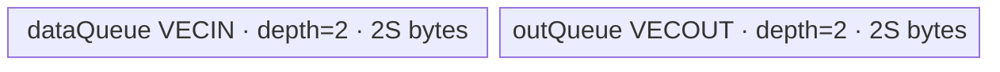
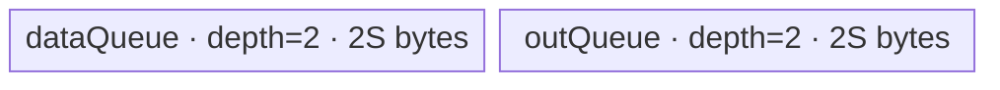

# ForeachSigmoid A2/A3 ACLNN 算子知识

## 算子速览

| 项目 | 内容 |
|---|---|
| 实际入口 | `aclnnForeachSigmoidGetWorkspaceSize` + `aclnnForeachSigmoid`，公开、无版本后缀的两段式 ACLNN 接口 |
| 计算语义 | 对列表中每个张量逐元素计算 `y_i[j] = 1 / (1 + exp(-x_i[j]))` |
| 输入输出 | `x/out` 均为 ND TensorList；FP16、FP32、BF16；同一列表内及输入输出 dtype 一致；输入可非连续，输出必须连续；rank 0～8 |
| 执行类型 | 单节点 `AIV_VECTOR`；没有 Cube/AIC、MIX_CV、SIMT 或 NDDMA 节点 |
| Kernel 路线 | R-001 FP16 原精度；R-002 FP32 原精度；R-003 BF16→FP32→BF16 |
| 核心资源 | TensorList GM 描述符、双缓冲 VECIN/VECOUT；BF16 另有单缓冲 FP32 scratch；workspace 声明 32 B 但 Kernel 不读 |
| 来源闭包 | `source_closed`：公开 ACLNN 约束→框架生成两段式边界→`ForeachSigmoid` OpDef→arch22 Tiling/POD→dtype router→公共 unary/triangle body→A2/A3 构建与 binary config 已闭合 |
| 验证状态 | 已完成源码闭包检查；本次知识提取未执行编译、真机、数值或性能测试。 |

## 接口与语义

### 计算语义

输入是长度为 `n` 的 TensorList `x=[x_0,...,x_{n-1}]`。对每个张量的存储元素域 `0 <= j < numel(x_i)` 独立计算：

```text
y_i[j] = sigmoid(x_i[j]) = 1 / (1 + exp(-x_i[j]))
```

输出允许拥有不小于对应输入的 storage shape size；Kernel 只写前 `numel(x_i)` 个元素，输出额外后缀不属于本算子的有效写域。各张量相互独立，不做跨张量归约。

### 输入、输出与属性

| 参数 | shape/layout | dtype | 约束、默认值与语义 |
|---|---|---|---|
| `x` | TensorList；每个 Tensor 为 ND，rank 0～8 | FP16、FP32、BF16 | 指针不能为空；列表内 dtype 一致；文档允许空 Tensor；OpDef `.AutoContiguous()` 使非连续输入在框架边界转连续 |
| `out` | TensorList；每个 Tensor 为 ND，rank 0～8 | 与 `x` 相同 | 指针不能为空；列表内 dtype 一致；对应输出 storage size 不小于输入；不支持非连续输出 |
| `workspaceSize` | 标量输出 | `uint64_t` | 第一段接口返回；arch22 Tiling 写 32 B，注释说明 foreach Vector 不需要算子 workspace |
| `executor` | Host 对象 | `aclOpExecutor**` | 第一段创建并持有计算流程，第二段消费 |
| `workspace` | Device 地址 | 无类型字节区 | 调用者按 `workspaceSize` 分配；本 Kernel 将其替换为 `userWS=nullptr`，不读取这 32 B |
| `stream` | ACL runtime stream | `aclrtStream` | 第二段在该 stream 上提交 Kernel |

### 入口与版本

固定 Commit 公开的是无版本后缀的 `aclnnForeachSigmoidGetWorkspaceSize/aclnnForeachSigmoid`，没有更高后缀版本可选。第一段负责参数校验、输入连续化与 executor/workspace 生成；自动生成的 ACLNN inner bridge 不在该算子目录中，属于明确的框架边界。公开文档明确列出 A2、A3 支持；OpDef 注册 `ascend910b` 与 `ascend910_93`，Host/Kernel CMake 和两份 binary config 均有活动接线，无发布冲突。

## Host/Launcher 执行流程

### 参数校验与前处理

1. ACLNN 第一段拒绝空的 `x/out` 指针、非 FP16/FP32/BF16、输入输出 dtype 不一致、列表内部 dtype 不一致、输入输出 shape size 约束不满足及 rank 大于 8。
2. `ForeachSigmoid` OpDef 将动态输入、输出限制为 ND 与三种浮点 dtype，并对二者声明 `.AutoContiguous()`；公开契约只允许输入非连续，输出必须连续。
3. `ForeachCommonTiling::Init(FOREACH_SIGMOID_OP_CODE)` 遍历最多 `MAX_TENSOR_CONT=50` 个动态输入实例，以第一个 dtype 冻结 `dataType/dataTypeSize/elementsPerBlock=32/dataTypeSize`，记录每个 storage numel 和总元素数；遇到输入描述缺失或 dtype 不一致失败。
4. `RunBigKernelTiling` 再检查输入 rank、输出 dtype 与 shape size、列表内 dtype；任何失败均返回 `GRAPH_FAILED`，阻断 launch。

### 参数、Workspace 与生命周期

`GetWorkspaceSizes(1)[0]=32`，该区域由 ACLNN 调用者在第二段前分配并活到 stream 完成；但 `foreach_sigmoid` entry 明确令 `userWS=nullptr`，传给 `Init` 的 workspace 未绑定任何 GM/UB 对象。真正的数据 owner 是调用者的 `x/out` TensorList；其描述符 GM 保存数据指针表，`KernelForeachBase::GetTensorAddr` 先读取描述头中的偏移，再取第 `i` 个 64 位数据地址。

### 启动图与失败传播

```text
aclnnForeachSigmoidGetWorkspaceSize(x, out)
  -> ACLNN 参数校验与 AutoContiguous 框架边界
  -> ForeachSigmoid / Tiling4ForeachSigmoidTiling
     -> ForeachCommonTiling::Init(11)
     -> ForeachCommonTiling::RunBigKernelTiling
  -> executor + workspaceSize=32
aclnnForeachSigmoid(workspace, 32, executor, stream)
  -> foreach_sigmoid<<<blockDim=needCoreNum, stream>>>(xListGM, yListGM, workspace, tiling)
```

唯一节点的 entry 为 `foreach_sigmoid`，POD 为 `ForeachCommonTilingData`，输入/输出分别是 TensorList 描述符 GM；无 Kernel 间边。launch 失败由 executor/stream 返回，Tiling 失败不会提交 Kernel。单 stream 保证该节点与调用者同 stream 上前后任务的顺序；Kernel 内部由 TQue 和 `PIPE_V` barrier 建立 DMA/Vector 顺序。

## Route 与参数设计

### 分核与资源计算

令 `E=sum_i numel(x_i)`，`B=32/sizeof(T)` 个元素/32 B block，`Cplat=GetCoreNumAiv()`：

```text
needCoreNum = min(max(1, ceil(E / B)), Cplat, 50)
blockCount = ceil(E / B)
baseElems = floor(blockCount / needCoreNum) * B
前 blockCount % needCoreNum 个核处理 baseElems + B，其余处理 baseElems
```

`AssignDataToEachCore` 将全列表看成拼接的一维元素流，再把每核区间反解为 `tensorStart/End` 与首尾 offset；因此一个核可跨多个 Tensor，一个 Tensor 也可跨核。设平台 UB 字节为 `Uplat`、POD 序列化字节为 `TD`、`S=inputsTensorUbSize`：

```text
FP16/FP32: S = floor32((uint32(Uplat - TD - 1024) / 4))
BF16:      S = floor64((uint32(Uplat - TD - 1024) / 10) / 4)
```

FP16/FP32 每 tile 最大元素数 `S/sizeof(T)`；BF16 输入/输出队列单槽容量扩为 `9S`，每 tile 最大 `9S/2` 个 BF16 元素，内部再按 `S/4` 个元素分段 cast/计算。

### Route 选择

| 顺序 | Route | Key/模板 | 精确选择条件与优先级 | 不适用去向 |
|---:|---|---|---|---|
| 1 | R-001 FP16 | key 1；`ForeachTriangle<half,half,Sigmoid<half,false>,2>` | `dataType==DT_FLOAT16`，`GetTilingKeyByDtypeOnly` 返回 1 | 非 FP16 继续按 dtype key |
| 2 | R-002 FP32 | key 2；`ForeachTriangle<float,float,Sigmoid<float,false>,2>` | `dataType==DT_FLOAT`，返回 2 | 非 FP32 继续按 dtype key |
| 3 | R-003 BF16 升精度 | key 4；`ForeachTriangle<bfloat16_t,float,Sigmoid<float,false>,2>` | `dataType==DT_BF16`，返回 4；Kernel 分支还受 `__CCE_AICORE__>=220` 且非 NPU arch 3003/3113 编译 guard 约束 | 其它 key：entry 无分支、无输出；公开/OpDef 已先限制 dtype |

```text
DT_FLOAT16 -> key 1 -> R-001
DT_FLOAT   -> key 2 -> R-002
DT_BF16    -> key 4 -> R-003（编译 guard 成立）
其它 dtype -> key 0/其它 -> ACLNN/Host 失败；若绕过则 router 无输出分支
```

### 模板/实现执行矩阵

| Route | key/selector | dtype/shape/platform 完整命中条件 | 执行拓扑与 Kernel 节点 | 实际模板/body | 内存与同步特征 | tail/fallback |
|---|---|---|---|---|---|---|
| R-001 FP16 | 1 | FP16、ND、rank≤8、输出 size≥输入、A2/A3 | 单 AIV Kernel | `ForeachTriangle<half,half,Sigmoid<half,false>,2>`→`KernelForeachUnary` | VECIN/VECOUT 各 depth 2；`Sigmoid<half,false>`；TQue + `PIPE_V` | 满 tile `DataCopy`，尾 tile `DataCopyPad`；元素级 `dataCount` 限定计算 |
| R-002 FP32 | 2 | FP32，其余同上 | 单 AIV Kernel | `ForeachTriangle<float,float,Sigmoid<float,false>,2>` | 与 R-001 同布局，元素宽度为 4 B | 同 R-001 |
| R-003 BF16 | 4 | BF16，其余同上；编译 guard 成立 | 单 AIV Kernel | `ForeachTriangle<bfloat16_t,float,Sigmoid<float,false>,2>`→BF16 `InnerComputer` specialization | 输入/输出双缓冲各单槽 `9S`，FP32 scratch `2S`；每 sub-chunk 4 个 `PIPE_V` barrier | 外层 DMA tail 同上；内部 cast remainder 单独处理 |

### 隐藏性能 Guard

| Guard | Host/Tiling 条件 | Device/资源原因 | 影响 Route | 不满足时去向 | 源码符号 |
|---|---|---|---|---|---|
| 最大动态 Tensor 数 | `Init` 仅循环 `i<50` | POD 的 tensor/core 数组固定 50 项 | 全部 | ACLNN 契约未单列该上限；固定 Host 只编码前 50 项 | `ForeachCommonTiling::Init`、`MAX_TENSOR_CONT` |
| 32 B 分核 | `B=32/sizeof(T)`，按 `ceil(E/B)` 分核 | 非尾块使用按元素计数的对齐 `DataCopy` | 全部 | 尾段走 `DataCopyPad` | `GetNeedCoreNum`、`AssignDataToEachCore` |
| UB 上界 | `Uplat>TD+1024` 后按 4 或 40 分并向下对齐 | 双缓冲及 Sigmoid primitive 预留；BF16 还需 cast scratch | 全部 | 固定源码没有资源不足 fallback；无显式下溢检查 | `DivideUbMemory3` |
| BF16 编译 guard | `__CCE_AICORE__>=220 && arch!=3003/3113` | BF16 specialization 和 entry 分支仅在 guard 内编译 | R-003 | guard 不成立时 key 4 无 body | `foreach_sigmoid`、`InnerComputer<bfloat16_t,...>` |
| 输出有效域 | `out_size>=x_size` | Kernel 只按 `tensorDataCountList[i]` 写输入元素数 | 全部 | 输出额外后缀保持调用前内容 | `CheckOutputShapeAndDtype`、`KernelForeachUnary::Process` |

### POD/ABI

| 结构 | 字段 | 类型/位宽 | ABI 布局 | 单位 | Host/launcher producer | Device consumer | 边界 |
|---|---|---|---|---|---|---|---|
| `ForeachCommonTilingData` | `inputsTensorUbSize` | `uint64_t`/64 | 首字段；宏生成的精确 `sizeof/alignof/offsetof` 在固定仓不可见 | 字节/单 queue 基准槽 | `DivideUbMemory3`→`set_inputsTensorUbSize(S)` | `KernelForeachBase::Init` 计算 queue 容量与 tile 上限 | 32 B 对齐，BF16 为 64 B 对齐 |
| 同上 | `tensorDataCountList[50]` | `int64_t[50]` | 紧随前字段；精确 offset 由外部 tiling 宏生成 | 元素 | `Init`: `shape.GetShapeSize()` | `Process`: 每 Tensor 的末端与 dataCount | 未活动项为初始化零值 |
| 同上 | `tensorStartList[50]` | `uint16_t[50]` | 声明顺序固定；精确 offset 固定仓不可见 | Tensor 索引 | `AssignDataToEachCore` | `ParseTilingData` 按 `blockIdx` 取首 Tensor | 仅 `blockIdx<blockDim<=50` 活动 |
| 同上 | `tensorEndList[50]` | `uint16_t[50]` | 同上 | Tensor 索引 | `AssignDataToEachCore` | 同上，控制闭区间循环终点 | 同上 |
| 同上 | `tensorStartOffsetList[50]` | `int64_t[50]` | 同上 | 元素 | `AssignDataToEachCore` | 首 Tensor 的 GM base offset | 同上 |
| 同上 | `tensorEndOffsetList[50]` | `int64_t[50]` | 同上 | 元素/闭区间末端 | `AssignDataToEachCore` | 末 Tensor 的 `cursorEnd` | 空域可为 `-1`，使 dataCount 为 0 |

### Route 源码闭包

| Route | Key/selector | Host/Tiling producer | POD/参数 | Kernel entry/router 节点 | Kernel body/直接依赖 | 构建接线 |
|---|---|---|---|---|---|---|
| R-001 FP16 | key 1 | `foreach_sigmoid_tiling_arch22.cpp::Tiling4ForeachSigmoidTiling`；`ForeachCommonTiling` | `ForeachCommonTilingData` | `op_kernel/foreach_sigmoid.cpp::foreach_sigmoid` key 1 | `KernelForeachBase`→`KernelForeachUnary`→`ForeachTriangle`→`Sigmoid<half,false>` | Host/Kernel CMake；ascend910b/ascend910_93 binary config |
| R-002 FP32 | key 2 | 同上 | 同上 | 同 entry key 2 | 同调用链，`Sigmoid<float,false>` | 同上 |
| R-003 BF16 | key 4 | 同上 | 同上 | 同 entry key 4 + compile guard | 同调用链，BF16 `InnerComputer` + `Sigmoid<float,false>` | 同上 |

## Kernel 实现

### 公共执行流程

三个 Route 都是单 AIV Kernel。entry 解析 POD、按 dtype key 实例化 `ForeachTriangle`；`Init` 解析本核覆盖的 Tensor 区间、从 TensorList 描述符取真实数据地址并初始化 Queue。`Process` 对本核覆盖的每个 Tensor 片段执行 `SingleTensorProcess`；每 tile 的固定流水为 `CopyIn -> Compute -> CopyOut`，尾 tile 使用非对齐字节搬运。`workspace` 不参与数据流。

### Route R-001：FP16 原精度

#### 适用条件

##### 选择证据

| 层级 | 文件 | 符号 | 源码谓词/参数 | 结果/下一跳 |
|---|---|---|---|---|
| ACLNN | `docs/aclnnForeachSigmoid.md` | 两段式接口 | `x/out` FP16、ND、rank≤8、shape/dtype 合法 | 创建 executor，否则返回文档错误码 |
| Tiling | `foreach_utils/op_host/common_dtype.h` | `GetTilingKeyByDtypeOnly` | `DT_FLOAT16` | key 1 |
| Router | `op_kernel/foreach_sigmoid.cpp` | `foreach_sigmoid` | `TILING_KEY_IS(1)` | `ForeachTriangle<half,half,Sigmoid<half,false>,2>` |

#### Device 数据流

##### 函数级调用链

```text
foreach_sigmoid(xList, yList, workspace, tiling)
  -> ForeachTriangle<half,...>::Init
     -> KernelForeachBase<half>::ParseTilingData
     -> InitBuffer(dataQueue/outQueue, depth=2, S)
  -> KernelForeachUnary::Process
     -> GetTensorAddr -> SingleTensorProcess
        -> CopyIn -> ForeachTriangle::Compute -> Sigmoid<half,false> -> CopyOut
```

##### 源码等价伪码

```text
# 源码等价伪码
block = GetBlockIdx()
for tensor i in [start[block], end[block]]:
  begin = (i == start ? startOffset : 0)
  finish = (i == end ? endOffset : numel[i]-1)
  n = finish-begin+1
  bind xGM = tensor_list_addr(x,i)+begin; yGM likewise
  for tile in ceil(n/(S/2)):
    valid = min(S/2, n-tile*S/2)
    in = valid==S/2 ? DataCopy(xGM+tile*S/2) : DataCopyPad(valid*2 bytes)
    PipeBarrier(V); Sigmoid<half,false>(out,in,valid); PipeBarrier(V)
    valid==S/2 ? DataCopy(yGM+tile*S/2) : DataCopyPad(valid*2 bytes)
```

#### 内存与数据搬运

##### 资源与搬运表

| 层级/缓冲区 | offset/地址公式 | extent/容量公式 | dtype/layout | producer | consumer | owner/lifetime | 对齐/复用 |
|---|---|---|---|---|---|---|---|
| x TensorList GM | 描述头 offset→地址表第 `i` 项，再 `+cursorStart+tile*S/2` | `valid` 元素 | half/ND | 调用者 | `CopyIn` | 调用者，整个 launch 有效 | 满 tile 对齐搬运，尾 tile pad |
| `dataQueue` | VECIN | depth 2 × `S` B | half | `CopyIn` | `Compute` | `TPipe`；DeQue 后消费，随后 Free | 双缓冲槽 |
| `outQueue` | VECOUT | depth 2 × `S` B | half | `Compute` | `CopyOut` | `TPipe`；GM copy 后 Free | 双缓冲槽 |
| y TensorList GM | 对应输出地址 `+cursorStart+tile*S/2` | `valid` 元素 | half/ND | `CopyOut` | 调用者后续任务 | 调用者 | 只写有效元素 |

##### 分层内存布局



##### 字节账与复用顺序

```text
UB_total(operator-owned) = 2S + 2S = 4S
S = floor32((Uplat - TD - 1024)/4)
UB_total + TD + 1024 <= Uplat
dynamic_ub = N/A
workspace_total = 32 B reserved, 0 B consumed by Kernel
```

| 复用子区 | 写入者 | 读取者/消费点 | 下一次覆盖 | 同步或释放依据 | 安全条件 |
|---|---|---|---|---|---|
| `dataQueue` 当前槽 | `CopyIn` | `ForeachTriangle::Compute` | `FreeTensor` 后后续 tile | EnQue→DeQue→FreeTensor | depth 2 且消费后才归还 |
| `outQueue` 当前槽 | `Sigmoid` | `CopyOut` | `FreeTensor` 后后续 tile | EnQue→DeQue→FreeTensor | GM copy 完成前不归还 |

#### 同步、精度与尾块

##### 同步与数值边界表

| 阶段 | primitive/机制 | producer | consumer/等待点 | 保护对象 | 精度/尾块 |
|---|---|---|---|---|---|
| GM→UB | TQue EnQue/DeQue | `CopyIn` | `Compute` | 当前 input 槽 | 尾部按 `valid*sizeof(half)` 的单 block `DataCopyPad` |
| 计算 | `PipeBarrier<PIPE_V>` + `Sigmoid<half,false>` | input queue | Vector Sigmoid/output queue | Vector 读写顺序 | half 输入与输出；primitive 内部细节为 AscendC 边界 |
| UB→GM | TQue EnQue/DeQue | `Compute` | `CopyOut` | 当前 output 槽 | 只搬 `valid` 元素，padding lane 不写 GM |

#### 关键实现

##### 符号证据表

| 阶段 | 文件 | 符号/模板实例 | 实现事实 |
|---|---|---|---|
| Host/Tiling producer | `foreach_utils/op_host/foreach_tiling_class.h` | `RunBigKernelTiling`、`AssignDataToEachCore`、`DivideUbMemory3` | key、分核、S、POD、32 B workspace |
| Kernel entry/router | `foreach/foreach_sigmoid/op_kernel/foreach_sigmoid.cpp` | key 1 branch | key 到 half template |
| Device body/helper | `foreach_utils/op_kernel/kernel_foreach_unary.h`、`foreach_triangle.h` | `SingleTensorProcess/CopyIn/Compute/CopyOut` | tile、Queue、Sigmoid 与 tail |

### Route R-002：FP32 原精度

#### 适用条件

##### 选择证据

| 层级 | 文件 | 符号 | 源码谓词/参数 | 结果/下一跳 |
|---|---|---|---|---|
| ACLNN | `docs/aclnnForeachSigmoid.md` | 两段式接口 | FP32 且其余契约合法 | executor 或错误 |
| Tiling | `foreach_utils/op_host/common_dtype.h` | `GetTilingKeyByDtypeOnly` | `DT_FLOAT` | key 2 |
| Router | `op_kernel/foreach_sigmoid.cpp` | `foreach_sigmoid` | `TILING_KEY_IS(2)` | float template |

#### Device 数据流

##### 函数级调用链

```text
foreach_sigmoid -> ForeachTriangle<float,float,Sigmoid<float,false>,2>::Init/Process
  -> per covered tensor -> per tile CopyIn -> Sigmoid<float,false> -> CopyOut
```

##### 源码等价伪码

```text
# 与 R-001 相同的 core/tensor/tile 循环；差异为 T=float
tileElems = S/4
CopyIn(float[valid]); PipeBarrier(V)
Sigmoid<float,false>(outLocal, dataLocal, valid); PipeBarrier(V)
CopyOut(float[valid])
```

#### 内存与数据搬运

##### 资源与搬运表

| 层级/缓冲区 | offset/地址公式 | extent/容量公式 | dtype/layout | producer | consumer | owner/lifetime | 对齐/复用 |
|---|---|---|---|---|---|---|---|
| x/y GM | `tensorAddr(i)+cursorStart+tile*S/4` | `valid<=S/4` | float/ND | 调用者/CopyOut | CopyIn/调用者 | launch | 满 tile aligned，尾 tile padded |
| `dataQueue` | VECIN | depth 2 × S B | float | CopyIn | Sigmoid | TPipe | 双缓冲 |
| `outQueue` | VECOUT | depth 2 × S B | float | Sigmoid | CopyOut | TPipe | 双缓冲 |

##### 分层内存布局



##### 字节账与复用顺序

```text
UB_total = 4S; S=floor32((Uplat-TD-1024)/4)
dynamic_ub=N/A; workspace_total=32 B reserved / 0 B consumed
```

| 复用子区 | 写入者 | 读取者/消费点 | 下一次覆盖 | 同步或释放依据 | 安全条件 |
|---|---|---|---|---|---|
| input/output queue slots | CopyIn/Sigmoid | Sigmoid/CopyOut | `FreeTensor` 后 | TQue 生命周期 | 同 R-001 |

#### 同步、精度与尾块

##### 同步与数值边界表

| 阶段 | primitive/机制 | producer | consumer/等待点 | 保护对象 | 精度/尾块 |
|---|---|---|---|---|---|
| CopyIn→Compute→CopyOut | TQue + `PIPE_V` barrier | DMA/Vector | 后继阶段 | 当前 tile | 全程 FP32；尾 tile 仅 `valid` 元素 |

#### 关键实现

##### 符号证据表

| 阶段 | 文件 | 符号/模板实例 | 实现事实 |
|---|---|---|---|
| Host/Tiling producer | `foreach_utils/op_host/foreach_tiling_class.h` | key/分核/UB methods | FP32 key 2 与 S |
| Kernel entry/router | `foreach/foreach_sigmoid/op_kernel/foreach_sigmoid.cpp` | key 2 branch | float template |
| Device body/helper | `foreach_utils/op_kernel/kernel_foreach_unary.h`、`foreach_triangle.h` | 公共 unary body | FP32 tile pipeline |

### Route R-003：BF16 升精度

#### 适用条件

##### 选择证据

| 层级 | 文件 | 符号 | 源码谓词/参数 | 结果/下一跳 |
|---|---|---|---|---|
| ACLNN | `docs/aclnnForeachSigmoid.md` | 两段式接口 | BF16 且契约合法 | executor 或错误 |
| Tiling | `common_dtype.h` | `GetTilingKeyByDtypeOnly` | `DT_BF16` | key 4 |
| Router | `op_kernel/foreach_sigmoid.cpp` | guarded key 4 branch | key 4 且编译 guard 成立 | BF16/FP32 template |

#### Device 数据流

##### 函数级调用链

```text
foreach_sigmoid
  -> ForeachTriangle<bfloat16_t,float,Sigmoid<float,false>,2>::Init
     -> InitBuffer(dataQueue,2,9S), InitBuffer(outQueue,2,9S)
     -> InitBuffer(float32Queue,1,2S)
  -> Process -> per tile ForeachTriangle::Compute
     -> InnerComputer<bfloat16_t,float>::Compute
        -> per cast chunk: Cast(BF16->FP32) -> Sigmoid<float,false> -> Cast(FP32->BF16,RINT)
     -> CopyOut
```

##### 源码等价伪码

```text
# 源码等价伪码
tileElems = 9S/2; castElems = S/4
for each core-owned tensor segment and tile:
  load BF16[valid]
  for k in [0, ceil(valid/castElems)):
    m = min(castElems, valid-k*castElems)
    PipeBarrier(V); cast fp32[0:castElems] = bf16[k*castElems:][:m]
    PipeBarrier(V); Sigmoid<float,false>(fp32[castElems:], fp32[:], m)
    PipeBarrier(V); cast_rint bf16_out[k*castElems:] = fp32[castElems:][:m]
    PipeBarrier(V)
  store BF16[valid]
```

#### 内存与数据搬运

##### 资源与搬运表

| 层级/缓冲区 | offset/地址公式 | extent/容量公式 | dtype/layout | producer | consumer | owner/lifetime | 对齐/复用 |
|---|---|---|---|---|---|---|---|
| x/y GM | `tensorAddr(i)+cursorStart+tile*(9S/2)` | `valid<=9S/2` | BF16/ND | 调用者/CopyOut | CopyIn/调用者 | launch | tail byte count=`valid*2` |
| `dataQueue` | VECIN | depth 2 × 9S B | BF16 | CopyIn | Cast | TPipe | 双缓冲 |
| `outQueue` | VECOUT | depth 2 × 9S B | BF16 | final Cast | CopyOut | TPipe | 双缓冲 |
| `float32Queue` | 两个连续 S-byte 子区 | depth 1 × 2S B | FP32 | first Cast / Sigmoid | Sigmoid / final Cast | 整个 Process 持有一次 | input scratch 在 offset 0；result scratch 在 offset `S/4` float 元素 |

##### 分层内存布局


##### 字节账与复用顺序

```text
UB_total = 2*9S + 2*9S + 1*2S = 38S
S = floor64((uint32(Uplat-TD-1024)/10)/4)
38S + TD + 1024 <= Uplat（由 Host 的 /10 再 /4 保守切分与向下对齐保证）
dynamic_ub=N/A; workspace_total=32 B reserved / 0 B consumed
```

| 复用子区 | 写入者 | 读取者/消费点 | 下一次覆盖 | 同步或释放依据 | 安全条件 |
|---|---|---|---|---|---|
| FP32 input slice | BF16→FP32 Cast | `Sigmoid<float,false>` | 下一 cast chunk | `PIPE_V` barrier | Sigmoid 读取完成后覆盖 |
| FP32 result slice | Sigmoid | FP32→BF16 `CAST_RINT` | 下一 cast chunk | `PIPE_V` barrier | 降精度读取完成后覆盖 |
| queue slots | CopyIn/final Cast | Compute/CopyOut | FreeTensor 后 | TQue | 同 R-001 |

#### 同步、精度与尾块

##### 同步与数值边界表

| 阶段 | primitive/机制 | producer | consumer/等待点 | 保护对象 | 精度/尾块 |
|---|---|---|---|---|---|
| BF16→FP32 | `Cast(...,CAST_NONE,m)` + `PIPE_V` | input queue | FP32 Sigmoid | FP32 input slice | 每次最多 `S/4` 元素 |
| FP32 Sigmoid | `Sigmoid<float,false>` + `PIPE_V` | FP32 input | final Cast | FP32 result slice | 指数、加法、除法由 float primitive 执行 |
| FP32→BF16 | `Cast(...,CAST_RINT,m)` + `PIPE_V` | FP32 result | output queue | BF16 output tile | RINT 舍入；最后 sub-chunk 用 remainder `m` |
| DMA tail | `DataCopyPad` | GM/UB | 后继阶段 | 有效元素域 | 外层 tile 仅提交 valid BF16 元素 |

#### 关键实现

##### 符号证据表

| 阶段 | 文件 | 符号/模板实例 | 实现事实 |
|---|---|---|---|
| Host/Tiling producer | `foreach_utils/op_host/foreach_tiling_class.h` | `DivideUbMemory3` | BF16 `/10`、`/4`、64 B 对齐 |
| Kernel entry/router | `foreach/foreach_sigmoid/op_kernel/foreach_sigmoid.cpp` | guarded key 4 branch | BF16→float template |
| Device body/helper | `foreach_utils/op_kernel/kernel_foreach_base.h`、`kernel_foreach_unary.h`、`foreach_triangle.h` | BF16 Init 与 `InnerComputer` | 9S queue、2S scratch、分段 cast/计算/回写 |

## 算子特定优化

### Trick T-001：TensorList 拼接域按 32 B block 跨张量均衡分核

#### 触发与源码依据

- 适用 Route：R-001、R-002、R-003
- 触发条件：任意通过 Host 校验的非空/含有效元素 TensorList；`needCoreNum=min(ceil(E/B),Cplat,50)`。
- Golden 来源：[`foreach_tiling_class.h:651-703`](../../../../../../../cann-ops-raw/ascendc/ops-nn/955f8b33985b6d72989ebff341bb9c2c564a51bc/foreach/foreach_utils/op_host/foreach_tiling_class.h#L651-L703)

**官方源码（固定 Commit 连续逐字摘录）**：

```cpp
int64_t blockCount = CeilA2B(totalDataCount, elementsPerBlock);
int64_t tempPerCoreCount = blockCount / needCoreNum * static_cast<int64_t>(elementsPerBlock);
int64_t remainderCount = blockCount % needCoreNum;
```

#### 机制与设计原因

Host 不按 Tensor 个数静态分核，而把所有 Tensor 的元素域拼接后按 32 B block 均分，再用 start/end Tensor 与 offset 表恢复边界。这样大 Tensor 可被多核切分、小 Tensor 可由同一核连续处理；非尾段天然满足普通 `DataCopy` 的 32 B 粒度，只有真实末段进入 `DataCopyPad`。

#### 迁移边界

- 适用：多个独立 Tensor 上执行相同逐元素 Vector 算子的 TensorList。
- 前提：各 Tensor dtype 相同，POD 能表达每核跨 Tensor 的闭区间，输出至少覆盖输入有效域。
- 失效：需要跨 Tensor 归约、不同 dtype、或 Tensor 间有依赖时不能直接复用该分核图。
- 未验证：本次知识提取未执行编译、真机、数值或性能测试。

#### 错误做法

固定仓未提供可验证反例。

### Trick T-002：BF16 分段升到 FP32 并复用双切片 scratch

#### 触发与源码依据

- 适用 Route：R-003
- 触发条件：dtype 为 BF16 且 BF16 编译 guard 成立；每个 DMA tile 再按 `maxCastDataCount=S/4` 分段。
- Golden 来源：[`foreach_triangle.h:51-75`](../../../../../../../cann-ops-raw/ascendc/ops-nn/955f8b33985b6d72989ebff341bb9c2c564a51bc/foreach/foreach_utils/op_kernel/foreach_triangle.h#L51-L75)

**官方源码（固定 Commit 连续逐字摘录）**：

```cpp
Cast(float32Tensor, x1Local[index * maxCastDataCount], RoundMode::CAST_NONE, dataCount);
PipeBarrier<PIPE_V>();
uint32_t offset = (paramsCount == 1) ? 0 : maxCastDataCount;
op(float32Tensor[offset], float32Tensor, dataCount);
PipeBarrier<PIPE_V>();
Cast(yLocal[index * maxCastDataCount], float32Tensor[offset], RoundMode::CAST_RINT, dataCount);
```

#### 机制与设计原因

同一个 `2S` FP32 Queue 被切成输入与结果两个 S-byte 子区；每个 sub-chunk 依次升精度、执行 float Sigmoid、RINT 降精度。它避免为整个 `9S` BF16 tile 同时物化 FP32 输入和输出，并用 barrier 证明下一 sub-chunk 覆盖 scratch 前，前一结果已被消费。

#### 迁移边界

- 适用：BF16 输入但核心 transcendental primitive 以 FP32 实现、且允许分段处理的逐元素算子。
- 前提：scratch 两子区容量各至少 `maxCastDataCount*sizeof(float)`，四处 `PIPE_V` 顺序不删减。
- 失效：若 primitive 需要跨 chunk 状态或输出不能 RINT 回 BF16，应采用不同实现。
- 未验证：本次知识提取未执行编译、真机、数值或性能测试。

#### 错误做法

固定仓未提供可验证反例。

## 模板与实现对比

| 对比维度 | R-001 FP16 | R-002 FP32 | R-003 BF16 升精度 | 设计选择依据 |
|---|---|---|---|---|
| 命中条件/优先级 | key 1 | key 2 | key 4 + compile guard | dtype 单轴互斥 |
| 模板与 dtype | half→half | float→float | BF16→float→BF16 | BF16 使用 float opmath |
| 循环与分核 | 拼接域/每 tile S/2 | 拼接域/每 tile S/4 | 拼接域/每 tile 9S/2，再分段 S/4 | 元素宽度与 scratch 容量 |
| Queue/TBuf/寄存器/dynamic UB/通信 window | input/output depth 2 | 同左 | input/output depth 2×9S + FP32 depth 1×2S | BF16 cast scratch |
| 内存总占用与复用 | 4S | 4S | 38S | Host 对 BF16 更保守切分 |
| 搬运/Vector/SIMT/NDDMA/通信 API | DataCopy(Pad)+half Sigmoid | DataCopy(Pad)+float Sigmoid | DataCopy(Pad)+Cast+float Sigmoid+Cast | 精度路径不同 |
| 同步、精度与 tail | TQue + 两次 V barrier；half | 同左；float | TQue + 每 sub-chunk 四次 V barrier；RINT | scratch 复用要求 |
| fallback/失败边界 | 无 route fallback | 无 | guard 不成立无 body | ACLNN/Host 应先拒绝不支持配置 |

## 平台差异

| 项目 | A2 | A3 | 950 |
|---|---|---|---|
| 支持状态 | 公开支持 | 公开支持 | 公开支持，但实现见独立 `_950` 卡 |
| Host/Launcher | `ascend910b`→arch22 common tiling | `ascend910_93`→同一 arch22 common tiling | arch35 自定义 SIMT tiling |
| Kernel/资源 | 共用 AIV Vector body | 共用 AIV Vector body | SIMT grid-stride、无 AIV Queue |

## 限制与失败边界

- 公开 API 允许单个空 Tensor；arch22 以闭区间 offset 形成 `dataCount=0`，本次未做运行验证。TensorList 的公开最大个数未写明，但固定 Host/POD 只容纳 50 项。
- Host 计算 `uint32(Uplat-TD-1024)` 前未见显式 `Uplat>TD+1024` 检查；资源不足行为不能从固定源码安全外推。
- `ForeachCommonTilingData` 由外部注册宏生成，固定仓能确认字段声明顺序与宽度，不能确认宏展开后的精确 `sizeof/alignof/offsetof`。
- AscendC `Sigmoid<T,false>` primitive 内部算法、临时区细节及误差界属于框架源码边界；卡中不推测。
- ACLNN 自动生成 inner bridge/executor 实现不可见；其校验和错误码以公开文档为准。未执行编译、真机、数值或性能测试。

## 源码索引

### 链路索引

| 链路阶段 | 文件 | 关键符号 | 支撑内容 |
|---|---|---|---|
| 入口声明/约束 | `foreach/foreach_sigmoid/docs/aclnnForeachSigmoid.md` | `aclnnForeachSigmoidGetWorkspaceSize`、`aclnnForeachSigmoid` | 公开性、平台、参数、错误、确定性 |
| 入口实现 | `foreach/foreach_sigmoid/op_host/foreach_sigmoid_def.cpp` | `ForeachSigmoid` | dtype/layout、AutoContiguous、A2/A3 注册 |
| Host/Tiling/Launcher | `foreach/foreach_sigmoid/op_host/arch22/foreach_sigmoid_tiling_arch22.cpp` | `Tiling4ForeachSigmoidTiling` | 当前算子到 common tiling 的接线 |
| Host/Tiling/Launcher | `foreach/foreach_utils/op_host/foreach_tiling_class.h` | `ForeachCommonTiling` | 校验、分核、UB、workspace、POD producer |
| Host/Tiling/Launcher | `foreach/foreach_utils/op_host/foreach_tiling_def.h` | `ForeachCommonTilingData` | POD 字段与注册 |
| Host/Tiling/Launcher | `foreach/foreach_utils/op_host/common_dtype.h` | `GetTilingKeyByDtypeOnly` | dtype→key、dtype 字节数 |
| Kernel entry/body | `foreach/foreach_sigmoid/op_kernel/foreach_sigmoid.cpp` | `foreach_sigmoid` | key router 与模板实例 |
| Kernel entry/body | `foreach/foreach_utils/op_kernel/kernel_foreach_base.h` | `KernelForeachBase` | POD 解析与 TensorList 地址 |
| Kernel entry/body | `foreach/foreach_utils/op_kernel/kernel_foreach_unary.h` | `KernelForeachUnary` | Queue、tile、DMA 与 tail |
| Kernel entry/body | `foreach/foreach_utils/op_kernel/foreach_triangle.h` | `ForeachTriangle`、`InnerComputer` | Sigmoid 调用与 BF16 精度路径 |
| 构建接线 | `foreach/foreach_sigmoid/op_host/CMakeLists.txt` | `SUPPORT_COMPUTE_UNIT/TILING_DIR` | A2/A3 使用 arch22 Host |
| 构建接线 | `foreach/foreach_sigmoid/op_kernel/CMakeLists.txt` | `add_kernel_sources` | A2/A3 Kernel source |
| 构建接线 | `foreach/foreach_sigmoid/op_host/config/ascend910b/foreach_sigmoid_binary.json` | `ForeachSigmoid` binary entries | A2 三 dtype binary |
| 构建接线 | `foreach/foreach_sigmoid/op_host/config/ascend910_93/foreach_sigmoid_binary.json` | `ForeachSigmoid` binary entries | A3 三 dtype binary |

### 实现复用检查

| 检查项 | 可复用事实 | 不得改变的约束 | 源码符号 |
|---|---|---|---|
| ABI/POD | 以拼接域首尾 Tensor/offset 描述每核工作 | 数组 50 项、字段宽度/顺序、闭区间 end | `ForeachCommonTilingData` |
| 调用顺序 | 每 Tensor 分片按 CopyIn→Compute→CopyOut | TensorList 地址解码与 `cursorStart` 必须同时作用于 x/y | `KernelForeachUnary::Process` |
| workspace/内存 | 非 BF16 4S；BF16 38S；workspace 不消费 | depth、9S 扩容、2S scratch 与 Host S 公式 | `Init`、`DivideUbMemory3` |
| 同步 | TQue 管 DMA，`PIPE_V` 管 Vector/cast | FreeTensor 与 barrier 不得提前 | `ForeachTriangle::Compute` |
| 精度与尾块 | FP16/FP32 原 dtype；BF16 经 FP32/RINT；尾部 byte copy | `valid`、`maxCastDataCount` 和 cast offset | `InnerComputer`、`CopyIn/CopyOut` |
| 失败边界 | 校验失败不 launch；未知 key 无输出 | 不把未知 key 当 fallback | `CheckOpInfo`、`foreach_sigmoid` |