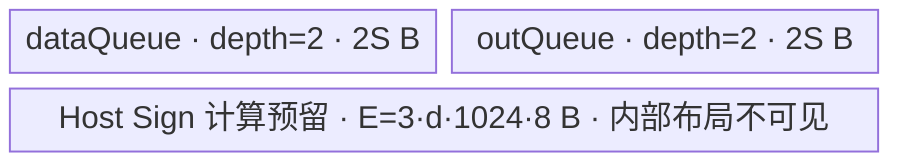

# ForeachSign A2/A3 ACLNN 算子知识

## 算子速览

| 项目 | 内容 |
|---|---|
| 实际入口 | `aclnnForeachSignGetWorkspaceSize` + `aclnnForeachSign`，公开 ACLNN 两段式接口，固定仓未发现更高版本入口。 |
| 计算语义 | 对 TensorList 中每个元素计算 `sign(x)`: 正数为 `1`、零为 `0`、负数为 `-1`；只写每个输入 Tensor 的元素范围。 |
| 输入输出 | `x`/`out` 均为 ND TensorList；FLOAT16、FLOAT32、BFLOAT16、INT8、INT32、INT64；输入可非连续并由 `AutoContiguous` 处理，公开接口不支持非连续输出。 |
| 执行类型 | 单 Kernel，唯一节点为 `AIV_VECTOR`；无 Cube/AIC、SIMT、NDDMA 或通信节点。 |
| Kernel 路线 | R-001 FP16/FP32 原生 `Sign`；R-002 INT32 原地限幅；R-003 BF16→FP32；R-004 INT8→FP16；R-005 INT64→FP32。 |
| 核心资源 | TensorList GM 描述、双缓冲 `VECIN`/`VECOUT` TQue；转换路线另有单缓冲临时 Queue；Host 返回 32 B workspace，但 Kernel 显式置 `userWS=nullptr`。 |
| 来源闭包 | source_closed：公开 API 文档/OpDef → arch22 Host/Tiling → `ForeachCommonTilingData` → dtype router → `ForeachSignND`/`InnerComputer` → A2/A3 构建接线闭合；自动生成 ACLNN bridge 是框架边界。 |
| 验证状态 | 已完成源码闭包检查；本次知识提取未执行编译、真机、数值或性能测试。 |

## 接口与语义

### 计算语义

令输入 TensorList 为 `x=[x_0,...,x_{n-1}]`，对每个 Tensor `x_i` 的每个有效元素 `j`：

```text
y_i[j] =  1, x_i[j] > 0
          0, x_i[j] = 0
         -1, x_i[j] < 0
```

Host 按所有 Tensor 元素组成的逻辑串联域分核，但 Device 仍通过 TensorList 描述逐 Tensor 取真实 GM 地址。输出 Tensor 可以比对应输入拥有更多元素；Kernel 只覆盖输入元素数，额外输出区域不写。浮点 NaN 不属于公开分段公式的三个条件；A2/A3 `Sign` primitive 对 NaN 的确切结果属于固定仓外 primitive 边界。

### 输入、输出与属性

| 参数 | shape/layout | dtype | 约束、默认值与语义 |
|---|---|---|---|
| `x` | TensorList；每个 Tensor 为 ND，公开接口 rank 0–8 | FLOAT16/FLOAT32/BFLOAT16/INT8/INT32/INT64，列表内一致 | 支持空 Tensor；允许非连续输入，OpDef 对输入启用 `AutoContiguous()`。A2/A3 Tiling POD 最多容纳 50 个 Tensor。 |
| `out` | TensorList；ND；对应项 storage 元素数不小于输入 | 与 `x` 相同且列表内一致 | 支持空 Tensor；公开接口不支持非连续输出。Kernel 只写对应输入的元素数。 |
| `workspaceSize` | 标量输出 | `uint64_t*` | 第一段返回；A2/A3 Tiling 固定写 `32` B。 |
| `executor` | Host 执行器输出 | `aclOpExecutor**` | 第一段生成，封装后续单 Kernel 执行流程；生成实现固定仓不可见。 |
| `workspace` | Device 地址 | N/A | 第二段传入；Kernel 参数保留但 A2/A3 body 不使用。 |
| `stream` | Runtime stream | `aclrtStream` | 第二段提交 Kernel；完成前输入、输出、workspace 与 executor 关联资源须保持有效。 |

### 入口与版本

公开文档只声明无版本后缀的 `aclnnForeachSignGetWorkspaceSize`/`aclnnForeachSign`，固定仓没有 `V2` 或其它更高公开版本。第一段校验空指针、dtype、列表内 dtype、rank 和输入/输出 shape 约束并返回 workspace/executor；第二段在指定 stream 上执行。固定仓没有自动生成的 `aclnn_foreach_sign.h` 及 inner bridge 定义，故其逐行检查顺序是框架边界；算子自有 `ForeachSign` OpDef 明确输入输出动态列表、六种 dtype、ND、`AutoContiguous`，并注册 `ascend910b`（A2）与 `ascend910_93`（A3）。公开 README/API 产品表同时明确支持 A2/A3，无发布冲突。

## Host/Launcher 执行流程

### 参数校验与前处理

1. ACLNN 第一段接收 `x/out`，公开错误表要求二者非空、dtype 属于六种支持类型且对应一致，列表内部 dtype 一致，rank 不超过 8，输出 storage 元素数不小于输入。
2. OpDef 为输入和输出声明动态 ND TensorList 并启用 `AutoContiguous()`；公开接口明确输入支持非连续、输出不支持非连续。具体 generated bridge 的 Contiguous/ViewCopy 调用序列固定仓不可见。
3. 公共 infer-shape 要求动态输入实例数等于输出数，逐项复制 shape；infer-dtype 逐项复制 dtype。ACLNN 显式 `out` 的生成桥如何调用这些函数固定仓不可见。
4. `Tiling4ForeachSignTiling` 以 `FOREACH_SIGN_OP_CODE=33` 初始化 `ForeachCommonTiling`，再运行 `RunBigKernelTiling()`；任一 Init/校验或 workspace 指针获取失败返回 `GRAPH_FAILED`。
5. `Init` 最多读取 50 个动态输入，积累各 Tensor storage 元素数和总元素数，并要求列表内 dtype 一致；`CheckOpInfo` 再检查 rank、输出 dtype/shape 及列表一致性。

### 参数、Workspace 与生命周期

记平台 AIV 核数为 `C`、UB 字节数为 `U`、dtype 字节数为 `d`、32 B 中元素数 `e=32/d`、总输入元素数 `N=sum_i n_i`。Tiling 生成 `blockDim=min(max(1,ceil(N/e)),C,50)`，把 `ceil(N/e)` 个逻辑 32 B block 近均分给各核，前 `remainder` 个核多一个 block。每核通过 `(tensorStart,tensorStartOffset,tensorEnd,tensorEndOffset)` 描述跨 Tensor 的连续逻辑区间。

Host 固定返回 `workspace[0]=32` B；Kernel entry 注释指出 foreach vector 不需要 workspace，并把传入指针替换为 `nullptr`，因此该 32 B 不构成节点间数据边。workspace 由调用者根据第一段结果分配，生命周期至少覆盖第二段异步提交及 stream 完成；executor 由第一段产生，精确 owner/销毁协议属于 ACLNN 框架边界。

### 启动图与失败传播

```text
aclnnForeachSignGetWorkspaceSize(x, out)
  -> generated ACLNN/OpDef framework boundary
  -> Tiling4ForeachSignTiling
     -> ForeachCommonTiling::Init(33)
     -> ForeachCommonTiling::RunBigKernelTiling
  -> workspaceSize=32 B, executor

aclnnForeachSign(workspace, 32, executor, stream)
  -> node K0: foreach_sign<<<blockDim>>>(xDesc, yDesc, workspace, tiling)
     -> exactly one AIV_VECTOR dtype route
```

| 节点/边 | producer / consumer | 介质与范围 | ordering | owner/lifetime | 失败传播 |
|---|---|---|---|---|---|
| K0 | ACLNN executor / `foreach_sign` | `x`、`y` TensorList 描述；`ForeachCommonTilingData`；`blockDim` | 同一 `stream` 单节点提交 | 调用者持有 Tensor/GM；tiling 由 runtime 管理至 launch | 第一段 Tiling 失败则不生成可执行流程；第二段 launch 错误返回 ACLNN 状态。 |
| workspace 参数 | 第一段 / K0 | 32 B caller allocation；K0 不读写 | 无跨节点依赖 | caller 持有至 stream 完成 | 分配失败由 caller 处理；不是算法中间结果。 |
| K0 输出 | K0 / caller | 每个 `y_i[0:n_i)`，dtype/ND | caller 在同 stream 后续操作或显式同步后可见 | caller 持有 | K0 失败时无后续算子自有节点。 |

## Route 与参数设计

### 分核与资源计算

分核公式：

```text
n_i = storage_shape_size(x_i)                 # 元素
N = sum(n_i)                                  # 元素
e = 32 / sizeof(T)                            # 元素/32B block
B = ceil(N / e)                               # 逻辑 block 数
blockDim = min(max(1, B), platformAivCores, 50)
base = floor(B / blockDim) * e                # 元素/核
前 B % blockDim 个核处理 base+e，其余处理 base
```

分配器允许核区间跨越 Tensor 边界，并以 POD 起止 Tensor 索引与元素 offset 精确恢复。记 `P=tilingData.GetDataSize()`（宏展开后的精确数值固定仓不可见），`align_a(v)=floor(v/a)*a`，每个 Queue 的 `InitBuffer` 第三个参数是每个 depth 槽容量：

```text
FP16/FP32: E = 3 * d * 1024 * 8; S = align_32(((U-P)-E)/4)
INT32:     S = align_32((U-P)/4)
BF16:      S = align_64(((U-P)/10)/4)
INT8/I64:  S = align_32(((U-P)/10)/4)
```

R-001/R-002 每个数据块最多 `S/d` 元素；R-003/R-004/R-005 将 data/out 单槽扩大为 `4S`，每块最多 `4S/d` 元素。Host 对浮点原生 `Sign` 另预留 `E`，对转换路线以 `/10` 保守缩小可分配基数。

### Route 选择

| 顺序 | Route | Key/模板 | 精确选择条件与优先级 | 不适用去向 |
|---:|---|---|---|---|
| 1 | R-001 FP16/FP32 原生 Sign | key 1 → `ForeachSignND<half>`；key 2 → `ForeachSignND<float>` | `dataType==DT_FLOAT16` 或 `DT_FLOAT`，由 `GetTilingKeyByDtypeOnly` 产生 | 继续匹配 key 3/4/7/10；未知 key 无 body。 |
| 2 | R-002 INT32 原地限幅 | key 3 → `ForeachSignND<int32_t>` | `dataType==DT_INT32` | 继续匹配 key 4/7/10。 |
| 3 | R-003 BF16→FP32 | key 4 → `ForeachSignND<bfloat16_t>` | `dataType==DT_BF16`，且非 Kirin 编译 guard；A2/A3 可达 | 继续匹配 key 7/10；Kirin build 不实例化。 |
| 4 | R-004 INT8→FP16 | key 7 → `ForeachSignND<int8_t>` | `dataType==DT_INT8` | 继续匹配 key 10。 |
| 5 | R-005 INT64→FP32 | key 10 → `ForeachSignND<int64_t>` | `dataType==DT_INT64` | 未知 key：entry 不执行任何 body。 |

```text
dtype FLOAT16 -> key 1 -> R-001<half>
else FLOAT32  -> key 2 -> R-001<float>
else INT32    -> key 3 -> R-002
else BF16     -> key 4 -> R-003
else INT8     -> key 7 -> R-004
else INT64    -> key 10 -> R-005
else          -> key 0 / OpDef-Tiling 校验失败；若绕过 Host，router 无输出
```

### 模板/实现执行矩阵

| Route | key/selector | dtype/shape/platform 完整命中条件 | 执行拓扑与 Kernel 节点 | 实际模板/body | 内存与同步特征 | tail/fallback |
|---|---|---|---|---|---|---|
| R-001 FP16/FP32 原生 Sign | 1/2 | 六 dtype 公共校验通过；A2/A3；dtype FP16/FP32 | 单 K0 AIV_VECTOR | `ForeachSignND<T>` + generic `InnerComputer<T>::Compute` | depth-2 input/output Queue；`Sign<T,false>`；Host 另扣 Sign 计算预留 `E`，其内部消费固定仓不可见 | 完整块 `DataCopy`；尾块按精确字节 `DataCopyPad`。 |
| R-002 INT32 原地限幅 | 3 | 同上，dtype INT32 | 单 K0 AIV_VECTOR | `InnerComputer<int32_t>` | input local 先原地 `Maxs(-1)`，再 `Mins(1)` 写 output local；V pipe barrier | 同上。 |
| R-003 BF16→FP32 | 4 | 同上，dtype BF16 | 单 K0 AIV_VECTOR | `InnerComputer<bfloat16_t>` | data/out 单槽 `4S`，各 depth 2；8S 临时 FP32 Queue，分片 Cast→Sign→Cast | cast 子块尾由 `dataCount % maxCastDataCount`；DMA 尾同上。 |
| R-004 INT8→FP16 | 7 | 同上，dtype INT8 | 单 K0 AIV_VECTOR | `InnerComputer<int8_t>` | 与 R-003 同布局，临时 Queue 解释为 FP16 | 同上。 |
| R-005 INT64→FP32 | 10 | 同上，dtype INT64 | 单 K0 AIV_VECTOR | `InnerComputer<int64_t>` | 与 R-003 同布局，INT64 以 `CAST_RINT` 转 FP32 | 同上。 |

### 隐藏性能 Guard

| Guard | Host/Tiling 条件 | Device/资源原因 | 影响 Route | 不满足时去向 | 源码符号 |
|---|---|---|---|---|---|
| TensorList 容量 | `Init` 循环 `i<MAX_TENSOR_CONT(50)` | POD 各 Tensor 数组只有 50 项 | 全部 | 公开文档未声明该上限；超过 50 项不会进入当前 POD，不能复用此实现假设 | `ForeachCommonTiling::Init` |
| AIV 核数/POD 容量 | `blockDim<=min(platform cores,50)` | 每核起止数组只有 50 项 | 全部 | 截到 50 核 | `RunBigKernelTiling` |
| 32 B 分核 | `B=ceil(N/(32/d))` | 普通完整 DMA 要求整块元素数 | 全部 | 尾元素仍由最后核和 `DataCopyPad` 处理 | `GetNeedCoreNum`、`AssignDataToEachCore` |
| UB 可分配 | `U>P+E`（R-001）或 `U>P`；计算后 `S>0` 是 Device 可工作的隐含条件 | `maxDataCount` 被用作除数，若 `S==0` 会失效 | 全部 | 固定 Host 未显式报错；依赖支持平台 UB 资源保证 | `DivideUbMemory10`、`SingleTensorProcess` |
| BF16 64 B 对齐 | `S=floor_64(...)` | BF16 临时转换路线采用 `BYTE_BLOCK_FOR_BF16=64` | R-003 | 缩小 S；无其它 Route | `DivideUbMemory10` |
| BF16 编译 guard | 排除 `__NPU_ARCH__==3003/3113` | 这两个 Kirin 架构不支持 BF16 | R-003 | 对 A2/A3 不触发；Kirin 无 BF16 body | `foreach_sign` router |
| 空 Tensor tail | `dataCount==0` 时 chunk 循环为 0 | 不发 DMA/Vector，但仍会解析对应 TensorList 地址 | 全部 | 跳过该 Tensor 的数据处理 | `Process`、`SingleTensorProcess` |

### POD/ABI

`ForeachCommonTilingData` 由仓外 `TILING_DATA_FIELD_DEF*` 宏生成；字段顺序、源码类型、数组长度和 producer/consumer 已闭合，但宏展开后的 `sizeof/alignof/offsetof` 在固定仓不可见。下表以“序列槽”保留严格顺序，不虚构 padding。

| 结构 | 字段 | 类型/位宽 | ABI 布局 | 单位 | Host/launcher producer | Device consumer | 边界 |
|---|---|---|---|---|---|---|---|
| `ForeachCommonTilingData` | `inputsTensorUbSize` | `uint64_t`/64 | 序列槽 0；精确 offset/总 sizeof 固定仓不可见 | 字节/Queue 单槽基数 S | `FillTilingData: set_inputsTensorUbSize(inputsTensorUbSize)` | `ParseTilingData`；决定 Queue 容量、`maxDataCount/maxCastDataCount` | 必须大于 0；dtype 路线决定 32/64 B 对齐。 |
| 同上 | `tensorDataCountList` | `int64_t[50]`/每项 64 | 序列槽 1 | 元素/Tensor | `Init: shape.GetShapeSize()`；`FillTilingData` | `Process` 计算每 Tensor 起止与 `dataCount` | 未使用尾项初始为 0。 |
| 同上 | `tensorStartList` | `uint16_t[50]`/每项 16 | 序列槽 2 | Tensor 索引/核 | `AssignDataToEachCore` | `ParseTilingData[blockIdx]` | `blockDim<=50`。 |
| 同上 | `tensorEndList` | `uint16_t[50]`/每项 16 | 序列槽 3 | Tensor 索引/核 | `AssignDataToEachCore` | `ParseTilingData[blockIdx]` | 含端点。 |
| 同上 | `tensorStartOffsetList` | `int64_t[50]`/每项 64 | 序列槽 4 | 元素/Tensor | `AssignDataToEachCore` | `Process` 设置首 Tensor `cursorStart` | 含端点起始 offset。 |
| 同上 | `tensorEndOffsetList` | `int64_t[50]`/每项 64 | 序列槽 5 | 元素/Tensor | `AssignDataToEachCore` | `Process` 设置末 Tensor `cursorEnd` | 含端点结束 offset。 |

### Route 源码闭包

| Route | Key/selector | Host/Tiling producer | POD/参数 | Kernel entry/router 节点 | Kernel body/直接依赖 | 构建接线 |
|---|---|---|---|---|---|---|
| R-001 FP16/FP32 | 1/2 | `foreach_sign_tiling_arch22.cpp::Tiling4ForeachSignTiling`; `ForeachCommonTiling` | `ForeachCommonTilingData` | `op_kernel/foreach_sign.cpp::foreach_sign` | `foreach_sign.h::ForeachSignND<T>`、generic `InnerComputer<T>` | op_host CMake maps A2/A3 to arch22；op_kernel CMake builds default source |
| R-002 INT32 | 3 | 同上 | 同上 | 同上 | `InnerComputer<int32_t>` | 同上 |
| R-003 BF16 | 4 | 同上 | 同上 | 同上 | `InnerComputer<bfloat16_t>` | 同上 |
| R-004 INT8 | 7 | 同上 | 同上 | 同上 | `InnerComputer<int8_t>` | 同上 |
| R-005 INT64 | 10 | 同上 | 同上 | 同上 | `InnerComputer<int64_t>` | 同上 |

## Kernel 实现

### 公共执行流程

单节点 K0 从 TensorList GM 描述读取各真实数据指针。`blockIdx` 选择 POD 中自己的跨 Tensor 区间；对区间内每个 Tensor 计算首尾 offset，再把区间分成 `maxDataCount` 完整块和一个尾块。完整块用 `DataCopy`，尾块用 `DataCopyPad` 的单 block、精确 `dataCount*sizeof(T)` 字节；Queue 的 EnQue/DeQue 建立 MTE2→V→MTE3 顺序。所有路线都只写输入有效元素，不使用 workspace。

### Route R-001：FP16/FP32 原生 Sign

#### 适用条件

##### 选择证据

| 层级 | 文件 | 符号 | 源码谓词/参数 | 结果/下一跳 |
|---|---|---|---|---|
| Host | `foreach_utils/op_host/common_dtype.h` | `GetTilingKeyByDtypeOnly` | `DT_FLOAT16→1; DT_FLOAT→2` | key 1/2 |
| Tiling | `foreach_utils/op_host/foreach_tiling_class.h` | `DivideUbMemory10` | dtype FLOAT/FLOAT16 时扣除 `3*d*1024*8`，再 `/4`、32 B 下对齐 | S |
| Router | `foreach_sign/op_kernel/foreach_sign.cpp` | `foreach_sign` | `TILING_KEY_IS(1/2)` | `ForeachSignND<half/float>` |

#### Device 数据流

##### 函数级调用链

```text
foreach_sign(x,y,workspace,tiling)
  -> ForeachSignND<T>::Init
     -> ParseTilingData
     -> InitBuffer(dataQueue,2,S); InitBuffer(outQueue,2,S)
  -> ForeachSignND<T>::Process
     -> per covered tensor: SingleTensorProcess
        -> CopyIn -> InnerComputer<T>::Compute -> ComputeAndCopyOut
```

##### 源码等价伪码

```text
# 伪码
range = POD[blockIdx]
for tensor i in [tensorStart, tensorEnd]:
  begin = (i==tensorStart ? tensorStartOffset : 0)
  end   = (i==tensorEnd ? tensorEndOffset : n_i-1)
  bind input/output GM at tensor_ptr(i)+begin
  for chunk in floor((end-begin+1)/(S/sizeof(T))):
    DataCopy GM->VECIN; Sign<T,false>(VECOUT,VECIN,count); DataCopy VECOUT->GM
  if tail>0:
    DataCopyPad exact tail bytes -> Sign exact count -> DataCopyPad exact tail bytes
```

#### 内存与数据搬运

##### 资源与搬运表

| 层级/缓冲区 | offset/地址公式 | extent/容量公式 | dtype/layout | producer | consumer | owner/lifetime | 对齐/复用 |
|---|---|---|---|---|---|---|---|
| input GM | `tensor_ptr(i)+begin+chunk*(S/d)` | `count` 元素 | T/ND | caller | CopyIn | caller；stream 完成前有效 | TensorList 间不连续。 |
| `dataQueue` | Queue slot | depth 2 × S B | T | MTE2 CopyIn | Vector Sign | K0/每块 Alloc→Free | 32 B S；槽循环复用。 |
| `outQueue` | Queue slot | depth 2 × S B | T | Vector Sign | MTE3 CopyOut | K0/每块 Alloc→Free | 32 B S。 |
| output GM | `tensor_ptr(i)+begin+chunk*(S/d)` | `count` 元素 | T/ND | CopyOut | caller | caller | 尾按精确字节写。 |

##### 分层内存布局



##### 字节账与复用顺序

```text
explicit_UB = 2S + 2S = 4S
host_sign_reserve = E（固定仓未展示其内部 buffer）
P + 4S + E <= U
dynamic_ub = N/A
workspace_total = 32 B（Kernel 不消费）
=> maxDataCount=S/sizeof(T)
```

| 复用子区 | 写入者 | 读取者/消费点 | 下一次覆盖 | 同步或释放依据 | 安全条件 |
|---|---|---|---|---|---|
| `dataQueue` slot | `CopyIn` | `InnerComputer<T>::Compute` | 下一 chunk Alloc | EnQue→DeQue→FreeTensor | Compute 完成后才 Free。 |
| `outQueue` slot | `Sign` | `CopyOut` | 下一 chunk Alloc | EnQue→DeQue→FreeTensor | MTE3 消费后才 Free。 |

#### 同步、精度与尾块

##### 同步与数值边界表

| 阶段 | primitive/机制 | producer | consumer/等待点 | 保护对象 | 精度/尾块 |
|---|---|---|---|---|---|
| CopyIn→Compute | TQue EnQue/DeQue | MTE2 | Vector | data slot | 完整块 S/d；尾块精确 `dataCount`。 |
| Compute | `Sign<T,false>` | input local | output local | Vector pipeline | 原 dtype，无显式 cast；primitive 内部细节固定仓不可见。 |
| Compute→CopyOut | TQue EnQue/DeQue | Vector | MTE3 | output slot | 只提交有效元素。 |

#### 关键实现

##### 符号证据表

| 阶段 | 文件 | 符号/模板实例 | 实现事实 |
|---|---|---|---|
| Host/Tiling producer | `foreach_utils/op_host/foreach_tiling_class.h` | `RunBigKernelTiling/DivideUbMemory10` | key、分核、S 与 workspace 生产 |
| Kernel entry/router | `foreach_sign/op_kernel/foreach_sign.cpp` | `foreach_sign` key 1/2 | dtype 到模板映射 |
| Device body/helper | `foreach_sign/op_kernel/foreach_sign.h` | `ForeachSignND<T>`、`InnerComputer<T>` | Queue、chunk、Sign、tail DMA |

### Route R-002：INT32 原地限幅

#### 适用条件

##### 选择证据

| 层级 | 文件 | 符号 | 源码谓词/参数 | 结果/下一跳 |
|---|---|---|---|---|
| Host | `common_dtype.h` | `GetTilingKeyByDtypeOnly` | `DT_INT32` | key 3 |
| Tiling | `foreach_tiling_class.h` | `DivideUbMemory10` | 非 FP/BF16/INT8/INT64；`S=align32((U-P)/4)` | R-002 |
| Router | `foreach_sign.cpp` | `foreach_sign` | `TILING_KEY_IS(3)` | `ForeachSignND<int32_t>` |

#### Device 数据流

##### 函数级调用链

```text
foreach_sign -> ForeachSignND<int32_t>::Process
  -> CopyIn
  -> InnerComputer<int32_t>::Compute
     -> Maxs(dataLocal,dataLocal,-1,count)
     -> Mins(outLocal,dataLocal,1,count)
  -> CopyOut
```

##### 源码等价伪码

```text
# 伪码；分核、地址与 chunk 同 R-001
local = input_chunk
barrier V; local = max(local, -1)
barrier V; out = min(local, 1)
barrier V; write only count valid elements
```

#### 内存与数据搬运

##### 资源与搬运表

| 层级/缓冲区 | offset/地址公式 | extent/容量公式 | dtype/layout | producer | consumer | owner/lifetime | 对齐/复用 |
|---|---|---|---|---|---|---|---|
| input/output GM | 同 R-001 | `count` | int32/ND | caller/K0 | K0/caller | caller | 尾精确字节。 |
| `dataQueue` | slot | depth 2 × S | int32 | CopyIn | Maxs→Mins | K0 | Maxs 原地覆盖。 |
| `outQueue` | slot | depth 2 × S | int32 | Mins | CopyOut | K0 | 每块复用。 |

##### 分层内存布局


##### 字节账与复用顺序

```text
UB_total = 2S + 2S = 4S
P + 4S <= U
dynamic_ub = N/A
workspace_total = 32 B（未消费）
```

| 复用子区 | 写入者 | 读取者/消费点 | 下一次覆盖 | 同步或释放依据 | 安全条件 |
|---|---|---|---|---|---|
| `dataLocal` | CopyIn；随后 `Maxs` 原地改写 | `Mins` | Free 后下块 CopyIn | 两次 `PipeBarrier<PIPE_V>` + FreeTensor | `Mins` 必须在覆盖/Free 前完成。 |

#### 同步、精度与尾块

##### 同步与数值边界表

| 阶段 | primitive/机制 | producer | consumer/等待点 | 保护对象 | 精度/尾块 |
|---|---|---|---|---|---|
| clamp lower | `PipeBarrier<PIPE_V>` + `Maxs(-1)` | CopyIn | `Mins` | dataLocal | int32 原精度。 |
| clamp upper | `PipeBarrier<PIPE_V>` + `Mins(1)` | Maxs | CopyOut | outLocal | 数学上把整数压到 {-1,0,1}。 |
| tail | `DataCopyPad` | GM/local | local/GM | 有效字节 | 不写 padding lane。 |

#### 关键实现

##### 符号证据表

| 阶段 | 文件 | 符号/模板实例 | 实现事实 |
|---|---|---|---|
| Host/Tiling producer | `foreach_tiling_class.h` | `DivideUbMemory10` | INT32 S 公式 |
| Kernel entry/router | `foreach_sign.cpp` | key 3 | INT32 实例 |
| Device body/helper | `foreach_sign.h` | `InnerComputer<int32_t>::Compute` | 原地 Maxs 与 Mins 管线 |

### Route R-003：BF16→FP32

#### 适用条件

##### 选择证据

| 层级 | 文件 | 符号 | 源码谓词/参数 | 结果/下一跳 |
|---|---|---|---|---|
| Host | `common_dtype.h` | `GetTilingKeyByDtypeOnly` | `DT_BF16` | key 4 |
| Tiling | `foreach_tiling_class.h` | `DivideUbMemory10` | `/10`、`/4`、64 B 下对齐 | S |
| Router | `foreach_sign.cpp` | key 4 guard | A2/A3 非 Kirin guard | `ForeachSignND<bfloat16_t>` |

#### Device 数据流

##### 函数级调用链

```text
foreach_sign -> ForeachSignND<bfloat16_t>::Init/Process
  -> CopyIn BF16
  -> InnerComputer<bfloat16_t>::Compute
     -> per maxCastDataCount: Cast BF16->FP32
     -> Sign<float,false>
     -> Cast FP32->BF16(CAST_RINT)
  -> CopyOut BF16
```

##### 源码等价伪码

```text
# 伪码；M=4S/2, C=S
for each DMA chunk of at most M BF16 elements:
  for subchunk of at most C elements:
    tmp[0:C] = Cast<float>(input, CAST_NONE)
    tmp[C:2C] = Sign<float>(tmp[0:C])
    out = Cast<bf16>(tmp[C:2C], CAST_RINT)
  copy exact valid BF16 results to GM
```

#### 内存与数据搬运

##### 资源与搬运表

| 层级/缓冲区 | offset/地址公式 | extent/容量公式 | dtype/layout | producer | consumer | owner/lifetime | 对齐/复用 |
|---|---|---|---|---|---|---|---|
| `dataQueue` | slot | depth 2 × 4S | BF16 | CopyIn | Cast | K0 | S 64 B 对齐。 |
| `outQueue` | slot | depth 2 × 4S | BF16 | downcast | CopyOut | K0 | 同上。 |
| `float32Queue` | `[0,C)` / `[C,2C)` | 8S B，depth 1 | FP32 | upcast/Sign | Sign/downcast | Init 后跨所有 chunk 持有，Process 末 Free | 两半 ping-pong 语义，不跨 chunk 保留值。 |

##### 分层内存布局


##### 字节账与复用顺序

```text
UB_allocated = 8S + 8S + 8S = 24S
S = align64(floor(floor((U-P)/10)/4))
24S <= 0.6*(U-P)（忽略下对齐后更小）
dynamic_ub = N/A
workspace_total = 32 B（未消费）
```

| 复用子区 | 写入者 | 读取者/消费点 | 下一次覆盖 | 同步或释放依据 | 安全条件 |
|---|---|---|---|---|---|
| FP32 前半 | upcast | Sign | 下一 cast 子块 | `PipeBarrier<PIPE_V>` | Sign 读完才覆盖。 |
| FP32 后半 | Sign | downcast | 下一 Sign 子块 | `PipeBarrier<PIPE_V>` | downcast 读完才覆盖。 |

#### 同步、精度与尾块

##### 同步与数值边界表

| 阶段 | primitive/机制 | producer | consumer/等待点 | 保护对象 | 精度/尾块 |
|---|---|---|---|---|---|
| BF16→FP32 | Cast `CAST_NONE` + V barrier | BF16 local | FP32 Sign | tmp 前半 | 升精度后取符号。 |
| Sign→BF16 | Sign + Cast `CAST_RINT`，各自 V barrier | tmp 前/后半 | output local | tmp 两半 | 结果只有 -1/0/1，可精确表示。 |
| subchunk tail | modulo `maxCastDataCount` | loop | final cast | valid lanes | API count 精确限制。 |

#### 关键实现

##### 符号证据表

| 阶段 | 文件 | 符号/模板实例 | 实现事实 |
|---|---|---|---|
| Host/Tiling producer | `foreach_tiling_class.h` | `DivideUbMemory10` | BF16 `/10` 与 64 B 对齐 |
| Kernel entry/router | `foreach_sign.cpp` | key 4 | BF16 实例与架构 guard |
| Device body/helper | `foreach_sign.h` | `InnerComputer<bfloat16_t>` | FP32 两半临时区、cast/Sign 顺序 |

### Route R-004：INT8→FP16

#### 适用条件

##### 选择证据

| 层级 | 文件 | 符号 | 源码谓词/参数 | 结果/下一跳 |
|---|---|---|---|---|
| Host | `common_dtype.h` | `GetTilingKeyByDtypeOnly` | `DT_INT8` | key 7 |
| Tiling | `foreach_tiling_class.h` | `DivideUbMemory10` | `/10`、`/4`、32 B 下对齐 | S |
| Router | `foreach_sign.cpp` | key 7 | `TILING_KEY_IS(7)` | `ForeachSignND<int8_t>` |

#### Device 数据流

##### 函数级调用链

```text
foreach_sign -> ForeachSignND<int8_t>::Process
  -> CopyIn INT8
  -> InnerComputer<int8_t>::Compute
     -> Cast INT8->FP16 -> Sign<half,false> -> Cast FP16->INT8(CAST_RINT)
  -> CopyOut INT8
```

##### 源码等价伪码

```text
# 伪码；M=4S INT8 元素，C=2S 元素
for chunk<=M, for subchunk<=C:
  tmp_half[0:C] = Cast(input_int8, CAST_NONE)
  tmp_half[C:2C] = Sign(tmp_half[0:C])
  output_int8 = Cast(tmp_half[C:2C], CAST_RINT)
```

#### 内存与数据搬运

##### 资源与搬运表

| 层级/缓冲区 | offset/地址公式 | extent/容量公式 | dtype/layout | producer | consumer | owner/lifetime | 对齐/复用 |
|---|---|---|---|---|---|---|---|
| data/out Queue | slot | 各 depth 2 × 4S | INT8 | DMA/compute | compute/DMA | K0 | 总 16S。 |
| temp Queue | `[0,C)`/`[C,2C)` | 8S B | FP16 | cast/Sign | Sign/cast | K0 Process | 两半各 4S B。 |

##### 分层内存布局


##### 字节账与复用顺序

```text
UB_total = 8S + 8S + 8S = 24S
24S <= 0.6*(U-P)
dynamic_ub = N/A
workspace_total = 32 B（未消费）
```

| 复用子区 | 写入者 | 读取者/消费点 | 下一次覆盖 | 同步或释放依据 | 安全条件 |
|---|---|---|---|---|---|
| FP16 两半 | Cast/Sign | Sign/downcast | 下一子块 | 每阶段 `PipeBarrier<PIPE_V>` | consumer 完成后覆盖。 |

#### 同步、精度与尾块

##### 同步与数值边界表

| 阶段 | primitive/机制 | producer | consumer/等待点 | 保护对象 | 精度/尾块 |
|---|---|---|---|---|---|
| compute | 三段 Vector + V barrier | INT8 local | output local | temp 两半 | INT8 值先精确表示为 FP16，结果 -1/0/1 再 RINT。 |
| tail | cast modulo + DataCopyPad | loop | output | valid lanes | 同时闭合 cast tail 与 DMA tail。 |

#### 关键实现

##### 符号证据表

| 阶段 | 文件 | 符号/模板实例 | 实现事实 |
|---|---|---|---|
| Host/Tiling producer | `foreach_tiling_class.h` | `DivideUbMemory10` | INT8 S 公式 |
| Kernel entry/router | `foreach_sign.cpp` | key 7 | INT8 实例 |
| Device body/helper | `foreach_sign.h` | `InnerComputer<int8_t>` | FP16 转换与两半复用 |

### Route R-005：INT64→FP32

#### 适用条件

##### 选择证据

| 层级 | 文件 | 符号 | 源码谓词/参数 | 结果/下一跳 |
|---|---|---|---|---|
| Host | `common_dtype.h` | `GetTilingKeyByDtypeOnly` | `DT_INT64` | key 10 |
| Tiling | `foreach_tiling_class.h` | `DivideUbMemory10` | `/10`、`/4`、32 B 下对齐 | S |
| Router | `foreach_sign.cpp` | key 10 | `TILING_KEY_IS(10)` | `ForeachSignND<int64_t>` |

#### Device 数据流

##### 函数级调用链

```text
foreach_sign -> ForeachSignND<int64_t>::Process
  -> CopyIn INT64
  -> InnerComputer<int64_t>::Compute
     -> Cast INT64->FP32(CAST_RINT) -> Sign<float,false> -> Cast FP32->INT64(CAST_RINT)
  -> CopyOut INT64
```

##### 源码等价伪码

```text
# 伪码；M=4S/8=S/2 元素，C=S 元素，故正常 full DMA chunk 也只需一个 cast 子块
tmp_fp32[0:count] = Cast(input_int64, CAST_RINT)
tmp_fp32[C:C+count] = Sign(tmp_fp32[0:count])
output_int64 = Cast(tmp_fp32[C:C+count], CAST_RINT)
```

#### 内存与数据搬运

##### 资源与搬运表

| 层级/缓冲区 | offset/地址公式 | extent/容量公式 | dtype/layout | producer | consumer | owner/lifetime | 对齐/复用 |
|---|---|---|---|---|---|---|---|
| data/out Queue | slot | 各 depth 2 × 4S | INT64 | DMA/compute | compute/DMA | K0 | 总 16S。 |
| temp Queue | `[0,C)`/`[C,2C)` | 8S B | FP32 | cast/Sign | Sign/cast | K0 | C=S FP32 元素，两半各 4S B。 |

##### 分层内存布局


##### 字节账与复用顺序

```text
UB_total = 24S <= 0.6*(U-P)
dynamic_ub = N/A
workspace_total = 32 B（未消费）
```

| 复用子区 | 写入者 | 读取者/消费点 | 下一次覆盖 | 同步或释放依据 | 安全条件 |
|---|---|---|---|---|---|
| FP32 两半 | upcast/Sign | Sign/downcast | 下一 chunk | V barriers | 三阶段严格串行。 |

#### 同步、精度与尾块

##### 同步与数值边界表

| 阶段 | primitive/机制 | producer | consumer/等待点 | 保护对象 | 精度/尾块 |
|---|---|---|---|---|---|
| INT64→FP32 | Cast `CAST_RINT` | INT64 local | Sign | tmp 前半 | 转换不保留整数幅值精度，但 sign 只依赖零与正负；固定仓未提供极值专项证明。 |
| FP32→INT64 | Cast `CAST_RINT` | Sign | output | tmp 后半 | -1/0/1 精确可表示。 |
| tail | `dataCount` | DMA/cast | output | valid elements | 精确 count。 |

#### 关键实现

##### 符号证据表

| 阶段 | 文件 | 符号/模板实例 | 实现事实 |
|---|---|---|---|
| Host/Tiling producer | `foreach_tiling_class.h` | `DivideUbMemory10` | INT64 S 公式 |
| Kernel entry/router | `foreach_sign.cpp` | key 10 | INT64 实例 |
| Device body/helper | `foreach_sign.h` | `InnerComputer<int64_t>` | FP32 转换与 Sign |

## 算子特定优化

### Trick T-001：INT32 以两次限幅替代转换并原地复用输入 LocalTensor

#### 触发与源码依据

- 适用 Route：R-002
- 触发条件：Host 选择 `DT_INT32→key 3`，router 实例化 `ForeachSignND<int32_t>`。
- Golden 来源：[`foreach/foreach_sign/op_kernel/foreach_sign.h:95-99`](../../../../../../../cann-ops-raw/ascendc/ops-nn/955f8b33985b6d72989ebff341bb9c2c564a51bc/foreach/foreach_sign/op_kernel/foreach_sign.h#L95-L99)

**官方源码（固定 Commit 连续逐字摘录）**：

```cpp
PipeBarrier<PIPE_V>();
Maxs(dataLocal, dataLocal, -1, dataCount);
PipeBarrier<PIPE_V>();
Mins(outLocal, dataLocal, 1, dataCount);
PipeBarrier<PIPE_V>();
```

#### 机制与设计原因

整数符号等价于 `min(max(x,-1),1)`。第一条 Vector 指令把 input Queue 的 `dataLocal` 原地覆写，不新增中间 TBuf；第二条直接写 output Queue。`dataCount` 来自当前 chunk/尾块，三个 V barrier 保证同一 local 区的写后读顺序。与转换路线相比，该 Route 不分配 8S 临时 Queue，也不执行两次 Cast。

#### 迁移边界

- 适用：有序整数 dtype、目标语义严格为三值 sign 的逐元素算子。
- 前提：Vector `Maxs/Mins` 支持目标整数 dtype；input local 可在消费后原地改写；常量 `-1/1` 可精确表示。
- 失效：BF16/INT8/INT64 在本实现中必须分别使用 R-003/R-004/R-005；不能臆自复用 INT32 specialization。
- 未验证：本次知识提取未执行编译、真机、数值或性能测试。

#### 错误做法

固定仓未提供可验证反例。

### Trick T-002：转换临时 Queue 的前后半区复用

#### 触发与源码依据

- 适用 Route：R-003、R-004、R-005
- 触发条件：dtype 为 BF16、INT8 或 INT64，`maxCastDataCount` 从 `S*4/sizeof(intermediate)` 产生。
- Golden 来源：[`foreach/foreach_sign/op_kernel/foreach_sign.h:75-82`](../../../../../../../cann-ops-raw/ascendc/ops-nn/955f8b33985b6d72989ebff341bb9c2c564a51bc/foreach/foreach_sign/op_kernel/foreach_sign.h#L75-L82)

**官方源码（固定 Commit 连续逐字摘录）**：

```cpp
Cast(tensorInfo.float32Tensor, dataLocal[index * tensorInfo.maxCastDataCount], RoundMode::CAST_NONE, dataCount);
PipeBarrier<PIPE_V>();
Sign<float, false>(tensorInfo.float32Tensor[tensorInfo.maxCastDataCount], tensorInfo.float32Tensor, dataCount);
PipeBarrier<PIPE_V>();
```

#### 机制与设计原因

同一连续临时 Queue 被切成两个等容量子区：前半存升精度输入，后半直接接收 Sign 输出；downcast 消费后，下一子块复用两半。临时张量在 `Process` 开头 DeQue、跨所有 Tensor/chunk 持有，最后一次性 Free，避免逐 chunk 反复申请。关键 offset `maxCastDataCount` 由 Host 的 S 与中间 dtype 字节数共同决定。

#### 迁移边界

- 适用：升精度计算后立即降精度、且两个中间值生命周期只在单个子块内重叠的 Vector 管线。
- 前提：临时 Queue 至少容纳两半；每阶段有 V barrier；`dataCount<=maxCastDataCount`。
- 失效：阶段间需同时保留更多中间量或异步重叠时必须重新做生命周期/容量证明。
- 未验证：本次知识提取未执行编译、真机、数值或性能测试。

#### 错误做法

固定仓未提供可验证反例。

## 模板与实现对比

| 对比维度 | R-001 FP16/FP32 | R-002 INT32 | R-003 BF16 | R-004 INT8 | R-005 INT64 | 设计选择依据 |
|---|---|---|---|---|---|---|
| 命中条件/优先级 | key 1/2 | key 3 | key 4 | key 7 | key 10 | dtype 唯一决定，无 shape fallback。 |
| 模板与 dtype | generic `InnerComputer<T>` | INT32 specialization | BF16 specialization | INT8 specialization | INT64 specialization | 是否存在原生/合适 Vector Sign。 |
| 循环与分核 | 公共跨 Tensor 分核与 DMA chunk | 同左 | 另有 cast 子块 | 同左 | full DMA chunk 通常一个 cast 子块 | POD 公共。 |
| Queue/TBuf/寄存器/dynamic UB/通信 window | 两个 depth-2 Queue | 同左，input 原地 | 两 Queue + FP32 temp | 两 Queue + FP16 temp | 两 Queue + FP32 temp | 无 dynamic UB/通信。 |
| 内存总占用与复用 | 4S+E | 4S | 24S | 24S | 24S | Host 对转换路线保守 `/10`。 |
| 搬运/Vector/SIMT/NDDMA/通信 API | DataCopy(Pad)+Sign | +Maxs/Mins | +Cast/Sign/Cast | 同结构 FP16 | 同结构 FP32 | 全部 AIV_VECTOR。 |
| 同步、精度与 tail | Queue；原 dtype | V barrier；原 dtype | V barrier；FP32 | V barrier；FP16 | V barrier；FP32 | 尾部均精确 count。 |
| fallback/失败边界 | 未知 key 无输出 | 同左 | Kirin guard | 未知 key | 未知 key | A2/A3 六 dtype 都有可达 body。 |

## 平台差异

| 项目 | A2 | A3 | 950 |
|---|---|---|---|
| 支持状态 | 支持；公开表 + `ascend910b` | 支持；公开表 + `ascend910_93` | 支持，但由独立 `_950` 卡描述。 |
| Host/Launcher | 共用 arch22 `ForeachCommonTiling` | 共用 arch22 `ForeachCommonTiling` | arch35 独立 Tiling，TensorList 上限 256、workspace 16 MiB。 |
| Kernel/资源 | 共用 AIV Vector body，平台 UB/核数动态取值 | 共用 AIV Vector body，平台 UB/核数动态取值 | SIMT 512-thread VF，无 AIV Queue。 |

## 限制与失败边界

- 公开 API 支持 rank 0–8、六 dtype、空 Tensor；输出不支持非连续 Tensor，输出对应项元素数必须不小于输入。
- A2/A3 公共 POD 只含 50 个 Tensor 与 50 个 core 槽；公开文档未声明 TensorList 数量上限，超过 50 项的完整错误行为固定仓不可见，工程复用不得绕过这一实现上限。
- Tiling 未显式检查计算后的 S 是否为 0，支持平台需满足 UB 大于 POD/primitive 预留；否则 Device 的 chunk 除数不安全。
- 未知 TilingKey 的 router 没有显式 error/fallback，只是不进入任何 body；正常入口由 OpDef/Tiling 限定到六个可达 key。
- ACLNN 自动生成 bridge、executor 内部结构、精确 Contiguous/ViewCopy 序列、executor 销毁协议以及 AscendC `Sign` primitive 内部 scratch/NaN 细节固定仓不可见。
- 本次知识提取未执行编译、单元测试、真机、数值或性能测试。

## 源码索引

### 链路索引

| 链路阶段 | 文件 | 关键符号 | 支撑内容 |
|---|---|---|---|
| 入口声明/约束 | `foreach/foreach_sign/docs/aclnnForeachSign.md` | 两段式原型、参数/错误表 | 公开 API、平台、dtype/rank/连续性 |
| 入口实现 | `foreach/foreach_sign/op_host/foreach_sign_def.cpp` | `ops::ForeachSign`、`OP_ADD` | 动态 TensorList、AutoContiguous、平台注册 |
| Host/Tiling/Launcher | `foreach/foreach_sign/op_host/arch22/foreach_sign_tiling_arch22.cpp` | `Tiling4ForeachSignTiling` | ForeachSign 到公共 Tiling 接线 |
| Host/Tiling/Launcher | `foreach/foreach_utils/op_host/foreach_tiling_class.h` | `ForeachCommonTiling` | 校验、分核、UB、workspace、POD producer |
| Host/Tiling/Launcher | `foreach/foreach_utils/op_host/foreach_tiling_def.h` | `ForeachCommonTilingData` | POD 定义与注册 |
| Host/Tiling/Launcher | `foreach/foreach_utils/op_host/common_dtype.h` | `GetTilingKeyByDtypeOnly` | dtype→key |
| Host/Tiling/Launcher | `foreach/foreach_utils/op_host/foreach_infershape.cpp` | `InferShape4ForeachCommon` | 输出 shape/dtype 推导 |
| Kernel entry/body | `foreach/foreach_sign/op_kernel/foreach_sign.cpp` | `foreach_sign` | key router、workspace 不使用 |
| Kernel entry/body | `foreach/foreach_sign/op_kernel/foreach_sign.h` | `ForeachSignND`、`InnerComputer` | 完整 AIV body、内存、同步、tail |
| 构建接线 | `foreach/foreach_sign/op_host/CMakeLists.txt` | `SUPPORT_COMPUTE_UNIT/TILING_DIR` | A2/A3→arch22 |
| 构建接线 | `foreach/foreach_sign/op_kernel/CMakeLists.txt` | `add_kernel_sources` | A2/A3 构建默认 Kernel |

### 实现复用检查

| 检查项 | 可复用事实 | 不得改变的约束 | 源码符号 |
|---|---|---|---|
| ABI/POD | 公共 6 字段 POD 支持跨 Tensor 分核 | 字段顺序、50 槽、元素/字节单位、含端点 offset | `ForeachCommonTilingData`、`FillTilingData` |
| 调用顺序 | Init→Process→逐 Tensor chunk | Queue producer/consumer 与 router key 顺序 | `foreach_sign`、`ForeachSignND::Process` |
| workspace/内存 | 32 B workspace 不参与算法；S 控制 Queue | depth 必须乘入；转换路线 data/out 单槽是 4S，temp 是 8S | `RunBigKernelTiling`、`ForeachSignND::Init` |
| 同步 | TQue 阶段序；转换/INT32 使用 V barrier | 临时两半不得在 consumer 前覆盖 | `ComputeAndCopyOut`、各 specialization |
| 精度与尾块 | dtype 特化的 Cast/Sign/Clamp；尾 DMA 精确字节 | RoundMode、maxCastDataCount、tail count 不得改变 | `InnerComputer`、`CopyIn/ComputeAndCopyOut` |
| 失败边界 | Host 校验阻断非法 dtype/shape；unknown key 无 body | 不得把超过 50 Tensor 或 S=0 当成已支持 | `CheckOpInfo`、router |