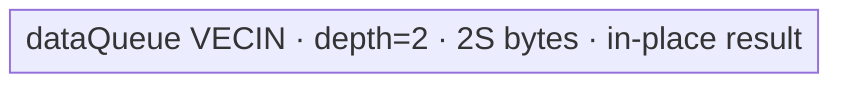
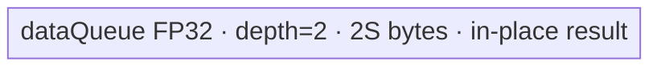

# ForeachSqrt A2/A3 ACLNN 算子知识

## 算子速览

| 项目 | 内容 |
|---|---|
| 实际入口 | `aclnnForeachSqrtGetWorkspaceSize` + `aclnnForeachSqrt`，无版本后缀的公开两段式 ACLNN。 |
| 计算语义 | 对 TensorList 中每个输入元素计算平方根：`y_i[j]=sqrt(x_i[j])`。 |
| 输入输出 | 动态 TensorList，FP16/FP32/BF16、ND；列表内 dtype 一致；输入由 `AutoContiguous` 连续化，公开输出不支持非连续 Tensor。 |
| 执行类型 | 单 AIV_VECTOR Kernel：`ForeachImplictOutput` → `KernelForeachUnary` → AscendC `Sqrt`；无 Cube/AIC/MIX_CV。 |
| Kernel 路线 | R-001 FP16 原类型 Sqrt；R-002 FP32 原类型 Sqrt；R-003 BF16 分块升到 FP32 后 Sqrt 再降回 BF16；key 1/2/4。 |
| 核心资源 | GM TensorList 地址表；一个 `VECIN` double-buffer Queue；BF16 另有单 buffer FP32 Queue；Tiling 预留 32-byte workspace，Kernel 不使用。 |
| 来源闭包 | `source_closed`：公开 ACLNN → `ForeachSqrt` OpDef/生成 bridge 边界 → membase selector/Tiling/POD → key router → Base/Unary/implicit-output body → A2/A3 构建与 binary config。 |
| 验证状态 | 已完成源码闭包检查；本次知识提取未执行编译、真机、数值或性能测试。 |

## 接口与语义

### 计算语义

令 `x=[x_0,...,x_(n-1)]`、`y=[y_0,...,y_(n-1)]`，对每个输入 storage element 执行 `y_i[j]=sqrt(x_i[j])`。FP16 和 FP32 直接以原 dtype 调用 `Sqrt(dataLocal,dataLocal,count)`；BF16 以 FP32 chunk 执行 `Cast(CAST_NONE) → Sqrt → Cast(CAST_RINT)`。Kernel 只写输入元素数对应的输出前缀；公开契约允许 A2/A3 的对应输出 storage numel 大于等于输入，额外区域不写。

### 输入、输出与属性

| 参数 | shape/layout | dtype | 约束、默认值与语义 |
|---|---|---|---|
| `x` | TensorList；每 Tensor 0～8 维，ND | FP16/FP32/BF16，列表内一致 | 非空指针；支持零元素 Tensor；OpDef 动态输入声明 `AutoContiguous()`；公开/IR 上限为 50 个 Tensor。 |
| `out` | TensorList；每 Tensor 0～8 维，ND | 与 `x` 相同，列表内一致 | 非空指针；A2/A3 每项 storage numel≥对应输入；公开接口不支持非连续输出，Kernel 仅写输入长度。 |
| `workspaceSize` | 标量 | `uint64_t*` | 第一段返回 executor 所需 Device workspace；算子 Tiling 固定写 32 bytes。 |
| `executor` | N/A | `aclOpExecutor**` | 第一段产生，第二段消费，封装框架前处理与单 Kernel launch。 |
| `workspace/stream` | Device 地址/stream | pointer | 第二段消费；Kernel 将算子 workspace 置 `nullptr`，按调用 stream 提交。 |

### 入口与版本

固定仓仅公开无后缀 `aclnnForeachSqrt`，没有更新的同语义版本。手写 ACLNN bridge/header 不在仓内；`op_host/CMakeLists.txt` 的 `ACLNNTYPE aclnn` 是生成边界。README 与 ACLNN 文档均公开支持 Atlas A2/A3；OpDef 注册 `ascend910b`、`ascend910_93`，Kernel CMake 对两者选用非 `arch35` entry，两个 binary JSON 均列出 FP16/FP32/BF16，平台证据无冲突。

## Host/Launcher 执行流程

### 参数校验与前处理

1. 第一段按公开契约检查 `x/out` 指针、FP16/FP32/BF16、输入输出 dtype 与列表内 dtype 一致性、每 Tensor 0～8 维以及对应输出容量。
2. OpDef 将动态 `x/y` 约束为 ND，并对输入输出配置 `AutoContiguous`；公开契约仍明确不接受非连续输出。
3. `Tiling4ForeachSqrtTiling` 进入按优先级递增遍历的 `TilingRegistry`。priority 10000 的 `ForeachSqrtMembaseTiling::IsCapable()` 在非 regbase SoC 返回 true；priority 30000 的 regbase 模板不会成为 A2/A3 Route。
4. membase 宏以 `ZERO_OP_CODE=1`、`TYPE_TENSORS` 调 `ForeachCommonTiling::Init` 与 `RunBigScalarKernelTiling`，生成 key、分核区间、UB tile、POD、blockDim 和 32-byte workspace。
5. 任何 descriptor/shape/output/workspace 指针检查失败返回 `GRAPH_FAILED` 并阻断 launch；框架生成 executor 的内部清理在固定仓不可见。

### 参数、Workspace 与生命周期

记 `N=sum_i numel(x_i)`、`E=32/sizeof(T)` 个元素/32-byte block、平台 AIV core 数为 `C`：

```text
needCoreNum = min(50, C, max(1, ceil(N/E)))
blockCount = ceil(N/E)
base = floor(blockCount/needCoreNum)*E
前 blockCount%needCoreNum 个 core 处理 base+E 元素，其余处理 base 元素
```

`AssignDataToEachCore` 将拼接的一维域还原成每 core 的 `tensorStart/end` 和首尾元素 offset；一个 Tensor 可跨 core，一个 core 也可连续处理多个 Tensor。POD 与 GM TensorList 地址表必须存活到 Kernel 完成。Tiling 声明 workspace slice `(offset=0, extent=32 bytes)`，但 entry 注释并显式将 `userWS=nullptr`，body 不读该 slice。

### 启动图与失败传播

```text
aclnnForeachSqrtGetWorkspaceSize
  -> framework-generated ForeachSqrt bridge / AutoContiguous boundary
    -> Tiling4ForeachSqrtTiling
      -> TilingRegistry -> ForeachSqrtMembaseTiling
        -> ForeachCommonTiling::Init/RunBigScalarKernelTiling
          -> one foreach_sqrt(xList,yList,workspace,tiling), blockDim=needCoreNum
            -> ForeachImplictOutput<T,P,Sqrt,2,1>::Init/Process
```

这是单节点 launch graph，没有 Kernel 间 workspace/GM edge。输入、输出为框架编码的 GM TensorList 地址表；Tiling/POD producer 失败即不启动。entry 对未知 key 没有 fallback/错误上报，只是不执行 body，因此 public/OpDef/Host dtype guard 不可省略。

## Route 与参数设计

### 分核与资源计算

记 `H=ForeachCommonTilingData::GetDataSize()`、平台 UB 字节数为 `U`、POD 字段 `S=inputsTensorUbSize`（bytes）。字段声明的 payload 合计 1408 bytes，但结构由外部 `tilingdata_base.h` 宏生成，固定仓无法确认最终 padding/`sizeof`，所以公式保留源码实际读取的 `H`：

```text
FP16/FP32: S = align_down(floor((U-H)/2), 32 bytes)
BF16:      S = align_down(floor(floor((U-H)/10)/2), 64 bytes)
```

FP16/FP32 只有 `dataQueue`，depth 2、每 slot `S` bytes，总显式 UB 为 `2S`。BF16 把外层 input slot 放大为 `9S`：`dataQueue=2×9S`，另分配 `float32Queue=1×S`，总显式 UB 为 `19S`；Host 的 `/10` 再 `/2` 给出 `S≤(U-H)/20`，留有至少 `S` 的保守余量。BF16 外 tile 最大 `9S/2` 个元素，内 cast chunk 最大 `S/4` 个元素。

### Route 选择

| 顺序 | Route | Key/模板 | 精确选择条件与优先级 | 不适用去向 |
|---:|---|---|---|---|
| 1 | R-001 FP16 direct | key 1；`ForeachImplictOutput<half,half,Sqrt,2,1>` | membase selector 命中且 `dataType==DT_FLOAT16` | FP32/BF16 key；非法 dtype 为 key 0 |
| 2 | R-002 FP32 direct | key 2；`ForeachImplictOutput<float,float,Sqrt,2,1>` | membase selector 命中且 `dataType==DT_FLOAT` | BF16 key；非法 dtype 为 key 0 |
| 3 | R-003 BF16 cast | key 4；`ForeachImplictOutput<bfloat16_t,float,Sqrt,2,1>` | membase selector命中、`dataType==DT_BF16`，且编译 guard `__CCE_AICORE__>=220`、非 NPU arch 3003/3113 | guard 不成立时 binary 不含该 branch；无 Device fallback |

```text
non-regbase SoC -> priority 10000 membase template
  FLOAT16  -> key 1 -> half Sqrt in place
  FLOAT32  -> key 2 -> float Sqrt in place
  BFLOAT16 -> key 4 -> chunked BF16->FP32->Sqrt->BF16
  otherwise -> key 0 -> no Device branch
```

### 模板/实现执行矩阵

| Route | key/selector | dtype/shape/platform 完整命中条件 | 执行拓扑与 Kernel 节点 | 实际模板/body | 内存与同步特征 | tail/fallback |
|---|---|---|---|---|---|---|
| R-001 FP16 | 1 | A2/A3、FP16、合法 TensorList | 单 AIV Kernel | implicit-output generic `InnerComputer<half,half>` → `Sqrt` | VECIN depth2；结果原地留在输入 LocalTensor；V→MTE3 与 MTE3→MTE2 events | tile 容量 `S/2` 元素；末 tile `DataCopyPad` |
| R-002 FP32 | 2 | A2/A3、FP32、合法 TensorList | 单 AIV Kernel | generic `InnerComputer<float,float>` → `Sqrt` | 同结构 | tile 容量 `S/4`；末 tile exact-byte DMA |
| R-003 BF16 | 4 | A2/A3、BF16、compile guard 可用 | 单 AIV Kernel | BF16 specialized `InnerComputer` | VECIN depth2×9S + FP32 Queue S；cast 阶段 `PIPE_V` barriers，输出仍原地 | 外 tile `9S/2` 元素；内 chunk `S/4`；两级 tail |

### 隐藏性能 Guard

| Guard | Host/Tiling 条件 | Device/资源原因 | 影响 Route | 不满足时去向 | 源码符号 |
|---|---|---|---|---|---|
| Tensor/POD 上限 | `Init` 最多扫描 50 项；IR 注释最大 50 | POD Tensor 数组固定 50 | 全部 | public 复用域必须≤50；固定 Host 对第 51 项无显式报错 | `ForeachCommonTiling::Init` |
| Core/POD 上限 | `needCoreNum=min(...,50)` | 每 core 起止数组 50 项 | 全部 | 截到 50 AIV core | `RunBigScalarKernelTiling` |
| DMA 对齐 | FP routes 的 S 向下对齐 32 bytes；BF16 向下对齐 64 bytes | full tile 使用 `DataCopy`；partial tile 使用 exact-byte `DataCopyPad` | 全部 | tail 留在同 Route | `DivideUbMemory1` / `KernelForeachUnary::CopyIn` |
| BF16 编译 guard | AICore≥220 且非 arch3003/3113 | BF16 cast/Sqrt 模板只在 guard 中实例化 | R-003 | 无 branch | `foreach_sqrt.cpp::foreach_sqrt` |
| BF16 cast 分块 | `maxCastDataCount=S/4` | FP32 scratch 只有 S bytes，外 BF16 slot 为 9S bytes | R-003 | 最后不足 chunk 单独执行 | `InnerComputer<bfloat16_t,float>::Compute` |
| 最小 UB | 源码隐含要求 `U>H` 且对齐后 `S>0` | `maxDataCount`/`maxCastDataCount` 后续作为除数 | 全部 | 固定 Host 没有资源 fallback/显式失败 | `DivideUbMemory1` / `SingleTensorProcess` |
| 空 segment | `dataCount=end-start+1` 可为 0 | `copyTimes==0` 时不搬运/计算 | 全部 | 安全跳过 tile loop | `SingleTensorProcess` |

### POD/ABI

| 结构 | 字段 | 类型/位宽 | ABI 布局 | 单位 | Host/launcher producer | Device consumer | 边界 |
|---|---|---|---|---|---|---|---|
| `ForeachCommonTilingData` | `inputsTensorUbSize` | uint64/64 | 第1字段；最终 `sizeof/alignof/offsetof` 固定仓不可见 | bytes/Queue slot 基准 | `DivideUbMemory1` | `KernelForeachBase::Init` 计算 tile/Queue 容量 | FP/BF16 资源公式不同 |
| 同上 | `tensorDataCountList` | int64[50] | 第2字段；400-byte payload；最终 offset 固定仓不可见 | elements/Tensor | `Init`: storage shape size | `Process` 的默认 `cursorEnd` | 仅实际 Tensor 项有效 |
| 同上 | `tensorStartList` | uint16[50] | 第3字段；100-byte payload；最终 offset 固定仓不可见 | Tensor index/core | `AssignDataToEachCore` | `ParseTilingData` | `blockIdx<blockDim≤50` |
| 同上 | `tensorEndList` | uint16[50] | 第4字段；100-byte payload；最终 offset 固定仓不可见 | Tensor index/core | 同上 | `ParseTilingData` | inclusive |
| 同上 | `tensorStartOffsetList` | int64[50] | 第5字段；400-byte payload；最终 offset 固定仓不可见 | elements | 同上 | 首 Tensor `cursorStart` | inclusive |
| 同上 | `tensorEndOffsetList` | int64[50] | 第6字段；400-byte payload；最终 offset 固定仓不可见 | elements | 同上 | 尾 Tensor `cursorEnd` | inclusive；空域可为 -1 |

### Route 源码闭包

| Route | Key/selector | Host/Tiling producer | POD/参数 | Kernel entry/router 节点 | Kernel body/直接依赖 | 构建接线 |
|---|---|---|---|---|---|---|
| R-001 | 1/non-regbase | `Tiling4ForeachSqrtTiling` + membase macro + `ForeachCommonTiling` | `ForeachCommonTilingData` | `foreach_sqrt` key 1 | Base→Unary→implicit-output half | CMake ascend910b/910_93 + 两份 binary JSON |
| R-002 | 2/non-regbase | 同上 | 同上 | key 2 | Base→Unary→implicit-output float | 同上 |
| R-003 | 4/non-regbase | 同上 | 同上 | key 4 under compile guard | BF16 specialized `InnerComputer` | 同上 |

## Kernel 实现

### 公共执行流程

entry 读取公共 POD、忽略 workspace，并按 key 构造 `ForeachImplictOutput`。Base 用 `GetBlockIdx()` 取得本 core 的 Tensor 起止与 offset；TensorList 地址表首 uint64 是到真实指针数组的 byte offset，Device 以 `offset>>3` 找第 `i` 个指针。Unary 逐相交 Tensor 绑定 GM segment，并循环执行 `CopyIn → implicit Compute/CopyOut`。该派生类以 `needCopyOut=false` 禁用基类 outQueue，Compute 在 input LocalTensor 上原地写回并直接搬到 GM。

### Route R-001：FP16 原类型 Sqrt

#### 适用条件

##### 选择证据

| 层级 | 文件 | 符号 | 源码谓词/参数 | 结果/下一跳 |
|---|---|---|---|---|
| Host selector | `foreach_utils/op_host/foreach_tiling_def.h` | `ForeachSqrtMembaseTiling::IsCapable` | `!IsRegbaseSocVersion(context_)` | A2/A3 进入 membase |
| Host key | `foreach_utils/op_host/common_dtype.h` | `GetTilingKeyByDtypeOnly` | `DT_FLOAT16` | key 1 |
| Router | `foreach_sqrt/op_kernel/foreach_sqrt.cpp` | `foreach_sqrt` | `TILING_KEY_IS(1)` | half template |
| Body | `foreach_utils/op_kernel/foreach_implict_output.h` | generic `InnerComputer<half,half>` | 非 BF16 specialization | `Sqrt(dataLocal,dataLocal,count)` |

#### Device 数据流

##### 函数级调用链

```text
foreach_sqrt key1
  -> ForeachImplictOutput<half,half,Sqrt,2,1>::Init
    -> KernelForeachUnary::Init -> KernelForeachBase::Init/ParseTilingData
  -> Process -> SingleTensorProcess
    -> CopyIn -> InnerComputer::Compute -> Sqrt<half> in place
    -> event V_MTE3 -> direct CopyOut -> event MTE3_MTE2 -> FreeTensor
```

##### 源码等价伪码

```text
core = GetBlockIdx()
for tensor i in [tensorStart,tensorEnd]:
  begin = i==start ? startOffset : 0
  end   = i==end ? endOffset : numel[i]-1
  bind xGM/yGM = addressTable[i] + begin
  for tile k over count=end-begin+1, capacity=S/2 elements:
    tail ? DataCopyPad(x->dataLocal, count*2 bytes) : DataCopy(count)
    EnQue; DeQue
    Sqrt(dataLocal, dataLocal, count)
    signal/wait V_MTE3
    tail ? DataCopyPad(dataLocal->y, count*2 bytes) : DataCopy(count)
    signal/wait MTE3_MTE2; FreeTensor
```

#### 内存与数据搬运

##### 资源与搬运表

| 层级/缓冲区 | offset/地址公式 | extent/容量公式 | dtype/layout | producer | consumer | owner/lifetime | 对齐/复用 |
|---|---|---|---|---|---|---|---|
| GM address table | `base+(*base>>3)+i` | ≤50 pointers | uint64 | framework bridge | `GetTensorAddr` | launch | byte offset 以 `>>3` 转 uint64 index |
| GM segment | `ptr[i]+begin+k*(S/2)` | `validCount` | FP16 ND | caller/CopyIn | CopyIn/caller | stream | tail exact bytes |
| `dataQueue` | UB allocator | depth 2 × S bytes | FP16 VECIN | CopyIn | Sqrt/CopyOut | core launch | 同一 LocalTensor 原地成为输出 |

##### 分层内存布局



##### 字节账与复用顺序

```text
S = align_down((U-H)/2,32)
UB_total = 2S <= U-H
dynamic_ub = N/A
workspace_total = 32 bytes reserved; body-used bytes = 0
```

| 复用子区 | 写入者 | 读取者/消费点 | 下一次覆盖 | 同步或释放依据 | 安全条件 |
|---|---|---|---|---|---|
| dataQueue slot | CopyIn | Sqrt 后 CopyOut | `FreeTensor` 后下一 tile | Queue + V_MTE3 + MTE3_MTE2 | GM store 完成后才能复用 |

#### 同步、精度与尾块

##### 同步与数值边界表

| 阶段 | primitive/机制 | producer | consumer/等待点 | 保护对象 | 精度/尾块 |
|---|---|---|---|---|---|
| GM→Vector | `EnQue/DeQue` | MTE2 CopyIn | Sqrt | dataQueue slot | partial tile 仅计算 `validCount` |
| Vector→GM | `SetFlag/WaitFlag<V_MTE3>` | Sqrt | CopyOut | 原地 LocalTensor | FP16 原类型 Sqrt |
| slot reuse | `SetFlag/WaitFlag<MTE3_MTE2>` + `FreeTensor` | CopyOut | 下一 CopyIn | 同一 UB slot | tail 只写 `count*2` bytes |

#### 关键实现

##### 符号证据表

| 阶段 | 文件 | 符号/模板实例 | 实现事实 |
|---|---|---|---|
| Host/Tiling producer | `foreach_utils/op_host/foreach_tiling_class.h` | `RunBigScalarKernelTiling`/`DivideUbMemory1` | 产生 key/core/S/POD/workspace |
| Kernel entry/router | `foreach_sqrt/op_kernel/foreach_sqrt.cpp` | key 1 branch | 映射 half 实例 |
| Device body/helper | `kernel_foreach_unary.h` + `foreach_implict_output.h` | `CopyIn`/generic `InnerComputer`/derived `Compute` | 原地 Sqrt、events、tail |

### Route R-002：FP32 原类型 Sqrt

#### 适用条件

##### 选择证据

| 层级 | 文件 | 符号 | 源码谓词/参数 | 结果/下一跳 |
|---|---|---|---|---|
| Host key | `common_dtype.h` | `GetTilingKeyByDtypeOnly` | `DT_FLOAT` | key 2 |
| Router | `foreach_sqrt.cpp` | `TILING_KEY_IS(2)` | true | `ForeachImplictOutput<float,float,...>` |
| Body | `foreach_implict_output.h` | generic `InnerComputer<float,float>` | generic specialization | FP32 in-place Sqrt |

#### Device 数据流

##### 函数级调用链

```text
foreach_sqrt key2 -> ForeachImplictOutput<float,float,Sqrt,2,1>
  -> Base::Init -> Unary::Process
    -> CopyIn -> Sqrt<float>(dataLocal,dataLocal,count)
    -> V_MTE3 event -> CopyOut -> MTE3_MTE2 event
```

##### 源码等价伪码

```text
沿用 R-001 的 core/Tensor/segment 循环；tile capacity=S/4 elements；
Sqrt 在 FP32 LocalTensor 原地执行；末 tile 搬入/搬出 validCount*4 bytes。
```

#### 内存与数据搬运

##### 资源与搬运表

| 层级/缓冲区 | offset/地址公式 | extent/容量公式 | dtype/layout | producer | consumer | owner/lifetime | 对齐/复用 |
|---|---|---|---|---|---|---|---|
| GM segment | `ptr[i]+begin+k*(S/4)` | validCount×4 bytes | FP32 ND | caller/CopyIn | CopyIn/caller | stream | partial exact-byte DMA |
| `dataQueue` | UB | depth2×S | FP32 VECIN | CopyIn | Sqrt/CopyOut | core | result aliases input LocalTensor |

##### 分层内存布局



##### 字节账与复用顺序

```text
S=align_down((U-H)/2,32); UB_total=2S
dynamic_ub=N/A; workspace_total=32 bytes reserved, body uses 0
```

| 复用子区 | 写入者 | 读取者/消费点 | 下一次覆盖 | 同步或释放依据 | 安全条件 |
|---|---|---|---|---|---|
| dataQueue slot | CopyIn | FP32 Sqrt/CopyOut | Free 后 | Queue + two hard events | store 完成后覆盖 |

#### 同步、精度与尾块

##### 同步与数值边界表

| 阶段 | primitive/机制 | producer | consumer/等待点 | 保护对象 | 精度/尾块 |
|---|---|---|---|---|---|
| tile pipeline | Queue + V_MTE3/MTE3_MTE2 events | CopyIn/Sqrt/CopyOut | 下一阶段/下一 tile | in-place slot | FP32；末 tile exact count |

#### 关键实现

##### 符号证据表

| 阶段 | 文件 | 符号/模板实例 | 实现事实 |
|---|---|---|---|
| Host/Tiling producer | `foreach_tiling_class.h` | `GetTilingKeyByDtypeOnly`/`DivideUbMemory1` | key 2、S |
| Kernel entry/router | `foreach_sqrt.cpp` | key 2 | float template |
| Device body/helper | `foreach_implict_output.h` | generic `InnerComputer<float,float>` | FP32 Sqrt 与直接 CopyOut |

### Route R-003：BF16 分块升精度 Sqrt

#### 适用条件

##### 选择证据

| 层级 | 文件 | 符号 | 源码谓词/参数 | 结果/下一跳 |
|---|---|---|---|---|
| Host key | `common_dtype.h` | `GetTilingKeyByDtypeOnly` | `DT_BF16` | key 4 |
| Router | `foreach_sqrt.cpp` | compile guard + `TILING_KEY_IS(4)` | guard 成立 | BF16/float template |
| Body | `foreach_implict_output.h` | `InnerComputer<bfloat16_t,float>` | BF16 specialization | chunked cast/Sqrt/cast |

#### Device 数据流

##### 函数级调用链

```text
foreach_sqrt key4
  -> ForeachImplictOutput<bfloat16_t,float,Sqrt,2,1>::Init
    -> dataQueue(depth2,9S) + float32Queue(depth1,S)
  -> Unary::Process/SingleTensorProcess
    -> CopyIn BF16 outer tile
    -> specialized InnerComputer::Compute
      -> repeated ComputePerCast: Cast NONE -> Sqrt<float> -> Cast RINT
    -> V_MTE3 event -> CopyOut BF16 -> MTE3_MTE2 event
```

##### 源码等价伪码

```text
for outer tile of at most 9S/2 BF16 elements:
  copy exact valid BF16 values into dataLocal
  fullChunks = valid/(S/4); rem = valid%(S/4)
  for each full chunk and optional rem:
    barrier V
    castLocal[0:count] = Cast<BF16,float>(dataLocal[offset:]) CAST_NONE
    barrier V
    Sqrt(castLocal,castLocal,count)
    barrier V
    dataLocal[offset:] = Cast<float,BF16>(castLocal) CAST_RINT
    barrier V
  wait V_MTE3; copy valid BF16 bytes to y; wait MTE3_MTE2; free slot
```

#### 内存与数据搬运

##### 资源与搬运表

| 层级/缓冲区 | offset/地址公式 | extent/容量公式 | dtype/layout | producer | consumer | owner/lifetime | 对齐/复用 |
|---|---|---|---|---|---|---|---|
| GM BF16 segment | `ptr[i]+begin+k*(9S/2)` | validCount×2 bytes | BF16 ND | caller/CopyIn | CopyIn/caller | stream | exact tail bytes |
| `dataQueue` | UB | depth2 × 9S bytes | BF16 VECIN | CopyIn | cast/Sqrt/CopyOut | core | outer tile 原地更新 |
| `float32Queue` | UB | depth1 × S bytes | FP32 VECIN scratch | Init/ComputePerCast | Sqrt/cast back | core | 所有 cast chunk 串行复用 |

##### 分层内存布局


##### 字节账与复用顺序

```text
S=align_down(((U-H)/10)/2,64)
UB_total=2*(9S)+S=19S <= U-H
dynamic_ub=N/A
workspace_total=32 bytes reserved; body-used bytes=0
```

| 复用子区 | 写入者 | 读取者/消费点 | 下一次覆盖 | 同步或释放依据 | 安全条件 |
|---|---|---|---|---|---|
| FP32 scratch | BF16→FP32 Cast | Sqrt→BF16 Cast | 下一 inner chunk | four `PipeBarrier<PIPE_V>` | cast-back 完成后覆盖 |
| BF16 dataQueue slot | CopyIn / cast-back | CopyOut | Free 后下一 outer tile | V_MTE3 + MTE3_MTE2 | 所有 chunk 已写回且 GM store 完成 |

#### 同步、精度与尾块

##### 同步与数值边界表

| 阶段 | primitive/机制 | producer | consumer/等待点 | 保护对象 | 精度/尾块 |
|---|---|---|---|---|---|
| cast/Sqrt/cast | `PipeBarrier<PIPE_V>` | 每个 Vector op | 下一 Vector op | FP32 scratch 与 BF16 slot | `CAST_NONE` 升精度、FP32 Sqrt、`CAST_RINT` 降精度；inner rem 独立处理 |
| Vector→GM/reuse | hard events | 完整 cast loop/CopyOut | DMA/下一 CopyIn | BF16 slot | outer tail exact bytes，空 segment 0 次 loop |

#### 关键实现

##### 符号证据表

| 阶段 | 文件 | 符号/模板实例 | 实现事实 |
|---|---|---|---|
| Host/Tiling producer | `foreach_tiling_class.h` | `DivideUbMemory1` | `/10`、`/2`、64-byte align 产生 S |
| Kernel entry/router | `foreach_sqrt.cpp` | guarded key 4 | BF16→float specialization |
| Device body/helper | `foreach_implict_output.h` | specialized `InnerComputer::Compute/ComputePerCast` | 两级 tile、cast 顺序、PIPE_V barriers |

## 算子特定优化

### Trick T-001：BF16 外 tile 与 FP32 scratch 分块解耦

#### 触发与源码依据

- 适用 Route：R-003。
- 触发条件：A2/A3 BF16、key 4、compile guard 成立；`dataCount` 可大于 `maxCastDataCount=S/4`。
- Golden 来源：[`foreach_implict_output.h:43-64`](../../../../../../../cann-ops-raw/ascendc/ops-nn/955f8b33985b6d72989ebff341bb9c2c564a51bc/foreach/foreach_utils/op_kernel/foreach_implict_output.h#L43-L64)

**官方源码（固定 Commit 连续逐字摘录）**：

```cpp
uint32_t castTimes = dataCount / maxCastDataCount;
uint32_t castTimesRemainder = dataCount % maxCastDataCount;
for (uint32_t i = 0; i < castTimes; i++) {
    ComputePerCast(dataLocal, float32Tensor, maxCastDataCount, i, maxCastDataCount);
}
if (castTimesRemainder > 0) {
    ComputePerCast(dataLocal, float32Tensor, maxCastDataCount, castTimes, castTimesRemainder);
}
```

#### 机制与设计原因

Host 将 BF16 input Queue slot 放大到 `9S`，但只提供 `S` bytes FP32 scratch。Device 因而一次 GM CopyIn 最多装 `9S/2` 个 BF16 元素，再按 `maxCastDataCount=S/4` 切 FP32 chunk；每个 chunk 顺序执行升精度、Sqrt、降精度并写回原 BF16 LocalTensor。这样无需为整个外 tile 同时物化 FP32 副本，同时减少同一外 tile 的 GM 往返次数。`paramsCount=1` 令 `offset=0`，关键容量来自 Host 的 S 和 Base 的 `maxCastDataCount`。

#### 迁移边界

- 适用：输入/输出同为 BF16、核心计算需要 FP32 scratch 且结果可安全写回原 LocalTensor 的逐元素算子。
- 前提：AICore compile guard、64-byte S 对齐、Queue 放大与 Host `/20` UB 预算保持一致，cast-back 完成后才覆盖 scratch。
- 失效：FP16/FP32 改走 R-001/R-002；若输出不能与 input LocalTensor 共址或计算需要多个同时存活的 FP32 参数，必须重算 Queue/TBuf 布局。
- 未验证：本次知识提取未执行编译、真机、数值或性能测试。

#### 错误做法

固定仓未提供可验证反例；但源码闭包要求不得把 `maxCastDataCount` 误写成外 tile 容量，两者分别是 `S/4` 与 `9S/2` 个元素。

## 模板与实现对比

| 对比维度 | R-001 FP16 | R-002 FP32 | R-003 BF16 | 设计选择依据 |
|---|---|---|---|---|
| 命中条件/优先级 | key 1 | key 2 | key 4 + compile guard | non-regbase selector 后按 dtype |
| 模板与 dtype | half/half | float/float | BF16/float specialization | BF16 缺直接 body，升到 FP32 |
| 循环与分核 | 32-byte block 分核；S/2 tile | 同分核；S/4 tile | 同分核；9S/2 outer + S/4 inner | dtype 字节数与 scratch 容量 |
| Queue/TBuf/寄存器/dynamic UB/通信 window | VECIN depth2 | VECIN depth2 | VECIN depth2×9S + FP32 Queue S | implicit output 不建 outQueue |
| 内存总占用与复用 | 2S，原地 | 2S，原地 | 19S，双层原地复用 | Host `DivideUbMemory1` |
| 搬运/Vector/SIMT/NDDMA/通信 API | DataCopy/Pad + half Sqrt | DataCopy/Pad + float Sqrt | DataCopy/Pad + Cast/Sqrt/Cast | 全为 AIV_VECTOR |
| 同步、精度与 tail | hard events；FP16 | hard events；FP32 | PIPE_V + hard events；RINT；两级 tail | 数据依赖与 cast scratch |
| fallback/失败边界 | 无 Device fallback | 无 Device fallback | guard 不成立无 branch | 非法 key 必须 Host 阻断 |

## 平台差异

| 项目 | A2 | A3 | 950 |
|---|---|---|---|
| 支持状态 | 支持；ascend910b | 支持；ascend910_93 | 支持，但见独立 `_950` 卡 |
| Host/Launcher | 共用 non-regbase membase selector/POD | 同 A2 | regbase priority 30000、不同 POD/key |
| Kernel/资源 | 共用非 arch35 implicit-output body | 同 A2 | arch35 RegBase body；独立 in/out Queue，FP16/BF16 均升精度 |

## 限制与失败边界

- 仅支持 FP16/FP32/BF16、ND、每 Tensor 0～8 维、列表内 dtype 一致；公开/IR 上限 50 个 Tensor。负数输入的 `Sqrt` 特殊值行为由 AscendC primitive 决定，固定仓没有额外数值承诺。
- A2/A3 对应输出 storage numel 必须不小于输入；只写前 `numel(x_i)` 个元素。公开输出不支持非连续；生成 bridge 内具体连续化 workspace 切片固定仓不可见。
- `tensorDataCountList` 与累计元素使用 int64，但总和与 byteLen 窄化到 uint32 的极大张量边界没有显式溢出检查；正式迁移不可扩张到固定源码未证明的规模。
- Host 没有显式验证 `U>H` 和对齐后 `S>0`；若平台资源不满足，Device tile 除法会失去合法除数。正常 A2/A3 平台资源由构建/平台注册保证，移植时必须重新证明。
- unknown key、BF16 compile guard 不成立均没有 Device fallback；Host/OpDef 校验与平台构建接线是必要前置。
- 手写 ACLNN 实现、executor 内部节点描述、框架 TensorList 地址表构造与 32-byte 保留 workspace 的框架用途在固定仓不可见。
- `ForeachCommonTilingData` 的字段声明与 payload 可见，但生成宏来自固定仓外部依赖；最终 `sizeof/alignof/offsetof` 固定仓不可见。

## 源码索引

### 链路索引

| 链路阶段 | 文件 | 关键符号 | 支撑内容 |
|---|---|---|---|
| 入口声明/约束 | `foreach/foreach_sqrt/docs/aclnnForeachSqrt.md` | 两段式原型/产品表 | API、错误、A2/A3 约束 |
| 入口声明/约束 | `foreach/foreach_sqrt/README.md` | 产品支持/参数表 | 语义与平台交叉证据 |
| 入口实现 | `foreach/foreach_sqrt/op_host/foreach_sqrt_def.cpp` | `ops::ForeachSqrt` | dtype/ND/AutoContiguous/平台注册 |
| 入口声明/约束 | `foreach/foreach_sqrt/op_graph/foreach_sqrt_proto.h` | `REG_OP(ForeachSqrt)` | TensorList dtype 与最大 50 项 |
| 入口实现 | `foreach/foreach_sqrt/op_host/CMakeLists.txt` | `ACLNNTYPE aclnn` | ACLNN 生成 bridge 边界 |
| Host/Tiling/Launcher | `foreach/foreach_utils/op_host/foreach_tiling_func.cpp` | `Tiling4ForeachSqrtTiling`/注册 | registry 入口与两个模板 |
| Host/Tiling/Launcher | `foreach/foreach_utils/op_host/foreach_tiling_def.h` | POD/membase macro | ABI 与 selector |
| Host/Tiling/Launcher | `foreach/foreach_utils/op_host/foreach_tiling_class.h` | `ForeachCommonTiling` | 校验、分核、UB、POD、workspace |
| Host/Tiling/Launcher | `foreach/foreach_utils/op_host/common_dtype.h` | `GetTilingKeyByDtypeOnly` | key 与对齐常量 |
| Host/Tiling/Launcher | `common/inc/op_host/tiling_templates_registry.h` | `TilingRegistry::DoTilingImpl` | priority 递增遍历与 fallthrough |
| Host/Tiling/Launcher | `common/inc/op_host/tiling_base.h` | `TilingBaseClass::DoTiling` | IsCapable 与各 Tiling 阶段顺序 |
| Host/Tiling/Launcher | `common/inc/op_host/tiling_util.h` | `IsRegbaseSocVersion` | regbase/non-regbase 架构判定 |
| Kernel entry/body | `foreach/foreach_sqrt/op_kernel/foreach_sqrt.cpp` | `foreach_sqrt` | key router/AIV-only/workspace unused |
| Kernel entry/body | `foreach/foreach_utils/op_kernel/kernel_foreach_base.h` | `KernelForeachBase` | POD parse/地址表/tile 容量 |
| Kernel entry/body | `foreach/foreach_utils/op_kernel/kernel_foreach_unary.h` | `KernelForeachUnary` | Tensor/tile 循环与 CopyIn |
| Kernel entry/body | `foreach/foreach_utils/op_kernel/foreach_implict_output.h` | `ForeachImplictOutput`/`InnerComputer` | Sqrt、cast、direct CopyOut、同步 |
| 构建接线 | `foreach/foreach_sqrt/op_kernel/CMakeLists.txt` | `add_kernel_sources` | A2/A3 使用公共 entry |
| 构建接线 | `foreach/foreach_sqrt/op_host/config/ascend910b/foreach_sqrt_binary.json` | `op_list` | A2 三 dtype binary |
| 构建接线 | `foreach/foreach_sqrt/op_host/config/ascend910_93/foreach_sqrt_binary.json` | `op_list` | A3 三 dtype binary |

### 实现复用检查

| 检查项 | 可复用事实 | 不得改变的约束 | 源码符号 |
|---|---|---|---|
| ABI/POD | 六字段分核 POD | 字段顺序、位宽、数组 50、S 为 bytes | `ForeachCommonTilingData` |
| 调用顺序 | selector→Tiling→单 entry→Base/Unary/derived | priority 10000 与 non-regbase `IsCapable` | `TilingRegistry`/membase macro |
| workspace/内存 | body 无 workspace；implicit output 原地复用 input Queue | 32-byte reserved slice、Queue depth2、BF16 9S/S 布局 | `RunBigScalarKernelTiling`/`InitBuffer` |
| 同步 | Queue + V_MTE3/MTE3_MTE2；BF16 另有 PIPE_V | GM store 完成前不得复用 slot | `ForeachImplictOutput::Compute/ComputePerCast` |
| 精度与尾块 | FP16/FP32 direct；BF16 CAST_NONE→FP32 Sqrt→CAST_RINT | valid count 与 exact-byte tail | `InnerComputer`/`CopyIn` |
| 失败边界 | Host 失败阻断；Device 无 unknown-key fallback | dtype/platform/shape guard 不可省略 | `CheckOpInfo`/`foreach_sqrt` |