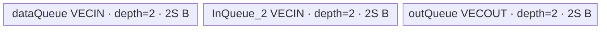
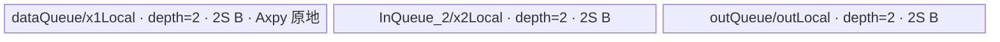
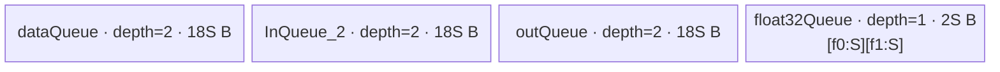

# ForeachSubList A2/A3 ACLNN 算子知识

## 算子速览

| 项目 | 内容 |
|---|---|
| 实际入口 | `aclnnForeachSubListV2GetWorkspaceSize` / `aclnnForeachSubListV2`，公开 ACLNN V2；同平台版本族取固定仓最新 V2。 |
| 计算语义 | `y_i[j] = x1_i[j] - alpha * x2_i[j]`，对 TensorList 逐位置、逐元素执行。 |
| 输入输出 | 等长 `x1/x2/out` TensorList；逐位置 shape 相同；Tensor dtype FP32/FP16/INT32/BF16，公开格式 ND、维数 0–8；`alpha` 为 Scalar。 |
| 执行类型 | 单 AIV_VECTOR Kernel：`foreach_sub_list` → `ForeachOneScalarTernary`；无 Cube/AIC、无 MIX_CV。 |
| Kernel 路线 | R-001 FP16/INT32 `Muls+Sub`；R-002 FP32 `Axpy`；R-003 BF16 分段升 FP32 `Axpy`。 |
| 核心资源 | TensorList GM 地址表；3 个 depth=2 Queue；BF16 另有 depth=1 FP32 scratch Queue；算子 tiling workspace 32 B 但 Kernel 显式忽略。 |
| 来源闭包 | `source_closed`：公开 V2 ACLNN → 校验/Scalar 转 Tensor → launcher → arch22 公共 Foreach tiling/POD → dtype key router → Queue/Vector body → A2/A3 binary/CMake。 |
| 验证状态 | 已完成源码闭包检查；本次知识提取未执行编译、真机、数值或性能测试。 |

## 接口与语义

### 计算语义

设列表长度 `n`，第 `i` 个 Tensor 元素数为 `E_i`。在 `0<=i<n`、`0<=j<E_i` 上：

```text
y_i[j] = x1_i[j] - x2_i[j] * alpha
```

Kernel 使用 storage shape 的元素数并把每个 Tensor 展平；不同 Tensor 之间无数据依赖。Host 同时检查两个输入 TensorList 逐位置 shape 一致以及输出 dtype/shape 约束。

### 输入、输出与属性

| 参数 | shape/layout | dtype | 约束、默认值与语义 |
|---|---|---|---|
| `x1` | TensorList；每 Tensor 0–8 维；公开 ND | FP32/FP16/INT32/BF16 | 支持空 Tensor；列表内 dtype 一致。ACLNN V2 文档不承诺非连续 Tensor。 |
| `x2` | 与 `x1` 等长、逐位置 shape 相同 | 与 `x1` 相同 | 减数列表。 |
| `alpha` | `aclScalar` | FP32/BF16 输入接受 FP32/DOUBLE；FP16 接受 FP16/DOUBLE；INT32 接受 INT32/INT64 | 第一段接口转为 1 元素 Tensor；BF16 路线转 FP32，其余转输入 dtype。 |
| `out` | 与 `x1` 逐位置 shape 相同 | 与 `x1` 相同 | 输出列表；非连续输出不在 V2 公开支持域。 |
| `workspaceSize/executor` | Host 输出 | `uint64_t*` / `aclOpExecutor**` | 第一段接口返回；空 TensorList 时 workspace 0 且无算子 node。 |

### 入口与版本

`aclnnForeachSubListV2` 相比旧入口把 `alpha` 从 `aclTensor` 改为 `aclScalar`。固定 Commit 的 V2 产品支持表明确覆盖 Atlas A2/A3，API `GetDtypeSupportList` 接受 `DAV_2201`，OpDef 注册 `ascend910b` 与 `ascend910_93`，Host CMake 把两者都映射到 arch22，两个 binary config 均含四种 dtype，Kernel CMake 也活动接入。因此 A2/A3 使用实际支持的最新公开 V2，而不是旧入口。

## Host/Launcher 执行流程

### 参数校验与前处理

第一段接口按以下顺序执行：

1. `CREATE_EXECUTOR`。
2. `CheckNotNull(x1,x2,alpha,out)`。
3. `CheckDtypeValid`：平台、四种 Tensor dtype、Scalar dtype 对应关系，以及各列表内部与三列表之间 dtype 一致。
4. `CheckShape`：`x1.Size == x2.Size`，逐位置 `x1/x2` shape 相同，`x1` 每 Tensor 维数不超过 8，逐位置 `x1/out` shape 相同。
5. `CheckFormat` 拒绝私有 storage format。
6. 空 TensorList 直接返回 workspace 0 和空 executor。
7. 对 `x1/x2` 每个 Tensor 调用框架 `l0op::Contiguous`，重建连续 TensorList；该实现属于允许的框架边界。
8. `ConvertToTensor` 将 Scalar 转为设备 Tensor；BF16 输入对应 FP32 alpha Tensor。
9. `l0op::ForeachSubListV2` 将唯一 `ForeachSubList` AICore node 加入 launcher list；失败返回 null 并阻断执行。

### 参数、Workspace 与生命周期

API 的总 workspace 来自 `executor->GetWorkspaceSize()`，owner 是调用方，必须保持到第二段 `CommonOpExecutorRun(...,stream)` 完成。arch22 算子 tiling 固定写 `workspaces[0]=32`，但 entry 把 `userWS` 置 null，Device body不读 workspace；这 32 B 是节点预留。若 Contiguous 框架节点需要临时空间，其大小由 executor 汇总，固定算子源码未公开公式。

`TilingPrepare4ForeachScalarTiling` 从平台读取 AIV/AIC 核数、UB/L1/L0 大小和系统 workspace；实际 `RunBigScalarKernelTiling` 只消费 AIV 核数与 UB。输入元素数、分核边界、UB tile、key、blockDim 和 `ForeachCommonTilingData` 都在第一段构图/tiling 生命周期内生成，运行时把 POD 传入唯一 Kernel。

### 启动图与失败传播

```text
aclnnForeachSubListV2GetWorkspaceSize
  -> [框架边界：x1/x2 逐 Tensor Contiguous]
  -> ADD_TO_LAUNCHER_LIST_AICORE(ForeachSubList)
       Host: Tiling4ForeachSubListTiling
             -> ForeachCommonTiling::Init(BINARY_LIST_OP_CODE, TYPE_SCALAR)
             -> RunBigScalarKernelTiling
       Device: foreach_sub_list(inputs_1,inputs_2,alpha,outputs,workspace,tiling)
       blockDim: needCoreNum
       POD: ForeachCommonTilingData
       workspace slice: 32 B（Device 不消费）
  -> out TensorList
```

支持域内是单算子 Kernel，无跨 Kernel 数据边。launcher list 与第二段传入 stream 给出框架顺序；所有 API 校验、Contiguous、launcher 添加与 tiling 错误均在 launch 前返回。Kernel 无 runtime 返回码；未知 key 不进入任何 body，也无 fallback 输出。

## Route 与参数设计

### 分核与资源计算

令 `d=sizeof(T)`、`B=32/d` 个元素/32 B block、`P=ForeachCommonTilingData` 的序列化字节数、平台 AIV 核数为 `C`、UB 字节数为 `U`：

```text
tensorDataCountList[i] = storage_numel(x1_i)
N = Σ tensorDataCountList[i]
needCoreNum = min(max(1, ceil(N/B)), C, 50)
blockCount = ceil(N/B)
basePerCore = floor(blockCount/needCoreNum) * B
前 blockCount%needCoreNum 个 core 多处理 B 个元素

非 BF16: S = floor_32((U-P)/6)
BF16:    S = floor_64(((U-P)/10)/6)
```

`AssignDataToEachCore` 把上述每核连续元素域投影为 `tensorStart/tensorEnd` 和首尾 Tensor 内 offset；一个 core 可跨多个 Tensor，一个 Tensor 也可在 core 边界处分段。`S=inputsTensorUbSize` 是每个普通 Queue slot 的字节基准，不是有效元素数。BF16 的实际输入/输出 slot 扩为 `9S`，FP32 scratch 为 `2S`。

### Route 选择

| 顺序 | Route | Key/模板 | 精确选择条件与优先级 | 不适用去向 |
|---:|---|---|---|---|
| 1 | R-001 FP16/INT32 Muls+Sub | key 1 FP16；key 3 INT32 | `GetTilingKeyByDtypeOnly(DT_FLOAT16/DT_INT32)`；API/Host 校验通过 | 其它 dtype 走对应 key；unsupported 得 key 0，无 body。 |
| 2 | R-002 FP32 Axpy | key 2 | dtype `DT_FLOAT` | 同上。 |
| 3 | R-003 BF16 FP32 分段 | key 4 | dtype `DT_BF16`，且非 Kirin guard；本卡 A2/A3 满足 | 非支持平台编译时不实例化。 |

```text
dtype FP16 -> key 1 -> ForeachOneScalarTernary<half,half,SubListNormalAdapter<half>>
dtype FP32 -> key 2 -> ForeachOneScalarTernary<float,float,SubListFloatAdapter<float>>
dtype INT32 -> key 3 -> ForeachOneScalarTernary<int,int,SubListNormalAdapter<int>>
dtype BF16 -> key 4 -> ForeachOneScalarTernary<bfloat16_t,float,SubListFloatAdapter<float>>
otherwise -> key 0 -> no Device body
```

### 模板/实现执行矩阵

| Route | key/selector | dtype/shape/platform 完整命中条件 | 执行拓扑与 Kernel 节点 | 实际模板/body | 内存与同步特征 | tail/fallback |
|---|---|---|---|---|---|---|
| R-001 FP16/INT32 | 1 / 3 | A2/A3；FP16/INT32；TensorList/shape/dtype 校验通过；前 50 个以内 | 单 AIV node | `ForeachOneScalarTernary<T,T,SubListNormalAdapter<T>>` | 3×depth2 Queue；`Muls(x2)`→V barrier→`Sub` | `DataCopyPad` 精确字节 tail；未知 key 无 fallback。 |
| R-002 FP32 | 2 | 同上，dtype FP32 | 单 AIV node | `ForeachOneScalarTernary<float,float,SubListFloatAdapter<float>>` | 3×depth2 Queue；`Axpy` 原地更新 x1 local，必要时对齐 copy 到 out local | 同上。 |
| R-003 BF16 | 4 | A2/A3；dtype BF16 | 单 AIV node | `ForeachOneScalarTernary<bfloat16_t,float,SubListFloatAdapter<float>>` + BF16 `InnerComputer` specialization | 3×depth2×`9S` Queue + depth1×`2S` FP32 scratch；分段 cast/Axpy/cast | 每 GM tile 可再分 FP32 scratch 子段；tail 精确输出字节。 |

### 隐藏性能 Guard

| Guard | Host/Tiling 条件 | Device/资源原因 | 影响 Route | 不满足时去向 | 源码符号 |
|---|---|---|---|---|---|
| 32 B 分核 | `B=32/sizeof(T)`；`needCoreNum<=ceil(N/B)` | core 边界按 DMA block 粒度；首尾 Tensor offset保留精确元素域 | 全部 | 无备用 Route | `ForeachCommonTiling::GetNeedCoreNum/AssignDataToEachCore` |
| core/POD 上限 | `needCoreNum<=50` | POD 的 core arrays 长度 50 | 全部 | 截至 50 cores | 同上、`ForeachCommonTilingData` |
| Tensor 上限 | `Init` 循环 `i<50` | `tensorDataCountList[50]` | 全部 | 固定源码没有 `tensorList.Size<=50` 显式错误；超出部分不进入 POD | `ForeachCommonTiling::Init` |
| UB 对齐 | 非 BF16 floor 32 B；BF16 floor 64 B | 普通 DMA block 与 BF16 cast buffer划分 | 全部/R-003 | 无 fallback；UB 不足的显式失败 guard 不可见 | `DivideUbMemory1` |
| BF16 保守缩放 | 先 `(U-P)/10`，再 `/6` | Device 实际分配 `56S`，需覆盖三组 `9S` 双缓冲和 `2S` scratch | R-003 | 无备用 Route | `DivideUbMemory1`、`KernelForeachBase::Init`、各 `InitBuffer` |
| Kernel 编译 guard | int/BF16 要求 `__CCE_AICORE__>=220`；BF16 排除 arch 3003/3113 | 对应类型与 Cast 实现可用性 | R-001 INT32、R-003 | guard 外无 body | `op_kernel/foreach_sub_list.cpp` |

### POD/ABI

`ForeachCommonTilingData` 由 `BEGIN_TILING_DATA_DEF` 宏生成。固定仓可见字段顺序、类型和 Host/Device 同名 consumer；按这些字段的自然对齐可核算序列化 footprint 为 1408 B、对齐 8 B。宏定义本体属于外部框架 include，固定仓未直接给出生成类的 `sizeof/alignof/offsetof` 静态断言。

| 结构 | 字段 | 类型/位宽 | ABI 布局 | 单位 | Host/launcher producer | Device consumer | 边界 |
|---|---|---|---|---|---|---|---|
| `ForeachCommonTilingData` | `inputsTensorUbSize` | `uint64_t/64` | 声明序第 1；自然 offset 0 | 字节/Queue slot 基准 | `DivideUbMemory1` 后 `set_inputsTensorUbSize(S)` | `KernelForeachBase::ParseTilingData`；决定 `maxDataCount` 与 Queue 容量 | 32 B 对齐；BF16 为 64 B 对齐。 |
| 同上 | `tensorDataCountList` | `int64_t[50]` | 声明序第 2；自然 offset 8 | 元素/Tensor | `Init` 从 storage shape 写入 | `Process` 计算每 Tensor cursorEnd | 仅前 `totalTensorCount<=50` 被写/用。 |
| 同上 | `tensorStartList` | `uint16_t[50]` | 声明序第 3；自然 offset 408 | Tensor index/core | `AssignDataToEachCore` | blockIdx 索引后作为 Tensor 循环起点 | 活跃 core `<needCoreNum<=50`。 |
| 同上 | `tensorEndList` | `uint16_t[50]` | 声明序第 4；自然 offset 508 | Tensor index/core | 同上 | Tensor 循环终点（含） | 同上。 |
| 同上 | `tensorStartOffsetList` | `int64_t[50]` | 声明序第 5；自然 offset 608 | 元素/Tensor | 同上 | 首 Tensor GM base offset | 空域可为 0。 |
| 同上 | `tensorEndOffsetList` | `int64_t[50]` | 声明序第 6；自然 offset 1008 | 元素/Tensor | 同上 | 尾 Tensor最后有效 offset（含） | 全空元素域可出现 -1，使 `dataCount=0`。 |

### Route 源码闭包

| Route | Key/selector | Host/Tiling producer | POD/参数 | Kernel entry/router 节点 | Kernel body/直接依赖 | 构建接线 |
|---|---|---|---|---|---|---|
| R-001 FP16/INT32 | key 1/3 | `foreach_sub_list_tiling_arch22.cpp::Tiling4ForeachSubListTiling` → `ForeachCommonTiling` | `ForeachCommonTilingData` | `op_kernel/foreach_sub_list.cpp::foreach_sub_list` | `SubListNormalAdapter`、`ForeachOneScalarTernary`、`KernelForeachUnary/Base` | `op_kernel/CMakeLists.txt` + ascend910b/910_93 binary config |
| R-002 FP32 | key 2 | 同上 | 同上 | 同上 | `SubListFloatAdapter<float>` 与相同公共模板 | 同上 |
| R-003 BF16 | key 4 | 同上 | 同上 | 同上 | BF16 `InnerComputer`、`SubListFloatAdapter<float>`、公共模板 | 同上 |

## Kernel 实现

### 公共执行流程

entry 用 runtime tiling key 选择模板实例。`KernelForeachBase::Init` 读取 `blockIdx` 和本核 Tensor/offset 边界；`KernelForeachUnary::Process` 对本核覆盖的 Tensor 逐个绑定真实 GM 指针，再把每段切成 `maxDataCount` tile。每 tile 的真实顺序是 `CopyIn(x1)` → `CopyInPlus(x2)` → `Compute` → `CopyOut`。普通 tile 用 `DataCopy`，最后不足 tile 用 `DataCopyPad` 且 `blockLen=dataCount*sizeof(T)`；Vector 计算只处理 `dataCount`，CopyOut tail 也只提交相同有效字节。

TensorList 地址通过共同 ABI 解码：首个 `uint64_t` 给出地址表相对字节偏移，右移 3 转为指针索引，再取第 `i` 个 Tensor 地址。Queue 的 Alloc/EnQue/DeQue/FreeTensor 建立 MTE↔Vector↔MTE 生命周期；Vector 内显式 `PipeBarrier<PIPE_V>` 保护原地依赖。

### Route R-001：FP16/INT32 Muls+Sub

#### 适用条件

##### 选择证据

| 层级 | 文件 | 符号 | 源码谓词/参数 | 结果/下一跳 |
|---|---|---|---|---|
| API | `op_host/op_api/aclnn_foreach_sub_list_v2.cpp` | `CheckDtypeValid` | A2/A3，Tensor dtype FP16/INT32，Scalar 对应合法 | 加入 ForeachSubList node。 |
| Tiling | `foreach_utils/op_host/common_dtype.h` | `GetTilingKeyByDtypeOnly` | FP16→1，INT32→3 | runtime key。 |
| Router | `op_kernel/foreach_sub_list.cpp` | `foreach_sub_list` | `TILING_KEY_IS(1/3)` | `ForeachOneScalarTernary<half\|int,...NormalAdapter>`。 |

#### Device 数据流

##### 函数级调用链

```text
Tiling4ForeachSubListTiling -> ForeachCommonTiling::RunBigScalarKernelTiling
  -> foreach_sub_list(key 1|3)
    -> ForeachOneScalarTernary<T,T,SubListNormalAdapter<T>>::Init
    -> KernelForeachUnary::Process
      -> CopyIn(x1) + CopyInPlus(x2)
      -> InnerComputer::Compute
        -> SubListNormalAdapter: Muls(x2Local,x2Local,alpha,count)
                               -> PipeBarrier<PIPE_V>
                               -> Sub(outLocal,x1Local,x2Local,count)
      -> KernelForeachUnary::CopyOut
```

##### 源码等价伪码

```text
# 伪码
for tensor i in [tensorStart, tensorEnd]:
    begin = (i==tensorStart ? tensorStartOffset : 0)
    end   = (i==tensorEnd ? tensorEndOffset : tensorDataCount[i]-1)
    bind x1/x2/y GM at tensor_ptr(i)+begin
    for tile k over dataCount=end-begin+1, capacity maxDataCount=S/sizeof(T):
        x1Local = GM x1[k]                       # tail: exact byte DataCopyPad
        x2Local = GM x2[k]
        PipeBarrier(V)
        x2Local[0:valid] *= alpha
        PipeBarrier(V)
        outLocal[0:valid] = x1Local - x2Local
        PipeBarrier(V)
        GM y[k] = outLocal                       # tail: exact byte DataCopyPad
```

#### 内存与数据搬运

##### 资源与搬运表

| 层级/缓冲区 | offset/地址公式 | extent/容量公式 | dtype/layout | producer | consumer | owner/lifetime | 对齐/复用 |
|---|---|---|---|---|---|---|---|
| x1 GM | `tensor_ptr(i)+cursorStart+k*maxDataCount` | `valid` 元素 | T/flat storage | caller | `CopyIn` | caller 至 stream 完成 | tail 精确字节。 |
| `dataQueue` VECIN | Queue slot | depth 2 × S B | T | `CopyIn` | Compute | TPipe/每 tile | 双缓冲。 |
| x2 GM / `InQueue_2` | 同 x1；独立 TensorList | depth 2 × S B | T | `CopyInPlus` | Compute | TPipe | 双缓冲；Compute 后 Free。 |
| `outQueue` VECOUT | Queue slot | depth 2 × S B | T | Compute | CopyOut | TPipe | 双缓冲。 |
| y GM | 与 x1 对应 offset | `valid` 元素 | T | CopyOut | caller | caller | 仅有效 tail 写入。 |

##### 分层内存布局



##### 字节账与复用顺序

```text
S = floor_32((U-P)/6)
UB_total = 2S + 2S + 2S = 6S <= U-P
dynamic_ub = N/A（AIV 静态 TPipe Queue）
workspace_total = 32 B（节点预留；Kernel userWS=null）
```

| 复用子区 | 写入者 | 读取者/消费点 | 下一次覆盖 | 同步或释放依据 | 安全条件 |
|---|---|---|---|---|---|
| `dataQueue` slot | CopyIn | Compute `DeQue` | `FreeTensor` 后后续 tile | Queue EnQue/DeQue/Free | depth=2，未消费不得覆盖。 |
| `InQueue_2` slot | CopyInPlus | `Muls/Sub` | Compute Free 后 | 同上 + V barrier | Muls 完成后才允许 Sub 读。 |
| `outQueue` slot | Compute | CopyOut | CopyOut Free 后 | EnQue/DeQue/Free | GM copy 完成前不覆盖。 |

#### 同步、精度与尾块

##### 同步与数值边界表

| 阶段 | primitive/机制 | producer | consumer/等待点 | 保护对象 | 精度/尾块 |
|---|---|---|---|---|---|
| MTE2→V | Queue | CopyIn/CopyInPlus | Compute DeQue | 两输入 slot | tail 搬入真实字节；pad 参数禁用额外填充值。 |
| Vector | `PipeBarrier<PIPE_V>` | `Muls` | `Sub` | 原地 x2Local | FP16 在 FP16 Vector 路线；INT32 直接整型乘减，溢出策略源码未说明。 |
| V→MTE3 | outQueue | Compute EnQue | CopyOut DeQue | out slot | Vector 仅处理 `valid`；tail 仅写 `valid*sizeof(T)`。 |

#### 关键实现

##### 符号证据表

| 阶段 | 文件 | 符号/模板实例 | 实现事实 |
|---|---|---|---|
| Host/Tiling producer | `foreach_utils/op_host/foreach_tiling_class.h` | `RunBigScalarKernelTiling`、`AssignDataToEachCore`、`DivideUbMemory1` | key/core/POD/S/workspace。 |
| Kernel entry/router | `foreach_sub_list/op_kernel/foreach_sub_list.cpp` | key 1/3 branches | 模板实例映射。 |
| Device body/helper | `foreach_utils/op_kernel/kernel_foreach_unary.h`、`foreach_one_scalar_ternary.h` | `Process/CopyIn/Compute/CopyOut` | tile、Queue、tail。 |
| Device body/helper | `foreach_sub_list/op_kernel/foreach_sub_list.cpp` | `SubListNormalAdapter` | Muls→barrier→Sub。 |

### Route R-002：FP32 Axpy

#### 适用条件

##### 选择证据

| 层级 | 文件 | 符号 | 源码谓词/参数 | 结果/下一跳 |
|---|---|---|---|---|
| API | `aclnn_foreach_sub_list_v2.cpp` | `CheckDtypeValid` | Tensor dtype FP32；Scalar FP32/DOUBLE 后转 FP32 Tensor | launcher node。 |
| Tiling | `common_dtype.h` | `GetTilingKeyByDtypeOnly(DT_FLOAT)` | 返回 2 | key 2。 |
| Router | `op_kernel/foreach_sub_list.cpp` | key 2 branch | `TILING_KEY_IS(2)` | `ForeachOneScalarTernary<float,float,SubListFloatAdapter<float>>`。 |

#### Device 数据流

##### 函数级调用链

```text
foreach_sub_list(key 2)
  -> ForeachOneScalarTernary<float,float,SubListFloatAdapter<float>>
    -> common CopyIn(x1,x2)
    -> SubListFloatAdapter
       -> Axpy<float,float>(x1Local,x2Local,-alpha,valid)
       -> if outLocal physical address != x1Local:
            PipeBarrier(V) -> aligned DataCopy(x1Local -> outLocal)
    -> common CopyOut(outLocal -> y)
```

##### 源码等价伪码

```text
# 外层 core/Tensor/tile 与 R-001 相同
x1Local += (-alpha) * x2Local               # Axpy，x1Local 原地
if phy(outLocal) != phy(x1Local):
    PipeBarrier(V)
    copyCount = valid if valid*sizeof(float)%32==0 else ceil(valid/8)*8
    DataCopy(outLocal, x1Local, copyCount)
enqueue outLocal; CopyOut 仅提交 valid 元素
```

#### 内存与数据搬运

##### 资源与搬运表

| 层级/缓冲区 | offset/地址公式 | extent/容量公式 | dtype/layout | producer | consumer | owner/lifetime | 对齐/复用 |
|---|---|---|---|---|---|---|---|
| GM/三 Queue | 与 R-001 相同 | 每 Queue depth 2 × S B | FP32 | CopyIn/Axpy/CopyOut | 后继阶段 | TPipe | `S` 32 B 对齐。 |
| x1Local | 当前 dataQueue slot | S B | FP32 | CopyIn | Axpy dst/src1 | Queue | Vector 原地写回。 |
| outLocal | 当前 outQueue slot | S B | FP32 | 对齐 DataCopy | CopyOut | Queue | 若物理地址相同则免 copy；固定实现仍先分配 out slot。 |

##### 分层内存布局



##### 字节账与复用顺序

```text
S = floor_32((U-P)/6)
UB_total = 6S <= U-P
workspace_total = 32 B（Device 不读）
```

| 复用子区 | 写入者 | 读取者/消费点 | 下一次覆盖 | 同步或释放依据 | 安全条件 |
|---|---|---|---|---|---|
| x1Local | CopyIn 后 Axpy 原地更新 | 可选 DataCopy | dataQueue Free 后 | Axpy 后 V barrier | Copy 前必须等待 Axpy。 |
| outLocal | 对齐 DataCopy | CopyOut | outQueue Free 后 | outQueue 协议 | CopyOut 仅提交 valid，舍弃对齐 extra lane。 |

#### 同步、精度与尾块

##### 同步与数值边界表

| 阶段 | primitive/机制 | producer | consumer/等待点 | 保护对象 | 精度/尾块 |
|---|---|---|---|---|---|
| 乘减融合 | `Axpy<T,T>(src1,src2,-alpha,valid)` | x1/x2 local | 后继 copy | x1Local | FP32；负 alpha 由 Host scalar值转成 float后在 Device 取负。 |
| 原地→out | `PipeBarrier<PIPE_V>` | Axpy | DataCopy | x1Local | 不足 32 B 时向上取整 copy；GM tail仍只写 valid 字节。 |
| Queue | EnQue/DeQue/Free | 各阶段 | 后继阶段 | 三 Queue slot | 与 R-001 相同。 |

#### 关键实现

##### 符号证据表

| 阶段 | 文件 | 符号/模板实例 | 实现事实 |
|---|---|---|---|
| Host/Tiling producer | `foreach_utils/op_host/foreach_tiling_class.h` | `RunBigScalarKernelTiling` | key 2、S、core/POD。 |
| Kernel entry/router | `foreach_sub_list/op_kernel/foreach_sub_list.cpp` | key 2 branch | FP32 Axpy adapter。 |
| Device body/helper | 同上 | `SubListFloatAdapter<float>` | Axpy 原地与地址判定 copy。 |
| Device body/helper | `kernel_foreach_unary.h` | `CopyOut` | GM tail 精确提交。 |

### Route R-003：BF16 分段升 FP32 Axpy

#### 适用条件

##### 选择证据

| 层级 | 文件 | 符号 | 源码谓词/参数 | 结果/下一跳 |
|---|---|---|---|---|
| API | `aclnn_foreach_sub_list_v2.cpp` | `CheckDtypeValid` / `ConvertToTensor` | Tensor BF16；Scalar FP32/DOUBLE | alpha 转 FP32 Tensor。 |
| Tiling | `common_dtype.h`、`foreach_tiling_class.h` | key 4、`DivideUbMemory1` | `dataType==DT_BF16` | `S=floor64(((U-P)/10)/6)`。 |
| Router | `op_kernel/foreach_sub_list.cpp` | key 4 branch | A2/A3，非 arch3003/3113 | `ForeachOneScalarTernary<bfloat16_t,float,SubListFloatAdapter<float>>`。 |

#### Device 数据流

##### 函数级调用链

```text
foreach_sub_list(key 4)
  -> ForeachOneScalarTernary<bfloat16_t,float,SubListFloatAdapter<float>>::Init
     -> three BF16 queues use slot capacity 9S; float32Queue uses 2S
  -> common Process/CopyIn x1,x2 (BF16 tile up to 9S bytes)
  -> InnerComputer<bfloat16_t,float>::Compute
     -> for each FP32 scratch chunk of maxCastDataCount=S/4 elements:
          Cast(x1 BF16 -> scratch[0])
          Cast(x2 BF16 -> scratch[S/4])
          SubListFloatAdapter(scratch[0],scratch[1],dst=scratch[0])
          Cast(scratch[0] -> out BF16, CAST_RINT)
  -> common CopyOut BF16
```

##### 源码等价伪码

```text
# BF16 GM tile capacity maxDataCount=(9S)/2 elements
for chunk c of at most maxCastDataCount=S/4 elements:
    PipeBarrier(V)
    f0 = Cast<float>(x1Local[c], CAST_NONE)
    PipeBarrier(V)
    f1 = Cast<float>(x2Local[c], CAST_NONE)
    PipeBarrier(V)
    Axpy(f0, f1, -alphaFP32, validChunk)        # dst==src1，adapter 不再 copy
    PipeBarrier(V)
    outBF16[c] = Cast<bfloat16_t>(f0, CAST_RINT)
enqueue out; GM CopyOut exact valid tile bytes
```

#### 内存与数据搬运

##### 资源与搬运表

| 层级/缓冲区 | offset/地址公式 | extent/容量公式 | dtype/layout | producer | consumer | owner/lifetime | 对齐/复用 |
|---|---|---|---|---|---|---|---|
| `dataQueue` | Queue slot | depth 2 × 9S B | BF16 | CopyIn x1 | Cast | TPipe | 双缓冲。 |
| `InQueue_2` | Queue slot | depth 2 × 9S B | BF16 | CopyIn x2 | Cast | TPipe | 双缓冲。 |
| `outQueue` | Queue slot | depth 2 × 9S B | BF16 | Cast_RINT | CopyOut | TPipe | 双缓冲。 |
| `float32Queue` | 单 slot；前/后半 | depth 1 × 2S B | FP32 | 两次 Cast | Axpy/降精度 Cast | 整个 `Process` DeQue 持有，结束 Free | 前半 `S` B 容纳 x1/结果，后半 `S` B 起点由 `maxCastDataCount=S/4` 元素给出；实际每半使用至多 S B。 |
| alpha GM | element 0 | 4 B | FP32 | API ConvertToTensor | `scalarVal` | executor | Init 读取一次/核。 |

##### 分层内存布局



##### 字节账与复用顺序

```text
S = floor_64(((U-P)/10)/6)
BF16 input/output slot capacity = 9S
maxDataCount = 9S / sizeof(BF16) = 9S/2 elements
maxCastDataCount = S / sizeof(float) = S/4 elements
UB_total = 2*9S + 2*9S + 2*9S + 1*2S = 56S
Host conservative bound gives 60S <= U-P before alignment
=> UB_total=56S <= U-P
workspace_total = 32 B（不消费）
```

| 复用子区 | 写入者 | 读取者/消费点 | 下一次覆盖 | 同步或释放依据 | 安全条件 |
|---|---|---|---|---|---|
| scratch 前半 `f0` | x1 Cast | Axpy src1/dst；降精度 Cast | 下一 chunk 的 x1 Cast | 每阶段 V barrier | 降精度 Cast 完成前不得覆盖。 |
| scratch 后半 `f1` | x2 Cast | Axpy src2 | 下一 chunk 的 x2 Cast | Axpy 前后 V barrier | `chunk<=S/4`，两个半区不重叠。 |
| BF16 Queue slots | CopyIn/Compute | Cast/CopyOut | Free 后下一 tile | Queue 协议 | depth=2 容量均为 9S。 |

#### 同步、精度与尾块

##### 同步与数值边界表

| 阶段 | primitive/机制 | producer | consumer/等待点 | 保护对象 | 精度/尾块 |
|---|---|---|---|---|---|
| BF16→FP32 | `Cast(... CAST_NONE)` + V barrier | BF16 local | Axpy | scratch 两半 | 每 chunk 仅 `dataCount` 元素。 |
| FP32 乘减 | `Axpy(f0,f1,-alpha,count)` | 两次 Cast | BF16 Cast | scratch 前半 | FP32 运算；adapter 因 dst==src1 不执行额外 DataCopy。 |
| FP32→BF16 | `Cast(... CAST_RINT)` | Axpy | outQueue/CopyOut | BF16 outLocal | 明确 RINT；GM tail 精确字节。 |
| tile/chunk tail | 两级 remainder | GM tile循环 / scratch chunk循环 | CopyOut | 有效元素域 | tile remainder 用 DataCopyPad，chunk remainder只处理余数。 |

#### 关键实现

##### 符号证据表

| 阶段 | 文件 | 符号/模板实例 | 实现事实 |
|---|---|---|---|
| Host/Tiling producer | `foreach_utils/op_host/foreach_tiling_class.h` | BF16 `DivideUbMemory1` | `/10/6` UB 预算和 64 B 对齐。 |
| Kernel entry/router | `foreach_sub_list/op_kernel/foreach_sub_list.cpp` | key 4 branch | BF16 storage、FP32 compute。 |
| Device body/helper | `kernel_foreach_base.h`、`kernel_foreach_unary.h` | BF16 specialization branches | `9S` slots、`2S` scratch、max counts。 |
| Device body/helper | `foreach_one_scalar_ternary.h` | BF16 `InnerComputer::ComputePerCast` | Cast/Axpy/Cast 与 RINT。 |

## 算子特定优化

### Trick T-001：FP32 用 Axpy 合并乘法与减法

#### 触发与源码依据

- 适用 Route：R-002；R-003 的 FP32 scratch 子段也复用该 adapter。
- 触发条件：Device compute type `P=float`。
- Golden 来源：[`foreach_sub_list.cpp:37-50`](../../../../../../../cann-ops-raw/ascendc/ops-nn/955f8b33985b6d72989ebff341bb9c2c564a51bc/foreach/foreach_sub_list/op_kernel/foreach_sub_list.cpp#L37-L50)

**官方源码（固定 Commit 连续逐字摘录）**：

```cpp
template <typename T>
__aicore__ void SubListFloatAdapter(
    const LocalTensor<T>& dstLocal, const LocalTensor<T>& srcLocal1, const LocalTensor<T>& srcLocal2,
    const T& scalarVal, const int32_t& uValue)
{
    Axpy<T, T>(srcLocal1, srcLocal2, -scalarVal, uValue);
    if (dstLocal.GetPhyAddr() != srcLocal1.GetPhyAddr()) {
        PipeBarrier<PIPE_V>();
        if (uValue * sizeof(T) % BYTE_PER_BLOCK == 0) {
            DataCopy(dstLocal, srcLocal1, uValue);
        } else {
            int32_t dataCountInBlock = BYTE_PER_BLOCK / sizeof(T);
            DataCopy(dstLocal, srcLocal1, (uValue + dataCountInBlock - 1) / dataCountInBlock * dataCountInBlock);
        }
```

#### 机制与设计原因

`Axpy(dst=srcLocal1, src=srcLocal2, scalar=-alpha, count)` 把 `x1-alpha*x2` 合成一次 Vector primitive，并在 x1 local 上原地生成结果。若调用方让 `dstLocal` 与 `srcLocal1` 物理别名，则不再搬运；常规独立 outQueue 时只执行一次 UB→UB 对齐 copy。`uValue` 来自当前 tile 有效元素数；不足 32 B 的 copy 向上取整，但 GM CopyOut仍只写有效字节。

#### 迁移边界

- 适用：形如 `a + scale*b` 的逐元素 FP32 计算，输入 local 可被覆盖或能接受一次 UB copy。
- 前提：`Axpy` 支持目标 dtype；`-alpha` 可按同 dtype表示；tail 的 out buffer 容量覆盖向上取整元素。
- 失效：FP16/INT32 路线固定实现改用 `Muls+Sub`；需要保留 x1 local 且无 out buffer 时不能原地复用。
- 未验证：本次知识提取未执行编译、真机、数值或性能测试。

#### 错误做法

固定仓提供的真实防护是物理地址不等时必须 barrier 后 copy；省略该 copy 会使已分配的 outQueue 没有有效结果。

### Trick T-002：BF16 大 tile 复用双半区 FP32 scratch

#### 触发与源码依据

- 适用 Route：R-003。
- 触发条件：storage dtype BF16、compute dtype FP32；每个 BF16 tile 再按 `maxCastDataCount` 分段。
- Golden 来源：[`foreach_one_scalar_ternary.h:68-80`](../../../../../../../cann-ops-raw/ascendc/ops-nn/955f8b33985b6d72989ebff341bb9c2c564a51bc/foreach/foreach_utils/op_kernel/foreach_one_scalar_ternary.h#L68-L80)

**官方源码（固定 Commit 连续逐字摘录）**：

```cpp
__aicore__ inline void ComputePerCast(
    LocalTensor<bfloat16_t>& inLocal_1, LocalTensor<bfloat16_t>& inLocal_2, LocalTensor<bfloat16_t>& outLocal,
    LocalTensor<float>& float32Tensor, float scalarVal, uint32_t maxCastDataCount, uint32_t index,
    int64_t dataCount)
{
    PipeBarrier<PIPE_V>();
    Cast(float32Tensor, inLocal_1[index * maxCastDataCount], RoundMode::CAST_NONE, dataCount);
    PipeBarrier<PIPE_V>();
    Cast(float32Tensor[maxCastDataCount], inLocal_2[index * maxCastDataCount], RoundMode::CAST_NONE, dataCount);
    PipeBarrier<PIPE_V>();
    op(float32Tensor, float32Tensor, float32Tensor[maxCastDataCount], scalarVal, dataCount);
    PipeBarrier<PIPE_V>();
    Cast(outLocal[index * maxCastDataCount], float32Tensor, RoundMode::CAST_RINT, dataCount);
}
```

#### 机制与设计原因

单个 `2S` FP32 Queue slot 被稳定划成两个 `S` 半区：前半依次承载 x1 FP32 和结果，后半承载 x2 FP32。每完成一个子段就把结果降回 BF16 outLocal，再由下一个子段覆盖 scratch；因此不需要为整个 `9S` BF16 tile 同时物化两份 FP32 Tensor。显式 V barrier 给出 Cast→Axpy→Cast 的覆盖时序，Host 的保守 `/10/6` 预算覆盖实际 `56S` Queue 总量。

#### 迁移边界

- 适用：低精度大 tile 需要双输入升精度，但 FP32 运算可分段且无跨段依赖。
- 前提：`2S` scratch 可均分；`maxCastDataCount=S/4`；outLocal 能逐段写入；降精度 RINT 满足语义。
- 失效：跨段归约、需同时访问三份以上 FP32 中间量或不能分段的 Vector API，需要扩大/重排 scratch。
- 未验证：本次知识提取未执行编译、真机、数值或性能测试。

#### 错误做法

固定仓未提供可验证反例；源码中的每阶段 `PipeBarrier<PIPE_V>` 是不可省略的覆盖条件。

## 模板与实现对比

| 对比维度 | R-001 FP16/INT32 | R-002 FP32 | R-003 BF16 | 设计选择依据 |
|---|---|---|---|---|
| 命中条件/优先级 | key 1/3 | key 2 | key 4 | dtype 唯一映射，无 fallback。 |
| 模板与 dtype | storage=compute T | float/float | BF16/float | BF16 显式升精度。 |
| 循环与分核 | 32 B block 分核；S tile | 同 | 32 B 分核；9S-byte tile + S/4 元素子段 | BF16 scratch 容量。 |
| Queue/TBuf/寄存器/dynamic UB/通信 window | 三个 depth2 S Queue | 同 | 三个 depth2 9S Queue + depth1 2S FP32 Queue | 无 TBuf/dynamic UB/通信。 |
| 内存总占用与复用 | 6S | 6S；x1Local 原地 Axpy | 56S；scratch 双半区复用 | Host 分别按 6 或 60 预算。 |
| 搬运/Vector/SIMT/NDDMA/通信 API | DataCopy(Pad), Muls, Sub | DataCopy(Pad), Axpy, UB copy | DataCopy(Pad), Cast, Axpy, Cast | 全部是 AIV Vector。 |
| 同步、精度与 tail | V barrier；原 dtype；精确 GM tail | V barrier；FP32；对齐 UB copy | 多 V barrier；FP32 compute/RINT；两级 tail | 依赖覆盖顺序。 |
| fallback/失败边界 | 未知 key无 body | 同 | 编译 guard 外无 body | Host/API 应先拒绝不支持组合。 |

## 平台差异

| 项目 | A2 | A3 | 950 |
|---|---|---|---|
| 支持状态 | V2 公开支持 | V2 公开支持 | V2 公开支持；见 `_950` 卡 |
| Host/Launcher | ascend910b→arch22 公共 tiling | ascend910_93→同一 arch22 公共 tiling | arch35 专用 tiling/SIMT |
| Kernel/资源 | 相同 AIV Vector entry、最多 50 Tensor/cores | 同 A2 | 最多 256 Tensor，GM 直通，无显式 UB |

## 限制与失败边界

- arch22 `ForeachCommonTiling::Init` 只扫描 `MAX_TENSOR_CONT=50`，且没有在超过 50 时显式报错；正式复用应把 TensorList 长度限制为 `<=50`，否则超出部分不会进入 POD/Kernel 覆盖域。
- API 显式比较 `x1.Size` 与 `x2.Size`，但不单独比较 `out.Size`，随后按 `x1.Size` 索引 `out`；调用方必须提供逐位置完整输出列表。
- Host 将算子节点 workspace 设为 32 B，但 Kernel 强制 `userWS=null`；不得把这 32 B 当作可用中间数据。API executor 总 workspace 还可能含框架 Contiguous 开销。
- UB 公式直接从 `U-P` 做无符号减法，固定源码没有显式 `U>P` 或 `S>0` guard；平台配置必须满足 Queue 最低容量。
- 未知/不支持 dtype 可能得到 key 0，entry 没有 else 错误或 fallback；ACLNN/OpDef 的 dtype 校验是必要前置条件。
- FP16 走原 dtype `Muls+Sub`，BF16 走 FP32 `Axpy` 后 `CAST_RINT`；迁移实现不得把两者误归为同一精度顺序。
- `totalDataCount` 的 int64 累加没有显式溢出检查；INT32 的算术溢出行为固定源码未说明。
- TensorList 地址表和 ACLNN Contiguous 的内部实现是框架边界；算子拥有的解码、POD、Queue 与 Vector body 已闭合。
- 本次知识提取未执行编译、真机、数值或性能测试。

## 源码索引

### 链路索引

| 链路阶段 | 文件 | 关键符号 | 支撑内容 |
|---|---|---|---|
| 入口声明/约束 | `foreach/foreach_sub_list/docs/aclnnForeachSubListV2.md` | 产品支持、原型、参数表 | A2/A3 公开 V2 契约。 |
| 入口实现 | `foreach/foreach_sub_list/op_host/op_api/aclnn_foreach_sub_list_v2.cpp` | `CheckParams`、`ExecForeachSubListV2GetWorkspaceSize` | API 校验、前处理、executor。 |
| 入口实现 | `foreach/foreach_sub_list/op_host/op_api/foreach_sub_list_v2.cpp` | `l0op::ForeachSubListV2` | launcher node。 |
| OpDef | `foreach/foreach_sub_list/op_host/foreach_sub_list_def.cpp` | `ops::ForeachSubList` | dtype、format、平台注册。 |
| Host/Tiling/Launcher | `foreach/foreach_sub_list/op_host/arch22/foreach_sub_list_tiling_arch22.cpp` | `Tiling4ForeachSubListTiling` | 公共 tiling 入口。 |
| Host/Tiling/Launcher | `foreach/foreach_utils/op_host/foreach_tiling_class.h` | `ForeachCommonTiling` | 校验、分核、UB、POD、workspace。 |
| POD | `foreach/foreach_utils/op_host/foreach_tiling_def.h` | `ForeachCommonTilingData` | 字段/数组上限与注册。 |
| key | `foreach/foreach_utils/op_host/common_dtype.h` | `GetTilingKeyByDtypeOnly` | dtype→1/2/3/4。 |
| Kernel entry/body | `foreach/foreach_sub_list/op_kernel/foreach_sub_list.cpp` | `foreach_sub_list`、两个 adapter | router 与 Vector 算术。 |
| Kernel body | `foreach/foreach_utils/op_kernel/kernel_foreach_base.h` | `KernelForeachBase` | POD 解析、TensorList 地址、BF16 容量。 |
| Kernel body | `foreach/foreach_utils/op_kernel/kernel_foreach_unary.h` | `KernelForeachUnary` | Tensor/tile循环、CopyIn/Out、Queue。 |
| Kernel body | `foreach/foreach_utils/op_kernel/foreach_one_scalar_ternary.h` | `ForeachOneScalarTernary`、`InnerComputer` | x2/scalar、三输入 compute、BF16 分段。 |
| binary config | `foreach/foreach_sub_list/op_host/config/ascend910b/foreach_sub_list_binary.json` | 四个 `ForeachSubList` binary | A2 dtype/alpha Tensor组合。 |
| binary config | `foreach/foreach_sub_list/op_host/config/ascend910_93/foreach_sub_list_binary.json` | 四个 `ForeachSubList` binary | A3 dtype/alpha Tensor组合。 |
| 构建接线 | `foreach/foreach_sub_list/op_kernel/CMakeLists.txt` | `add_kernel_sources` | ascend910b/910_93 活动接线。 |

### 实现复用检查

| 检查项 | 可复用事实 | 不得改变的约束 | 源码符号 |
|---|---|---|---|
| ABI/POD | `S`、50 Tensor 元素数、50 core 首尾边界 | 字段顺序/位宽/元素单位；Host/Device 使用同一生成类型 | `ForeachCommonTilingData`、`ParseTilingData` |
| 调用顺序 | API 校验→Contiguous→Scalar Tensor→单 launcher | 空列表短路；任一失败阻断 launch | `ExecForeachSubListV2GetWorkspaceSize` |
| workspace/内存 | 普通 6S；BF16 56S；节点 workspace 32 B 不消费 | depth=2 必须计入；BF16 slot 是 9S 而非逻辑有效字节 | `DivideUbMemory1`、各 `InitBuffer` |
| 同步 | Queue 生命周期 + Vector barrier | Muls→Sub、Cast→Axpy→Cast、Axpy→copy 顺序 | adapters、`InnerComputer`、`KernelForeachUnary` |
| 精度与尾块 | FP16/INT32 原 dtype；FP32 Axpy；BF16 FP32/RINT；GM tail 精确字节 | 不得把 UB 对齐 extra lane 写回 GM；BF16 两级 remainder | `CopyIn/CopyOut`、`ComputePerCast` |
| 失败边界 | dtype、shape、Tensor count、UB/core 上限 | key 0/编译 guard 无 fallback；TensorList 必须 `<=50` | `CheckOpInfo`、`Init`、entry router |