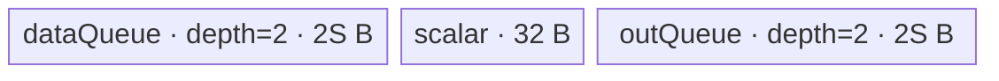

# ForeachSubScalarList A2/A3 ACLNN 算子知识

## 算子速览

| 项目 | 内容 |
|---|---|
| 实际入口 | `aclnnForeachSubScalarListGetWorkspaceSize` + `aclnnForeachSubScalarList`，公开两段式 ACLNN；inner bridge 是未提交的生成框架边界。 |
| 计算语义 | 对列表位置 `t`、元素 `j`：`y_t[j]=x_t[j]-scalars[t]`，写入长度为 `numel(x_t)`。 |
| 输入输出 | ND TensorList x/y；FP16/FP32/INT32/BF16，scalars 分别为 FP32/FP32/INT64/FP32；y dtype 与 x 一致。 |
| 执行类型 | 单节点 `AIV_VECTOR`，四条 dtype/精度 Route；可达节点不含 Cube/AIC 或 MIX_CV。 |
| Kernel 路线 | R-001 FP16 原生 half，R-002 FP32，R-003 INT32，R-004 BF16→FP32。 |
| 核心资源 | GM ListTensor 指针表、GM scalar list；双缓冲 `dataQueue/outQueue`、32 B scalar TBuf；BF16 另有单槽 FP32 Queue。Tiling 请求 32 B workspace，但 entry 明确不使用。 |
| 来源闭包 | `source_closed`：公开 ACLNN 文档/生成边界→OpDef/InferShape→arch22 common Tiling/POD→entry/router→CRTP Vector body/helper→A2/A3 构建与 binary config 已闭合。 |
| 验证状态 | 已完成源码闭包检查；本次知识提取未执行编译、真机、数值或性能测试。 |

## 接口与语义

### 计算语义

设 `x=[x_0,...,x_{n-1}]`、`scalars=[s_0,...,s_{n-1}]`、`y=[y_0,...,y_{n-1}]`，对 `0<=t<n`、`0<=j<numel(x_t)` 执行 `y_t[j]=x_t[j]-s_t`。A2/A3 Tiling 按 storage-shape 取 `numel`；若 y 更大，Kernel 只写与 x 对应的前缀。公共图推导则要求动态输出数等于 x Tensor 数并把每项 shape/dtype 复制为 x。

### 输入、输出与属性

| 参数 | shape/layout | dtype | 约束、默认值与语义 |
|---|---|---|---|
| `x` | TensorList；每项 ND，0–8 维 | FP16、FP32、INT32、BF16 | 支持空 Tensor和非连续 Tensor；列表内 dtype 一致。OpDef `AutoContiguous` 的具体临时空间由生成框架处理。 |
| `scalars` | ScalarList，元素数等于 x Tensor 数 | 浮点 x 对应 FP32；INT32 x 对应 INT64 | Kernel 每核对其处理的 Tensor 读取一次 `scalars[t]`，再转成 Route 的 `P` 并 Duplicate 到一个 32 B UB block。 |
| `out` | TensorList；每项 ND，0–8 维 | 与 x 相同 | 列表内 dtype 一致；shape size 至少为 x；公开接口不支持非连续输出。 |
| `workspaceSize/executor` | Host | `uint64_t*`/`aclOpExecutor**` | Tiling 固定请求 32 B；ACLNN 总 workspace 还可能含连续化临时区，精确公式固定仓不可见。 |
| `workspace/stream` | Device 地址/stream | `void*`/`aclrtStream` | entry 将语义 workspace 改为 `nullptr`；executor 仍在指定 stream 上提交 Kernel。 |

### 入口与版本

固定仓只公开该单一版本，没有同语义 V2。文档明确支持 Atlas A2 与 A3；OpDef 注册 `ascend910b/ascend910_93`，Host CMake 将两者映射至 arch22，Kernel CMake 和各自 binary JSON 均存在且列出四组 dtype。公开 ACLNN 声明/错误语义可见，但自动生成的 inner bridge、executor 构造和 launch 包装未提交；本卡将其作为框架边界，不推测其内部符号。

## Host/Launcher 执行流程

### 参数校验与前处理

公开 ACLNN 文档规定：x/scalars/out 空指针、dtype 不支持、x/out dtype 不同、shape 不满足、列表内 dtype 不一致或维数超过 8 均失败。OpDef 声明 ND、四组 x/y dtype，并由 `DtypeTensor2Scalar` 生成 FP32/INT64 scalar dtype。`ForeachCommonTiling::CheckOpInfo` 依次验证 TensorList 数量/shape、scalars 维数与元素数、output dtype/容量、x 列表内 dtype；公共 InferShape 检查动态 input/output 数相等并逐项复制 shape/dtype。x/scalars 的 AutoContiguous 具体步骤在生成 bridge 内，固定仓不可见。

### 参数、Workspace 与生命周期

`Init` 最多扫描 50 个 x Tensor，记录 `e_t=numel(storageShape)`、`E=sum(e_t)`、dtype 字节数 `d` 和 `elementsPerBlock=32/d`。`needCoreNum=min(AIVCoreNum,ceil(E/elementsPerBlock),50)`，空域强制 1。Tiling 把逻辑拼接域按 32 B block 数尽量均分到 core，POD 为每 core 写起止 Tensor 与首尾元素 offset。设平台 UB 为 `U`、`P=ForeachCommonTilingData::GetDataSize()`：FP32/INT32 的 `S=floor32((U-P-32)/4)`；FP16/BF16 的 `S=floor64((((U-P-32)/10)/4))`。`S` 是基础 Queue 槽字节数。workspace 固定 32 B，但 Device `userWS=nullptr`。executor、contiguous 临时对象和总 workspace owner/释放时点属于 ACLNN runtime 边界。

### 启动图与失败传播

```text
aclnnForeachSubScalarListGetWorkspaceSize
  -> 生成框架：参数校验/AutoContiguous/executor
  -> Tiling4ForeachSubScalarListTiling
     -> ForeachCommonTiling::Init(opCode=30, TYPE_SCALARS_TENSOR)
     -> RunBigKernelTiling
     -> N1 foreach_sub_scalar_list<<<blockDim>>>(x,scalars,y,workspace,tiling)
aclnnForeachSubScalarList(...,stream) -> stream 提交 N1
```

N1 为唯一 Device 节点，直接写 y；无 Kernel 间 edge。POD、x/y/scalars 在 N1 完成前保持有效。任一 Host 校验、POD 序列化、workspace 指针或 launch 错误均阻断节点；底层 stream 提交与 executor cleanup 固定仓不可见。

## Route 与参数设计

### 分核与资源计算

令 `d=sizeof(T)`、`q=32/d`、`blocks=ceil(E/q)`、`B=min(AIVCoreNum,blocks,50)`，`E=0` 时 B=1。每核目标元素数为 `floor(blocks/B)*q`，前 `blocks%B` 核多一个 q；`AssignDataToEachCore` 跨 Tensor 连续扫描并生成闭区间 `[tensorStart,tensorEnd]` 与首尾 offset。每核再按 `maxDataCount` 切 UB tile：原生 Route 为 `S/d` 元素，BF16 为 `9S/2` 元素且内部按 `S/4` 元素做 FP32 cast chunk。full tile 用 `DataCopy`，最后 tile 用字节长度 `DataCopyPad`。

### Route 选择

| 顺序 | Route | Key/模板 | 精确选择条件与优先级 | 不适用去向 |
|---:|---|---|---|---|
| 1 | R-001 FP16 | key 1；`<half,half,Sub,2,1>` | `GetTilingKeyByDtypeOnly(DT_FLOAT16)==1` | router 判断 key 2 |
| 2 | R-002 FP32 | key 2；`<float,float,Sub,2,1>` | `DT_FLOAT` | router 判断 key 3 |
| 3 | R-003 INT32 | key 3；`<int,int,Sub,2,1>` | `DT_INT32` | router 判断 key 4 |
| 4 | R-004 BF16→FP32 | key 4；`<bfloat16_t,float,Sub,2,1>` | `DT_BF16` 且编译 guard `__CCE_AICORE__>=220`、非 arch 3003/3113 | 未知/被 guard 排除：entry 无 body |

```text
Tiling: key=GetTilingKeyByDtypeOnly(x.dtype)
entry: if key1 R-001; else if key2 R-002; else if key3 R-003;
       else if compiled BF16 guard and key4 R-004; else no Route
```

### 模板/实现执行矩阵

| Route | key/selector | dtype/shape/platform 完整命中条件 | 执行拓扑与 Kernel 节点 | 实际模板/body | 内存与同步特征 | tail/fallback |
|---|---|---|---|---|---|---|
| R-001 FP16 | 1 | A2/A3，x/y FP16、scalars FP32，`1<=n<=50` | 单 AIV N1 | `ForeachOneScalarListBinaryLevelZeroApi<half,half,Sub,2,1>`；generic `InnerComputer` | 4S+32 B；half Duplicate/Sub；Queue+events | DataCopyPad + mask tail；无 fallback |
| R-002 FP32 | 2 | A2/A3，x/y/scalars FP32，`1<=n<=50` | 单 AIV N1 | `<float,float,Sub,2,1>` | 4S+32 B；FP32 | 同上 |
| R-003 INT32 | 3 | A2/A3，x/y INT32、scalars INT64，`1<=n<=50` | 单 AIV N1 | `<int,int,Sub,2,1>` | 4S+32 B；scalar 先窄化 int32 | 同上 |
| R-004 BF16→FP32 | 4 | A2/A3，x/y BF16、scalars FP32，编译 guard 成立，`1<=n<=50` | 单 AIV N1 | `<bfloat16_t,float,Sub,2,1>`；BF16 specialized `InnerComputer` | 37S+32 B；FP32 scratch in-place Sub；PipeBarrier | DataCopyPad、cast chunk/mask tail；无 fallback |

### 隐藏性能 Guard

| Guard | Host/Tiling 条件 | Device/资源原因 | 影响 Route | 不满足时去向 | 源码符号 |
|---|---|---|---|---|---|
| Tensor/core 固定数组 | Init 扫描 `<50`；`B<=50` | POD 六个数组容量均 50 | 全部 | 超过 50 的显式拒绝逻辑固定仓不可见，不得假定支持 | `MAX_TENSOR_CONT/MAX_CORE_CONT`; `Init` |
| 32 B 分核 | `elementsPerBlock=32/d` | full DMA tile 对齐且 core 边界按 block 分配 | 全部 | 最后真实尾通过 offset/Pad | `AssignDataToEachCore` |
| UB 基准 S | FP32/INT32 `floor32((U-P-32)/4)`；FP16/BF16 先 `/10` 再 `/4`、floor64 | 双 Queue与 scalar block；BF16 还需 cast scratch | 全部 | 无小 UB fallback/显式 S=0 检查 | `DivideUbMemory9` |
| Vector repeat | `elementsPerRepeat=256/sizeof(P)`；batch≤255 repeats | L0 Binary API repeat 上限 | 全部 | 拆为多次 255 repeat +尾 mask | `InnerComputer::Compute` |
| BF16 编译 | key4 且 `__CCE_AICORE__>=220`、非 3003/3113 | BF16 type/Vector path可用性 | R-004 | guard 不成立时 entry 不处理 key4 | `foreach_sub_scalar_list.cpp` |
| 空 Tensor | per-core `dataCount=0` | `copyTimes=0`，不发 DMA/Vector | 全部 | 下一 Tensor/结束 | `SingleTensorProcess` |

### POD/ABI

`ForeachCommonTilingData` 由仓外 `TILING_DATA_FIELD_DEF*` 宏生成；固定仓可闭合字段顺序/类型/数组长度与 producer/consumer，但精确 `sizeof/alignof/offsetof` 固定仓不可见。

| 结构 | 字段 | 类型/位宽 | ABI 布局 | 单位 | Host/launcher producer | Device consumer | 边界 |
|---|---|---|---|---|---|---|---|
| `ForeachCommonTilingData` | `inputsTensorUbSize` | `uint64_t`/64 | 第1字段；精确 offset/总大小不可见 | 字节/基础槽 S | `DivideUbMemory9`→`FillTilingData::set_...` | `KernelForeachBase::ParseTilingData/Init` | 32或64 B向下对齐；未显式检查非零 |
| `ForeachCommonTilingData` | `tensorDataCountList` | `int64_t[50]` | 第2字段；offset不可见 | 元素/Tensor | `Init` 取 storage shape size | `Process` 默认 cursorEnd | 仅扫描到的 Tensor 活跃；可为0 |
| `ForeachCommonTilingData` | `tensorStartList` | `uint16_t[50]` | 第3字段 | Tensor索引/core | `AssignDataToEachCore` | `ParseTilingData[blockIdx]` | 仅 `[0,blockDim)` 活跃 |
| `ForeachCommonTilingData` | `tensorEndList` | `uint16_t[50]` | 第4字段 | Tensor索引/core，闭区间 | 同上 | `Process` 循环终点 | 同上 |
| `ForeachCommonTilingData` | `tensorStartOffsetList` | `int64_t[50]` | 第5字段 | 元素/core | 同上 | 首 Tensor cursorStart | 相对该 Tensor |
| `ForeachCommonTilingData` | `tensorEndOffsetList` | `int64_t[50]` | 第6字段 | 元素/core，闭区间 | 同上 | 尾 Tensor cursorEnd | 空片段可为-1 |

### Route 源码闭包

| Route | Key/selector | Host/Tiling producer | POD/参数 | Kernel entry/router 节点 | Kernel body/直接依赖 | 构建接线 |
|---|---|---|---|---|---|---|
| R-001 | 1 | `arch22/...tiling_arch22.cpp::Tiling4...`→`ForeachCommonTiling` | `ForeachCommonTilingData` | `op_kernel/foreach_sub_scalar_list.cpp::foreach_sub_scalar_list` key1 | scalar-list L0 API→`KernelForeachUnary/Base`→generic `InnerComputer<half,half>` | CMake + A2/A3 binary JSON |
| R-002 | 2 | 同上 | 同上 | 同 entry key2 | generic `InnerComputer<float,float>` | 同上 |
| R-003 | 3 | 同上 | 同上 | 同 entry key3 | generic `InnerComputer<int,int>` | 同上 |
| R-004 | 4 | 同上 | 同上 | 同 entry guarded key4 | specialized `InnerComputer<bfloat16_t,float>` | 同上 |

## Kernel 实现

### 公共执行流程

entry 解析 `ForeachCommonTilingData`，丢弃 workspace 并按 key 构造 CRTP 模板。`KernelForeachBase` 取 blockIdx 对应的 Tensor 起止区间；ListTensor 的首个 uint64 是数据地址表相对 base 的字节偏移，表项是实际 Tensor GM 地址。每核顺序遍历其 Tensor片段，绑定 x/y 的首元素地址，派生类读取 `scalars[t]`、Duplicate 到 32 B scalar TBuf，再按 UB tile 执行 CopyIn→Sub→CopyOut。`dataQueue/outQueue` 负责 DMA/Vector生命周期；CopyOut 另有 V→MTE3 和 MTE3→MTE2 flag/wait。

### Route R-001：FP16 原生 half Vector

#### 适用条件

##### 选择证据

| 层级 | 文件 | 符号 | 源码谓词/参数 | 结果/下一跳 |
|---|---|---|---|---|
| Tiling | `foreach_utils/op_host/common_dtype.h` | `GetTilingKeyByDtypeOnly` | `DT_FLOAT16` | key1 |
| Router | `op_kernel/foreach_sub_scalar_list.cpp` | `foreach_sub_scalar_list` | `TILING_KEY_IS(1)` | `<half,half,Sub,2,1>` |

#### Device 数据流

##### 函数级调用链

```text
N1 foreach_sub_scalar_list key1
 -> ForeachOneScalarListBinaryLevelZeroApi<half,half,Sub,2,1>::Init/Process
 -> KernelForeachUnary::Process -> SingleTensorProcess
 -> CopyIn -> ProcessPlusInLoop(scalar FP32->half+Duplicate)
 -> Compute -> InnerComputer<half,half>::Compute -> Sub
 -> CopyOut
```

##### 源码等价伪码

```text
# 源码等价伪码
for t in core tensor closed-range:
  begin/end = POD offsets for first/last tensor
  bind xT/yT at begin; scalarHalf=half(scalars_fp32[t]); Duplicate 16 lanes
  for tile in ceil((end-begin+1)/(S/2)):
    len=min(S/2,remain); GM->dataQueue (tail DataCopyPad)
    for batches of <=255 repeats: Sub(out,in,scalar,mask=128,repeats,{1,1,0,8,8,0})
    if vector tail: Sub(mask=tail,repeats=1,...)
    outQueue->GM after V_MTE3 event
```

#### 内存与数据搬运

##### 资源与搬运表

| 层级/缓冲区 | offset/地址公式 | extent/容量公式 | dtype/layout | producer | consumer | owner/lifetime | 对齐/复用 |
|---|---|---|---|---|---|---|---|
| GM x/y | List table address + core offset + tile*S/2 | 有效 len*2 B | FP16 ND | runtime/MTE2 | Vector/MTE3 | Kernel | tail pad |
| `dataQueue` | UB allocator | depth2×S B | half | CopyIn | Compute | TPipe；Free after Sub | double buffer |
| `outQueue` | UB allocator | depth2×S B | half | Compute | CopyOut | TPipe；Free after DMA | double buffer |
| `scalarOneBlockBuf` | UB allocator | 32 B | 16 half broadcast lanes | Duplicate | Sub src1 | whole Process，per Tensor overwrite | src block/repeat stride 0 |

##### 分层内存布局


##### 字节账与复用顺序

```text
UB_explicit = 2S + 2S + 32 = 4S+32
S=floor64((((U-P-32)/10)/4)) => 4S+32 <= U-P（保守）
dynamic_ub=N/A; workspace_total=32 B requested, 0 B consumed by body
```

| 复用子区 | 写入者 | 读取者/消费点 | 下一次覆盖 | 同步或释放依据 | 安全条件 |
|---|---|---|---|---|---|
| dataQueue slot | CopyIn | DeQue→Sub | FreeTensor后下一 tile | Queue协议 | depth2槽不可提前覆盖 |
| outQueue slot | Sub | DeQue→CopyOut | MTE3完成并Free后 | Queue + V_MTE3/MTE3_MTE2 | tail只搬有效字节 |
| scalar TBuf | Duplicate for t | all tiles of t | next Tensor t+1 | 每 Tensor外层程序顺序 | 当前 Tensor所有 tile已完成 |

#### 同步、精度与尾块

##### 同步与数值边界表

| 阶段 | primitive/机制 | producer | consumer/等待点 | 保护对象 | 精度/尾块 |
|---|---|---|---|---|---|
| CopyIn→Compute | TQue EnQue/DeQue | MTE2 | Vector | data slot | tail `DataCopyPad`，Compute mask=len |
| Compute→CopyOut | outQueue + `V_MTE3` flag/wait | Sub | MTE3 | out slot | FP32 scalar先转half；half Sub |
| CopyOut→复用 | `MTE3_MTE2` flag/wait | MTE3 | next copy/reuse | UB port/slot | tail写 len*2 B |

#### 关键实现

##### 符号证据表

| 阶段 | 文件 | 符号/模板实例 | 实现事实 |
|---|---|---|---|
| Host/Tiling producer | `foreach_utils/op_host/foreach_tiling_class.h` | `RunBigKernelTiling/AssignDataToEachCore/DivideUbMemory9` | key、core、S、POD |
| Kernel entry/router | `foreach_sub_scalar_list/op_kernel/foreach_sub_scalar_list.cpp` | key1 branch | FP16模板 |
| Device body/helper | `foreach_utils/op_kernel/foreach_one_scalar_list_binary_level_zero_api.h` | `ProcessPlusInLoop/Compute/CopyOut` | scalar broadcast、Sub、events |
| Device body/helper | `foreach_utils/op_kernel/kernel_foreach_unary.h` | `Process/SingleTensorProcess/CopyIn` | core/tensor/tile/Pad循环 |

### Route R-002：FP32 Vector

#### 适用条件

##### 选择证据

| 层级 | 文件 | 符号 | 源码谓词/参数 | 结果/下一跳 |
|---|---|---|---|---|
| Tiling | `common_dtype.h` | `GetTilingKeyByDtypeOnly` | `DT_FLOAT` | key2 |
| Router | `op_kernel/foreach_sub_scalar_list.cpp` | key2 branch | `TILING_KEY_IS(2)` | `<float,float,Sub,2,1>` |

#### Device 数据流

##### 函数级调用链

```text
entry key2 -> scalar-list L0<float,float>::Init/Process
 -> KernelForeachUnary::Process/SingleTensorProcess
 -> CopyIn -> Duplicate scalar -> InnerComputer<float,float>::Compute(Sub) -> CopyOut
```

##### 源码等价伪码

```text
# 源码等价伪码
for assigned tensor slices: scalar=float(scalars[t]); Duplicate 8 float lanes
for tile len<=S/4: CopyIn; Sub with 64 elems/repeat, <=255 repeats/batch,
  strides {dstBlock=1,srcBlock=1,scalarBlock=0,dstRepeat=8,srcRepeat=8,scalarRepeat=0}; CopyOut
```

#### 内存与数据搬运

##### 资源与搬运表

| 层级/缓冲区 | offset/地址公式 | extent/容量公式 | dtype/layout | producer | consumer | owner/lifetime | 对齐/复用 |
|---|---|---|---|---|---|---|---|
| GM x/y | pointer table + slice + tile*S/4 | len*4 B | FP32 | MTE2/MTE3 | Vector/runtime | Kernel | tail pad |
| dataQueue/outQueue | allocator | each depth2×S B | FP32 | CopyIn/Sub | Sub/CopyOut | per tile | double buffer |
| scalar TBuf | allocator | 32 B=8 floats | | Duplicate | Sub broadcast | per Tensor | stride 0 |

##### 分层内存布局



##### 字节账与复用顺序

```text
UB_explicit=4S+32; S=floor32((U-P-32)/4); UB_explicit<=U-P
dynamic_ub=N/A; workspace requested=32 B, body consumed=0 B
```

| 复用子区 | 写入者 | 读取者/消费点 | 下一次覆盖 | 同步或释放依据 | 安全条件 |
|---|---|---|---|---|---|
| Queue slots | CopyIn/Sub | Sub/CopyOut | FreeTensor后 | Queue+events | depth2 |
| scalar TBuf | Duplicate t | all t tiles | t+1 | program order | scalar repeat stride=0 |

#### 同步、精度与尾块

##### 同步与数值边界表

| 阶段 | primitive/机制 | producer | consumer/等待点 | 保护对象 | 精度/尾块 |
|---|---|---|---|---|---|
| pipeline | Queue + V_MTE3/MTE3_MTE2 | DMA/Vector | next stage | slots | FP32 subtract |
| repeat/tail | mask+batch | len | Sub | valid lanes | 64 elems/repeat；tail mask exact |

#### 关键实现

##### 符号证据表

| 阶段 | 文件 | 符号/模板实例 | 实现事实 |
|---|---|---|---|
| Host/Tiling producer | `foreach_tiling_class.h` | `RunBigKernelTiling/DivideUbMemory9` | key2、S |
| Kernel entry/router | `foreach_sub_scalar_list.cpp` | key2 | float模板 |
| Device body/helper | `foreach_one_scalar_binary_level_zero_api.h` | generic `InnerComputer<float,float>` | repeat/mask/stride |

### Route R-003：INT32 Vector

#### 适用条件

##### 选择证据

| 层级 | 文件 | 符号 | 源码谓词/参数 | 结果/下一跳 |
|---|---|---|---|---|
| Tiling | `common_dtype.h` | `GetTilingKeyByDtypeOnly` | `DT_INT32` | key3 |
| Router | `op_kernel/foreach_sub_scalar_list.cpp` | key3 branch | `TILING_KEY_IS(3)` | `<int,int,Sub,2,1>` |

#### Device 数据流

##### 函数级调用链

```text
entry key3 -> scalar-list L0<int,int>::Init/Process
 -> scalar INT64 GM read -> int cast/Duplicate
 -> Queue tile -> InnerComputer<int,int>::Sub -> CopyOut
```

##### 源码等价伪码

```text
# 源码等价伪码
scalarI32=int(scalars_i64[t]); Duplicate 8 lanes
for tile len<=S/4: GM->UB; Sub int32 with 64 elems/repeat and exact tail mask; UB->GM
```

#### 内存与数据搬运

##### 资源与搬运表

| 层级/缓冲区 | offset/地址公式 | extent/容量公式 | dtype/layout | producer | consumer | owner/lifetime | 对齐/复用 |
|---|---|---|---|---|---|---|---|
| GM x/y | list table + element offset | len*4 B | INT32 | DMA | Vector/DMA | Kernel | tail Pad |
| GM scalars | `t*8` B | n*8 B | INT64 | bridge | `GetValue(t)` | Kernel | cast once/core/Tensor |
| data/out Queue | allocator | each depth2×S B | INT32 | CopyIn/Sub | Sub/CopyOut | tile | double buffer |
| scalar TBuf | allocator | 32 B INT32 | | Duplicate | Sub | Tensor | broadcast |

##### 分层内存布局


##### 字节账与复用顺序

```text
UB_explicit=4S+32; S=floor32((U-P-32)/4); dynamic_ub=N/A; workspace body=0 B
```

| 复用子区 | 写入者 | 读取者/消费点 | 下一次覆盖 | 同步或释放依据 | 安全条件 |
|---|---|---|---|---|---|
| Queue slot | DMA/Sub | Sub/DMA | Free后 | Queue+events | 不提前覆盖 |
| scalar block | INT64→INT32 Duplicate | Sub | next Tensor | outer-loop order | 窄化在所有 tile前固定 |

#### 同步、精度与尾块

##### 同步与数值边界表

| 阶段 | primitive/机制 | producer | consumer/等待点 | 保护对象 | 精度/尾块 |
|---|---|---|---|---|---|
| scalar | `P(inScalarGM.GetValue(t))` | INT64 GM | Duplicate/Sub | scalar block | 先窄化 INT32；源码无饱和处理 |
| compute/tail | Sub+mask | Queue | CopyOut | valid elements | INT32 Sub；64/repeat，tail mask |

#### 关键实现

##### 符号证据表

| 阶段 | 文件 | 符号/模板实例 | 实现事实 |
|---|---|---|---|
| Host/Tiling producer | `foreach_tiling_class.h` | dtype/key/core/POD | INT32 route |
| Kernel entry/router | `foreach_sub_scalar_list.cpp` | key3 | `<int,int>` |
| Device body/helper | `foreach_one_scalar_list_binary_level_zero_api.h` | `ProcessPlusInLoop` | scalar list index与窄化 |

### Route R-004：BF16 升精度 Vector

#### 适用条件

##### 选择证据

| 层级 | 文件 | 符号 | 源码谓词/参数 | 结果/下一跳 |
|---|---|---|---|---|
| Tiling | `common_dtype.h` | `GetTilingKeyByDtypeOnly` | `DT_BF16` | key4 |
| Router | `op_kernel/foreach_sub_scalar_list.cpp` | guarded key4 | compile guard且 `TILING_KEY_IS(4)` | `<bfloat16_t,float,Sub,2,1>` |

#### Device 数据流

##### 函数级调用链

```text
entry key4 -> scalar-list L0<bf16,float>::Init/Process
 -> KernelForeachUnary (BF16 queues+FP32 queue)
 -> CopyIn BF16 -> specialized InnerComputer::ComputePerCast
 -> Cast BF16→FP32 -> in-place FP32 Sub -> Cast_RINT FP32→BF16 -> CopyOut
```

##### 源码等价伪码

```text
# 源码等价伪码
scalar=float(scalars_fp32[t]); Duplicate 8 float lanes
for BF16 tile len<=9S/2:
  CopyIn BF16
  for castChunk len2<=S/4:
    Cast(fp32Scratch,bf16Chunk,CAST_NONE,len2)
    Sub(fp32Scratch,fp32Scratch,scalar,64 elems/repeat,<=255 repeats,tail mask)
    Cast(outBf16Chunk,fp32Scratch,CAST_RINT,len2)
  CopyOut valid BF16 bytes
```

#### 内存与数据搬运

##### 资源与搬运表

| 层级/缓冲区 | offset/地址公式 | extent/容量公式 | dtype/layout | producer | consumer | owner/lifetime | 对齐/复用 |
|---|---|---|---|---|---|---|---|
| GM x/y | list table+slice+tile | len*2 B | BF16 | DMA | cast/DMA | Kernel | tail Pad |
| dataQueue | allocator | depth2×9S B | BF16 | CopyIn | Cast | tile | double buffer |
| outQueue | allocator | depth2×9S B | BF16 | downcast | CopyOut | tile | double buffer |
| float32Queue | allocator | depth1×S B=S/4 floats | FP32 | Cast | in-place Sub/downcast | Process 全程 | 每 cast chunk覆盖 |
| scalar TBuf | allocator | 32 B=8 floats | FP32 | Duplicate | Sub | Tensor | broadcast stride0 |

##### 分层内存布局


##### 字节账与复用顺序

```text
UB_explicit=18S+18S+S+32=37S+32
S=floor64((((U-P-32)/10)/4)) <= (U-P-32)/40
=> 37S+32 <= U-P
dynamic_ub=N/A; workspace requested=32 B, body consumed=0 B
```

| 复用子区 | 写入者 | 读取者/消费点 | 下一次覆盖 | 同步或释放依据 | 安全条件 |
|---|---|---|---|---|---|
| FP32 Queue tensor | Cast BF16→FP32 | in-place Sub；downcast | 下一 cast chunk | `PipeBarrier<PIPE_V>` before/after ops | chunk≤S/4，downcast完成后覆盖 |
| data/out slots | DMA/cast | cast/DMA | FreeTensor后 | Queue+events | depth2 |
| scalar block | Duplicate | all chunks/tiles | next Tensor | program order | scalar有效 |

#### 同步、精度与尾块

##### 同步与数值边界表

| 阶段 | primitive/机制 | producer | consumer/等待点 | 保护对象 | 精度/尾块 |
|---|---|---|---|---|---|
| Cast→Sub→Cast | `PipeBarrier<PIPE_V>` | each Vector op | next Vector op | FP32 scratch | BF16→FP32 `CAST_NONE`；FP32→BF16 `CAST_RINT` |
| DMA/Vector | Queue + hard events | MTE2/V/MTE3 | next stage/reuse | slots | tail DataCopyPad，Sub exact mask |
| chunk tail | repeat mask | len2 | Sub | valid lanes | ≤255 repeats/batch + one tail repeat |

#### 关键实现

##### 符号证据表

| 阶段 | 文件 | 符号/模板实例 | 实现事实 |
|---|---|---|---|
| Host/Tiling producer | `foreach_tiling_class.h` | `DivideUbMemory9` | BF16保守S与64 B对齐 |
| Kernel entry/router | `foreach_sub_scalar_list.cpp` | guarded key4 | BF16/FP32模板 |
| Device body/helper | `foreach_one_scalar_binary_level_zero_api.h` | `InnerComputer<bfloat16_t,float>::ComputePerCast` | cast、in-place Sub、RINT、barrier |
| Device body/helper | `kernel_foreach_base.h` | BF16 `Init` | `totalTensorUbSize=9S`、cast chunk=S/4 |

## 算子特定优化

### Trick T-001：标量每 Tensor 只装载一次并以零 stride 广播

#### 触发与源码依据

- 适用 Route：R-001～R-004。
- 触发条件：进入一个本 core 负责的 Tensor `t`，其所有 UB tile 共用 `scalars[t]`。
- Golden 来源：[`foreach_one_scalar_list_binary_level_zero_api.h:73-77`](../../../../../../../cann-ops-raw/ascendc/ops-nn/955f8b33985b6d72989ebff341bb9c2c564a51bc/foreach/foreach_utils/op_kernel/foreach_one_scalar_list_binary_level_zero_api.h#L73-L77)

**官方源码（固定 Commit 连续逐字摘录）**：

```cpp
__aicore__ inline void ProcessPlusInLoop(uint32_t index, uint64_t cursorStart)
{
    scalarVal = P(inScalarGM.GetValue(index));
    Duplicate(scalarOneBlockLM, scalarVal, BYTES_PER_BLOCK / sizeof(P));
}
```

#### 机制与设计原因

scalar load/类型转换位于 Tensor 外层、tile 内层之前；32 B Duplicate 结果被所有 tile 和所有 Vector repeats复用。BinaryRepeatParams 把 scalar 的 block/repeat stride 均设为 0，所以一个 block 就能广播，而无需为每个输入元素物化 scalar Tensor。源码可证明减少了 scalar GM 搬运和 UB 占用。

#### 迁移边界

- 适用：一个 Tensor 全部元素共享一个标量的逐元素运算。
- 前提：每个 Tensor 的 scalar 索引与 Tensor索引一一对应，P 类型转换满足语义。
- 失效：标量随元素变化时必须改用真正 Tensor输入；固定仓没有此 fallback。
- 未验证：本次知识提取未执行编译、真机、数值或性能测试。

#### 错误做法

固定仓未提供可验证反例。

### Trick T-002：BF16 用单块 FP32 scratch 原地计算并跨 chunk 复用

#### 触发与源码依据

- 适用 Route：R-004。
- 触发条件：T 为 BF16、P 为 FP32且 key4编译 guard成立。
- Golden 来源：[`foreach_one_scalar_binary_level_zero_api.h:187-200`](../../../../../../../cann-ops-raw/ascendc/ops-nn/955f8b33985b6d72989ebff341bb9c2c564a51bc/foreach/foreach_utils/op_kernel/foreach_one_scalar_binary_level_zero_api.h#L187-L200)

**官方源码（固定 Commit 连续逐字摘录）**：

```cpp
PipeBarrier<PIPE_V>();
Cast(float32Tensor, dataLocal[index * maxCastDataCount], RoundMode::CAST_NONE, dataCount);
uint32_t totalRepeatCnt = dataCount / elementsPerRepeat;
uint32_t totalRepeatCntRemainder = dataCount % elementsPerRepeat;
uint32_t repeatBatchCnt = totalRepeatCnt / MAX_REPEATS;
uint32_t repeatBatchCntRemainder = totalRepeatCnt % MAX_REPEATS;
uint32_t offset_1 = 0;
for (uint32_t i = 0; i < repeatBatchCnt; i++) {
    PipeBarrier<PIPE_V>();
    op(float32Tensor[offset_1], float32Tensor[offset_1], oneBlockData, elementsPerRepeat, MAX_REPEATS,
       {1, 1, 0, 8, 8, 0});
```

#### 机制与设计原因

FP32 scratch 同时是 Sub 的 src0 和 dst，避免再分配一份结果 FP32 buffer；downcast后同一 scratch 被下一 cast chunk覆盖。`maxCastDataCount=S/4` 保证 chunk 容纳于单槽 S B，PipeBarrier 保证 cast、原地 Sub、downcast的顺序。该机制提升 BF16 计算精度并限制 FP32 中间物化为一个 chunk。

#### 迁移边界

- 适用：可安全原地覆盖 FP32 中间值、输出另有 Queue的逐元素运算。
- 前提：Vector primitive支持 dst/src0 alias，chunk不超过 scratch，barrier顺序保持不变。
- 失效：后续仍需原始 FP32 cast输入或 primitive不支持 alias 时必须增加 buffer；固定仓未提供替代 Route。
- 未验证：本次知识提取未执行编译、真机、数值或性能测试。

#### 错误做法

固定仓未提供可验证反例。

## 模板与实现对比

| 对比维度 | R-001 FP16 | R-002 FP32 | R-003 INT32 | R-004 BF16 | 设计选择依据 |
|---|---|---|---|---|---|
| 命中条件/优先级 | key1 | key2 | key3 | guarded key4 | dtype key |
| 模板与 dtype | T/P=half/half | float/float | int/int | bf16/float | scalar输入需转P |
| 循环与分核 | 共用POD/core/tensor/tile | 同左 | 同左 | 外层相同，内增cast chunk | BF16 scratch上限 |
| Queue/TBuf/寄存器/dynamic UB/通信 window | 2×双Queue+scalar | 同 | 同 | 9S双Queue+FP32 Queue+scalar | 精度路线 |
| 内存总占用与复用 | 4S+32 | 4S+32 | 4S+32 | 37S+32 | Host S保守公式 |
| 搬运/Vector/SIMT/NDDMA/通信 API | Pad/Sub | Pad/Sub | Pad/Sub | Pad/Cast/Sub/Cast | dtype能力 |
| 同步、精度与 tail | half计算 | FP32 | INT32，scalar先窄化 | FP32，RINT回BF16 | explicit barriers only BF16 compute |
| fallback/失败边界 | 无 | 无 | 无 | compile guard | unknown key无body |

## 平台差异

| 项目 | A2 | A3 | 950 |
|---|---|---|---|
| 支持状态 | 支持 | 支持 | 支持，另见 `_950` 卡 |
| Host/Launcher | ascend910b→arch22 common Tiling | ascend910_93→同一 arch22 Tiling | arch35专用 Tiling |
| Kernel/资源 | 同一 AIV Vector源码/POD/Queue | 同 A2 | SIMT direct-GM/register、不同POD与0 B workspace |

## 限制与失败边界

- 公共 Tiling/POD 只含 50 Tensor/50 core槽；`Init` 到50即停止，固定仓没有 `tensorNum>50` 的显式失败分支，不能把更长列表视为已支持。
- 公开文档支持空 Tensor，不等于支持空 TensorList；生成 bridge 对空列表的校验固定仓不可见，而 arch22 默认 POD 区间不能据源码证明安全空列表 no-op，因此本卡 Route 仅覆盖非空列表。
- `S` 由无符号 `U-P-32` 派生且无显式小 UB/下溢/零值检查；若资源不足，固定仓没有 fallback Route。
- FP16 Route 先将 FP32 scalar 转 half并以 half Sub；INT32 Route先将 INT64 scalar转 int32；BF16 Route明确 FP32 Sub并 `CAST_RINT` 回 BF16。不得跨 Route统一成同一精度语义。
- scalar `GlobalTensor` 以长度参数 1 绑定，但 `ProcessPlusInLoop` 按 Tensor索引读取 `GetValue(t)`；其底层边界检查语义属于固定仓外 AscendC primitive。复用时必须保持官方 List/Scalar GM ABI，不得据长度参数自行裁成单元素。
- output shape size可大于x，但只写 x 对应前缀；非连续 output公开不支持。
- ListTensor pointer-table ABI、生成 ACLNN inner bridge、AutoContiguous workspace公式、executor cleanup和底层 stream launch固定仓不可见。
- 本次知识提取未执行编译、真机、数值或性能测试。

## 源码索引

### 链路索引

| 链路阶段 | 文件 | 关键符号 | 支撑内容 |
|---|---|---|---|
| 入口声明/约束 | `foreach/foreach_sub_scalar_list/docs/aclnnForeachSubScalarList.md` | 函数原型/参数/错误/产品表 | 公开入口和约束 |
| 入口声明/约束 | `foreach/foreach_sub_scalar_list/README.md` | 产品支持/公式 | A2/A3支持与语义 |
| 入口实现 | `foreach/foreach_sub_scalar_list/op_host/foreach_sub_scalar_list_def.cpp` | `ForeachSubScalarList` | dtype、scalar映射、平台、AutoContiguous |
| 入口实现 | `foreach/foreach_utils/op_host/foreach_proto_utils.h` | `DtypeTensor2Scalar` | x dtype到scalar dtype映射 |
| 入口实现 | `foreach/foreach_utils/op_host/foreach_infershape.cpp` | `InferShape4ForeachCommon`; registration | output shape/dtype |
| Host/Tiling/Launcher | `foreach/foreach_sub_scalar_list/op_host/arch22/foreach_sub_scalar_list_tiling_arch22.cpp` | `Tiling4ForeachSubScalarListTiling` | opCode/InputType入口 |
| Host/Tiling/Launcher | `foreach/foreach_utils/op_host/foreach_tiling_class.h` | `ForeachCommonTiling` | checks/core/UB/POD/workspace |
| Host/Tiling/Launcher | `foreach/foreach_utils/op_host/foreach_tiling_def.h` | `ForeachCommonTilingData` | POD字段与注册 |
| Host/Tiling/Launcher | `foreach/foreach_utils/op_host/common_dtype.h` | `GetTilingKeyByDtypeOnly` | keys 1–4 |
| Kernel entry/body | `foreach/foreach_sub_scalar_list/op_kernel/foreach_sub_scalar_list.cpp` | `foreach_sub_scalar_list` | 四key router/workspace无使用 |
| Kernel entry/body | `foreach/foreach_utils/op_kernel/kernel_foreach_base.h` | `KernelForeachBase` | POD解析/ListTensor地址/BF16容量 |
| Kernel entry/body | `foreach/foreach_utils/op_kernel/kernel_foreach_unary.h` | `KernelForeachUnary` | Queue/Process/tile/CopyIn |
| Kernel entry/body | `foreach/foreach_utils/op_kernel/foreach_one_scalar_binary_level_zero_api.h` | `InnerComputer` specializations | repeat、cast、barrier、precision |
| Kernel entry/body | `foreach/foreach_utils/op_kernel/foreach_one_scalar_list_binary_level_zero_api.h` | scalar-list class | scalar索引、Duplicate、Compute/CopyOut |
| 构建接线 | `foreach/foreach_sub_scalar_list/op_host/CMakeLists.txt` | compute-unit/tiling-dir mapping | A2/A3→arch22 |
| 构建接线 | `foreach/foreach_sub_scalar_list/op_kernel/CMakeLists.txt` | arch22 `add_kernel_sources` | A2/A3 Kernel |
| 构建接线 | `foreach/foreach_sub_scalar_list/op_host/config/ascend910b/foreach_sub_scalar_list_binary.json` | 四条binary | A2 dtype配置 |
| 构建接线 | `foreach/foreach_sub_scalar_list/op_host/config/ascend910_93/foreach_sub_scalar_list_binary.json` | 四条binary | A3 dtype配置 |

### 实现复用检查

| 检查项 | 可复用事实 | 不得改变的约束 | 源码符号 |
|---|---|---|---|
| ABI/POD | 六字段表达 TensorList扁平分核区间 | 字段顺序/位宽/50槽、offset闭区间；宏ABI不可猜 | `ForeachCommonTilingData`; `ParseTilingData` |
| 调用顺序 | key→Init→Process→每Tensor scalar→每tile Copy/Compute/Copy | scalar必须在该Tensor tiles前更新 | entry；`KernelForeachUnary::Process` |
| workspace/内存 | Device语义workspace为0；Queue字节账可复用 | Host仍请求32 B；S公式、depth、BF16 9S/S scratch不可改 | `RunBigKernelTiling`; entry; InitBuffer |
| 同步 | Queue + V_MTE3/MTE3_MTE2；BF16 PIPE_V barrier | Free/覆盖点与事件顺序 | `CopyOut`; `ComputePerCast` |
| 精度与尾块 | dtype专属P、repeat/mask/Pad | FP16/INT窄化位置、BF16 Cast_RINT、≤255 repeats | templates；`InnerComputer` |
| 失败边界 | 校验失败阻断；未知key无body | 不静默接受>50、unsupported dtype或小UB | `CheckOpInfo`; router |
