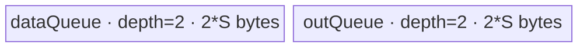
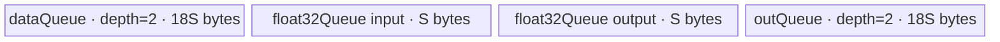

# ForeachTanh A2/A3 ACLNN 算子知识

## 算子速览

| 项目 | 内容 |
|---|---|
| 实际入口 | 公开两段式 `aclnnForeachTanhGetWorkspaceSize` / `aclnnForeachTanh`，无其它公开版本 |
| 计算语义 | 对列表中每个张量逐元素计算 `y_i[j] = tanh(x_i[j])` |
| 输入输出 | 动态 TensorList；ND；FLOAT16/FLOAT32/BFLOAT16；每个张量 0--8 维；输入可非连续、输出必须连续 |
| 执行类型 | 单 Kernel，唯一 Device 节点为 `AIV_VECTOR` |
| Kernel 路线 | R-001 FP16 直算；R-002 FP32 直算；R-003 BF16→FP32→BF16 |
| 核心资源 | TensorList GM 地址表、双缓冲 VECIN/VECOUT Queue；BF16 额外单缓冲 FP32 Queue；算子 body 不消费 workspace |
| 来源闭包 | `source_closed`：公开 ACLNN 约束→生成式 executor/连续化框架边界→`ForeachTanh` OpDef→arch22 Tiling→POD→`foreach_tanh` entry→`ForeachTriangle` body→构建接线闭合 |
| 验证状态 | 已完成源码闭包检查；本次知识提取未执行编译、真机、数值或性能测试。 |

## 接口与语义

### 计算语义

令 `x=[x_0,...,x_{n-1}]`，对每个张量的存储元素域 `0 <= j < numel(x_i)`，输出 `y_i[j]=tanh(x_i[j])`。Kernel 只写与输入元素数相同的前缀；若 ACLNN 传入的 `out_i` 容量大于 `x_i`，超出该前缀的元素不由本算子写入。空张量允许并产生空输出域。

### 输入、输出与属性

| 参数 | shape/layout | dtype | 约束、默认值与语义 |
|---|---|---|---|
| `x` | TensorList；每个张量 0--8 维，ND | FLOAT16/FLOAT32/BFLOAT16 | 非空列表指针；列表内 dtype 一致；支持空张量和非连续 Tensor，生成式 ACLNN 桥的连续化细节在固定仓不可见 |
| `out` | TensorList；每项容量 `>=` 对应输入，ND | 与 `x` 相同 | 列表内 dtype 一致；公开接口不支持非连续输出；图模式公共推导会令输出项数、shape、dtype 与输入逐项一致 |
| `workspaceSize` | 标量 | `uint64_t*` | 第一段接口输出；算子 Tiling 固定报告 32 bytes，生成式 ACLNN 前处理若需额外空间，其计算在固定仓不可见 |
| `executor` | 不适用 | `aclOpExecutor**` | 第一段接口产生，持有连续化、Host/Tiling 与 launch 流程 |
| `workspace` / `stream` | Device 地址 / stream | 不适用 | 第二段接口消费；Kernel 参数保留 workspace，但 body 显式改为 `nullptr`，不读该区 |

### 入口与版本

固定提交公开文档只声明这一组无版本后缀 API。文档产品表明确支持 Atlas A2、A3；OpDef 注册 `ascend910b` 与 `ascend910_93`，Host CMake 将两者映射到 `arch22`，Kernel CMake 将二者映射到同一个非 arch35 body。两段式 ACLNN 的自动生成 inner bridge 不在固定仓；其参数校验、输入连续化和 executor 封装作为框架边界，算子拥有的 OpDef、Tiling、POD 与 Kernel 均已闭合。

## Host/Launcher 执行流程

### 参数校验与前处理

公开第一段接口检查 `x/out` 非空、dtype 属于三种浮点类型且匹配、列表内 dtype 一致、维数不超过 8、对应输出容量不小于输入。OpDef 对动态输入和输出声明 `AutoContiguous()`；公开文档允许输入非连续而禁止输出非连续。之后 `Tiling4ForeachTanhTiling` 以 opCode 17 初始化 `ForeachCommonTiling`：枚举最多 50 个输入项，读取 storage shape 元素数并检查 dtype；`CheckOpInfo` 再检查输入/输出列表大小、shape/dtype 与维数。失败均返回 `GRAPH_FAILED`，由 ACLNN 框架映射为公开错误码。

### 参数、Workspace 与生命周期

Host 取平台 AIV 核数与 UB 大小。设 `N=sum_i numel(x_i)`，`E=32/sizeof(T)`，`C=min(platformAivCores,max(1,ceil(N/E)),50)`。它按 32-byte block 将聚合列表域近似均分给 `C` 个核，生成每核起止张量与张量内 offset。算子 Tiling 写 `workspace[0]=32`；Device entry 不把传入 workspace 交给 body。workspace 与 executor 由调用方在第二段执行完成前保持有效，stream 决定 launch 顺序；固定仓未公开生成式 executor 的额外 workspace 切片。

### 启动图与失败传播

```text
aclnnForeachTanhGetWorkspaceSize(x, out)
  -> 生成式 ACLNN 校验/输入连续化（固定仓框架边界）
  -> ForeachTanh / Tiling4ForeachTanhTiling
  -> ForeachCommonTiling::RunBigKernelTiling
aclnnForeachTanh(workspace, workspaceSize, executor, stream)
  -> K-001 foreach_tanh<<<blockDim=C, stream>>>(xListDesc, yListDesc, workspace, tiling)
     -> ForeachTriangle<T,...>::Process
```

这是单 Kernel 图，无跨 Kernel workspace 边。K-001 的输入/输出为 TensorList GM 描述符，POD 为 `ForeachCommonTilingData`；同一 stream 上 launch 成功后输出生效。Tiling、POD 获取或 launch 失败会阻断该节点；固定仓未公开 executor 的 cleanup 实现。

## Route 与参数设计

### 分核与资源计算

聚合元素数先换算为 `ceil(N/E)` 个 32-byte block；前 `blockCount % C` 个核多分一个 block。`AssignDataToEachCore` 将这一线性分段反解为 `tensorStart/End` 与 inclusive `tensorStartOffset/EndOffset`。设平台 UB 为 `U`、POD 序列化大小为 `P`：`raw=uint32(U-P-1024)`；FP16 的 `S=floor((raw/7)/32)*32`，FP32 的 `S=floor((raw/8)/32)*32`，BF16 的 `S=floor(((raw/10)/7)/64)*64`。`S=inputsTensorUbSize`，是每个 Queue slot 的基础字节预算，而非元素数。

### Route 选择

| 顺序 | Route | Key/模板 | 精确选择条件与优先级 | 不适用去向 |
|---:|---|---|---|---|
| 1 | R-001 FP16 直算 | key 1；`ForeachTriangle<half,half,Tanh<half,false>>` | `dataType == DT_FLOAT16` | 检查 key 2 |
| 2 | R-002 FP32 直算 | key 2；`ForeachTriangle<float,float,Tanh<float,false>>` | `dataType == DT_FLOAT` | 检查 key 4 |
| 3 | R-003 BF16 升精度 | key 4；`ForeachTriangle<bfloat16_t,float,Tanh<float,false>>` | `dataType == DT_BF16` 且非 NPU arch 3003/3113 编译 guard | 未知 key 无 body、无输出 |

```text
DT_FLOAT16 -> key 1 -> R-001
else DT_FLOAT -> key 2 -> R-002
else DT_BF16 -> key 4 -> R-003（arch 3003/3113 不编译该分支）
else -> key 0 / Tiling 失败
```

### 模板/实现执行矩阵

| Route | key/selector | dtype/shape/platform 完整命中条件 | 执行拓扑与 Kernel 节点 | 实际模板/body | 内存与同步特征 | tail/fallback |
|---|---|---|---|---|---|---|
| R-001 FP16 | 1 | FP16、合法 TensorList、A2/A3 | K-001 AIV_VECTOR | `ForeachTriangle<half,half,Tanh<half,false>>` | VECIN/VECOUT 各 depth 2；Queue + `PIPE_V` barrier | 尾 tile 用 byte-count `DataCopyPad` |
| R-002 FP32 | 2 | FP32、合法 TensorList、A2/A3 | K-001 AIV_VECTOR | `ForeachTriangle<float,float,Tanh<float,false>>` | 同上，`S` 的 Host 除数为 8 | 同上 |
| R-003 BF16 | 4 | BF16、合法 TensorList、A2/A3 且编译 guard 允许 | K-001 AIV_VECTOR | `ForeachTriangle<bfloat16_t,float,Tanh<float,false>>` | 两个 depth-2 Queue 的 slot 为 `9S`；另有 depth-1、`2S` FP32 Queue；Cast 间 `PIPE_V` barrier | 每次最多 `S/4` 元素分段升精度；尾 tile/尾 cast 均显式处理 |

### 隐藏性能 Guard

| Guard | Host/Tiling 条件 | Device/资源原因 | 影响 Route | 不满足时去向 | 源码符号 |
|---|---|---|---|---|---|
| TensorList 容量 | Host `Init` 循环 `i < 50` | POD 的 tensor 元素数组仅 50 项 | 全部 | 超出部分不进入闭合分配；安全复用边界为 `<=50` | `foreach_tiling_class.h::Init` |
| 32-byte 分核 | `E=32/sizeof(T)` | 整 tile `DataCopy` 以 block 对齐，尾 tile另走 Pad | 全部 | 尾部走 `DataCopyPad` | `GetNeedCoreNum` / `AssignDataToEachCore` |
| UB 预留 | `U > P+1024`，并按 dtype 除数得到 `S>0` | Queue、Tanh primitive 隐式临时量及 BF16 cast 均需 UB | 全部 | 固定源码无 fallback，算术下溢/零 tile 未被显式拒绝 | `DivideUbMemory5` |
| BF16 编译 guard | `__CCE_AICORE__>=220` 且 NPU arch 非 3003/3113 | BF16 Cast/Tanh<float> 实现受平台编译能力限制 | R-003 | key 4 无分支 | `foreach_tanh.cpp::foreach_tanh` |
| 空域 | 总元素数可为 0，Host 仍令 `blockDim=1` | 每核起止 POD 默认值可能形成空项边界 | 全部 | 单个空 tensor 的 `dataCount=0` 不搬运；空列表行为固定仓未闭合为成功 | `GetNeedCoreNum` / `SingleTensorProcess` |

### POD/ABI

| 结构 | 字段 | 类型/位宽 | ABI 布局 | 单位 | Host/launcher producer | Device consumer | 边界 |
|---|---|---|---|---|---|---|---|
| `ForeachCommonTilingData` | `inputsTensorUbSize` | `uint64_t`/64 | tiling 宏生成；固定仓不可见 `sizeof/alignof/offsetof` | bytes/Queue slot 基数 | `DivideUbMemory5`→`FillTilingData` | `KernelForeachBase::ParseTilingData`，计算 `maxDataCount` 与 InitBuffer 大小 | 32-byte 对齐；BF16 为 64-byte 对齐 |
| 同上 | `tensorDataCountList[50]` | `int64_t[50]` | 同上 | elements | `Init` 逐项写 storage shape size | `Process` 决定每张量末尾 | 仅前 `totalTensorCount` 有效 |
| 同上 | `tensorStartList[50]` | `uint16_t[50]` | 同上 | tensor index | `AssignDataToEachCore` | `ParseTilingData[blockIdx]` | 有效核索引 `<blockDim` |
| 同上 | `tensorEndList[50]` | `uint16_t[50]` | 同上 | inclusive tensor index | 同上 | 同上 | 同上 |
| 同上 | `tensorStartOffsetList[50]` | `int64_t[50]` | 同上 | elements | 同上 | `Process` 首项起点 | inclusive |
| 同上 | `tensorEndOffsetList[50]` | `int64_t[50]` | 同上 | elements | 同上 | `Process` 末项终点 | inclusive |

### Route 源码闭包

| Route | Key/selector | Host/Tiling producer | POD/参数 | Kernel entry/router 节点 | Kernel body/直接依赖 | 构建接线 |
|---|---|---|---|---|---|---|
| R-001 FP16 | key 1 | `foreach_tanh_tiling_arch22.cpp::Tiling4ForeachTanhTiling`；`ForeachCommonTiling` | `ForeachCommonTilingData` | `op_kernel/foreach_tanh.cpp::foreach_tanh` | `ForeachTriangle<half,...>`；`KernelForeachUnary` | `op_kernel/CMakeLists.txt::add_kernel_sources` |
| R-002 FP32 | key 2 | 同上 | 同上 | 同上 | `ForeachTriangle<float,...>`；`KernelForeachUnary` | 同上 |
| R-003 BF16 | key 4 | 同上 | 同上 | 同上 | `ForeachTriangle<bfloat16_t,float,...>`；BF16 `InnerComputer` | 同上 |

## Kernel 实现

### 公共执行流程

entry 解析 POD 后按 key 实例化一个 CRTP `ForeachTriangle`。基类从 TensorList GM 描述符首 qword 取得地址表偏移，再按 tensor index 取实际 GM 指针。每个核遍历其 inclusive 张量区间；每个张量分成 `maxDataCount` 元素 tile，执行 `CopyIn→Tanh→CopyOut`。完整 tile 使用 `DataCopy`，尾 tile使用单 block、字节长度的 `DataCopyPad`。输入 Queue `EnQue/DeQue`、输出 Queue `EnQue/DeQue` 管理搬运与 Vector 消费次序；Tanh 调用前后还插入 `PipeBarrier<PIPE_V>`。

### Route R-001：FP16 直算

#### 适用条件

##### 选择证据

| 层级 | 文件 | 符号 | 源码谓词/参数 | 结果/下一跳 |
|---|---|---|---|---|
| Host/Tiling | `foreach_utils/op_host/common_dtype.h` | `GetTilingKeyByDtypeOnly` | `DT_FLOAT16` | key 1 |
| Router | `foreach_tanh/op_kernel/foreach_tanh.cpp` | `foreach_tanh` | `TILING_KEY_IS(1)` | `ForeachTriangle<half,half,Tanh<half,false>>` |

#### Device 数据流

##### 函数级调用链

```text
foreach_tanh -> ForeachTriangle<half,...>::Init/Process
  -> KernelForeachUnary::Process -> SingleTensorProcess
    -> CopyIn -> ForeachTriangle::Compute -> InnerComputer<half,half>::Compute
    -> KernelForeachUnary::CopyOut
```

##### 源码等价伪码

```text
for tensor i in [tensorStart, tensorEnd]:
  start/end = POD 首末 offset 或张量边界
  bind x_i[start:], y_i[start:]
  for tile in ceil((end-start+1)/(S/2)):
    valid = min(S/2, remaining)
    inputQ.alloc; GM->UB(valid, tail 用 DataCopyPad); inputQ.enqueue
    in=inputQ.dequeue; out=outputQ.alloc
    barrier(V); Tanh<half,false>(out,in,valid); barrier(V)
    inputQ.free; outputQ.enqueue
    out=outputQ.dequeue; UB->GM(valid, tail 用 DataCopyPad); outputQ.free
```

#### 内存与数据搬运

##### 资源与搬运表

| 层级/缓冲区 | offset/地址公式 | extent/容量公式 | dtype/layout | producer | consumer | owner/lifetime | 对齐/复用 |
|---|---|---|---|---|---|---|---|
| GM `x_i/y_i` | TensorList 地址表项 + `cursorStart + tile*S/2` | `valid` elements | half/ND | caller / Compute | CopyIn / caller | caller，launch 期间有效 | 整 tile `S` bytes；尾按真实 bytes |
| `dataQueue` | Queue slot | `2*S` bytes | half | CopyIn | Compute | `TPipe`，Alloc→EnQue→DeQue→Free | depth 2 |
| `outQueue` | Queue slot | `2*S` bytes | half | Compute | CopyOut | 同上 | depth 2 |
| workspace | N/A | body 0 bytes | N/A | N/A | N/A | Tiling 报告 32 bytes但 body 不绑定 | 不复用 |

##### 分层内存布局



##### 字节账与复用顺序

```text
显式 UB_total = 2*S + 2*S = 4*S
Host 安全预算：S=floor(((U-P-1024)/7)/32)*32，另为 Tanh primitive 临时量留出系数余量
dynamic_ub = N/A
workspace_total = 32 bytes（Kernel body 实际消费 0）
```

| 复用子区 | 写入者 | 读取者/消费点 | 下一次覆盖 | 同步或释放依据 | 安全条件 |
|---|---|---|---|---|---|
| `dataQueue` slot | CopyIn | Tanh | `FreeTensor` 后后续 tile | Queue EnQue/DeQue/Free | depth 2 协议不被绕过 |
| `outQueue` slot | Tanh | CopyOut | `FreeTensor` 后后续 tile | Queue EnQue/DeQue/Free | CopyOut 完成前不可覆盖 |

#### 同步、精度与尾块

##### 同步与数值边界表

| 阶段 | primitive/机制 | producer | consumer/等待点 | 保护对象 | 精度/尾块 |
|---|---|---|---|---|---|
| GM→UB→Vector | Queue | CopyIn | Compute DeQue | input slot | half 直接计算；尾 tile按真实 byte count |
| Tanh | `PipeBarrier<PIPE_V>` | 前序 V 指令 | `Tanh` 及后序 V 指令 | Vector pipeline | `Tanh<half,false>`，固定仓不展开库内近似 |
| Vector→GM | Queue | Compute EnQue | CopyOut DeQue | output slot | 仅写 `valid` 元素 |

#### 关键实现

##### 符号证据表

| 阶段 | 文件 | 符号/模板实例 | 实现事实 |
|---|---|---|---|
| Host/Tiling producer | `foreach_utils/op_host/foreach_tiling_class.h` | `RunBigKernelTiling` / `DivideUbMemory5` | 分核、S、key、blockDim、workspace |
| Kernel entry/router | `foreach_tanh/op_kernel/foreach_tanh.cpp` | `foreach_tanh`, key 1 | 路由到 half 模板 |
| Device body/helper | `foreach_utils/op_kernel/foreach_triangle.h` | `InnerComputer<half,half>` | 直接 Tanh 和 V barrier |

### Route R-002：FP32 直算

#### 适用条件

##### 选择证据

| 层级 | 文件 | 符号 | 源码谓词/参数 | 结果/下一跳 |
|---|---|---|---|---|
| Host/Tiling | `foreach_utils/op_host/common_dtype.h` | `GetTilingKeyByDtypeOnly` | `DT_FLOAT` | key 2 |
| Router | `foreach_tanh/op_kernel/foreach_tanh.cpp` | `foreach_tanh` | `TILING_KEY_IS(2)` | `ForeachTriangle<float,float,Tanh<float,false>>` |

#### Device 数据流

##### 函数级调用链

```text
foreach_tanh -> ForeachTriangle<float,...>::Init/Process
  -> KernelForeachUnary::SingleTensorProcess
    -> CopyIn -> InnerComputer<float,float>::Compute(Tanh<float,false>) -> CopyOut
```

##### 源码等价伪码

```text
与 R-001 相同，但 maxDataCount=S/4；每个 tile 对 float 输入直接调用
Tanh<float,false>(outLocal, dataLocal, valid)，不做 cast。
```

#### 内存与数据搬运

##### 资源与搬运表

| 层级/缓冲区 | offset/地址公式 | extent/容量公式 | dtype/layout | producer | consumer | owner/lifetime | 对齐/复用 |
|---|---|---|---|---|---|---|---|
| GM `x_i/y_i` | 地址表项 + `cursorStart + tile*S/4` | `valid` | float/ND | caller / Compute | CopyIn / caller | caller | 整 tile S bytes，尾按真实 bytes |
| `dataQueue` | Queue slot | `2*S` bytes | float | CopyIn | Tanh | `TPipe` | depth 2 |
| `outQueue` | Queue slot | `2*S` bytes | float | Tanh | CopyOut | `TPipe` | depth 2 |
| workspace | N/A | body 0 bytes | N/A | N/A | N/A | Tiling 报告 32 bytes | 不复用 |

##### 分层内存布局


##### 字节账与复用顺序

```text
显式 UB_total = 4*S
S=floor(((U-P-1024)/8)/32)*32；余量由 Host 留给 Tanh<float> 内部临时资源
dynamic_ub = N/A
workspace_total = 32 bytes（body 0）
```

| 复用子区 | 写入者 | 读取者/消费点 | 下一次覆盖 | 同步或释放依据 | 安全条件 |
|---|---|---|---|---|---|
| input/output Queue slots | CopyIn/Tanh | Tanh/CopyOut | 各自 Free 后 | Queue 生命周期 | 不跨 Free 使用 LocalTensor |

#### 同步、精度与尾块

##### 同步与数值边界表

| 阶段 | primitive/机制 | producer | consumer/等待点 | 保护对象 | 精度/尾块 |
|---|---|---|---|---|---|
| 搬运 | Queue + DataCopy/Pad | GM/Compute | Tanh/GM | Queue slot | FP32；尾按 `valid*4` bytes |
| 计算 | `PipeBarrier<PIPE_V>` | CopyIn/V 指令 | `Tanh<float,false>`/CopyOut | Vector pipeline | 无 cast，库内算法固定仓不可见 |

#### 关键实现

##### 符号证据表

| 阶段 | 文件 | 符号/模板实例 | 实现事实 |
|---|---|---|---|
| Host/Tiling producer | `foreach_utils/op_host/foreach_tiling_class.h` | `DivideUbMemory5` | float 使用 calcPro 6、总除数 8 |
| Kernel entry/router | `foreach_tanh/op_kernel/foreach_tanh.cpp` | key 2 | float 模板 |
| Device body/helper | `foreach_utils/op_kernel/foreach_triangle.h` | `InnerComputer<float,float>` | float 直算 |

### Route R-003：BF16 升精度

#### 适用条件

##### 选择证据

| 层级 | 文件 | 符号 | 源码谓词/参数 | 结果/下一跳 |
|---|---|---|---|---|
| Host/Tiling | `foreach_utils/op_host/common_dtype.h` | `GetTilingKeyByDtypeOnly` | `DT_BF16` | key 4 |
| Router | `foreach_tanh/op_kernel/foreach_tanh.cpp` | `foreach_tanh` | key 4 且编译 guard 成立 | BF16 输入、float Tanh 模板 |

#### Device 数据流

##### 函数级调用链

```text
foreach_tanh -> ForeachTriangle<bfloat16_t,float,...>::Process
  -> CopyIn(BF16 tile)
  -> InnerComputer<bfloat16_t,float>::Compute
     -> ComputePerCast: Cast BF16->FP32 -> Tanh<float,false> -> Cast FP32->BF16(RINT)
  -> CopyOut(BF16 tile)
```

##### 源码等价伪码

```text
maxDataCount = 9*S/2; maxCastDataCount=S/4
for BF16 tile:
  copy valid BF16 elements to dataQueue
  for castChunk in ceil(valid/(S/4)):
    n=min(S/4,remaining)
    Cast(fp32[0:], bf16[chunkOffset:], CAST_NONE, n)
    barrier; Tanh<float,false>(fp32[S/4:], fp32[0:], n)
    barrier; Cast(bf16Out[chunkOffset:], fp32[S/4:], CAST_RINT, n)
  copy only valid BF16 outputs to GM
```

#### 内存与数据搬运

##### 资源与搬运表

| 层级/缓冲区 | offset/地址公式 | extent/容量公式 | dtype/layout | producer | consumer | owner/lifetime | 对齐/复用 |
|---|---|---|---|---|---|---|---|
| GM `x_i/y_i` | 地址表项 + tile offset | valid | BF16/ND | caller / cast | CopyIn / caller | caller | tail bytes=`valid*2` |
| `dataQueue` | Queue slot | `2*9S=18S` bytes | BF16 | CopyIn | cast | `TPipe` | depth 2 |
| `outQueue` | Queue slot | `18S` bytes | BF16 | final Cast | CopyOut | `TPipe` | depth 2 |
| `float32Queue` | `[0,S)` input cast；`[S,2S)` Tanh output | `2S` bytes | FP32 | Cast/Tanh | Tanh/Cast | Process 全程持有同一 LocalTensor | depth 1，两半不别名 |
| workspace | N/A | body 0 | N/A | N/A | N/A | Tiling 报告 32 bytes | 不复用 |

##### 分层内存布局



##### 字节账与复用顺序

```text
显式 UB_total = 18S + 18S + 2S = 38S
S=floor((floor((U-P-1024)/10)/7)/64)*64
dynamic_ub = N/A
workspace_total = 32 bytes（body 0）
```

| 复用子区 | 写入者 | 读取者/消费点 | 下一次覆盖 | 同步或释放依据 | 安全条件 |
|---|---|---|---|---|---|
| FP32 `[0,S)` | BF16→FP32 Cast | Tanh | 下一 cast chunk | `PIPE_V` barrier | Tanh 已读完当前 chunk |
| FP32 `[S,2S)` | Tanh | FP32→BF16 Cast | 下一 cast chunk | `PIPE_V` barrier | 降精度 Cast 已读完 |
| Queue slots | CopyIn/final Cast | Cast/CopyOut | Free 后 | Queue 生命周期 | valid 元素数不超过各自容量 |

#### 同步、精度与尾块

##### 同步与数值边界表

| 阶段 | primitive/机制 | producer | consumer/等待点 | 保护对象 | 精度/尾块 |
|---|---|---|---|---|---|
| 升精度 | Cast + `PIPE_V` barrier | BF16 input | Tanh | FP32 输入半区 | `CAST_NONE` |
| 计算 | `Tanh<float,false>` + barrier | FP32 input | 降精度 Cast | FP32 输出半区 | FP32 计算 |
| 降精度 | Cast | Tanh | CopyOut | BF16 outQueue | `CAST_RINT`；最后 cast chunk按 remainder |
| 搬运尾块 | DataCopyPad | GM/UB | UB/GM | 有效前缀 | 仅 `valid*2` bytes |

#### 关键实现

##### 符号证据表

| 阶段 | 文件 | 符号/模板实例 | 实现事实 |
|---|---|---|---|
| Host/Tiling producer | `foreach_utils/op_host/foreach_tiling_class.h` | `DivideUbMemory5` | BF16 额外除 10 并 64-byte 对齐 |
| Kernel entry/router | `foreach_tanh/op_kernel/foreach_tanh.cpp` | key 4 branch | 编译 guard 和 BF16→float 模板 |
| Device body/helper | `foreach_utils/op_kernel/foreach_triangle.h` | BF16 `InnerComputer::ComputePerCast` | 分段双 Cast、FP32 Tanh、RINT |

## 算子特定优化

### Trick T-001：按 Tanh 临时资源与 dtype 反推 tile 容量

#### 触发与源码依据

- 适用 Route：R-001、R-002、R-003
- 触发条件：`opCode == FOREACH_TANH_OP_CODE`
- Golden 来源：[`foreach_tiling_class.h:961-973`](../../../../../../../cann-ops-raw/ascendc/ops-nn/955f8b33985b6d72989ebff341bb9c2c564a51bc/foreach/foreach_utils/op_host/foreach_tiling_class.h#L961-L973)

**官方源码（固定 Commit 连续逐字摘录）**：

```cpp
} else if (opCode == FOREACH_TANH_OP_CODE) {
    uint32_t calcPro = TANH_FLOAT_CALC_PROC;
    if (dataTypeSize == BYTE_LEN_2) {
        calcPro = TANH_HALF_CALC_PROC;
    }
    uint32_t totalSize = uint32_t(ubSizePlatForm - tilingData.GetDataSize() - 1024);
    if (dataType == ge::DT_BF16) {
        totalSize = totalSize / UB_DIVIDER_FOR_TEMP_CASTING;
    }
    uint32_t canUseUbSize = totalSize / (calcPro + FOREACH_TANH_DIVIDER);
```

#### 机制与设计原因

Host 不把可用 UB 全给输入 tile，而是先扣 POD 与 1024 bytes，再按 Tanh 的 dtype 计算阶段系数和输入/输出 Queue 系数分摊；BF16 还先除 10，为升精度路径收缩 tile。这样 `S` 在进入 Kernel 前已经满足不同模板的保守资源上界，Device 不需运行时试探 UB 或退化分支。

#### 迁移边界

- 适用：具有 dtype 特定临时量、但共用 Foreach 分核框架的逐元素 Vector 算子。
- 前提：平台 UB 大小、POD 大小、Queue depth、Tanh 临时资源系数与 BF16 cast 布局保持一致。
- 失效：改变 primitive、Queue depth 或 BF16 中间布局时必须重算系数；固定实现无小 tile fallback。
- 未验证：本次知识提取未执行编译、真机、数值或性能测试。

#### 错误做法

固定仓未提供可验证反例。

## 模板与实现对比

| 对比维度 | R-001 FP16 | R-002 FP32 | R-003 BF16 | 设计选择依据 |
|---|---|---|---|---|
| 命中条件/优先级 | key 1 | key 2 | key 4 + 编译 guard | dtype 单轴分发 |
| 模板与 dtype | half→half | float→float | BF16→float→BF16 | BF16 升精度 |
| 循环与分核 | 聚合域分核，tile `S/2` | 同左，tile `S/4` | tile `9S/2`，内部 cast chunk `S/4` | 元素宽度与 cast 容量 |
| Queue/TBuf/寄存器/dynamic UB/通信 window | 两个 depth-2 Queue | 同左 | 两个 18S Queue + 2S FP32 Queue | BF16 中间物化 |
| 内存总占用与复用 | 显式 4S | 显式 4S | 显式 38S，FP32 两半轮换覆盖 | Host dtype 预算 |
| 搬运/Vector/SIMT/NDDMA/通信 API | DataCopy/Pad + half Tanh | DataCopy/Pad + float Tanh | DataCopy/Pad + Cast/Tanh/Cast | 精度路线 |
| 同步、精度与 tail | Queue + V barrier；half | 同左；float | cast 间 V barrier；RINT | 数据依赖 |
| fallback/失败边界 | 未知 key无输出 | 同左 | guard 不满足无 key4 body | 固定实现无 fallback |

## 平台差异

| 项目 | A2 | A3 | 950 |
|---|---|---|---|
| 支持状态 | 公开支持 | 公开支持 | 公开支持，但实现见 `_950` 卡 |
| Host/Launcher | `ascend910b`→arch22 公共 Tiling | `ascend910_93`→arch22 公共 Tiling | arch35 专用 Tiling |
| Kernel/资源 | 公共 AIV Vector body | 与 A2 共用 body；平台实际核数/UB由 Host 查询 | SIMT body，无 AIV Queue |

## 限制与失败边界

- 公开 dtype 仅 FLOAT16/FLOAT32/BFLOAT16，ND，单张量维数不超过 8；输出必须连续，输出容量不得小于输入，且只有输入元素对应前缀会被写入。
- arch22 POD 最多容纳 50 个张量/50 个核；Host 对核数显式截断到 50，但对超过 50 个 TensorList 项没有公开成功语义，复用时必须把 50 作为上界。
- `U-P-1024` 先窄化为 `uint32_t`，固定源码没有显式检查下溢或 `S==0`；不能假设任意小 UB 都有 fallback。
- 算子 Tiling 报告 32-byte workspace，但 Device body不消费；生成式 ACLNN 连续化可能产生的额外 workspace 公式、executor cleanup 和错误映射实现固定仓不可见。
- `Tanh` primitive 的库内多项式/舍入细节属于 AscendC 库边界；本卡只闭合其模板类型、长度和前后 Cast/同步。
- 本次知识提取未执行编译、真机、数值或性能测试。

## 源码索引

### 链路索引

| 链路阶段 | 文件 | 关键符号 | 支撑内容 |
|---|---|---|---|
| 入口声明/约束 | `foreach/foreach_tanh/docs/aclnnForeachTanh.md` | 两段式函数原型、产品表 | 公开入口、平台、dtype/shape/错误语义 |
| 入口实现 | `foreach/foreach_tanh/op_host/foreach_tanh_def.cpp` | `ops::ForeachTanh` | 动态输入输出、AutoContiguous、平台注册 |
| Host/Tiling/Launcher | `foreach/foreach_tanh/op_host/arch22/foreach_tanh_tiling_arch22.cpp` | `Tiling4ForeachTanhTiling` | arch22 入口与 opCode 17 |
| Host/Tiling/Launcher | `foreach/foreach_tanh/op_host/CMakeLists.txt` | `SUPPORT_COMPUTE_UNIT` / `SUPPORT_TILING_DIR` | A2/A3 到 arch22 的活动映射 |
| Host/Tiling/Launcher | `foreach/foreach_utils/op_host/foreach_tiling_class.h` | `ForeachCommonTiling` | 校验、分核、UB、workspace、POD producer |
| Host/Tiling/Launcher | `foreach/foreach_utils/op_host/foreach_tiling_def.h` | `ForeachCommonTilingData` | POD 字段与 ForeachTanh 注册 |
| Host/Tiling/Launcher | `foreach/foreach_utils/op_host/common_dtype.h` | `GetDataTypeSize` / `GetTilingKeyByDtypeOnly` | dtype 大小与 key 映射 |
| Host/Tiling/Launcher | `foreach/foreach_utils/op_host/foreach_infershape.cpp` | `InferShape4ForeachCommon` / `InferDataType4ForeachCommon` | 图模式逐项 shape/dtype 传播 |
| Kernel entry/body | `foreach/foreach_tanh/op_kernel/foreach_tanh.cpp` | `foreach_tanh` | key router 与三种模板 |
| Kernel entry/body | `foreach/foreach_utils/op_kernel/kernel_foreach_base.h` | `KernelForeachBase` | POD 消费与 TensorList GM 地址表解析 |
| Kernel entry/body | `foreach/foreach_utils/op_kernel/kernel_foreach_unary.h` | `KernelForeachUnary` | Queue、循环、CopyIn/Out、tail |
| Kernel entry/body | `foreach/foreach_utils/op_kernel/foreach_triangle.h` | `ForeachTriangle` / `InnerComputer` | Tanh 与 BF16 Cast 管线 |
| 构建接线 | `foreach/foreach_tanh/op_kernel/CMakeLists.txt` | `add_kernel_sources` | A2/A3 选择公共 Kernel body |

### 实现复用检查

| 检查项 | 可复用事实 | 不得改变的约束 | 源码符号 |
|---|---|---|---|
| ABI/POD | 六字段公共 Foreach 分核 POD | 数组 50 项、单位、inclusive offset、宏生成 ABI | `ForeachCommonTilingData` |
| 调用顺序 | CopyIn→Tanh/ Cast管线→CopyOut | Queue 生命周期和 BF16 cast chunk 顺序 | `SingleTensorProcess` / `ComputePerCast` |
| workspace/内存 | body 无 workspace；Queue按 S 分配 | depth 必须计入；BF16 totalTensorUbSize=9S | `Init` |
| 同步 | Queue + `PIPE_V` barrier | Cast/Tanh/Cast 数据依赖不可重排 | `InnerComputer` |
| 精度与尾块 | FP16/FP32直算，BF16 FP32升精度后 RINT | tail byte count、cast remainder、round mode | `CopyIn` / `CopyOut` / `ComputePerCast` |
| 失败边界 | 校验失败或未知 key终止 | 50 项、UB、编译 guard 不能外推 | `CheckOpInfo` / `foreach_tanh` |