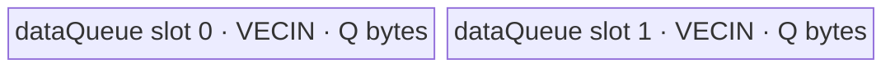
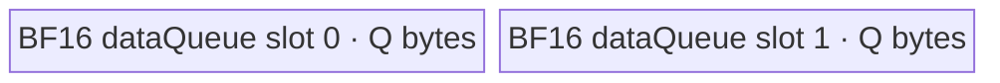

# ForeachZeroInplace A2/A3 ACLNN 算子知识

## 算子速览

| 项目 | 内容 |
|---|---|
| 实际入口 | `aclnnForeachZeroInplaceGetWorkspaceSize` + `aclnnForeachZeroInplace`，公开 ACLNN 两段式接口 |
| 计算语义 | 对列表 `x=[x_0,...,x_{n-1}]` 原地执行 `x_i[j]=0`，不产生独立输出张量 |
| 输入输出 | 动态 TensorList `x`；各 Tensor 同 dtype、ND、0～8 维、连续；支持 FP16/FP32/INT16/INT32/BF16 |
| 执行类型 | 单 Kernel、单 AIV_VECTOR 节点；无 AIC/Cube、SIMT、NDDMA 或通信节点 |
| Kernel 路线 | R-001：FP16/FP32/INT32/INT16 常规 UB；R-002：BF16 衰减 UB |
| 核心资源 | 原地 GM TensorList；`VECIN` 双缓冲 `TQue`；无实际用户 workspace 消费，Host 仍预留 32 B |
| 来源闭包 | `source_closed`：公开 ACLNN 契约经生成式 ACLNN/运行时边界进入 `ForeachZeroInplace` OpDef、公共 Tiling、dtype router 与 `ForeachZeroInplaceND<T>` body |
| 验证状态 | 已完成源码闭包检查；本次知识提取未执行编译、真机、数值或性能测试。 |

## 接口与语义

### 计算语义

令 `x` 含 `n` 个连续 ND Tensor，第 `i` 个 Tensor 的存储元素数为 `N_i`。接口原地写入：

```text
for i in [0, n):
  for j in [0, N_i):
    x_i[j] = static_cast<dtype(x_i)>(0)
```

Device 不读取原值：它在 UB 中用 `Duplicate(..., 0, count)` 合成零，再把零块写回输入 GM。输出有效域就是每个输入 Tensor 的原存储域；shape、dtype 和 layout 不变。

### 输入、输出与属性

| 参数 | shape/layout | dtype | 约束、默认值与语义 |
|---|---|---|---|
| `x` | TensorList；每个 Tensor 为 ND、0～8 维 | FP16、FP32、INT16、INT32、BF16；列表内一致 | 输入/输出别名；公开文档支持空 Tensor，不支持非连续 Tensor；空指针、非法 dtype、列表内 dtype 不一致或维数大于 8 失败 |
| 独立输出 | N/A | N/A | 原地接口没有独立输出描述或 Kernel 输出参数 |

### 入口与版本

公开版本只有 `aclnnForeachZeroInplace` 两段式接口：第一段校验并返回 `workspaceSize` 与 `executor`，第二段接收 workspace、executor 和 stream 执行。固定仓未提供手写 ACLNN C++ bridge；该生成式 bridge、executor 壳与 TensorList 打包属于框架边界。算子拥有的 OpDef、Tiling 注册、POD producer、Kernel router/body 和构建接线均已闭合。

`README.md` 与 ACLNN 文档明确支持 Atlas A2/A3，且 OpDef 注册 `ascend910b`、`ascend910_93`，binary config 与 Kernel CMake 同时接线。固定仓未出现更新版本入口或复用到其它 ACLNN 版本的证据。

## Host/Launcher 执行流程

### 参数校验与前处理

1. ACLNN 第一段拒绝 `x == nullptr` 和不在 FP16/FP32/INT16/INT32/BF16 集合内的 dtype；文档把列表内 dtype 不一致和维数超过 8 归为 inner tiling error。
2. OpDef 将动态输入 `x` 声明为 ND、上述五种 dtype，并启用 `AutoContiguous()`；公开 ACLNN 约束又明确原地输入不接受非连续 Tensor，因此不能把此标记解释成允许 ACLNN 为原地输入制造可回拷的临时连续副本。
3. `ForeachCommonTiling::Init` 最多扫描 50 个动态输入实例，记录每个存储 shape 的元素数；首个 dtype 决定 `dataTypeSize` 与 `elementsPerBlock=32/dataTypeSize`，后续 dtype 不一致立即失败。
4. `CheckOpInfo` 检查输入实例信息、每个 Tensor 维数 `<=8` 和 dtype 一致。`TYPE_INPLACE` 令 `CheckOutputShapeAndDtype` 直接成功，因为没有独立输出。
5. 公开文档声称支持空 Tensor；对应 `N_i=0` 时 Kernel 的 `SingleTensorProcess(0)` 不进入 full/tail 写回。公开材料没有把“空 TensorList”列为支持域，固定源码也没有显式空列表 launch 短路，不能外推为空列表支持。

### 参数、Workspace 与生命周期

设平台 UB 字节数为 `U`，序列化 POD 的 `GetDataSize()` 为 `P`，元素字节数为 `d`：

- Host 从 `PlatformAscendC` 读取 `U` 与 AIV 核数。
- R-001 令 `Q=floor_32(floor((U-P)/2))`；R-002 先令 `T=floor((U-P)/10)`，再令 `Q=floor_64(floor(T/2))`。`Q` 写入 `inputsTensorUbSize`。
- Kernel 的 `TQue<VECIN,2>` 每个槽分配 `Q` B，总 UB 账为 `2Q`；`maxDataCount=Q/d`。
- Tiling 总是写 `workspaces[0]=32` B，但 Kernel entry 将 `userWS=nullptr` 传给 `Init`，body 从不读 `workspace`。这 32 B 由 ACLNN executor 报告并由调用方持有到 stream 上任务完成，不能误当成算法中间区。
- executor 由第一段创建，第二段在指定 stream 上提交单 Kernel。输入 Tensor 的设备内存必须至少活到该 stream 完成，因为它就是原地输出。

### 启动图与失败传播

```text
aclnnForeachZeroInplaceGetWorkspaceSize(x)
  -> 生成式 ACLNN/executor 边界
  -> ForeachZeroInplace OpDef + Tiling4ForeachZeroInplaceTiling
     -> ForeachCommonTiling::Init(ZERO_OP_CODE, TYPE_TENSORS, TYPE_INPLACE)
     -> ForeachCommonTiling::RunBigKernelTiling
  -> workspaceSize=32 B + executor

aclnnForeachZeroInplace(workspace, 32, executor, stream)
  -> 单节点 K0: foreach_zero_inplace(x, workspace, tiling)
     blockDim=needCoreNum, POD=ForeachCommonTilingData
     -> ForeachZeroInplaceND<T>::Process
     -> 原地覆盖 x
```

| 节点/边 | producer | consumer | 介质与范围 | ordering / owner / failure |
|---|---|---|---|---|
| K0 参数 | Tiling runtime | `foreach_zero_inplace` | `x` TensorList descriptor、32 B 保留 workspace、POD | executor 在指定 stream 提交；Tiling 失败则不应启动 K0 |
| K0 原地边 | 调用方输入 `x_i` | K0 MTE3 写回及后续 stream 任务 | 每个 `x_i[0:N_i)`，dtype/ND 不变 | 输入 owner 为调用方；同 stream 的后续消费者依赖正常 stream 顺序；launch/运行失败时固定仓未给出回滚机制 |

该 Route 没有 Kernel 间 workspace 边。生成式 ACLNN bridge 的具体 C++ 错误传播代码在固定仓不可见；公开契约给出第一段状态码，Device body 为 `void` entry，不提供逐 Tensor 失败返回。

## Route 与参数设计

### 分核与资源计算

令 `S=sum_i N_i`、`e=32/d`（每个 32 B block 的元素数）、平台 AIV 数为 `C_platform`：

```text
B = ceil(S / e)                         # 32 B block 数
C0 = (B == 0 ? 1 : min(B, C_platform))
C = min(C0, 50)                         # blockDim
q = floor(B / C)
r = B mod C
core j 的目标配额 = (q + (j < r ? 1 : 0)) * e 个元素
```

`AssignDataToEachCore` 按 TensorList 的扁平前缀顺序把配额映射为 `tensorStart/End` 与首尾元素 offset；一个核可以跨多个 Tensor，一个 Tensor 也可以在核边界被切开。最后一核只写实际存在的元素，不写全局 32 B padding。`tensorStart/End` 是 `uint16_t`，但列表上限 50 使索引不发生窄化；`needCoreNum` 也被截到 50。

### Route 选择

| 顺序 | Route | Key/模板 | 精确选择条件与优先级 | 不适用去向 |
|---:|---|---|---|---|
| 1 | R-001 常规零填充 | key 1/2/3/5；`ForeachZeroInplaceND<half/float/int/int16_t>` | dtype 分别为 FP16/FP32/INT32/INT16；`GetTilingKeyByDtypeOnly` 直接映射 | dtype 为 BF16 时到 R-002；其它 dtype 被公开接口/OpDef 拒绝或 key 0 无 body |
| 2 | R-002 BF16 衰减 UB 零填充 | key 4；`ForeachZeroInplaceND<bfloat16_t>` | dtype=BF16，且编译 guard `__CCE_AICORE__ >= 220` 且不是 NPU arch 3003/3113 | guard 不成立则 router 无 key-4 body；A2/A3 的公开与构建支持共同要求该实例可用 |

```text
dtype == FP16  -> key 1 -> R-001<half>
dtype == FP32  -> key 2 -> R-001<float>
dtype == INT32 -> key 3 -> R-001<int>
dtype == BF16  -> key 4 -> R-002<bfloat16_t>（受编译 guard）
dtype == INT16 -> key 5 -> R-001<int16_t>
otherwise      -> key 0 / 无 router body -> 入口支持域外
```

### 模板/实现执行矩阵

| Route | key/selector | dtype/shape/platform 完整命中条件 | 执行拓扑与 Kernel 节点 | 实际模板/body | 内存与同步特征 | tail/fallback |
|---|---|---|---|---|---|---|
| R-001 常规零填充 | 1/2/3/5 | FP16/FP32/INT32/INT16；ND、维数<=8、列表内同 dtype；A2/A3 | 单 K0 AIV_VECTOR | `ForeachZeroInplaceND<T>::Init/Process/SingleTensorProcess/ComputeAndCopyOut` | `VECIN` depth=2，每槽 `Q=floor_32((U-P)/2)`；V→MTE3、MTE3→MTE2 event | full tile 用 `DataCopy`；尾 tile 用按有效字节计的 `DataCopyPad`；无另一 Kernel fallback |
| R-002 BF16 衰减 UB 零填充 | 4 | BF16；其余 shape/platform 条件同上；满足 router 编译 guard | 单 K0 AIV_VECTOR | 同一 body 的 `bfloat16_t` 实例 | `VECIN` depth=2，每槽 `Q=floor_64(floor(floor((U-P)/10)/2))`；同步同 R-001 | tail 同 R-001；guard 不成立无 body |

### 隐藏性能 Guard

| Guard | Host/Tiling 条件 | Device/资源原因 | 影响 Route | 不满足时去向 | 源码符号 |
|---|---|---|---|---|---|
| TensorList 容量 | `totalTensorCount <= MAX_TENSOR_CONT=50`（扫描在 50 停止） | POD 只给 50 个 `tensorDataCountList` 项 | 全部 | 超过 50 的额外实例不会进入该 POD；公开文档未声明更大列表，不能安全复用 | `foreach_tiling_def.h::MAX_TENSOR_CONT`；`ForeachCommonTiling::Init` |
| 核数容量 | `C<=MAX_CORE_CONT=50` | POD 只有 50 组核起止字段 | 全部 | Host 截到 50 核 | `RunBigKernelTiling` |
| 32 B 分核粒度 | `e=32/d`，`C<=ceil(S/e)`（非空域） | full `DataCopy` 按对齐 tile 搬运，尾部另走扩展搬运 | 全部 | 最后一段走 tail；`S=0` 仍取 1 核 | `GetNeedCoreNum`；`AssignDataToEachCore` |
| UB 可用量 | `U>P`，R-001 再二分并向下 32 B 对齐；R-002 再 `/10`、二分、向下 64 B 对齐 | 双槽 Queue 必须容纳 `2Q`；`maxDataCount=Q/d` 不能为 0 | 全部 | 固定源码没有显式 `Q>0` 失败 guard；资源不足会使 Device 除零，属于调用环境前提 | `DivideUbMemory1`；`ForeachZeroInplaceND::Init` |
| BF16 编译 guard | `__CCE_AICORE__>=220 && arch!=3003 && arch!=3113` | 决定 key 4 router body 是否编译 | R-002 | 无 fallback body | `foreach_zero_inplace` |
| tail 字节位宽 | `dataCount*sizeof(T)` 转为 `uint32_t` | `DataCopyExtParams.blockLen` 为 32 位字节数 | 全部 | 固定 Host 未写显式溢出 guard；受每槽 `Q` 的平台 UB 上界约束 | `ComputeAndCopyOut` |

### POD/ABI

`ForeachCommonTilingData` 的序列化宏定义来自仓外 CANN 注册头；固定仓可确认字段顺序、源码类型和数组长度，但不能可靠给出最终 `sizeof/alignof/offsetof`。Host 与 Device 都使用同名结构，entry 通过 `GET_TILING_DATA` 解析。

| 结构 | 字段 | 类型/位宽 | ABI 布局 | 单位 | Host/launcher producer | Device consumer | 边界 |
|---|---|---|---|---|---|---|---|
| `ForeachCommonTilingData` | `inputsTensorUbSize` | `uint64_t`/64 | 第 1 字段；精确 offset/总大小固定仓不可见 | 字节/Queue 槽 | `DivideUbMemory1`；`FillTilingData::set_inputsTensorUbSize` | `ParseTilingData`；`InitBuffer`；除以 `sizeof(T)` 得 tile 元素数 | R-001 向下 32 B 对齐；R-002 向下 64 B 对齐；Device 再窄化到 `uint32_t maxDataCount` |
| `ForeachCommonTilingData` | `tensorDataCountList` | `int64_t[50]` | 第 2 字段；精确 offset 固定仓不可见 | 元素/每 Tensor | `Init` 读取 storage shape size；`FillTilingData` | `Process` 计算每个 Tensor 的默认末元素 | 空 Tensor 为 0；只存 50 项 |
| `ForeachCommonTilingData` | `tensorStartList` | `uint16_t[50]` | 第 3 字段；精确 offset 固定仓不可见 | Tensor 索引/每核 | `AssignDataToEachCore`；`FillTilingData` | `ParseTilingData` 后作为 `Process` 循环起点 | 只读取 `blockIdx` 对应项 |
| `ForeachCommonTilingData` | `tensorEndList` | `uint16_t[50]` | 第 4 字段；精确 offset 固定仓不可见 | Tensor 索引/每核 | `AssignDataToEachCore`；`FillTilingData` | `Process` 循环终点（含端点） | 只读取活动核项 |
| `ForeachCommonTilingData` | `tensorStartOffsetList` | `int64_t[50]` | 第 5 字段；精确 offset 固定仓不可见 | 元素/每核 | `AssignDataToEachCore`；`FillTilingData` | 首 Tensor 的起始元素 offset | 非首 Tensor 固定从 0 开始 |
| `ForeachCommonTilingData` | `tensorEndOffsetList` | `int64_t[50]` | 第 6 字段；精确 offset 固定仓不可见 | 元素/每核 | `AssignDataToEachCore`；`FillTilingData` | 末 Tensor 的含端点 offset | 空 Tensor 可为 -1；非末 Tensor 使用 `N_i-1` |

### Route 源码闭包

| Route | Key/selector | Host/Tiling producer | POD/参数 | Kernel entry/router 节点 | Kernel body/直接依赖 | 构建接线 |
|---|---|---|---|---|---|---|
| R-001 常规零填充 | `GetTilingKeyByDtypeOnly` -> 1/2/3/5 | `foreach_tiling_func.cpp::Tiling4ForeachZeroInplaceTiling`；`foreach_tiling_class.h::RunBigKernelTiling` | `ForeachCommonTilingData` | `foreach_zero_inplace.cpp::foreach_zero_inplace` 的 key 1/2/3/5 分支 | `foreach_zero_inplace.h::ForeachZeroInplaceND<T>` 全部方法 | `op_kernel/CMakeLists.txt::add_kernel_sources(ascend910b, ascend910_93)` |
| R-002 BF16 衰减 UB 零填充 | `GetTilingKeyByDtypeOnly` -> 4 | 同上；`DivideUbMemory1` 的 BF16 分支 | 同一 POD，`inputsTensorUbSize` 取 `/10` 路径 | `foreach_zero_inplace` key 4 编译条件分支 | `ForeachZeroInplaceND<bfloat16_t>` | 同上；OpDef 与 A2/A3 binary config 含 BF16 |

## Kernel 实现

### 公共执行流程

两个 Route 都是单 Kernel：entry 解析 POD、按 key 构造唯一 `ForeachZeroInplaceND<T>` 实例，`Init` 依据 `blockIdx` 取当前核的 TensorList 区间并建立双槽 Queue，`Process` 跨 Tensor 遍历。每个 Tensor 区间再按 `maxDataCount` 切 tile；tile 内只执行 UB 零生成和 UB→GM 原地写回，没有 GM→UB CopyIn、数值 cast、workspace 访问或跨核归约。

### Route R-001：常规零填充

#### 适用条件

##### 选择证据

| 层级 | 文件 | 符号 | 源码谓词/参数 | 结果/下一跳 |
|---|---|---|---|---|
| API | `docs/aclnnForeachZeroInplace.md` | `aclnnForeachZeroInplaceGetWorkspaceSize` | x dtype 属于 FP16/FP32/INT16/INT32/BF16，连续 ND | 非 BF16 继续到 R-001 |
| Host | `foreach_utils/op_host/common_dtype.h` | `GetTilingKeyByDtypeOnly` | FP16/FP32/INT32/INT16 | key 1/2/3/5 |
| Tiling | `foreach_utils/op_host/foreach_tiling_class.h` | `DivideUbMemory1` | `opCode==ZERO_OP_CODE && dataType!=BF16` | `Q=floor_32((U-P)/2)` |
| Router | `op_kernel/foreach_zero_inplace.cpp` | `foreach_zero_inplace` | `TILING_KEY_IS(1/2/3/5)` | 实例化 half/float/int/int16_t body |

#### Device 数据流

##### 函数级调用链

```text
Tiling4ForeachZeroInplaceTiling
  -> ForeachCommonTiling::Init(ZERO_OP_CODE, TYPE_TENSORS, TYPE_INPLACE)
  -> ForeachCommonTiling::RunBigKernelTiling
aclnnForeachZeroInplace stream launch K0: foreach_zero_inplace(x, workspace, tiling)
  -> GET_TILING_DATA(ForeachCommonTilingData)
  -> ForeachZeroInplaceND<T>::Init
     -> ParseTilingData
     -> pipe.InitBuffer(dataQueue, 2, inputsTensorUbSize)
  -> ForeachZeroInplaceND<T>::Process
     -> GetTensorAddr
     -> SingleTensorProcess
        -> ComputeAndCopyOut
           -> AllocTensor -> Duplicate(0) -> V_MTE3 event
           -> DataCopy/DataCopyPad -> MTE3_MTE2 event -> FreeTensor
```

##### 源码等价伪码

```text
# 伪码；所有 offset 均为 T 元素
j = GetBlockIdx()
startTensor = pod.tensorStartList[j]
endTensor = pod.tensorEndList[j]
tileElems = pod.inputsTensorUbSize / sizeof(T)
InitBuffer(dataQueue[VECIN], depth=2, bytesPerSlot=pod.inputsTensorUbSize)

for tensorId in [startTensor, endTensor]:
  begin = (tensorId == startTensor) ? pod.tensorStartOffsetList[j] : 0
  end = (tensorId == endTensor) ? pod.tensorEndOffsetList[j]
                                : pod.tensorDataCountList[tensorId] - 1
  count = end - begin + 1
  gm = resolve_tensor_list_pointer(x, tensorId) + begin
  full = count / tileElems
  rem = count % tileElems
  for tileId in [0, full):
    local = AllocTensor(dataQueue)
    Duplicate(local, T(0), tileElems)
    SetFlag/WaitFlag(V_MTE3)
    DataCopy(gm[tileId * tileElems], local, tileElems)
    SetFlag/WaitFlag(MTE3_MTE2)
    FreeTensor(local)
  if rem > 0:
    local = AllocTensor(dataQueue)
    Duplicate(local, T(0), rem)
    SetFlag/WaitFlag(V_MTE3)
    DataCopyPad(gm[full * tileElems], local,
                blockCount=1, blockLen=rem*sizeof(T), srcStride=0, dstStride=0)
    SetFlag/WaitFlag(MTE3_MTE2)
    FreeTensor(local)
```

TensorList 地址解析把 `x` 视为 `uint64_t*`：首个 64 位值是从 descriptor 起点到指针表的字节 offset，右移 3 转成 `uint64_t` 索引，随后读取表中第 `tensorId` 个绝对 GM 地址。

#### 内存与数据搬运

##### 资源与搬运表

| 层级/缓冲区 | offset/地址公式 | extent/容量公式 | dtype/layout | producer | consumer | owner/lifetime | 对齐/复用 |
|---|---|---|---|---|---|---|---|
| GM `x` descriptor | base `x`；指针表 `x + (*uint64(x)>>3)` | TensorList descriptor，精确字节布局由框架产生 | `uint64_t` metadata | ACLNN/runtime | `GetTensorAddr` | framework/caller；Kernel 全程有效 | 首 offset 以字节存储，Device 除 8 |
| GM `x_i` 原地数据 | `ptr[i] + begin + tileId*tileElems` | full=`tileElems`；tail=`rem` | T/ND contiguous | caller；本 Kernel 覆盖 | 后续任务 | caller owner；写回后即结果 | full 走 `DataCopy`；tail 按有效字节走 `DataCopyPad` |
| UB `dataQueue` slot 0 | Queue 管理 | `Q` B | T | `Duplicate` | MTE3 `DataCopy*` | `AllocTensor` 至 `FreeTensor` | `VECIN`；depth 2；Q 向下 32 B 对齐 |
| UB `dataQueue` slot 1 | Queue 管理 | `Q` B | T | 下一可用 tile 的 `Duplicate` | MTE3 | 同上 | 与 slot 0 ping-pong；源码为顺序循环但 Queue 保留双槽 |
| workspace | entry 参数；body 改为 `userWS=nullptr` | 32 B Host 保留 | opaque | ACLNN caller | 无 Device consumer | 调用方持有至 stream 完成 | 不参与 UB/GM 数据流 |

##### 分层内存布局



##### 字节账与复用顺序

```text
P = ForeachCommonTilingData.GetDataSize()
Q = floor_32(floor((U - P) / 2))
UB_total = 2 * Q
UB_total <= U - P <= U
dynamic_ub = N/A（AIV TPipe 静态/运行时 InitBuffer 路径）
workspace_total = 32 B reserved；0 B consumed by body
=> tileElems = Q / sizeof(T)，要求 Q > 0
```

| 复用子区 | 写入者 | 读取者/消费点 | 下一次覆盖 | 同步或释放依据 | 安全条件 |
|---|---|---|---|---|---|
| 当前 `dataQueue` slot | `Duplicate` | MTE3 `DataCopy`/`DataCopyPad` | `FreeTensor` 后的后续 tile | `V_MTE3` 等待零生成完成；`MTE3_MTE2` 等待写回完成后 `FreeTensor` | 两个 event 都必须保留，且不得在 MTE3 完成前复用 slot |

#### 同步、精度与尾块

##### 同步与数值边界表

| 阶段 | primitive/机制 | producer | consumer/等待点 | 保护对象 | 精度/尾块 |
|---|---|---|---|---|---|
| UB 零生成→写回 | `SetFlag/WaitFlag<HardEvent::V_MTE3>` | Vector `Duplicate` | MTE3 搬运 | 当前 local slot 的有效 `dataCount` | 零直接按 T 生成，无 cast/round |
| 写回→Queue 复用 | `SetFlag/WaitFlag<HardEvent::MTE3_MTE2>` | MTE3 `DataCopy*` | `FreeTensor` 及后续 Alloc | 当前 local slot | 防止 GM 写回未完成便覆盖 UB |
| full tile | `DataCopy` | UB 零块 | GM | `tileElems` 个元素 | Q 已按 32 B 对齐；无 tail mask |
| tail tile | `DataCopyPad` + `DataCopyExtParams{1, rem*sizeof(T),0,0,0}` | UB 中 `rem` 个零 | GM | 仅有效尾字节 | 不写超出 Tensor 末端的对齐 padding |
| 空 Tensor | `full=0, rem=0` | N/A | N/A | 零长度域 | 不调用 `Duplicate` 或搬运 |

#### 关键实现

##### 符号证据表

| 阶段 | 文件 | 符号/模板实例 | 实现事实 |
|---|---|---|---|
| Host/Tiling producer | `foreach_utils/op_host/foreach_tiling_class.h` | `RunBigKernelTiling`、`AssignDataToEachCore`、`DivideUbMemory1`、`FillTilingData` | 生成 key、核区间、Q、POD、blockDim 与 32 B workspace |
| Kernel entry/router | `foreach/foreach_zero_inplace/op_kernel/foreach_zero_inplace.cpp` | `foreach_zero_inplace` key 1/2/3/5 | 映射到四个非 BF16 模板实例，并把实际 workspace 丢弃 |
| Device body/helper | `foreach/foreach_zero_inplace/op_kernel/foreach_zero_inplace.h` | `ForeachZeroInplaceND<T>::Process/SingleTensorProcess/ComputeAndCopyOut/GetTensorAddr` | 跨 Tensor/tile 遍历、零合成、原地写回、同步与 tail |

### Route R-002：BF16 衰减 UB 零填充

#### 适用条件

##### 选择证据

| 层级 | 文件 | 符号 | 源码谓词/参数 | 结果/下一跳 |
|---|---|---|---|---|
| API | `docs/aclnnForeachZeroInplace.md` | `aclnnForeachZeroInplaceGetWorkspaceSize` | x dtype=BF16；A2/A3 公开支持 | 继续到 R-002 |
| Host | `foreach_utils/op_host/common_dtype.h` | `GetTilingKeyByDtypeOnly` | `ge::DT_BF16` | key 4 |
| Tiling | `foreach_utils/op_host/foreach_tiling_class.h` | `DivideUbMemory1` | `opCode==ZERO_OP_CODE && dataType==BF16` | `(U-P)` 先 `/10`，再二分、64 B 对齐 |
| Router | `op_kernel/foreach_zero_inplace.cpp` | `foreach_zero_inplace` | key 4 且编译 guard 成立 | `ForeachZeroInplaceND<bfloat16_t>` |

#### Device 数据流

##### 函数级调用链

```text
Tiling4ForeachZeroInplaceTiling
  -> ForeachCommonTiling::RunBigKernelTiling (key=4, BF16 Q)
aclnnForeachZeroInplace stream launch K0: foreach_zero_inplace
  -> guarded key-4 router
  -> ForeachZeroInplaceND<bfloat16_t>::Init
  -> ForeachZeroInplaceND<bfloat16_t>::Process
     -> SingleTensorProcess
        -> ComputeAndCopyOut
           -> Duplicate(bfloat16_t(0)) -> event -> DataCopy/DataCopyPad -> event
```

##### 源码等价伪码

```text
# 伪码；分核、地址和循环与 R-001 相同，仅 Host Q 与 T 不同
T = bfloat16_t
usable0 = uint32(U - P)
usable1 = floor(usable0 / 10)
Q = floor_64(floor(usable1 / 2))
tileElems = Q / 2
for each assigned tensor segment and tile:
  local = AllocTensor<bfloat16_t>()
  Duplicate(local, bfloat16_t(0), validElems)
  wait V_MTE3
  if full: DataCopy(gm[offset], local, validElems)
  else: DataCopyPad(gm[offset], local, {1, validElems*2, 0, 0, 0})
  wait MTE3_MTE2
  FreeTensor(local)
```

#### 内存与数据搬运

##### 资源与搬运表

| 层级/缓冲区 | offset/地址公式 | extent/容量公式 | dtype/layout | producer | consumer | owner/lifetime | 对齐/复用 |
|---|---|---|---|---|---|---|---|
| GM descriptor / `x_i` | 同 R-001 | 每个核分配的有效元素域 | BF16/ND contiguous | caller / `GetTensorAddr` | Kernel / 后续任务 | caller owner | full 32 B 对齐，tail 有效字节写回 |
| UB `dataQueue` slot 0 | Queue 管理 | `Q` B | BF16 | `Duplicate` | MTE3 | Alloc→Free | Q 向下 64 B 对齐 |
| UB `dataQueue` slot 1 | Queue 管理 | `Q` B | BF16 | 后续 tile | MTE3 | Alloc→Free | depth 2；event 保护复用 |
| workspace | entry 参数 | 32 B 保留 | opaque | caller | 无 | stream 生命周期 | body 不消费 |

##### 分层内存布局



##### 字节账与复用顺序

```text
P = ForeachCommonTilingData.GetDataSize()
T = floor((U - P) / 10)
Q = floor_64(floor(T / 2))
UB_total = 2 * Q <= T <= U - P
dynamic_ub = N/A（AIV TPipe 路径）
workspace_total = 32 B reserved；0 B consumed
=> tileElems = Q / 2，要求 Q > 0
```

| 复用子区 | 写入者 | 读取者/消费点 | 下一次覆盖 | 同步或释放依据 | 安全条件 |
|---|---|---|---|---|---|
| BF16 `dataQueue` 当前 slot | `Duplicate` | `DataCopy*` | `FreeTensor` 后后续 tile | V_MTE3 与 MTE3_MTE2 两组 event | 与 R-001 相同；`/10` 只改变容量，不改变 lifetime |

#### 同步、精度与尾块

##### 同步与数值边界表

| 阶段 | primitive/机制 | producer | consumer/等待点 | 保护对象 | 精度/尾块 |
|---|---|---|---|---|---|
| 零生成 | `Duplicate<bfloat16_t>` | Vector | MTE3 | BF16 local tile | 直接生成 BF16 0，无 FP32 临时量、cast 或 round |
| Vector→MTE3 | `V_MTE3` event | `Duplicate` | `DataCopy*` | 当前 slot | 必须等待 |
| MTE3→复用 | `MTE3_MTE2` event | `DataCopy*` | `FreeTensor` | 当前 slot | 必须等待 |
| tail | `DataCopyPad` blockLen=`rem*2` B | UB | GM | 最后 `rem` 个 BF16 | 不触碰 Tensor 外字节 |

#### 关键实现

##### 符号证据表

| 阶段 | 文件 | 符号/模板实例 | 实现事实 |
|---|---|---|---|
| Host/Tiling producer | `foreach_utils/op_host/foreach_tiling_class.h` | `DivideUbMemory1` BF16 分支 | 对可用 UB 施加 `/10` 衰减并 64 B 对齐 |
| Kernel entry/router | `foreach/foreach_zero_inplace/op_kernel/foreach_zero_inplace.cpp` | guarded key-4 branch | 映射 `bfloat16_t` body；移动架构 3003/3113 被排除 |
| Device body/helper | `foreach/foreach_zero_inplace/op_kernel/foreach_zero_inplace.h` | `ForeachZeroInplaceND<bfloat16_t>` | body 与 R-001 同构，直接 BF16 Duplicate 和原地写回 |

## 算子特定优化

### Trick T-001：省略 GM 输入读取，直接在 UB 合成零并原地写回

#### 触发与源码依据

- 适用 Route：R-001、R-002
- 触发条件：所有合法 dtype、每个 `dataCount>0` 的 full 或 tail tile
- Golden 来源：[`foreach/foreach_zero_inplace/op_kernel/foreach_zero_inplace.h:130-145`](../../../../../../../cann-ops-raw/ascendc/ops-nn/955f8b33985b6d72989ebff341bb9c2c564a51bc/foreach/foreach_zero_inplace/op_kernel/foreach_zero_inplace.h#L130-L145)

**官方源码（固定 Commit 连续逐字摘录）**：

```cpp
__aicore__ inline void ForeachZeroInplaceND<T>::ComputeAndCopyOut(uint16_t index, int64_t dataCount, bool isRemainder)
{
    LocalTensor<T> dataLocal = dataQueue.AllocTensor<T>();

    Duplicate(dataLocal, (T)0, dataCount);

    // Transport can be performed only after the Muls is complete.
    event_t eventIDVToMTE3 = static_cast<event_t>(GetTPipePtr()->FetchEventID(HardEvent::V_MTE3));
    SetFlag<HardEvent::V_MTE3>(eventIDVToMTE3);
    WaitFlag<HardEvent::V_MTE3>(eventIDVToMTE3);
    if (isRemainder) {
        DataCopyExtParams copyParams{1, static_cast<uint32_t>(dataCount * sizeof(T)), 0, 0, 0};
        DataCopyPad(inTensorsGM[1ULL * index * maxDataCount], dataLocal, copyParams);
    } else {
        DataCopy(inTensorsGM[1ULL * index * maxDataCount], dataLocal, dataCount);
    }
```

#### 机制与设计原因

置零结果与旧值无关，因此 body 没有 `CopyIn`。`Duplicate` 只按当前 tile 的 `dataCount` 在 UB 生成 T 类型零；`V_MTE3` event 保证生成完成后才写回。full tile 复用对齐 `DataCopy`，tail 用 `blockCount=1`、`blockLen=dataCount*sizeof(T)` 的扩展搬运，只提交有效字节。这一设计从源码上消除一次 GM→UB 读取和输入 Queue，同时避免 tail 覆盖相邻内存；不声称未经实测的性能幅度。

#### 迁移边界

- 适用：输出完全独立于输入值、且允许覆盖目标 GM 的常量填充类原地算子。
- 前提：目标连续、常量可由 `Duplicate` 以目标 dtype 精确表示、Host 能按 32 B 粒度分核并提供精确 tail 长度。
- 失效：若结果依赖旧值、目标非连续、需要 broadcast 索引或写回必须保留未覆盖 lane，则必须恢复相应 CopyIn/地址变换，不能复用该 body。
- 未验证：本次知识提取未执行编译、真机、数值或性能测试。

#### 错误做法

固定仓未提供可验证反例；从当前源码能确定的是，删除 `V_MTE3` 等待或让 tail 使用 full-tile 写回都会破坏现有同步/有效范围协议，但固定仓没有对应错误实现可供对照。

## 模板与实现对比

| 对比维度 | R-001 常规零填充 | R-002 BF16 衰减 UB | 设计选择依据 |
|---|---|---|---|
| 命中条件/优先级 | key 1/2/3/5 | key 4 + 编译 guard | dtype 直接决定，互斥且无 shape selector |
| 模板与 dtype | half/float/int/int16_t | bfloat16_t | 仅 C++ 元素类型不同 |
| 循环与分核 | 32 B block 分核，跨 Tensor/tile | 相同 | 公共 POD 与 body |
| Queue/TBuf/寄存器/dynamic UB/通信 window | `TQue<VECIN,2>`；无显式 TBuf/dynamic UB/通信 | 相同 Queue，Q 更小 | Host BF16 `/10` 分支 |
| 内存总占用与复用 | `2*floor_32((U-P)/2)` | `2*floor_64(floor((U-P)/20))` | BF16 采用保守衰减；Device 实际没有额外 cast buffer |
| 搬运/Vector/SIMT/NDDMA/通信 API | `Duplicate` + `DataCopy/DataCopyPad` | 同上，BF16 类型 | 都是 AIV_VECTOR |
| 同步、精度与 tail | V_MTE3、MTE3_MTE2；目标类型零；有效字节 tail | 相同，无升降精度 | 零无需算术精度路径 |
| fallback/失败边界 | 非支持 dtype 无 body | guard 不成立无 key-4 body | 没有 SIMT/NDDMA 或第二 Kernel fallback |

## 平台差异

| 项目 | A2 | A3 | 950 |
|---|---|---|---|
| 支持状态 | 公开支持；`ascend910b` 接线 | 公开支持；`ascend910_93` 接线 | 公开 README 与 ACLNN 文档明确不支持；虽存在 `ascend950` OpDef/config/CMake，实现与发布文档冲突，不发布正式卡 |
| Host/Launcher | 共用 `ForeachCommonTiling`，最多 50 核 | 同 A2 | 实现信号共用当前 Tiling，但不能覆盖公开“不支持”结论 |
| Kernel/资源 | 同一 AIV_VECTOR entry/body | 同 A2 | Kernel CMake 含 `ascend950`，但仅是实现信号，不构成 ACLNN 公开支持 |

## 限制与失败边界

- TensorList 最多 50 项是 POD/Host 扫描的固定上限；公开文档未另行声明更大列表行为。
- 所有 Tensor 必须连续、ND、0～8 维且 dtype 一致；支持空 Tensor，但固定公开材料没有明确允许空 TensorList。
- Tiling 的 `uint32_t(U-P)`、Device 的 `uint32_t maxDataCount=Q/sizeof(T)` 和 tail `uint32_t blockLen` 都存在窄化点；常规平台 UB 尺寸使其通常受资源上界约束，但固定源码没有显式溢出检查，移植时必须保留范围证明。
- `Q==0` 时 Device 的 tile 除法会除零；固定 Host 没有显式 guard，要求平台 `U` 足以容纳 POD 和至少一个对齐的双缓冲槽。
- Host 报告 32 B workspace，但 Kernel 丢弃该指针；不能让复用实现依赖这 32 B 保存跨核状态。
- unknown key 没有显式 error/fallback 分支，entry 直接结束且不会置零；入口/OpDef 的 dtype 校验必须先阻断。
- 950 存在公开不支持与实现接线冲突，依据发布 gate 未生成 `foreach_zero_inplace_950.md`。
- 固定仓未提供生成式 ACLNN bridge 的 C++ 实现、Tiling 序列化宏最终 ABI 布局和运行时 stream launch 代码；这些仅作为明确框架边界，不推测具体实现。
- 本次知识提取未执行编译、真机、数值或性能测试。

## 源码索引

### 链路索引

| 链路阶段 | 文件 | 关键符号 | 支撑内容 |
|---|---|---|---|
| 入口声明/约束 | `foreach/foreach_zero_inplace/docs/aclnnForeachZeroInplace.md` | `aclnnForeachZeroInplaceGetWorkspaceSize`、`aclnnForeachZeroInplace` | 两段式原型、参数、dtype/shape、错误与 A2/A3/950 公开支持表 |
| 入口声明/约束 | `foreach/foreach_zero_inplace/README.md` | `ForeachZeroInplace` 产品表与公式 | 原地语义、连续约束、产品支持交叉证据 |
| Host 注册 | `foreach/foreach_zero_inplace/op_host/foreach_zero_inplace_def.cpp` | `ops::ForeachZeroInplace` | 动态输入 dtype/format、AutoContiguous、A2/A3/950 实现注册 |
| Host/Tiling | `foreach/foreach_utils/op_host/foreach_tiling_func.cpp` | `Tiling4ForeachZeroInplaceTiling`、`IMPL_OP_OPTILING` | ZERO/TYPE_TENSORS/TYPE_INPLACE 初始化和 Tiling 注册 |
| Host/Tiling | `foreach/foreach_utils/op_host/foreach_tiling_class.h` | `ForeachCommonTiling` | 校验、分核、UB、POD、blockDim、workspace 全部 producer |
| POD | `foreach/foreach_utils/op_host/foreach_tiling_def.h` | `ForeachCommonTilingData` | 六个字段、数组上限和算子 POD 注册 |
| selector | `foreach/foreach_utils/op_host/common_dtype.h` | `GetDataTypeSize`、`GetTilingKeyByDtypeOnly` | dtype 大小与 key 映射 |
| Kernel entry | `foreach/foreach_zero_inplace/op_kernel/foreach_zero_inplace.cpp` | `foreach_zero_inplace` | key router、模板实例、BF16 guard、workspace 丢弃 |
| Kernel body | `foreach/foreach_zero_inplace/op_kernel/foreach_zero_inplace.h` | `ForeachZeroInplaceND<T>` | TensorList 地址、循环、Queue、Duplicate、搬运、同步、tail |
| 构建接线 | `foreach/foreach_zero_inplace/op_kernel/CMakeLists.txt` | `add_kernel_sources` | ascend910b/ascend910_93 与 ascend950 编译接线及 `AUTO_SYNC false` |

### 实现复用检查

| 检查项 | 可复用事实 | 不得改变的约束 | 源码符号 |
|---|---|---|---|
| ABI/POD | 六字段共同描述 tile 大小与每核跨 Tensor 区间 | 字段顺序、类型、50 项上限、end offset 为含端点；精确 ABI 需使用同一 CANN 序列化定义 | `ForeachCommonTilingData`；`FillTilingData`；`ParseTilingData` |
| 调用顺序 | Init→Parse/InitBuffer→Process→逐 Tensor→逐 tile | key 选定的 T 必须和 Host dtype/key 一致 | `foreach_zero_inplace`；`ForeachZeroInplaceND<T>` |
| workspace/内存 | 双槽 Queue；32 B workspace 只保留 | Q 字节而非元素；depth=2 必须计入；不得把保留 workspace 当算法区 | `DivideUbMemory1`；`Init` |
| 同步 | Duplicate 后 V_MTE3，搬运后 MTE3_MTE2 | 两个等待都在 FreeTensor/复用之前 | `ComputeAndCopyOut` |
| 精度与尾块 | 直接按 T 生成零；full 对齐 copy、tail 有效字节 copy | 不引入无证据 cast；tail 不可越过 Tensor 末端 | `ComputeAndCopyOut` |
| 失败边界 | Host 校验 dtype/维数/列表一致性；unknown key 无 body | 必须阻断非法 dtype、Q=0、超 50 Tensor 与 950 发布冲突 | `CheckOpInfo`；`GetTilingKeyByDtypeOnly`；router |
