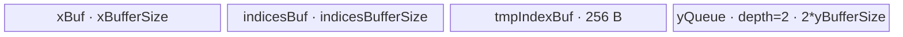

# Embedding 950 ACLNN 算子知识

## 算子速览

| 项目 | 内容 |
|---|---|
| 实际入口 | `aclnnEmbeddingGetWorkspaceSize` + `aclnnEmbedding`，公开两段式 ACLNN；固定 Commit 中没有更高版本入口。 |
| 计算语义 | 对二维 `weight[V, D]`，令 `N=Numel(indices)`，按 `indices` 的逻辑顺序输出 `out[..., D]`，其中 `out[p, d]=weight[indices[p], d]`。 |
| 输入输出 | `weight` 为 2-D ND；`indices` 为任意维 ND；`out.shape=indices.shape+[D]`，`out.dtype=weight.dtype`。输入与输出均允许非连续视图。 |
| 执行类型 | 可选框架 `Contiguous/ViewCopy` 边界；Gather 主节点为 AIV_VECTOR（R-002/R-003/R-004/R-006）、SIMT（R-005）或 AICPU（R-007）。每条非空路线均为单个核心语义 Kernel 节点。 |
| Kernel 路线 | R-001 空输入；R-002 SIMD 二维逐行搬运；R-003 末轴全载入 Vector Gather；R-004 GA 全载入；R-005 SIMT 二维直访 GM；R-006 PCIe 地址 SIMD fallback；R-007 Complex128 AICPU。 |
| 核心资源 | AIV 使用 GM、UB、`TQue/TBuf` 与寄存器；SIMT 直访 GM 并设置 dynamic local memory；AICPU 使用 CPU 地址与逐 slice `BiggerMemCpy`；AICore tiling 固定声明 16 MiB workspace，但这些 Gather body 不读取 `workspace`。 |
| 来源闭包 | `source_closed`：公开 ACLNN、参数检查、框架前后处理、`GatherV2` L0 选择、950 Tiling/POD、全部 Embedding 可达 entry/body、AICPU fallback 与构建接线均已闭合；目录内独立 `Embedding` Kernel 在该 ACLNN 实现中不可达。 |
| 验证状态 | 已完成源码闭包检查；本次知识提取未执行编译、真机、数值或性能测试。 |

## 接口与语义

### 计算语义

设 `weight` 的 shape 为 `[V,D]`，把 `indices` 展平成长度 `N` 的序列 `idx`。有效索引域为 `0 <= idx[p] < V`，有效输出域为 `N*D` 个元素：

```text
for p in [0, N):
  for d in [0, D):
    out_flat[p * D + d] = weight[idx[p] * D + d]
```

实际 L0 节点是 `GatherV2(weight, axis=0, indices, batchDims=0, negativeIndexSupport=false)`。Tiling 将二维 Embedding 特化成 `batchSize=1`、`outerSize=1`、`gatherDimSize=V`、`gatherSize=N`、`innerSize=D`（可能按连续 2/4/8 字节组重解释）。算子不进行数值运算，所有 dtype 都按位搬运；Vector 路线用 `int8/int16/int32/int64` 载体实现等宽复制。

### 输入、输出与属性

| 参数 | shape/layout | dtype | 约束、默认值与语义 |
|---|---|---|---|
| `weight` | 2-D、ND；可为非连续 view | BF16、FP16、FP32、FP64、INT8/16/32/64、UINT8、BOOL、COMPLEX64、COMPLEX128 | 非空时 `V>0` 且 `D>0`；950 API 校验表由 `CheckDtypeValid` 决定。 |
| `indices` | 任意维、ND；可为非连续 view | INT32、INT64 | 文档有效域为 `[0,V)`；固定源码各 backend 的越界行为并不完全一致，见限制章节。 |
| `out` | `indices.shape+[D]`、ND；可为非连续 view | 与 `weight` 相同 | API 只显式检查 rank 比 `indices` 多 1 且前导维等于 `indices`；末维与 `D` 的一致性未在 `CheckDimension` 中显式检查。 |
| `workspaceSize` | 标量 Host 输出 | `uint64_t` | 来自 executor 聚合；AICore Gather Tiling 向框架声明 16 MiB，非连续前后处理可继续增加 executor workspace。 |
| `executor` | Host 对象 | `aclOpExecutor*` | 第一段创建并移交所有可选 `Contiguous`、Gather 与 `ViewCopy` 节点；第二段消费。 |
| `stream` | ACL runtime stream | `aclrtStream` | `CommonOpExecutorRun` 按 executor 顺序提交。 |

### 入口与版本

公开版本族只有 `aclnnEmbeddingGetWorkspaceSize/aclnnEmbedding`。固定实现先处理空 tensor；非空时无条件创建 `weightContiguous` 与 `indicesContiguous`，950 上 `CheckHighperf` 因要求 `DAV_2201` 为 false，所以只调用普通 `l0op::GatherV2`，再用 `ViewCopy` 提交到用户 `out`。文件中存在 `CheckEmbeddingKernel`、`IsUseNoContiguous` 和 `l0op::Embedding`，但第一段入口没有调用它们，故独立 `index/embedding/op_host` 与 `op_kernel/embedding.cpp` 不属于公开 ACLNN 的 Host 可达实现。

## Host/Launcher 执行流程

### 参数校验与前处理

顺序固定为：创建 executor → 非空指针 → dtype 支持与 `out.dtype==weight.dtype` → 三个 tensor 的 rank 不超过 8 → `out.rank=indices.rank+1` 且 `out` 前导 shape 等于 `indices`。若 `weight` 或 `indices` 为空，直接返回 `workspaceSize=0` 的空 executor。非空时调用两次框架 `Contiguous`；这两个调用对本来连续的 tensor 可退化为框架 view/无复制，对非连续 tensor 形成前置复制节点，具体框架 Kernel 属于允许的框架边界。

### 参数、Workspace 与生命周期

`l0op::GatherV2` 在 executor 内分配连续临时输出 `[indices.shape,D]`，并把 Host 常量 `axis=0` 转成 INT64 tensor。950 `IsAiCoreSupport` 对除 COMPLEX128 外的 ACLNN dtype 返回 true，添加 `GatherV2` AICore launcher；COMPLEX128 添加 AICPU launcher。AICore Tiling 的 `GetWorkspaceSize` 固定写 `16*1024*1024` 字节；本卡覆盖的 entry 接收但不读取 `workspace`。executor 拥有中间 tensor、框架节点与 workspace 切片，直到第二段执行完成；用户拥有传入的 workspace 和 stream。

### 启动图与失败传播

```text
R-001: empty(weight) || empty(indices)
  -> empty executor, workspaceSize=0, no Gather node

R-002..R-006:
  [optional Contiguous(weight)] --executor stream--+
  [optional Contiguous(indices)] ------------------+-> GatherV2 AICore(axis=0, attrs={0,false})
                                                     -> [optional ViewCopy] -> out

R-007:
  optional Contiguous nodes -> GatherV2 AICPU(axis=0, attrs={0,false}) -> optional ViewCopy -> out
```

Gather 节点输入为连续 `weight/indices` 与 executor 生成的 INT64 `axis`；输出是 executor 临时连续 tensor。AICore 的 `blockDim=needCoreNum`，POD 按 Route 变化，workspace slice 为 tiling 声明的 16 MiB、body 不消费。AICPU 节点没有 AICore blockDim/POD。节点按同一 executor/stream 顺序提交；任一 `Contiguous`、launcher 或 `ViewCopy` 返回空指针即终止第一段并返回错误，第二段由 `CommonOpExecutorRun` 传播运行失败。框架内部复制节点的精确 workspace offset/extent 在固定仓可见的算子源码中不可见。

## Route 与参数设计

### 分核与资源计算

对非空 Embedding，`batch=outer=1`，`V=gatherDimSize`，`N=gatherSize`。先令原始元素字节数为 `s`、一行字节数为 `rowBytes=D*s`；`XDtypeImprove` 优先在 `rowBytes%8==0` 时取 `s'=8`，否则依次尝试 4、2，最后取 `s'=s`，并令 `inner'=rowBytes/s'`。平台提供 `C=aivNum`、`U=ubSize`、`B=UB block size`、`R=vRegSize`。

- SIMD 二维：`blockFactor=floor(N/C)`，`tail=N-blockFactor*C`，`needCore=C`（若 `blockFactor>0`）否则为 `tail`；`maxElement=floor_B(U-8192)/s'/2`，index cache 为 `8192/sizeof(indices)` 个元素。
- LastGather：先按 `V` 行域分核；当核数不超过 `C/2` 且 `N` 足够大时再用 `coreInCols` 拆输出列。Host 在 UB 不等式中选择 input depth 2 或 1，再求 `ubRows/ubCols`、各 Queue 字节数与 `splitMode`。
- GA all-load：先把 `outerSize=1` 与 indices 两轴映射到 `pOuter*indicesOuter` 个核；`aSizeAligned=align_B(rowBytes)`，恰为 128 或 256 字节时额外加一个 UB block；每个 GA tile 用 `(V+1)*aSizeAligned`，第 0 行为越界零哨兵。
- SIMT 二维：线程数从 2048 开始，在小输出上按 2 递减到至少 128；`perCore=ceil(N*inner'/C)` 再对齐线程数，最后一核用 `lastCoreElements`。

### Route 选择

| 顺序 | Route | Key/模板 | 精确选择条件与优先级 | 不适用去向 |
|---:|---|---|---|---|
| 1 | R-001 空输入 | 无 Kernel | `weight->IsEmpty() \|\| indices->IsEmpty()` | 非空进入 2 |
| 2 | R-007 AICPU | `GatherV2CpuKernel` | 950 且 `weight.dtype==COMPLEX128`；`IsAiCoreSupport` 不含该 dtype | 其他 dtype 进入 AICore Tiling |
| 3 | R-002 SIMD 二维 | `1000000299` | `rowBytes>=2048`，或 `s'=1 && rowBytes>=218`，或 `s'=2 && rowBytes>=360`，或 `s'=4 && rowBytes>=620`；并且 `N>=C/2` | 进入 4 |
| 4 | R-003 LastGather | `1100000000+s'`（Embedding 的 negative flag 为 false） | `inner'==1`；`V*s'<=U/2 \|\| V*s'<=U-32768`；`s'<=2 ? V<65536 : V<INT32_MAX`；`floor(N/V)>1`；`N*s'>=32`；`s'<=8` | 进入 5 |
| 5 | R-004 GA all-load | `3000` | `32<rowBytes<2048`；排除 `s'=8 && align_B(rowBytes)*V<=512`；`floor(N/V)>1`；且 `U-256-4*16384-min(N,1024/sizeof(indices))*sizeof(indices)-align_B(rowBytes)*(V+1)>=0` | 进入 6 |
| 6 | R-006 PCIe SIMD fallback | 与 R-005 相同的 `2000000000+s'(+100 if 64-bit address)` | Tiling 已选二维 SIMT，且 entry 发现任一 `x/indices/axis/y` 地址位于 `[0x40000000000,0x80000000000)` | 地址不命中为 R-005 |
| 7 | R-005 SIMT 二维 | `2000000000+s'(+100 if 64-bit address)` | 对 Embedding 的 `batch=outer=1`，前述路线均未命中且地址不是 PCIe 区间 | 无后续 Route |

```text
if empty(weight) || empty(indices): R-001
else if dtype == COMPLEX128: R-007
else:
  compute s', inner', V, N, C, U
  if IsSimdTwoDim(): R-002
  else if IsLastGatherAndFullLoad(): R-003
  else if IsGaAllLoad(): R-004
  else:                         # IsSimtTwoDim() 恒为 true
    key = 2000000000 + s' + (V*inner' > INT32_MAX || N*inner' > INT32_MAX ? 100 : 0)
    if any GM address in PCIe range: R-006
    else: R-005
```

### 模板/实现执行矩阵

| Route | key/selector | dtype/shape/platform 完整命中条件 | 执行拓扑与 Kernel 节点 | 实际模板/body | 内存与同步特征 | tail/fallback |
|---|---|---|---|---|---|---|
| R-001 空输入 | Host early return | 任一输入空 | 零 Kernel | `aclnnEmbeddingGetWorkspaceSize` | workspace 0 | 无输出写节点 |
| R-002 SIMD 二维 | 1000000299 | 上表 SIMD 谓词；950 AICore dtype | 单 AIV | `Gatherv2SimdTwoDim<DTYPE_INDICES>` | 双深度 bind queue + 8 KiB index TBuf；MTE/V event | 分行或分列，末段按实际字节 |
| R-003 LastGather | 1100000001/2/4/8 | `inner'=1` 与全载入谓词；key 尾数为 `s'` | 单 AIV | `Gatherv2SimdLastGather<int{8,16,32,64}_t,DTYPE_INDICES,false>` | input/index/output Queue + int64 index cast TBuf；MicroAPI Gather | `splitMode` 控制 indices 是否分片 |
| R-004 GA all-load | 3000 | 中等行宽、重复查表且 UB 可容纳 | 单 AIV | `Gatherv2GaAllLoad<DTYPE_INDICES,false>` | x/index/helper TBuf + 双深度 yQueue；显式 MTE/V event | 按 x tile、indices tile、y tile 三级尾块 |
| R-005 SIMT 二维 | 2000000001/2/4/8 或 +100 | 前三 AICore路线不命中；非 PCIe 地址 | 单 SIMT | `Gatherv2SimtTwoDim<int{8,16,32,64}_t,DTYPE_INDICES,uint32_t/uint64_t>` | GM 直访；dynamic local=`U-128KiB`，body 不显式分配 shared UB | 每线程步长 `threadNum`；越界置 0 |
| R-006 PCIe SIMD | 同 R-005 | R-005 key 且任一地址在 PCIe 区间 | 单 AIV | `Gatherv2SimdTwoDimPcie<DTYPE_INDICES>` | Device 重新按 `GetUBSize-128KiB` 算双队列与 8 KiB index TBuf | 与 R-002 相同分行/列 tail |
| R-007 AICPU | `IsAiCoreSupport=false` | COMPLEX128 | 单 AICPU | `GatherV2CpuKernel::Compute` → `DoGatherV2Compute<std::complex<double>,Index>` | CPU 逐 slice `BiggerMemCpy`，无 AIV UB/POD | 首个非法正越界返回错误；负索引加 V |

### 隐藏性能 Guard

| Guard | Host/Tiling 条件 | Device/资源原因 | 影响 Route | 不满足时去向 | 源码符号 |
|---|---|---|---|---|---|
| dtype 打包 | `rowBytes%8/4/2==0` 按优先级 | 用更宽整数按位搬运，缩短逻辑 `innerSize` | 所有 AICore | 保持原 dtype 宽度 | `gather_v2_tiling.cpp::XDtypeImprove` |
| SIMD 二维门槛 | 行字节阈值且 `N>=C/2` | 足够行宽与核并行度才使用 DMA/Vector 行复制 | R-002 | R-003 | `IsSimdTwoDim` |
| LastGather 全载入 | `inner'==1`、V 可装 UB、重复率与 Gather 下标范围 | 整个 gather 轴驻留 UB 后用 `DataCopyGather` | R-003 | R-004 | `IsLastGatherAndFullLoad` |
| GA bank padding | `aSizeAligned==128 \|\| 256` 时 `+=B` | 避免 Gather 访问固定步长 bank 冲突 | R-004 | 仍为 R-004，改变内存布局 | `IsGaAllLoad/GaAllLoadTiling` |
| GA UB 容量 | `remainSpace>=0` | 同时容纳 `(V+1)` 行、indices、双输出和 helper | R-004 | R-005/R-006 | `IsGaAllLoad` |
| 地址位宽 | `V*inner'>INT32_MAX \|\| N*inner'>INT32_MAX` | 防止 GM 线性地址窄化 | R-005/R-006 | key 增加 100，实例改 `uint64_t` | `GetTilingKey` |
| PCIe 地址 | 任一 GM 地址落入固定区间 | SIMT 直访路径改为显式 UB 搬运 | R-005/R-006 | 非命中继续 SIMT | `gather_v2_apt.cpp::gather_v2` |
| SIMT local memory | Tiling 对 SIMT key 调用 `SetLocalMemorySize(U-128KiB)` | 为 SIMT runtime/cache 保留动态 local 区 | R-005/R-006 | 无其它 fallback | `Gatherv2TilingBase::PostTiling` |

### POD/ABI

宏 `BEGIN_TILING_DATA_DEF` 生成序列化结构；固定仓未显式展开 `sizeof/alignof/offsetof`，故 ABI 布局栏只记录字段顺序，不能推测 padding。producer 均在 `Gatherv2TilingBase` 对应 Tiling 函数，consumer 为对应 Device 类。

| 结构 | 字段 | 类型/位宽 | ABI 布局 | 单位 | Host/launcher producer | Device consumer | 边界 |
|---|---|---|---|---|---|---|---|
| `GatherV2TilingDataSimdTwoDim` | `needCoreNum` | int16/16 | 顺序 0；offset 不可见 | core | `SimdTwoDimTiling` | `Process` core guard | `<=C` |
| 同上 | `negativeIndexSupport` | int16/16 | 顺序 1；offset 不可见 | bool | 固定 false | `NoSplitColProcess/SplitColProcess` | Embedding inactive |
| 同上 | `indiceFactor` | int32/32 | 顺序 2；offset 不可见 | element | `8192/indicesDtypeSize` | `GetIndex` | >0 |
| 同上 | `dtypeSize` | int32/32 | 顺序 3；offset 不可见 | byte/packed element | `s'` | 全部地址与容量公式 | 1/2/4/8 |
| 同上 | `gatherDimSize` | int64/64 | 顺序 4；offset 不可见 | row | `V` | index 范围 | >0 |
| 同上 | `gatherSize` | int64/64 | 顺序 5；offset 不可见 | index | `N` | 分核 | >0 |
| 同上 | `innerSize` | int64/64 | 顺序 6；offset 不可见 | packed element/row | `rowBytes/s'` | x/y 行 offset | >0 |
| 同上 | `blockFactor` | int64/64 | 顺序 7；offset 不可见 | row/core | `N/C` | `yStart/yEnd` | floor division |
| 同上 | `tailBlockFactor` | int64/64 | 顺序 8；offset 不可见 | core with +1 row | `N-blockFactor*C` | 分核前缀 | `<C` |
| 同上 | `maxElement` | int64/64 | 顺序 9；offset 不可见 | packed element/queue slot | `floor_B(U-8192)/s'/2` | 行/列 tile | 正值 |
| `GatherV2LastTilingData` | `needCoreNum` | int16/16 | 顺序 0；offset 不可见 | core | `LastGatherTiling` | core guard | int16 窄化；由 C 限制 |
| 同上 | `indicesNum` | int16/16 | 顺序 1；offset 不可见 | queue depth | 常量 2 | `InitBuffer(indexQue_)` | 2 |
| 同上 | `splitIndices` | int16/16 | 顺序 2；offset 不可见 | flag | 常量 1 | 固定仓 body 未读取 | inactive |
| 同上 | `inputNum` | int16/16 | 顺序 3；offset 不可见 | queue depth | UB 分支 1/2 | `InitBuffer(inQueue_)` | 1 或 2 |
| 同上 | `splitMode` | int16/16 | 顺序 4；offset 不可见 | enum | `indiceUbSize>=gFactor*indexSize ? 0:1` | `Process` | 0/1 |
| 同上 | `coreInCols` | int16/16 | 顺序 5；offset 不可见 | sub-core | 并行拆列公式 | `pBlock_/gBlock_` | >=1 |
| 同上 | `inputUbSize` | int32/32 | 顺序 6；offset 不可见 | byte/slot | `align_B(ubRows*V*s')` | input Queue | >0 |
| 同上 | `outUbSize` | int32/32 | 顺序 7；offset 不可见 | byte/slot | `align_B(ubRows*ubCols*s')` | output Queue | >0 |
| 同上 | `indiceUbSize` | int32/32 | 顺序 8；offset 不可见 | byte/slot | `align_B(ubCols*indexSize)` | index Queue | >0 |
| 同上 | `indiceCastUbSize` | int32/32 | 顺序 9；offset 不可见 | byte | cast 公式，至少 index alignment | `indexBuf_` | INT64 时存 INT32 cast |
| 同上 | `ubCols` | int32/32 | 顺序 10；offset 不可见 | index/tile | `LastGatherUbTiling` | output列循环 | vector 对齐 |
| 同上 | `ubRows` | int32/32 | 顺序 11；offset 不可见 | row/tile | `LastGatherUbTiling` | input行循环 | >=1 才可执行 |
| 同上 | `gatherDimSize` | int32/32 | 顺序 12；offset 不可见 | element | `V` | Vector Gather dim | guard 保证范围 |
| 同上 | `gatherSize` | int64/64 | 顺序 13；offset 不可见 | index | `N` | GM output stride | >0 |
| 同上 | `blockFactor` | int64/64 | 顺序 14；offset 不可见 | row/core | `ceil(outer/C)` | 每核行数 | Embedding outer=1 |
| 同上 | `tailBlockFactor` | int64/64 | 顺序 15；offset 不可见 | row | tail | 末核 | >0 |
| 同上 | `gFactor` | int64/64 | 顺序 16；offset 不可见 | output col/core | 拆列后的 `ceil(N/coreInCols)` | `curGatherFactor_` | >0 |
| `GatherV2GaAllLoadTilingData` | `gSize` | int64/64 | 顺序 0；offset 不可见 | row | `V` | X tile 与 index fix | >0 |
| 同上 | `aSize` | int64/64 | 顺序 1；offset 不可见 | byte/row | `rowBytes` | DMA/Vector tail | 33..2047 |
| 同上 | `aSizeAligned` | int64/64 | 顺序 2；offset 不可见 | byte/row | align+bank pad | 全部 UB stride | >=aSize |
| 同上 | `indicesSize` | int64/64 | 顺序 3；offset 不可见 | index | `N` | output GM stride | >0 |
| 同上 | `usedCoreNum` | int64/64 | 顺序 4；offset 不可见 | core | `pOuter*indicesOuter` | core guard | <=C |
| 同上 | `indicesOuter` | int64/64 | 顺序 5；offset 不可见 | core axis | 分核公式 | core decode | >=1 |
| 同上 | `normalCoreIndicesNum` | int64/64 | 顺序 6；offset 不可见 | index/core | `ceil(N/indicesOuter)` | core extent | >0 |
| 同上 | `tailCoreIndicesNum` | int64/64 | 顺序 7；offset 不可见 | index | tail | tail core | >0 |
| 同上 | `pOuter` | int64/64 | 顺序 8；offset 不可见 | core axis | GA 分核公式 | core decode | >=1 |
| 同上 | `normalCoreGaNum` | int64/64 | 顺序 9；offset 不可见 | GA group/core | `ceil(outer/pOuter)` | X offset | Embedding outer=1 |
| 同上 | `tailCoreGaNum` | int64/64 | 顺序 10；offset 不可见 | GA group | tail | tail core | >0 |
| 同上 | `xBufferSize` | int64/64 | 顺序 11；offset 不可见 | byte | Host UB partition | `xBuf_` | aligned |
| 同上 | `indicesBufferSize` | int64/64 | 顺序 12；offset 不可见 | byte | Host UB partition | `indicesBuf_` | aligned |
| 同上 | `yBufferSize` | int64/64 | 顺序 13；offset 不可见 | byte/slot | 剩余 UB/2 | `yQueue_` | 双缓冲 |
| `GatherV2TilingDataSimtTwoDim` | `needCoreNum` | int16/16 | 顺序 0；offset 不可见 | core | `SimtTwoDimTiling` | core guard；PCIe 重算 | <=C |
| 同上 | `negativeIndexSupport` | int16/16 | 顺序 1；offset 不可见 | bool | false | SIMT/PCIe body | Embedding false |
| 同上 | `threadNum` | int32/32 | 顺序 2；offset 不可见 | thread/block | 2048→128 | `asc_vf_call(dim3)` | 2 的幂 |
| 同上 | `gatherDimSize` | int64/64 | 顺序 3；offset 不可见 | row | `V` | index guard | >0 |
| 同上 | `innerSize` | int64/64 | 顺序 4；offset 不可见 | packed element/row | `inner'` | 地址除法 | >0 |
| 同上 | `perCoreElements` | int64/64 | 顺序 5；offset 不可见 | packed element/core | 对齐 threadNum | SIMT block | >0 |
| 同上 | `lastCoreElements` | int64/64 | 顺序 6；offset 不可见 | packed element | tail | last block | >0 |
| 同上 | `gatherSize` | int64/64 | 顺序 7；offset 不可见 | index | `N` | PCIe 重分核 | >0 |
| 同上 | `dtypeSize` | int64/64 | 顺序 8；offset 不可见 | byte/packed element | `s'` | PCIe UB/地址 | 1/2/4/8 |

### Route 源码闭包

| Route | Key/selector | Host/Tiling producer | POD/参数 | Kernel entry/router 节点 | Kernel body/直接依赖 | 构建接线 |
|---|---|---|---|---|---|---|
| R-001 | Host empty | `aclnn_embedding.cpp::aclnnEmbeddingGetWorkspaceSize` | workspace=0 | 无 | 无 | ACLNN API 构建 |
| R-002 | 1000000299 | `gather_v2_tiling.cpp::SimdTwoDimTiling` | `GatherV2TilingDataSimdTwoDim` | `gather_v2_apt.cpp::gather_v2` | `Gatherv2SimdTwoDim::*` | `gather_v2/CMakeLists.txt` + 950 binary JSON |
| R-003 | 1100000001/2/4/8 | `LastGatherTiling` | `GatherV2LastTilingData` | 同上 | `Gatherv2SimdLastGather::*` | 同上 |
| R-004 | 3000 | `GaAllLoadTiling` | `GatherV2GaAllLoadTilingData` | 同上 | `Gatherv2GaAllLoad::*` | 同上 |
| R-005 | 2000000xxx | `SimtTwoDimTiling/GetTilingKey` | `GatherV2TilingDataSimtTwoDim` | 同上 | `Gatherv2SimtTwoDim::*` | 同上 |
| R-006 | 同 R-005 + Device 地址 selector | 同上 | 同上；Device 重算 UB/core | 同上 | `Gatherv2SimdTwoDimPcie::*` | 同上 |
| R-007 | `IsAiCoreSupport=false` | `gather_v2.cpp::GatherV2` | AICPU context attrs | `GatherV2CpuKernel::Compute` | `InitGatherV2Info/CopyGatherV2Data` | `op_kernel_aicpu/CMakeLists.txt` 与 AICPU OpDef |

## Kernel 实现

### 公共执行流程

非空路线共享 `axis=0,batchDims=0,negativeIndexSupport=false`。AICore entry 把 `x/indices/y` 绑定到 GM，按编译期 `TILING_KEY_VAR` 构造唯一 body；未知 key 没有 `else` body，因此不写输出。R-002/R-003/R-004/R-005/R-006 都只启动一个 Gather Device 节点，不产生跨 Kernel workspace 边。输入与输出保持逻辑 dtype 的位模式；`s'` 只改变搬运载体和线性元素计数。

### Route R-001：空输入

#### 适用条件

##### 选择证据

| 层级 | 文件 | 符号 | 源码谓词/参数 | 结果/下一跳 |
|---|---|---|---|---|
| API | `index/embedding/op_api/aclnn_embedding.cpp` | `aclnnEmbeddingGetWorkspaceSize` | `weight->IsEmpty() \|\| indices->IsEmpty()` | workspace 0、释放空 executor、成功返回 |

#### Device 数据流

##### 函数级调用链

```text
aclnnEmbeddingGetWorkspaceSize -> empty executor -> aclnnEmbedding/CommonOpExecutorRun(no op)
```

##### 源码等价伪码

```text
if empty(weight) or empty(indices):
  workspaceSize = 0
  return SUCCESS with executor containing no Gather task
```

#### 内存与数据搬运

##### 资源与搬运表

| 层级/缓冲区 | offset/地址公式 | extent/容量公式 | dtype/layout | producer | consumer | owner/lifetime | 对齐/复用 |
|---|---|---|---|---|---|---|---|
| workspace | N/A | 0 | N/A | API | 无 | 用户/调用期 | N/A |

##### 分层内存布局

N/A：没有 Device 节点，也没有 AIV UB、SIMT dynamic UB 或 AICPU 临时区。

##### 字节账与复用顺序

```text
UB_total = N/A
dynamic_ub = N/A
workspace_total = 0
```

| 复用子区 | 写入者 | 读取者/消费点 | 下一次覆盖 | 同步或释放依据 | 安全条件 |
|---|---|---|---|---|---|
| N/A | 无 | 无 | 无 | 空 executor | 输入确为空 |

#### 同步、精度与尾块

##### 同步与数值边界表

| 阶段 | primitive/机制 | producer | consumer/等待点 | 保护对象 | 精度/尾块 |
|---|---|---|---|---|---|
| Host early return | 无 | API | 调用者 | executor | 无数据域 |

#### 关键实现

##### 符号证据表

| 阶段 | 文件 | 符号/模板实例 | 实现事实 |
|---|---|---|---|
| Host/Tiling producer | `index/embedding/op_api/aclnn_embedding.cpp` | `aclnnEmbeddingGetWorkspaceSize` | 空 tensor 不添加 Gather 节点 |
| Kernel entry/router | N/A | N/A | 无 Kernel |
| Device body/helper | N/A | N/A | 无 Device 数据流 |

### Route R-002：SIMD 二维逐行搬运

#### 适用条件

##### 选择证据

| 层级 | 文件 | 符号 | 源码谓词/参数 | 结果/下一跳 |
|---|---|---|---|---|
| Tiling | `index/gather_v2/op_host/arch35/gather_v2_tiling.cpp` | `IsSimdTwoDim/DoOpTiling` | 二维、行宽阈值、`N>=C/2` | key 1000000299 |
| Router | `index/gather_v2/op_kernel/gather_v2_apt.cpp` | `gather_v2` | `TILING_KEY_VAR==1000000299` | `Gatherv2SimdTwoDim<DTYPE_INDICES>` |

#### Device 数据流

##### 函数级调用链

```text
GatherV2 launcher -> gather_v2
  -> Gatherv2SimdTwoDim::Init
  -> Process -> NoSplitColProcess | SplitColProcess
    -> GetIndex -> CopyIn(indices)
    -> CopyIn(weight row/chunk) | Copy(previous row) | Duplicate(0)
    -> CopyOut -> out
```

##### 源码等价伪码

```text
partition N rows nearly evenly across cores
if aligned(rowBytes) <= queue_slot_bytes:
  for row tiles:
    cache up to 8192/indexSize indices in indexBuf
    for row in tile:
      idx = indices[row]
      if idx equals one of previous 3 loaded rows: UB-to-UB Copy
      else if 0 <= idx < V: GM weight[idx] -> padded UB row
      else: fill valid row bytes with zero
    UB tile -> contiguous GM out rows
else:
  for each output row and each maxElement chunk:
    load valid weight chunk or zero invalid index
    copy exactly valid chunk bytes to GM
```

#### 内存与数据搬运

##### 资源与搬运表

| 层级/缓冲区 | offset/地址公式 | extent/容量公式 | dtype/layout | producer | consumer | owner/lifetime | 对齐/复用 |
|---|---|---|---|---|---|---|---|
| weight GM | `idx*inner'*s' + chunk*s'` | row/chunk bytes | packed integer, row-major | caller | `CopyIn` | caller | valid bytes only |
| indexBuf | cached `indices[rowBase:...]` | 8192 bytes | INT32/64 | MTE2 | scalar `GetValue` | kernel/core | reused after MTE2→S |
| inQueue slot | row tile offset `j*colsAlign` | `maxElement*s'` bytes, depth 2 | int8 byte view | MTE2/Vector | MTE3 | TPipe/core | row padded to B |
| out GM | `row*inner'*s'+chunk*s'` | valid row/chunk | original dtype bit pattern | MTE3 | caller/ViewCopy | caller | no padded bytes written |

##### 分层内存布局


##### 字节账与复用顺序

```text
UB_total = 2 * maxElement * s' + 8192
maxElement = floor_B(U - 8192) / s' / 2
UB_total <= U
dynamic_ub = N/A
workspace_total = 16 MiB declared by Gather Tiling; body consumption = 0
```

| 复用子区 | 写入者 | 读取者/消费点 | 下一次覆盖 | 同步或释放依据 | 安全条件 |
|---|---|---|---|---|---|
| inQueue slot | CopyIn/Copy/Duplicate | CopyOut | `FreeTensor` 后下一 tile | queue + MTE3→V/V→MTE3 events | 不在 MTE3 完成前覆盖 |
| indexBuf | `GetIndex` refill | scalar `GetValue` | cache miss refill | MTE2→S event | 当前 `idx` 位于缓存窗 |

#### 同步、精度与尾块

##### 同步与数值边界表

| 阶段 | primitive/机制 | producer | consumer/等待点 | 保护对象 | 精度/尾块 |
|---|---|---|---|---|---|
| index refill | `MTE2_S` | DataCopyPad | scalar GetValue | indexBuf | copyLen=min(余量,indiceFactor) |
| duplicate-row reuse | `MTE2_V` | prior GM load | UB `Copy` | same queue slot | 仅回看最近 3 个 row offset |
| slot reuse | `MTE3_V`/`V_MTE3` + queue | CopyOut/Vector | next fill/MTE3 | inQueue | exact valid `rowBytes` |
| dtype | bitwise byte copy | weight | out | data bits | 无 cast/round；非法索引填 0 |

#### 关键实现

##### 符号证据表

| 阶段 | 文件 | 符号/模板实例 | 实现事实 |
|---|---|---|---|
| Host/Tiling producer | `index/gather_v2/op_host/arch35/gather_v2_tiling.cpp` | `IsSimdTwoDim/SimdTwoDimTiling` | 行宽、核数、queue 与 index cache 参数 |
| Kernel entry/router | `index/gather_v2/op_kernel/gather_v2_apt.cpp` | key 1000000299 | key 到 SIMD body |
| Device body/helper | `index/gather_v2/op_kernel/arch35/gather_v2_simd_two_dim.h` | `Gatherv2SimdTwoDim::*` | 分行/分列、三行回看、DMA tail |

### Route R-003：末轴全载入 Vector Gather

#### 适用条件

##### 选择证据

| 层级 | 文件 | 符号 | 源码谓词/参数 | 结果/下一跳 |
|---|---|---|---|---|
| Tiling | `index/gather_v2/op_host/arch35/gather_v2_tiling.cpp` | `IsLastGatherAndFullLoad` | `inner'==1`、V 可全载、重复率与 Gather 范围成立 | 1100000000+s' |
| Router | `index/gather_v2/op_kernel/gather_v2_apt.cpp` | key 1100000001/2/4/8 | negative flag=false | 等宽整数模板 |

#### Device 数据流

##### 函数级调用链

```text
gather_v2 -> Gatherv2SimdLastGather::Init -> Process
  -> NoSplitIndicesProcess | SplitIndicesProcess
    -> CopyInIndices -> optional INT64->INT32 Cast
    -> CopyInX(full V rows for ubRows outer rows)
    -> GatherComputeMultiRows -> GatherComputeMultiRowsVF
      -> LoadIndices -> MicroAPI::DataCopyGather -> DataCopy
    -> CopyOut
```

##### 源码等价伪码

```text
decode core as pBlock and optional gBlock
for each ubRows input-row tile:
  load [rows,V] completely to UB
  for each ubCols index tile (or one resident indices tile):
    cast INT64 indices to INT32 when needed
    build mask (0 <= idx < V)
    for each input row:
      vector-gather xLocal[row,idx] under mask into yLocal
    DMA strided [rows,curCols] to output
```

#### 内存与数据搬运

##### 资源与搬运表

| 层级/缓冲区 | offset/地址公式 | extent/容量公式 | dtype/layout | producer | consumer | owner/lifetime | 对齐/复用 |
|---|---|---|---|---|---|---|---|
| inQueue | `pBlock*blockFactor*V + tile*ubRows*V` | `inputNum*inputUbSize` | X_T | MTE2 | Vector Gather | TPipe/core | depth 1/2 |
| indexQue | `gBlock*gFactor + tile*ubCols` | `indicesNum*indiceUbSize` | INT32/64 | MTE2 | cast/LoadIndices | TPipe/core | depth 2 |
| indexBuf | 0 | `indiceCastUbSize` | INT32 | Cast | Vector Gather | TPipe/core | only meaningful for INT64 |
| outQueue | tile-local `[rows,ubCols]` | `2*outUbSize` | X_T | MicroAPI | MTE3 | TPipe/core | double buffer |
| out GM | `pBlock*blockFactor*N + gBlock*gFactor + row*N + col` | rows*cols | X_T | MTE3 | caller | caller | dstStride=`(N-cols)*s'` bytes |

##### 分层内存布局


##### 字节账与复用顺序

```text
UB_total = inputNum*inputUbSize + indicesNum*indiceUbSize
         + indiceCastUbSize + 2*outUbSize
UB_total <= U by LastGatherUbTiling's padded capacity inequalities
dynamic_ub = N/A
workspace_total = 16 MiB declared; body consumption = 0
```

| 复用子区 | 写入者 | 读取者/消费点 | 下一次覆盖 | 同步或释放依据 | 安全条件 |
|---|---|---|---|---|---|
| input Queue slot | `CopyInX` | all col tiles for row tile | `FreeTensor` after inner loop | Queue lifecycle | no early free |
| indexBuf | INT64 Cast | Gather VF | next index tile cast | sequential Vector call | V fits INT32 guard |
| out Queue slot | Gather VF | CopyOut | `FreeTensor` | Queue protocol | MTE3 consumes current tile |

#### 同步、精度与尾块

##### 同步与数值边界表

| 阶段 | primitive/机制 | producer | consumer/等待点 | 保护对象 | 精度/尾块 |
|---|---|---|---|---|---|
| queues | EnQue/DeQue/FreeTensor | MTE2/Vector | Vector/MTE3 | input/index/output slots | inputLoop/outLoop tail exact |
| index cast | `Cast(...CAST_NONE)` | INT64 index Queue | LoadIndices | indexBuf | guard makes V fit supported Gather index range |
| gather mask | GE 0 + LT V, MaskAnd | LoadIndices | DataCopyGather | invalid lanes | 固定 body 未初始化 `vd0` 的无效 lane，越界输出值不可由该源码闭合为 0 |
| output DMA | DataCopyPad strides | output Queue | GM | row-major out | tail cols and tail rows explicit |

#### 关键实现

##### 符号证据表

| 阶段 | 文件 | 符号/模板实例 | 实现事实 |
|---|---|---|---|
| Host/Tiling producer | `index/gather_v2/op_host/arch35/gather_v2_tiling.cpp` | `LastGatherUbTiling/LastGatherTiling` | depth、UB tile、拆列与 splitMode |
| Kernel entry/router | `index/gather_v2/op_kernel/gather_v2_apt.cpp` | 1100000001/2/4/8 | s' 到 X_T |
| Device body/helper | `index/gather_v2/op_kernel/arch35/gather_v2_simd_last_gather.h` | `Gatherv2SimdLastGather/GatherComputeMultiRowsVF` | 全载、Vector Gather、cast 与 tail |

### Route R-004：GA 全载入

#### 适用条件

##### 选择证据

| 层级 | 文件 | 符号 | 源码谓词/参数 | 结果/下一跳 |
|---|---|---|---|---|
| Tiling | `index/gather_v2/op_host/arch35/gather_v2_tiling.cpp` | `IsGaAllLoad/GaAllLoadTiling` | 32<rowBytes<2048、重复查表、UB remainSpace>=0 | key 3000 |
| Router | `index/gather_v2/op_kernel/gather_v2_apt.cpp` | key 3000 | negative flag=false | `Gatherv2GaAllLoad<DTYPE_INDICES,false>` |

#### Device 数据流

##### 函数级调用链

```text
gather_v2 -> Gatherv2GaAllLoad::Init -> Process
  -> InitializationX (zero sentinel/padding)
  -> xProcess -> CopyInX (V rows into padded UB GA tile)
  -> IndicesProcess -> CopyInIndices -> FixIndices
  -> yProcess
    -> GatherProcessWithGA2 | GatherProcessVfWithGA | per-GA GatherProcess
    -> CopyOutY
```

##### 源码等价伪码

```text
split cores over GA groups and indices ranges
initialize each UB GA tile including sentinel row to zero
for each x tile:
  DMA V rows per GA group to UB starting at row 1, stride aSizeAligned
  for each indices tile:
    DMA indices; invalid -> -1; then (idx+1)*aSizeAligned
    choose DataCopyGather layout when xBufGaNum*aSizeAligned<=512 and y capacity survives rounding
    otherwise copy indexed row bytes with vector registers
    strip UB padding and DMA [gaNum,indicesNum,rowBytes] to GM
```

#### 内存与数据搬运

##### 资源与搬运表

| 层级/缓冲区 | offset/地址公式 | extent/容量公式 | dtype/layout | producer | consumer | owner/lifetime | 对齐/复用 |
|---|---|---|---|---|---|---|---|
| xBuf | GA tile base + `(idx+1)*aSizeAligned` | `xBufferSize` | bytes; `(V+1)` padded rows/GA | zero init + MTE2 | Gather VF | TPipe/core | sentinel row 0; bank padding |
| indicesBuf | core index slice | `indicesBufferSize` | input dtype then in-place INT32 byte offset | MTE2/FixIndices | Gather VF | TPipe/core | same physical TBuf overwritten after MTE2→V |
| tmpIndexBuf | 0 | 256 bytes | uint32 helper lanes | GenIndexBuf | Gather2 VF | TPipe/core | route-local constant |
| yQueue | tile-local | depth 2 * `yBufferSize` | padded byte rows | Vector | MTE3 | TPipe/core | padding stripped on CopyOut |
| out GM | `((p* N)+index)*rowBytes` | valid bytes | original dtype bit pattern | MTE3 | caller | caller | loop-mode strides across GA |

##### 分层内存布局



##### 字节账与复用顺序

```text
UB_total = xBufferSize + indicesBufferSize + 256 + 2*yBufferSize
yBufferSize = (U-256-indicesBufferSize-xBufferSize)/2
UB_total <= U
dynamic_ub = N/A
workspace_total = 16 MiB declared; body consumption = 0
```

| 复用子区 | 写入者 | 读取者/消费点 | 下一次覆盖 | 同步或释放依据 | 安全条件 |
|---|---|---|---|---|---|
| xBuf | InitializationX/CopyInX | all index tiles | next x tile | MTE3→MTE2 and MTE2→V events | consumers complete before overwrite |
| indicesBuf | CopyInIndices/FixIndices | yProcess | next indices tile | MTE2→V plus sequential body | fixed offsets consumed first |
| yQueue slot | Gather VF | CopyOutY | FreeTensor | Queue protocol | valid nBurst copied before reuse |

#### 同步、精度与尾块

##### 同步与数值边界表

| 阶段 | primitive/机制 | producer | consumer/等待点 | 保护对象 | 精度/尾块 |
|---|---|---|---|---|---|
| x/index refill | MTE3→MTE2, MTE2→V events | prior output/MTE2 | refill/Vector | shared TBuf | x/indices loop tails explicit |
| index normalization | MicroAPI compare/copy/add/mul | indices | Gather | indicesBuf | negative/positive OOB→sentinel offset 0；无 numeric cast of weight |
| gather | DataCopyGather or register DataCopy | xBuf | yQueue | padded rows | mask by exact `aSize`, last register UpdateMask |
| output | loop-mode DataCopyPad | yQueue | GM | output rows | only `aSize` bytes, padding excluded |

#### 关键实现

##### 符号证据表

| 阶段 | 文件 | 符号/模板实例 | 实现事实 |
|---|---|---|---|
| Host/Tiling producer | `index/gather_v2/op_host/arch35/gather_v2_tiling.cpp` | `IsGaAllLoad/GaAllLoadTiling` | UB partition、bank pad、core split |
| Kernel entry/router | `index/gather_v2/op_kernel/gather_v2_apt.cpp` | key 3000 | false negative-support实例 |
| Device body/helper | `index/gather_v2/op_kernel/arch35/gather_v2_ga_all_load.h` | `Gatherv2GaAllLoad::*` | sentinel、全载、三种 VF 与搬运循环 |

### Route R-005：SIMT 二维直访 GM

#### 适用条件

##### 选择证据

| 层级 | 文件 | 符号 | 源码谓词/参数 | 结果/下一跳 |
|---|---|---|---|---|
| Tiling | `index/gather_v2/op_host/arch35/gather_v2_tiling.cpp` | `IsSimtTwoDim/SimtTwoDimTiling/GetTilingKey` | batch=outer=1，前三路线失败 | 2xxxxxxxxx key |
| Router | `index/gather_v2/op_kernel/gather_v2_apt.cpp` | SIMT key branches | GM 地址不在 PCIe 区间 | SIMT uint32/64 body |

#### Device 数据流

##### 函数级调用链

```text
gather_v2 -> Gatherv2SimtTwoDim::Init -> Process
  -> GetUintDivMagicAndShift(inner')
  -> asc_vf_call<GatherSimt<false>>(threadNum)
    -> each thread: indices GM load -> weight GM load -> output GM store
```

##### 源码等价伪码

```text
coreBase = core * perCoreElements
for local = threadIdx.x; local < currentCoreElements; local += threadNum:
  y = coreBase + local
  p = fast_div(y, inner')
  d = y - p*inner'
  idx = indices[p]
  out[y] = (idx < 0 || unsigned(idx) >= V) ? 0 : weight[idx*inner' + d]
```

#### 内存与数据搬运

##### 资源与搬运表

| 层级/缓冲区 | offset/地址公式 | extent/容量公式 | dtype/layout | producer | consumer | owner/lifetime | 对齐/复用 |
|---|---|---|---|---|---|---|---|
| indices GM | `p` | 1 element/thread iteration | INT32/64 | caller | SIMT thread | caller | no cache explicit in body |
| weight GM | `idx*inner'+d` | 1 packed element | int8/16/32/64 carrier | caller | SIMT thread | caller | direct GM |
| out GM | `y` | 1 packed element | same carrier | SIMT thread | caller | caller | each y written once |
| dynamic local | runtime base | `U-128KiB` | runtime-managed | Host Tiling | SIMT runtime/cache | kernel launch | body declares no shared array |

##### 分层内存布局

N/A：Device body 不创建 AIV `TQue/TBuf`；实际替代路径是每线程 GM 直访。Host 仍设置 `dynamic_ub=U-128KiB`，固定 body 未给出该区内部布局。

##### 字节账与复用顺序

```text
UB_total = N/A (no explicit AIV allocation)
dynamic_ub = U - 128 KiB
workspace_total = 16 MiB declared; body consumption = 0
```

| 复用子区 | 写入者 | 读取者/消费点 | 下一次覆盖 | 同步或释放依据 | 安全条件 |
|---|---|---|---|---|---|
| N/A | 每线程只写独占 y | caller after stream completion | N/A | executor stream ordering | core ranges不重叠 |

#### 同步、精度与尾块

##### 同步与数值边界表

| 阶段 | primitive/机制 | producer | consumer/等待点 | 保护对象 | 精度/尾块 |
|---|---|---|---|---|---|
| thread loop | independent SIMT threads | GM inputs | GM output | unique y index | `local<currentCoreElements` tail guard |
| block tail | last-core element count | Tiling | Process | last core | inactive core guarded by `blockIdx<needCoreNum` |
| dtype/OOB | conditional scalar copy | weight/index | out | one element | bitwise copy；非法索引写 0 |

#### 关键实现

##### 符号证据表

| 阶段 | 文件 | 符号/模板实例 | 实现事实 |
|---|---|---|---|
| Host/Tiling producer | `index/gather_v2/op_host/arch35/gather_v2_tiling.cpp` | `SimtTwoDimTiling/PostTiling` | thread/core/dynamic UB |
| Kernel entry/router | `index/gather_v2/op_kernel/gather_v2_apt.cpp` | SIMT key + address branch | 非 PCIe 选 SIMT |
| Device body/helper | `index/gather_v2/op_kernel/arch35/gather_v2_simt_two_dim.h` | `GatherSimt<false>/Process` | fast division、线程映射、OOB zero |

### Route R-006：PCIe 地址 SIMD fallback

#### 适用条件

##### 选择证据

| 层级 | 文件 | 符号 | 源码谓词/参数 | 结果/下一跳 |
|---|---|---|---|---|
| Router | `index/gather_v2/op_kernel/gather_v2_apt.cpp` | SIMT key branches | 任一地址 `>=0x40000000000 && <0x80000000000` | `Gatherv2SimdTwoDimPcie` |

#### Device 数据流

##### 函数级调用链

```text
gather_v2 -> Gatherv2SimdTwoDimPcie::Init (Device重算core/UB)
  -> Process -> NoSplitColProcess | SplitColProcess
  -> GetIndex/CopyIn -> Copy or Duplicate -> CopyOut
```

##### 源码等价伪码

```text
Ulocal = GetUBSizeInBytes() - 128KiB
recompute blockFactor, tail, queue capacity from gatherSize and GetBlockNum()
then execute the same row/chunk DMA algorithm as R-002,
including 3-entry repeated-row UB reuse and invalid-index zero fill
```

#### 内存与数据搬运

##### 资源与搬运表

| 层级/缓冲区 | offset/地址公式 | extent/容量公式 | dtype/layout | producer | consumer | owner/lifetime | 对齐/复用 |
|---|---|---|---|---|---|---|---|
| inQueue | row/chunk | depth 2 * `ubAvailable*s'` | byte view | MTE2/Vector | MTE3 | TPipe/core | double buffer |
| indexBuf | index window | 8192 bytes | INT32/64 | MTE2 | scalar | TPipe/core | MTE2→S |
| GM | 同 R-002 | exact valid bytes | original bits | caller/kernel | kernel/caller | caller | PCIe-addressed object |

##### 分层内存布局


##### 字节账与复用顺序

```text
Ulocal = GetUBSizeInBytes() - 131072
ubAvailable = floor_B(Ulocal-8192)/s'/2
UB_total = 2*ubAvailable*s' + 8192 <= Ulocal
dynamic_ub = U - 128 KiB
workspace_total = 16 MiB declared; body consumption = 0
```

| 复用子区 | 写入者 | 读取者/消费点 | 下一次覆盖 | 同步或释放依据 | 安全条件 |
|---|---|---|---|---|---|
| queue/indexBuf | 同 R-002 | 同 R-002 | 同 R-002 | queue + MTE/S/V events | Device 重算容量为正 |

#### 同步、精度与尾块

##### 同步与数值边界表

| 阶段 | primitive/机制 | producer | consumer/等待点 | 保护对象 | 精度/尾块 |
|---|---|---|---|---|---|
| index/queue | MTE2→S、MTE2→V、V→MTE3、MTE3→V | DMA/Vector | scalar/Vector/DMA | UB regions | 同 R-002 精确 tail |
| dtype/OOB | byte copy / Duplicate 0 | weight/index | out | row/chunk | 无 cast/round |

#### 关键实现

##### 符号证据表

| 阶段 | 文件 | 符号/模板实例 | 实现事实 |
|---|---|---|---|
| Host/Tiling producer | `index/gather_v2/op_host/arch35/gather_v2_tiling.cpp` | `SimtTwoDimTiling` | 提供 V/N/inner'/dtypeSize |
| Kernel entry/router | `index/gather_v2/op_kernel/gather_v2_apt.cpp` | PCIe address predicate | 同 key 的 runtime body switch |
| Device body/helper | `index/gather_v2/op_kernel/arch35/gather_v2_simd_two_dim_pcie.h` | `Gatherv2SimdTwoDimPcie::*` | Device 资源重算与 DMA pipeline |

### Route R-007：Complex128 AICPU

#### 适用条件

##### 选择证据

| 层级 | 文件 | 符号 | 源码谓词/参数 | 结果/下一跳 |
|---|---|---|---|---|
| L0 | `index/gather_v2/op_api/gather_v2.cpp` | `IsAiCoreSupport/GatherV2` | 950 AICore list不含 COMPLEX128 | `GatherV2AiCPU` |
| AICPU | `index/gather_v2/op_kernel_aicpu/gather_v2_aicpu.cpp` | `IndicesCompute` | x dtype COMPLEX128，index INT32/64 | `DoGatherV2Compute<std::complex<double>,Index>` |

#### Device 数据流

##### 函数级调用链

```text
GatherV2AiCPU -> GatherV2CpuKernel::Compute
  -> NormalCheck/GetInputAndCheck
  -> IndicesCompute<int32_t|int64_t>
  -> DoGatherV2Compute<complex<double>,Index>
  -> InitGatherV2Info -> CopyGatherV2Data -> BiggerMemCpy
```

##### 源码等价伪码

```text
V=weight.dim0; D=weight.dim1; sliceBytes=D*16
for j in [0,N):
  idx = indices[j] < 0 ? indices[j] + V : indices[j]
  if idx >= V: return PARAM_INVALID
  BiggerMemCpy(out + j*D, sliceBytes, weight + idx*D, sliceBytes)
```

#### 内存与数据搬运

##### 资源与搬运表

| 层级/缓冲区 | offset/地址公式 | extent/容量公式 | dtype/layout | producer | consumer | owner/lifetime | 对齐/复用 |
|---|---|---|---|---|---|---|---|
| weight CPU-visible input | `idx*D` | `D*16` bytes | complex<double> ND | caller/framework | BiggerMemCpy | runtime tensor | per slice |
| out CPU-visible output | `j*D` | `D*16` bytes | complex<double> ND | BiggerMemCpy | caller/ViewCopy | runtime tensor | no temp materialization in body |

##### 分层内存布局

N/A：AICPU body 不使用 AIV UB、SIMT dynamic UB 或通信 window；替代路径为 CPU-visible tensor 地址上的逐 slice 安全复制。

##### 字节账与复用顺序

```text
UB_total = N/A
dynamic_ub = N/A
workspace_total = executor/framework dependent; AICPU body自身未声明额外 workspace
```

| 复用子区 | 写入者 | 读取者/消费点 | 下一次覆盖 | 同步或释放依据 | 安全条件 |
|---|---|---|---|---|---|
| N/A | BiggerMemCpy writes disjoint output slices | caller after task | N/A | executor stream/task completion | j slices不重叠 |

#### 同步、精度与尾块

##### 同步与数值边界表

| 阶段 | primitive/机制 | producer | consumer/等待点 | 保护对象 | 精度/尾块 |
|---|---|---|---|---|---|
| slice copy | `BiggerMemCpy` | weight slice | output slice | D*16 bytes | bitwise copy，无 cast/round |
| error | kernel status | first invalid positive OOB/copy failure | executor | remaining output | 失败立即返回，后续 slice 不执行 |

#### 关键实现

##### 符号证据表

| 阶段 | 文件 | 符号/模板实例 | 实现事实 |
|---|---|---|---|
| Host/Tiling producer | `index/gather_v2/op_api/gather_v2.cpp` | `IsAiCoreSupport/GatherV2AiCPU` | COMPLEX128 fallback |
| Kernel entry/router | `index/gather_v2/op_kernel_aicpu/gather_v2_aicpu.cpp` | `GatherV2CpuKernel::Compute/IndicesCompute` | index与weight dtype分派 |
| Device body/helper | 同上 | `InitGatherV2Info/CopyGatherV2Data` | 维度折叠、slice字节账、循环与错误传播 |

## 算子特定优化

### Trick T-001：按行字节整除提升搬运载体宽度

#### 触发与源码依据

- 适用 Route：R-002～R-006
- 触发条件：原 dtype 小于 8/4/2 字节，且完整 Embedding 行字节数依次能被 8/4/2 整除。
- Golden 来源：[`index/gather_v2/op_host/arch35/gather_v2_tiling.cpp:312-333`](../../../../../../../cann-ops-raw/ascendc/ops-nn/955f8b33985b6d72989ebff341bb9c2c564a51bc/index/gather_v2/op_host/arch35/gather_v2_tiling.cpp#L312-L333)

**官方源码（固定 Commit 连续逐字摘录）**：

```cpp
if ((xDtypeSize < INPUT_DTYPE_B64) && (lastAxisBytes % INPUT_DTYPE_B64) == 0) {
  improveDtypeSize_ = INPUT_DTYPE_B64;
  return INPUT_DTYPE_B64;
}
```

#### 机制与设计原因

Host 把同一行的连续小元素按 8 字节载体重解释，同时将 `innerSize` 除以宽化比；地址覆盖的总字节数不变。Router 据 `s'` 选择 `int64_t` 等宽 body，SIMT 每线程和 Vector/DMA 每逻辑元素完成更多字节的按位复制，减少循环迭代和地址计算。该机制不改变浮点/复数数值位模式，也没有 cast/round。

#### 迁移边界

- 适用：纯搬运且最后连续域能整除目标载体宽度的 Gather/Embedding。
- 前提：950、连续临时输入、整行字节整除、地址与输出均按同一宽化比缩放。
- 失效：不能整除时依次退到 4/2/原 dtype 宽度；不能仅改 Kernel 模板而不改 `innerSize`。
- 未验证：本次知识提取未执行编译、真机、数值或性能测试。

#### 错误做法

固定仓未提供可验证反例；从源码约束可知，忽略行字节整除会让宽载体跨越行边界，不能迁移。

### Trick T-002：SIMD 二维路线复用最近三次重复索引

#### 触发与源码依据

- 适用 Route：R-002、R-006 的不分列分支
- 触发条件：当前 `xIndex` 等于当前 tile 内最近三个从 GM 加载的行起点之一。
- Golden 来源：[`index/gather_v2/op_kernel/arch35/gather_v2_simd_two_dim.h:167-181`](../../../../../../../cann-ops-raw/ascendc/ops-nn/955f8b33985b6d72989ebff341bb9c2c564a51bc/index/gather_v2/op_kernel/arch35/gather_v2_simd_two_dim.h#L167-L181)

**官方源码（固定 Commit 连续逐字摘录）**：

```cpp
if (unlikely(xIndex == preIdx0 || xIndex == preIdx1 ||xIndex == preIdx2)) {
    int32_t backStep = (xIndex == preIdx0) ? backOffset0 : (xIndex == preIdx1) ? backOffset1 : backOffset2;
    Copy(xLocal[j * colsAlign], xLocal[backStep], tilingData_->innerSize * tilingData_->dtypeSize);
} else {
    CopyIn(xLocal[j * colsAlign], xGm_, offset, 1, tilingData_->innerSize * tilingData_->dtypeSize);
```

#### 机制与设计原因

连续输出 row tile 共用一个 Queue slot，已加载的前三行仍在该 slot 中。重复索引时用 UB→UB `Copy` 代替再次从 GM 读取整行；`backOffset` 是 `j*colsAlign`，因此包含 Host/Device 一致的行 padding。MTE2→V event 保证先前 GM load 对 UB Copy 可见。

#### 迁移边界

- 适用：局部索引重复率高、一个输出 tile 能同时保留多行的按行 Gather。
- 前提：不分列；回看行仍在同一未释放 Queue slot；行 stride 使用 `colsAlign`；输出仅复制有效 `rowBytes`。
- 失效：分列路径没有跨行 tile 的三项缓存；应退回逐 chunk GM CopyIn。
- 未验证：本次知识提取未执行编译、真机、数值或性能测试。

#### 错误做法

固定仓未提供独立反例；若在 `FreeTensor` 后或用未对齐行 stride 回拷，会读取已释放/错误子区。

### Trick T-003：GA 全载入的零哨兵与 bank padding

#### 触发与源码依据

- 适用 Route：R-004
- 触发条件：`32<rowBytes<2048`、重复率 `floor(N/V)>1` 且 UB 容量 guard 成立；当对齐行宽为 128 或 256 字节时额外 padding 一个 UB block。
- Golden 来源：[`index/gather_v2/op_host/arch35/gather_v2_tiling.cpp:539-556`](../../../../../../../cann-ops-raw/ascendc/ops-nn/955f8b33985b6d72989ebff341bb9c2c564a51bc/index/gather_v2/op_host/arch35/gather_v2_tiling.cpp#L539-L556)

**官方源码（固定 Commit 连续逐字摘录）**：

```cpp
int64_t aSizeAligned = (aSize + ubBlockSize - 1) / ubBlockSize * ubBlockSize;
if (aSizeAligned == SIMD_VECTOR_REG || aSizeAligned == SIMD_VECTOR_REG / NUM_TWO) {
  aSizeAligned += ubBlockSize;
}
int64_t gaSizeInUb = aSizeAligned * (gSize + 1);
```

#### 机制与设计原因

每个 GA tile 开 `(V+1)` 行：先将整区清零，再把真实 `V` 行搬到从第 1 行开始的位置；`FixIndices` 把非法索引变成 `-1` 后统一计算 `(idx+1)*aSizeAligned`，使非法索引自然落到零哨兵，无需在 Gather 热循环分支。128/256 字节固定行距会额外加一个 UB block，打破源码明确标注的 Gather bank 冲突模式。

#### 迁移边界

- 适用：整个 Gather 轴可分 tile 驻留 UB、索引会多次复用该轴数据的按行查表。
- 前提：必须把零哨兵计入 `(V+1)` 容量，GM→UB 目的从 `aSizeAligned` 开始，所有索引乘相同 padded stride。
- 失效：UB remainSpace 为负或行字节不在范围时必须走二维 SIMT/PCIe 路线。
- 未验证：本次知识提取未执行编译、真机、数值或性能测试。

#### 错误做法

源码 guard 明确排除 UB 容量不足；遗漏哨兵行或额外 bank padding 会分别破坏越界零语义或源码的冲突规避布局。

## 模板与实现对比

| 对比维度 | R-001 空 | R-002 SIMD2D | R-003 Last | R-004 GA | R-005 SIMT | R-006 PCIe | R-007 AICPU | 设计选择依据 |
|---|---|---|---|---|---|---|---|---|
| 命中条件/优先级 | 输入空 | 宽行且 N 足够 | 极窄行、V全载 | 中行、重复且UB足 | 前三失败 | SIMT key+PCIe地址 | COMPLEX128 | Host顺序不可交换；PCIe为entry内二次选择 |
| 模板与 dtype | 无 | byte view + index dtype | X_T按s' | byte view | X_T按s'、32/64地址 | byte view | complex<double> | 数据均按位复制 |
| 循环与分核 | 无 | 输出行→行/列tile | outer行→index tile→VF | x tile→index tile→y tile | core→thread→元素 | 行/列 DMA tile | batch/outer/index | 行宽、重复率和介质决定 |
| Queue/TBuf/寄存器/dynamic UB/通信 window | 无 | 2-slot+8KiB | 多Queue+castBuf | 3 TBuf+2-slot | dynamic local，显式UB无 | 2-slot+8KiB+dynamic local | CPU | 无通信 window |
| 内存总占用与复用 | 0 | `2*slot+8192` | 四项精确和 | `x+idx+256+2y` | runtime-managed | `2*slot+8192` | 无AIV UB | 均由真实 InitBuffer 闭合 |
| 搬运/Vector/SIMT/NDDMA/通信 API | 无 | DataCopyPad/Copy | DataCopyGather | DataCopyGather/DataCopy | asc_vf_call+GM | DataCopyPad/Copy | BiggerMemCpy | 无NDDMA/通信 |
| 同步、精度与 tail | 无 | MTE/S/V；字节tail | Queue；mask/cast，非法 lane 值不闭合 | event+Queue；zero sentinel | 独立线程；元素tail | MTE/S/V；字节tail | task顺序；slice | 无weight数值cast |
| fallback/失败边界 | 成功空执行 | 分列 | splitMode | 三种VF/逐GA | PCIe转R-006 | 无 | OOB/copy错误 | 未知key无body |

## 平台差异

| 项目 | A2 | A3 | 950 |
|---|---|---|---|
| 支持状态 | ACLNN 文档写支持，但算子 README 写不支持，且固定仓没有 A2 AICore闭包；不发布卡 | 同 A2 | ACLNN 文档与 README 均支持，source_closed |
| Host/Launcher | API 可选择 GatherV2/HighPerformance，但对应公开 Host/Kernel 固定仓不闭合 | 同 A2；DAV_2201 还可命中 HighPerformance | HighPerformance 条件恒 false；普通 GatherV2；COMPLEX128走AICPU |
| Kernel/资源 | 固定仓缺少对应平台 AICore Tiling/Kernel 接线 | 固定仓缺少对应平台 AICore Tiling/Kernel 接线 | arch35 AIV/SIMT + AICPU，四类 AICore 实现族 |

## 限制与失败边界

- A2/A3 的 `embedding.md` 未生成：`index/embedding/README.md` 明确标记 A2/A3 不支持，而公开 ACLNN 文档标记支持；此外固定仓的 `Embedding/GatherV2` AICore OpDef、binary config 与 CMake 只接 `ascend950`（Gather 另含 `mc62`），无法形成 A2/A3 `source_closed`。
- 固定 ACLNN 实现从不调用目录内自定义 `l0op::Embedding`，因此其 non-contiguous SIMT Kernel 不可作为 `aclnnEmbedding` 的实现证据。
- 越界语义存在源码/文档冲突：文档称负索引报错、正越界输出随机值；950 AICore R-002/R-004/R-005/R-006 明确把非法索引写 0；R-003 用 Gather mask 屏蔽 load，但目标寄存器无效 lane 的初始化不可见，结果不能闭合为 0；AICPU R-007 对负索引加 V、对 `idx>=V` 返回错误。固定 API `CheckParams` 不读取 index 值，卡片不替任一方推测统一语义。
- AICPU `CopyGatherV2Data` 只检查 `indices_value < V`，负值加 V 后若仍为负并没有显式 `>=0` 检查；极端负索引可能形成负源 offset，属于固定源码失败边界。
- `CheckDimension` 没有显式检查 `out` 最后一维等于 `weight.shape[1]`；实际临时 Gather 输出按 D 分配，最终 `ViewCopy` 的额外校验属于框架边界。
- Tiling POD 由宏生成，固定仓未展开精确 `sizeof/alignof/offsetof`；不得跨版本手写 ABI。
- AICore Tiling 固定声明 16 MiB workspace，但本卡可达 Gather body 都不读取 entry 的 workspace 参数；框架如何切分 executor 总 workspace 在固定算子源码中不可见。
- 本次知识提取未执行编译、真机、数值或性能测试。

## 源码索引

### 链路索引

| 链路阶段 | 文件 | 关键符号 | 支撑内容 |
|---|---|---|---|
| 入口声明/约束 | `index/embedding/README.md` | 产品支持情况 | Embedding 算子目录的平台声明与 A2/A3 冲突证据 |
| 入口声明/约束 | `index/embedding/docs/aclnnEmbedding.md` | `aclnnEmbedding*` 文档 | 平台、shape/dtype、两段式接口与公开错误语义 |
| 入口声明/约束 | `index/embedding/op_api/aclnn_embedding.h` | ACLNN prototypes | 固定入口与参数 |
| 入口实现 | `index/embedding/op_api/aclnn_embedding.cpp` | `CheckParams/aclnnEmbeddingGetWorkspaceSize/aclnnEmbedding` | 实际 GatherV2 链、空域、框架边界与950分支 |
| Host/Launcher | `index/gather_v2/op_api/gather_v2.cpp` | `IsAiCoreSupport/GatherV2/GatherV2AiCPU` | AICore/AICPU选择与 launcher |
| Host/Tiling/Launcher | `index/gather_v2/op_host/arch35/gather_v2_tiling.h` | 四种 POD、`Gatherv2TilingBase` | ABI字段与Tiling接口 |
| Host/Tiling/Launcher | `index/gather_v2/op_host/arch35/gather_v2_tiling.cpp` | `DoOpTiling/GetTilingKey/*Tiling` | Route、资源公式、workspace、dynamic UB |
| Host/Tiling/Launcher | `index/gather_v2/op_host/arch35/gather_v2_tiling_arch35.cpp` | `GatherTiling/TilingPrepareForGatherV2` | AIV核数、UB producer与注册 |
| Kernel entry/body | `index/gather_v2/op_kernel/gather_v2_apt.cpp` | `gather_v2` | key router、PCIe selector、模板实例 |
| Kernel entry/body | `index/gather_v2/op_kernel/arch35/gather_v2_simd_two_dim.h` | `Gatherv2SimdTwoDim` | R-002搬运、复用、同步与tail |
| Kernel entry/body | `index/gather_v2/op_kernel/arch35/gather_v2_simd_two_dim_pcie.h` | `Gatherv2SimdTwoDimPcie` | R-006 Device资源重算与搬运 |
| Kernel entry/body | `index/gather_v2/op_kernel/arch35/gather_v2_simd_last_gather.h` | `Gatherv2SimdLastGather` | R-003全载入、Vector Gather与cast |
| Kernel entry/body | `index/gather_v2/op_kernel/arch35/gather_v2_ga_all_load.h` | `Gatherv2GaAllLoad` | R-004哨兵、bank padding与VF |
| Kernel entry/body | `index/gather_v2/op_kernel/arch35/gather_v2_simt_two_dim.h` | `Gatherv2SimtTwoDim` | R-005 thread映射与GM直访 |
| Kernel entry/body | `index/gather_v2/op_kernel_aicpu/gather_v2_aicpu.cpp` | `GatherV2CpuKernel/CopyGatherV2Data` | R-007 AICPU dtype分派、循环与错误 |
| 构建接线 | `index/gather_v2/op_kernel_aicpu/gather_v2_aicpu_def.cpp` | `GatherV2::AICPU/OP_ADD` | AICPU dtype与注册 |
| 构建接线 | `index/gather_v2/op_kernel_aicpu/CMakeLists.txt` | `add_aicpu_cust_kernel_modules` | AICPU body 构建目标 |
| 构建接线 | `index/embedding/op_host/embedding_def.cpp` | `Embedding::AICore().AddConfig` | 自定义 Embedding 仅接 ascend950，且与实际 ACLNN Gather 链区分 |
| 构建接线 | `index/gather_v2/op_host/gather_v2_def.cpp` | `GatherV2::AICore().AddConfig` | ascend950 AICore配置 |
| 构建接线 | `index/gather_v2/op_host/config/ascend950/gather_v2_binary.json` | `GatherV2` binary descriptors | 950 dtype/format二进制接线 |
| 构建接线 | `index/gather_v2/CMakeLists.txt` | `SUPPORT_COMPUTE_UNIT/add_modules_sources` | ascend950 arch35构建目标 |
| 构建接线 | `index/embedding/CMakeLists.txt` | `SUPPORT_COMPUTE_UNIT/add_modules_sources` | Embedding 目录仅接 ascend950，依赖 gather_v2 |

### 实现复用检查

| 检查项 | 可复用事实 | 不得改变的约束 | 源码符号 |
|---|---|---|---|
| ABI/POD | 四类 Tiling 结构逐 Route 复用 | 字段顺序、位宽、单位与宏序列化必须一致 | `gather_v2_tiling.h` |
| 调用顺序 | Contiguous→GatherV2→ViewCopy | 空域 early return、AICore/AICPU分派和同一 executor 顺序 | `aclnn_embedding.cpp` |
| workspace/内存 | AICore 16 MiB声明；各 Route UB公式 | queue depth、8192/256常量、bank pad、dynamic local不可删 | `GetWorkspaceSize/PostTiling` 与各 `Init` |
| 同步 | Queue与 MTE/S/V events 可复用 | TBuf覆盖前必须保留对应等待；SIMT只写独占 y | 各 Kernel body |
| 精度与尾块 | weight按位搬运、s'打包 | index mask/OOB、INT64地址key、行/列/线程tail必须一致 | `XDtypeImprove/GetTilingKey` 与 body |
| 失败边界 | API空指针/dtype/rank/shape，AICPU status | 不得把文档越界语义补成各 backend 的统一实现 | `CheckParams/GatherV2CpuKernel` |
