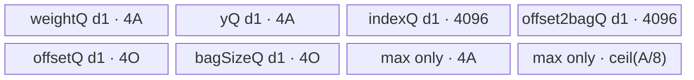
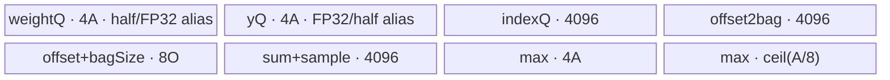

# EmbeddingBag A2/A3 ACLNN 算子知识

## 算子速览

| 项目 | 内容 |
|---|---|
| 实际入口 | `aclnnEmbeddingBagGetWorkspaceSize` + `aclnnEmbeddingBag`，公开 ACLNN 两段式接口，无 V2/V3 版本 |
| 计算语义 | 按 `offsets` 把 `indices` 划为 bag，跳过 `paddingIdx`，沿 `weight` 第 0 维取行并作 sum/mean/max；sum 可乘 `perSampleWeights` |
| 输入输出 | `weight[numWeight, embeddingDim]`；A2/A3 ACLNN 主 Kernel 接收连续的 INT32 indices/offsets；输出 `y/offset2bag/bagSize/maxIndices` |
| 执行类型 | executor 的 Contiguous/Cast/ViewCopy 为框架边界；核心节点是单个 `AIV_VECTOR` Kernel，无 Cube/AIC/MIX_CV 节点 |
| Kernel 路线 | R-001 FP32（key 1）；R-002 FP16（key 2）；R-003 BF16（key 3） |
| 核心资源 | GM + depth=1 的 VECIN/VECOUT Queue + max mask TBuf；框架 workspace 与 AscendC system workspace |
| 来源闭包 | source_closed：公开 ACLNN→L0 launcher→Tiling/POD→entry/router→两套完整 AIV body→config/OpDef 闭合；通用 Contiguous/Cast/ViewCopy/executor 为明确框架边界 |
| 验证状态 | 已完成源码闭包检查；本次知识提取未执行编译、真机、数值或性能测试。 |

## 接口与语义

### 计算语义

令 bag `b` 的边界为 `s_b = (b==0 ? 0 : offsets[b])`、`e_b = (b==B-1 ? indicesNum : offsets[b+1])`。有效集合 `S_b={j | s_b<=j<e_b, indices[j]!=paddingIdx}`。对特征 `d`：sum 为 `Σ weight[indices[j],d] * (perSampleWeights[j] 或 1)`；mean 为 `Σ weight[indices[j],d]/|S_b|`（空 bag 保持 0）；max 为有效行最大值并在 `maxIndices[b,d]` 保存对应 weight 行号。`offset2bag[j]=b` 在该 bag 第一列 tile 时写出。`includeLastOffset=true` 时最后一个 offset 只作哨兵，输出 bag 数减一。

### 输入、输出与属性

| 参数 | shape/layout | dtype | 约束、默认值与语义 |
|---|---|---|---|
| weight | 2D/ND | FLOAT/FLOAT16/BFLOAT16 | A2/A3 文档支持；输出 dtype 相同 |
| indices | API 1D/ND | UINT8/INT8/INT16/INT32/INT64 | 非 regbase 路线先 Cast 为 INT32；至少 indices/offsets 之一须为 INT32/INT64 |
| offsets | 1D/ND | 同上 | 非空必需；描述各 bag 边界 |
| perSampleWeights | 可空，1D/ND | 与 weight 相同 | 只对 sum 合法，长度必须等于 indices 元素数 |
| output | `[B,embeddingDim]`/ND | 与 weight 相同 | `B=offsets.size-(includeLastOffset?1:0)` |
| offset2bag | 1D/ND，可为零元素 | INT32/INT64 | 非零时长度等于 indices 元素数；内部结果 INT32 后按请求 Cast |
| bagSize | 1D/ND | INT32/INT64 | A2/A3 长度为 B；sum 路线源码写 0，mean/max 写有效非 padding 个数 |
| maxIndices | max 为 `[B,D]`，否则 `[B]` | INT32/INT64 | max 保存 weight 行号，非 max 写 0 |
| mode | 标量 | int64 | 0=sum，1=mean，其余映射为 max |
| scaleGradByFreq/sparse | 标量 | bool | 传递给 L0/Op attr；前向 Kernel 不读取 |
| includeLastOffset | 标量 | bool | 为 true 时 offsets 至少含两个元素且 B 减一 |
| paddingIdx | 标量 | int64 | 命中该 index 时不累计且不计 bagSize |

### 入口与版本

固定 Commit 只公开 `aclnnEmbeddingBag` 一个版本。文档产品表同时明确 A2/A3 支持；`EmbeddingBag` OpDef 把 `ascend910_93`、`ascend910b` 接到 `embedding_bag_apt`。ACLNN 先校验，再构造 executor；空 weight/indices/offsets 直接返回 workspace 0 且不加入核心 launcher。

## Host/Launcher 执行流程

### 参数校验与前处理

`CheckParams` 依次执行非空、dtype、维数与 shape 校验。随后 `weight/indices/offsets` 通过 `l0op::Contiguous`，可选 sample weight 也连续化。A2/A3（`IsRegbase()==false`）无条件把 indices、offsets Cast 为 INT32，再由 `l0op::EmbeddingBag` 分配内部四输出并调用 `ADD_TO_LAUNCHER_LIST_AICORE`。核心完成后，`ViewCopy` output；三个整数输出先 Cast 到用户 dtype 再 ViewCopy（空 `offset2bag` 跳过；内部空 `maxIndices` 跳过）。任何空返回或 launcher 添加失败都终止 executor 构造。

### 参数、Workspace 与生命周期

用户 workspace 大小来自 `uniqueExecutor->GetWorkspaceSize()`，覆盖连续化、Cast、核心节点和 ViewCopy 的框架分配；第一段把 executor 所有权转给调用方，第二段在指定 stream 通过 `CommonOpExecutorRun` 顺序执行。核心 Tiling 另令 `workspace[0]=PlatformAscendC::GetLibApiWorkSpaceSize()`；Kernel 要求 `workspace` 与 `GetUserWorkspace(workspace)` 均非空，否则无输出返回。固定仓不展开通用框架各 slice offset，不能把它们当作算子自有 ABI。

### 启动图与失败传播

```text
ACLNN executor（同一 stream）
  -> Contiguous(weight, indices, offsets[, perSampleWeights])        # 框架边界
  -> Cast(indices, INT32), Cast(offsets, INT32)                       # A2/A3 框架边界
  -> EmbeddingBag launcher: embedding_bag(..., EmbeddingBagTilingData)
       blockDim = usedCoreNum, key = 1/2/3, workspace[0]=system workspace
  -> Cast/ViewCopy(integer outputs), ViewCopy(output)                 # 框架边界
```

核心是单 Kernel 节点，无算子自有跨 Kernel workspace 边。框架按 executor/stream 顺序保证前处理结果在核心前可见、核心输出在 Cast/ViewCopy 前可见；任一步构造失败则第一段返回错误，第二段以 `CommonOpExecutorRun` 的状态传播执行失败。

## Route 与参数设计

### 分核与资源计算

`numOffset=B`；若 `B<=AIV核数`，`usedCoreNum=B` 且每核 1 bag，否则 `usedCoreNum=coreNum`、`former=floor(B/coreNum)`、最后核 `tail=B-former*(usedCoreNum-1)`。Host 预留 `15 KiB`，并扣除 `2*former*sizeof(float)` 与 `2*1024*sizeof(float)`；余量除以 `3*sizeof(float)` 得 `computeRepTime`。Device 再令 `A=align_up(computeRepTime,64)`、`O=align_up(localBagCount+1,8)`，特征循环数 `ceil(D/A)`，indices 按 1024 个元素分段。

### Route 选择

| 顺序 | Route | Key/模板 | 精确选择条件与优先级 | 不适用去向 |
|---:|---|---|---|---|
| 1 | R-001 FP32 | key 1 / `EmbeddingBag<float,int>` | weight dtype FLOAT | 下一 dtype 分支 |
| 2 | R-002 FP16 | key 2 / `EmbeddingBagFP16<half,int>` | weight dtype FLOAT16 | 下一 dtype 分支 |
| 3 | R-003 BF16 | key 3 / `EmbeddingBagFP16<bfloat16_t,int>` | 其它受 API/OpDef 限定为 BFLOAT16；entry 编译 guard `__CCE_AICORE__>=220` 且非 arch 3003/3113 | guard 不成立则 router 不启动 body |

```text
if weight==FLOAT: key=1
else if weight==FLOAT16: key=2
else: key=3
entry: key1 -> FP32 body; key2 -> promoted FP16 body; guarded key3 -> promoted BF16 body
```

### 模板/实现执行矩阵

| Route | key/selector | dtype/shape/platform 完整命中条件 | 执行拓扑与 Kernel 节点 | 实际模板/body | 内存与同步特征 | tail/fallback |
|---|---|---|---|---|---|---|
| R-001 | 1 | FLOAT，1D INT32 indices/offsets，A2/A3 | 单 AIV Kernel | `EmbeddingBag<float,int>::Process` | FP32 直接累计；depth 1 Queue；event/pipe 同步 | 最后核 bag tail、特征 tail、indices 1024 tail |
| R-002 | 2 | FLOAT16，其余同上 | 单 AIV Kernel | `EmbeddingBagFP16<half,int>::Process` | weight/y UB 物理按 FP32 分配，FP16↔FP32 Cast 累计 | 同上 |
| R-003 | 3 | BFLOAT16 且编译 guard 成立 | 单 AIV Kernel | `EmbeddingBagFP16<bfloat16_t,int>::Process` | 与 R-002 同 body，BF16↔FP32 Cast | guard/unknown key 无 fallback |

### 隐藏性能 Guard

| Guard | Host/Tiling 条件 | Device/资源原因 | 影响 Route | 不满足时去向 | 源码符号 |
|---|---|---|---|---|---|
| UB 正余量 | `computeRepTime=(ub-15KiB-2*former*4-2*1024*4)/(3*4)>0` | 三个 A 元素级主区并为 offsets/indices 留预算 | 全部 | Tiling failed | `EmbeddingBagTiling::getTilingKeyAndComputeRepTime/Init` |
| AIV 核数 | `GetCoreNumAiv()`；B 必须非零 | blockDim 与 bag 分片依赖 | 全部 | Tiling failed/空输入 ACLNN 早退 | `TilingPrepareForEmbeddingBag/GetUsedCore` |
| dtype guard | BF16 entry 仅 `__CCE_AICORE__>=220` 且非 3003/3113 | BF16 body/指令可用性 | R-003 | router 无 body | `embedding_bag` |
| tail copy | A2/A3 `DataCopyPad` 使用 `realLength*sizeof(C)` | 防止最后特征/indices 越界 | 全部 | N/A，进入 tail 参数 | `GMToUB/UBToGM` |
| max mask | 比较长度 `align_up(realCount,64)`，UB A 已 64 对齐 | Vector Compare/Select mask 覆盖完整 repeat | 全部 max | N/A | `MaxWeight` |

### POD/ABI

`EmbeddingBagTilingData` 由注册宏序列化；固定仓可确定 26 个连续 `int64_t` 字段，结构总大小/alignof/offsetof 由外部 tiling 宏生成代码决定，故逐字段 ABI offset 固定仓不可见。A2/A3 活跃字段如下，regbase 字段在本卡均 inactive 且 Device 不读。

| 结构 | 字段 | 类型/位宽 | ABI 布局 | 单位 | Host/launcher producer | Device consumer | 边界 |
|---|---|---|---|---|---|---|---|
| EmbeddingBagTilingData | formerOffsetNum | int64/64 | 宏生成，offset 不可见 | bag/core | `GetUsedCore` | `InitParams` 分片基址 | 正常核份额 |
| 同上 | tailOffsetNum | int64/64 | 同上 | bag | `GetUsedCore` | 最后核 local bag 数 | 最后核专用 |
| 同上 | numEmbeddings | int64/64 | 同上 | element/row | weight dim1 | 特征循环、weight 地址 | 必须>0，否则 Tiling 失败 |
| 同上 | computeRepTime | int64/64 | 同上 | FP32 element | UB 公式 | 对齐为 A | 必须>0 |
| 同上 | indicesMaxMoveLength | int64/64 | 同上 | index element | 常量 1024 | indices 分段/Queue | 固定 1024 |
| 同上 | usedCoreNum | int64/64 | 同上 | AIV core | `GetUsedCore` | 仅记录；blockDim 另写 context | B 与 coreNum 的最小值 |
| 同上 | paddingIdx | int64/64 | 同上 | weight row index | attr[4] | 有效项判断 | int64 到 int 比较需值可表示 |
| 同上 | numIndices | int64/64 | 同上 | element | indices dim0 | 尾 offset/清零 | 1D |
| 同上 | mode | int64/64 | 同上 | enum 0/1/2 | 字符串映射 | sum/mean/max 分支 | 其它字符串失败 |
| 同上 | tilingKey | int64/64 | 同上 | key | dtype 分支 | body 不读；context/router 读 key | 1/2/3 |
| 同上 | hasPerSampleWeights | int64/64 | 同上 | bool-like | optional tensor 非空且非零元素 | sum 加权及条件 Queue | 非 sum 即便为 1 也不读取 sample Queue |

### Route 源码闭包

| Route | Key/selector | Host/Tiling producer | POD/参数 | Kernel entry/router 节点 | Kernel body/直接依赖 | 构建接线 |
|---|---|---|---|---|---|---|
| R-001 | 1 | `embedding_bag_tiling.cpp::EmbeddingBagTiling` | `EmbeddingBagTilingData` 活跃 11 字段 | `embedding_bag_apt.cpp::embedding_bag` | `embedding_bag.h::EmbeddingBag<float,int>` | `embedding_bag_def.cpp` + ascend910b/910_93 config |
| R-002 | 2 | 同上 | 同上 | 同上 | `embedding_bag_fp16.h::EmbeddingBagFP16<half,int>` | 同上 |
| R-003 | 3 | 同上 | 同上 | guarded key3 | `embedding_bag_fp16.h::EmbeddingBagFP16<bfloat16_t,int>` | 同上 |

## Kernel 实现

### 公共执行流程

entry 校验 user workspace，解析 POD，用 key 构造类。每核先搬 offsets（首核补 0、末核补 `numIndices`），再对每个本地 bag 和每个特征 tile：清零 y，按 1024 个 index 分段搬入，逐 index 跳过 padding，搬对应 weight tile并 sum/mean/max；首个特征 tile写 offset2bag；最后写 y/maxIndices，bag 结束后写 bagSize，释放 Queue。A2/A3 使用 `DataCopyPad` tail；MTE2→V、V→MTE3、MTE3→S 与 `PipeBarrier<PIPE_ALL>`保护搬运/Vector/标量访问。

### Route R-001：FP32 直接累计

#### 适用条件

##### 选择证据

| 层级 | 文件 | 符号 | 源码谓词/参数 | 结果/下一跳 |
|---|---|---|---|---|
| ACLNN | `op_host/op_api/aclnn_embedding_bag.cpp` | `aclnnEmbeddingBagGetWorkspaceSize` | 非 regbase，Cast index/offset INT32 | L0 EmbeddingBag |
| Tiling | `op_host/embedding_bag_tiling.cpp` | `getTilingKeyAndComputeRepTime` | `weightDtype==DT_FLOAT` | key 1 |
| Router | `op_kernel/embedding_bag_apt.cpp` | `embedding_bag` | `TILING_KEY_IS(1)` | `EmbeddingBag<float,int>` |

#### Device 数据流

##### 函数级调用链

```text
embedding_bag -> EmbeddingBag<float,int>::Process
  -> CopyIn(offsets)
  -> Compute -> MoveAndCompute -> AddWeight/MaxWeight -> TensorCopyOut
  -> FreeUBTensor -> CopyOut(bagSize/maxIndices)
```

##### 源码等价伪码

```text
coreBagBase=blockIdx*former; localBags=(last?tail:former)
offsetUB=offsets[coreBagBase : coreBagBase+localBags+1]; 补首0/末indicesNum
for bag in localBags:
  for d0 in range(0,D,A):
    valid=min(A,D-d0); yUB[0:valid]=0; maxIdxUB=0
    for [s,e) in 1024-index chunks:
      indicesUB=indices[s:e]; if d0==0: offset2bag[s:e]=globalBag
      for j: if indicesUB[j]!=paddingIdx:
        weightUB=weight[index*D+d0 : +valid]
        sum: yUB += sample?weightUB*sample[j]:weightUB
        max: first有效行初始化，否则 Compare(GE)+Select 并更新行号
    mean且bagSize>0: yUB *= 1/bagSize
    写 y；max 另写 maxIndices
  bagSize=(sum?0:有效行数); 非max的maxIndices=0
```

#### 内存与数据搬运

##### 资源与搬运表

| 层级/缓冲区 | offset/地址公式 | extent/容量公式 | dtype/layout | producer | consumer | owner/lifetime | 对齐/复用 |
|---|---|---|---|---|---|---|---|
| weight GM | `index*D+d0` | valid≤A | FP32/ND | API | Add/Max | caller | DataCopyPad tail |
| offset Queue | coreBagBase | O | INT32 | CopyIn | Compute | TPipe/whole Process | depth1，8元素对齐 |
| indices Queue | chunk start | 1024 | INT32 | MoveAndCompute | scalar loop | TPipe/whole Process | depth1 |
| weight Queue | 0 | A*4 bytes | FP32 | GMToUB | Add/Max | TPipe/每 index 覆盖 | depth1 |
| y Queue | 0 | A*4 bytes | FP32 | Duplicate/Add/Select | UBToGM | TPipe/每 tile覆盖 | depth1 |
| output2bag Queue | 0 | 1024*4 bytes | INT32 | Duplicate | UBToGM | TPipe/whole Process | depth1 |
| bagSize Queue | 0 | O*4 bytes | INT32 | Compute | CopyOut | TPipe/whole Process | depth1 |
| maxIndices Queue | 0 | A*4 bytes | INT32/reinterpret FP32 | Duplicate/Select | UBToGM | max only | 与 FP32 比特选择配对 |
| mask TBuf | 0 | ceil(A/8) bytes | uint8 bit mask | Compare | Select | max only | A 64对齐 |

##### 分层内存布局



##### 字节账与复用顺序

```text
sum/mean: UB = 8A + 8192 + 8O + (sample?4096:0)
max:      UB = 12A + ceil(A/8) + 8192 + 8O
A=align_up(computeRepTime,64), O=align_up(localBags+1,8), depth均为1
dynamic_ub=N/A；workspace_total=PlatformAscendC system workspace（核心无自有 slice）
```

| 复用子区 | 写入者 | 读取者/消费点 | 下一次覆盖 | 同步或释放依据 | 安全条件 |
|---|---|---|---|---|---|
| weightQ | GMToUB | Add/Compare | 下一 index | MTE2_V + PIPE_ALL | 当前 Vector 消费完成 |
| yQ | Duplicate/Add/Select | UBToGM | 下一 feature tile | V_MTE3/MTE3_S | GM 写提交后覆盖 |
| indicesQ | GMToUB | scalar GetValue | 下一 1024 chunk | 顺序 + FreeTensor末释放 | 当前 chunk循环完成 |

#### 同步、精度与尾块

##### 同步与数值边界表

| 阶段 | primitive/机制 | producer | consumer/等待点 | 保护对象 | 精度/尾块 |
|---|---|---|---|---|---|
| weight搬入 | MTE2_V flag | DataCopyPad | Vector Add/Compare | weightQ | valid byte count防越界 |
| 累计 | PIPE_ALL | Add/Select | 下一次覆盖/标量 | yQ/weightQ | FP32累计 |
| 写回 | V_MTE3 + MTE3_S | Vector/UBToGM | 后续标量/覆盖 | y/max GM | realCountNum精确字节 |
| max | Compare GE + Select | y与新weight | y/maxIdx | mask | 等值保留先出现行；padding跳过 |

#### 关键实现

##### 符号证据表

| 阶段 | 文件 | 符号/模板实例 | 实现事实 |
|---|---|---|---|
| Host/Tiling producer | `op_host/embedding_bag_tiling.cpp` | `GetUsedCore/getTilingKeyAndComputeRepTime/SetKernelTiling` | 分核、UB公式、key/POD |
| Kernel entry/router | `op_kernel/embedding_bag_apt.cpp` | `embedding_bag`, key1 | 路由 FP32 body |
| Device body/helper | `op_kernel/embedding_bag.h` | `EmbeddingBag<float,int>` | 搬运、累计、同步、tail |

### Route R-002：FP16 升精度累计

#### 适用条件

##### 选择证据

| 层级 | 文件 | 符号 | 源码谓词/参数 | 结果/下一跳 |
|---|---|---|---|---|
| Tiling | `op_host/embedding_bag_tiling.cpp` | `getTilingKeyAndComputeRepTime` | weight FLOAT16 | key2 |
| Router | `op_kernel/embedding_bag_apt.cpp` | `embedding_bag` | key2 | `EmbeddingBagFP16<half,int>` |

#### Device 数据流

##### 函数级调用链

```text
embedding_bag -> EmbeddingBagFP16<half,int>::Process
  -> CopyIn -> Compute -> MoveAndCompute
  -> Cast(half->float) -> Add/Muls/Compare/Select -> Cast(float->half) -> CopyOut
```

##### 源码等价伪码

```text
沿用R-001分核/循环；weight与sample从GM搬入半精度视图后Cast到FP32物理Queue；
y始终FP32累计，mean在FP32乘倒数；提交前Cast回half；max值FP32比较，max行号仍INT32。
```

#### 内存与数据搬运

##### 资源与搬运表

| 层级/缓冲区 | offset/地址公式 | extent/容量公式 | dtype/layout | producer | consumer | owner/lifetime | 对齐/复用 |
|---|---|---|---|---|---|---|---|
| weightQ/yQ | 同 R-001 | 各 4A bytes | FP32物理区，half 视图位于其中 | DataCopyPad+Cast | FP32 Vector/half CopyOut | TPipe | ReinterpretCast，不增加物理区 |
| sampleQ | chunk | 4*1024 bytes | FP32物理/half视图 | Copy+Cast | Muls | sum+sample生命周期 | 条件分配 |
| 其它 Queue/TBuf | 同 R-001 | 同 R-001 | INT32/mask | 同上 | 同上 | 同上 | 同上 |

##### 分层内存布局



##### 字节账与复用顺序

```text
与R-001公式相同；半精度输入不把weight/y Queue减半，因为InitBuffer明确按sizeof(float)分配。
```

| 复用子区 | 写入者 | 读取者/消费点 | 下一次覆盖 | 同步或释放依据 | 安全条件 |
|---|---|---|---|---|---|
| weightQ half/FP32 alias | GMToUB half view→Cast FP32 | Add/Compare | 下一 index | MTE2_V/PIPE_ALL | Cast完成后再Vector |
| yQ FP32/half alias | FP32累计→Cast half view | UBToGM | 下一 tile | V_MTE3/MTE3_S | 写回完成 |

#### 同步、精度与尾块

##### 同步与数值边界表

| 阶段 | primitive/机制 | producer | consumer/等待点 | 保护对象 | 精度/尾块 |
|---|---|---|---|---|---|
| 输入升精度 | `Cast(...,CAST_NONE,length)` | half搬入 | FP32累计 | alias Queue | 仅valid长度 |
| 输出降精度 | `Cast(yTDataLocal,yDataLocal,CAST_NONE,realCount)` | FP32结果 | UBToGM | y alias | 最后tile精确长度 |
| 其余 | 同 R-001 | 同上 | 同上 | 同上 | 同上 |

#### 关键实现

##### 符号证据表

| 阶段 | 文件 | 符号/模板实例 | 实现事实 |
|---|---|---|---|
| Host/Tiling producer | `op_host/embedding_bag_tiling.cpp` | `getTilingKeyAndComputeRepTime` | key2 |
| Kernel entry/router | `op_kernel/embedding_bag_apt.cpp` | key2 branch | half实例 |
| Device body/helper | `op_kernel/embedding_bag_fp16.h` | `EmbeddingBagFP16<half,int>` | FP32 Queue与cast顺序 |

### Route R-003：BF16 升精度累计

#### 适用条件

##### 选择证据

| 层级 | 文件 | 符号 | 源码谓词/参数 | 结果/下一跳 |
|---|---|---|---|---|
| Tiling | `op_host/embedding_bag_tiling.cpp` | dtype else | API限定的 BF16 | key3 |
| Router | `op_kernel/embedding_bag_apt.cpp` | compile guard + key3 | `__CCE_AICORE__>=220` 且排除 arch3003/3113 | BF16实例 |

#### Device 数据流

##### 函数级调用链

```text
embedding_bag -> EmbeddingBagFP16<bfloat16_t,int>::Process -> 与R-002同一模板方法
```

##### 源码等价伪码

```text
与R-002相同，仅GM视图与Cast输入/输出类型改为bfloat16_t。
```

#### 内存与数据搬运

##### 资源与搬运表

| 层级/缓冲区 | offset/地址公式 | extent/容量公式 | dtype/layout | producer | consumer | owner/lifetime | 对齐/复用 |
|---|---|---|---|---|---|---|---|
| 全部 | 同 R-002 | 同 R-002 | BF16 GM、FP32 UB累计 | 同 R-002 | 同 R-002 | 同 R-002 | 同 R-002 |

##### 分层内存布局


##### 字节账与复用顺序

```text
UB_total、workspace_total与R-002相同；compile guard是额外成立条件。
```

| 复用子区 | 写入者 | 读取者/消费点 | 下一次覆盖 | 同步或释放依据 | 安全条件 |
|---|---|---|---|---|---|
| weight/y FP32物理Queue | BF16视图与FP32视图交替 | Cast/Vector/CopyOut | 下一tile | event/pipe同R-002 | guard成立 |

#### 同步、精度与尾块

##### 同步与数值边界表

| 阶段 | primitive/机制 | producer | consumer/等待点 | 保护对象 | 精度/尾块 |
|---|---|---|---|---|---|
| BF16升降精度 | Cast + events | GM/FP32结果 | Vector/GM | alias Queue | FP32累计后降回BF16 |

#### 关键实现

##### 符号证据表

| 阶段 | 文件 | 符号/模板实例 | 实现事实 |
|---|---|---|---|
| Host/Tiling producer | `op_host/embedding_bag_tiling.cpp` | dtype else | key3 |
| Kernel entry/router | `op_kernel/embedding_bag_apt.cpp` | guarded key3 | BF16实例与平台guard |
| Device body/helper | `op_kernel/embedding_bag_fp16.h` | `EmbeddingBagFP16<bfloat16_t,int>` | FP32累计 |

## 算子特定优化

### Trick T-001：特征分片与 indices 分段解耦

#### 触发与源码依据

- 适用 Route：R-001/R-002/R-003
- 触发条件：任意非空 bag；`D>A` 或 bag 长度>1024 时形成多级 tile
- Golden 来源：[`index/embedding_bag/op_kernel/embedding_bag.h:353-379`](../../../../../../../cann-ops-raw/ascendc/ops-nn/955f8b33985b6d72989ebff341bb9c2c564a51bc/index/embedding_bag/op_kernel/embedding_bag.h#L353-L379)

**官方源码（固定 Commit 连续逐字摘录）**：

```cpp
auto count = CeilDiv(numEmbeddings_, allocatedSpaceSize_);
for (int i = 0; i < offsetNum_ - 1; i++) {
    for (auto j = 0; j < count; j++) {
        realCountNum_ = allocatedSpaceSize_;
        if (j == count - 1) {
            realCountNum_ = numEmbeddings_ - j * allocatedSpaceSize_;
        }
        yOffset_ = (offset_ + i) * numEmbeddings_ + j * allocatedSpaceSize_;
        weightOffset_ = j * allocatedSpaceSize_;
        DTYPE startNumber = offsetDataLocal.GetValue(i);
        DTYPE endNumber = offsetDataLocal.GetValue(i + 1);
        while (endNumber - startNumber > indicesMaxMoveLength_) {
            MoveAndCompute(indicesMaxMoveLength_, startNumber, i, false);
            startNumber += indicesMaxMoveLength_;
        }
        auto length = endNumber - startNumber;
        MoveAndCompute(length, startNumber, i, true);
```

#### 机制与设计原因

Host 用 UB 余量决定 A，Device 再把 D 切为 A 宽特征片，同时把任意长 bag 切为固定 1024-index 片；因此无需把整张 embedding 行或整 bag 的 index 常驻 UB。只有最后 index chunk 的 `flag=true` 才提交该特征片，保持跨 chunk 累计。

#### 迁移边界

- 适用：随机 gather 后沿行归约、特征维或索引数可能超 UB 的算子。
- 前提：A 64 对齐、indices chunk Queue 至少 1024 元素、跨 chunk 累计区不被覆盖。
- 失效：UB 公式使 `computeRepTime<=0` 时 Tiling 失败，没有小 tile fallback。
- 未验证：本次知识提取未执行编译、真机、数值或性能测试。

#### 错误做法

固定仓未提供可验证反例；源码明确要求仅最后 chunk 调用 `TensorCopyOut`，提前提交会丢失后续 chunk 的累计。

### Trick T-002：FP16/BF16 共享 FP32 物理 Queue 升精度累计

#### 触发与源码依据

- 适用 Route：R-002/R-003
- 触发条件：weight 为 FP16/BF16
- Golden 来源：[`index/embedding_bag/op_kernel/embedding_bag_fp16.h:188-211`](../../../../../../../cann-ops-raw/ascendc/ops-nn/955f8b33985b6d72989ebff341bb9c2c564a51bc/index/embedding_bag/op_kernel/embedding_bag_fp16.h#L188-L211)

**官方源码（固定 Commit 连续逐字摘录）**：

```cpp
pipe.InitBuffer(weightQue_, BUFFER_NUM, allocatedSpaceSize_ * sizeof(float));
pipe.InitBuffer(yQue_, BUFFER_NUM, allocatedSpaceSize_ * sizeof(float));
weightDataLocal = weightQue_.AllocTensor<float>();
weightTDataLocal = weightDataLocal.template ReinterpretCast<T>();
yDataLocal = yQue_.AllocTensor<float>();
yTDataLocal = yDataLocal.template ReinterpretCast<T>();
```

#### 机制与设计原因

同一物理 Queue 以 T 视图接收/发出半精度数据，以 float 视图承载累计；`Cast` 顺序显式夹在 DMA 与 Vector 累计之间。它避免另分配一份半精度输入/输出 UB，同时阻止长 bag 在低精度中逐项累加。

#### 迁移边界

- 适用：半精度 GM、FP32 中间归约且输入/输出视图生命周期不重叠的 Vector 算子。
- 前提：物理容量按 FP32 计算；event/pipe 保证 Cast 和 DMA 不交叠覆盖。
- 失效：不支持对应 Cast 或 BF16 compile guard 不成立时不能复用该路线。
- 未验证：本次知识提取未执行编译、真机、数值或性能测试。

#### 错误做法

固定仓未提供可验证反例；按 `sizeof(T)` 缩小 Queue 会破坏 FP32 视图容量。

## 模板与实现对比

| 对比维度 | R-001 FP32 | R-002 FP16 | R-003 BF16 | 设计选择依据 |
|---|---|---|---|---|
| 命中条件/优先级 | dtype FP32 | dtype FP16 | dtype BF16+guard | Host dtype key |
| 模板与 dtype | `EmbeddingBag<float,int>` | `EmbeddingBagFP16<half,int>` | `EmbeddingBagFP16<bfloat16_t,int>` | 半精度共享 promoted body |
| 循环与分核 | 相同 | 相同 | 相同 | POD相同 |
| Queue/TBuf | FP32原生 | FP32物理+half alias | FP32物理+BF16 alias | 精度策略 |
| 内存总占用与复用 | 公式相同 | 公式相同 | 公式相同 | 主Queue均按FP32 |
| 搬运/Vector API | CopyPad/Add/Compare | 另含Cast | 另含Cast | GM dtype |
| 同步、精度与 tail | FP32 | FP32累计→FP16 | FP32累计→BF16 | 输出dtype |
| fallback/失败边界 | unknown key无输出 | 同左 | guard不成立无body | router无默认 |

## 平台差异

| 项目 | A2 | A3 | 950 |
|---|---|---|---|
| 支持状态 | 支持 | 支持 | 见独立 `_950` 卡 |
| Host/Launcher | 非 regbase，indices/offsets统一Cast INT32 | 同 A2 | regbase保留INT32/INT64并使用新Tiling |
| Kernel/资源 | key1/2/3 AIV旧body | 同 A2 | Vector+SIMT多实现族 |

## 限制与失败边界

- 空 weight/indices/offsets 在 ACLNN 第一段直接成功返回但不写输出；核心 Tiling 的 B=0 或 D<=0 无可用正常路线。
- `paddingIdx` 合法范围只在公开文档声明，ACLNN 源码未显式检查其数值范围。
- 通用 Contiguous/Cast/ViewCopy 的 Kernel body、精确 workspace slice 和内部同步属于框架边界，固定 `ops-nn` 仓只提供调用声明；本卡不推测。
- router 未提供 unknown-key fallback；workspace/user-workspace 空指针直接返回。

## 源码索引

### 链路索引

| 链路阶段 | 文件 | 关键符号 | 支撑内容 |
|---|---|---|---|
| 入口声明/约束 | `index/embedding_bag/docs/aclnnEmbeddingBag.md` | ACLNN prototype/产品表 | 公开性、平台、参数 |
| 入口实现 | `index/embedding_bag/op_host/op_api/aclnn_embedding_bag.cpp` | `aclnnEmbeddingBagGetWorkspaceSize/aclnnEmbeddingBag` | 校验、前后处理、executor |
| 入口实现 | `index/embedding_bag/op_host/op_api/embedding_bag.cpp` | `l0op::EmbeddingBag` | 内部输出、launcher添加 |
| Host/Tiling/Launcher | `index/embedding_bag/op_host/embedding_bag_tiling.h` | `EmbeddingBagTilingData` | POD字段/CompileInfo |
| Host/Tiling/Launcher | `index/embedding_bag/op_host/embedding_bag_tiling.cpp` | `EmbeddingBagTiling/TilingEmbeddingBag` | 分核、UB、POD、key |
| Kernel entry/body | `index/embedding_bag/op_kernel/embedding_bag_apt.cpp` | `embedding_bag` | router |
| Kernel entry/body | `index/embedding_bag/op_kernel/embedding_bag.h` | `EmbeddingBag` | FP32 body |
| Kernel entry/body | `index/embedding_bag/op_kernel/embedding_bag_fp16.h` | `EmbeddingBagFP16` | FP16/BF16 body |
| 构建接线 | `index/embedding_bag/op_host/embedding_bag_def.cpp` | `EmbeddingBag` OpDef | A2/A3/950注册 |
| 构建接线 | `index/embedding_bag/op_host/config/ascend910b/embedding_bag_binary.json` | `op_list` | A2/A3 dtype binary |

### 实现复用检查

| 检查项 | 可复用事实 | 不得改变的约束 | 源码符号 |
|---|---|---|---|
| ABI/POD | 11个旧路线活跃int64字段 | 字段序列、单位、key1/2/3 | `EmbeddingBagTilingData` |
| 调用顺序 | offsets→bag/feature/index→结果 | 仅末index chunk提交 | `Process/MoveAndCompute` |
| workspace/内存 | 3份A预算+meta预算 | A向上64对齐、depth=1、半精度Queue按FP32 | Tiling+InitBuffer |
| 同步 | MTE2_V/V_MTE3/MTE3_S+PIPE_ALL | alias覆盖前必须等待 | sync helpers |
| 精度与尾块 | FP32累计、精确DataCopyPad tail | max等值保留旧值、padding不计数 | `AddWeight/MaxWeight/UBToGM` |
| 失败边界 | Tiling失败/unknown key/workspace空 | 不得静默补 fallback | `Init`, entry router |