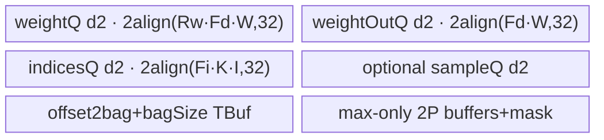

# EmbeddingBag 950 ACLNN 算子知识

## 算子速览

| 项目 | 内容 |
|---|---|
| 实际入口 | `aclnnEmbeddingBagGetWorkspaceSize` + `aclnnEmbeddingBag`，公开 ACLNN |
| 计算语义 | 按 1D offsets 或 2D indices 行形成 bag，跳过 padding，执行 sum/mean/max；sum 可逐样本加权 |
| 输入输出 | weight FP32/FP16/BF16；indices/offsets 经 API 规范化后为 INT32/INT64；中间整数输出使用二者提升 dtype |
| 执行类型 | 单个核心 Kernel；Host 可达 body 为 `AIV_VECTOR` 或 SIMT，均无 Cube/AIC/MIX_CV |
| Kernel 路线 | R-001 empty SIMT；R-002 1D SIMT；R-003 2D SIMT；R-004 1D Vector sum；R-005 1D Vector mean；R-006 1D Vector max；R-007 2D Vector |
| 核心资源 | SIMT 直接 GM+线程寄存器；Vector 使用 32B 对齐 Queue/TBuf/RegTensor；固定 16MiB AscendC tools workspace |
| 来源闭包 | source_closed：公开 ACLNN→regbase selector/Tiling/POD→全 key router→七个可达 body/helper→950 OpDef/config 闭合；通用 executor/Contiguous/Cast/ViewCopy 为框架边界 |
| 验证状态 | 已完成源码闭包检查；本次知识提取未执行编译、真机、数值或性能测试。 |

## 接口与语义

### 计算语义

对 1D indices，bag `b` 的 `[begin,end)` 来自 offsets（源码把 `b==0` 的 begin 强制为 0，末 bag 的 end 取 `indicesNumel`）；对 2D indices `[B,K]`，每一行即一个 bag。每个非 `paddingIdx` 的 index 选择 `weight[index,:]`。sum 累加并可乘 sample weight，mean 除以有效 index 数，max 输出逐列最大值及 weight 行号。950 非 max 的内部 `maxIndices` shape 为 `[0]`，`bagSize` 内部长度固定为 offsets 长度；`includeLastOffset` 时最后一项写 0。

### 输入、输出与属性

| 参数 | shape/layout | dtype | 约束、默认值与语义 |
|---|---|---|---|
| weight | `[N,D]`/ND | FLOAT/FLOAT16/BFLOAT16 | D 决定 SIMT/Vector；输出同 dtype |
| indices | 1D 或 2D/ND | API 可接小整数，核心为 INT32/INT64 | 1D 配 offsets；2D 每行一 bag |
| offsets | 1D/ND | 核心 INT32/INT64 | 2D路线仍传入但 body 不参与 bag 切分 |
| perSampleWeights | 可空，1D/2D | 与 weight 相同 | regbase API允许与indices同元素数；只有sum消费 |
| output | `[B,D]` | 与 weight相同 | sum/mean/max结果 |
| offset2bag | `[indicesNumel]`或空 | INT32/INT64 | 内部 dtype 是 indices/offsets 中较宽者 |
| bagSize | `[offsetsNum]` | INT32/INT64 | 950固定内部长度；includeLastOffset的哨兵槽为0 |
| maxIndices | max为`[B,D]`，其它为`[0]` | INT32/INT64 | max保存weight行号；空bag为-1 |
| mode | 标量 | int64 | 0=sum，1=mean，其他经API映射max |
| includeLastOffset | 标量 | bool | 1D时B=offsetsNum-1；2D API仅允许false |
| paddingIdx | 标量 | int64 | 跳过且不计bagSize |
| scaleGradByFreq/sparse | 标量 | bool | launcher attr存在，前向Tiling/Kernel不消费 |

### 入口与版本

固定 Commit 只有无版本后缀入口。公开文档和 README 均明确 Ascend 950PR/950DT 支持，OpDef 的 `ascend950` config 与 `opFile.value=embedding_bag_apt`、950 binary JSON 共同证明发布接线。ACLNN 的 `IsRegbase()` 分支保留 INT32/INT64，只有更小整数才 Cast 到 INT32；indices/offsets dtype 不同则内部输出提升到 INT64。

## Host/Launcher 执行流程

### 参数校验与前处理

校验顺序与 A2/A3 相同，但 950 允许 indices 最多 2D、sample weight最多2D、maxIndices最多2D。空输入仍在第一段提前成功返回。非空时连续化四输入；indices/offsets 若已 INT32/INT64直接复用，否则 Cast INT32。`l0op::EmbeddingBag` 分配 output、提升 dtype 的 meta 输出，添加一个 AICore launcher；核心后 output ViewCopy，非空 meta 输出按用户 dtype Cast/ViewCopy。

### 参数、Workspace 与生命周期

核心 `GetWorkspaceSize` 固定 `16*1024*1024` bytes，`PostTiling` 写 workspace[0]，设置 `blockDim=usedCoreNum`、`scheduleMode=1`、local memory size=`平台UB-32KiB DCache`。第一段返回的总 workspace 仍由 executor 汇总并由用户持有到第二段完成；核心只检查 user workspace 非空，不自定义跨 Kernel slice。

### 启动图与失败传播

```text
executor stream:
  Contiguous/Cast framework nodes
    -> one embedding_bag entry(blockDim=usedCoreNum,key=100..503,POD)
      -> one Vector class Process OR one/two asc_vf_call SIMT stages inside same entry
    -> Cast/ViewCopy framework nodes
```

R-001 empty body在同一 entry 中依次调用 `SimtComputeOffst2Bag`、`SimtComputeBagSize`；这两个 `asc_vf_call` 是同 Kernel entry 内的顺序子阶段，不是 Host 多 Kernel 节点。其余路线各调用一个 body。entry 检查 workspace；unknown key或非法mode分支不启动实际计算。

## Route 与参数设计

### 分核与资源计算

Host 取 `UB'=UB-32KiB`、AIV核数。若 `D*sizeof(weight)<=512`，强制 SIMT且 `usedCoreNum=totalCoreNum`。否则 `AutoTiling` 用 `colAlignNum=ceil(D/(512/sizeof(weight)))` 估算核数，再枚举行切分 `m` 与列切分 `n`，按 `(负载delta,n)` 排序选最小，得到 row/col normal/tail。1D Vector 保留 offsets 2KiB、indices 4KiB、sample 4KiB，按精确 Queue公式递减 factor 直到 UB 可容；2D Vector以 `(UB'/2)-256` 为半UB预算，若单行 indices 双份超过4KiB则退回SIMT。

### Route 选择

| 顺序 | Route | Key/模板 | 精确选择条件与优先级 | 不适用去向 |
|---:|---|---|---|---|
| 1 | R-001 empty SIMT | 500/501/502/503 | `D==0`；+2/+3 表示dtype提升，+1/+3表示compute地址需uint64 | 返回该key |
| 2 | R-002 1D SIMT | 300/301/302/303 | `D>0 && indices.rank==1 && (D*weightSize<=512)`；或其它逻辑把`isSimt=1` | 返回该key |
| 3 | R-003 2D SIMT | 400/401/402/403 | `D>0 && indices.rank==2 && (D*weightSize<=512 \|\| 2*K*indicesSize>4096)` | 返回该key |
| 4 | R-004 1D Vector sum | 100/101 + mode0 | 非SIMT、rank1、mode=sum；101表示indices/offsets dtype不同 | entry mode子分支 |
| 5 | R-005 1D Vector mean | 100/101 + mode1 | 非SIMT、rank1、mode=mean | entry mode子分支 |
| 6 | R-006 1D Vector max | 100/101 + mode2 | 非SIMT、rank1、mode=max | entry mode子分支 |
| 7 | R-007 2D Vector | 200/201 | 非SIMT、rank2；body内部按mode分派，201表示提升输出dtype | unknown key无fallback |

```text
if D==0: key=500 + dtype/地址宽度位
else if isSimt:
  key=(rank1?300:400)+dtype/地址宽度位
else:
  key=(rank1?100:200)+(indicesType!=offsetsType)
```

key 后缀精确映射：同 dtype且 `weightShapeSize<=UINT32_MAX` 为 +0；同 dtype且大地址为 +1；异 dtype且小地址为 +2；异 dtype且大地址为 +3。Vector只区分同/异dtype，因此100/200为同dtype、101/201为提升dtype。

### 模板/实现执行矩阵

| Route | key/selector | dtype/shape/platform 完整命中条件 | 执行拓扑与 Kernel 节点 | 实际模板/body | 内存与同步特征 | tail/fallback |
|---|---|---|---|---|---|---|
| R-001 | 500-503 | D=0 | entry内2个顺序SIMT子阶段 | `EmbeddingBagRegBaseSimtEmpty<P,COMP_T>` | 无AIV UB；GM直写 | grid-stride tail |
| R-002 | 300-303 | 1D+SIMT | 单SIMT子阶段 | `EmbeddingBagRegBaseSimt1D<W,I,O,P,uint32/64>` | 2048线程，dim(32,64)，寄存器FP32累计 | feature guard；uint地址宽度key |
| R-003 | 400-403 | 2D+SIMT | 单SIMT子阶段 | `EmbeddingBagRegBaseSimt2D<...>` | 同R-002，row替代offset bag | feature guard |
| R-004 | 100/101+sum | 1D Vector sum | 单AIV body | `EmbeddingBagRegBaseIndx1dSum` | MicroAPI FP32 sum；可选sample条件Buffer | offsets/index/weight三层tail |
| R-005 | 100/101+mean | 1D Vector mean | 单AIV body | `EmbeddingBagRegBaseIndx1dMean` | FP32 sum后`DivForMean` | 空bag保持0 |
| R-006 | 100/101+max | 1D Vector max | 单AIV body | `EmbeddingBagRegBaseIndx1dMax` | -inf初始化、mask/select、行号Buffer | padding/空bag为-1 |
| R-007 | 200/201 | 2D Vector | 单AIV body | `EmbeddingBagRegBaseIndx2d` | weight/indices depth2；mode特定Buffer | row/col/indices/weight tail |

### 隐藏性能 Guard

| Guard | Host/Tiling 条件 | Device/资源原因 | 影响 Route | 不满足时去向 | 源码符号 |
|---|---|---|---|---|---|
| SIMT窄行 | `D*weightTypeSize<=512` | 每thread.x覆盖feature，窄行适合GM直算 | R-002/R-003 | Vector候选 | `GetShapeAttrsInfo` |
| 2D indices UB | `2*K*indicesTypeSize>4096` | depth2 indices行不能放4KiB预算 | R-003 | SIMT | `Compute2DFactor` |
| 计算地址宽度 | `weightShapeSize<=UINT32_MAX` | SIMT offset类型避免uint32溢出 | R-001/R-002/R-003 | +1/+3 uint64模板 | `GetTilingKey` |
| AIV有效核 | `GetCoreNumAiv()>0` | blockDim/二维切分 | 全部 | Tiling失败 | `GetPlatformInfo` |
| local memory | `SetLocalMemorySize(UB-32KiB)`成功 | DCache从可分UB剔除 | 全部 | PostTiling失败 | `PostTiling` |
| 32B对齐 | 所有Queue/TBuf `CeilAlign(bytes,32)` | DataCopyPad/MicroAPI本地布局 | Vector | factor递减或SIMT | 各Init/Get*AlignSize |

### POD/ABI

所有字段为连续声明的 `int64_t`；序列化宏生成的 `sizeof/alignof/offsetof` 固定仓不可见。以下逐列列出 950 producer/consumer；未列出的旧字段 `formerOffsetNum/tailOffsetNum/numEmbeddings/computeRepTime/indicesMaxMoveLength/numIndices/tilingKey/hasPerSampleWeights` 在 950 inactive且不读。

| 结构 | 字段 | 类型/位宽 | ABI 布局 | 单位 | Host/launcher producer | Device consumer | 边界 |
|---|---|---|---|---|---|---|---|
| EmbeddingBagTilingData | usedCoreNum | int64/64 | 宏生成offset不可见 | core | AutoTiling/SIMT设置 | Vector block guard | SIMT仍blockDim使用 |
| 同上 | paddingIdx | int64/64 | 同上 | row index | attr[4] | 全body有效项判断 | 可为负 |
| 同上 | mode | int64/64 | 同上 | 0/1/2 | mode map | entry/body分支 | API只产生合法字符串 |
| 同上 | nBags | int64/64 | 同上 | bag | rank/offsets/include | 循环/线程numChunks | 可<=0走empty/早退 |
| 同上 | embeddingDim | int64/64 | 同上 | element | weight dim1 | 地址/feature guard | 0走R-001 |
| 同上 | indiceSize | int64/64 | 同上 | index/2D row | indices dim1 | 2D循环/Buffer | rank1为0 |
| 同上 | rowTileNum | int64/64 | 同上 | tile | AutoTiling | block→row mapping | Vector active |
| 同上 | colTileNum | int64/64 | 同上 | tile | AutoTiling | block→col mapping | Vector active |
| 同上 | rowNormalNum | int64/64 | 同上 | bag | AutoTiling | 正常核行数 | Vector active |
| 同上 | colNormalNum | int64/64 | 同上 | feature | AutoTiling | 正常核列数 | Vector active |
| 同上 | rowTailNum | int64/64 | 同上 | bag | AutoTiling | 末row tile | Vector active |
| 同上 | colTailNum | int64/64 | 同上 | feature | AutoTiling | 末col tile | Vector active |
| 同上 | indicesFactor | int64/64 | 同上 | index/row | Compute1D/2DFactor | indices loops/Queue | SIMT不读 |
| 同上 | offsetsFactor | int64/64 | 同上 | offset | Compute1DFactor | offsets loops/Queue | 2D/SIMT不读 |
| 同上 | weightDimFactor | int64/64 | 同上 | feature | factor计算 | weight loops/Queue | SIMT不读 |
| 同上 | weightRowFactor | int64/64 | 同上 | selected row | factor计算 | weight batching/Queue | SIMT不读 |
| 同上 | isNeedSampleWeight | int64/64 | 同上 | bool-like | optional且mode=sum | sample route/buffer | 非sum强制0 |
| 同上 | indicesNumel | int64/64 | 同上 | element | indices shape size | SIMT范围/1D尾 | 全路线 |
| 同上 | indicesLimit | int64/64 | 同上 | element | 类字段默认0，SetTilingData写入 | 固定body未读取 | 当前inactive |
| 同上 | sampleWeightNum | int64/64 | 同上 | element | optional shape size | 1D sum tail处理 | 无sample为0 |
| 同上 | inclueLastOfst | int64/64 | 同上 | bool-like | attr[3] | bagSize哨兵写0 | 源码字段名拼写如此 |

### Route 源码闭包

| Route | Key/selector | Host/Tiling producer | POD/参数 | Kernel entry/router 节点 | Kernel body/直接依赖 | 构建接线 |
|---|---|---|---|---|---|---|
| R-001 | 500-503 | `EmbeddingBagRegBaseTiling::GetTilingKey` | meta/宽度字段 | `embedding_bag` | `embedding_bag_regbase_empty_simt.h` | 950 OpDef/config |
| R-002 | 300-303 | 同上 | nBags/D/indicesNumel等 | `embedding_bag` | `embedding_bag_regbase_1d_simt.h`+common | 同上 |
| R-003 | 400-403 | 同上 | nBags/D/indiceSize等 | `embedding_bag` | `embedding_bag_regbase_2d_simt.h`+common | 同上 |
| R-004 | 100/101+sum | Tiling factors+mode | 1D factor字段 | entry mode sum | `embedding_bag_regbase_1d_sum.h`+common | 同上 |
| R-005 | 100/101+mean | 同上 | 同上 | entry mode mean | `embedding_bag_regbase_1d_mean.h`+common | 同上 |
| R-006 | 100/101+max | 同上 | 同上 | entry mode max | `embedding_bag_regbase_1d_max.h`+common | 同上 |
| R-007 | 200/201 | 2D factors | 2D factor字段 | key200/201 | `embedding_bag_regbase_2d.h`+common | 同上 |

## Kernel 实现

### 公共执行流程

entry 在 arch35 guard 下把8个GM参数组成数组。key后缀决定 `I/O/P` 模板：同dtype使用indices类型，异dtype按一侧INT32、一侧INT64并把meta输出提升INT64；SIMT再按weight总元素选择uint32/uint64计算地址。所有路线单 Host Kernel；Vector block映射二维row×col tile，SIMT用 `asc_vf_call`。sum/mean均以FP32寄存器累计，max保存原weight dtype值和提升dtype行号。

### Route R-001：空 embeddingDim SIMT

#### 适用条件

##### 选择证据

| 层级 | 文件 | 符号 | 源码谓词/参数 | 结果/下一跳 |
|---|---|---|---|---|
| Tiling | `embedding_bag_regbase_tiling.cpp` | `DoOpTiling/GetTilingKey` | D==0 | key500-503 |
| Router | `embedding_bag_apt.cpp` | key500-503 branches | dtype/uint宽度 | Empty实例 |

#### Device 数据流

##### 函数级调用链

```text
embedding_bag -> EmbeddingBagRegBaseSimtEmpty::Process
  -> asc_vf_call<SimtComputeOffst2Bag>
  -> asc_vf_call<SimtComputeBagSize>
```

##### 源码等价伪码

```text
for i=globalThread; i<indicesNumel; i+=gridThreads: offset2bag[i]=0
if includeLastOffset: nBags++
for i=globalThread; i<nBags; i+=gridThreads: bagSize[i]=0
```

#### 内存与数据搬运

##### 资源与搬运表

| 层级/缓冲区 | offset/地址公式 | extent/容量公式 | dtype/layout | producer | consumer | owner/lifetime | 对齐/复用 |
|---|---|---|---|---|---|---|---|
| offset2bag GM | thread grid-stride | indicesNumel | P/ND | SIMT stage1 | ACLNN post Cast/ViewCopy | executor | 无UB |
| bagSize GM | thread grid-stride | nBags(+哨兵) | P/ND | SIMT stage2 | ACLNN post | executor | 无UB |

##### 分层内存布局

N/A：该路线不分配 AIV UB/dynamic UB；每线程仅持索引标量，直接写 GM。

##### 字节账与复用顺序

```text
UB_total=0; dynamic_ub=0; workspace_total=16MiB tools workspace
```

| 复用子区 | 写入者 | 读取者/消费点 | 下一次覆盖 | 同步或释放依据 | 安全条件 |
|---|---|---|---|---|---|
| N/A | N/A | N/A | N/A | 两个asc_vf_call源码顺序 | 两stage写不同GM对象 |

#### 同步、精度与尾块

##### 同步与数值边界表

| 阶段 | primitive/机制 | producer | consumer/等待点 | 保护对象 | 精度/尾块 |
|---|---|---|---|---|---|
| 两次清零 | 顺序 asc_vf_call | stage1 | stage2 | 不同meta输出 | grid-stride `<limit`保护 |

#### 关键实现

##### 符号证据表

| 阶段 | 文件 | 符号/模板实例 | 实现事实 |
|---|---|---|---|
| Host/Tiling producer | `op_host/embedding_bag_regbase_tiling.cpp` | `DoOpTiling/GetTilingKey` | D=0、key |
| Kernel entry/router | `op_kernel/embedding_bag_apt.cpp` | key500-503 | P/COMP_T映射 |
| Device body/helper | `op_kernel/arch35/embedding_bag_regbase_empty_simt.h` | Empty Process/two SIMT funcs | 两输出清零 |

### Route R-002：1D SIMT

#### 适用条件

##### 选择证据

| 层级 | 文件 | 符号 | 源码谓词/参数 | 结果/下一跳 |
|---|---|---|---|---|
| Tiling | `embedding_bag_regbase_tiling.cpp` | `GetShapeAttrsInfo/GetTilingKey` | rank1且isSimt | key300-303 |
| Router | `embedding_bag_apt.cpp` | key300-303 | dtype/地址宽度 | Simt1D实例 |

#### Device 数据流

##### 函数级调用链

```text
embedding_bag -> EmbeddingBagRegBaseSimt1D::Process
  -> mode max/mean/sum/sum+sample 对应 asc_vf_call<SimtCompute*1D>
```

##### 源码等价伪码

```text
threads=(32,64), chunkPerBag=ceil(D/32)
chunk = blockIdx*64+threadIdx.y; feature=(chunk%chunkPerBag)*32+threadIdx.x
if feature<D:
  begin=(bag==0?0:offsets[bag]); end=(lastBag?indicesNumel:offsets[bag+1])
  for j in [begin,end): 跳padding；FP32累计；feature==0时写offset2bag[j]
  mean除有效数；max从-inf/row=-1更新；写y/bagSize/maxIndices
```

#### 内存与数据搬运

##### 资源与搬运表

| 层级/缓冲区 | offset/地址公式 | extent/容量公式 | dtype/layout | producer | consumer | owner/lifetime | 对齐/复用 |
|---|---|---|---|---|---|---|---|
| weight GM | `indices[j]*D+feature` | 1/thread/iteration | W/ND | caller | SIMT thread | caller | padding仍先读源码事实 |
| outputs GM | `bag*D+feature`/j/bag | 1 | W/P | SIMT thread | ACLNN post | executor | feature guard |
| thread registers | scalar | weightSum FP32, count, max | FP32/COMP_T/P | thread | thread | call lifetime | 无共享/atomic |

##### 分层内存布局

N/A：无 AIV Queue/TBuf、无 shared/dynamic UB；GM 直接访问，线程私有寄存器累计。

##### 字节账与复用顺序

```text
UB_total=0; dynamic_ub=0; workspace_total=16MiB
```

| 复用子区 | 写入者 | 读取者/消费点 | 下一次覆盖 | 同步或释放依据 | 安全条件 |
|---|---|---|---|---|---|
| thread weightSum | 当前bag-feature循环 | 最终GM写 | 下一chunk | 单线程程序顺序 | 每chunk唯一映射 |

#### 同步、精度与尾块

##### 同步与数值边界表

| 阶段 | primitive/机制 | producer | consumer/等待点 | 保护对象 | 精度/尾块 |
|---|---|---|---|---|---|
| thread mapping | 无barrier/atomic | 独占bag-feature | GM写 | y/maxIndices | `feature<D`保护 |
| meta写 | `feature==0` | 单lane | GM | offset2bag；bagSize虽多feature重复同值 | P cast |
| precision | scalar cast | W load | FP32 sum/div | weightSum | 最终cast W；max保持W比较 |

#### 关键实现

##### 符号证据表

| 阶段 | 文件 | 符号/模板实例 | 实现事实 |
|---|---|---|---|
| Host/Tiling producer | `op_host/embedding_bag_regbase_tiling.cpp` | `GetShapeAttrsInfo/GetTilingKey` | 512B阈值/key |
| Kernel entry/router | `op_kernel/embedding_bag_apt.cpp` | 300-303 | 模板映射 |
| Device body/helper | `op_kernel/arch35/embedding_bag_regbase_1d_simt.h` | four `SimtCompute*1D` | 线程映射/精度/tail |

### Route R-003：2D SIMT

#### 适用条件

##### 选择证据

| 层级 | 文件 | 符号 | 源码谓词/参数 | 结果/下一跳 |
|---|---|---|---|---|
| Tiling | `embedding_bag_regbase_tiling.cpp` | rank2+isSimt/Compute2DFactor | 窄D或2*K*indexBytes>4KiB | 400-403 |
| Router | `embedding_bag_apt.cpp` | 400-403 | dtype/宽度 | Simt2D |

#### Device 数据流

##### 函数级调用链

```text
embedding_bag -> EmbeddingBagRegBaseSimt2D::Process -> mode-specific SimtCompute*2D
```

##### 源码等价伪码

```text
线程映射同R-002；bag由indices第0维行号确定，begin=bag*K,end=begin+K；
逐行扫描indices并在feature0写offset2bag，sum/mean/max与1D相同。
```

#### 内存与数据搬运

##### 资源与搬运表

| 层级/缓冲区 | offset/地址公式 | extent/容量公式 | dtype/layout | producer | consumer | owner/lifetime | 对齐/复用 |
|---|---|---|---|---|---|---|---|
| GM与线程寄存器 | row*K+j；index*D+feature | 标量 | 同R-002 | SIMT | outputs | executor/thread | feature guard |

##### 分层内存布局

N/A：与 R-002 相同，无 local buffer。

##### 字节账与复用顺序

```text
UB_total=0; dynamic_ub=0; workspace_total=16MiB
```

| 复用子区 | 写入者 | 读取者/消费点 | 下一次覆盖 | 同步或释放依据 | 安全条件 |
|---|---|---|---|---|---|
| thread accumulators | thread | GM write | next chunk | thread order | unique bag-feature |

#### 同步、精度与尾块

##### 同步与数值边界表

| 阶段 | primitive/机制 | producer | consumer/等待点 | 保护对象 | 精度/尾块 |
|---|---|---|---|---|---|
| 全阶段 | 无barrier/atomic | 独占线程 | GM | row-feature | FP32 sum，feature guard |

#### 关键实现

##### 符号证据表

| 阶段 | 文件 | 符号/模板实例 | 实现事实 |
|---|---|---|---|
| Host/Tiling producer | `op_host/embedding_bag_regbase_tiling.cpp` | `Compute2DFactor/GetTilingKey` | 2D fallback |
| Kernel entry/router | `op_kernel/embedding_bag_apt.cpp` | 400-403 | template |
| Device body/helper | `op_kernel/arch35/embedding_bag_regbase_2d_simt.h` | `SimtCompute*2D` | 2D线程算法 |

### Route R-004：1D Vector sum

#### 适用条件

##### 选择证据

| 层级 | 文件 | 符号 | 源码谓词/参数 | 结果/下一跳 |
|---|---|---|---|---|
| Tiling | regbase tiling | rank1、非SIMT、mode0 | key100/101 | Sum class |
| Router | apt entry | key100/101+mode sum | dtype模板 | 1dSum |

#### Device 数据流

##### 函数级调用链

```text
1dSum::Process -> ProcessNoPerSample/ProcessPerSample
  -> CopyOffsets/CopyIndices[/CopyPerSample]/CopyWeight
  -> ComputeBagSize/ComputeAdd[/ComputeAddPerSample]
  -> CopyY/CopyOffset2bag/Copy bagSize
```

##### 源码等价伪码

```text
block(rowTile,colTile)决定bag范围与feature范围；offset按offsetsFactor分段，index按indicesFactor分段；
weight按weightRowFactor*weightDimFactor搬入；MicroAPI按VReg宽度mask尾列，load W->FP32寄存器，
可选乘sample标量后加到FP32 outY；末chunk写y，首col tile写meta；includeLastOffset末槽写0。
```

#### 内存与数据搬运

##### 资源与搬运表

| 层级/缓冲区 | offset/地址公式 | extent/容量公式 | dtype/layout | producer | consumer | owner/lifetime | 对齐/复用 |
|---|---|---|---|---|---|---|---|
| weightQ | selectedRow*D+colBase | `align(Rw*Cd*sizeof(W),32)` | W | CopyWeight | MicroAPI sum | depth1 | 每batch覆盖 |
| indicesQ | index chunk | `align(Fi*sizeof(I),32)` | I | CopyIndices | row gather | depth1 | 4KiB预算 |
| offsetsQ | bag chunk | `align((Fo+1)*sizeof(O),32)` | O | CopyOffsets | bag bounds | depth1 | 2KiB预算 |
| outYQ | feature tile | `align(Cd*4,32)` | FP32 | Duplicate/Add | CopyY cast/store | depth1 | 累计区 |
| meta buffers | index/bag | `align(Rw*sizeof(P),32)`等 | P | helper | GM copy | TBuf/Queue | col0有效 |
| sample buffers | index/row | `align(Fi*sizeof(W),32)` + `align(Rw*4,32)` | W/FP32 | Copy+cast | Muls | 条件分配 | 仅sum+sample |

##### 分层内存布局


##### 字节账与复用顺序

```text
UB_total = align(Rw*Cd*W,32)+align(Cd*4,32)+align(Fi*I,32)+align((Fo+1)*O,32)
         +align((Fo+1)*P,32)+2*align(Rw*P,32)
         +(sample?align(Fi*W,32)+align(Rw*4,32):0)
UB_total <= UB-32KiB；workspace_total=16MiB
```

| 复用子区 | 写入者 | 读取者/消费点 | 下一次覆盖 | 同步或释放依据 | 安全条件 |
|---|---|---|---|---|---|
| weightQ | CopyWeight | ComputeAdd | next row batch | Queue/`SyncAll`及顺序 | 当前batch消费完 |
| outYQ | Duplicate/Add | CopyY | next feature tile | Queue生命周期 | 所有index chunk已累计 |

#### 同步、精度与尾块

##### 同步与数值边界表

| 阶段 | primitive/机制 | producer | consumer/等待点 | 保护对象 | 精度/尾块 |
|---|---|---|---|---|---|
| DMA/Vector | Queue+`SyncAll` | DataCopyPad | MicroAPI | local tensors | 32B对齐、mask尾列 |
| FP32 sum | RegTensor/Add ZEROING | W load | FP32 outY | accumulator | W load升FP32 |

#### 关键实现

##### 符号证据表

| 阶段 | 文件 | 符号/模板实例 | 实现事实 |
|---|---|---|---|
| Host/Tiling producer | `embedding_bag_regbase_tiling.cpp` | `Compute1DFactor` | factor/UB |
| Kernel entry/router | `embedding_bag_apt.cpp` | 100/101+sum | template |
| Device body/helper | `embedding_bag_regbase_1d_sum.h` + common | Process/ComputeSum* | 完整sum管线 |

### Route R-005：1D Vector mean

#### 适用条件

##### 选择证据

| 层级 | 文件 | 符号 | 源码谓词/参数 | 结果/下一跳 |
|---|---|---|---|---|
| Router | apt entry | key100/101且mode1 | Mean class | Process |

#### Device 数据流

##### 函数级调用链

```text
1dMean::Process -> ProcessNoPerSample -> common Copy/ComputeAdd -> DivForMean -> Copy outputs
```

##### 源码等价伪码

```text
与R-004无sample路径相同；每bag有效行FP32求和，count>0时MicroAPI Div以count寄存器逐VReg相除。
```

#### 内存与数据搬运

##### 资源与搬运表

| 层级/缓冲区 | offset/地址公式 | extent/容量公式 | dtype/layout | producer | consumer | owner/lifetime | 对齐/复用 |
|---|---|---|---|---|---|---|---|
| Queue/TBuf | 同R-004去掉sample | 同R-004 | W/I/O/P/FP32 | body | body | TPipe | 32B |

##### 分层内存布局


##### 字节账与复用顺序

```text
UB_total=R-004基础项（sample项为0）；workspace_total=16MiB
```

| 复用子区 | 写入者 | 读取者/消费点 | 下一次覆盖 | 同步或释放依据 | 安全条件 |
|---|---|---|---|---|---|
| outY | ComputeAdd | DivForMean/CopyY | next tile | MicroAPI顺序 | count>0才除 |

#### 同步、精度与尾块

##### 同步与数值边界表

| 阶段 | primitive/机制 | producer | consumer/等待点 | 保护对象 | 精度/尾块 |
|---|---|---|---|---|---|
| mean | FP32 RegTensor Div | sum/count | store | outY | UpdateMask尾列；空bag不除 |

#### 关键实现

##### 符号证据表

| 阶段 | 文件 | 符号/模板实例 | 实现事实 |
|---|---|---|---|
| Host/Tiling producer | regbase tiling | mode/factors | mean参数 |
| Kernel entry/router | apt entry | mode mean | class |
| Device body/helper | `embedding_bag_regbase_1d_mean.h`+common | Process/DivForMean | FP32 mean |

### Route R-006：1D Vector max

#### 适用条件

##### 选择证据

| 层级 | 文件 | 符号 | 源码谓词/参数 | 结果/下一跳 |
|---|---|---|---|---|
| Router | apt entry | key100/101且mode2 | Max class | Process |

#### Device 数据流

##### 函数级调用链

```text
1dMax::Process -> Copy* -> DuplicateNegInf/maxIndex=-1 -> ComputeMax -> CopyY/MaxIndices/meta
```

##### 源码等价伪码

```text
每feature tile初始化y=-inf、row=-1；对有效weight用GT mask更新值；row==-1的初次有效值也被选择；
空bag输出0语义由body的初始化/empty处理路径控制，maxIndex保持-1。
```

#### 内存与数据搬运

##### 资源与搬运表

| 层级/缓冲区 | offset/地址公式 | extent/容量公式 | dtype/layout | producer | consumer | owner/lifetime | 对齐/复用 |
|---|---|---|---|---|---|---|---|
| 基础Queue | 同R-004 | weight按`Rw*Cd` | W/I/O | copy | max | TPipe | 32B |
| outY/max buffers | feature tile | `align(Cd*sizeof(W),32)`+`align(Cd*sizeof(P),32)`等 | W/P/mask | init/Compare | CopyOut | tile lifetime | GT mask/初值mask |

##### 分层内存布局


##### 字节账与复用顺序

```text
UB_total=align(Rw*Cd*W,32)+align(Cd*W,32)+align(Fi*I,32)+align((Fo+1)*O,32)
       +align((Fo+1)*P,32)+2*align(Rw*P,32)+align(Cd*P,32)+其它源码Init中的32B对齐max区
workspace_total=16MiB
```

| 复用子区 | 写入者 | 读取者/消费点 | 下一次覆盖 | 同步或释放依据 | 安全条件 |
|---|---|---|---|---|---|
| y/maxIndex | init/ComputeMax | CopyOut | next tile | Queue/SyncAll | 全部有效行处理完 |

#### 同步、精度与尾块

##### 同步与数值边界表

| 阶段 | primitive/机制 | producer | consumer/等待点 | 保护对象 | 精度/尾块 |
|---|---|---|---|---|---|
| max | MicroAPI Compare GT/Select | weight/y | y+row | RegTensor/mask | 等值保留旧行；mask尾列 |

#### 关键实现

##### 符号证据表

| 阶段 | 文件 | 符号/模板实例 | 实现事实 |
|---|---|---|---|
| Host/Tiling producer | regbase tiling | max UB公式 | 5份weight-dim预算 |
| Kernel entry/router | apt entry | mode max | class |
| Device body/helper | `embedding_bag_regbase_1d_max.h`+common | Process/ComputeMax | max与行号 |

### Route R-007：2D Vector

#### 适用条件

##### 选择证据

| 层级 | 文件 | 符号 | 源码谓词/参数 | 结果/下一跳 |
|---|---|---|---|---|
| Tiling | regbase tiling | rank2、Compute2DFactor未置SIMT | key200/201 | 2D class |
| Router | apt entry | key200/201 | P同dtype/INT64提升 | body |

#### Device 数据流

##### 函数级调用链

```text
EmbeddingBagRegBaseIndx2d::Process
  -> TensorAlloc -> CopyInIndices
  -> CopyInWeightAndSum / CopyInWeightAndMean / CopyInWeightAndMax
  -> TensorFree
```

##### 源码等价伪码

```text
block切[B,D]二维输出；indices行按Fi分段、feature按Fd分段、每bag的K个index按Rw分段；
depth2 indices/weight队列搬入；sum/mean以FP32 outQ累计并最后cast W；max用W值、P行号与uint8 mask；
只写有效handleIndices/handleWeightDim字节，三重末循环各自取tail。
```

#### 内存与数据搬运

##### 资源与搬运表

| 层级/缓冲区 | offset/地址公式 | extent/容量公式 | dtype/layout | producer | consumer | owner/lifetime | 对齐/复用 |
|---|---|---|---|---|---|---|---|
| weightQ | selected rows/feature tile | depth2*`align(Rw*Fd*W,32)` | W | DataCopyPad | mode compute | TPipe | double buffer |
| weightOutQ | bag/feature | depth2*`align(Fd*W,32)`（代码以float local视图消费） | W/FP32视图 | compute | GM write | TPipe | double buffer |
| indicesQ | row block | depth2*`align(Fi*K*I,32)` | I | CopyInIndices | gather | TPipe | double buffer |
| sampleQ | row block | depth2*`align(Fi*K*W,32)` | W | optional Copy | sum | conditional | double buffer |
| meta TBuf | row/K/feature | `align(K*P,32)+align(Fi*P,32)` | P | compute | GM | TPipe | single |
| max TBuf | feature | `2*align(Fd*P,32)+align(Fd,32)` | P/uint8 | max | output | max only | single |

##### 分层内存布局



##### 字节账与复用顺序

```text
UB_total = 2align(Rw*Fd*W,32)+2align(Fd*W,32)+2align(Fi*K*I,32)
         +(sample?2align(Fi*K*W,32):0)+align(K*P,32)+align(Fi*P,32)
         +(max?2align(Fd*P,32)+align(Fd,32):0)
UB_total <= UB-32KiB（Host用半UB预算为double buffer留界）；workspace_total=16MiB
```

| 复用子区 | 写入者 | 读取者/消费点 | 下一次覆盖 | 同步或释放依据 | 安全条件 |
|---|---|---|---|---|---|
| depth2 weight/indices | CopyIn | mode compute | 下下迭代 | EnQue/DeQue/FreeTensor | producer/consumer按队列轮换 |
| weightOut | mode compute | GM CopyOut | queue slot复用 | depth2 queue | 输出搬运完成 |

#### 同步、精度与尾块

##### 同步与数值边界表

| 阶段 | primitive/机制 | producer | consumer/等待点 | 保护对象 | 精度/尾块 |
|---|---|---|---|---|---|
| double buffer | TQue depth2 | CopyIn | compute/Free | indices/weight/out | 三层loop tail长度 |
| sum/mean | FP32 local/PromoteType | W/sample | output cast | accumulator | mean有效数非0才除 |
| max | CompareScalar/Compare/Select | init/new weight | y/max row | mask TBuf | GT选择、-1初值 |

#### 关键实现

##### 符号证据表

| 阶段 | 文件 | 符号/模板实例 | 实现事实 |
|---|---|---|---|
| Host/Tiling producer | `embedding_bag_regbase_tiling.cpp` | `Compute2DFactor` | factor/UB/SIMT fallback |
| Kernel entry/router | `embedding_bag_apt.cpp` | key200/201 | template |
| Device body/helper | `embedding_bag_regbase_2d.h` | Init/Process/CopyInWeightAnd* | double-buffer三模式 |

## 算子特定优化

### Trick T-001：Host 用 512B 行宽与 4KiB indices Guard 在 SIMT/Vector 间切换

#### 触发与源码依据

- 适用 Route：R-002/R-003 与 R-004~R-007 的边界
- 触发条件：`D*weightTypeSize<=512`，或2D `2*K*indicesTypeSize>4096`
- Golden 来源：[`index/embedding_bag/op_host/embedding_bag_regbase_tiling.cpp:160-170`](../../../../../../../cann-ops-raw/ascendc/ops-nn/955f8b33985b6d72989ebff341bb9c2c564a51bc/index/embedding_bag/op_host/embedding_bag_regbase_tiling.cpp#L160-L170)

**官方源码（固定 Commit 连续逐字摘录）**：

```cpp
if (embeddingDim_ * weightTypeSize_ <= MAX_SIMT_EMBDDING_BYTES) {
    usedCoreNum_ = totalCoreNum_;
    isSimt_ = 1;
}
if (indiceShape.GetDimNum() == 1) {
    numBags_ = inclueLastOfst_ ? offsetsNum_ - 1 : offsetsNum_;
    isNeedOffset_ = 1;
} else if (indiceShape.GetDimNum() == DIM_TWO) {
    numBags_ = indiceShape.GetDim(0);
    indiceSize_ = indiceShape.GetDim(1);
}
```

#### 机制与设计原因

窄行时 SIMT 每个32-lane x维直接覆盖特征，免去UB分块；宽行进入二维Vector分核。2D即使宽行，若一行indices的双缓冲超过4KiB预算也转SIMT，避免构造不可满足的 Queue factor。

#### 迁移边界

- 适用：gather-reduce中行宽与index行长度差异大的算子。
- 前提：SIMT线程可独占输出feature且无需atomic；Vector具有32B对齐Queue。
- 失效：需要跨线程归约/同输出冲突时不可直接套用该SIMT映射。
- 未验证：本次知识提取未执行编译、真机、数值或性能测试。

#### 错误做法

固定仓提供的真实fallback是2D indices超4KiB时改SIMT；强行把该shape留在Vector会突破Host的双缓冲预算。

### Trick T-002：SIMT 用 magic/shift 除法映射 chunk 到 bag

#### 触发与源码依据

- 适用 Route：R-002/R-003
- 触发条件：SIMT路线，`chunkPerBag=ceil(D,32)`
- Golden 来源：[`index/embedding_bag/op_kernel/arch35/embedding_bag_regbase_1d_simt.h:234-249`](../../../../../../../cann-ops-raw/ascendc/ops-nn/955f8b33985b6d72989ebff341bb9c2c564a51bc/index/embedding_bag/op_kernel/arch35/embedding_bag_regbase_1d_simt.h#L234-L249)

**官方源码（固定 Commit 连续逐字摘录）**：

```cpp
COMP_T magic = 0;
COMP_T shift = 0;
COMP_T chunkPerBag = ops::CeilDiv(embeddingDimSize, static_cast<COMP_T>(BLOCK_DIM_0));
GetUintDivMagicAndShift(magic, shift, chunkPerBag);
if (mode == MODE_MAX) {
    asc_vf_call<SimtComputeMax1D<W, I, O, P, COMP_T>>(dim3{BLOCK_DIM_0, BLOCK_DIM_1},
```

#### 机制与设计原因

Host/POD只传D，entry预计算除数的magic/shift，线程函数用 `Simt::UintDiv` 从线性chunk恢复bag和feature片，避免在每个线程/循环中执行普通整除，同时用 `(32,64)` 覆盖一个2048线程调用。

#### 迁移边界

- 适用：规则二维域线性化且除数在调用期间固定的SIMT算子。
- 前提：chunkPerBag非零（D>0路线）、COMP_T宽度能覆盖总chunk。
- 失效：D=0必须用R-001；weight总元素超UINT32_MAX必须选uint64 key。
- 未验证：本次知识提取未执行编译、真机、数值或性能测试。

#### 错误做法

固定仓的反例边界是大地址仍用uint32会溢出；`GetTilingKey`以+1/+3切到uint64模板。

### Trick T-003：2D Vector 的真实 depth=2 搬运管线

#### 触发与源码依据

- 适用 Route：R-007
- 触发条件：2D非SIMT
- Golden 来源：[`index/embedding_bag/op_kernel/arch35/embedding_bag_regbase_2d.h:90-100`](../../../../../../../cann-ops-raw/ascendc/ops-nn/955f8b33985b6d72989ebff341bb9c2c564a51bc/index/embedding_bag/op_kernel/arch35/embedding_bag_regbase_2d.h#L90-L100)

**官方源码（固定 Commit 连续逐字摘录）**：

```cpp
pipe_.InitBuffer(weightQue_, DOUBLE_BUFFER,
                ops::CeilAlign((tilingData_.weightRowFactor * tilingData_.weightDimFactor) * sizeof(W), UB_AGLIN_VALUE));
pipe_.InitBuffer(weightOutQue_, DOUBLE_BUFFER,
                ops::CeilAlign((tilingData_.weightDimFactor) * sizeof(W), UB_AGLIN_VALUE));
pipe_.InitBuffer(indicesQue_, DOUBLE_BUFFER,
                ops::CeilAlign((tilingData_.indicesFactor) * tilingData_.indiceSize * sizeof(I), UB_AGLIN_VALUE));
if (tilingData_.isNeedSampleWeight == 1) {
    pipe_.InitBuffer(perSamplWeightQue_, DOUBLE_BUFFER,
```

#### 机制与设计原因

indices、weight、output（以及可选sample）均以depth2轮换，让后续块搬运与当前块计算具备队列级解耦；Host的 `halfUbSize=UB'/2-256` 与所有factor公式把双份容量纳入上界。

#### 迁移边界

- 适用：嵌套row/feature tile且搬运与计算交替的Vector gather-reduce。
- 前提：字节账必须乘2，Queue生命周期使用EnQue/DeQue/FreeTensor。
- 失效：indices单行双份超过4KiB时源码切R-003。
- 未验证：本次知识提取未执行编译、真机、数值或性能测试。

#### 错误做法

把logical tensor容量只计一份会低估UB；固定源码明确 `DOUBLE_BUFFER=2`。

## 模板与实现对比

| 对比维度 | R-001 empty | R-002/003 SIMT | R-004/005/006 1D Vector | R-007 2D Vector | 设计选择依据 |
|---|---|---|---|---|---|
| 命中条件/优先级 | D=0最高 | 窄D/2D index过大 | rank1宽D | rank2宽D且可放UB | Host guard |
| 模板与 dtype | P+COMP_T | W/I/O/P+COMP_T | W/I/O/P+mode class | W/I/P单class | key后缀/shape/mode |
| 循环与分核 | grid-stride清零 | 32×64 thread chunk | row×col core、多factor | row×col+三层loop | 工作域 |
| Queue/TBuf/寄存器 | 无UB | 线程寄存器 | depth1 Queue+RegTensor | depth2 Queue+mode TBuf | 资源路线 |
| 内存总占用与复用 | 0 UB | 0 UB | UB'内精确因子 | 双份Queue | Host预算 |
| 搬运/计算 API | GM scalar | GM scalar/SIMT | DataCopyPad+MicroAPI | DataCopyPad+Vector/MicroAPI | 行宽/索引规模 |
| 同步、精度与 tail | call顺序 | 无barrier，feature guard | Queue/SyncAll，mask tail | depth2 queue，多重tail | 唯一写/流水 |
| fallback/失败边界 | N/A | 大地址uint64 key | UB factor递减 | index过大转SIMT | Guard矩阵 |

## 平台差异

| 项目 | A2 | A3 | 950 |
|---|---|---|---|
| 支持状态 | 见无后缀卡 | 见无后缀卡 | 公开支持 |
| Host/Launcher | 非regbase旧Tiling | 同左 | regbase Tiling、16MiB workspace、scheduleMode1 |
| Kernel/资源 | 旧AIV key1/2/3 | 同左 | arch35 Vector+SIMT key100-503 |

## 限制与失败边界

- 950 API校验允许2D indices，但2D只支持 `includeLastOffset=false`；offsets仍为必需非空参数。
- `modeMap[modeStr]` 使用下标访问；公开ACLNN只产生 sum/mean/max，因此未知字符串不可达，不外推其行为。
- SIMT源码在判断padding前读取 `weight[index,D]`，因此无效padding index仍必须是可寻址值；公开文档只给 `paddingIdx` 范围，固定仓未见额外Device guard。
- 通用 executor、Contiguous/Cast/ViewCopy 与 `op_common` SDK内 `GetUbBlockSize` 实现作为框架边界；算子拥有的selector、POD、entry和body已闭合。
- unknown key没有default fallback；workspace为空entry直接返回。`AutoTiling` 假设候选切分集合非空，固定源码未给独立fallback。

## 源码索引

### 链路索引

| 链路阶段 | 文件 | 关键符号 | 支撑内容 |
|---|---|---|---|
| 入口声明/约束 | `index/embedding_bag/docs/aclnnEmbeddingBag.md` | prototypes/产品表 | 950公开支持与参数 |
| 入口实现 | `index/embedding_bag/op_host/op_api/aclnn_embedding_bag.cpp` | workspace API | regbase前后处理 |
| 入口实现 | `index/embedding_bag/op_host/op_api/embedding_bag.cpp` | `l0op::EmbeddingBag` | 提升dtype输出与launcher |
| Host/Tiling/Launcher | `index/embedding_bag/op_host/embedding_bag_tiling.h` | `EmbeddingBagTilingData` | POD/CompileInfo |
| Host/Tiling/Launcher | `index/embedding_bag/op_host/embedding_bag_tiling.cpp` | `TilingEmbeddingBag` | regbase平台selector |
| Host/Tiling/Launcher | `index/embedding_bag/op_host/embedding_bag_regbase_tiling.cpp` | `EmbeddingBagRegBaseTiling` | selector/factor/POD/key/workspace |
| Host/Tiling/Launcher | `common/inc/op_host/tiling_base.h` | `TilingBaseClass::DoTiling` | Host阶段顺序/失败传播 |
| Host/Tiling/Launcher | `common/inc/op_host/tiling_util.h` | `IsRegbaseSocVersion` | DAV_3510/5102平台分流 |
| Kernel entry/body | `index/embedding_bag/op_kernel/embedding_bag_apt.cpp` | `embedding_bag` | 所有key router |
| Kernel entry/body | `index/embedding_bag/op_kernel/arch35/embedding_bag_regbase_common.h` | common helpers | MicroAPI/精度/meta |
| Kernel entry/body | `index/embedding_bag/op_kernel/arch35/embedding_bag_regbase_1d_sum.h` | 1dSum | sum body |
| Kernel entry/body | `index/embedding_bag/op_kernel/arch35/embedding_bag_regbase_1d_mean.h` | 1dMean | mean body |
| Kernel entry/body | `index/embedding_bag/op_kernel/arch35/embedding_bag_regbase_1d_max.h` | 1dMax | max body |
| Kernel entry/body | `index/embedding_bag/op_kernel/arch35/embedding_bag_regbase_2d.h` | Indx2d | 2D Vector body |
| Kernel entry/body | `index/embedding_bag/op_kernel/arch35/embedding_bag_regbase_1d_simt.h` | Simt1D | 1D SIMT |
| Kernel entry/body | `index/embedding_bag/op_kernel/arch35/embedding_bag_regbase_2d_simt.h` | Simt2D | 2D SIMT |
| Kernel entry/body | `index/embedding_bag/op_kernel/arch35/embedding_bag_regbase_empty_simt.h` | SimtEmpty | empty stages |
| Kernel entry/body | `common/inc/op_kernel/platform.h` | `GetUbBlockSize/GetVRegSize` | 32B/VReg平台参数 |
| Kernel entry/body | `common/inc/op_kernel/kernel_utils.h` | `CeilAlign/CeilDiv` | Device对齐/切分helper |
| Kernel entry/body | `common/inc/op_kernel/load_store_utils.h` | `LoadOneTensorForDtypeT/StoreOneTensorForDtypeT` | W与FP32寄存器转换 |
| 构建接线 | `index/embedding_bag/op_host/embedding_bag_def.cpp` | config_950 | 950 OpDef |
| 构建接线 | `index/embedding_bag/op_host/config/ascend950/embedding_bag_binary.json` | op_list | 950 binary dtype组合 |

### 实现复用检查

| 检查项 | 可复用事实 | 不得改变的约束 | 源码符号 |
|---|---|---|---|
| ABI/POD | 21个950活跃int64字段 | 字段顺序/单位/同异dtype key位 | `EmbeddingBagTilingData/SetTilingData` |
| 调用顺序 | framework→单entry→framework；empty内两SIMT stage | stream与stage顺序 | ACLNN/Empty Process |
| workspace/内存 | 16MiB、UB减32KiB、Vector factor公式 | depth2必须乘2、32B对齐 | GetWorkspaceSize/InitBuffer |
| 同步 | SIMT独占输出；Vector Queue/SyncAll | 不可引入无保护同址写 | SIMT funcs/Vector Process |
| 精度与尾块 | FP32 sum/mean、W dtype max、多层tail | COMP_T宽度、mask、padding语义 | common+SIMT bodies |
| 失败边界 | 512B/4KiB fallback、uint地址key、unknown key | 不得将目录存在当fallback | Tiling/GetTilingKey/router |