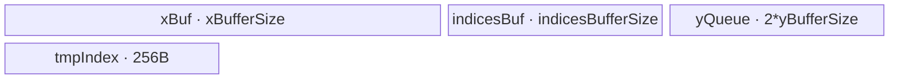
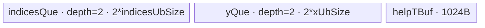

# GatherNd 950 ACLNN 算子知识

## 算子速览

| 项目 | 内容 |
|---|---|
| 实际入口 | `aclnnGatherNdGetWorkspaceSize` + `aclnnGatherNd`，公开 ACLNN、固定仓仅此版本 |
| 计算语义 | 每个长度 `K=indices.shape[-1]` 的索引元组选取 `self` 的一个尾部切片；`out.shape=indices.shape[:-1]+self.shape[K:]` |
| 输入输出 | `self/out` 为 ND 且同 dtype；950 公开支持 FLOAT/FLOAT16/BFLOAT16/DOUBLE/INT8/UINT8/BOOL/INT16/UINT16/INT32/UINT32/INT64/UINT64；`indices` 为 INT32/INT64 ND；两输入秩 1～8 |
| 执行类型 | 单 AIV Kernel；R-001/R-002 为 `AIV_VECTOR`，R-003 为 AIV 搬运，R-004 为 `Hybrid(AIV SIMD+SIMT)`，R-005 为 AIV 内嵌 SIMT；没有 Cube/AIC 或 `MIX_CV` |
| Kernel 路线 | R-001 全量装载+VGather；R-002 全量装载+逐切片 Vector；R-003 长切片 SIMD；R-004 小切片 Hybrid；R-005 常规 SIMT fallback |
| 核心资源 | GM、UB `TBuf/TQue`、MicroAPI 寄存器、SIMT 线程；GatherNd 节点声明 16 MiB workspace，body 不读写 user workspace |
| 来源闭包 | `source_closed`：公开 API→L0 launcher→Tiling 决策树/POD→AIV entry/router→五条可达 body→ascend950 构建接线闭合 |
| 验证状态 | 已完成源码闭包检查；本次知识提取未执行编译、真机、数值或性能测试。 |

## 接口与语义

### 计算语义

令 `r=rank(self)`、`q=rank(indices)`、`K=indices[q-1]`。把 `indices` 展平为 `N=prod(indices.shape[:-1])` 个索引元组 `I_n`，把 `self.shape[K:]` 展平为长度 `A` 的切片，则 `out[n,a]=self[I_n[0],...,I_n[K-1],a]`，输出形状为 `indices.shape[:-1]+self.shape[K:]`。`negativeIndexSupport=true` 时负索引先按当前轴长度加回；两种属性值下 Kernel 均检测 `<0` 或 `>=axis_size`，越界结果写零。公开契约要求索引在 `[-s,s-1]`，越界写零属于实现边界，不应替代调用侧校验。

### 输入、输出与属性

| 参数 | shape/layout | dtype | 约束、默认值与语义 |
|---|---|---|---|
| `self` | ND，秩 1～8，可非连续 | FLOAT/FLOAT16/BFLOAT16/DOUBLE/INT8/UINT8/BOOL/INT16/UINT16/INT32/UINT32/INT64/UINT64 | 先经 `Contiguous`；空 tensor 时 ACLNN 直接成功返回，不启动 GatherNd |
| `indices` | ND，秩 1～8，可非连续；末维 `K` | INT32/INT64 | `1<=K<=rank(self)`；前 `q-1` 维决定索引元组数 `N` |
| `negativeIndexSupport` | 标量属性 | BOOL | `false` 默认语义；公开入口显式传入，控制负索引归一化 |
| `out` | ND，可非连续；`indices[:-1]+self[K:]` | 与 `self` 相同 | GatherNd 先产连续临时结果，再由 `ViewCopy` 写入用户输出 |

### 入口与版本

固定仓公开文档和头文件只声明两段式 `aclnnGatherNd`，未出现 V2/V3。第一段创建 executor、校验、安排 `Contiguous(self)`、`Contiguous(indices)`、`l0op::GatherNd`、`ViewCopy`；第二段由 `CommonOpExecutorRun` 在给定 stream 执行。README/接口文档明确 Ascend 950PR/950DT 支持；API 的 `DAV_3510` 分支选择完整 950 dtype 表。逻辑语义不含 Grad、原地或量化变体。

## Host/Launcher 执行流程

### 参数校验与前处理

`CheckParams` 依次检查三 tensor 非空、`self/out` dtype 相同、平台 dtype 白名单、`indices` 为 INT32/INT64、两输入秩 1～8、`1<=K<=rank(self)`，并重算输出 shape 与 `out` 比较；非 ND storage 只记录 warning。若 `self` 或 `indices` empty，第一段把 `workspaceSize=0` 后返回。非空时依次生成两个连续输入、分配连续 `gatherNdOut`，由 `ADD_TO_LAUNCHER_LIST_AICORE(GatherNd, OP_INPUT(self,indices), OP_OUTPUT(gatherNdOut), OP_ATTR(negativeIndexSupport))` 添加节点，最后 `ViewCopy`。

### 参数、Workspace 与生命周期

Tiling 读取平台 AIV 核数和 UB，先保留 32 KiB DCache；所有 Route 的 `GetWorkspaceSize` 都令 GatherNd 节点 workspace 为 `16,777,216` 字节。entry 要求框架 workspace、`GetUserWorkspace` 均非空，调用 `SetSysWorkspace`，但五个可达 body 没有对 user workspace 的 load/store。ACLNN 返回的总 workspace 还包含通用 `Contiguous/ViewCopy` 节点需求，其切片、对齐与 executor 内部 owner/lifetime 在固定仓不可见；用户必须保持 workspace 与 executor 到第二段 stream 提交完成。

### 启动图与失败传播

```text
ACLNN executor（同一 stream，具体队列实现固定仓不可见）
  node F1: Contiguous(self)      -> contiguousSelf
  node F2: Contiguous(indices)   -> contiguousIndices
  node G : GatherNd launcher -> Tiling4GatherNd -> gather_nd<<<blockDim>>>
           inputs=(contiguousSelf, contiguousIndices), output=gatherNdOut,
           attr=negativeIndexSupport, node workspace=16 MiB, POD=二选一
  node F3: ViewCopy(gatherNdOut, out)
```

F1/F2 的输出由 executor 持有并存活到 G 消费，`gatherNdOut` 存活到 F3；添加任何节点失败均返回空指针并阻止第一段成功。第二段把 `CommonOpExecutorRun` 返回码原样上送。F1/F2/F3 的内部 Kernel、workspace offset、event 和失败清理为框架边界；G 是单 Device 节点，无跨 Kernel workspace 边。

## Route 与参数设计

### 分核与资源计算

公共量：`K=rank_`，`N=indicesNum_`，`A=gatherSize_`（尾部切片元素数），`G=gatherDimSize_=prod(self.shape[:K])`，`O=N*A`；`xShape[0:K]` 保存被索引维，`xShape[K]=A`，`strideShape[i]=prod(xShape[i+1:K-1])`。当 `negativeIndexSupport=false` 且 `A*sizeof(x)` 可整除 8/4/2 字节时，`XDtypeImprove` 把 byte-copy 单位扩大并相应缩小 `A`。平台可用 `U=rawUB-32768`。

全量路线先按 `indicesInner=ceil(N/coreNum)`、`usedCoreNum=ceil(N/indicesInner)` 分核；其 `aSizeAligned=align32(A*xBytes)`，若为 128 或 256 再加 32，`xBuffer=align32(aSizeAligned*(G+1))`，`indicesBuffer=align32(min(indicesInner*32, rawUB-1024-2*16384-xBuffer))`，`yBuffer=(rawUB-1024-indicesBuffer-xBuffer)/2`。R-003 按索引元组分核，`maxElement=floor32((U-16384))/xBytes/2`。R-004 按元组分核并以 `singleUbProNum=floor((U-2048)/2/(A*xBytes+K*indicesBytes))` 分 UB。R-005 以输出元素 tile：`gatherCount=(U-512)/(A*xBytes+K*indicesBytes)`，据此生成 `xUbSize/indicesUbSize/ubFactor/blockFactor/blockNum`。

### Route 选择

| 顺序 | Route | Key/模板 | 精确选择条件与优先级 | 不适用去向 |
|---:|---|---|---|---|
| 1 | R-001 全量+VGather | 4000/4100，`GatherNdAllLoadV<INT32,NIS>` | `IsGaAllLoad()` 全部成立且 `aSizeAligned<=512`；key +100 表示负索引 | R-002/R-003 |
| 2 | R-002 全量+Vector | 3000/3100，`GatherNdAllLoad<INT32,NIS>` | `IsGaAllLoad()` 全部成立且 `aSizeAligned>512` | R-003 |
| 3 | R-003 长切片 SIMD | 11111111，`GatherNdSimd<DTYPE_INDICES>` | 非全量；`A*xBytes>=2048 && U>=32768 && N>=coreNum/2` | R-004 |
| 4 | R-004 Hybrid | 140/180/181/240/280/281/440/480/481/840/880/881 | 非前三；非 `(indices=int32 && (N>INT32_MAX \|\| O>INT32_MAX))`，且 `K>1 && A*xBytes<=2048 && N>=640` | R-005 |
| 5 | R-005 常规 SIMT | 十进制编码长 key，`GatherNdSimt<T1,T2,T3,NIS>` | 其余非空 ACLNN 合法输入；`T3` 按规模选 uint32/uint64，NIS 按属性选 | Tiling/资源失败 |

```text
empty input -> ACLNN 成功短路，无 Kernel
nonempty -> IsGaAllLoad ? (aSizeAligned<=512 ? R-001 : R-002)
         : large-slice guard ? R-003
         : mix guard ? R-004
         : R-005
```

### 模板/实现执行矩阵

| Route | key/selector | dtype/shape/platform 完整命中条件 | 执行拓扑与 Kernel 节点 | 实际模板/body | 内存与同步特征 | tail/fallback |
|---|---|---|---|---|---|---|
| R-001 | 4000/4100 | INT32 indices、K<=3、全量 UB/并行/重复度 guard、aligned slice<=512 | 单 `gather_nd` AIV | `GatherNdAllLoadV<DTYPE_INDICES,false/true>` | 全量 x、原地改写 indices、双 yQueue，MicroAPI VGather | mask 处理 indices/y tail；越界偏移指向预清零块 |
| R-002 | 3000/3100 | 同 R-001，但 512<aligned slice<=16384 | 单 `gather_nd` AIV | `GatherNdAllLoad<DTYPE_INDICES,false/true>` | 全量 x、rank1/2/3 专用索引修正、双 yQueue | 每 slice 的 MicroAPI mask；越界读预清零块 |
| R-003 | 11111111 | 长切片 guard | 单 `gather_nd` AIV | `GatherNdSimd<DTYPE_INDICES>` | 双缓冲 byte-copy queue、16 KiB index TBuf、显式 pipe event | 行装得下则多行，否则切列；非法索引 Duplicate 0 |
| R-004 | 12 个宽度 key | 小切片、K>1、N>=640、int32 地址安全 | 单 `gather_nd` AIV Hybrid | `GatherNdMixKernel<T1,T2,T3>` | 双 indices/y queue；SIMD 将元组原地变 GM 行偏移，SIMT gather | 最后一核/UB loop；越界偏移 -1 后 SIMT 写零 |
| R-005 | `GET_TILINGKEY(...)` | fallback | 单 `gather_nd` AIV+SIMT | `GatherNdSimt<T1,T2,T3,NIS>` | depth1 input/output queue、shape TBuf、1024 线程 VF | `min(end,O)`、线程步长 1024；越界写零 |

### 隐藏性能 Guard

| Guard | Host/Tiling 条件 | Device/资源原因 | 影响 Route | 不满足时去向 | 源码符号 |
|---|---|---|---|---|---|
| 全量装载 | `N/coreNum>G`、`aSizeAligned<=16384`、重复度条件、`K<=3`、indices INT32、`remainSpace>=0` | x 全域加一块零 slice、至少两个 16 KiB y 缓冲和最小 indices 区必须进 UB | R-001/R-002 | R-003 | `GatherNdSimtTiling::IsGaAllLoad` |
| VGather 阈值 | `aSizeAligned<=512` | VGather 以 32-bit lane 和 block stride 组织 | R-001 | R-002 | `GaAllLoadTiling` |
| bank padding | `aSizeAligned==128 \|\| 256` 时 `+=32` | 避免 gather bank conflict | R-001/R-002 | 同路线不同 stride | `IsGaAllLoad`、`GaAllLoadTiling` |
| 长切片 | `A*xBytes>=2048 && U>=32768 && N>=coreNum/2` | 保留 16 KiB index 区并给 byte-copy 双缓冲 | R-003 | R-004 | `DoOpTiling`、`CalcSimdTiling` |
| Hybrid 地址宽度 | int32 indices 且 `N` 或 `O` 超 INT32_MAX 时禁用 | Mix 的部分索引/loop 参数为 int32 | R-004 | R-005 uint64 地址模板 | `MixkernelNotSupport` |
| 空域 | `HasEmptyTensor(self,indices)` | ACLNN 不创建 GatherNd 节点 | 全部 | 成功短路 | `aclnnGatherNdGetWorkspaceSize` |

### POD/ABI

两种结构均由 `BEGIN_TILING_DATA_DEF` 声明；固定仓没有该外部宏展开，所以精确 `sizeof/alignof/offsetof` 不可见。下表的顺序就是序列化声明顺序。

| 结构 | 字段 | 类型/位宽 | ABI 布局 | 单位 | Host/launcher producer | Device consumer | 边界 |
|---|---|---|---|---|---|---|---|
| `GatherNdTilingData` | `xShape[8]` | uint64×8 | 宏展开不可见；第1字段 | 元素 | `GetXShapeInfo/GetShapeAttrsInfo:set_xShape` | SIMD/SIMT/Mix 地址与越界检查 | 未用槽置1 |
| 同上 | `strideShape[8]` | uint64×8 | 第2字段 | 元素 stride | `GetShapeAttrsInfo:set_strideShape` | Mix `FixIndicesVf` | 仅 R-004 |
| 同上 | `indicesShape[2]` | uint64×2 | 第3字段 | 元组数、K | `GetIndicesShapeInfo` | SIMT 初始化 | R-005 |
| 同上 | `xUbSize` | uint64 | 第4字段 | 字节 | Norm/Mix tiling | `vecOutQue/yQue InitBuffer` | R-004/R-005 |
| 同上 | `indicesUbSize` | uint64 | 第5字段 | 字节 | 各非全量 tiling | input queue/TBuf 初始化 | R-003/R-004/R-005 |
| 同上 | `gatherSize` | uint64 | 第6字段 | 元素 | `GetXShapeInfo`，可能经 dtype improve 缩小 | 各 body 地址/loop | 全部 |
| 同上 | `indicesNum` | uint64 | 第7字段 | 元组 | `GetIndicesShapeInfo` | SIMD/SIMT | R-003/R-005 |
| 同上 | `outputSize` | uint64 | 第8字段 | 改写后元素 | `GetShapeAttrsInfo` | SIMT end/tail | R-005 |
| 同上 | `blockFactor` | uint64 | 第9字段 | tile/核 | `CalcSimdTiling` 或 Norm | SIMD/SIMT core begin | R-003/R-005 |
| 同上 | `tailBlockFactor` | uint64 | 第10字段 | 核数余数 | `CalcSimdTiling` | SIMD former/tail core | R-003 |
| 同上 | `ubFactor` | uint64 | 第11字段 | 输出元素/tile | Norm tiling | SIMT loop step | R-005 |
| 同上 | `rank` | uint64 | 第12字段 | 轴数 K | `GetShapeAttrsInfo` | 全部索引循环 | 全部 |
| 同上 | `blockNum` | uint64 | 第13字段 | AIV 核 | 各 tiling | Mix guard/SIMT 保存 | R-004/R-005；同时设 blockDim |
| 同上 | `normalCoreIndicesNum` | uint64 | 第14字段 | 元组/核 | Mix tiling | Mix GM base、loop | R-004 |
| 同上 | `tailCoreIndicesNum` | uint64 | 第15字段 | 元组 | Mix tiling | Mix 尾核 | R-004 |
| 同上 | `singleUbProNum` | uint64 | 第16字段 | 元组/UB轮 | Mix tiling | Mix UB loop | R-004 |
| 同上 | `negativeIndexSupport` | uint64 | 第17字段 | 0/1 | `GetShapeAttrsInfo` | SIMD/Mix runtime；SIMT key选择 | 全部 |
| 同上 | `supportOutOfBoundIndex` | uint64 | 第18字段 | 0/1 | 固定写0 | 仅参与 Host key | Device 不读 |
| 同上 | `maxElement` | int64 | 第19字段 | 元素 | `CalcSimdTiling:ubAviable` | SIMD tile容量 | R-003 |
| 同上 | `dtypeSize` | int64 | 第20字段 | 字节/元素 | `CalcSimdTiling:xDtypeSize_` | SIMD byte地址 | R-003 |
| 同上 | `needCoreNum` | int64 | 第21字段 | 核 | `CalcSimdTiling` | SIMD 空核返回 | R-003 |
| `GatherNdGaAllLoadTilingData` | `xShape[8]` | uint64×8 | 宏展开不可见；第1字段 | 元素 | `GaAllLoadTiling` | 索引线性化 | R-001/R-002 |
| 同上 | `rank` | int64 | 第2字段 | 轴数 | 同上 | rank专用/通用修正 | 同上 |
| 同上 | `gSize` | int64 | 第3字段 | slice 数 | 同上 | x全量搬运 blockCount | 同上 |
| 同上 | `aSize` | int64 | 第4字段 | 字节 | `A*xBytes` | x/y DMA blockLen | 同上 |
| 同上 | `aSizeAligned` | int64 | 第5字段 | 字节 | align32+bank padding | UB行 stride | 同上 |
| 同上 | `indicesSize` | int64 | 第6字段 | 元组 | `N` | 固定 body 未读取 | inactive |
| 同上 | `usedCoreNum` | int64 | 第7字段 | 核 | `indicesOuter` | entry body空核检查 | 同上 |
| 同上 | `indicesOuter` | int64 | 第8字段 | 核 | 分核公式 | core→元组块 | 同上 |
| 同上 | `normalCoreIndicesNum` | int64 | 第9字段 | 元组/核 | `indicesInner` | GM offset | 同上 |
| 同上 | `tailCoreIndicesNum` | int64 | 第10字段 | 元组 | `indicesTail` | 尾核 | 同上 |
| 同上 | `xBufferSize` | int64 | 第11字段 | 字节 | `allLoadXBytes` | xBuf InitBuffer | 同上 |
| 同上 | `indicesBufferSize` | int64 | 第12字段 | 字节 | UB余量公式 | indicesBuf InitBuffer/loop | 同上 |
| 同上 | `yBufferSize` | int64 | 第13字段 | 每个队列槽字节 | UB余量/2 | depth2 yQueue | 同上 |

### Route 源码闭包

| Route | Key/selector | Host/Tiling producer | POD/参数 | Kernel entry/router 节点 | Kernel body/直接依赖 | 构建接线 |
|---|---|---|---|---|---|---|
| R-001 | 4000/4100 | `gather_nd_tiling_arch35.cpp::IsGaAllLoad/GaAllLoadTiling` | GaAllLoad POD | `gather_nd_apt.cpp::gather_nd` | `gather_nd_full_load_vgather.h::GatherNdAllLoadV` | CMake `ascend950` + `ascendc_config.json` |
| R-002 | 3000/3100 | 同上 | GaAllLoad POD | 同上 | `gather_nd_all_load.h::GatherNdAllLoad` | 同上 |
| R-003 | 11111111 | `DoOpTiling/CalcSimdTiling` | 通用 POD | 同上 | `gather_nd_simd.h::GatherNdSimd` | 同上 |
| R-004 | 宽度编码 key | `DoMixKernelOpTiling/GetTilingKey` | 通用 POD | 同上 | `gather_nd_mix.h::GatherNdMixKernel` | 同上 |
| R-005 | 长 key | `DoNormOpTiling/GetTilingKey` | 通用 POD | 同上 | `gather_nd_simt.h::GatherNdSimt/SimtDim` | 同上 |

## Kernel 实现

### 公共执行流程

`gather_nd(x,indices,y,workspace,tiling)` 先验证 workspace，设置系统 workspace，创建 `TPipe` 并强制 `KERNEL_TYPE_AIV_ONLY`；router 按 key 解出对应 POD、实例化 body、调用 `Init/Process`。每条 Route 都是一个 Device 节点，GM 输入只读、GM y 按不相交 core 区域写；没有 atomic、跨核归约或跨 Kernel 边。未知 key 没有 else 报错而直接无输出，这是 launcher/编译接线必须避免的失败边界。

### Route R-001：全量装载 VGather

#### 适用条件

##### 选择证据

| 层级 | 文件 | 符号 | 源码谓词/参数 | 结果/下一跳 |
|---|---|---|---|---|
| Tiling | `gather_nd_tiling_arch35.cpp` | `IsGaAllLoad` | 全量六项 guard 全真 | `isGaAllLoad_=true` |
| Tiling | 同上 | `GaAllLoadTiling` | `aSizeAligned<=512`；NIS 决定 +100 | 4000/4100 |
| Router | `gather_nd_apt.cpp` | `gather_nd` | key 4000/4100 | `GatherNdAllLoadV<DTYPE_INDICES,false/true>` |

#### Device 数据流

##### 函数级调用链

```text
gather_nd -> GatherNdAllLoadV::Init -> Process
  -> GenIndexBuf + IndicesColBuf + InitXbuf + CopyInX
  -> IndicesProcess(CopyInIndices -> DealIndicesBound)
  -> yProcess -> DealByVgather -> CopyOutY
```

##### 源码等价伪码

```text
core range = [core*normal, core*normal + (tail?tail:normal))
zero xBuf[0:aSizeAligned]; DMA all G slices to xBuf[aSizeAligned:] with padded row stride
for each indices UB tile:
  DMA tuple rows; SIMD normalize/check each component
  replace invalid tuple by encoded offset 0, valid by (linear_index+1)*aSizeAligned
  for each y tile and each 32B slice block:
    VGather 32-bit lanes from xBuf[encoded_offset + intra_slice_offset]
    masked store to padded y row
  DMA valid aSize bytes/row to GM y; omit UB padding
```

#### 内存与数据搬运

##### 资源与搬运表

| 层级/缓冲区 | offset/地址公式 | extent/容量公式 | dtype/layout | producer | consumer | owner/lifetime | 对齐/复用 |
|---|---|---|---|---|---|---|---|
| GM x | 0 | `G*aSize` bytes | byte-view rows | API | `CopyInX` | caller | 32B padded only in UB |
| `xBuf_` | zero row 0；x from `aSizeAligned` | `xBufferSize` | int8 padded rows | `InitXbuf/CopyInX` | VGather | kernel全程 | invalid tuple aliases zero row |
| `indicesBuf_` | tile base | `indicesBufferSize` | INT32 then in-place encoded int32 | DMA/DealIndicesBound | VGather | each tile | MTE3→MTE2、MTE2→V |
| `yQueue_` | slot | `2*yBufferSize` | padded byte rows | VGather | `CopyOutY` | queue slot | depth2 |
| helper TBuf | 独立 | 256+256+32 bytes | index/column/rank | generators | SIMD | kernel全程 | 计入1024 reserve |

##### 分层内存布局


##### 字节账与复用顺序

```text
UB_total = xBufferSize + indicesBufferSize + 2*yBufferSize + 544
xBufferSize + indicesBufferSize + 2*yBufferSize = rawUB - 1024
=> UB_total = rawUB - 480
dynamic_ub = N/A；AIV UB 由 InitBuffer 使用
workspace_total = 16,777,216 bytes（body不读写）
```

| 复用子区 | 写入者 | 读取者/消费点 | 下一次覆盖 | 同步或释放依据 | 安全条件 |
|---|---|---|---|---|---|
| indicesBuf | DMA | DealIndicesBound/VGather | 下一 indices tile | MTE2→V event | VGather 完成后才复用 |
| yQueue slot | VGather | MTE3 CopyOut | depth2后续 slot | EnQue/DeQue/FreeTensor | 仅写当前 tile有效行 |

#### 同步、精度与尾块

##### 同步与数值边界表

| 阶段 | primitive/机制 | producer | consumer/等待点 | 保护对象 | 精度/尾块 |
|---|---|---|---|---|---|
| indices复用 | MTE3_MTE2、MTE2_V event | 前轮输出/当前DMA | 下一DMA/SIMD | indicesBuf | mask=`indicesNum` |
| gather | MicroAPI mask/VGather | encoded index | y register/store | x/y UB | 纯字节搬运，无 cast；tail mask |
| output | TQue depth2 | SIMD | `CopyOutY` | y slot | 每行仅写 `aSize`，跳过 padding |

#### 关键实现

##### 符号证据表

| 阶段 | 文件 | 符号/模板实例 | 实现事实 |
|---|---|---|---|
| Host/Tiling producer | `gather_nd_tiling_arch35.cpp` | `IsGaAllLoad/GaAllLoadTiling` | 全量 UB、分核和 4000/4100 |
| Kernel entry/router | `gather_nd_apt.cpp` | `gather_nd` | key 到 NIS 模板 |
| Device body/helper | `gather_nd_full_load_vgather.h` | `DealIndicesBoundVf/DealByVgatherVf` | 原地索引编码、零行和 VGather |

### Route R-002：全量装载逐切片 Vector

#### 适用条件

##### 选择证据

| 层级 | 文件 | 符号 | 源码谓词/参数 | 结果/下一跳 |
|---|---|---|---|---|
| Tiling | `gather_nd_tiling_arch35.cpp` | `IsGaAllLoad/GaAllLoadTiling` | 全量 guard 真且 `aSizeAligned>512` | 3000/3100 |
| Router | `gather_nd_apt.cpp` | `gather_nd` | key 3000/3100 | `GatherNdAllLoad<DTYPE_INDICES,NIS>` |

#### Device 数据流

##### 函数级调用链

```text
gather_nd -> GatherNdAllLoad::Init -> Process
 -> GenIndexBuf -> InitializationX -> xProcess/CopyInX
 -> IndicesProcess -> FixIndicesVfRank1/2/3
 -> yProcess -> GatherProcessVfWithGA -> CopyOutY
```

##### 源码等价伪码

```text
全量x和indices线性化同R-001；K由Host限制<=3
按K选择展开的rank1/2/3 SIMD，将每个tuple原地写为(线性行+1)*aSizeAligned
for tuple in y tile:
  from = xBuf + encoded_offset
  repeat ceil(aSize/VRegBytes): masked register copy to padded y row
DMA aSize bytes/row to GM
```

#### 内存与数据搬运

##### 资源与搬运表

| 层级/缓冲区 | offset/地址公式 | extent/容量公式 | dtype/layout | producer | consumer | owner/lifetime | 对齐/复用 |
|---|---|---|---|---|---|---|---|
| xBuf | zero row + G rows | `xBufferSize` | int8 padded | zero+DMA | register copy | kernel | 32B row；128/256再pad32 |
| indicesBuf | tile | `indicesBufferSize` | INT32→encoded int32 | DMA+FixIndices | gather | tile | 原地覆盖 |
| yQueue | slot | `2*yBufferSize` | int8 padded | MicroAPI | DMA | queue | depth2 |
| tmpIndexBuf | 0 | 256B | uint32 | `GenIndexBuf` | FixIndices | kernel | reserve内 |

##### 分层内存布局



##### 字节账与复用顺序

```text
UB_total = xBufferSize + indicesBufferSize + 2*yBufferSize + 256 = rawUB - 768
dynamic_ub = N/A
workspace_total = 16,777,216 bytes（body不读写）
```

| 复用子区 | 写入者 | 读取者/消费点 | 下一次覆盖 | 同步或释放依据 | 安全条件 |
|---|---|---|---|---|---|
| indicesBuf | CopyInIndices/FixIndices | GatherProcess | 下一tile | MTE2→V event | 当前 yProcess 完成 |
| yQueue | GatherProcess | CopyOutY | depth2轮转 | queue协议 | tail mask只提交aSize |

#### 同步、精度与尾块

##### 同步与数值边界表

| 阶段 | primitive/机制 | producer | consumer/等待点 | 保护对象 | 精度/尾块 |
|---|---|---|---|---|---|
| indices | MTE3_MTE2/MTE2_V | DMA | FixIndices | indicesBuf | NIS compile-time；越界→zero row |
| slice copy | MicroAPI UpdateMask | xBuf | yBuf | 寄存器/UB | byte exact，无数值 cast；末 repeat mask |
| output | queue | y SIMD | DMA | y slot | 去除 padding |

#### 关键实现

##### 符号证据表

| 阶段 | 文件 | 符号/模板实例 | 实现事实 |
|---|---|---|---|
| Host/Tiling producer | `gather_nd_tiling_arch35.cpp` | `GaAllLoadTiling` | 3000/3100、buffer公式 |
| Kernel entry/router | `gather_nd_apt.cpp` | `gather_nd` | 模板映射 |
| Device body/helper | `gather_nd_all_load.h` | `FixIndicesVfRank*CoreVf/GatherProcessVf*` | rank展开和masked byte copy |

### Route R-003：长切片 SIMD

#### 适用条件

##### 选择证据

| 层级 | 文件 | 符号 | 源码谓词/参数 | 结果/下一跳 |
|---|---|---|---|---|
| Tiling | `gather_nd_tiling_arch35.cpp` | `DoOpTiling` | 非全量且长切片三项 guard | 11111111 |
| Router | `gather_nd_apt.cpp` | `gather_nd` | key命中 | `GatherNdSimd<DTYPE_INDICES>` |

#### Device 数据流

##### 函数级调用链

```text
gather_nd -> GatherNdSimd::Init -> Process
 -> NoSplitColProcess(GetIndex -> CopyIn/UB复用 -> CopyOut)
 or SplitColProcess(GetIndex -> 分段CopyIn/Duplicate -> CopyOut)
```

##### 源码等价伪码

```text
former cores get blockFactor+1 tuples; others get blockFactor
cache indices in 16KiB TBuf
if aligned_slice <= output-slot capacity:
  batch rows; for each tuple compute linear source
  if source equals one of previous 3 rows, UB Copy previous row; else GM DMA
  invalid -> Duplicate(0); DMA rows to y
else:
  one tuple at a time, split slice by maxElement; DMA/Duplicate then output each segment
```

#### 内存与数据搬运

##### 资源与搬运表

| 层级/缓冲区 | offset/地址公式 | extent/容量公式 | dtype/layout | producer | consumer | owner/lifetime | 对齐/复用 |
|---|---|---|---|---|---|---|---|
| `inQueue_` | slot | `2*maxElement*dtypeSize` | byte view | GM DMA/UB Copy/Duplicate | MTE3 | queue | bind VECIN/VECOUT depth2 |
| `indexBuf_` | cached range base | 16384B | INDICES_T | DMA | scalar GetValue | kernel | range cache |
| GM y | tuple/slice byte offset | valid bytes | original dtype bytes | CopyOut | caller | caller | row/segment tail exact |

##### 分层内存布局


##### 字节账与复用顺序

```text
UB_total = 2*floor32(U-16384)/2 + 16384 <= U = rawUB-32768
dynamic_ub = N/A；PostTiling localMemorySize=U
workspace_total = 16 MiB
```

| 复用子区 | 写入者 | 读取者/消费点 | 下一次覆盖 | 同步或释放依据 | 安全条件 |
|---|---|---|---|---|---|
| indexBuf | CopyIn | GetValue | idx越缓存窗 | MTE2_S event | `idx<base+maxIndex` 方可复用 |
| output slot previous 3 rows | GM DMA/UB Copy | later duplicate row | queue释放前 | MTE2_V event | 只在同一已分配 xLocal tile内引用 |

#### 同步、精度与尾块

##### 同步与数值边界表

| 阶段 | primitive/机制 | producer | consumer/等待点 | 保护对象 | 精度/尾块 |
|---|---|---|---|---|---|
| index scalar | MTE2_S | DMA | GetValue | indexBuf | exact int32/int64 |
| duplicate row | MTE2_V | earlier DMA | UB Copy | xLocal | only exact same linear slice |
| output | V_MTE3、MTE3_V、queue | UB写 | DMA/下轮 | slot | byte exact；rows/cols tail显式 |

#### 关键实现

##### 符号证据表

| 阶段 | 文件 | 符号/模板实例 | 实现事实 |
|---|---|---|---|
| Host/Tiling producer | `gather_nd_tiling_arch35.cpp` | `CalcSimdTiling` | core、maxElement、16KiB |
| Kernel entry/router | `gather_nd_apt.cpp` | 11111111 branch | DTYPE_INDICES实例 |
| Device body/helper | `gather_nd_simd.h` | `NoSplitColProcess/SplitColProcess` | 三行缓存、切列和tail |

### Route R-004：小切片 SIMD+SIMT Hybrid

#### 适用条件

##### 选择证据

| 层级 | 文件 | 符号 | 源码谓词/参数 | 结果/下一跳 |
|---|---|---|---|---|
| Tiling | `gather_nd_tiling_arch35.cpp` | `DoOpTiling/DoMixKernelOpTiling` | mix guard、singleUbProNum>0 | 宽度编码 key |
| Router | `gather_nd_apt.cpp` | 12 branches | x/indices/address宽度 | `GatherNdMixKernel<T1,T2,T3>` |

#### Device 数据流

##### 函数级调用链

```text
gather_nd -> GatherNdMixKernel::Init -> Process
 -> GenGatherIndex -> CopyInIndices
 -> FixIndicesVf<false/true>（SIMD）
 -> asc_vf_call<MixSimt[WithLastAxisOne]>（2048线程）
 -> CopyOutY
```

##### 源码等价伪码

```text
each core owns contiguous tuple range; each UB loop copies tuple rows
SIMD: for each tuple, normalize/check K components, accumulate flattened prefix,
      multiply by A; invalid becomes -1; overwrite indices UB with rowStart
SIMT thread idx stride 2048 over yCount:
  row=idx/A, col=idx%A (A==1 has division-free specialization)
  rowStart=indicesUB[row]; y= rowStart<0 ? 0 : xGM[rowStart+col]
DMA y UB to this core's GM range
```

#### 内存与数据搬运

##### 资源与搬运表

| 层级/缓冲区 | offset/地址公式 | extent/容量公式 | dtype/layout | producer | consumer | owner/lifetime | 对齐/复用 |
|---|---|---|---|---|---|---|---|
| indicesQue | core+tile tuple offset | `2*indicesUbSize` | T2 input→T3 rowStart | DMA+SIMD | SIMT | depth2 | same physical buffer in-place |
| yQue | core+tile output | `2*xUbSize` | T1 | SIMT | DMA | depth2 | tail yCount |
| helpTBuf | 0/512/640 | 1024B | arange/xShape/stride | Host constants+SIMD | FixIndices | kernel | DSB after scalar stores |
| GM x | `rowStart+col` | caller extent | T1 | caller | SIMT | caller | random read |

##### 分层内存布局



##### 字节账与复用顺序

```text
UB_total = 2*indicesUbSize + 2*xUbSize + 1024
selector reserves 2KiB before sizing two single buffers；32B对齐余量覆盖见源码公式
dynamic_ub = embedded SIMT 2048 threads；无独立dynUB launch参数
workspace_total = 16 MiB
```

| 复用子区 | 写入者 | 读取者/消费点 | 下一次覆盖 | 同步或释放依据 | 安全条件 |
|---|---|---|---|---|---|
| indices slot | DMA→FixIndices原地写 | MixSimt | FreeTensor后下一轮 | queue + SIMD/SIMT调用顺序 | SIMT完成前不释放 |
| y slot | MixSimt | CopyOutY | FreeTensor | yQueue | yCount不超过xUbSize/T1 |

#### 同步、精度与尾块

##### 同步与数值边界表

| 阶段 | primitive/机制 | producer | consumer/等待点 | 保护对象 | 精度/尾块 |
|---|---|---|---|---|---|
| shape helper | `DataSyncBarrier<UB>` | scalar SetValue | SIMD | helpTBuf | T3 int32/64 exact |
| indices→SIMT | 顺序 asc_vf_call | FixIndices | MixSimt | indices slot | mask按indicesNumPro；越界=-1 |
| output | queue | SIMT | DMA | y slot | last core/loop yCount |

#### 关键实现

##### 符号证据表

| 阶段 | 文件 | 符号/模板实例 | 实现事实 |
|---|---|---|---|
| Host/Tiling producer | `gather_nd_tiling_arch35.cpp` | `DoMixKernelOpTiling` | 双缓冲容量和分核 |
| Kernel entry/router | `gather_nd_apt.cpp` | mix key branches | T1/T2/T3映射 |
| Device body/helper | `gather_nd_mix.h` | `FixIndicesVfCoreVf/MixSimt` | SIMD预计算+SIMT随机读 |

### Route R-005：常规 SIMT fallback

#### 适用条件

##### 选择证据

| 层级 | 文件 | 符号 | 源码谓词/参数 | 结果/下一跳 |
|---|---|---|---|---|
| Tiling | `gather_nd_tiling_arch35.cpp` | `DoNormOpTiling/GetTilingKey` | 前四路线均不命中 | 宽度/NIS长 key |
| Router | `gather_nd_apt.cpp` | SIMT branches | x、indices、地址、NIS | `GatherNdSimt<T1,T2,T3,NIS>` |

#### Device 数据流

##### 函数级调用链

```text
gather_nd -> GatherNdSimt::Init -> Process
 -> CopyIn(indices tile)
 -> asc_vf_call<SimtDim>(1024 threads)
 -> CopyOut(output tile)
```

##### 源码等价伪码

```text
core covers [core*blockFactor*ubFactor, min(next,O))
for tile by ubFactor:
  DMA only tuple rows intersecting tile
  each SIMT thread loops idx += 1024:
    derive tuple id and slice col (uint32 uses magic divide, uint64 uses / and %)
    fold K indices; optional negative normalization; detect OOB
    outputUB[idx] = OOB ? 0 : xGM[linear*A+col]
  DMA curSize elements to GM y
```

#### 内存与数据搬运

##### 资源与搬运表

| 层级/缓冲区 | offset/地址公式 | extent/容量公式 | dtype/layout | producer | consumer | owner/lifetime | 对齐/复用 |
|---|---|---|---|---|---|---|---|
| vecInQue | `indicesBegin=(curBegin/A)*K` | `indicesUbSize` | T2 | DMA | SIMT | depth1/tile | byte length exact |
| vecOutQue | current output tile | `xUbSize` | T1 | SIMT | DMA | depth1/tile | curSize tail |
| inShapeBuf | 0 | 1024B | T3[8]有效 | scalar store | SIMT | kernel | UB DSB |
| GM x/y | computed index / curBegin | caller/O | T1 | caller/SIMT | SIMT/caller | external | no atomic |

##### 分层内存布局


##### 字节账与复用顺序

```text
UB_total = indicesUbSize + xUbSize + 1024
PostTiling localMemorySize = U = rawUB-32768
注意：DoNormOpTiling仅以512B INDICES_REDUENT_SIZE预留计算x/indices区；固定源码没有给出额外条件证明 UB_total<=U，复用时必须重新核对平台分配器口径。
dynamic_ub = embedded SIMT 1024 threads；无独立dynUB launch参数
workspace_total = 16 MiB
```

| 复用子区 | 写入者 | 读取者/消费点 | 下一次覆盖 | 同步或释放依据 | 安全条件 |
|---|---|---|---|---|---|
| vecIn slot | CopyIn | SimtDim | FreeTensor后下一tile | EnQue/DeQue/FreeTensor | SIMT返回后释放 |
| vecOut slot | SimtDim | CopyOut | FreeTensor | queue | curSize<=ubFactor |

#### 同步、精度与尾块

##### 同步与数值边界表

| 阶段 | primitive/机制 | producer | consumer/等待点 | 保护对象 | 精度/尾块 |
|---|---|---|---|---|---|
| shape | UB DSB | scalar stores | SIMT VF | xShape | 8项写完后可见 |
| SIMT | VF completion + queue顺序 | indices DMA | output DMA | input/output UB | 1024线程步进；uint32 magic divide |
| 数值 | direct assignment | x GM | y UB | payload | payload无算术/cast；索引整数计算 |

#### 关键实现

##### 符号证据表

| 阶段 | 文件 | 符号/模板实例 | 实现事实 |
|---|---|---|---|
| Host/Tiling producer | `gather_nd_tiling_arch35.cpp` | `DoNormOpTiling/GetTilingKey` | tile/core/地址宽度 |
| Kernel entry/router | `gather_nd_apt.cpp` | SIMT key branches | 全模板实例 |
| Device body/helper | `gather_nd_simt.h` | `GatherNdSimt::Process/SimtDim` | 线程映射、越界、tail |

## 算子特定优化

### Trick T-001：以更宽 byte-copy 单位压缩循环

#### 触发与源码依据

- 适用 Route：R-001～R-005 的 Host shape/POD 归一化，实际最直接影响按元素规模计算的路线。
- 触发条件：非空、`K>0`、`negativeIndexSupport=false`，且 slice 字节数可整除 8、4 或 2；选择不小于原 dtype 的最大整除宽度。
- Golden 来源：[`index/gather_nd/op_host/arch35/gather_nd_tiling_arch35.cpp:204-224`](../../../../../../../cann-ops-raw/ascendc/ops-nn/955f8b33985b6d72989ebff341bb9c2c564a51bc/index/gather_nd/op_host/arch35/gather_nd_tiling_arch35.cpp#L204-L224)

**官方源码（固定 Commit 连续逐字摘录）**：

```cpp
if ((xDtypeSize_ < INPUT_DTYPE_B64) && ((lastAxisByte % INPUT_DTYPE_B64) == 0)) {
    improveDtypeSize_ = INPUT_DTYPE_B64;
    return true;
}
```

#### 机制与设计原因

Host 保持 slice 总字节数不变，把 `gatherSize_` 除以 `improveDtypeSize_/xDtypeSize_`，并把 `xDtypeSize_` 放大。Kernel 全部按 payload 字节搬运，不做数值计算，因此可用更少的逻辑元素和地址步进覆盖相同字节。负索引路线禁用该改写，避免改变 NIS 专门模板/key 的参数解释。

#### 迁移边界

- 适用：纯搬运、输出 dtype 与输入完全一致的连续尾切片。
- 前提：slice 字节整除候选宽度，且后续地址、POD、binary dtype-byte 匹配均按改写宽度一致解释。
- 失效：不整除或支持负索引时保留原 dtype 宽度，不改变 Route 决策顺序。
- 未验证：本次知识提取未执行编译、真机、数值或性能测试。

#### 错误做法

固定仓未提供可验证反例；不可把该技巧用于包含数值运算或需要保留元素类型语义的 Kernel。

### Trick T-002：长切片批内最近三行 UB 复用

#### 触发与源码依据

- 适用 Route：R-003 的 `NoSplitColProcess`。
- 触发条件：当前 slice 的 aligned bytes 能放入一个 queue slot，且新 tuple 的线性 `xIndex` 等于当前 batch 前三次从 GM 装载之一。
- Golden 来源：[`index/gather_nd/op_kernel/arch35/gather_nd_simd.h:181-196`](../../../../../../../cann-ops-raw/ascendc/ops-nn/955f8b33985b6d72989ebff341bb9c2c564a51bc/index/gather_nd/op_kernel/arch35/gather_nd_simd.h#L181-L196)

**官方源码（固定 Commit 连续逐字摘录）**：

```cpp
if (unlikely(xIndex == preIdx0 || xIndex == preIdx1 || xIndex == preIdx2)) {
  int32_t backStep = (xIndex == preIdx0) ? backOffset0 : (xIndex == preIdx1) ? backOffset1 : backOffset2;
  Copy(xLocal[j * colsAlign], xLocal[backStep], tilingData_->gatherSize * tilingData_->dtypeSize);
} else {
  CopyIn(xLocal[j * colsAlign], xGm_, srcOffset, 1, tilingData_->gatherSize * tilingData_->dtypeSize);
}
```

#### 机制与设计原因

同一 UB batch 内的重复索引不再次随机读取 GM，而在 `MTE2_V` 可见性后复制已装载的完整 slice；缓存仅保存三个 `xIndex→UB offset`，不额外分配 tensor。命中时减少 GM 搬运，未命中维持正常 DMA。

#### 迁移边界

- 适用：输出批次中短距离重复索引明显、完整 slice 已在同一 LocalTensor 的 gather。
- 前提：源与目标区不越界，比较使用线性 slice 起点，覆盖前等待 MTE2→V。
- 失效：切列路线 R-003 `SplitColProcess` 或重复距离超过3时回到 GM `CopyIn`。
- 未验证：本次知识提取未执行编译、真机、数值或性能测试。

#### 错误做法

不能跨 queue slot 或已释放 batch 保存 UB offset；源码只在当前 `xLocal` 内复用。

## 模板与实现对比

| 对比维度 | R-001 全量VGather | R-002 全量Vector | R-003 长切片SIMD | R-004 Hybrid | R-005 SIMT | 设计选择依据 |
|---|---|---|---|---|---|---|
| 命中条件/优先级 | 全量且<=512 | 全量且>512 | slice>=2048 | K>1、小slice、N>=640 | fallback | 先复用全量x，再按slice/规模 |
| 模板与 dtype | byte x，INT32 index，NIS编译期 | 同左 | DTYPE_INDICES，NIS运行时 | T1/T2/T3，NIS运行时 | T1/T2/T3/NIS | 地址宽度与索引语义 |
| 循环与分核 | core→index tile→y tile→block | core→index tile→y tile→slice repeat | core→row/col tile | core→UB tuple→SIMT element | core→output tile→thread | UB与随机读粒度 |
| Queue/TBuf/寄存器/dynamic UB/通信 window | 全量x+indices+双y+3 helpers | 全量x+indices+双y+helper | 双queue+16KiB index | 双indices/y+1KiB helper+SIMT | depth1 queues+1KiB shape+SIMT | 均无通信 window |
| 内存总占用与复用 | rawUB-480 | rawUB-768 | <=rawUB-32768 | selector双buffer公式 | 源码有512/1024预留口径差 | 见逐Route字节账 |
| 搬运/Vector/SIMT/NDDMA/通信 API | DataCopyPad+VGather | DataCopyPad+reg copy | DMA/UB Copy | SIMD+asc_vf_call | DMA+asc_vf_call | 无NDDMA/通信 |
| 同步、精度与 tail | event+queue、byte exact | 同左 | 显式HardEvent | UB DSB+queue | UB DSB+queue | payload不cast；索引整数 |
| fallback/失败边界 | guard失败→后续 | guard失败→R-003 | guard失败→R-004 | guard失败→R-005 | tiling失败/unknown key | 空输入Host短路 |

## 平台差异

| 项目 | A2 | A3 | 950 |
|---|---|---|---|
| 支持状态 | 公开文档声明支持，但固定源码接线未闭合 | 公开文档声明支持，但固定源码接线未闭合 | 公开支持且 source closed |
| Host/Launcher | 缺少可确认代际身份的 OpDef/per-op binary；不以 `mc62` 推测 | 同左 | `ascend950` OpDef、binary、arch35 tiling闭合 |
| Kernel/资源 | 不从950 body外推 | 不从950 body外推 | 五路线共用运行时 coreNum/rawUB；VReg width由公共 `platform.h` 编译期选择 |

## 限制与失败边界

- 公开 ACLNN 只支持 `1<=K<=rank(self)`，两输入秩 1～8；空输入直接成功且不启动 Kernel。router 中 zero/broadcast key 对此公开入口不可达，未作为正式 Route。
- 950 公开支持 DOUBLE/INT16/UINT16/UINT32/UINT64 等扩展 dtype；binary JSON 以 `DtypeByte` 为 x/y 匹配模式，由 1/2/4/8-byte 实例覆盖；非 ND storage 仅 warning，但公开格式为 ND。
- out-of-bound 实现写零；调用方仍须遵守公开索引范围。未知 tiling key、空 workspace 或空 user workspace 时 entry 无输出，且无 Device 错误码。
- `GatherNdTilingData` 的宏生成 ABI 精确 offset/size、executor 的通用节点 workspace 切片与 stream/event 实现固定仓不可见。
- 公开文档声明 A2/A3 支持，但 `gather_nd_def.cpp` 只显式 `AddConfig("ascend950")`，per-op binary 也只有 `ascend950`；模块 CMake/全局配置中的 `mc62` 不能单独证明 A2/A3 代际身份。因此固定提交不足以发布无后缀 A2/A3 卡。
- R-005 的 Host 仅留 512B 冗余而 body 分配 1024B shape TBuf；固定源码未证明该字节账一定不超过 `SetLocalMemorySize(U)`，迁移必须核对实际编译器/平台分配口径。

## 源码索引

### 链路索引

| 链路阶段 | 文件 | 关键符号 | 支撑内容 |
|---|---|---|---|
| 入口声明/约束 | `index/gather_nd/docs/aclnnGatherNd.md` | `aclnnGatherNd*` | 公开平台、dtype、shape与确定性 |
| 入口实现 | `index/gather_nd/op_api/aclnn_gather_nd.cpp` | `CheckParams/aclnnGatherNdGetWorkspaceSize/aclnnGatherNd` | 校验、框架节点、executor |
| 入口实现 | `index/gather_nd/op_api/gather_nd.cpp` | `l0op::GatherNd` | 输出分配和AICore launcher |
| Host/Tiling/Launcher | `index/gather_nd/op_host/gather_nd_def.cpp` | `ops::GatherNd` | dtype、属性与ascend950 OpDef配置 |
| Host/Tiling/Launcher | `index/gather_nd/op_host/arch35/gather_nd_tiling.cpp` | `Tiling4GatherNd/TilingPrepare4GatherNd` | Tiling注册、AIV核数与UB producer |
| Host/Tiling/Launcher | `index/gather_nd/op_host/arch35/gather_nd_tiling_arch35.h` | 两种 TilingData、`GatherNdSimtTiling` | POD声明 |
| Host/Tiling/Launcher | `index/gather_nd/op_host/arch35/gather_nd_tiling_arch35.cpp` | `DoOpTiling/GetTilingKey/PostTiling` | 完整决策树、资源、workspace |
| Kernel entry/body | `index/gather_nd/op_kernel/gather_nd_apt.cpp` | `gather_nd` | AIV router和全部key |
| Kernel entry/body | `index/gather_nd/op_kernel/arch35/gather_nd_full_load_vgather.h` | `GatherNdAllLoadV` | R-001 |
| Kernel entry/body | `index/gather_nd/op_kernel/arch35/gather_nd_all_load.h` | `GatherNdAllLoad` | R-002 |
| Kernel entry/body | `index/gather_nd/op_kernel/arch35/gather_nd_simd.h` | `GatherNdSimd` | R-003 |
| Kernel entry/body | `index/gather_nd/op_kernel/arch35/gather_nd_mix.h` | `GatherNdMixKernel` | R-004 |
| Kernel entry/body | `index/gather_nd/op_kernel/arch35/gather_nd_simt.h` | `GatherNdSimt/SimtDim` | R-005 |
| 构建接线 | `index/gather_nd/CMakeLists.txt` | `SUPPORT_COMPUTE_UNIT/SUPPORT_TILING_DIR` | mc62与ascend950共用arch35 |
| 构建接线 | `index/gather_nd/op_host/config/ascend950/gather_nd_binary.json` | `GatherNd op_list` | 950按1/2/4/8-byte x与int32/int64 indices实例 |
| 构建接线 | `scripts/kernel/binary_config/ascendc_config.json` | `GatherNd` | ascend950/mc62活动binary项与no-dcache-flush；mc62不用于代际外推 |
| Host/Tiling/Launcher | `common/inc/op_host/tiling_base.h` | `TilingBaseClass::DoTiling` | shape→platform→selector→tiling→workspace→POD→key顺序 |
| Kernel entry/body | `common/inc/op_kernel/platform.h` | `platform::GetUbBlockSize/GetVRegSize` | 32B UB block与VReg平台选择 |

### 实现复用检查

| 检查项 | 可复用事实 | 不得改变的约束 | 源码符号 |
|---|---|---|---|
| ABI/POD | 两种POD字段顺序与producer/consumer | 宏ABI、位宽、字节/元素单位和inactive字段 | `gather_nd_tiling_arch35.h` |
| 调用顺序 | empty短路；Contiguous×2→GatherNd→ViewCopy | executor与临时tensor生命周期 | `aclnnGatherNdGetWorkspaceSize` |
| workspace/内存 | GatherNd节点16MiB；逐Route UB公式 | entry要求非空workspace；depth必须计入 | `GetWorkspaceSize`、各`InitBuffer` |
| 同步 | queue、HardEvent、UB DSB | 不得提前覆盖indices/y/help区 | 各Route `Process` |
| 精度与尾块 | payload byte exact、索引整数、越界零、mask/tail | dtype improve只保持总字节；NIS语义不变 | `XDtypeImprove`、各body |
| 失败边界 | Host校验/Tiling失败阻断；unknown key无输出 | 不得把zero/broadcast dormant key当公开Route | `CheckParams/DoOpTiling/gather_nd` |

- [DataSyncBarrier](../../../../apis/simd_api/basic_api/sync_control/intra_core_sync/data_sync_barrier_isasi.md)
- [SetSysWorkSpace](../../../../apis/simd_api/basic_api/resource_management/workspace/set_sys_work_space.md)
