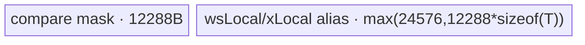

# IndexFill A2/A3 ACLNN 算子知识

## 算子速览

| 项目 | 内容 |
|---|---|
| 实际入口 | `aclnnIndexFillGetWorkspaceSize` + `aclnnIndexFill`，公开、非原地 ACLNN |
| 计算语义 | 把 `self` 视为 `[P,N,Q]`；若 `indices` 含归一化后等于 `n` 的项，则 `out[p,n,q]=value`，否则复制 `self[p,n,q]` |
| 输入输出 | `self/out/value`：FP16、FP32、BF16、INT32、INT64、BOOL；`index`：INT32/INT64；ND，`out.shape=self.shape` |
| 执行类型 | 单个核心 `index_fill` Kernel，5 条路线均为 `AIV_VECTOR`；ACLNN 的 `Contiguous/Transpose/ViewCopy` 是框架节点，无 Cube/AIC/MIX_CV |
| Kernel 路线 | R-001 Front-Q；R-002 Front-N；R-003 Front-P；R-004 Tail-N；R-005 Tail-P |
| 核心资源 | 每核一个覆盖整个平台 `ubSize` 的 `TBuf`，按阶段别名为 mask/indices/x/value；用户 workspace 保存 FP16 索引位图、核间完成标志及路线临时区 |
| 来源闭包 | source_closed：公开 ACLNN→非原地 `l0op::IndexFill`→arch32 Tiling/POD→key 0..4 router→五个 body/helper→A2/A3 OpDef/config/CMake 闭合 |
| 验证状态 | 已完成源码闭包检查；本次知识提取未执行编译、真机、数值或性能测试。 |

## 接口与语义

### 计算语义

令规范化轴 `d=dim>=0?dim:dim+rank(self)`，`P=prod(shape[0:d])`、`N=shape[d]`、`Q=prod(shape[d+1:])`。每个索引仅做一次负数归一化 `j'=j<0?j+N:j`；`j'` 不在 `[0,N)` 时跳过。对有效索引集合 `S`，输出为 `out[p,n,q]=(n in S)?cast(value,self.dtype):self[p,n,q]`。重复索引只把同一位置写成同一个标量，结果确定。

### 输入、输出与属性

| 参数 | shape/layout | dtype | 约束、默认值与语义 |
|---|---|---|---|
| `self` | 0–8D、ND，可非连续 | FP16/FP32/BF16/INT32/INT64/BOOL | 非原地源张量；空张量在 ACLNN 层直接成功返回 |
| `dim` | 标量属性 | INT64 | rank>0 时 `[-rank,rank)`；0D 时 `[-1,1)`；负值归一化 |
| `index` | 文档语义为标量或 1D，API 先连续化并把 0D unsqueeze | INT32/INT64 | 负值加 `N`；越界值跳过；空 index 只执行 `ViewCopy(self,out)` |
| `value` | `aclScalar`，转换为单元素 Tensor | 可转为 `self.dtype` | Kernel 按与 `self` 等宽的 `half/float/uint8_t/uint64_t` 位模式读取 |
| `out` | 与 `self` 同 shape、ND，可非连续 | 与 `self` 相同 | 最终由 `ViewCopy` 提交，输入 `self` 不被覆盖 |

### 入口与版本

固定仓仅公开两段式 `aclnnIndexFill`，没有更高版本符号。`aclnnIndexFillGetWorkspaceSize` 固定以 `isInplace=false` 调 `ExecIndexFillGetWorkspaceSize`，核心节点始终是 `l0op::IndexFill`，不进入 `l0op::InplaceIndexFill`，也不进入 Tensor-value API。公开文档和 `index_fill/CMakeLists.txt`、OpDef 同时证明 Atlas A2/A3（`ascend910b`、`ascend910_93`）支持。

## Host/Launcher 执行流程

### 参数校验与前处理

顺序为：检查 `self/index/value/out` 非空；按 A2/A3 白名单检查 `self`，检查 `index` 为 INT32/INT64，检查 `self/out` dtype、shape、最大 8D 与 `dim`；创建 executor。`self.IsEmpty()` 时 workspace 置 0 后直接返回。`index.Size()==0` 时只加入 `ViewCopy(self,out)`。其余场景依次 `Contiguous(self)`、`Contiguous(index)`，0D 输入各自 `UnsqueezeNd(...,0)`，把 scalar `value` 转成 `self.dtype` Tensor。A2/A3 的 INT64/BOOL 且目标为尾轴时，先交换首尾轴并把 `dim=0`；核心 `IndexFill` 后再交换回来，最后 `ViewCopy` 到可能非连续的 `out`。这些转换由同一 executor 按同一 stream 排序。

### 参数、Workspace 与生命周期

核心节点的 workspace 为 `16 MiB` 系统区加用户区。用户区基址由 `GetUserWorkspace` 给出：`wsGm[0:N]` 是 FP16 位图；其后 `sysGm[0:coreNum]` 是每核 1B 完成标志；二者合计向上对齐 32B；后续区由 key 复用为 `repeatGm/gatherGm`。额外字节为：key0/key3 为 0；key1 为 `Q*8*sizeof(uint32_t)=32Q`；key2 为 `NQ<128 ? 128*N*Q*2 : 8192*2`；key4 为 `N*32*2`。executor 拥有所有中间 Tensor 与 workspace 需求，第二段 `CommonOpExecutorRun` 在调用者 stream 上执行。

### 启动图与失败传播

```text
非空 self 且非空 index
  -> [可选] Contiguous(self/index), UnsqueezeNd
  -> [A2/A3 INT64/BOOL 尾轴可选] Transpose(first<->last)
  -> l0op::IndexFill / ADD_TO_LAUNCHER_LIST_AICORE(IndexFill)
     -> 单节点 index_fill(x, indices, value, y, workspace, tiling)
  -> [可选] inverse Transpose(first<->last)
  -> ViewCopy(indexFillOut, out)
```

核心节点 `blockDim=coreNum=GetCoreNumAiv()`，POD 为 `IndexFillTilingData`。所有节点由 executor 依次加入同一执行流；任一返回空指针或 launcher 添加失败即停止构造并返回错误，第二段由 `CommonOpExecutorRun` 传播运行错误。框架转换节点的独立 workspace offset/extent 在固定仓生成层不可见；核心 IndexFill 用户区如上，生存期覆盖 Kernel 内位图构建、`SyncAll` 和输出阶段。

## Route 与参数设计

### 分核与资源计算

Tiling 把输入折叠为 `[P,N,Q]`。`indicesProcessMode=(N<coreNum*32)?0:1`：mode 0 按 `indicesNum` 分核并用 FP16 AtomicAdd 合并位图；mode 1 按 `N` 分核，每核清零自己的 N 段、扫描全部 indices。通用 former/tail 分配令 `tailTask=floor(dataNums/coreNum)`：小于一项/核时只启用 `dataNums` 个前核，否则整除时全为相同任务，不整除时前 `dataNums-tailTask*coreNum` 核多一项。所有路线每核通过 `InitBuffer(allUbBuf,ubSize)`取得整块 UB，再按阶段建立别名视图。

### Route 选择

| 顺序 | Route | Key/模板 | 精确选择条件与优先级 | 不适用去向 |
|---:|---|---|---|---|
| 1 | R-001 Front-Q | key 0 | `(axis!=rank-1 \|\| rank==1)` 且 `Q>=1024`；或同一轴域中 dtype 为 INT64/BOOL（源码也含 950-only UINT8 override） | 否则继续 key1/key2；尾轴去 key3/key4 |
| 2 | R-002 Front-N | key 1 | 前/单轴，dtype 非 INT64/BOOL，`Q<1024 && (N>=64 \|\| Q>=64)` | R-003 |
| 3 | R-003 Front-P | key 2 | 前/单轴，dtype 非 INT64/BOOL，`N<64 && Q<64` | 无 |
| 4 | R-004 Tail-N | key 3 | `rank>1 && axis==rank-1 && N>=coreNum*256`；ACLNN 的 INT64/BOOL 尾轴已转置，故公开路径仅 2B/4B dtype 可达 | R-005 |
| 5 | R-005 Tail-P | key 4 | `rank>1 && axis==rank-1 && N<coreNum*256`；同上仅 2B/4B dtype 可达 | 无 |

```text
if axis != rank-1 or rank == 1:
    if Q >= 1024: key=0
    elif N >= 64 or Q >= 64: key=1
    else: key=2
    if dtype in {INT64, BOOL, UINT8}: key=0
else:
    key = 3 if N >= coreNum*256 else 4
```

### 模板/实现执行矩阵

| Route | key/selector | dtype/shape/platform 完整命中条件 | 执行拓扑与 Kernel 节点 | 实际模板/body | 内存与同步特征 | tail/fallback |
|---|---|---|---|---|---|---|
| R-001 Front-Q | 0 | 前/单轴大 Q，或 A2/A3 INT64/BOOL 前轴 | 单 AIV Kernel | `IndexFillFrontQ<T,U>`，T 按 1/2/4/8B映射 | workspace FP16 mask；UB 预广播 value，按 Q 分核；全核 `SyncAll` | Q 以 8192 元素半块切尾 |
| R-002 Front-N | 1 | 前/单轴，2B/4B dtype，Q<1024 且 N/Q 至少一者>=64 | 单 AIV Kernel | `IndexFillFrontN<half\|float,U>` | workspace gather offsets；UB Gather 扩展 mask | N 以 `8192/Q` 切尾 |
| R-003 Front-P | 2 | 前/单轴，2B/4B dtype，N,Q<64 | 单 AIV Kernel | `IndexFillFrontP<half\|float,U>` | workspace 多次复制标记；UB mask 后复用成 x | P 尾块 |
| R-004 Tail-N | 3 | 多维尾轴，2B/4B dtype，N>=coreNum*256 | 单 AIV Kernel | `IndexFillTailN<half\|float,U>` | mask/FP16 ws/x 阶段别名 | N 以 12288 切尾 |
| R-005 Tail-P | 4 | 多维尾轴，2B/4B dtype，N<coreNum*256 | 单 AIV Kernel | `IndexFillTailP<half\|float,U>` | workspace 复制 32 行标记；按 P 分核 | `pBlockLength=floor((N<=1024?4096:12288)/N)` |

### 隐藏性能 Guard

| Guard | Host/Tiling 条件 | Device/资源原因 | 影响 Route | 不满足时去向 | 源码符号 |
|---|---|---|---|---|---|
| 轴路线 | `axis!=last \|\| rank==1` | 前轴需处理 Q，尾轴 Q=1 可直接按 N/P | 全部 | 另一轴族 | `IndexFillTilingOp::ComputeTilingKey` |
| 大 Q | `Q>=1024` | Front-Q 让同一 `(p,n)` 的 Q 片跨核并可直接搬 fill 块 | R-001 | R-002/R-003 | 同上 |
| 小 N/Q | `N<64 && Q<64` | mask 扩展成本可由按 P 复用摊销 | R-003 | R-002 | 同上 |
| 尾轴大 N | `N>=coreNum*256` | 按 N 切分提供足够并行度 | R-004 | R-005 | 同上 |
| 位图构建模式 | `N<coreNum*32` | 小 N 适合每核局部位图后 AtomicAdd；大 N 避免冲突改为 N 分片 | 全部 | mode 0/1 互换 | `IndicesTaskTiling` |
| UB | `InitBuffer(...,ubSize)` | 路线常量与视图必须落在平台 UB 内；Host 未另设失败 fallback | 全部 | 无，固定仓未见显式越界失败 | `IndexFillBase::Init` |

### POD/ABI

`IndexFillTilingData` 由 `BEGIN_TILING_DATA_DEF` 生成；固定仓未展开宏后的 `sizeof/alignof/offsetof`，只能确认声明顺序、源码类型与 Host/Device 一一对应，不能臆造偏移。

| 结构 | 字段 | 类型/位宽 | ABI 布局 | 单位 | Host/launcher producer | Device consumer | 边界 |
|---|---|---|---|---|---|---|---|
| `IndexFillTilingData` | `coreNum` | uint32/32 | 宏生成，精确 offset 固定仓不可见 | AIV core | `GetCoreNumAiv()` | `Init`、分核、同步 | >0 由平台提供 |
| 同上 | `N` | uint64/64 | 同上 | element | `shape[axis]` | 位图长度、地址映射 | 乘法溢出未显式检查 |
| 同上 | `indicesNum` | uint64/64 | 同上 | element | `indices.shape[0]` | 两种索引扫描循环 | API 已把 0D unsqueeze |
| 同上 | `indicesProcessMode` | uint64/64 | 同上 | enum 0/1 | `N<coreNum*32` | `ExecIndicesTask` | 仅 0/1 |
| 同上 | `frontCoreNumTaskIndices` | uint64/64 | 同上 | core | `IndicesTaskTiling` | `GetCoreTask` | mode 对应 dataNums |
| 同上 | `tailCoreNumTaskIndices` | uint64/64 | 同上 | core | 同上 | `GetCoreTask` | 整除时为 0 |
| 同上 | `frontCoreDataTaskIndices` | uint64/64 | 同上 | element/core | 同上 | `GetCoreTask` | 前核任务数 |
| 同上 | `tailCoreDataTaskIndices` | uint64/64 | 同上 | element/core | 同上 | `GetCoreTask` | 可为 0 |
| 同上 | `ubSize` | uint64/64 | 同上 | byte | 平台 `GetCoreMemSize(UB)` | `InitBuffer(allUbBuf,ubSize)` | 全 UB 分配 |
| 同上 | `P` | uint64/64 | 同上 | logical row group | 轴前 shape 乘积 | 各 Route 地址公式 | 无溢出检查 |
| 同上 | `Q` | uint64/64 | 同上 | element/row | 轴后 shape 乘积 | 各 Route tile/地址 | 无溢出检查 |

### Route 源码闭包

| Route | Key/selector | Host/Tiling producer | POD/参数 | Kernel entry/router 节点 | Kernel body/直接依赖 | 构建接线 |
|---|---|---|---|---|---|---|
| R-001 | 0 | `arch32/index_fill_tiling.cpp::ComputeTilingKey` | `IndexFillTilingData` | `index_fill.cpp::index_fill` | `IndexFillFrontQ` + `IndexFillBase` | `CMakeLists.txt` arch32 for 910B/910_93 |
| R-002 | 1 | 同上 | 同上 | 同上 | `IndexFillFrontN` + base | 同上 |
| R-003 | 2 | 同上 | 同上 | 同上 | `IndexFillFrontP` + base | 同上 |
| R-004 | 3 | 同上 | 同上 | 同上 | `IndexFillTailN` + base | 同上 |
| R-005 | 4 | 同上 | 同上 | 同上 | `IndexFillTailP` + base | 同上 |

## Kernel 实现

### 公共执行流程

`index_fill` 解析 POD 后按 key 构造唯一 body。每个 body 先 `IndexFillBase::Init` 绑定 GM、用户 workspace 和整块 UB，并把每核完成标志清零；mode 0 还由各核把整段 FP16 位图清零，随后 `SyncAll`。`ExecIndicesTask` 用 mode 0 的 AtomicAdd 或 mode 1 的 N 分片生成位图，再由 `sysGm` 标志轮询保证所有核完成，之后路线 body 才复制/填充输出。所有 DMA 与标量读取间通过显式 `MTE2_S`、`MTE3_S`、`V_S/S_V` event 配对；单 Kernel 内 workspace 由所有核共同拥有，Kernel 返回后才可释放。

### Route R-001：Front-Q

#### 适用条件

##### 选择证据

| 层级 | 文件 | 符号 | 源码谓词/参数 | 结果/下一跳 |
|---|---|---|---|---|
| API | `index_fill_d/op_api/aclnn_index_fill.cpp` | `NeedTranspose` | A2/A3 INT64/BOOL 尾轴先换到轴 0 | 可达 key0 |
| Tiling | `index_fill/op_host/arch32/index_fill_tiling.cpp` | `ComputeTilingKey` | 前/单轴 `Q>=1024` 或 dtype override | key0 |
| Router | `index_fill/op_kernel/index_fill.cpp` | `index_fill` | `TILING_KEY_IS(0)` | `index_fill_front_q` |

#### Device 数据流

##### 函数级调用链

```text
index_fill -> index_fill_front_q<T,U> -> IndexFillBase::Init
  -> ExecIndicesTask -> FrontAxisQ -> RepeatValue -> CopyOutQ
```

##### 源码等价伪码

```text
build mask[N]; broadcast value into first X_UB_LENGTH/2 elements of xLocal
for p in [0,P), for each 8192-element mask tile, for each n:
  split Q over NCoreNum=max(1,max(1,coreNum/P)/N) rotating cores
  if mask[n]>0: DMA prebuilt value block -> y[p,n,Q-slice]
  else: DMA x[p,n,Q-slice] -> second half xLocal -> y
```

#### 内存与数据搬运

##### 资源与搬运表

| 层级/缓冲区 | offset/地址公式 | extent/容量公式 | dtype/layout | producer | consumer | owner/lifetime | 对齐/复用 |
|---|---|---|---|---|---|---|---|
| workspace mask | 0 | `2N` B | FP16 `[N]` | `ExecIndicesTask` | `FrontAxisQ` | Kernel shared | 32B 总前缀 |
| `wsLocal` | UB 0 | `8192*2` B | FP16 | GM→UB | 标量 mask 读 | 当前 mask tile | 与早期索引阶段复用 |
| `xLocal` | UB `8192*2` | `16384*sizeof(T)` B | T | `RepeatValue`/x DMA | y DMA | 输出阶段 | 前半 fill、后半 x staging |
| `valueLocal` | UB `16384+16384*sizeof(T)` | `sizeof(T)` | T | value DMA | `RepeatValue` | 初始化 | 紧随 xLocal |

##### 分层内存布局


##### 字节账与复用顺序

```text
allUbBuf = ubSize bytes
active prefix = 16384 + 16384*sizeof(T) + sizeof(T)
workspace_total(core node) = 16MiB + align32(2N + coreNum)
```

| 复用子区 | 写入者 | 读取者/消费点 | 下一次覆盖 | 同步或释放依据 | 安全条件 |
|---|---|---|---|---|---|
| xLocal 后半 | `CopyIn(x)` | `CopyOut(y)` | 下一 Q tile | `MTE2_S`、`MTE3_S` | 上次 GM 写完成 |
| xLocal 前半 | `RepeatValue` | selected Q DMA | Kernel 结束 | `S_V/V_S`、`PipeBarrier<V>` | fill block 长度覆盖当前 tile |

#### 同步、精度与尾块

##### 同步与数值边界表

| 阶段 | primitive/机制 | producer | consumer/等待点 | 保护对象 | 精度/尾块 |
|---|---|---|---|---|---|
| mask | `SyncAll` + sys flag | 全核索引任务 | `FrontAxisQ` | workspace mask | 负索引加 N，越界跳过 |
| broadcast | `S_V`、`PipeBarrier<V>` | scalar set/DataCopy doubling | Q 输出 | fill buffer | 按同宽 T 位模式，无 cast |
| output | `MTE2_S/MTE3_S` | x DMA | y DMA/复用 | 后半 xLocal | `QNums=min(8192,left)` |

#### 关键实现

##### 符号证据表

| 阶段 | 文件 | 符号/模板实例 | 实现事实 |
|---|---|---|---|
| Host/Tiling producer | `index_fill_tiling.cpp` | `ComputeTilingKey` | key0 谓词 |
| Kernel entry/router | `index_fill.cpp` | `index_fill`, key0 | 路由到 Front-Q |
| Device body/helper | `index_fill_front_q.h` | `FrontAxisQ/CopyOutQ/RepeatValue` | Q 分核、fill 预广播、尾片 |

### Route R-002：Front-N

#### 适用条件

##### 选择证据

| 层级 | 文件 | 符号 | 源码谓词/参数 | 结果/下一跳 |
|---|---|---|---|---|
| Tiling | `index_fill_tiling.cpp` | `ComputeTilingKey` | 前/单轴、`Q<1024`、`N>=64 \|\| Q>=64`、dtype 非 override | key1 |
| Router | `index_fill.cpp` | `index_fill` | key1 | `IndexFillFrontN<half\|float,U>` |

#### Device 数据流

##### 函数级调用链

```text
index_fill -> IndexFillFrontN::Process -> ExecIndicesTask -> ReadValue
  -> InitGather -> ProcessOneP -> Gather -> CompareScalar -> Select -> CopyOut
```

##### 源码等价伪码

```text
construct offsetLocal so Gather repeats each mask[n] Q times
split N among max(1,coreNum/P) cores; ubN=min(coreNNums,8192/Q)
for each p and N tile: load mask; Gather to [Ntile,Q]; compare ==0
load x tile; Select(mask_eq_zero, x, value); store valid Ntile*Q
```

#### 内存与数据搬运

##### 资源与搬运表

| 层级/缓冲区 | offset/地址公式 | extent/容量公式 | dtype/layout | producer | consumer | owner/lifetime | 对齐/复用 |
|---|---|---|---|---|---|---|---|
| `offsetLocal` | UB 0 | `8192*4` B | INT32 | `InitGather` | `Gather` | whole route | workspace `gatherGm` stages 32Q B |
| `wsLocal` | UB 32768 | `align32(ubN*2)` | FP16 | mask DMA | Gather | tile | — |
| `wsLocalQ` | after ws | `align128(ubN*Q*2)` | FP16 | Gather | Compare | tile | — |
| compare mask | after wsLocalQ | `align128(ubN*Q)` B reserved | packed mask | Compare | Select | tile | x follows |
| `xLocal` | after mask | `ubN*Q*sizeof(T)` | T | x DMA/Select in-place | y DMA | tile | in-place Select |

##### 分层内存布局


##### 字节账与复用顺序

```text
ubN = min(coreNNums, floor(8192/Q))
active prefix = 32768 + align32(ubN*2) + align128(ubN*Q*2) + align128(ubN*Q) + ubN*Q*sizeof(T)
workspace_total = 16MiB + align32(2N+coreNum) + 32Q
```

| 复用子区 | 写入者 | 读取者/消费点 | 下一次覆盖 | 同步或释放依据 | 安全条件 |
|---|---|---|---|---|---|
| xLocal | x DMA | in-place `Select`、y DMA | 下一 tile | MTE2_S→V_S→MTE3_S | 只搬有效 `NNums*Q` |

#### 同步、精度与尾块

##### 同步与数值边界表

| 阶段 | primitive/机制 | producer | consumer/等待点 | 保护对象 | 精度/尾块 |
|---|---|---|---|---|---|
| Gather table | GM staging + events | `InitGather` | Gather | offsets | `mteLength` 处理不足 8 行尾部 |
| select | `CompareScalar` + `Select` | FP16 mask | y DMA | xLocal | `NNums=min(ubN,left)`，无数值转换 |

#### 关键实现

##### 符号证据表

| 阶段 | 文件 | 符号/模板实例 | 实现事实 |
|---|---|---|---|
| Host/Tiling producer | `index_fill_tiling.cpp` | `ComputeTilingKey/Init` | key1 与 32Q workspace |
| Kernel entry/router | `index_fill.cpp` | key1 | Front-N 实例 |
| Device body/helper | `index_fill_front_n.h` | `InitGather/ProcessOneP` | mask Gather、Select、N tail |

### Route R-003：Front-P

#### 适用条件

##### 选择证据

| 层级 | 文件 | 符号 | 源码谓词/参数 | 结果/下一跳 |
|---|---|---|---|---|
| Tiling | `index_fill_tiling.cpp` | `ComputeTilingKey` | 前/单轴、`N<64 && Q<64`、2B/4B dtype | key2 |
| Router | `index_fill.cpp` | key2 | `IndexFillFrontP` | R-003 |

#### Device 数据流

##### 函数级调用链

```text
index_fill -> IndexFillFrontP::Process -> ExecIndicesTask -> ReadValue
  -> SliceP -> InitSelect -> CopyIn(x) -> Select in-place -> CopyOut(y)
```

##### 源码等价伪码

```text
ubP=8192/(NQ), but forced to 128 when NQ<128
expand mask [N] -> [N,Q] -> [ubP,N,Q] through workspace; compare ==0
split P across cores; for each P tile load x, select x where mask==0 else value, store
```

#### 内存与数据搬运

##### 资源与搬运表

| 层级/缓冲区 | offset/地址公式 | extent/容量公式 | dtype/layout | producer | consumer | owner/lifetime | 对齐/复用 |
|---|---|---|---|---|---|---|---|
| compare mask | UB 0 | `align128(ubP*NQ)` | packed mask | Compare | Select | output phase | 保留 |
| repeat marker | UB after mask | `align32(ubP*NQ*2)` | FP16 | workspace DMA | Compare | InitSelect | 后续被 xLocal 覆盖 |
| marker/temp | after repeat | `align32(N*2)+Q*2` | FP16 | mask expansion | repeat workspace | InitSelect only | phase-local |
| xLocal | UB `align32(ubP*NQ)` | `pNums*NQ*sizeof(T)` | T | x DMA/Select | y DMA | each P tile | 覆盖已消费 repeat 区 |

##### 分层内存布局


##### 字节账与复用顺序

```text
InitSelect peak = mask + repeatMarker + marker + temp
output peak = mask + xLocal
UB_active = max(two phase peaks) <= allUbBuf(ubSize)
workspace_total = 16MiB + align32(2N+coreNum) + (NQ<128 ? 256NQ : 16384)
```

| 复用子区 | 写入者 | 读取者/消费点 | 下一次覆盖 | 同步或释放依据 | 安全条件 |
|---|---|---|---|---|---|
| repeat marker 区 | workspace→UB | Compare | `CopyIn(x)` | `V_S` after Compare | compare mask 已物化 |

#### 同步、精度与尾块

##### 同步与数值边界表

| 阶段 | primitive/机制 | producer | consumer/等待点 | 保护对象 | 精度/尾块 |
|---|---|---|---|---|---|
| expansion | MTE2/MTE3/V events | marker duplication | Compare | repeat workspace/UB | 完整 `ubP*NQ` mask |
| output | Select in-place | x+mask+value | y | xLocal | `pNums` 尾 P，不写 padding |

#### 关键实现

##### 符号证据表

| 阶段 | 文件 | 符号/模板实例 | 实现事实 |
|---|---|---|---|
| Host/Tiling producer | `index_fill_tiling.cpp` | `ComputeTilingKey/Init` | key2 与 workspace 分支 |
| Kernel entry/router | `index_fill.cpp` | key2 | Front-P |
| Device body/helper | `index_fill_front_p.h` | `FrontAxisP/InitSelect` | P tile、三层 mask 复制、UB 复用 |

### Route R-004：Tail-N

#### 适用条件

##### 选择证据

| 层级 | 文件 | 符号 | 源码谓词/参数 | 结果/下一跳 |
|---|---|---|---|---|
| API | `aclnn_index_fill.cpp` | `NeedTranspose` | INT64/BOOL 尾轴被移出本路线 | 仅 2B/4B dtype |
| Tiling | `index_fill_tiling.cpp` | `ComputeTilingKey` | 多维尾轴、`N>=coreNum*256` | key3 |
| Router | `index_fill.cpp` | key3 | `IndexFillTailN` | R-004 |

#### Device 数据流

##### 函数级调用链

```text
index_fill -> IndexFillTailN::Process -> ExecIndicesTask -> ReadValue
  -> TailAxisN -> InitSelect -> ProcessPN -> Select -> CopyOut
```

##### 源码等价伪码

```text
split N across all cores; tile each core's N segment by 12288
load mask tile; compare mask==0 once
for each p: load x[p,nTile], in-place select x/value, store valid NNums
```

#### 内存与数据搬运

##### 资源与搬运表

| 层级/缓冲区 | offset/地址公式 | extent/容量公式 | dtype/layout | producer | consumer | owner/lifetime | 对齐/复用 |
|---|---|---|---|---|---|---|---|
| compare mask | UB 0 | `align128(12288)` B reserved | packed mask | Compare | all P Select | N tile | — |
| ws/x alias | UB `align128(12288)` | max(`12288*2`,`12288*sizeof(T)`) | FP16 then T | mask DMA then x DMA | Compare/Select | phase | ws 被 x 覆盖后 mask 已独立 |

##### 分层内存布局



##### 字节账与复用顺序

```text
active prefix = 12288 + max(24576,12288*sizeof(T))
workspace_total = 16MiB + align32(2N+coreNum)
```

| 复用子区 | 写入者 | 读取者/消费点 | 下一次覆盖 | 同步或释放依据 | 安全条件 |
|---|---|---|---|---|---|
| ws/x alias | mask DMA | Compare | x DMA for p=0 | `V_S` | mask bits already stored at UB 0 |
| 同一 xLocal | x DMA | Select/y DMA | next p | event chain | GM 写完成 |

#### 同步、精度与尾块

##### 同步与数值边界表

| 阶段 | primitive/机制 | producer | consumer/等待点 | 保护对象 | 精度/尾块 |
|---|---|---|---|---|---|
| mask reuse | MTE2_S→V_S | wsLocal | x overwrite | alias region | Compare 对齐到 128，输出仅 `nNums` |
| select | `VSEL_TENSOR_SCALAR_MODE` | x/mask/value | y DMA | xLocal | 2B/4B 同宽位模式 |

#### 关键实现

##### 符号证据表

| 阶段 | 文件 | 符号/模板实例 | 实现事实 |
|---|---|---|---|
| Host/Tiling producer | `index_fill_tiling.cpp` | `ComputeTilingKey` | 大 N key3 |
| Kernel entry/router | `index_fill.cpp` | key3 | Tail-N |
| Device body/helper | `index_fill_tail_n.h` | `TailAxisN/InitSelect/ProcessPN` | N 分核、mask 跨 P 复用 |

### Route R-005：Tail-P

#### 适用条件

##### 选择证据

| 层级 | 文件 | 符号 | 源码谓词/参数 | 结果/下一跳 |
|---|---|---|---|---|
| API | `aclnn_index_fill.cpp` | `NeedTranspose` | INT64/BOOL 尾轴不进入 | 仅 2B/4B dtype |
| Tiling | `index_fill_tiling.cpp` | `ComputeTilingKey` | 多维尾轴、`N<coreNum*256` | key4 |
| Router | `index_fill.cpp` | key4 | `IndexFillTailP` | R-005 |

#### Device 数据流

##### 函数级调用链

```text
index_fill -> IndexFillTailP::Process -> ExecIndicesTask -> ReadValue
  -> pBlockLength -> SliceP -> InitSelect -> TailAxisP -> Select -> CopyOut
```

##### 源码等价伪码

```text
pUbLength = N<=1024 ? 4096 : 12288; pBlockLength=floor(pUbLength/N)
expand mask[N] to pBlockLength rows via 32-row workspace staging; Compare ==0
split P across cores; per P tile load pNums*N x, select x/value, store
```

#### 内存与数据搬运

##### 资源与搬运表

| 层级/缓冲区 | offset/地址公式 | extent/容量公式 | dtype/layout | producer | consumer | owner/lifetime | 对齐/复用 |
|---|---|---|---|---|---|---|---|
| compare mask | UB 0 | `align128(pBlock*N)` B | packed mask | Compare | Select | output phase | — |
| `wsPNLocal` | after mask | `align32(pBlock*N*2)` | FP16 | repeatGm DMA | Compare | InitSelect | 后续可被 x 覆盖 |
| ws/temp | after wsPN | `align32(N*2)` + staging | FP16/bytes | mask DMA | repeat staging | InitSelect | phase-local |
| xLocal | UB `align32(pBlock*N)` | `pNums*N*sizeof(T)` | T | x DMA/Select | y DMA | P tile | 与已消费 wsPN 区别名 |

##### 分层内存布局


##### 字节账与复用顺序

```text
InitSelect peak = mask + wsPN + wsLocal + temp
output peak = mask + pBlock*N*sizeof(T)
UB_active = max(two phase peaks) <= allUbBuf(ubSize)
workspace_total = 16MiB + align32(2N+coreNum) + 64N
```

| 复用子区 | 写入者 | 读取者/消费点 | 下一次覆盖 | 同步或释放依据 | 安全条件 |
|---|---|---|---|---|---|
| wsPN 区 | repeatGm DMA | Compare | x DMA | `V_S` | compare mask 已物化 |

#### 同步、精度与尾块

##### 同步与数值边界表

| 阶段 | primitive/机制 | producer | consumer/等待点 | 保护对象 | 精度/尾块 |
|---|---|---|---|---|---|
| 32-row expansion | MTE3_S/MTE2_S | wsLocal→repeatGm | wsPNLocal | workspace | 最后一批由 `leftP` 控制 |
| P tile | Select + events | x/mask/value | y | xLocal | `pNums` 与最后 `dataLen` 精确限制 |

#### 关键实现

##### 符号证据表

| 阶段 | 文件 | 符号/模板实例 | 实现事实 |
|---|---|---|---|
| Host/Tiling producer | `index_fill_tiling.cpp` | `ComputeTilingKey/Init` | key4 与 64N workspace |
| Kernel entry/router | `index_fill.cpp` | key4 | Tail-P |
| Device body/helper | `index_fill_tail_p.h` | `TailAxisP/InitSelect` | P 分核、32 行扩展、尾块 |

## 算子特定优化

### Trick T-001：按 N 尺度切换无冲突分片与 Atomic 位图合并

#### 触发与源码依据

- 适用 Route：R-001～R-005 的公共索引阶段
- 触发条件：`N < coreNum*32` 走按 indices 分核；否则走按 N 分核
- Golden 来源：[`index_fill_tiling.cpp:151-168`](../../../../../../../cann-ops-raw/ascendc/ops-nn/955f8b33985b6d72989ebff341bb9c2c564a51bc/index/index_fill/op_host/arch32/index_fill_tiling.cpp#L151-L168)

**官方源码（固定 Commit 连续逐字摘录）**：

```cpp
if (tilingData.N < tilingData.coreNum * ALIGNED_NUM) {
  // 按indicesNum分核
  tilingData.indicesProcessMode = 0;
} else {
  // 按N分核
  tilingData.indicesProcessMode = 1;
}

uint64_t dataNums = 0;
if (tilingData.indicesProcessMode == 0) {
  dataNums = tilingData.indicesNum;
} else {
  dataNums = tilingData.N;
}
```

#### 机制与设计原因

小 N 时每核仅扫描自己的 indices，局部 FP16 位图以 AtomicAdd 合并，扩大 indices 并行度；大 N 时每核独占位图 N 区间、扫描所有 indices，单点写 `1`，消除同地址 Atomic 冲突。两条路径都在完成标志后才进入输出阶段。

#### 迁移边界

- 适用：集合成员关系可压成布尔位图、重复索引语义幂等的填充类算子。
- 前提：workspace 容纳 `2N` 字节位图和 `coreNum` 标志；所有核支持全核同步。
- 失效：若更新值依赖索引出现次数，FP16 AtomicAdd 位图不能直接复用。
- 未验证：本次知识提取未执行编译、真机、数值或性能测试。

#### 错误做法

固定仓未提供可验证反例；源码明确表明在大 N 仍使用共享 Atomic 路线不是该实现选择。

### Trick T-002：Front-Q 对命中行直接搬预广播 value，跳过 x 读取

#### 触发与源码依据

- 适用 Route：R-001
- 触发条件：当前 `mask[n]>0`
- Golden 来源：[`index_fill_front_q.h:103-113`](../../../../../../../cann-ops-raw/ascendc/ops-nn/955f8b33985b6d72989ebff341bb9c2c564a51bc/index/index_fill/op_kernel/index_fill_front_q.h#L103-L113)

**官方源码（固定 Commit 连续逐字摘录）**：

```cpp
uint64_t gmStartInt8 = (p * (this->N * this->Q) + n * this->Q + coreQStart + i * (X_UB_LENGTH / 2)) * sizeof(T);
uint64_t mteNumsInt8 = QNums * sizeof(T);
if (update) {
    uint64_t ubStartInt8 = WS_UB_LENGTH * sizeof(half);
    this->CopyOut(this->yGm, gmStartInt8, ubStartInt8, mteNumsInt8);
} else {
    uint64_t ubStartInt8 = WS_UB_LENGTH * sizeof(half) + (X_UB_LENGTH / 2) * sizeof(T);
    this->CopyIn(this->xGm, gmStartInt8, ubStartInt8, mteNumsInt8);
    this->PIPE_MTE2_S();
    this->CopyOut(this->yGm, gmStartInt8, ubStartInt8, mteNumsInt8);
    this->PIPE_MTE3_S();
}
```

#### 机制与设计原因

value 在进入 `(p,n)` 循环前已扩成可 DMA 的连续块；命中索引时直接 UB→GM，不加载将被覆盖的 x。未命中时使用 xLocal 后半作为透传 staging，两个半区生命周期互不覆盖。

#### 迁移边界

- 适用：大连续内轴、整段被同一标量覆盖的算子。
- 前提：预广播区覆盖最大 Q tile，mask 已完成且全核可见。
- 失效：填充值逐元素变化时必须加载或生成对应数据，不能复用单一广播块。
- 未验证：本次知识提取未执行编译、真机、数值或性能测试。

#### 错误做法

固定仓未提供可验证反例。

## 模板与实现对比

| 对比维度 | R-001 Front-Q | R-002 Front-N | R-003 Front-P | R-004 Tail-N | R-005 Tail-P | 设计选择依据 |
|---|---|---|---|---|---|---|
| 命中条件/优先级 | 大 Q/8B或1B | 中等 N/Q | 小 N/Q | 尾轴大 N | 尾轴小 N | 轴位置与并行维度 |
| 模板与 dtype | 1/2/4/8B T | 2/4B | 2/4B | 2/4B | 2/4B | INT64/BOOL 尾轴由 API 转置到 Front-Q |
| 循环与分核 | P,N,Q | P,N tile | P tile | N tile 后遍历 P | P tile | 使连续 Q/N/P 工作量供核并行 |
| Queue/TBuf/寄存器/dynamic UB/通信 window | 整 UB TBuf、fill/x 双半区 | offset/ws/wsQ/mask/x | mask/repeat/x 别名 | mask+ws/x 别名 | mask/wsPN/x 别名 | 均无 dynamic UB/通信 |
| 内存总占用与复用 | prefix `16384+16384s+s` | 公式见 R-002 | 两阶段峰值 | `12288+max(...)` | 两阶段峰值 | 物理分配均为 `ubSize` |
| 搬运/Vector/SIMT/NDDMA/通信 API | DataCopy + scalar mask | Gather/Compare/Select | Duplicate/Compare/Select | Compare/Select | Compare/Select | 仅 AIV Vector |
| 同步、精度与 tail | Q tail | N tail | P tail | N=12288 tail | P tail | 同宽位模式，无升降精度 |
| fallback/失败边界 | 无 | R-003 | 无 | R-005 | 无 | 未知 key 无 body、Host 固定生成 0..4 |

## 平台差异

| 项目 | A2 | A3 | 950 |
|---|---|---|---|
| 支持状态 | 支持（Atlas A2 训练/推理） | 支持（Atlas A3 训练/推理） | 另见 `_950` 卡 |
| Host/Launcher | `ascend910b`→arch32，共用同一决策树 | `ascend910_93`→arch32，共用同一决策树 | arch35 优先级模板 |
| Kernel/资源 | `index_fill.cpp`，5 个 AIV body | 同 A2 | 不在本卡展开 |

## 限制与失败边界

- 本卡只描述非原地 `aclnnIndexFill`；不包含 `aclnnInplaceIndexFill`、`aclnnIndexFillTensor` 或其原地变体。
- `self` 空时 ACLNN 直接成功且不加入 `ViewCopy`；`index` 空时只加入 `ViewCopy`，均不进入五条 Kernel Route。
- A2/A3 的 INT64/BOOL 尾轴依赖前后 `Transpose(first,last)`；转换节点的内部 Tiling、workspace slice 与 Kernel body属于框架边界，固定算子源码未展开。
- `P/N/Q` 乘法、workspace 加法和若干 DMA `uint32_t blockLen` 窄化没有显式溢出检查；不得把超大 shape 支持外推到源码未证明范围。
- `IndexFillBase` 为每核分配完整平台 UB；Host 未对各路线 active prefix 单独做运行时上界校验。未知 key 不执行任何 body，但 Host 只生成 0..4。
- 固定仓未公开 `BEGIN_TILING_DATA_DEF` 展开后的精确 ABI offset；复用时必须使用同一生成机制，不能手写猜测布局。

## 源码索引

### 链路索引

| 链路阶段 | 文件 | 关键符号 | 支撑内容 |
|---|---|---|---|
| 入口声明/约束 | `index/index_fill_d/docs/aclnnIndexFill&aclnnInplaceIndexFill.md` | `aclnnIndexFill*` | A2/A3 支持、公开签名、dtype/shape/错误 |
| 入口实现 | `index/index_fill_d/op_api/aclnn_index_fill.cpp` | `CheckParams/NeedTranspose/ExecIndexFillGetWorkspaceSize/aclnnIndexFill` | 校验、短路、转换、非原地调用与执行器 |
| Launcher | `index/index_fill_d/op_api/index_fill.cpp` | `l0op::IndexFill` | 单核心节点加入 launcher |
| POD | `index/index_fill/op_host/arch32/index_fill_tiling.h` | `IndexFillTilingData` | POD 字段与注册 |
| Host/Tiling | `index/index_fill/op_host/arch32/index_fill_tiling.cpp` | `ComputeTilingKey/IndicesTaskTiling/Init` | Route、分核、workspace、blockDim |
| Kernel router | `index/index_fill/op_kernel/index_fill.cpp` | `index_fill` | key0..4 路由 |
| Kernel common | `index/index_fill/op_kernel/index_fill_base.h` | `IndexFillBase` | 位图构建、workspace、全核同步、DMA helper |
| Kernel body | `index/index_fill/op_kernel/index_fill_front_q.h` | `IndexFillFrontQ` | Front-Q |
| Kernel body | `index/index_fill/op_kernel/index_fill_front_n.h` | `IndexFillFrontN` | Front-N |
| Kernel body | `index/index_fill/op_kernel/index_fill_front_p.h` | `IndexFillFrontP` | Front-P |
| Kernel body | `index/index_fill/op_kernel/index_fill_tail_n.h` | `IndexFillTailN` | Tail-N |
| Kernel body | `index/index_fill/op_kernel/index_fill_tail_p.h` | `IndexFillTailP` | Tail-P |
| 平台注册 | `index/index_fill/op_host/index_fill_def.cpp` | `ops::IndexFill` | 910B/910_93 dtype、动态 shape 注册 |
| binary 接线 | `index/index_fill/op_host/config/ascend910b/index_fill_binary.json` | `IndexFill` entries | A2 dtype/index 组合 |
| binary 接线 | `index/index_fill/op_host/config/ascend910_93/index_fill_binary.json` | `IndexFill` entries | A3 dtype/index 组合 |
| 构建接线 | `index/index_fill/CMakeLists.txt` | `SUPPORT_COMPUTE_UNIT/SUPPORT_TILING_DIR` | A2/A3 选 arch32 |

### 实现复用检查

| 检查项 | 可复用事实 | 不得改变的约束 | 源码符号 |
|---|---|---|---|
| ABI/POD | P/N/Q、分核和 UB 参数可直接驱动 body | 字段声明顺序、位宽、宏序列化一致 | `IndexFillTilingData` |
| 调用顺序 | 先建位图再输出 | `InitCoreSys→ExecIndicesTask→WaitForIndicesTask→Route body` | `IndexFillBase` |
| workspace/内存 | FP16 mask + byte flags + route scratch | 32B 前缀对齐、route extra、owner/lifetime | `IndexFillTilingOp::Init`, `IndexFillBase::Init` |
| 同步 | event + `SyncAll` + GM flags | 位图完成前不得覆盖/读取输出阶段数据 | `InitCoreSys/WaitForIndicesTask` |
| 精度与尾块 | 同宽位模式复制，Select 仅选值 | 负索引只加一次 N、越界跳过、有效长度搬运 | 五个 Route body |
| 失败边界 | API 校验和 launcher 返回可传播 | 不得把空 self/index 当 Kernel 路线，不得接受未知 key | `ExecIndexFillGetWorkspaceSize`, `index_fill` |