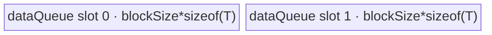

# IndexFill 950 ACLNN 算子知识

## 算子速览

| 项目 | 内容 |
|---|---|
| 实际入口 | `aclnnIndexFillGetWorkspaceSize` + `aclnnIndexFill`，公开、非原地 ACLNN |
| 计算语义 | 折叠为 `[P,N,Q]` 后，把有效 `indices` 指定的整条 Q slice 写成 scalar `value`，其他位置复制 `self` |
| 输入输出 | 公开文档：`self/out/value` FP16/FP32/BF16/INT32/INT64/BOOL，`index` INT32/INT64，ND；950 实现另接线 INT8/UINT8/INT16/DOUBLE，见限制 |
| 执行类型 | 单个 `index_fill` AIV-only entry；R-001 为 SIMT mask + AIV Vector/DMA，R-002 为 AIV Vector Sort/去重 + SIMT + AIV DMA，R-003/R-004 为 AIV DMA + SIMT；均是无 Cube 的 Hybrid |
| Kernel 路线 | R-001 宽 Q SIMD；R-002 稠密 indices 去重；R-003 通用 SIMT 按 indices；R-004 通用 SIMT 按 N |
| 核心资源 | 双缓冲 Queue、32/128KiB dCache 预留、可选 N-byte workspace mask、Dense 路线动态 local memory 与 Sort 临时区 |
| 来源闭包 | source_closed：公开 ACLNN→`l0op::IndexFill`→arch35 优先级 selector/Tiling/POD→全模板 key router→四个公开可达 body/helper→950 OpDef/config/CMake 闭合 |
| 验证状态 | 已完成源码闭包检查；本次知识提取未执行编译、真机、数值或性能测试。 |

## 接口与语义

### 计算语义

令 `d=dim>=0?dim:dim+rank(self)`，`P=prod(shape[0:d])`、`N=shape[d]`、`Q=prod(shape[d+1:])`。索引 `j` 规范化为 `j<0?j+N:j`，仍越界则忽略。若规范化索引集合为 `S`，则 `out[p,n,q]=(n in S)?value:self[p,n,q]`。Kernel 把数据 dtype 映射为同宽有符号整数 `T`，只做搬运/赋值，因此浮点与整数均保持 value/self 的位模式，不做算术 cast。

### 输入、输出与属性

| 参数 | shape/layout | dtype | 约束、默认值与语义 |
|---|---|---|---|
| `self` | 0–8D、ND，可非连续 | 公开：FP16/FP32/BF16/INT32/INT64/BOOL | 非原地源；空 Tensor 在 ACLNN 层直接成功返回，不启动核心 Kernel |
| `dim` | 标量属性 | INT64 | rank>0 为 `[-rank,rank)`，0D 为 `[-1,1)`；950 不做首尾轴 Transpose |
| `index` | 0D 或 1D 语义，连续化后 0D unsqueeze | INT32/INT64 | 负值加一次 N，越界跳过；空 index 只执行 ViewCopy |
| `value` | `aclScalar`→单元素 Tensor | 转换到 `self.dtype` | Kernel 从 GM 读一个同宽位模式 |
| `out` | 与 self 同 shape、ND，可非连续 | 与 self 相同 | 核心临时输出经 ViewCopy 提交 |

### 入口与版本

固定仓仅有公开 `aclnnIndexFill` 两段式入口；第一段固定以 `isInplace=false` 进入 `l0op::IndexFill`，不触达任何 Inplace 或 Tensor-value 变体。公开文档、README 与 `ascend950` CMake/config 一致证明 950 平台支持。公开文档仍只列 6 种 self dtype，而 `DTYPE_950_SUPPORT_LIST`、950 OpDef/config 接线 10 种；本卡以公开文档为接口承诺，额外四种只记录为源码差异，不外推为公开契约。

## Host/Launcher 执行流程

### 参数校验与前处理

依次校验非空指针、950 self dtype 白名单、index INT32/INT64、self/out dtype 与 shape、最大 8D 和 dim；创建 executor。`self.IsEmpty()` 时 workspace=0 并返回；`index.Size()==0` 时只加入 `ViewCopy`。否则 `Contiguous(self/index)`，把 0D self/index 各自 `UnsqueezeNd(...,0)`，把 scalar value 转为 self dtype。`NeedTranspose` 对 regbase/950 恒为 false；随后加入非原地 `IndexFill`，最后 `ViewCopy` 到 out。

### 参数、Workspace 与生命周期

所有路线包含系统 workspace：R-001 的 override 固定使用 16MiB；R-002～R-004 使用平台 `GetLibApiWorkSpaceSize()`，不可用时回退 16MiB。R-001、R-002、R-004 额外申请 `N*sizeof(int8_t)` 位图；R-003 按 indices 直接写 y，不追加位图。R-002 还以 `SetLocalMemorySize(ubSize-128KiB)` 声明 local-memory 上限。executor 持有 Contiguous/Unsqueeze/核心临时 y/ViewCopy 与总 workspace；Kernel 内 workspace mask 从初始化、全核同步、填充直到 Kernel 返回都有效。

### 启动图与失败传播

```text
aclnnIndexFillGetWorkspaceSize
  -> Contiguous/Unsqueeze (framework nodes)
  -> l0op::IndexFill -> ADD_TO_LAUNCHER_LIST_AICORE(IndexFill)
     -> one kernel: index_fill<TEMPLATE_MODE,DYTPE_MODE>(x,indices,value,y,workspace,tiling)
  -> ViewCopy(y,out)
aclnnIndexFill -> CommonOpExecutorRun(same stream)
```

核心 launch 的 `blockDim=usedCoreNum`，R-001/R-003/R-004 由 Tiling 计算，R-002 还取 indices 分块核数的最大值。entry 固定标记 `KERNEL_TYPE_AIV_ONLY`，SIMT 通过 Kernel 内 `VF_CALL/asc_vf_call` 发起，不是第二个 Host Kernel。executor 节点同 stream 排序；任何前处理/launcher 空返回终止 executor 构造，运行错误由第二段返回。框架节点的具体 workspace slice 在固定源码生成层不可见。

## Route 与参数设计

### 分核与资源计算

公共 Tiling 校验 x/y shape、dtype 与 x/value dtype，0D 用 `EnsureNotScalar` 视作 `[1]`，归一化 dim 并计算 P/N/Q、numel、indicesNum 与 dtype 字节数；平台提供 AIV coreNum、UB 和系统 workspace。模板 registry 以数值越小优先：priority 1 SIMD、6 Dense、10 通用 SIMT。SIMT 系列先按至少 1KiB 的 `blockSize` 或 `(UB-128KiB)/2` 计算 AIV CopyTensor 分片；SIMT 线程固定每 block 2048，估算核数时逐级降到 128 threads 的工作量阈值，最终 `usedCoreNum=max(simdUsedCoreNum,simtUsedCoreNum)`。

### Route 选择

| 顺序 | Route | Key/模板 | 精确选择条件与优先级 | 不适用去向 |
|---:|---|---|---|---|
| 1 | R-001 宽 Q SIMD | `(SIMD,B32/B64)` | `numel!=0 && Q*dtypeSize>128`；priority 1 | R-002 |
| 2 | R-002 稠密 indices | `(SIMT_DENSE_INDICES,B32/B64)` | `numel!=0 && Q*dtypeSize<=128 && P*Q*indicesNum>2048 && indicesNum>=N*5`；priority 6 | 通用 SIMT |
| 3 | R-003 通用按 indices | `(SIMT,B32/B64)` | 前两者失败，且 `numel*dtypeSize<256 \|\| indicesNum<=N/5`；priority 10 | R-004 |
| 4 | R-004 通用按 N | `(SIMT,B32/B64)` | 前两者失败，且上述按-indices 谓词为 false | 无 |

```text
try priority 1 SIMD: nonempty && Q*bytes > 128
else try priority 6 Dense: nonempty && Q*bytes <=128 && P*Q*indicesNum>2048 && indicesNum>=5*N
else priority 10 General:
    mode=BY_INDICES if numel*bytes<256 || indicesNum<=N/5
    else mode=BY_N
```

公开 ACLNN 对空 self 已提前返回，因此 arch35 的 `TEMPLATE_EMPTY` 虽在 router 注册，却不是该入口的 Host 可达 Route，不进入正文。

### 模板/实现执行矩阵

| Route | key/selector | dtype/shape/platform 完整命中条件 | 执行拓扑与 Kernel 节点 | 实际模板/body | 内存与同步特征 | tail/fallback |
|---|---|---|---|---|---|---|
| R-001 宽 Q SIMD | SIMD；B64 iff `indicesNum>INT32_MAX` | 950、非空、`Q*s>128` | 单 Kernel，SIMT 建 mask→AIV 分 Q/PN copy/fill | `IndexFillSimdImpl<T,INDEX_TYPE,uint32/64_t>` | 32KiB dCache 预留；3 份 Q tile + mask UB；N-byte workspace | Q tile 与 Q 尾核；不满足去 Dense |
| R-002 稠密 indices | Dense；B64 iff `numel>INT32_MAX` | 950、非空、窄 Q、工作量>2048、indices>=5N | 单 Kernel，AIV copy→Sort/unique→SIMT mask→SIMT fill | `IndexFillSimtDenseIndicesImpl` | 两阶段 UB 复用；128KiB dCache；N-byte workspace；3 次 SyncAll | indices chunk tail；不满足去 General |
| R-003 通用按 indices | SIMT；B64 iff `numel>INT32_MAX \|\| indicesNum*P*Q>INT32_MAX` | fallback 且稀疏/极小 | 单 Kernel，AIV copy→SIMT 遍历 `indices*P*Q` | `IndexFillSimtImpl`, mode 1 | 双缓冲 copy Queue；无用户 mask；copy 后 SyncAll | grid-stride tail；越界 index continue |
| R-004 通用按 N | SIMT；同上 | fallback 且 mode 谓词 false | 单 Kernel，AIV copy→SIMT mask→SIMT 遍历 `P*N*Q` | 同一模板，mode 0 | 双缓冲 copy Queue；N-byte workspace；mask 前后 SyncAll | grid-stride tail；mask=0 skip |

### 隐藏性能 Guard

| Guard | Host/Tiling 条件 | Device/资源原因 | 影响 Route | 不满足时去向 | 源码符号 |
|---|---|---|---|---|---|
| 宽 Q | `Q*dtypeSize>128` | 连续 Q slice 可由 AIV DMA/预广播高效处理 | R-001 | R-002/General | `IndexFillSimdTiling::IsCapable` |
| 稠密重复 | `P*Q*indicesNum>2048 && indicesNum>=5N` | 先 Sort/unique 可减少同地址 mask 写与重复 index 工作 | R-002 | General | `IndexFillSimtDenseIndicesTiling::IsCapable` |
| 遍历域 | `numel*s<256 \|\| indicesNum<=N/5` | 在 `indices*P*Q` 与 `P*N*Q` 两种 SIMT 工作量间选择 | R-003/R-004 | 另一 mode | `CalcSimtUsedCoreNum` |
| 32/64-bit 计算索引 | 路线各自比较 `MAX_INT32` | 防止线程线性下标/乘积窄化 | 全部 | B64 实例 | 各 `GetTilingKey` |
| AIV tile UB | `(ubSize-128KiB)/2` 或 `(ubSize-32KiB)/3` | 给双缓冲及 SIMT dCache 留空间 | 全部 | tile 缩小，无另一 Route | `DoUBTiling/CalcUBBlock` |
| Dense indices factor | while `CalcUsedBufSize(f)>ubSize-128KiB` 每次减 1024 | Queue、sorted、unique、Sort tmp 必须同时容纳 | R-002 | 最低设 512，固定仓未给资源失败分支 | `DoIndicesTilingTask` |
| 全核同步模式 | workspace mask Route 调 `SetScheduleMode(1)` | `SyncAll` 要求调度模式 | R-001/R-002/R-004 | 无 | 各 `GetWorkspaceSize` |

### POD/ABI

arch35 使用源码中显式的 `int64_t` 类字段。固定仓没有 `static_assert(sizeof/offsetof)`，因此 ABI 列只给出声明顺序；同一编译链自然 8B 对齐时 Simt/Simd 基类分别为 120B/160B、Dense 追加字段后为 128B，但复用时仍须以同一头文件为准，不能依赖推算值。

| 结构 | 字段 | 类型/位宽 | ABI 布局 | 单位 | Host/launcher producer | Device consumer | 边界 |
|---|---|---|---|---|---|---|---|
| `IndexFillSimtTilingData` | `tilingKey` | int64/64 | 声明序 0 | encoded key | `GetTilingKey` | 调试字段；router 用编译期 key | B32/B64 |
| 同上 | `p` | int64/64 | 序 1 | group | `P` | SIMT 地址 | 乘积未显式溢出检查 |
| 同上 | `n` | int64/64 | 序 2 | axis element | `N` | index 归一化/mask | 非空核心路径 >0 |
| 同上 | `q` | int64/64 | 序 3 | inner element | `Q` | 地址除法 | 非空核心路径 >0 |
| 同上 | `indicesNum` | int64/64 | 序 4 | element | shape size | SIMT loop | 非空 index |
| 同上 | `coreNum` | int64/64 | 序 5 | core | platform | 记录/估算 | >0 |
| 同上 | `usedCoreNum` | int64/64 | 序 6 | core | `max(simd,simt)` | launch blockDim | 非空时 >0 |
| 同上 | `simdUsedCoreNum` | int64/64 | 序 7 | core | `DoUBTiling` | CopyTensor active core guard | 可小于 usedCoreNum |
| 同上 | `simtUsedCoreNum` | int64/64 | 序 8 | core estimate | `CalcSimtUsedCoreNum` | 仅影响 usedCoreNum | 可为 0 |
| 同上 | `frontCoreNum` | int64/64 | 序 9 | core | slice remainder | CopyTensor offset | 前核多一 block |
| 同上 | `blockSize` | int64/64 | 序 10 | element | UB/1KiB tiling | Queue 容量/DMA | DMA 字节转 uint32 |
| 同上 | `tailBlockSize` | int64/64 | 序 11 | element | numel remainder | last copy | <=blockSize |
| 同上 | `loopsPerFrontCore` | int64/64 | 序 12 | loop/core | ceil slices/core | CopyTensor | 前核 |
| 同上 | `loopsPerTailCore` | int64/64 | 序 13 | loop/core | floor slices/core | CopyTensor | 尾核 |
| 同上 | `simtComputeMode` | int64/64 | 序 14 | enum | workload predicate | `Process` branch | 1=indices,0=N |
| `IndexFillSimtDenseIndicesTilingData` | `indicesUbFactor` | int64/64 | base 后追加 | index/chunk | `DoIndicesTilingTask` | Queue/Sort 分块 | >=512 fallback |
| `IndexFillSimdTilingData` | `p` | int64/64 | 声明序 0 | group | P | PN mapping | — |
| 同上 | `n` | int64/64 | 序 1 | axis element | N | mask/mapping | — |
| 同上 | `q` | int64/64 | 序 2 | inner element | Q | Q split | — |
| 同上 | `indicesNum` | int64/64 | 序 3 | element | shape | SIMT mask loop | B64 guard |
| 同上 | `splitQ` | int64/64 | 序 4 | bool | `CalcUsedCoreNum` | `ProcessCopy` | 0/1 |
| 同上 | `usedCoreNum` | int64/64 | 序 5 | core | PN*Q cores | launch | — |
| 同上 | `blockFactorPN` | int64/64 | 序 6 | PN/core | floor(PN/core) | non-split range | — |
| 同上 | `usedCoreNumPN` | int64/64 | 序 7 | core | min(PN,core) | grid mapping | — |
| 同上 | `tailBlockNumPN` | int64/64 | 序 8 | core | PN remainder | former PN | — |
| 同上 | `usedCoreNumQ` | int64/64 | 序 9 | core/PN | Q split loop | qCoreId | >=1 |
| 同上 | `blockFactorQ` | int64/64 | 序 10 | element | ceil(Q/qcores) | normal Q core | — |
| 同上 | `blockTailQ` | int64/64 | 序 11 | element | Q remainder | last Q core | — |
| 同上 | `blockFactorUbBufferMask` | int64/64 | 序 12 | byte | UB formula | mask TBuf/cached range | <=2048 when cut |
| 同上 | `blockFactorTileNumQ` | int64/64 | 序 13 | tile | ceil(Qfactor/UBfactor) | Q loop | >=1 |
| 同上 | `blockFactorUbFactorQ` | int64/64 | 序 14 | element/tile | UB formula | Queue capacity/DMA | block aligned |
| 同上 | `blockFactorUbTailQ` | int64/64 | 序 15 | element | remainder | last tile | — |
| 同上 | `blockTailUbBufferMask` | int64/64 | 序 16 | byte | tail UB formula | allocation not used separately; router shares normal allocation | producer retained |
| 同上 | `blockTailTileNumQ` | int64/64 | 序 17 | tile | tail Q ceil | last Q core | — |
| 同上 | `blockTailUbFactorQ` | int64/64 | 序 18 | element/tile | tail UB formula | last Q core loop | <= normal capacity expected by Host |
| 同上 | `blockTailUbTailQ` | int64/64 | 序 19 | element | remainder | final DMA | — |

### Route 源码闭包

| Route | Key/selector | Host/Tiling producer | POD/参数 | Kernel entry/router 节点 | Kernel body/直接依赖 | 构建接线 |
|---|---|---|---|---|---|---|
| R-001 | SIMD B32/B64 | `IndexFillSimdTiling` priority 1 | `IndexFillSimdTilingData` | `index_fill_apt.cpp::index_fill` | `IndexFillSimdImpl` | `ascend950/index_fill_binary.json`, `index_fill_apt` |
| R-002 | Dense B32/B64 | `IndexFillSimtDenseIndicesTiling` priority 6 | Dense POD | 同上 | Dense impl + `SortAndUnique` | 同上 |
| R-003 | SIMT B32/B64, mode1 | `IndexFillSimtTiling` priority 10 | Simt POD | 同上 | `IndexFillSimtImpl::CopyTensor/ComputeByIndices` | 同上 |
| R-004 | SIMT B32/B64, mode0 | 同上 | Simt POD + mask workspace | 同上 | `BuildIndicesMask/ComputeByN` | 同上 |

## Kernel 实现

### 公共执行流程

entry 以 `ComputeTypeGet<DTYPE_X>`把 1/2/4/8B dtype 映射为 `int8/int16/int32/int64`，按 `(TEMPLATE_MODE,DYTPE_MODE)`解析对应 POD 并构造唯一实现。B32/B64 只改变线性计数与地址计算类型，不改变数据位宽。所有公开非空路线都是单个 AIV entry 内的阶段图：AIV DMA/Vector 与内部 SIMT `VF_CALL` 通过 `SyncAll` 建立全核可见性；无 Host 级 workspace 边，也没有第二个 Kernel。

### Route R-001：宽 Q SIMD

#### 适用条件

##### 选择证据

| 层级 | 文件 | 符号 | 源码谓词/参数 | 结果/下一跳 |
|---|---|---|---|---|
| Registry | `tiling_templates_registry.h` | `DoTilingImpl` | priority 升序尝试 | 先试 1 |
| Tiling | `index_fill_tiling_simd.cpp` | `IsCapable` | `numel!=0 && Q*s>128` | SIMD B32/B64 |
| Router | `index_fill_apt.cpp` | `index_fill` | TEMPLATE_SIMD | `IndexFillSimdImpl` |

#### Device 数据流

##### 函数级调用链

```text
index_fill<SIMD> -> IndexFillSimdImpl::Init -> InitMask -> SyncAll
  -> Process -> IndexFillSimtMaskFill(2048 threads/block) -> SyncAll
  -> ProcessCopy -> Duplicate(value) -> split-Q or split-PN DMA/fill
```

##### 源码等价伪码

```text
parallel zero mask[N]; SyncAll
for idx = globalThread; idx<indicesNum; idx+=gridThreads:
  nidx=normalize(indices[idx]); if valid: mask[nidx]=1
SyncAll
duplicate value to UB Q tile
if splitQ: each block owns (pn,qSlice)
else: each block owns PN interval and caches a mask segment in UB
for each Q tile: mask? DMA valueUB->y : DMA x->xQueue->y
```

#### 内存与数据搬运

##### 资源与搬运表

| 层级/缓冲区 | offset/地址公式 | extent/容量公式 | dtype/layout | producer | consumer | owner/lifetime | 对齐/复用 |
|---|---|---|---|---|---|---|---|
| workspace mask | 0 | N B | INT8 `[N]` | Fill + SIMT | ProcessCopy | Kernel shared | sys workspace follows |
| `xQueue_` | UB allocator | `2*ubFactorQ*sizeof(T)` | T, bind VECIN/VECOUT | x DMA | y DMA | per tile | depth 2 |
| `valueQueue_` | UB allocator | `ubFactorQ*sizeof(T)` | T | Duplicate | y DMA | whole copy phase | depth 1 |
| `indicesBuf_` | UB allocator | `maskBuffer` B | INT8 | mask GM DMA | scalar `GetMask` | cached N range | refreshed on miss |

##### 分层内存布局


##### 字节账与复用顺序

```text
UB_total = 3*blockFactorUbFactorQ*sizeof(T) + blockFactorUbBufferMask
UB_total <= ubSize - 32KiB dCache reserve
dynamic_ub = N/A; workspace_total = sysWorkspace + N
```

| 复用子区 | 写入者 | 读取者/消费点 | 下一次覆盖 | 同步或释放依据 | 安全条件 |
|---|---|---|---|---|---|
| xQueue slot | x DMA | y DMA | next tile | EnQue/DeQue/FreeTensor | depth=2 |
| indicesBuf | mask DMA | scalar mask reads | next cache miss | MTE2_S | requested n lies in cached range |

#### 同步、精度与尾块

##### 同步与数值边界表

| 阶段 | primitive/机制 | producer | consumer/等待点 | 保护对象 | 精度/尾块 |
|---|---|---|---|---|---|
| mask init/build | `SyncAll` twice | Fill/SIMT stores | ProcessCopy | workspace mask | duplicate indices write same byte 1 |
| value | S_V event + Duplicate | scalar GM read | DMA output | valueQueue | exact same-width bits |
| Q copy | Queue + valid copyLen | x/value | y | UB slots | separate normal/tail Q factors |

#### 关键实现

##### 符号证据表

| 阶段 | 文件 | 符号/模板实例 | 实现事实 |
|---|---|---|---|
| Host/Tiling producer | `index_fill_tiling_simd.cpp` | `CalcUsedCoreNum/CalcUBBlock` | PN/Q grid、UB tile、workspace |
| Kernel entry/router | `index_fill_apt.cpp` | SIMD B32/B64 branches | POD 与 COM_T 实例 |
| Device body/helper | `index_fill_simd.h` | `IndexFillSimtMaskFill/GetMask/ProcessCopy` | SIMT mask 与 AIV 直接 fill/copy |

### Route R-002：稠密 indices 排序去重

#### 适用条件

##### 选择证据

| 层级 | 文件 | 符号 | 源码谓词/参数 | 结果/下一跳 |
|---|---|---|---|---|
| Tiling | `index_fill_tiling_simt_dense_indices.cpp` | `IsCapable` | 非空、`Q*s<=128`、`P*Q*indicesNum>2048`、`indicesNum>=5N` | priority 6 |
| Tiling | 同文件 | `DoIndicesTilingTask` | factor 满足 UB+Sort tmp | Dense POD |
| Router | `index_fill_apt.cpp` | Dense branches | B32/B64 by numel | Dense impl |

#### Device 数据流

##### 函数级调用链

```text
index_fill<DENSE> -> Init: ZeroMemory(mask), SyncAll, init dataQueue
  -> Process: CopyTensor -> SyncAll
  -> BuildIndicesMask: Reset pipe -> CopyInIndices -> SortAndUnique -> SetMaskSimt
  -> SyncAll -> IndexFillSimtDenseIndicesCompute
```

##### 源码等价伪码

```text
copy all x to y with double-buffer DMA; SyncAll
partition indices into chunks f and chunks across cores
for each chunk: load indices; radix Sort; compare adjacent values; compact unique positions
  SIMT over unique positions: normalize and set mask[nidx]=1
SyncAll
SIMT grid-stride over P*N*Q: if mask[nIdx] set, y[i]=value
```

#### 内存与数据搬运

##### 资源与搬运表

| 层级/缓冲区 | offset/地址公式 | extent/容量公式 | dtype/layout | producer | consumer | owner/lifetime | 对齐/复用 |
|---|---|---|---|---|---|---|---|
| workspace mask | 0 | N B | INT8 | ZeroMemory/SetMaskSimt | final SIMT | Kernel shared | same-value cross-chunk writes |
| `dataQueue_` | local allocator | `2*blockSize*sizeof(T)` | T | x DMA | y DMA | copy phase only | pipe Reset afterward |
| `indicesQueue_` | reset allocator | `2*f*sizeof(INDEX_TYPE)` | index | GM DMA | Sort | per chunk | depth 2 |
| `indicesBuff_` | reset allocator | `ceil((f+1)/vfLen)*vfLen*idxSize+32` | sorted indices + sentinels | Sort | adjacent compare/SIMT | chunk | 32B front sentinel |
| `uniqueIdBuff_` | reset allocator | `f*4` B | INT32 | MicroAPI GatherMask | SetMaskSimt | chunk | compact positions |
| Sort tmp | remaining local memory | `GetSortMaxMinTmpSize(...).max` aligned 32B | internal | AscendC Sort | Sort | chunk | Host included in factor proof |

##### 分层内存布局


##### 字节账与复用顺序

```text
copy_phase_UB = 2*blockSize*sizeof(T)
indices_phase_explicit = 2*f*idxSize + align(sorted+32) + align(f*4)
indices_phase_total = explicit + align32(sortTmp) <= ubSize-128KiB
dynamic_local_memory = ubSize-128KiB
workspace_total = sysWorkspace + N
```

| 复用子区 | 写入者 | 读取者/消费点 | 下一次覆盖 | 同步或释放依据 | 安全条件 |
|---|---|---|---|---|---|
| whole pipe arena | dataQueue | CopyTensor | `pipe.Reset()`→indices buffers | first SyncAll + completed DMA Queue | x→y finished before reset |
| indicesQueue slot | index DMA | SortAndUnique | next chunk | DeQue/FreeTensor | depth 2 |

#### 同步、精度与尾块

##### 同步与数值边界表

| 阶段 | primitive/机制 | producer | consumer/等待点 | 保护对象 | 精度/尾块 |
|---|---|---|---|---|---|
| copy→sort | SyncAll + pipe Reset | all x→y DMA | mask phase | output y/local arena | tailBlockSize exact |
| unique | V_S/S_V + MicroAPI AR | Sort | unique compaction | sorted/sentinel buffers | chunk tail length passed to Sort |
| mask→fill | SyncAll | all chunk mask writes | final SIMT | workspace mask | invalid index skipped |

#### 关键实现

##### 符号证据表

| 阶段 | 文件 | 符号/模板实例 | 实现事实 |
|---|---|---|---|
| Host/Tiling producer | `index_fill_tiling_simt_dense_indices.cpp` | `CalcUsedBufSize/DoIndicesTilingTask` | factor、Sort tmp、local memory |
| Kernel entry/router | `index_fill_apt.cpp` | Dense branches | B32/B64 Dense 实例 |
| Device body/helper | `index_fill_simt_dense_indices.h`, `index_fill_common.h` | `BuildIndicesMask/SortAndUnique/ComputeUniqueIdNum` | 排序、哨兵、去重、mask、final SIMT |

### Route R-003：通用 SIMT 按 indices

#### 适用条件

##### 选择证据

| 层级 | 文件 | 符号 | 源码谓词/参数 | 结果/下一跳 |
|---|---|---|---|---|
| Registry | `tiling_templates_registry.h` | `DoTilingImpl` | priority 1、6 都返回 PARAM_INVALID | priority 10 |
| Tiling | `index_fill_tiling_simt.cpp` | `CalcSimtUsedCoreNum` | `numel*s<256 \|\| indicesNum<=N/5` | mode 1 |
| Router | `index_fill_apt.cpp` | SIMT B32/B64 | POD mode=1 | `IndexFillSimtImpl` |

#### Device 数据流

##### 函数级调用链

```text
index_fill<SIMT> -> IndexFillSimtImpl::Init -> CopyTensor -> SyncAll
  -> IndexFillSimtComputeByIndices(2048 threads/block)
```

##### 源码等价伪码

```text
AIV double-buffer copy x -> y over blockSize slices; SyncAll
processNum=indicesNum*P*Q; sliceSize=P*Q
for i=globalThread; i<processNum; i+=gridThreads:
  indexId=i/sliceSize; inner=i%sliceSize; nIdx=normalize(indices[indexId])
  if valid: pIdx=inner/Q; qOffset=inner%Q; y[pIdx*N*Q+nIdx*Q+qOffset]=value
```

#### 内存与数据搬运

##### 资源与搬运表

| 层级/缓冲区 | offset/地址公式 | extent/容量公式 | dtype/layout | producer | consumer | owner/lifetime | 对齐/复用 |
|---|---|---|---|---|---|---|---|
| `dataQueue_` | local allocator | `2*blockSize*sizeof(T)` | T | x DMA | y DMA | CopyTensor | depth 2 |
| y GM | `p*N*Q+nIdx*Q+qOffset` | one T/write | T `[P,N,Q]` | SIMT | caller/out ViewCopy | after copy sync | duplicate indices same-value race |
| workspace user mask | N/A | 0 | — | — | — | — | only system workspace |

##### 分层内存布局



##### 字节账与复用顺序

```text
UB_total = 2*blockSize*sizeof(T) <= ubSize-128KiB
dynamic_ub = N/A
workspace_total = sysWorkspace
```

| 复用子区 | 写入者 | 读取者/消费点 | 下一次覆盖 | 同步或释放依据 | 安全条件 |
|---|---|---|---|---|---|
| Queue slot | x DMA | y DMA | next copy slice | EnQue/DeQue/FreeTensor | valid `dataLen` |

#### 同步、精度与尾块

##### 同步与数值边界表

| 阶段 | primitive/机制 | producer | consumer/等待点 | 保护对象 | 精度/尾块 |
|---|---|---|---|---|---|
| copy→update | `SyncAll` | all AIV copies | SIMT writes | y | prevents fill being overwritten by late copy |
| update | grid-stride + magic/shift division | each SIMT thread | Kernel completion | y element | negative normalize once; invalid continue; B64 avoids address overflow threshold |

#### 关键实现

##### 符号证据表

| 阶段 | 文件 | 符号/模板实例 | 实现事实 |
|---|---|---|---|
| Host/Tiling producer | `index_fill_tiling_simt.cpp` | `DoUBTiling/CalcSimtUsedCoreNum/GetTilingKey` | copy split、mode1、B32/B64 |
| Kernel entry/router | `index_fill_apt.cpp` | SIMT branches | COM_T 实例 |
| Device body/helper | `index_fill_simt.h` | `CopyTensor/IndexFillSimtComputeByIndices` | 先复制后稀疏直接写 |

### Route R-004：通用 SIMT 按 N

#### 适用条件

##### 选择证据

| 层级 | 文件 | 符号 | 源码谓词/参数 | 结果/下一跳 |
|---|---|---|---|---|
| Tiling | `index_fill_tiling_simt.cpp` | `CalcSimtUsedCoreNum` | fallback 且 `numel*s>=256 && indicesNum>N/5` | mode 0 |
| Workspace | 同文件 | `GetWorkspaceSize` | mode0 | sys+N，schedule mode1 |
| Router | `index_fill_apt.cpp` | SIMT branches | POD mode0 | `IndexFillSimtImpl` |

#### Device 数据流

##### 函数级调用链

```text
index_fill<SIMT> -> Init -> CopyTensor -> SyncAll
  -> BuildIndicesMask: ZeroMemory -> SyncAll -> IndexFillSimtMaskFill -> SyncAll
  -> IndexFillSimtComputeByN(2048 threads/block)
```

##### 源码等价伪码

```text
copy x -> y; SyncAll
parallel zero mask[N]; SyncAll
SIMT scan indices and set valid mask[nIdx]=1; SyncAll
for i=globalThread; i<P*N*Q; i+=gridThreads:
  nIdx=(i/Q)%N; if mask[nIdx]!=0: y[i]=value
```

#### 内存与数据搬运

##### 资源与搬运表

| 层级/缓冲区 | offset/地址公式 | extent/容量公式 | dtype/layout | producer | consumer | owner/lifetime | 对齐/复用 |
|---|---|---|---|---|---|---|---|
| `dataQueue_` | local allocator | `2*blockSize*sizeof(T)` | T | x DMA | y DMA | copy phase | depth 2 |
| workspace mask | 0 | N B | INT8 `[N]` | Fill/SIMT scan | ComputeByN | Kernel shared | same-value writes |
| y GM | linear `i` | P*N*Q T | T | copy then conditional overwrite | ViewCopy | Kernel/caller | in-place update of temporary y |

##### 分层内存布局


##### 字节账与复用顺序

```text
UB_total = 2*blockSize*sizeof(T) <= ubSize-128KiB
dynamic_ub = N/A
workspace_total = sysWorkspace + N
```

| 复用子区 | 写入者 | 读取者/消费点 | 下一次覆盖 | 同步或释放依据 | 安全条件 |
|---|---|---|---|---|---|
| Queue slot | x DMA | y DMA | next slice | Queue lifecycle | copy complete before first SyncAll |
| mask byte | zeroer then index threads | ComputeByN | Kernel end | two SyncAll barriers | only identical value 1 races |

#### 同步、精度与尾块

##### 同步与数值边界表

| 阶段 | primitive/机制 | producer | consumer/等待点 | 保护对象 | 精度/尾块 |
|---|---|---|---|---|---|
| copy→mask | SyncAll | AIV copy | mask init | y | fill cannot race copy |
| mask init→build→use | SyncAll twice | Fill, then index stores | ComputeByN | N-byte mask | length<=512 may use single Fill; otherwise per-core slices |
| final | grid-stride bounds | SIMT thread | Kernel end | y | exact `i<total_num` tail |

#### 关键实现

##### 符号证据表

| 阶段 | 文件 | 符号/模板实例 | 实现事实 |
|---|---|---|---|
| Host/Tiling producer | `index_fill_tiling_simt.cpp` | `CalcSimtUsedCoreNum/GetWorkspaceSize` | mode0 与 N-byte mask |
| Kernel entry/router | `index_fill_apt.cpp` | SIMT B32/B64 | 路由 |
| Device body/helper | `index_fill_simt.h`, `index_fill_common.h` | `BuildIndicesMask/ZeroMemory/ComputeByN` | 三阶段同步与线性映射 |

## 算子特定优化

### Trick T-001：Host 在三种工作形态间按优先级选择

#### 触发与源码依据

- 适用 Route：R-001～R-004
- 触发条件：registry 以更小 priority 先尝试；宽 Q=1，Dense=6，General=10
- Golden 来源：[`tiling_templates_registry.h:441-457`](../../../../../../../cann-ops-raw/ascendc/ops-nn/955f8b33985b6d72989ebff341bb9c2c564a51bc/common/inc/op_host/tiling_templates_registry.h#L441-L457)

**官方源码（固定 Commit 连续逐字摘录）**：

```cpp
auto tilingTemplateRegistryMap = GetTilingTemplates(op_type);
for (auto it = tilingTemplateRegistryMap.begin(); it != tilingTemplateRegistryMap.end(); ++it) {
    auto tilingTemplate = it->second(context);
    if (tilingTemplate != nullptr) {
        ge::graphStatus status = tilingTemplate->DoTiling();
        if (status != ge::GRAPH_PARAM_INVALID) {
            OP_LOGD(context, "Do general op tiling success priority=%d", it->first);
            return status;
        }
    }
}
```

#### 机制与设计原因

Map 的升序遍历使宽连续 Q 优先走 AIV 直搬，窄 Q 且 indices 高重复时先排序去重，其余落入完整 SIMT。`IsCapable=false` 通过 `GRAPH_PARAM_INVALID` 明确 fallthrough，Route 条件不会被无序并列表达式破坏。

#### 迁移边界

- 适用：同一语义存在互补 shape/workload 实现族的算子。
- 前提：所有模板共享输入校验且最后有 `IsCapable=true` fallback。
- 失效：改变 priority 数值会改变重叠谓词的真实 Route。
- 未验证：本次知识提取未执行编译、真机、数值或性能测试。

#### 错误做法

固定仓给出的真实失败终点是所有模板均返回 `GRAPH_PARAM_INVALID` 时 `GRAPH_FAILED`；本算子的 priority 10 模板恒 capable，非校验失败时不会到该终点。

### Trick T-002：Dense 路线用 Sort+相邻比较压缩重复索引

#### 触发与源码依据

- 适用 Route：R-002
- 触发条件：每个 `indicesUbFactor` chunk
- Golden 来源：[`index_fill_simt_dense_indices.h:107-121`](../../../../../../../cann-ops-raw/ascendc/ops-nn/955f8b33985b6d72989ebff341bb9c2c564a51bc/index/index_fill/op_kernel/arch35/index_fill_simt_dense_indices.h#L107-L121)

**官方源码（固定 Commit 连续逐字摘录）**：

```cpp
LocalTensor<INDEX_TYPE> sortedOut = indicesBuff_.Get<INDEX_TYPE>();
LocalTensor<int32_t> uniqueIndicesOut = uniqueIdBuff_.Get<int32_t>();
LocalTensor<INDEX_TYPE> indicesLocal = indicesQueue_.DeQue<INDEX_TYPE>();
uint32_t uniqueNum = SortAndUnique(sortedOut, uniqueIndicesOut, indicesLocal, length);

COM_T n = static_cast<COM_T>(tilingData_->n);
__local_mem__ INDEX_TYPE* actualSortOut = ((__local_mem__ INDEX_TYPE*)sortedOut.GetPhyAddr()) + shiftOffset;
AscendC::Simt::VF_CALL<SetMaskSimt<T, INDEX_TYPE, COM_T>>(AscendC::Simt::Dim3{THREAD_NUM}, actualSortOut,
    (__local_mem__ int32_t*)uniqueIndicesOut.GetPhyAddr(), (__gm__ int8_t*)maskGm_.GetPhyAddr(), uniqueNum, n, length);

indicesQueue_.FreeTensor(indicesLocal);
```

#### 机制与设计原因

Radix Sort 后以首尾哨兵和相邻不等比较生成 unique 位置，仅让 SIMT 线程处理去重结果，减少高重复 indices 对同一 workspace byte 的重复写。Host 把 Sort 最大临时区也纳入 factor 搜索，且在 copy 阶段结束后 `pipe.Reset` 复用 local memory，避免两阶段容量相加。

#### 迁移边界

- 适用：重复索引远多于轴长、最终更新对重复次数不敏感。
- 前提：`indicesNum>=5N`、窄 Q、UB 能容纳 Queue/sorted/unique/Sort tmp。
- 失效：稀疏 indices 或需要保留原顺序/计数时转通用 SIMT，不得去重。
- 未验证：本次知识提取未执行编译、真机、数值或性能测试。

#### 错误做法

固定仓未提供独立错误代码；真实失效路径是 Dense `IsCapable=false` 后转 priority 10 通用 SIMT。

### Trick T-003：稀疏时直接遍历 indices，稠密时先建 N 位图

#### 触发与源码依据

- 适用 Route：R-003、R-004
- 触发条件：`numel*dtypeSize<256 || indicesNum<=N/5`
- Golden 来源：[`index_fill_tiling_simt.cpp:36-50`](../../../../../../../cann-ops-raw/ascendc/ops-nn/955f8b33985b6d72989ebff341bb9c2c564a51bc/index/index_fill/op_host/arch35/index_fill_tiling_simt.cpp#L36-L50)

**官方源码（固定 Commit 连续逐字摘录）**：

```cpp
simtComputeMode_ = (inputData.numel * inputData.dtypeSize < 256 || inputData.indicesNum <= inputData.N / 5) ? SIMT_COMPUTE_MODE_BY_INDICES : SIMT_COMPUTE_MODE_BY_N;

int64_t threadNum = MAX_THREAD_NUM;
int64_t numelByIndices = static_cast<int64_t>(inputData.P * inputData.Q * inputData.indicesNum);
int64_t numel = (simtComputeMode_ == SIMT_COMPUTE_MODE_BY_N) ? inputData.numel : numelByIndices;
int64_t simtUsedCoreNum = std::min(coreNum_, numel / threadNum);
while ((simtUsedCoreNum < (coreNum_ / 2)) && (threadNum > MIN_THREAD_NUM)) {
    threadNum = threadNum / 2;
    simtUsedCoreNum = std::min(coreNum_, numel / threadNum);
}
```

#### 机制与设计原因

按 indices 的工作量为 `indicesNum*P*Q` 且无需 N-byte workspace；按 N 的工作量为 `P*N*Q`，先把重复索引压为位图。Host 以两者的近似工作量选择遍历域，并用 2048→128 的线程阈值估算需要纳入 `blockDim` 的核数。

#### 迁移边界

- 适用：索引集合驱动的幂等标量覆盖。
- 前提：按 indices 的同地址竞争只写同一 value；按 N 路线有全核同步和 N-byte workspace。
- 失效：不同重复索引携带不同 value 时同地址写不再幂等，必须定义冲突顺序。
- 未验证：本次知识提取未执行编译、真机、数值或性能测试。

#### 错误做法

固定仓未提供可验证反例。

## 模板与实现对比

| 对比维度 | R-001 宽 Q SIMD | R-002 Dense | R-003 SIMT indices | R-004 SIMT N | 设计选择依据 |
|---|---|---|---|---|---|
| 命中条件/优先级 | Q字节>128，p1 | 窄Q、高重复，p6 | fallback 稀疏/极小 | fallback 稠密 | priority+IsCapable |
| 模板与 dtype | SIMD B32/B64 | Dense B32/B64 | SIMT B32/B64 | SIMT B32/B64 | 计算索引宽度按 Route 工作量选 |
| 循环与分核 | PN×Q cores，Q tile | copy slices+indices chunks+full output | indices×P×Q grid | mask scan+P×N×Q grid | 连续搬运/重复度/遍历域 |
| Queue/TBuf/寄存器/dynamic UB/通信 window | x/value Queue+mask TBuf | 两阶段 Queue/TBuf+RegTensor+Sort tmp | dataQueue | dataQueue+GM mask | 无通信；Dense 设置 local memory |
| 内存总占用与复用 | 3F*s+M，留32KiB | max(copy,index phases)，留128KiB | 2*block*s | 同左+N workspace | Host 显式资源公式 |
| 搬运/Vector/SIMT/NDDMA/通信 API | SIMT mask+AIV DMA/Duplicate | AIV DMA/Sort/MicroAPI+SIMT | AIV DMA+SIMT direct | AIV DMA+SIMT mask/full scan | 均为 VV Hybrid，无 NDDMA/Cube |
| 同步、精度与 tail | 两次 SyncAll，Q tail | 三次 SyncAll，chunk/copy tail | copy后 SyncAll，grid tail | copy/mask 两阶段 SyncAll | 同宽位模式，不做浮点算术 |
| fallback/失败边界 | Dense | General | 无 | 无 | 通用模板恒 capable |

## 平台差异

| 项目 | A2 | A3 | 950 |
|---|---|---|---|
| 支持状态 | 另见无后缀卡 | 另见无后缀卡 | 支持（Ascend 950PR/950DT） |
| Host/Launcher | arch32 单决策树 | arch32 单决策树 | arch35 priority 1/6/10 selector；尾轴 INT64/BOOL 不转置 |
| Kernel/资源 | 五个纯 AIV Route | 同 A2 | 单 entry 内 AIV+SIMT Hybrid，32/128KiB dCache 预留与可选 N-byte mask |

## 限制与失败边界

- 本卡只覆盖非原地 `aclnnIndexFill`；不包含 Inplace 或 Tensor-value 接口及其独立实现。
- 公开文档只列 FP16/FP32/BF16/INT32/INT64/BOOL；950 API/OpDef/config 另含 INT8/UINT8/INT16/DOUBLE。该不一致不是平台“不支持”冲突，但额外 dtype 未在本卡当作公开承诺。
- 空 self 在 ACLNN 层直接返回，空 index 只 ViewCopy；arch35 `TEMPLATE_EMPTY` 对该公开入口不可达，因此未作为 Route 发布。
- `P*N*Q`、`P*Q*indicesNum` 等乘法先发生再用于 B64 key 判断，固定仓未见前置溢出保护；DMA 字节数还窄化为 uint32。
- Dense factor 循环降到非正时强制 512，但固定仓没有再验证 512 一定适配异常小 UB 的错误分支；平台正常资源是隐含前提。
- SIMT mask 和按-indices y 写允许多个线程写同一地址，但所有竞争值相同；迁移到非幂等更新会破坏该同步假设。
- 框架 Contiguous/Unsqueeze/ViewCopy 与 executor 内部 workspace slice 固定仓不可见；算子拥有的 selector、POD、核心 Kernel 与同步已闭合。

## 源码索引

### 链路索引

| 链路阶段 | 文件 | 关键符号 | 支撑内容 |
|---|---|---|---|
| 入口声明/约束 | `index/index_fill_d/docs/aclnnIndexFill&aclnnInplaceIndexFill.md` | `aclnnIndexFill*` | 公开签名、950 平台与文档 dtype |
| 入口实现 | `index/index_fill_d/op_api/aclnn_index_fill.cpp` | `CheckParams/NeedTranspose/ExecIndexFillGetWorkspaceSize` | 950 校验、短路、无 Transpose、非原地链路 |
| Launcher | `index/index_fill_d/op_api/index_fill.cpp` | `l0op::IndexFill` | 单核心节点 |
| Host common | `index/index_fill/op_host/arch35/index_fill_tiling_common.cpp` | `GetIndexFillShapeAttrsInfo/IndexFillCommonTiling` | P/N/Q、平台、workspace、blockDim |
| Host SIMD | `index/index_fill/op_host/arch35/index_fill_tiling_simd.cpp` | `IndexFillSimdTiling` | priority1、Q/UB 分核 |
| Host SIMT | `index/index_fill/op_host/arch35/index_fill_tiling_simt.cpp` | `IndexFillSimtTiling` | priority10、两种遍历域 |
| Host Dense | `index/index_fill/op_host/arch35/index_fill_tiling_simt_dense_indices.cpp` | `IndexFillSimtDenseIndicesTiling` | priority6、factor、Sort tmp |
| POD | `index/index_fill/op_kernel/arch35/index_fill_struct.h` | 三个 TilingData 类 | 字段、compute type、常量 |
| Key | `index/index_fill/op_kernel/arch35/index_fill_tiling_key.h` | `ASCENDC_TPL_ARGS_DECL/SEL` | 模板 key 与 POD 选择 |
| Kernel router | `index/index_fill/op_kernel/index_fill_apt.cpp` | `index_fill` | 全编译期 Route 实例 |
| Kernel common | `index/index_fill/op_kernel/arch35/index_fill_common.h` | `ZeroMemory/SortAndUnique/ComputeUniqueIdNum` | mask 清零、排序去重、MicroAPI |
| Kernel SIMD | `index/index_fill/op_kernel/arch35/index_fill_simd.h` | `IndexFillSimdImpl` | 宽 Q Hybrid body |
| Kernel SIMT | `index/index_fill/op_kernel/arch35/index_fill_simt.h` | `IndexFillSimtImpl` | 两种通用 SIMT body |
| Kernel Dense | `index/index_fill/op_kernel/arch35/index_fill_simt_dense_indices.h` | `IndexFillSimtDenseIndicesImpl` | Dense 阶段图与内存复用 |
| selector 依赖 | `common/inc/op_host/tiling_templates_registry.h` | `TilingRegistry::DoTilingImpl` | 小 priority 优先与 fallthrough |
| Tiling 流程依赖 | `common/inc/op_host/tiling_base.h` | `TilingBaseClass::DoTiling` | IsCapable/失败语义 |
| 平台注册 | `index/index_fill/op_host/index_fill_def.cpp` | `ops::IndexFill` | 950 dtype 与 `index_fill_apt` |
| binary 接线 | `index/index_fill/op_host/config/ascend950/index_fill_binary.json` | `IndexFill` entries | 950 dtype 组合 |
| 构建接线 | `index/index_fill/CMakeLists.txt` | `SUPPORT_COMPUTE_UNIT/SUPPORT_TILING_DIR` | ascend950→arch35 |

### 实现复用检查

| 检查项 | 可复用事实 | 不得改变的约束 | 源码符号 |
|---|---|---|---|
| ABI/POD | 三类 POD 直接驱动模板 | 字段顺序、int64 位宽、B32/B64 key 必须一致 | `index_fill_struct.h`, `index_fill_tiling_key.h` |
| 调用顺序 | 单 entry 内按阶段串行 | copy→SyncAll→mask/直接写；Dense 还需 copy→reset→sort→mask→SyncAll | 各 `Process` |
| workspace/内存 | system + optional N-byte mask；UB 预留 dCache | Route workspace 公式、Queue depth、Dense phase max 而非相加 | 各 Tiling/InitBuffer |
| 同步 | schedule mode1 + SyncAll | mask 初始化、写入、消费三者不可重排 | `GetWorkspaceSize`, `BuildIndicesMask` |
| 精度与尾块 | 同宽整数位模式、B64 地址 | 负索引只加一次 N，越界跳过，DMA 使用有效尾长 | `ComputeTypeGet`, SIMT bodies |
| 失败边界 | priority fallthrough 到通用模板 | 空 public 输入不进 Kernel；不得把 dormant EMPTY 当公开 Route | API short-circuit, registry |