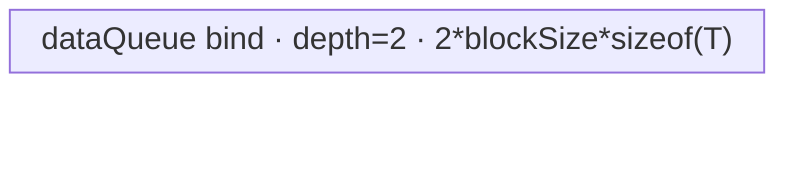

# IndexFillTensor 950 ACLNN 算子知识

## 算子速览

| 项目 | 内容 |
|---|---|
| 实际入口 | `aclnnIndexFillTensorGetWorkspaceSize` + `aclnnIndexFillTensor`，公开两段式 ACLNN；本卡不覆盖原地入口或 `aclnnIndexFill` 变体。 |
| 计算语义 | 将 `self` 复制到 `out`，再令所有 `i_dim ∈ normalize(index)` 的切片为标量 `value`；重复 index 仍写同一值。 |
| 输入输出 | `self/out` 为 ND、同 shape/dtype；950 支持 FP16/FP32/BF16/FP64、INT8/UINT8/INT16/INT32/INT64、BOOL；ACLNN 的 `index` 是 `aclIntArray`，进入内部算子后固定转为 INT64 tensor。 |
| 执行类型 | 单个 `index_fill` AIV-only entry；R-001 为 AIV DMA + intra-kernel SIMT mask 的 Hybrid，R-002 为 AIV/MicroAPI Sort 去重 + SIMT 的 Hybrid，R-003 为 AIV DMA + SIMT 的 Hybrid；无 Cube/AIC 或 `MIX_CV`。 |
| Kernel 路线 | R-001 大 Q SIMD 搬运族；R-002 高重复 indices 去重族；R-003 通用 SIMT 族；每族按 `COM_T=uint32_t/uint64_t` 有两个模板 key。 |
| 核心资源 | GM `x/indices/value/y`；内部 workspace 的 `N` 字节 mask（部分模式不使用）与系统 workspace；AIV `TQue/TBuf`；SIMT 固定每 block 2048 threads；无 AIC/L1/L0A/L0B/L0C。 |
| 来源闭包 | `source_closed`：公开 ACLNN、950 分支、内部 `IndexFill` launcher、arch35 三个 Host 模板、POD、模板 router、全部 AIV/SIMT body、workspace、同步和 ascend950 构建接线已闭合；`Contiguous/ConvertToTensor/ViewCopy/CommonOpExecutorRun` 作为框架边界。 |
| 验证状态 | 已完成源码闭包检查；本次知识提取未执行编译、真机、数值或性能测试。 |

## 接口与语义

### 计算语义

令 `rank0` 的 `self` 在内部按长度 1 的一维 tensor 处理；其余情况令 `d = dim >= 0 ? dim : dim + rank(self)`，并把 shape 折叠为：

```text
P = product(self.shape[0:d])
N = self.shape[d]
Q = product(self.shape[d+1:rank])
J = {j >= 0 ? j : j + N | j in index}

out[p, n, q] = value,  n in J
                   self[p, n, q], otherwise
```

ACLNN 在第一段校验每个 index 位于 `[-N, N)`；Device 仍保留越界保护。重复 index 不改变确定性结果，因为所有写入值相同。非原地语义由先复制 `self`、再填充输出以及最终 `ViewCopy` 到独立 `out` 保证。

### 输入、输出与属性

| 参数 | shape/layout | dtype | 约束、默认值与语义 |
|---|---|---|---|
| `self` | ND，0～8 维；允许非连续 | 950：FP16/FP32/BF16/FP64、INT8/UINT8/INT16/INT32/INT64、BOOL | 源 tensor；`FORMAT_FRACTAL_NZ` 仅告警，随后仍由 `Contiguous` 转换。 |
| `dim` | 标量属性 | `int64_t` | 非空 `self`：rank>0 时 `[-rank, rank)`；rank0 时 `[-1,1)`；负值在 Host 归一化。 |
| `index` | ACLNN `aclIntArray`；内部为一维 INT64 tensor | ACL_HOST_INT64 → `DT_INT64` | 每项需在 `[-N,N)`；负数可用；空数组走 `ViewCopy` 快路。 |
| `value` | `aclScalar`；内部变成单元素 tensor | 必须可转为 `self` dtype，禁止 complex | Device 只读取 `value[0]`；950 路线避免先转 float。 |
| `out` | 与 `self` 同 shape，ND，可非连续 | 与 `self` 相同 | 非原地结果；内部连续结果经 `ViewCopy` 落到该 view。 |
| `workspaceSize/executor` | 两段式输出 | N/A | 第一段返回 executor 所拥有的整条执行序列及其总 workspace。 |

### 入口与版本

固定仓只有未带版本后缀的 `aclnnIndexFillTensor` 公共入口。公开文档明确 950（Ascend 950PR/950DT）支持；`IsRegbase()` 分支调用新的内部 `IndexFill`，其 OpDef、CMake 与 binary config 均接入 `ascend950`。本卡只覆盖该非原地 Tensor 入口，不把 `aclnnInplaceIndexFillTensor` 或另一公开 API `aclnnIndexFill` 合并进版本族。

## Host/Launcher 执行流程

### 参数校验与前处理

调用顺序如下：

1. `OP_CHECK_COMM_INPUT` 检查 `workspaceSize/executor`，`CheckParams` 检查 `self/index/value/out` 非空、950 dtype、`self/out` dtype 与 shape、最大 8 维、dim、index 范围及 value 非 complex。
2. `CheckFormat` 对 NZ 仅记录告警；创建 `UniqueExecutor`。
3. `index->Size()==0` 时只加入 `ViewCopy(self,out)` 并返回；该源码分支未显式给 `*workspaceSize` 赋值。
4. 否则若 `self->IsEmpty()`，设置 `workspaceSize=0` 后返回，无 `IndexFill` launch。
5. 归一化负 dim；源码还构造 `appendIndex`，但 950 `IsRegbase()` 分支在使用它之前返回，因此 950 直接把原始 index 转为 INT64 tensor，负 index 留给 Device 归一化。
6. `IndexFillAiCore` 依次创建 `selfContiguous`、INT64 `indexTensor/indexContiguous`、与 `self` 同 dtype 的 `valueTensor`，调用 `l0op::IndexFill`，最后 `ViewCopy(indexFillOut,out)`。

### 参数、Workspace 与生命周期

`UniqueExecutor` 持有所有临时 tensor 和 launch 节点，第一段以 `ReleaseTo(executor)` 转交；第二段 `CommonOpExecutorRun(workspace,workspaceSize,executor,stream)` 在调用者 stream 上执行。内部 `IndexFill` 的 workspace 为：

```text
R-001 = N * sizeof(int8_t) + 16 MiB
R-002 = N * sizeof(int8_t) + sysWorkspaceSize
R-003/BY_N = N * sizeof(int8_t) + sysWorkspaceSize
R-003/BY_INDICES = sysWorkspaceSize
sysWorkspaceSize = platform GetLibApiWorkSpaceSize(); 若 <=0 则 16 MiB
```

mask 从内部 workspace 基址开始，有效期从清零到最后一次 SIMT 消费；系统区由运行库拥有。ACLNN 总 workspace 还可能包含 `Contiguous/ConvertToTensor/ViewCopy` 的框架临时区，固定仓只能由 `uniqueExecutor->GetWorkspaceSize()` 得到总数，未公开逐 slice offset。

### 启动图与失败传播

```text
aclnnIndexFillTensorGetWorkspaceSize
  -> [framework] Contiguous(self)
  -> [framework] ConvertToTensor(index, INT64) -> Contiguous(index)
  -> [framework] ConvertToTensor(value, self.dtype)
  -> l0op::IndexFill -> ADD_TO_LAUNCHER_LIST_AICORE(IndexFill)
       -> Host arch35 tiling selector
       -> one index_fill<TEMPLATE_MODE,DYTPE_MODE> AIV-only kernel
  -> [framework] ViewCopy(internal_out, out)
aclnnIndexFillTensor
  -> CommonOpExecutorRun(..., stream)
```

算子自有 Device 图只有一个 kernel 节点：entry 为 `index_fill`，`blockDim=usedCoreNum`，POD 依 Route 选择，输入 `x/indices/value`、输出 `y`、可选 mask workspace。内部各阶段以 `SyncAll` 和 pipe queue/event 排序；executor 中前处理、核心 kernel、后置 `ViewCopy` 共享调用者 stream。任一 tensor 创建、launcher 加入或 `ViewCopy` 返回空指针都会立即返回错误，不再加入后续节点；第二段返回 `CommonOpExecutorRun` 状态。

## Route 与参数设计

### 分核与资源计算

公共 Host 先得到 `P/N/Q/numel=P*N*Q/indicesNum/dtypeSize` 与 AIV core 数、UB 大小。三个模板按小数字高优先级尝试：priority 1 SIMD、priority 6 Dense、priority 10 General。

- R-001：先按 `P*N` 分核，再在 `Q` 足够大时增加 `usedCoreNumQ`；UB 预留 32 KiB DCache，`U` 按三份 dtype buffer 加一份 mask buffer计算。
- R-002/R-003：AIV copy 先按全量元素分块。若平均每核不超过 1024 字节，令 `blockSize=1024/dtypeSize`；否则 `blockSize=min(ceil(numel/coreNum), floor_align((UB-128KiB)/(2*dtypeSize), UB_block/dtypeSize))`，再算前/尾核循环与尾块。
- R-002 再按 `indicesUbFactor` 切 indices；Host 把双缓冲 indices、排序输出、unique-id 与 Sort 临时区总和压入 `UB-128KiB`，并取 copy 核数与 indices 核数最大值。
- 所有 POD 整数生产时从 `uint64_t/int64_t` 写入；`COM_T` 只有 B32/B64 key 选择能防止对应循环索引窄化。

### Route 选择

| 顺序 | Route | Key/模板 | 精确选择条件与优先级 | 不适用去向 |
|---:|---|---|---|---|
| 1 | R-001 大 Q SIMD | `TEMPLATE_MODE=SIMD(0)`；`DYTPE_MODE=B32(4)` iff `indicesNum<=INT32_MAX`，否则 `B64(8)` | priority 1；`numel!=0 && Q*dtypeSize>128` | R-002 |
| 2 | R-002 Dense indices | `TEMPLATE_MODE=SIMT_DENSE_INDICES(3)`；B32 iff `numel<=INT32_MAX`，否则 B64 | priority 6；`numel!=0 && Q*dtypeSize<=128 && P*Q*indicesNum>2048 && indicesNum>=5*N` | R-003 |
| 3 | R-003 通用 SIMT | `TEMPLATE_MODE=SIMT(1)`；B64 iff `numel>INT32_MAX \|\| indicesNum*P*Q>INT32_MAX` | priority 10；`IsCapable()==true`，是非空内部 launch 的最终 fallback | Tiling 失败仅来自公共校验/平台资源错误 |

```text
ACLNN fast path: indicesNum==0 -> ViewCopy only
else self.empty -> no IndexFill kernel
else priority 1: Q*dtypeSize > 128 ? R-001
else priority 6: P*Q*indicesNum > 2048 && indicesNum >= 5*N ? R-002
else priority 10: R-003
within selected family -> choose B32/B64 COM_T key by the family-specific bound
```

### 模板/实现执行矩阵

| Route | key/selector | dtype/shape/platform 完整命中条件 | 执行拓扑与 Kernel 节点 | 实际模板/body | 内存与同步特征 | tail/fallback |
|---|---|---|---|---|---|---|
| R-001 大 Q SIMD | `(SIMD,B32/B64)` | 950，非空，`Q*s>128`；B64 仅当 `indicesNum>INT32_MAX` | 单 `index_fill`；mask 清零→SIMT 填 mask→整 Q 切片 DMA | `IndexFillSimdImpl<T,int64_t,uint32_t/uint64_t>` | `N` 字节 GM mask；AIV queues/TBuf；两次 `SyncAll` 边界 | Q shard 与 UB tile 均有显式尾块；不命中去 R-002 |
| R-002 Dense indices | `(SIMT_DENSE_INDICES,B32/B64)` | 950，非空，R-001 失败，且 `P*Q*I>2048 && I>=5N` | 单 `index_fill`；copy x→y→分块 Sort/unique→SIMT mask→SIMT fill | `IndexFillSimtDenseIndicesImpl<T,int64_t,uint32_t/uint64_t>` | `N` 字节 GM mask；copy UB 与 sort UB 分阶段 `pipe.Reset` 复用；3 次 `SyncAll` | indices 最后一块与 x 最后一块独立处理；不命中去 R-003 |
| R-003 通用 SIMT | `(SIMT,B32/B64)` | 950，非空，前两模板失败 | 单 `index_fill`；copy x→y；按稀疏度直接遍历 indices 或建 mask 后遍历 N | `IndexFillSimtImpl<T,int64_t,uint32_t/uint64_t>` | 双缓冲 copy queue；BY_N 用 `N` 字节 mask，BY_INDICES 不用 mask | copy 尾块显式长度；SIMT 循环 `i+=grid*2048`；最终 fallback |

### 隐藏性能 Guard

| Guard | Host/Tiling 条件 | Device/资源原因 | 影响 Route | 不满足时去向 | 源码符号 |
|---|---|---|---|---|---|
| 模板优先级 | priority `1<6<10` | registry 的 `std::map` 升序遍历，首个非 `GRAPH_PARAM_INVALID` 终止 | 全部 | 下一 priority | `TilingRegistry::DoTilingImpl` |
| 大 Q | `Q*dtypeSize>128` | 以 N-mask 决定整段 Q 是复制还是填充值，摊薄 mask/分支成本 | R-001 | R-002 | `IndexFillSimdTiling::IsCapable` |
| Dense | `P*Q*I>2048 && I>=5N` | 先 sort/unique，减少重复 index 对 GM mask 的同地址写 | R-002 | R-003 | `IndexFillSimtDenseIndicesTiling::IsCapable` |
| 通用遍历模式 | `numel*s<256 \|\| I<=N/5` | 稀疏时遍历 `P*I*Q`，否则构造 mask 后遍历 `P*N*Q` | R-003 | 同 Route 另一模式 | `IndexFillSimtTiling::CalcSimtUsedCoreNum` |
| SIMD UB | `3*align(Qtile)*s + align(N-mask) <= UB-32KiB`，否则切 Q/mask | `xQueue` 双缓冲、`valueQueue` 单缓冲、mask TBuf 必须同时驻留 | R-001 | Host 缩小 `U/M`；无其它 Route fallback | `IndexFillSimdTiling::CalcUBBlock` |
| Dense UB | `CalcUsedBufSize(Iub)<=UB-128KiB` | 双缓冲 indices、排序输出、unique id、Sort tmp 同阶段驻留 | R-002 | 每次 `Iub-=1024`，下限 512 | `DoIndicesTilingTask` |
| B64 计算索引 | R-001 `I>INT32_MAX`；R-002 `numel>INT32_MAX`；R-003 `numel>INT32_MAX \|\| I*P*Q>INT32_MAX` | SIMT 循环计数/地址中间量不能窄化 | 对应 Route | B32 key | 三个 `GetTilingKey` |
| 空域 | ACLNN 在 Host 对 `index.empty`、`self.empty` 提前返回 | 不允许内部 empty key 成为本入口可达 kernel Route | 全部 | ViewCopy 或 no-op | `aclnnIndexFillTensorGetWorkspaceSize` |

### POD/ABI

以下结构 Host 与 Device 都直接包含 `index_fill_struct.h`。固定源码给出字段顺序与类型，但没有导出目标编译器的 `sizeof/alignof/offsetof`，故 ABI 列用“顺序号 + 未显式导出”，不推测字节偏移。

| 结构 | 字段 | 类型/位宽 | ABI 布局 | 单位 | Host/launcher producer | Device consumer | 边界 |
|---|---|---|---|---|---|---|---|
| `IndexFillSimdTilingData` | `p` | `int64_t/64` | #0；offset/sizeof 未导出 | 个 P 切片 | `inputData.P` | PN/core 地址 | `P>=1` |
| 同上 | `n` | `int64_t/64` | #1；未导出 | 元素 | `inputData.N` | mask 长度、N 下标 | `N>0` |
| 同上 | `q` | `int64_t/64` | #2；未导出 | 元素 | `inputData.Q` | Q 地址跨度 | `Q>=1` |
| 同上 | `indicesNum` | `int64_t/64` | #3；未导出 | index 项 | `inputData.indicesNum` | SIMT mask loop | 本入口正常 launch 时 >0 |
| 同上 | `splitQ` | `int64_t/64` | #4；未导出 | bool 枚举 | `splitQ_` | 选择 Q 分核 | 0/1 |
| 同上 | `usedCoreNum` | `int64_t/64` | #5；未导出 | AIV core | `usedCoreNum_` | 仅 Host blockDim 语义对应 | >0 |
| 同上 | `blockFactorPN` | `int64_t/64` | #6；未导出 | PN 项/core | `blockFactorPN_` | 非 splitQ 分核 | 可为 0，仅 tail 核参与 |
| 同上 | `usedCoreNumPN` | `int64_t/64` | #7；未导出 | core | `usedCoreNumPN_` | splitQ 的 `pnIdx` | >0 |
| 同上 | `tailBlockNumPN` | `int64_t/64` | #8；未导出 | core 数 | `tailBlockNumPN_` | former/tail PN | `<usedCoreNumPN` |
| 同上 | `usedCoreNumQ` | `int64_t/64` | #9；未导出 | core | `usedCoreNumQ_` | `qCoreId` | >=1 |
| 同上 | `blockFactorQ` | `int64_t/64` | #10；未导出 | 元素/core | `blockFactorQ_` | Q shard | 非尾 Q core |
| 同上 | `blockTailQ` | `int64_t/64` | #11；未导出 | 元素 | `blockTailQ_` | 尾 Q core | >0 |
| 同上 | `blockFactorUbBufferMask` | `int64_t/64` | #12；未导出 | 字节 | `blockFactorUbBufferMask_` | `indicesBuf_` 容量/GM mask tile | <=2048 或全 N 对齐值 |
| 同上 | `blockFactorTileNumQ` | `int64_t/64` | #13；未导出 | tile | `ceil(blockFactorQ/U)` | 常规 Q loop | >=1 |
| 同上 | `blockFactorUbFactorQ` | `int64_t/64` | #14；未导出 | T 元素 | Host UB 公式 | Queue 容量/常规 tile | >0 |
| 同上 | `blockFactorUbTailQ` | `int64_t/64` | #15；未导出 | T 元素 | Host 尾 tile | 常规 shard 尾块 | `(0,U]` |
| 同上 | `blockTailUbBufferMask` | `int64_t/64` | #16；未导出 | 字节 | 尾 Q UB 公式 | 未用于 InitBuffer；记录尾公式 | <=常规容量假设由 Host 公式保证 |
| 同上 | `blockTailTileNumQ` | `int64_t/64` | #17；未导出 | tile | `ceil(blockTailQ/Utail)` | 尾 Q loop | >=1 |
| 同上 | `blockTailUbFactorQ` | `int64_t/64` | #18；未导出 | T 元素 | Host 尾 Q UB 公式 | 尾 Q core copy | 不超过常规分配容量 |
| 同上 | `blockTailUbTailQ` | `int64_t/64` | #19；未导出 | T 元素 | Host 尾 Q 最后 tile | copy tail | >0 |
| `IndexFillSimtTilingData` | `tilingKey` | `int64_t/64` | #0；未导出 | encoded key | `GetTilingKey()` | body 本身不分支读取 | Dense 派生结构中未写也不读 |
| 同上 | `p` | `int64_t/64` | #1；未导出 | P | `inputData.P` | SIMT 地址 | >=1 |
| 同上 | `n` | `int64_t/64` | #2；未导出 | N | `inputData.N` | mask/地址 | >0 |
| 同上 | `q` | `int64_t/64` | #3；未导出 | Q | `inputData.Q` | SIMT 地址 | >=1 |
| 同上 | `indicesNum` | `int64_t/64` | #4；未导出 | 项 | `inputData.indicesNum` | 模式工作量 | >0 |
| 同上 | `coreNum` | `int64_t/64` | #5；未导出 | platform AIV core | `coreNum_` | 仅调试/基类字段 | >0 |
| 同上 | `usedCoreNum` | `int64_t/64` | #6；未导出 | launch core | `usedCoreNum_` | 与 `GetBlockNum` 对应 | >0 |
| 同上 | `simdUsedCoreNum` | `int64_t/64` | #7；未导出 | copy core | `simdUsedCoreNum_` | queue 初始化/copy guard | `<=usedCoreNum` |
| 同上 | `simtUsedCoreNum` | `int64_t/64` | #8；未导出 | 估算 SIMT core | `CalcSimtUsedCoreNum` | Dense 用于 POD 记录，body 不读 | 可为 0 |
| 同上 | `frontCoreNum` | `int64_t/64` | #9；未导出 | core | `totalSlices%simdCores` | former/tail copy | 范围 `[0,simdUsedCoreNum)` |
| 同上 | `blockSize` | `int64_t/64` | #10；未导出 | T 元素 | `DoUBTiling` | Queue 容量/copy | >0 |
| 同上 | `tailBlockSize` | `int64_t/64` | #11；未导出 | T 元素 | `DoUBTiling` | 最后 copy | `(0,blockSize]` |
| 同上 | `loopsPerFrontCore` | `int64_t/64` | #12；未导出 | loop | `ceil(totalSlices/simdCores)` | former core copy | >=1 |
| 同上 | `loopsPerTailCore` | `int64_t/64` | #13；未导出 | loop | `floor(totalSlices/simdCores)` | tail core copy | >=1（参与 copy 的核） |
| 同上 | `simtComputeMode` | `int64_t/64` | #14；未导出 | 0=BY_N,1=BY_INDICES | 稀疏度谓词 | R-003 分支 | R-002 不读取 |
| `IndexFillSimtDenseIndicesTilingData` | `indicesUbFactor` | `int64_t/64` | 基类 15 字段之后；offset/sizeof 未导出 | index 项/tile | `DoIndicesTilingTask` | indices 分块、Queue/TBuf | Host 以 512 为下限 |

### Route 源码闭包

| Route | Key/selector | Host/Tiling producer | POD/参数 | Kernel entry/router 节点 | Kernel body/直接依赖 | 构建接线 |
|---|---|---|---|---|---|---|
| R-001 | SIMD B32/B64 | `index_fill_tiling_simd.cpp` · `IndexFillSimdTiling` | `IndexFillSimdTilingData` | `index_fill_apt.cpp` · SIMD branches | `index_fill_simd.h` · `IndexFillSimdImpl` | `index_fill/CMakeLists.txt` + ascend950 binary JSON |
| R-002 | Dense B32/B64 | `index_fill_tiling_simt_dense_indices.cpp` · `IndexFillSimtDenseIndicesTiling` | `IndexFillSimtDenseIndicesTilingData` | `index_fill_apt.cpp` · dense branches | `index_fill_simt_dense_indices.h` + `index_fill_common.h` | 同上 |
| R-003 | SIMT B32/B64 | `index_fill_tiling_simt.cpp` · `IndexFillSimtTiling` | `IndexFillSimtTilingData` | `index_fill_apt.cpp` · SIMT branches | `index_fill_simt.h` + `index_fill_common.h` | 同上 |

## Kernel 实现

### 公共执行流程

所有可达核心 Route 都从同一 templated `index_fill(x,indices,value,y,workspace,tiling)` entry 进入，声明 `KERNEL_TYPE_AIV_ONLY`；router 只依据编译期 `TEMPLATE_MODE/DYTPE_MODE` 构造实际类。`T=ComputeTypeGet<DTYPE_X>::type` 把同位宽 dtype 映射为整数位模式，填充不做算术或 cast，保持输入 bit pattern。每条路线先确保 `x→y` 的非原地基线，再把命中的 N 切片改写为 `value[0]`。B32/B64 只改变 `COM_T` 循环/地址中间量宽度，POD、资源图与同步相同，因此在同一 Route 内列为两个 key。

### Route R-001：大 Q SIMD 搬运族

#### 适用条件

##### 选择证据

| 层级 | 文件 | 符号 | 源码谓词/参数 | 结果/下一跳 |
|---|---|---|---|---|
| API | `index/index_fill_d/op_api/aclnn_index_fill_tensor.cpp` | `aclnnIndexFillTensorGetWorkspaceSize` | Regbase + 950 dtype | `IndexFillAiCore` |
| Launcher | `index/index_fill_d/op_api/index_fill.cpp` | `l0op::IndexFill` | 无额外 selector | 加入 `IndexFill` AICore launcher |
| Tiling | `index/index_fill/op_host/arch35/index_fill_tiling_simd.cpp` | `IsCapable/GetTilingKey` | `numel!=0 && Q*s>128`；`I>INT32_MAX` 选 B64 | SIMD key，否则 priority 6 |
| Router | `index/index_fill/op_kernel/index_fill_apt.cpp` | `index_fill<SIMD,B32/B64>` | 编译期 template args | `IndexFillSimdImpl<T,int64_t,uint32_t/uint64_t>` |

#### Device 数据流

##### 函数级调用链

```text
IndexFillSimdTiling::DoTiling -> blockDim=usedCoreNum, POD, workspace=N+16MiB
  -> index_fill<SIMD,B32/B64>
    -> IndexFillSimdImpl::Init
       -> InitBuffer(xQueue depth2, valueQueue depth1, indicesBuf)
       -> InitMask(maskGM,N) -> SyncAll
    -> Process
       -> asc_vf_call<IndexFillSimtMaskFill>(threads=2048) -> SyncAll
       -> ProcessCopy -> GetMask / whole-Q DataCopyPad
```

##### 源码等价伪码

```text
# 伪码
parallel zero mask[0:N]; SyncAll
for index i assigned by (block*2048+thread, stride=blockNum*2048):
    n = indices[i] >= 0 ? indices[i] : indices[i] + N
    if 0 <= n < N: mask[n] = 1
SyncAll
valueUB[0:U] = value[0]
for each PN/Q shard owned by this AIV block:
    load the relevant mask byte/tile
    if mask[n]: DMA valueUB to every full Q tile and valid tail
    else:       DMA x tile GM->bound xQueue->GM y
```

#### 内存与数据搬运

##### 资源与搬运表

| 层级/缓冲区 | offset/地址公式 | extent/容量公式 | dtype/layout | producer | consumer | owner/lifetime | 对齐/复用 |
|---|---|---|---|---|---|---|---|
| GM `x/y` | `pn*Q + qCore*blockFactorQ + tile*U` | 有效 Q shard/tail | T/flattened PNQ | x / ProcessCopy | ProcessCopy / y | ACLNN/executor；全 kernel | `DataCopyPad`, blockCount=1, blockLen=`len*s` bytes |
| GM `indices` | `i` | `I` | INT64 | ACLNN conversion | SIMT mask fill | executor | 负 index Device 归一化 |
| workspace mask | offset 0 | `N` bytes | int8[N] | InitMask + SIMT | GetMask/GM scalar read | executor workspace；至 copy 完成 | 多核清零后 `SyncAll` |
| `xQueue_` bind | UB local 由 pipe 分配 | depth2 × `U*s` | T | CopyIn | CopyOut | tile；FreeTensor 后复用 | `TQueBind<VECIN,VECOUT,2>` |
| `valueQueue_` | UB local | depth1 × `U*s` | T | Duplicate | all fill DMA | ProcessCopy | 单次生成，最后 Free 缺失但 kernel 结束释放 |
| `indicesBuf_` | UB local | `M=blockFactorUbBufferMask` bytes | int8 | mask GM copy | scalar `GetValue` | mask tile | MTE2→S event 后读 |

##### 分层内存布局


##### 字节账与复用顺序

```text
available_ub = platform_ub - 32 KiB DCache reserve
U = blockFactorUbFactorQ
M = blockFactorUbBufferMask
UB_total = 2*U*sizeof(T) + U*sizeof(T) + M
UB_total <= available_ub
dynamic_ub = N/A；固定 AIV UB 由 InitBuffer 分配
workspace_total_internal = N bytes mask + 16 MiB system
```

| 复用子区 | 写入者 | 读取者/消费点 | 下一次覆盖 | 同步或释放依据 | 安全条件 |
|---|---|---|---|---|---|
| xQueue slot | `CommonCopyIn` | `CommonCopyOut` | 下一 Q tile | EnQue→DeQue→FreeTensor | depth2 容量按 U 分配，tail≤U |
| indicesBuf | `CommonCopyIn(maskGm)` | `GetValue` | 下个不在缓存区的 N tile | MTE2→S event | `startNIdx` 落在 `[base,base+size)` 才复用 |
| workspace mask byte | InitMask/SIMT | ProcessCopy | kernel 结束后系统区可回收 | 两次 `SyncAll` | 所有 mask 写完成后才读取 |

#### 同步、精度与尾块

##### 同步与数值边界表

| 阶段 | primitive/机制 | producer | consumer/等待点 | 保护对象 | 精度/尾块 |
|---|---|---|---|---|---|
| mask 初始化 | `Fill + SyncAll` | 多 AIV core | SIMT mask fill | N-byte mask | 精确写 0；N 小于等于 512 可单 Fill |
| mask 构建 | SIMT 2048 threads/block + `SyncAll` | indices threads | ProcessCopy | mask=1 | 负 index 加 N；越界 guard |
| mask UB 读取 | MTE2→S event | DataCopyPad | scalar GetValue | indicesBuf | copyLen 可跨 N 尾部但只读取有效位置 |
| value 生成 | S→V event + Duplicate | GM scalar read | DMA fill | valueQueue | bitwise T，无 cast/round |
| Q tail | tile count + tail length | Host POD | Copy loops | y valid range | 最后 `block*UbTailQ` 只写有效元素 |

#### 关键实现

##### 符号证据表

| 阶段 | 文件 | 符号/模板实例 | 实现事实 |
|---|---|---|---|
| Host/Tiling producer | `index/index_fill/op_host/arch35/index_fill_tiling_simd.cpp` | `CalcUsedCoreNum/CalcUBBlock/SetTilingData` | PN×Q 分核、UB、workspace、key |
| Kernel entry/router | `index/index_fill/op_kernel/index_fill_apt.cpp` | SIMD branches | B32/B64 → `COM_T` |
| Device body/helper | `index/index_fill/op_kernel/arch35/index_fill_simd.h` | `IndexFillSimdImpl::Init/Process/ProcessCopy` | mask + whole-Q copy/fill、队列与 tail |

### Route R-002：高重复 indices 去重族

#### 适用条件

##### 选择证据

| 层级 | 文件 | 符号 | 源码谓词/参数 | 结果/下一跳 |
|---|---|---|---|---|
| Tiling priority 1 | `index_fill_tiling_simd.cpp` | `IsCapable` | `Q*s<=128` | 继续 priority 6 |
| Tiling priority 6 | `index_fill_tiling_simt_dense_indices.cpp` | `IsCapable` | `numel!=0 && P*Q*I>2048 && I>=5*N` | Dense key；否则 R-003 |
| Key | 同上 | `GetTilingKey` | `numel>INT32_MAX` | B64，否则 B32 |
| Router | `index_fill_apt.cpp` | dense branches | template args | `IndexFillSimtDenseIndicesImpl<T,int64_t,COM_T>` |

#### Device 数据流

##### 函数级调用链

```text
IndexFillSimtDenseIndicesTiling::DoUBTiling -> DoIndicesTilingTask
  -> index_fill<DENSE,B32/B64>
    -> Init: zero mask -> SyncAll; init dataQueue for copy cores
    -> Process
       -> CopyTensor(x->y) -> SyncAll
       -> BuildIndicesMask
          -> pipe.Reset -> InitBuffer(indicesQueue,indicesBuff,uniqueIdBuff)
          -> CopyInIndices -> FillMaskWithUniqueIndices
             -> SortAndUnique -> Sort -> MicroAPI compare/gather
             -> VF_CALL<SetMaskSimt>
       -> SyncAll
       -> VF_CALL<IndexFillSimtDenseIndicesCompute>(threads=2048)
```

##### 源码等价伪码

```text
# 伪码
parallel DMA x slices to y; SyncAll
parallel zero mask[0:N]; SyncAll  # Init 中完成
partition ceil(I/Iub) index blocks across cores
for each owned block:
    indicesUB = DMA indices[offset:offset+len]
    sorted = radix_sort(indicesUB)
    uniquePos = positions where sorted[k] != sorted[k-1]
    SIMT for uniquePos: normalize negative index; if valid mask[index]=1
SyncAll
SIMT for i=(block*2048+thread); i<P*N*Q; i+=blockNum*2048:
    n = (i/Q) % N
    if mask[n]: y[i]=value
```

#### 内存与数据搬运

##### 资源与搬运表

| 层级/缓冲区 | offset/地址公式 | extent/容量公式 | dtype/layout | producer | consumer | owner/lifetime | 对齐/复用 |
|---|---|---|---|---|---|---|---|
| GM x/y | per-core `offset_ + loop*blockSize` | blockSize/tail | T/flat | x | y | copy phase | DataCopyPad exact bytes |
| workspace mask | 0 | N bytes | int8[N] | ZeroMemory + SetMaskSimt | final SIMT | whole kernel | `SyncAll` before read |
| `dataQueue_` | phase 1 UB | depth2 × `blockSize*s` | T | CopyIn | CopyOut | until `pipe.Reset` | bound input/output queue |
| `indicesQueue_` | phase 2 UB | depth2 × `Iub*8` | INT64 | CopyInIndices | SortAndUnique | per index tile | Reset 后重新布局 |
| `indicesBuff_` | phase 2 UB | `ceil((Iub+1)/vfLen)*vfLen*8+32` | INT64 | Sort | unique compare + SetMask | index tile | 32-byte front sentinel + one tail sentinel |
| `uniqueIdBuff_` | phase 2 UB | `Iub*4` | int32 | MicroAPI GatherMask | SetMaskSimt | index tile | position ids, not values |
| Sort tmp | phase 2 implicit local memory | `GetSortMaxMinTmpSize(...).maxValue` | library internal | AscendC Sort | AscendC Sort | Sort call | physical offset fixed仓不可见；Host 纳入上界 |

##### 分层内存布局


##### 字节账与复用顺序

```text
available_ub = platform_ub - 128 KiB DCache reserve
phase1 = 2*blockSize*sizeof(T)
phase2 = align(2*Iub*8,32)
       + align(ceil((Iub+1)/vfLen)*vfLen*8+32,32)
       + align(Iub*4,32)
       + align(sortTmpMax,32)
max(phase1, phase2) <= available_ub
dynamic_ub = N/A；Host 以 SetLocalMemorySize(available_ub) 声明本地内存上限
workspace_total_internal = N + sysWorkspaceSize bytes
```

| 复用子区 | 写入者 | 读取者/消费点 | 下一次覆盖 | 同步或释放依据 | 安全条件 |
|---|---|---|---|---|---|
| 整体 UB | data copy phase | y GM | `pipe.Reset` 后 index phase | Copy queue DeQue/Free + `SyncAll` | x→y 全局可见后才重排 pipe |
| indicesQueue slot | DMA | Sort | 下个 index tile | EnQue→DeQue→FreeTensor | Sort/SetMask 已完成当前 tile |
| sorted/unique buffers | Sort/MicroAPI | SetMaskSimt | 下一 index tile | 单核调用顺序；VF_CALL 返回后复用 | `uniqueNum<=len` |
| mask byte | SetMaskSimt | final compute | workspace 释放 | `SyncAll` | 重复写均为常量 1 |

#### 同步、精度与尾块

##### 同步与数值边界表

| 阶段 | primitive/机制 | producer | consumer/等待点 | 保护对象 | 精度/尾块 |
|---|---|---|---|---|---|
| baseline copy | queue + `SyncAll` | AIV DMA | mask/final compute | y | tail core 用 `tailBlockSize` |
| Sort/unique | V→S、S→V events + MicroAPI AR | Sort/vector | scalar sentinel/unique count | sorted UB | INT64 精确排序；sentinel 避免边界误判 |
| mask writes | SIMT | unique ids | global SyncAll | GM mask | 负 index 加 N，越界 guard |
| final fill | SIMT 2048 threads | mask/value | kernel end | y | T 位模式直接写，无数值运算 |
| indices tail | `tailIndicesUbFactor` | Host POD/Device loop | Sort | last index tile | 只读真实剩余项 |

#### 关键实现

##### 符号证据表

| 阶段 | 文件 | 符号/模板实例 | 实现事实 |
|---|---|---|---|
| Host/Tiling producer | `index/index_fill/op_host/arch35/index_fill_tiling_simt_dense_indices.cpp` | `IsCapable/DoIndicesTilingTask/CalcUsedBufSize` | Dense guard、Iub 与 Sort tmp 字节账 |
| Kernel entry/router | `index/index_fill/op_kernel/index_fill_apt.cpp` | dense branches | POD 与 B32/B64 body 映射 |
| Device body/helper | `index/index_fill/op_kernel/arch35/index_fill_simt_dense_indices.h` | `BuildIndicesMask/FillMaskWithUniqueIndices/Process` | 分阶段 UB、去重、mask、最终填充 |
| Device body/helper | `index/index_fill/op_kernel/arch35/index_fill_common.h` | `SortAndUnique/ComputeUniqueIdNum` | sentinel、Sort、MicroAPI compare/gather |

### Route R-003：通用 SIMT 族

#### 适用条件

##### 选择证据

| 层级 | 文件 | 符号 | 源码谓词/参数 | 结果/下一跳 |
|---|---|---|---|---|
| Tiling | `index_fill_tiling_simt.cpp` | `IsCapable` | 恒 true | 最终 fallback |
| 内部模式 | 同上 | `CalcSimtUsedCoreNum` | `numel*s<256 \|\| I<=N/5` | BY_INDICES；否则 BY_N |
| Key | 同上 | `GetTilingKey` | `numel>INT32_MAX \|\| I*P*Q>INT32_MAX` | B64，否则 B32 |
| Router | `index_fill_apt.cpp` | SIMT branches | template args | `IndexFillSimtImpl<T,int64_t,COM_T>` |

#### Device 数据流

##### 函数级调用链

```text
IndexFillSimtTiling::DoUBTiling -> blockDim=max(copy cores, SIMT estimate)
  -> index_fill<SIMT,B32/B64>
    -> Init: scalar value/indices; copy cores InitBuffer(dataQueue depth2)
    -> Process
       -> CopyTensor(x->y) -> SyncAll
       -> BY_INDICES: VF_CALL<IndexFillSimtComputeByIndices>
       -> BY_N: BuildIndicesMask(ZeroMemory->SyncAll->VF_CALL mask->SyncAll)
                -> VF_CALL<IndexFillSimtComputeByN>
```

##### 源码等价伪码

```text
# 伪码
parallel DMA x blocks to y; SyncAll
if numel*sizeof(T)<256 or I<=N/5:
    for t in grid-stride [0, I*P*Q):
        indexId=t/(P*Q); inner=t%(P*Q)
        n=normalize(indices[indexId])
        if valid: y[p*N*Q+n*Q+q]=value
else:
    zero mask; SyncAll
    grid-stride over indices: mask[normalize(index)]=1
    SyncAll
    grid-stride over P*N*Q: if mask[(i/Q)%N]: y[i]=value
```

#### 内存与数据搬运

##### 资源与搬运表

| 层级/缓冲区 | offset/地址公式 | extent/容量公式 | dtype/layout | producer | consumer | owner/lifetime | 对齐/复用 |
|---|---|---|---|---|---|---|---|
| GM x/y | `offset_ + loop*blockSize` | blockSize/tail | T/flat | x | CopyTensor/y | copy phase | exact-byte DataCopyPad |
| GM indices | indexId | I | INT64 | ACLNN conversion | SIMT | whole kernel | negative normalized |
| GM value | 0 | 1 T | T | ACLNN conversion | Init scalar `fillValue` | whole kernel | no cast on Device |
| workspace mask | 0 | N bytes only BY_N | int8[N] | ZeroMemory/mask SIMT | compute SIMT | BY_N phase | BY_INDICES N/A，实际替代为直接 indices 遍历 |
| `dataQueue_` | UB | depth2 × `blockSize*s` | T | CopyIn | CopyOut | copy core | blocks outside `simdUsedCoreNum` 不分配 |

##### 分层内存布局



##### 字节账与复用顺序

```text
available_ub = platform_ub - 128 KiB DCache reserve
UB_total = 2*blockSize*sizeof(T) <= available_ub
dynamic_ub = N/A；SIMT VF_CALL 未申请独立 dynamic UB
workspace_internal(BY_INDICES) = sysWorkspaceSize
workspace_internal(BY_N) = N + sysWorkspaceSize
```

| 复用子区 | 写入者 | 读取者/消费点 | 下一次覆盖 | 同步或释放依据 | 安全条件 |
|---|---|---|---|---|---|
| dataQueue slot | CopyIn | CopyOut | 下个 x block | EnQue→DeQue→FreeTensor | depth2，tail≤blockSize |
| y GM | CopyTensor | SIMT overwrite | executor 后置 ViewCopy | `SyncAll` | 基线 copy 对所有 block 可见后才填充 |
| mask GM | ZeroMemory/mask fill | BY_N compute | workspace release | 两次 `SyncAll` | BY_INDICES 不触碰该区 |

#### 同步、精度与尾块

##### 同步与数值边界表

| 阶段 | primitive/机制 | producer | consumer/等待点 | 保护对象 | 精度/尾块 |
|---|---|---|---|---|---|
| x→y | TQue bind + `SyncAll` | AIV DMA | SIMT | y | 最后一 copy core 使用 `tailBlockSize` |
| BY_INDICES | SIMT grid-stride | each index×P×Q thread | kernel end | y | 重复 index 同值写；越界 guard |
| BY_N mask | Fill/SIMT/两次 `SyncAll` | mask producers | final SIMT | mask | N byte有效域 |
| 地址除法 | `GetUintDivMagicAndShift` + `Simt::UintDiv` | scalar precompute | SIMT threads | p/n/q mapping | B32/B64 key防工作量溢出 |
| 数值 | direct GM store | `fillValue` | y | output dtype | bitwise同位宽类型，无 cast/round/累加 |

#### 关键实现

##### 符号证据表

| 阶段 | 文件 | 符号/模板实例 | 实现事实 |
|---|---|---|---|
| Host/Tiling producer | `index/index_fill/op_host/arch35/index_fill_tiling_simt.cpp` | `CalcSimtUsedCoreNum/DoUBTiling/GetWorkspaceSize` | 模式、分核、UB、workspace |
| Kernel entry/router | `index/index_fill/op_kernel/index_fill_apt.cpp` | SIMT branches | B32/B64 实例 |
| Device body/helper | `index/index_fill/op_kernel/arch35/index_fill_simt.h` | `CopyTensor/BuildIndicesMask/Process` + 三个 SIMT VF | copy、两种遍历、同步与地址 |
| Device body/helper | `index/index_fill/op_kernel/arch35/index_fill_common.h` | `ZeroMemory` | 小 N/多核清零 |

## 算子特定优化

### Trick T-001：大 Q 以 N 位图驱动整切片 DMA

#### 触发与源码依据

- 适用 Route：R-001。
- 触发条件：`numel!=0 && Q*dtypeSize>128`。
- Golden 来源：[`index/index_fill/op_kernel/arch35/index_fill_simd.h:244-258`](../../../../../../../cann-ops-raw/ascendc/ops-nn/955f8b33985b6d72989ebff341bb9c2c564a51bc/index/index_fill/op_kernel/arch35/index_fill_simd.h#L244-L258)

**官方源码（固定 Commit 连续逐字摘录）**：

```cpp
        if (maskGm_.GetValue(nIdx) == 1) {
            for (uint64_t i = 0; i < tileNumQ - 1; i++) {
                CommonCopyOut(yGm_, valLocal, dstOffset, ubFactorQ);
                dstOffset += ubFactorQ;
            }
            CommonCopyOut(yGm_, valLocal, dstOffset, ubFactorTailQ);
        } else {
            for (uint64_t i = 0; i < tileNumQ - 1; i++) {
                LocalTensor<T> xLocal = xQueue_.AllocTensor<T>();
                CommonCopyIn(xLocal, xGm_, dstOffset, ubFactorQ);
                xQueue_.EnQue<T>(xLocal);

                xLocal = xQueue_.DeQue<T>();
                CommonCopyOut(yGm_, xLocal, dstOffset, ubFactorQ);
                xQueue_.FreeTensor(xLocal);
```

#### 机制与设计原因

Host 在 `Q*s>128` 时优先选择该模板。SIMT 只把 index 集压成 N 字节位图；AIV 随后每个 `(p,n)` 只判断一次 mask，整段 Q 要么从已 Duplicate 的 value UB 直接写出，要么把 x DMA 到 y，避免每个 Q 元素都做 index 比较。`ubFactorQ/tailQ` 来自 POD，保证每次 `blockLen=len*sizeof(T)` 不超过 Queue 容量。

#### 迁移边界

- 适用：按一条轴整切片替换、且 trailing Q 较大的算子。
- 前提：950、N-byte mask 可放 workspace、写入值对整条 Q 相同、`Q*dtypeSize>128`。
- 失效：小 Q 转 R-002/R-003；若写入值依赖 q，不能复用该整切片 DMA。
- 未验证：本次知识提取未执行编译、真机、数值或性能测试。

#### 错误做法

固定仓未提供可验证反例；源码明确的小 Q 去向是后续模板，而不是强行使用本路线。

### Trick T-002：按稀疏度切换 SIMT 工作域

#### 触发与源码依据

- 适用 Route：R-003。
- 触发条件：`numel*dtypeSize<256 || indicesNum<=N/5` 选择 BY_INDICES，否则 BY_N。
- Golden 来源：[`index/index_fill/op_host/arch35/index_fill_tiling_simt.cpp:36-50`](../../../../../../../cann-ops-raw/ascendc/ops-nn/955f8b33985b6d72989ebff341bb9c2c564a51bc/index/index_fill/op_host/arch35/index_fill_tiling_simt.cpp#L36-L50)

**官方源码（固定 Commit 连续逐字摘录）**：

```cpp
int64_t IndexFillSimtTiling::CalcSimtUsedCoreNum()
{
    // 如果输入x大小很小(此时很容易被全量cache)或者indicesNum远远小于n时，才使用p * indicesNum * q做simt遍历; 否则走p * n * q simt遍历
    simtComputeMode_ = (inputData.numel * inputData.dtypeSize < 256 || inputData.indicesNum <= inputData.N / 5) ? SIMT_COMPUTE_MODE_BY_INDICES : SIMT_COMPUTE_MODE_BY_N;

    int64_t threadNum = MAX_THREAD_NUM;
    int64_t numelByIndices = static_cast<int64_t>(inputData.P * inputData.Q * inputData.indicesNum);
    int64_t numel = (simtComputeMode_ == SIMT_COMPUTE_MODE_BY_N) ? inputData.numel : numelByIndices;
    int64_t simtUsedCoreNum = std::min(coreNum_, numel / threadNum);
    while ((simtUsedCoreNum < (coreNum_ / 2)) && (threadNum > MIN_THREAD_NUM)) {
        threadNum = threadNum / 2;
        simtUsedCoreNum = std::min(coreNum_, numel / threadNum);
    }
```

#### 机制与设计原因

稀疏 index 时直接遍历 `P*I*Q`，省去 N-byte mask 与全 `P*N*Q` 扫描；index 较密时先构建 mask，再让每个输出元素做 O(1) mask 查询，避免把重复 index 扩展为重复的 Q 写入。Host 同时按实际工作量估算 SIMT core 数；Device 仍固定每 block 2048 threads，并以全 grid stride 覆盖尾部。

#### 迁移边界

- 适用：可在“按更新列表散写”和“按目标域筛选”之间切换的幂等更新。
- 前提：重复写值相同，BY_N 有 N-byte workspace，P/N/Q 乘积由 B32/B64 guard 覆盖。
- 失效：非幂等更新或不同 index 携带不同 value 时，重复写/顺序语义需重新设计。
- 未验证：本次知识提取未执行编译、真机、数值或性能测试。

#### 错误做法

固定仓未提供可验证反例；可验证的 fallback 是同一 R-003 内另一 `simtComputeMode`。

### Trick T-003：高重复 index 先分块 Sort/unique 再写 mask

#### 触发与源码依据

- 适用 Route：R-002。
- 触发条件：R-001 不命中，且 `P*Q*I>2048 && I>=5*N`。
- Golden 来源：[`index/index_fill/op_kernel/arch35/index_fill_simt_dense_indices.h:109-121`](../../../../../../../cann-ops-raw/ascendc/ops-nn/955f8b33985b6d72989ebff341bb9c2c564a51bc/index/index_fill/op_kernel/arch35/index_fill_simt_dense_indices.h#L109-L121)

**官方源码（固定 Commit 连续逐字摘录）**：

```cpp
    int64_t shiftOffset = UB_AGLIN_VALUE / sizeof(INDEX_TYPE);
    LocalTensor<INDEX_TYPE> sortedOut = indicesBuff_.Get<INDEX_TYPE>();
    LocalTensor<int32_t> uniqueIndicesOut = uniqueIdBuff_.Get<int32_t>();
    LocalTensor<INDEX_TYPE> indicesLocal = indicesQueue_.DeQue<INDEX_TYPE>();
    uint32_t uniqueNum = SortAndUnique(sortedOut, uniqueIndicesOut, indicesLocal, length);

    COM_T n = static_cast<COM_T>(tilingData_->n);
    __local_mem__ INDEX_TYPE* actualSortOut = ((__local_mem__ INDEX_TYPE*)sortedOut.GetPhyAddr()) + shiftOffset;
    AscendC::Simt::VF_CALL<SetMaskSimt<T, INDEX_TYPE, COM_T>>(AscendC::Simt::Dim3{THREAD_NUM}, actualSortOut,
        (__local_mem__ int32_t*)uniqueIndicesOut.GetPhyAddr(), (__gm__ int8_t*)maskGm_.GetPhyAddr(), uniqueNum, n, length);

    indicesQueue_.FreeTensor(indicesLocal);
```

#### 机制与设计原因

每个 index tile 在 UB 中 radix sort，再由 MicroAPI 比较相邻值并 Gather 出 unique 位置，SIMT 只为 unique 值写 GM mask。Host 用 `GetSortMaxMinTmpSize` 把 Sort 临时区纳入 `Iub` 上界，并在 copy 完成后 `pipe.Reset` 复用 UB，避免同时保留 x copy buffer 与排序工作集。

#### 迁移边界

- 适用：index 重复度高、目标操作对重复项幂等的 scatter/mask 构建。
- 前提：`I>=5N`、小 Q、可使用 AscendC Sort、局部内存至少容纳最小 512 index tile 及 temp。
- 失效：不满足 Dense guard 时走 R-003；若重复项有顺序相关语义，不能去重。
- 未验证：本次知识提取未执行编译、真机、数值或性能测试。

#### 错误做法

固定仓未提供可验证反例；源码的明确边界是不满足 Dense guard 时不承担 Sort 成本。

## 模板与实现对比

| 对比维度 | R-001 大 Q SIMD | R-002 Dense indices | R-003 通用 SIMT | 设计选择依据 |
|---|---|---|---|---|
| 命中条件/优先级 | priority1，`Q*s>128` | priority6，小 Q 且 `P*Q*I>2048,I>=5N` | priority10 fallback | 先整切片 DMA，再重复去重，最后通用路线 |
| 模板与 dtype | SIMD，COM_T B32/B64 | Dense，COM_T B32/B64 | SIMT，COM_T B32/B64 | `T` 保持位宽，ACLNN index 固定 INT64 |
| 循环与分核 | PN×Q 二维分核 | x copy 分核 + indices tile 分核 | x copy 分核 + SIMT grid | 各自按主工作域估算并行度 |
| Queue/TBuf/寄存器/dynamic UB/通信 window | xQ depth2、valueQ depth1、mask TBuf；SIMT registers | phase1 dataQ；phase2 indicesQ/sorted/unique/Sort tmp | dataQ depth2；SIMT registers | 均无通信 window/dynamic UB/AIC local memory |
| 内存总占用与复用 | `3U*s+M`，workspace N+16MiB | `max(copyUB,sortUB)`，workspace N+sys | `2*blockSize*s`；BY_INDICES 无 N mask | Host UB guard 与 `pipe.Reset` |
| 搬运/Vector/SIMT/NDDMA/通信 API | DataCopyPad、Duplicate、SIMT mask | DataCopyPad、Sort、MicroAPI compare/gather、SIMT | DataCopyPad、SIMT | 无 NDDMA/通信 |
| 同步、精度与 tail | SyncAll + queue/event；整 Q tail | 三阶段 SyncAll；indices/x 双 tail | copy SyncAll；BY_N mask SyncAll；grid stride tail | 都是 bitwise fill，无数值 cast |
| fallback/失败边界 | 小 Q→R-002 | guard 失败→R-003 | 公共校验/平台失败 | 空 index/self 在 ACLNN 先短路 |

## 平台差异

| 项目 | A2 | A3 | 950 |
|---|---|---|---|
| 支持状态 | 公开文档标为支持，但本固定仓实际 ACLNN 分支的 `IndexFillD` A2 Host/Tiling/Kernel 接线缺失；本卡不覆盖 | 同 A2 | 支持且 `source_closed` |
| Host/Launcher | 非 Regbase：生成 assist1/assist2 后调用 `IndexFillD`；闭包缺失 | 同 A2 | Regbase：index/value 转 tensor 后调用仓内 `IndexFill` |
| Kernel/资源 | 实际可达 `IndexFillD` body 在固定仓不可见；不能拿 `IndexFill` arch32 旁路替代 | 同 A2 | arch35 R-001/R-002/R-003，单 AIV-only entry，含 SIMT/MicroAPI hybrid |

## 限制与失败边界

- 本卡只描述非原地 `aclnnIndexFillTensor`。原地入口和 `aclnnIndexFill` 语义变体不在范围内。
- 950 ACLNN dtype 比 `IndexFillD` 旧内部 proto 更宽；实际 950 分支调用 `IndexFill`，以其 ascend950 OpDef/binary config 的十种 x/value dtype 为准。
- `index.empty` 分支源码未显式写 `*workspaceSize`；调用侧不得据本文件假定其具体数值，executor 中仅有框架 `ViewCopy`。
- 内部 `IndexFill` 的 POD 字段均为 64 位，但 B32 key 会把 SIMT 循环量转为 `uint32_t`；必须保持各 Route 的 B64 guard，且乘法在 key 比较前已以 `uint64_t/int64_t` 表达，固定仓未提供超范围 shape 的额外溢出证明。
- Dense 的 AscendC Sort 物理临时区 offset 与内部同步属于库 primitive 边界；固定仓只闭合 Host `maxValue` 字节上界和调用前后显式 event。
- ACLNN 总 workspace 的框架 slice offset、`CommonOpExecutorRun` 内部事件与 `ViewCopy/Contiguous` kernel body不可见；算子自有 mask slice、Host 顺序与单 kernel body已闭合。
- 本次知识提取未执行编译、真机、数值或性能测试。

## 源码索引

### 链路索引

| 链路阶段 | 文件 | 关键符号 | 支撑内容 |
|---|---|---|---|
| 入口声明/约束 | `index/index_fill_d/docs/aclnnIndexFillTensor&aclnnInplaceIndexFillTensor.md` | `aclnnIndexFillTensor*` 章节 | 公开平台、接口、shape/dtype、错误语义 |
| 入口声明/约束 | `index/index_fill_d/op_api/aclnn_index_fill_tensor.h` | 两段式声明 | C ABI 原型 |
| 入口实现 | `index/index_fill_d/op_api/aclnn_index_fill_tensor.cpp` | `CheckParams/IndexFillAiCore/aclnnIndexFillTensorGetWorkspaceSize` | 校验、fast path、950 分支、executor 顺序 |
| 入口实现 | `index/index_fill_d/op_api/index_fill.cpp` | `l0op::IndexFill` | 内部 launcher 节点 |
| Host/Tiling/Launcher | `index/index_fill/op_host/arch35/index_fill_tiling_common.cpp` | `GetIndexFillShapeAttrsInfo/IndexFillCommonTiling` | PNQ、平台、公共 workspace/blockDim |
| Host/Tiling/Launcher | `index/index_fill/op_host/arch35/index_fill_tiling_arch35.cpp` | `IndexFillTilingForArch35/TilingArch35PrepareForIndexFill` | arch35 Tiling 注册、AIV 核数、UB 与系统 workspace producer |
| Host/Tiling/Launcher | `index/index_fill/op_host/arch35/index_fill_tiling_simd.cpp` | `IndexFillSimdTiling` | R-001 selector/POD/UB/workspace |
| Host/Tiling/Launcher | `index/index_fill/op_host/arch35/index_fill_tiling_simt_dense_indices.cpp` | `IndexFillSimtDenseIndicesTiling` | R-002 selector/Sort tmp/Iub |
| Host/Tiling/Launcher | `index/index_fill/op_host/arch35/index_fill_tiling_simt.cpp` | `IndexFillSimtTiling` | R-003 模式/分核/workspace |
| Host/Tiling/Launcher | `common/inc/op_host/tiling_templates_registry.h` | `TilingRegistry::DoTilingImpl` | 小数优先、fallthrough 终点 |
| Kernel entry/body | `index/index_fill/op_kernel/index_fill_apt.cpp` | `index_fill` | template router、AIV-only 声明 |
| Kernel entry/body | `index/index_fill/op_kernel/arch35/index_fill_tiling_key.h` | `ASCENDC_TPL_ARGS_DECL/SEL` | 8 个 template tuple/POD 绑定 |
| Kernel entry/body | `index/index_fill/op_kernel/arch35/index_fill_struct.h` | 三个 POD + `ComputeTypeGet` | 字段、位宽与 T 位模式映射 |
| Kernel entry/body | `index/index_fill/op_kernel/arch35/index_fill_simd.h` | `IndexFillSimdImpl` | R-001 全 body |
| Kernel entry/body | `index/index_fill/op_kernel/arch35/index_fill_simt_dense_indices.h` | `IndexFillSimtDenseIndicesImpl` | R-002 全 body |
| Kernel entry/body | `index/index_fill/op_kernel/arch35/index_fill_simt.h` | `IndexFillSimtImpl` | R-003 全 body |
| Kernel entry/body | `index/index_fill/op_kernel/arch35/index_fill_common.h` | `ZeroMemory/SortAndUnique` | mask 清零、Dense helper |
| 构建接线 | `index/index_fill/CMakeLists.txt` | `SUPPORT_COMPUTE_UNIT/SUPPORT_TILING_DIR` | ascend950→arch35 |
| 构建接线 | `index/index_fill/op_host/index_fill_def.cpp` | `IndexFill::AICore().AddConfig("ascend950")` | 950 dtype与 apt 文件 |
| 构建接线 | `index/index_fill/op_host/config/ascend950/index_fill_binary.json` | `op_list` | 十种 x/value dtype × INT32/INT64 indices 实例；ACLNN 实际走 INT64 |

### 实现复用检查

| 检查项 | 可复用事实 | 不得改变的约束 | 源码符号 |
|---|---|---|---|
| ABI/POD | 三个 Route 的字段 producer/consumer 可直接复用 | 字段顺序、64 位、各 Route B64 guard、Dense 派生字段 | `index_fill_struct.h` + 三个 `SetTilingData` |
| 调用顺序 | `x→y` 基线后 mask/fill | `SyncAll` 不可删除；ACLNN 后置 ViewCopy 必须最后 | 三个 `Process` + `IndexFillAiCore` |
| workspace/内存 | N-byte mask 和系统区公式 | R-003 BY_INDICES 不应假装读取 mask；Dense `pipe.Reset` 生命周期 | 三个 `GetWorkspaceSize`/body |
| 同步 | Queue、MTE2→S、S→V、V→S 与多核 barrier 图 | mask 清零/填充/消费边必须保持 | `index_fill_common.h`、各 body |
| 精度与尾块 | 同位宽 bitwise T、负 index 归一化、copy/index/Q tail | 不得加入浮点 cast；不能把 B64 工作量窄化 | `ComputeTypeGet`、SIMT VF、Copy loops |
| 失败边界 | 公共校验失败终止；模板按 1→6→10 fallthrough | 不用旁路 arch32 `IndexFill` 补造 A2/A3 的 `IndexFillD` 链路 | `TilingRegistry`、ACLNN selector、两个 CMake |