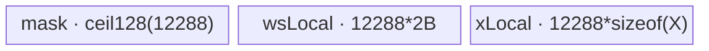

# InplaceIndexFill A2/A3 ACLNN 算子知识

## 算子速览

| 项目 | 内容 |
|---|---|
| 实际入口 | `aclnnInplaceIndexFillGetWorkspaceSize` + `aclnnInplaceIndexFill`，公开 ACLNN 两段式接口 |
| 计算语义 | 沿 `dim` 把合法 `index` 指定的切片写成 scalar `value`，最终提交回 `selfRef`；负索引加轴长、越界跳过 |
| 输入输出 | `selfRef/value`: FP16/FP32/BF16/INT32/INT64/BOOL；`index`: INT32/INT64；ND；ACLNN 语义为原地 |
| 执行类型 | 算子自有核心节点为 AIV_VECTOR；executor 还可能含框架 Contiguous/Transpose/ViewCopy 节点；无 Cube/AIC/MIX_CV |
| Kernel 路线 | R-001 FrontQ(key0)、R-002 FrontN(key1)、R-003 FrontP(key2)、R-004 TailN(key3)、R-005 TailP(key4) |
| 核心资源 | 一个覆盖整个平台 UB 的 `TBuf allUbBuf`；user workspace 含 half mask、每核完成 flag 与 Route 专用 repeat/gather 区；输出临时 y 后 ViewCopy 回 selfRef |
| 来源闭包 | source_closed：ACLNN 原地入口→A2/A3 内部 `IndexFill` 核心节点→arch32 Tiling/POD→五 key router/body→910B/910_93 构建接线已闭合；未扩展为非原地知识卡 |
| 验证状态 | 已完成源码闭包检查；本次知识提取未执行编译、真机、数值或性能测试。 |

## 接口与语义

### 计算语义

归一化 `d=dim>=0?dim:dim+rank`，折叠 `P=prod(shape[0:d])`、`N=shape[d]`、`Q=prod(shape[d+1:])`。对 `index[k]` 执行 `j=j<0?j+N:j`；若 `0<=j<N`，则对全部 `p,q` 令临时输出 `y[(p*N+j)*Q+q]=value`，其余位置复制 `self`。公开原地 API 最后 `ViewCopy(y,selfRef)`，因此对调用者表现为原地更新。

### 输入、输出与属性

| 参数 | shape/layout | dtype | 约束、默认值与语义 |
|---|---|---|---|
| `selfRef` | ND，0–8 维，允许非连续 | FP16/FP32/BF16/INT32/INT64/BOOL | 原地目标；内部可物化连续临时量 |
| `dim` | 标量 | int64 | rank>0 时 `[-rank,rank)`；0D 时 API 允许 `[-1,1)`，再 Unsqueeze 为 1D |
| `index` | 标量或向量；Kernel 读取 dim0 长度 | INT32/INT64 | 负数加 N；越界跳过 |
| `value` | `aclScalar`→单元素 tensor | 可转换为 self dtype | 核心 Kernel 读取元素 0 |
| `selfRef` 输出 | 同输入 view | 同 self | 核心 y 经可能的逆转置与 `ViewCopy` 提交 |

### 入口与版本

公开产品表明确 A2/A3 支持。固定仓无版本后缀 API；在非 Regbase 平台，`ExecIndexFillGetWorkspaceSize(...,isInplace=true)` 刻意登记 `l0op::IndexFill` 而非 950 专用 `InplaceIndexFill`，随后复制回 `selfRef`。这是 `aclnnInplaceIndexFill` 的内部实现路径；本文不发布或描述 `aclnnIndexFill` 作为独立逻辑算子，也不处理 Tensor-value 变体。

## Host/Launcher 执行流程

### 参数校验与前处理

依次校验非空、A2/A3 self dtype 六类型、index INT32/INT64、self/out shape 与 dtype、最大 8 维及 dim。空 self 直接 workspace 0；空 index 只做 `ViewCopy(self,selfRef)`。其余先 `Contiguous(self/index)`；0D 分别 `UnsqueezeNd(...,0)`；scalar `value` 转 self dtype。A2/A3 若 self 是 INT64/BOOL 且归一化 dim 是尾轴，`SwapDim` 交换首尾轴并把 dim 改为 0；核心完成后再交换回来。最后 `ViewCopy` 到原 view。

### 参数、Workspace 与生命周期

L0 `IndexFill` 分配与 self 同 shape/dtype 的 y，并登记 `OP_INPUT(self,indices,value)`、`OP_OUTPUT(y)`、`OP_ATTR(dim)`。Tiling 总 workspace 为固定 `16MiB` 系统区加 user 区：

```text
base_user = ceil32(N*2 + coreNum*1)
key1_extra = Q*8*4
key2_extra = (N*Q<128 ? 128*N*Q*2 : 8192*2)
key4_extra = N*32*2
key0/key3 extra = 0
```

`GetUserWorkspace` 返回 user 区；其中 `wsGm` 为 `N` 个 half 标记，紧随其后是 `coreNum` 个 uint8 完成标志；对齐后 `repeatGm/gatherGm` 复用 Route 专用扩展区。executor 持有 y、前后处理节点与 workspace 生命周期，第二段在调用 stream 上运行。

### 启动图与失败传播

```text
ACLNN GetWorkspaceSize
  -> Contiguous/Unsqueeze/ConvertToTensor
  -> [可选] Transpose(self, swap first/last), dim=0
  -> l0op::IndexFill / [K1] index_fill(x,indices,value,y,workspace,tiling)
  -> [可选] inverse Transpose(y)
  -> ViewCopy(y,selfRef)
ACLNN execute -> CommonOpExecutorRun(...,stream)
```

K1 是唯一算子自有 Kernel，`blockDim=平台 AIV coreNum`；框架节点依 executor 的同 stream 顺序交接临时 tensor。任何前处理或 ADD_TO_LAUNCHER 失败返回空并阻断后继；第二段返回 executor 状态。K1 输出 y 的 owner 是 executor，直到 ViewCopy 完成才可释放。

## Route 与参数设计

### 分核与资源计算

Tiling 总是取全部 AIV 核。索引标记阶段先比较 `N < coreNum*32`：成立按 `indicesNum` 分核，每核构本地 half mask 后 atomic-add 到 wsGm；否则按 N 分核，每核清零自己的 N 区间、遍历全部 indices 并单点写 1。分配采用前核 `floor(data/core)+1`、尾核 `floor(data/core)`。数据阶段各 Route 再按 P、N 或 Q 分核；所有 tail 均由 `coreSplit` 和显式 left loop 处理。

### Route 选择

| 顺序 | Route | Key/模板 | 精确选择条件与优先级 | 不适用去向 |
|---:|---|---|---|---|
| 1 | R-001 FrontQ | key 0 | `(axis!=last \|\| rank==1) && (Q>=1024 \|\| dtype∈{INT64,BOOL})` | R-002/R-003；尾轴去 R-004/5 |
| 2 | R-002 FrontN | key 1 | 非尾轴族、dtype 非 INT64/BOOL、`Q<1024 && (N>=64 \|\| Q>=64)` | R-003 |
| 3 | R-003 FrontP | key 2 | 非尾轴族、dtype 非 INT64/BOOL、`Q<64 && N<64` | 无 |
| 4 | R-004 TailN | key 3 | `rank>1 && axis==last && N>=coreNum*256` | R-005 |
| 5 | R-005 TailP | key 4 | `rank>1 && axis==last && N<coreNum*256` | 无 |

```text
if axis != last or rank == 1:
  if Q >= 1024: key0
  else if N >= 64 or Q >= 64: key1
  else: key2
  if dtype is INT64 or BOOL: key0
else:
  key3 if N >= coreNum*256 else key4
```

### 模板/实现执行矩阵

| Route | key/selector | dtype/shape/platform 完整命中条件 | 执行拓扑与 Kernel 节点 | 实际模板/body | 内存与同步特征 | tail/fallback |
|---|---|---|---|---|---|---|
| R-001 FrontQ | 0 | 上表 key0 | 单 K1 | `IndexFillFrontQ<half/float/uint8/uint64,I>` | half mask；预复制 value；按 Q 直接输出 value 或复制 x | Q 每次 `X_UB_LENGTH/2`；left Q |
| R-002 FrontN | 1 | 上表 key1 | 单 K1 | `IndexFillFrontN<half/float,I>` | gather offset、broadcast mask、Select | N block=`8192/Q`；left N |
| R-003 FrontP | 2 | 上表 key2 | 单 K1 | `IndexFillFrontP<half/float,I>` | repeat marker→mask；Select PNQ | P block=`8192/(NQ)`，小 NQ 强制 128 |
| R-004 TailN | 3 | 上表 key3 | 单 K1 | `IndexFillTailN<half/float,I>` | mask+N slice；Select | N block 12288 |
| R-005 TailP | 4 | 上表 key4 | 单 K1 | `IndexFillTailP<half/float,I>` | marker 重复 P 行；Select | `pUbLength=4096/12288`，`pBlock=pUbLength/N` |

### 隐藏性能 Guard

| Guard | Host/Tiling 条件 | Device/资源原因 | 影响 Route | 不满足时去向 | 源码符号 |
|---|---|---|---|---|---|
| FrontQ 阈值 | `Q>=1024` | Q 足够长，按切片直接搬运/填值 | R-001 | R-002/3 | `ComputeTilingKey` |
| dtype 强制 | INT64/BOOL | 其它 front body 只实例化 2/4 字节 | R-001 | 无 | `ComputeTilingKey/index_fill_front_q` |
| N/Q 阈值 | `N>=64 \|\| Q>=64` | 在 Q 不大时按 N 并行、Gather 展开 mask | R-002 | R-003 | 同上 |
| tail N 阈值 | `N>=coreNum*256` | 大尾轴按 N 分核 | R-004 | R-005 | 同上 |
| indices mode | `N<coreNum*32` | 小 N 可每核本地完整 mask；大 N 按 N 切避免 atomic 冲突 | 全部 | 另一 mode | `IndicesTaskTiling/ExecIndicesTask` |
| UB ownership | `InitBuffer(allUbBuf,ubSize)` | 各 body 在同一物理 TBuf 手工排子区 | 全部 | Tiling/运行资源失败 | `IndexFillBase::Init` |

### POD/ABI

`IndexFillTilingData` 由固定仓外的 tilingdata 宏生成，字段顺序和位宽可见，但 `sizeof/alignof/offsetof` 展开定义固定仓不可见。

| 结构 | 字段 | 类型/位宽 | ABI 布局 | 单位 | Host/launcher producer | Device consumer | 边界 |
|---|---|---|---|---|---|---|---|
| `IndexFillTilingData` | `coreNum` | uint32/32 | 固定仓不可见 | core | 平台 AIV 核数 | base/init/sync | >0 |
| 同上 | `N` | uint64/64 | 固定仓不可见 | 元素 | axis dim | 全 body/mask | 非负 |
| 同上 | `indicesNum` | uint64/64 | 固定仓不可见 | 元素 | index dim0 | indices loop | 非负 |
| 同上 | `indicesProcessMode` | uint64/64 | 固定仓不可见 | enum 0/1 | `N<core*32 ? 0:1` | `ExecIndicesTask` | 0=按 K，1=按 N |
| 同上 | `frontCoreNumTaskIndices` | uint64/64 | 固定仓不可见 | core | `IndicesTaskTiling` | `GetCoreTask` | 前核数 |
| 同上 | `tailCoreNumTaskIndices` | uint64/64 | 固定仓不可见 | core | 同上 | 同上 | 尾核数 |
| 同上 | `frontCoreDataTaskIndices` | uint64/64 | 固定仓不可见 | K 或 N 元素 | 同上 | 同上 | 每前核任务 |
| 同上 | `tailCoreDataTaskIndices` | uint64/64 | 固定仓不可见 | K 或 N 元素 | 同上 | 同上 | 每尾核任务 |
| 同上 | `ubSize` | uint64/64 | 固定仓不可见 | 字节 | 平台 UB | `InitBuffer` | 整个 UB TBuf |
| 同上 | `P` | uint64/64 | 固定仓不可见 | 轴乘积 | shape fold | 数据地址 | 非负 |
| 同上 | `Q` | uint64/64 | 固定仓不可见 | 轴乘积 | shape fold | 数据地址/route body | 非负 |

### Route 源码闭包

| Route | Key/selector | Host/Tiling producer | POD/参数 | Kernel entry/router 节点 | Kernel body/直接依赖 | 构建接线 |
|---|---|---|---|---|---|---|
| R-001 | key0 | `arch32/index_fill_tiling.cpp::ComputeTilingKey` | `IndexFillTilingData` | `index_fill.cpp` | `index_fill_front_q.h` + base | `index_fill/CMakeLists.txt` 910B/910_93→arch32 |
| R-002 | key1 | 同上 | 同上 | 同上 | `index_fill_front_n.h` + base | 同上 |
| R-003 | key2 | 同上 | 同上 | 同上 | `index_fill_front_p.h` + base | 同上 |
| R-004 | key3 | 同上 | 同上 | 同上 | `index_fill_tail_n.h` + base | 同上 |
| R-005 | key4 | 同上 | 同上 | 同上 | `index_fill_tail_p.h` + base | 同上 |

## Kernel 实现

### 公共执行流程

entry 解析 POD 后按 key 0→4 分派。各实例先 `IndexFillBase::Init` 绑定 byte-addressed x/y、indices/value，切出 user workspace，并以 `ubSize` 初始化唯一 `TBuf allUbBuf`。`InitCoreSys` 清每核 flag；mode0 由各核构本地 half mask并 atomic-add，mode1 按 N 区间清零并遍历全部 indices 单点置 1。每核写 `SYS_FLAG=133` 后轮询全部 flag，形成 mask→数据阶段的软件全核屏障。随后各 body 读 value、扩展 half mask，执行 Select 或直接填值/复制。

### Route R-001：FrontQ

#### 适用条件

##### 选择证据

| 层级 | 文件 | 符号 | 源码谓词/参数 | 结果/下一跳 |
|---|---|---|---|---|
| Tiling | `op_host/arch32/index_fill_tiling.cpp` | `ComputeTilingKey` | 非尾轴族且 Q>=1024，或 INT64/BOOL | key0 |
| Router | `op_kernel/index_fill.cpp` | `TILING_KEY_IS(0)` | DTYPE macros | `index_fill_front_q` |

#### Device 数据流

##### 函数级调用链

```text
index_fill -> index_fill_front_q -> Base::Init -> ExecIndicesTask
  -> FrontAxisQ -> RepeatValue -> per P/N: CopyOutQ(update ? valueUB : x-copy)
```

##### 源码等价伪码

```text
build half mask ws[N]; barrier
repeat scalar value into first half of xLocal
for p; for N chunks; for n:
  split Q among rotating cores
  if ws[n]>0: DMA repeated value UB -> y[p,n,qSlice]
  else: DMA x[p,n,qSlice] -> UB second half -> y
```

#### 内存与数据搬运

##### 资源与搬运表

| 层级/缓冲区 | offset/地址公式 | extent/容量公式 | dtype/layout | producer | consumer | owner/lifetime | 对齐/复用 |
|---|---|---|---|---|---|---|---|
| allUb/wsLocal | 0 | 8192 half | half mask slice | wsGm DMA | scalar branch | one TBuf | overlaps later phases only after barrier |
| allUb/xLocal | 16384B | 16384 X elements | X | RepeatValue / x DMA | y DMA | one TBuf | first half value, second half x |
| y | `(p*N+n)*Q+qStart` | q slice | X/PNQ | DMA | ViewCopy | executor | tail Q explicit |

##### 分层内存布局


##### 字节账与复用顺序

```text
UB_total = ubSize bytes（唯一 allUbBuf；图为 Route 活跃子区）
workspace_total = 16MiB + ceil32(2*N + coreNum)
```

| 复用子区 | 写入者 | 读取者/消费点 | 下一次覆盖 | 同步或释放依据 | 安全条件 |
|---|---|---|---|---|---|
| xLocal second half | CopyIn x | CopyOut y | next Q tile | MTE2_S、MTE3_S | previous DMA complete |

#### 同步、精度与尾块

##### 同步与数值边界表

| 阶段 | primitive/机制 | producer | consumer/等待点 | 保护对象 | 精度/尾块 |
|---|---|---|---|---|---|
| mask | atomic half or disjoint writes + flag poll | indices task | FrontAxisQ | wsGm | marker only tests >0 |
| value repeat | S_V/V barriers | scalar set/DataCopy | y DMA | xLocal | bitwise X value；兼容 1/2/4/8B |
| Q tail | explicit leftQ | CopyIn/value | CopyOut | y | exact bytes |

#### 关键实现

##### 符号证据表

| 阶段 | 文件 | 符号/模板实例 | 实现事实 |
|---|---|---|---|
| Host/Tiling producer | `op_host/arch32/index_fill_tiling.cpp` | `ComputeTilingKey` | key0 |
| Kernel entry/router | `op_kernel/index_fill.cpp` | key0 | dispatch |
| Device body/helper | `op_kernel/index_fill_front_q.h` | `FrontAxisQ/CopyOutQ/RepeatValue` | Q 切分与直填 |

### Route R-002：FrontN

#### 适用条件

##### 选择证据

| 层级 | 文件 | 符号 | 源码谓词/参数 | 结果/下一跳 |
|---|---|---|---|---|
| Tiling | arch32 tiling | `ComputeTilingKey` | Q<1024 且 N>=64 或 Q>=64，非 8B/bool | key1 |

#### Device 数据流

##### 函数级调用链

```text
index_fill -> front_n -> ExecIndicesTask/ReadValue -> InitGather
  -> per P/N tile: ws DMA -> Gather repeat Q -> CompareScalar -> x DMA -> Select -> y DMA
```

##### 源码等价伪码

```text
offset[k*Q+q]=k*sizeof(half)
for assigned N tile: markerQ=Gather(marker,offset); mask=(markerQ==0)
xTile=GM; Select(xTile,mask,xTile,value); y=tile
```

#### 内存与数据搬运

##### 资源与搬运表

| 层级/缓冲区 | offset/地址公式 | extent/容量公式 | dtype/layout | producer | consumer | owner/lifetime | 对齐/复用 |
|---|---|---|---|---|---|---|---|
| offsetLocal | 0 | 8192 int32 | gather offsets | InitGather | Gather | TBuf | gatherGm staging |
| wsLocal/wsLocalQ/mask/xLocal | successive aligned offsets | Ntile half; Ntile*Q half; ceil128 mask; Ntile*Q X | PNQ | DMA/Gather/Compare/x DMA | Select/y DMA | TBuf tile | sequential reuse |
| gatherGm | aligned workspace extra | `Q*8` int32 | offsets | first lanes | later loads | K1 | key1 only |

##### 分层内存布局


##### 字节账与复用顺序

```text
UB_total=ubSize
workspace_total=16MiB+ceil32(2*N+coreNum)+Q*8*4
Ntile=min(coreNNums,8192/Q)
```

| 复用子区 | 写入者 | 读取者/消费点 | 下一次覆盖 | 同步或释放依据 | 安全条件 |
|---|---|---|---|---|---|
| xLocal | x DMA/Select 原地 | y DMA | next tile | MTE2_S→V_S→MTE3_S | tail count controls APIs |

#### 同步、精度与尾块

##### 同步与数值边界表

| 阶段 | primitive/机制 | producer | consumer/等待点 | 保护对象 | 精度/尾块 |
|---|---|---|---|---|---|
| Gather/Compare/Select | V_S events | each vector op | next scalar/DMA | UB | half marker，X value no cast |
| tail | left N | loop | exact y DMA | PNQ | compare count ceil128，输出只有效元素 |

#### 关键实现

##### 符号证据表

| 阶段 | 文件 | 符号/模板实例 | 实现事实 |
|---|---|---|---|
| Host/Tiling producer | arch32 tiling | key1 + workspace | Q/N route |
| Kernel entry/router | `index_fill.cpp` | key1 | front_n |
| Device body/helper | `index_fill_front_n.h` | `InitGather/ProcessOneP` | Gather mask 与 Select |

### Route R-003：FrontP

#### 适用条件

##### 选择证据

| 层级 | 文件 | 符号 | 源码谓词/参数 | 结果/下一跳 |
|---|---|---|---|---|
| Tiling | arch32 tiling | `ComputeTilingKey` | Q<64 且 N<64，非 8B/bool | key2 |

#### Device 数据流

##### 函数级调用链

```text
index_fill -> front_p -> ExecIndicesTask/ReadValue -> SliceP -> InitSelect
  -> per P tile: x DMA -> Select in-place -> y DMA
```

##### 源码等价伪码

```text
repeat each marker Q times via repeatGm; repeat NQ marker Pblock times
mask=(repeatedMarker==0)
for P tile: xTile=GM; Select(xTile,mask,xTile,value); y=tile
```

#### 内存与数据搬运

##### 资源与搬运表

| 层级/缓冲区 | offset/地址公式 | extent/容量公式 | dtype/layout | producer | consumer | owner/lifetime | 对齐/复用 |
|---|---|---|---|---|---|---|---|
| compare/repeat/marker/temp | hand-aligned | Pblock*N*Q mask/half + N half + temp | half/mask | InitSelect | Select | TBuf | repeatGm staging |
| xLocal | aligned after mask | Pblock*N*Q X | X | x DMA | Select/y DMA | TBuf | in-place Select |

##### 分层内存布局


##### 字节账与复用顺序

```text
UB_total=ubSize
Pblock=8192/(N*Q), but if N*Q<128 then Pblock=128
workspace=16MiB+base+(N*Q<128 ? 128*N*Q*2 : 8192*2)
```

| 复用子区 | 写入者 | 读取者/消费点 | 下一次覆盖 | 同步或释放依据 | 安全条件 |
|---|---|---|---|---|---|
| xLocal | DMA x then Select same tensor | DMA y | next P tile | events | exact pNums*N*Q output |

#### 同步、精度与尾块

##### 同步与数值边界表

| 阶段 | primitive/机制 | producer | consumer/等待点 | 保护对象 | 精度/尾块 |
|---|---|---|---|---|---|
| marker staging | MTE/V events | repeat loops | compare | repeatGm/UB | half marker |
| P tail | leftP | tile loop | output | y | Select count only valid elements |

#### 关键实现

##### 符号证据表

| 阶段 | 文件 | 符号/模板实例 | 实现事实 |
|---|---|---|---|
| Host/Tiling producer | arch32 tiling | key2 workspace | small N/Q |
| Kernel entry/router | `index_fill.cpp` | key2 | front_p |
| Device body/helper | `index_fill_front_p.h` | `InitSelect/FrontAxisP` | marker replication + Select |

### Route R-004：TailN

#### 适用条件

##### 选择证据

| 层级 | 文件 | 符号 | 源码谓词/参数 | 结果/下一跳 |
|---|---|---|---|---|
| Tiling | arch32 tiling | `ComputeTilingKey` | rank>1、尾轴、N>=core*256 | key3 |

#### Device 数据流

##### 函数级调用链

```text
index_fill -> tail_n -> ExecIndicesTask/ReadValue -> coreSplit(N)
  -> per N tile InitSelect -> for P ProcessPN(x DMA->Select->y DMA)
```

##### 源码等价伪码

```text
for assigned N slice in chunks 12288:
  marker=ws[n:n+len]; mask=(marker==0)
  for p: x[p,n:n+len] -> Select -> y
```

#### 内存与数据搬运

##### 资源与搬运表

| 层级/缓冲区 | offset/地址公式 | extent/容量公式 | dtype/layout | producer | consumer | owner/lifetime | 对齐/复用 |
|---|---|---|---|---|---|---|---|
| compareMask | 0 | ceil128(Ntile) bytes | mask | Compare | Select | TBuf | stable across P loop |
| ws/xLocal | aligned N_UB_LENGTH offset | Ntile half / Ntile X | half/X | DMA | Compare/Select | TBuf | x overwrites route subarea per p |

##### 分层内存布局



##### 字节账与复用顺序

```text
UB_total=ubSize; workspace=16MiB+base; Ntile<=12288
```

| 复用子区 | 写入者 | 读取者/消费点 | 下一次覆盖 | 同步或释放依据 | 安全条件 |
|---|---|---|---|---|---|
| xLocal | x DMA/Select | y DMA | next p | events | mask held until all P consumed |

#### 同步、精度与尾块

##### 同步与数值边界表

| 阶段 | primitive/机制 | producer | consumer/等待点 | 保护对象 | 精度/尾块 |
|---|---|---|---|---|---|
| marker→mask | MTE2_S/V_S | ws DMA/Compare | P loop | mask | compare ceil128 |
| N tail | leftN | outer loop | exact CopyOut | y | no padded output |

#### 关键实现

##### 符号证据表

| 阶段 | 文件 | 符号/模板实例 | 实现事实 |
|---|---|---|---|
| Host/Tiling producer | arch32 tiling | key3 | tail large N |
| Kernel entry/router | `index_fill.cpp` | key3 | tail_n |
| Device body/helper | `index_fill_tail_n.h` | `TailAxisN/InitSelect/ProcessPN` | N slicing |

### Route R-005：TailP

#### 适用条件

##### 选择证据

| 层级 | 文件 | 符号 | 源码谓词/参数 | 结果/下一跳 |
|---|---|---|---|---|
| Tiling | arch32 tiling | `ComputeTilingKey` | rank>1、尾轴、N<core*256 | key4 |

#### Device 数据流

##### 函数级调用链

```text
index_fill -> tail_p -> ExecIndicesTask/ReadValue -> SliceP -> InitSelect
  -> per P block x DMA -> Select -> y DMA
```

##### 源码等价伪码

```text
pUbLength = N<=1024 ? 4096 : 12288; pBlock=pUbLength/N
repeat ws[N] for pBlock rows; compare to mask
for assigned P block: x -> Select(mask,x,value) -> y
```

#### 内存与数据搬运

##### 资源与搬运表

| 层级/缓冲区 | offset/地址公式 | extent/容量公式 | dtype/layout | producer | consumer | owner/lifetime | 对齐/复用 |
|---|---|---|---|---|---|---|---|
| mask/wsPN/ws/temp | successive aligned offsets | pBlock*N mask/half + N half | mask/half | repeatGm/Compare | Select | TBuf | route phases |
| xLocal | aligned offset | pBlock*N X | X | DMA | Select/y DMA | TBuf | in-place Select |

##### 分层内存布局


##### 字节账与复用顺序

```text
UB_total=ubSize
workspace=16MiB+base+N*32*2
pBlock=(N<=1024 ? 4096 : 12288)/N
```

| 复用子区 | 写入者 | 读取者/消费点 | 下一次覆盖 | 同步或释放依据 | 安全条件 |
|---|---|---|---|---|---|
| xLocal | x DMA/Select | y DMA | next P block | MTE/V events | pBlock>0；由 N<core*256 但固定仓未显式证明 N<=12288 |

#### 同步、精度与尾块

##### 同步与数值边界表

| 阶段 | primitive/机制 | producer | consumer/等待点 | 保护对象 | 精度/尾块 |
|---|---|---|---|---|---|
| repeat/compare | MTE/V events | repeatGm | Select | mask | half marker |
| P tail | leftP | loop | y DMA | output | exact valid count |

#### 关键实现

##### 符号证据表

| 阶段 | 文件 | 符号/模板实例 | 实现事实 |
|---|---|---|---|
| Host/Tiling producer | arch32 tiling | key4 + workspace | tail small N |
| Kernel entry/router | `index_fill.cpp` | key4 | tail_p |
| Device body/helper | `index_fill_tail_p.h` | `InitSelect/TailAxisP` | marker repeat and P tiling |

## 算子特定优化

### Trick T-001：按 N 大小切换索引标记并行轴

#### 触发与源码依据

- 适用 Route：R-001–R-005 公共前段
- 触发条件：`N < coreNum*32` 按 indicesNum 分核，否则按 N 分核
- Golden 来源：[`index_fill_tiling.cpp:151-167`](../../../../../../../cann-ops-raw/ascendc/ops-nn/955f8b33985b6d72989ebff341bb9c2c564a51bc/index/index_fill/op_host/arch32/index_fill_tiling.cpp#L151-L167)

**官方源码（固定 Commit 连续逐字摘录）**：

```cpp
if (tilingData.N < tilingData.coreNum * ALIGNED_NUM) {
  tilingData.indicesProcessMode = 0;
} else {
  tilingData.indicesProcessMode = 1;
}
uint64_t dataNums = 0;
if (tilingData.indicesProcessMode == 0) {
  dataNums = tilingData.indicesNum;
} else {
  dataNums = tilingData.N;
}
```

#### 机制与设计原因

小 N 时每核能在 UB 中持有完整标记数组，按 K 分核后以 half atomic-add 合并；大 N 时把 mask 区间分给不同核，每核遍历全部 K，只对自己区间单点写，从而规避重复 index 在同一地址的严重 atomic 冲突。切换改变并行域、GM 流量和同步行为。

#### 迁移边界

- 适用：输出位置先压成一维幂等 mask 的索引算子。
- 前提：mode0 的本地完整 mask 能放入 UB，mode1 可接受每核扫描全部 indices。
- 失效：标记不是可加/幂等或不能提供全核完成屏障时需重设协议。
- 未验证：本次知识提取未执行编译、真机、数值或性能测试。

#### 错误做法

固定仓未提供可验证反例。

### Trick T-002：FrontQ 预复制 value 后直接 DMA 输出

#### 触发与源码依据

- 适用 Route：R-001
- 触发条件：key0，尤其长 Q 切片
- Golden 来源：[`index_fill_front_q.h:96-113`](../../../../../../../cann-ops-raw/ascendc/ops-nn/955f8b33985b6d72989ebff341bb9c2c564a51bc/index/index_fill/op_kernel/index_fill_front_q.h#L96-L113)

**官方源码（固定 Commit 连续逐字摘录）**：

```cpp
if (update) {
    uint64_t ubStartInt8 = WS_UB_LENGTH * sizeof(half);
    this->CopyOut(this->yGm, gmStartInt8, ubStartInt8, mteNumsInt8);
} else {
    uint64_t ubStartInt8 = WS_UB_LENGTH * sizeof(half) +
                           (X_UB_LENGTH / 2) * sizeof(T);
    this->CopyIn(this->xGm, gmStartInt8, ubStartInt8, mteNumsInt8);
    this->PIPE_MTE2_S();
    this->CopyOut(this->yGm, gmStartInt8, ubStartInt8, mteNumsInt8);
    this->PIPE_MTE3_S();
}
```

#### 机制与设计原因

命中索引的长 Q 切片无需从 x 搬入，也无需逐元素 Select：`RepeatValue` 预先把 scalar 扩成一块 UB，随后直接 UB→GM；未命中切片才走 x→UB→y。这减少命中切片的 GM 读取和 Vector 计算。

#### 迁移边界

- 适用：整段连续切片被同一 scalar 覆盖。
- 前提：输出非别名临时 y、Q 连续、预复制值覆盖完整有效字节。
- 失效：部分 lane 更新或输出与输入危险重叠时需 Select/读改写。
- 未验证：本次知识提取未执行编译、真机、数值或性能测试。

#### 错误做法

固定仓未提供可验证反例。

## 模板与实现对比

| 对比维度 | R-001 FrontQ | R-002 FrontN | R-003 FrontP | R-004 TailN | R-005 TailP | 设计选择依据 |
|---|---|---|---|---|---|---|
| 命中条件/优先级 | 长 Q/8B | 中 N/Q | 小 N/Q | 尾轴大 N | 尾轴小 N | shape 决策树 |
| 模板与 dtype | 1/2/4/8B | 2/4B | 2/4B | 2/4B | 2/4B | 8B 强制 key0 |
| 循环与分核 | P,N,Q | P,Ntile | Ptile | Ntile,P | Ptile | 连续轴优先 |
| Queue/TBuf/寄存器/dynamic UB/通信 window | 单 allUb TBuf | 同 | 同 | 同 | 同 | 无 Queue/dynamic UB |
| 内存总占用与复用 | ubSize+base ws | +gather | +repeat | base | +repeat | Route 专用 workspace |
| 搬运/Vector/SIMT/NDDMA/通信 API | DMA/重复值 | Gather/Compare/Select | Duplicate/Compare/Select | Compare/Select | Compare/Select | 全为 AIV_VECTOR |
| 同步、精度与 tail | flag poll；Q tail | N tail | P tail | N tail | P tail | half marker、X 原 dtype |
| fallback/失败边界 | 无 | →FrontP | 无 | →TailP | 无 | 未知 key 无 body |

## 平台差异

| 项目 | A2 | A3 | 950 |
|---|---|---|---|
| 支持状态 | 支持 | 支持 | 支持，见 `_950` 卡 |
| Host/Launcher | 910B→arch32；原地 API 用 IndexFill+ViewCopy | 910_93→arch32；同 A2 | Regbase 直接 InplaceIndexFill |
| Kernel/资源 | 五 key AIV Vector | 与 A2 共用 | 三模板 SIMT/Sort，N-byte mask |

## 限制与失败边界

- A2/A3 原地语义依赖临时 y 与最终 ViewCopy；不能把内部 `IndexFill` 输出直接当成 self 已原地修改。
- INT64/BOOL 尾轴 API 会先交换首尾轴，故 arch32 tail key 对这两 dtype 从公开入口不可达；不能把 dormant 实例写成公开 Route。
- Tiling 的 `P/N/Q` 和 workspace 乘法未见溢出检查；`IndexFillTilingData` 宏展开 ABI 固定仓不可见。
- `WaitForIndicesTask` 是无超时轮询；任一核未写 133 会使其它核持续等待。mode0 依赖 half atomic-add，仅判断 marker 是否大于 0。
- R-005 的 `pBlockLength=pUbLength/N` 没有显式零保护；公开前处理保证非空核心路径，但固定源码也未给出 `N<=pUbLength` 的 selector guard。
- Contiguous/Transpose/ViewCopy 与 executor 内部 workspace/Kernel 是固定仓不可见框架边界；算子自有 Host、POD、Kernel 和 user workspace 已闭合。

## 源码索引

### 链路索引

| 链路阶段 | 文件 | 关键符号 | 支撑内容 |
|---|---|---|---|
| 入口声明/约束 | `index/index_fill_d/docs/aclnnIndexFill&aclnnInplaceIndexFill.md` | 产品表/接口 | A2/A3 公开支持 |
| 入口实现 | `index/index_fill_d/op_api/aclnn_index_fill.cpp` | `ExecIndexFillGetWorkspaceSize` | 原地入口、前后处理 |
| 入口实现 | `index/index_fill_d/op_api/index_fill.cpp` | `l0op::IndexFill` | 内部核心节点登记 |
| Host/Tiling/Launcher | `index/index_fill/op_host/arch32/index_fill_tiling.cpp` | `IndexFillTilingOp` | key、分核、workspace |
| Host/Tiling/Launcher | `index/index_fill/op_host/arch32/index_fill_tiling.h` | `IndexFillTilingData` | POD 字段 |
| Kernel entry/body | `index/index_fill/op_kernel/index_fill.cpp` | `index_fill` | 五 key router |
| Kernel entry/body | `index/index_fill/op_kernel/index_fill_base.h` | `IndexFillBase` | mask、同步、公共 DMA |
| Kernel entry/body | `index/index_fill/op_kernel/index_fill_front_q.h` | `IndexFillFrontQ` | R-001 |
| Kernel entry/body | `index/index_fill/op_kernel/index_fill_front_n.h` | `IndexFillFrontN` | R-002 |
| Kernel entry/body | `index/index_fill/op_kernel/index_fill_front_p.h` | `IndexFillFrontP` | R-003 |
| Kernel entry/body | `index/index_fill/op_kernel/index_fill_tail_n.h` | `IndexFillTailN` | R-004 |
| Kernel entry/body | `index/index_fill/op_kernel/index_fill_tail_p.h` | `IndexFillTailP` | R-005 |
| 构建接线 | `index/index_fill/op_host/index_fill_def.cpp` | `AddConfig("ascend910b/ascend910_93")` | A2/A3 dtype 与注册 |
| 构建接线 | `index/index_fill/op_host/config/ascend910b/index_fill_binary.json` | `op_type/op_list` | A2 binary 组合 |
| 构建接线 | `index/index_fill/op_host/config/ascend910_93/index_fill_binary.json` | `op_type/op_list` | A3 binary 组合 |
| 构建接线 | `index/index_fill/CMakeLists.txt` | SUPPORT_COMPUTE_UNIT/TILING_DIR | A2/A3 arch32 |

### 实现复用检查

| 检查项 | 可复用事实 | 不得改变的约束 | 源码符号 |
|---|---|---|---|
| ABI/POD | 11 字段 producer/consumer 已闭合 | 宏布局需用同一 SDK，不自行猜 offset | `IndexFillTilingData` |
| 调用顺序 | 临时 y→可选逆转置→ViewCopy self | 不能省略最终提交 | API executor graph |
| workspace/内存 | ws half mask、flag、Route extra | 16MiB 系统偏移和对齐 | `Init`/Tiling `Init` |
| 同步 | flag=133 软件屏障 | 全 blockDim 核参加，MTE 完成后写 flag | `WriteFlagToGm/WaitForIndicesTask` |
| 精度与尾块 | marker half；x 按 1/2/4/8B 位宽搬运 | INT64/BOOL frontQ；left loops | router/body |
| 失败边界 | ACLNN 空域短路和空指针返回 | 不从 direct Host 绕过这些约束 | `ExecIndexFillGetWorkspaceSize` |