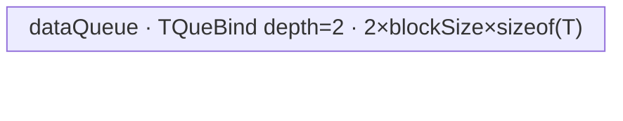

# InplaceIndexFillTensor 950 ACLNN 算子知识

## 算子速览

| 项目 | 内容 |
|---|---|
| 实际入口 | `aclnnInplaceIndexFillTensorGetWorkspaceSize` + `aclnnInplaceIndexFillTensor`，公开 ACLNN 两段式接口；实现复用非原地第一段接口，并把 `out` 指向 `selfRef`。 |
| 计算语义 | 对归一化轴 `d`，若 `j_d` 属于归一化后的 `index` 集合，则 `selfRef[j] = cast(value, dtype(selfRef))`；其它位置保留原值。负索引 `k` 在 Device 侧按 `k + N` 归一化。 |
| 输入输出 | `selfRef`：公开文档为 0～8 维 ND，FLOAT16/FLOAT/INT32/INT64/BOOL/BFLOAT16；`dim`：`int64`；`index`：Host `aclIntArray`，转换为 Device INT64 Tensor；`value`：非复数 `aclScalar`，转换到 `selfRef` dtype；输出与 `selfRef` 同一对象。 |
| 执行类型 | R-001/R-002 为框架快捷路径；R-003 为单 Kernel Hybrid（SIMT 位图构建 + AIV DMA/标量分支）；R-004 为单 Kernel Hybrid（AIV Sort/MicroAPI 去重 + SIMT 位图/写回 + AIV DMA）；R-005 为单 Kernel Hybrid（AIV DMA + SIMT 写回）。所有可达节点均无 Cube/AIC 与 MIX_CV。 |
| Kernel 路线 | R-001 空 `index`；R-002 空 `selfRef`；R-003 `Q*sizeof(T)>128` 的 SIMD 大行路线；R-004 小行且稠密索引；R-005 通用 SIMT fallback。 |
| 核心资源 | 核心节点使用 GM、AIV `TQueBind/TQue/TBuf`、SIMT VF、`N` 字节 GM workspace 位图和系统 workspace；公开 executor 还拥有 Contiguous、转换 Tensor、核心临时输出与 ViewCopy 的生命周期。 |
| 来源闭包 | `source_closed`：公开 ACLNN 声明/实现 → `IndexFillAiCore` → `l0op::IndexFill` launcher → arch35 三个 Host 模板 →共享 POD → `index_fill` router →全部 Hybrid body/helper → 950 构建接线均闭合。 |
| 验证状态 | 已完成源码闭包检查；本次知识提取未执行编译、真机、数值或性能测试。 |

## 接口与语义

### 计算语义

令 `selfRef` 的逻辑 shape 为 `(D0,...,Dr-1)`。标量输入按 `r=0` 处理为单元素；非标量时 `d = dim >= 0 ? dim : dim + r`，并定义：

```text
P = product(D0 ... Dd-1)
N = Dd
Q = product(Dd+1 ... Dr-1)
flat(p,n,q) = (p*N + n)*Q + q
I = { k >= 0 ? k : k + N | k in index }
selfRef_out[flat(p,n,q)] = value_as_self_dtype, n in I
                              selfRef_in[flat(p,n,q)], otherwise
```

重复索引只会把相同目标写成同一个 `value`，因此源码路径保持确定性。ACLNN 的“原地”体现在最终 `ViewCopy(..., selfRef)`；950 核心 `IndexFill` 本身先分配临时输出，并不直接覆盖输入。

### 输入、输出与属性

| 参数 | shape/layout | dtype | 约束、默认值与语义 |
|---|---|---|---|
| `selfRef` | 公开文档：0～8 维、ND，允许非连续 | 公开文档：FLOAT16/FLOAT/INT32/INT64/BOOL/BFLOAT16 | 非空指针；作为输入和最终输出。实现的 950 dtype 表还含 INT8/UINT8/INT16/DOUBLE，但公开文档未把这四类写入参数表，复用时按公开六类作为稳定契约。 |
| `dim` | 标量属性 | `int64_t` | 非标量范围 `[-r,r)`，标量范围 `[-1,1)`；Device tiling 再归一化为 `[0,r)`。 |
| `index` | Host 一维 `aclIntArray`；Device 转为连续 INT64 Tensor | Host 整数数组，Device `DT_INT64` | 每项须在 `[-N,N)`；负数由 Device body 加 `N`。空数组命中 R-001。 |
| `value` | Host scalar；Device 单元素 Tensor | 可转为 `selfRef` dtype，禁止 complex | `ConvertToTensor(value, selfContiguous->GetDataType())` 只做一次类型转换，Kernel 后续按等宽整数位模式搬运。 |
| `workspaceSize` | Host 标量输出 | `uint64_t` | 由 executor 汇总所有步骤；核心 Kernel 的切片见后文。R-001 源码未显式写该值，是失败边界。 |
| `executor` | Host 对象 | `aclOpExecutor*` | 第一段创建并转移所有权，第二段在传入 stream 上执行。 |
| `workspace` | Device 字节区 | - | 由调用者按第一段结果申请；核心路线前部可作 `N` 字节索引位图，其余含系统/框架空间。 |

### 入口与版本

公开声明位于 `op_api/aclnn_index_fill_tensor.h`，950 使用同一无版本后缀入口。`aclnnInplaceIndexFillTensorGetWorkspaceSize` 直接调用 `aclnnIndexFillTensorGetWorkspaceSize(selfRef,...,selfRef,...)`，第二段调用 `CommonOpExecutorRun`。公开文档明确支持 Ascend 950PR/950DT；950 分支由 `IsRegbase()` 选择 `IndexFillAiCore`，再复用 sibling `index/index_fill` 的最新 arch35 实现。非原地 ACLNN 只是实现复用边界，本卡不发布其独立语义。

## Host/Launcher 执行流程

### 参数校验与前处理

1. `OP_CHECK_COMM_INPUT` 校验 `workspaceSize/executor`；`CheckNotNull` 校验 `selfRef/index/value`（复用函数还校验 `out`，此处即 `selfRef`）。
2. `CheckDtypeValid` 按 Regbase 950 表校验 `selfRef`，并要求 `out` 同 dtype；`CheckPromoteType` 拒绝 complex scalar。
3. `CheckShape`：非空 Tensor 要求 rank ≤ 8、`dim` 合法、每个 index 在 `[-N,N)`；空 Tensor 提前成功，因此跳过这些 shape/index 校验。
4. `CheckFormat` 对 FRACTAL_NZ 只记录 warning，不返回失败。
5. 若 `index->Size()==0`，只把 `ViewCopy(selfRef,selfRef)` 放入 executor 后返回 R-001。
6. 否则若 `selfRef->IsEmpty()`，写 `workspaceSize=0`、释放 executor 后返回 R-002。
7. 950 正常路线进入 `IndexFillAiCore`：`Contiguous(selfRef)`；把 `aclIntArray` 转成 `DT_INT64` Tensor 并 `Contiguous`；把 `value` 转成 `selfRef` dtype Tensor；调用 `l0op::IndexFill`；最后 `ViewCopy` 到 `selfRef`。

通用函数在分平台前计算了负 index 的 Host `appendIndex`，但 950 分支位于 `AllocIntArray(appendIndex,...)` 之前，故 950 实际传入原始 index；各 Kernel body 自行执行负索引归一化。

### 参数、Workspace 与生命周期

`CREATE_EXECUTOR` 拥有 Contiguous 结果、转换后的 index/value Tensor、`IndexFill` 临时输出及 ViewCopy 节点，`GetWorkspaceSize()` 汇总后由 `ReleaseTo(executor)` 转交调用者。第二段 `CommonOpExecutorRun(workspace, workspaceSize, executor, stream)` 在同一 stream 执行既定顺序。

核心 `IndexFill` Tiling 的 workspace 为：

- R-003：`N*sizeof(int8_t) + 16 MiB`；Kernel 将 `workspace[0:N)` 绑定为索引位图。
- R-004：`N*sizeof(int8_t) + sysWorkspaceSize`；`sysWorkspaceSize` 来自 `GetLibApiWorkSpaceSize()`，非正时回退 16 MiB。
- R-005 by-N：同 R-004；by-indices：仅 `sysWorkspaceSize`，不构造位图。

框架如何在公开 executor 总 workspace 中摆放各节点切片、以及系统区相对用户位图区的内部偏移，在固定仓中不可见；不得把上述核心节点大小误当作整个 ACLNN executor 的精确 arena 布局。

### 启动图与失败传播

```text
aclnnInplaceIndexFillTensorGetWorkspaceSize
  -> aclnnIndexFillTensorGetWorkspaceSize(selfRef, ..., out=selfRef)
     -> [index empty] ViewCopy(selfRef -> selfRef)                         # R-001
     -> [self empty] no Device node, workspaceSize=0                       # R-002
     -> [A5 normal]
        Contiguous(selfRef)                                                # framework boundary
        ConvertToTensor(index, DT_INT64) -> Contiguous(index)              # framework boundary
        ConvertToTensor(value, dtype(selfRef))                             # framework boundary
        -> l0op::IndexFill -> ADD_TO_LAUNCHER_LIST_AICORE(IndexFill)
           -> one index_fill<templateMode,dtypeMode> node                  # R-003/R-004/R-005
        -> ViewCopy(core temporary y -> selfRef)                           # framework boundary
aclnnInplaceIndexFillTensor(workspace, executor, stream)
  -> CommonOpExecutorRun(..., stream)
```

| 节点/边 | entry、参数与范围 | ordering | owner/lifetime | 失败传播 |
|---|---|---|---|---|
| ACLNN 前处理 | Contiguous/ConvertToTensor，index 固定为 INT64 | executor 顺序 | executor 拥有中间 Tensor | 任一空返回经 `CHECK_RET` 阻断后续 |
| 核心节点 | `index_fill(x,indices,value,y,workspace,tiling)`；`blockDim=usedCoreNum`；POD 依 Route | 与前后节点在同一 executor/stream | `y` 为 executor 临时 Tensor；workspace 由调用者拥有至执行结束 | launcher 加入失败返回空并使第一段报内部错误 |
| 核心 → ViewCopy | producer 为 `index_fill` 临时 `y`；consumer 为 `ViewCopy(...,selfRef)`；shape/dtype 与 `selfRef` 一致 | executor/stream 顺序保证 consumer 在 producer 后 | ViewCopy 完成前临时 `y` 与 `selfRef` 均有效 | ViewCopy 创建失败阻断第一段 |
| Device 内部位图 | `workspace[0:N)`，INT8、一维 | `SyncAll` 保护 zero→set→read | 单 Kernel 有效期，核心 node owner 为 executor workspace | 无独立返回码；非法 index 被 Kernel `continue`，正常 ACLNN 已先校验 |

## Route 与参数设计

### 分核与资源计算

公共 Tiling 把 shape 合并成 `(P,N,Q)`，`numel=P*N*Q`，读取 AIV 核数、UB 大小和系统 workspace。模板注册按数值从小到大尝试：SIMD priority 1、dense-indices priority 6、通用 SIMT priority 10。

- R-003：先按 `P*N` 分核；当 `usedCoreNumPN*usedCoreNumQ < coreNum/2` 且 `ceilAlign(Q,usedCoreNumQ)*sizeof(T) >= 2048` 时逐步增大 Q 向分核。UB 先扣 32 KiB DCache，容量约束为 `3*alignedQ*sizeof(T)+alignedMask <= usableUB`，其中 3 来自双缓冲 x 加单缓冲 value。
- R-004/R-005：AIV copy 先令每核切片至少约 1024 字节；较大数据按 `floorAlign((UB-128KiB)/(2*sizeof(T)), ubBlock/sizeof(T))` 切 tile，再以 former/tail core 分发。`usedCoreNum=max(simdUsedCoreNum,simtUsedCoreNum)`。
- R-004 额外选择 `indicesUbFactor`，Host 计入双缓冲 indices、排序输出/哨兵、unique id 和 AscendC Sort 临时空间；随后可把 factor 降到 `max(512,N+256)` 以增加并行块数。

### Route 选择

| 顺序 | Route | Key/模板 | 精确选择条件与优先级 | 不适用去向 |
|---:|---|---|---|---|
| 1 | R-001 空 index | 无核心 key | `index->Size()==0`，在平台分支前命中 | 否则检查空 self |
| 2 | R-002 空 self | 无核心 key | `index` 非空且 `selfRef->IsEmpty()` | 否则 950 `IndexFillAiCore` |
| 3 | R-003 SIMD 大行 | `TEMPLATE_SIMD × B32/B64` | priority 1；`numel!=0 && Q*dtypeSize>128` | priority 6 |
| 4 | R-004 稠密索引 | `TEMPLATE_SIMT_DENSE_INDICES × B32/B64` | priority 6；`numel!=0 && Q*dtypeSize<=128 && P*Q*indicesNum>2048 && indicesNum>=5*N` | priority 10 |
| 5 | R-005 通用 SIMT | `TEMPLATE_SIMT × B32/B64` | priority 10；`IsCapable()==true`，是非空输入 fallback | tiling 失败仅发生于公共校验/资源异常 |

```text
if index.Size == 0: R-001
else if selfRef.IsEmpty: R-002
else:  # A5 IsRegbase
  P,N,Q,numel = normalize_shape_and_dim()
  try priority 1 SIMD:
    if Q*dtypeSize > 128: R-003
  try priority 6 dense-indices:
    if Q*dtypeSize <= 128 and P*Q*indicesNum > 2048 and indicesNum >= 5*N: R-004
  try priority 10 SIMT:
    R-005
```

### 模板/实现执行矩阵

| Route | key/selector | dtype/shape/platform 完整命中条件 | 执行拓扑与 Kernel 节点 | 实际模板/body | 内存与同步特征 | tail/fallback |
|---|---|---|---|---|---|---|
| R-001 | API shortcut | 950，`index.Size()==0` | 无核心 Kernel；框架 ViewCopy self→self | `l0op::ViewCopy` 边界 | 无本算子 POD/UB；workspaceSize 未显式赋值 | 无下一 Route |
| R-002 | API shortcut | 950，index 非空且 self empty | 无 Device 节点 | API early return | `workspaceSize=0` | 无输出写，self 已为空 |
| R-003 | SIMD+B32/B64 | 非空，`Q*s>128`；B64 当 `indicesNum>INT32_MAX` | 单 `index_fill` Hybrid 节点 | `IndexFillSimdImpl<ComputeType, int64_t, uint32_t/uint64_t>` | GM mask + `SyncAll`；AIV queues；SIMT set-mask | PN/Q former-tail、Q tile tail；不满足转 R-004/R-005 |
| R-004 | DENSE+B32/B64 | 非空，`Q*s<=128`，`P*Q*K>2048`，`K>=5N`；B64 当 `numel>INT32_MAX` | 单 `index_fill` Hybrid 节点 | `IndexFillSimtDenseIndicesImpl<ComputeType,int64_t,uint32_t/uint64_t>` | data copy 后 Reset UB；Sort+unique；GM mask；两次全核同步 | indices chunk tail、data tail；不满足转 R-005 |
| R-005 | SIMT+B32/B64 | 非空 fallback；B64 当 `numel>INT32_MAX \|\| K*P*Q>INT32_MAX` | 单 `index_fill` Hybrid 节点 | `IndexFillSimtImpl<ComputeType,int64_t,uint32_t/uint64_t>` | 双缓冲 copy；by-N 才用 GM mask；SIMT write | copy tile tail；线程网格 stride tail |

### 隐藏性能 Guard

| Guard | Host/Tiling 条件 | Device/资源原因 | 影响 Route | 不满足时去向 | 源码符号 |
|---|---|---|---|---|---|
| 大行阈值 | `Q*dtypeSize>128` | SIMD 路线按整段 Q 做 DMA，短行收益不足 | R-003 | R-004 或 R-005 | `index_fill_tiling_simd.cpp::IsCapable` |
| Q 向分核 | `usedCoreNumPN*usedCoreNumQ < coreNum/2 && ceilAlign(Q,usedCoreNumQ)*s>=2048` | PN 并行不足且每份 Q 仍有至少约 2 KiB | R-003 | 保持当前 Q 核数 | `IndexFillSimdTiling::CalcUsedCoreNum` |
| SIMD UB | `3*alignQ*s+alignMask <= UB-32KiB`，否则切 Q tile | 两份 x queue + 一份 value queue + mask TBuf | R-003 | 缩小 tile；固定仓无另一路 fallback | `IndexFillSimdTiling::CalcUBBlock` |
| 稠密 index | `P*Q*K>2048 && K>=5N` | 先排序去重，减少大量重复 index 对同一 mask 地址的写 | R-004 | R-005 | `IndexFillSimtDenseIndicesTiling::IsCapable` |
| Sort UB | `CalcUsedBufSize(indicesUbFactor)<=UB-128KiB` | indices 双缓冲、哨兵、unique id、Sort tmp 必须同驻 UB | R-004 | factor 每次减 1024，最低回退 512 | `DoIndicesTilingTask` |
| SIMT 遍历方式 | `numel*s<256 \|\| K<=N/5` 选 by-indices | 稀疏 index 时只遍历 `P*K*Q`；否则先位图再遍历 `P*N*Q` | R-005 | 两种模式互为 fallback | `CalcSimtUsedCoreNum` |
| 32/64 位地址计算 | 各 Route 的计数乘积超过 `INT32_MAX` | 防止线程索引和 offset 窄化溢出 | R-003/R-004/R-005 | 同 Route 的 B64 实例 | 各 `GetTilingKey` |
| 空输入 | ACLNN 在 launcher 前返回 | 避免 Host Tiling 中零除和空循环 | R-001/R-002 | 无 Device 路线 | `aclnnIndexFillTensorGetWorkspaceSize` |

### POD/ABI

`IndexFillSimdTilingData` 与 `IndexFillSimtTilingData` 均只含连续 `int64_t` 字段，源码共享于 Host/Device；自然布局下 alignof 为 8，前者 sizeof 为 160，后者 sizeof 为 120。Dense 类型公开继承 SIMT POD 并追加一个 `int64_t`；固定源码未给出该继承对象的 `offsetof/sizeof` 静态断言，工具链 ABI 布局不得凭空外推。

| 结构 | 字段 | 类型/位宽 | ABI 布局 | 单位 | Host/launcher producer | Device consumer | 边界 |
|---|---|---|---|---|---|---|---|
| `IndexFillSimdTilingData` | `p` | int64/64 | offset 0 | 逻辑行组 | `SetTilingData=P` | PN 解码 | ≥1 |
| 同上 | `n` | int64/64 | offset 8 | axis 元素 | `=N` | mask 长度、nIdx | ≥1 |
| 同上 | `q` | int64/64 | offset 16 | 每行元素 | `=Q` | GM offset | ≥1 |
| 同上 | `indicesNum` | int64/64 | offset 24 | index 个数 | `=K` | SIMT mask loop | >0 |
| 同上 | `splitQ` | int64/64 | offset 32 | 布尔标志 | `=splitQ_` | `ProcessCopy` 分支 | 0/1 |
| 同上 | `usedCoreNum` | int64/64 | offset 40 | core | `=usedCoreNum_` | 仅诊断/ABI，body 不读 | inactive consumer |
| 同上 | `blockFactorPN` | int64/64 | offset 48 | PN 行/core | `CalcUsedCoreNum` | 非 splitQ 分核 | 可为 0，仅尾块分配时 |
| 同上 | `usedCoreNumPN` | int64/64 | offset 56 | core | 同上 | splitQ PN 解码 | >0 |
| 同上 | `tailBlockNumPN` | int64/64 | offset 64 | core 数 | 同上 | former/tail PN | `[0,usedCoreNumPN]` |
| 同上 | `usedCoreNumQ` | int64/64 | offset 72 | core | 同上 | qCoreId/PN 解码 | ≥1 |
| 同上 | `blockFactorQ` | int64/64 | offset 80 | 元素 | `ceilDiv(Q,usedCoreNumQ)` | Q 普通核 extent | >0 |
| 同上 | `blockTailQ` | int64/64 | offset 88 | 元素 | 尾 Q 公式 | Q 尾核 extent | >0 |
| 同上 | `blockFactorUbBufferMask` | int64/64 | offset 96 | 字节/INT8 元素 | `CalcUBBlock` | mask TBuf、GetMask | >0 |
| 同上 | `blockFactorTileNumQ` | int64/64 | offset 104 | tile 次数 | `ceilDiv(blockFactorQ,factor)` | Q 普通核 loop | ≥1 |
| 同上 | `blockFactorUbFactorQ` | int64/64 | offset 112 | T 元素/tile | UB 公式 | queue 容量/DMA | >0 |
| 同上 | `blockFactorUbTailQ` | int64/64 | offset 120 | T 元素 | 尾 tile 公式 | 最后 DMA | `(0,factor]` |
| 同上 | `blockTailUbBufferMask` | int64/64 | offset 128 | 字节/INT8 元素 | 尾 Q UB 公式 | Host 写入；body 当前未读 | inactive consumer |
| 同上 | `blockTailTileNumQ` | int64/64 | offset 136 | tile 次数 | 尾 Q 公式 | Q 尾核 loop | ≥1 |
| 同上 | `blockTailUbFactorQ` | int64/64 | offset 144 | T 元素/tile | 尾 Q UB 公式 | Q 尾核 DMA | >0 |
| 同上 | `blockTailUbTailQ` | int64/64 | offset 152 | T 元素 | 尾 Q 尾 tile | 最后 DMA | `(0,factor]` |
| `IndexFillSimtTilingData` | `tilingKey` | int64/64 | offset 0 | key | `GetTilingKey()` | 保存于 POD，router 用编译期 key | body 不读 |
| 同上 | `p` | int64/64 | offset 8 | 逻辑行组 | `=P` | SIMT offset | ≥1 |
| 同上 | `n` | int64/64 | offset 16 | axis 元素 | `=N` | mask/offset | ≥1 |
| 同上 | `q` | int64/64 | offset 24 | 元素 | `=Q` | SIMT offset | ≥1 |
| 同上 | `indicesNum` | int64/64 | offset 32 | index 个数 | `=K` | mask/by-index loop | >0 |
| 同上 | `coreNum` | int64/64 | offset 40 | core | 平台 AIV core 数 | 仅 POD/诊断，body 不读 | inactive consumer |
| 同上 | `usedCoreNum` | int64/64 | offset 48 | core | `max(copy,simt)` | 仅 POD/诊断，launch blockDim 另设 | ≥1 |
| 同上 | `simdUsedCoreNum` | int64/64 | offset 56 | core | copy tiling | `Init/CopyTensor` guard | ≥1 |
| 同上 | `simtUsedCoreNum` | int64/64 | offset 64 | core | SIMT 估算 | 仅 POD/诊断，body 不读 | 可为 0 |
| 同上 | `frontCoreNum` | int64/64 | offset 72 | core 数 | slice 余数 | copy former/tail | `[0,simdUsedCoreNum)` |
| 同上 | `blockSize` | int64/64 | offset 80 | T 元素/tile | UB tiling | queue/DMA | >0 |
| 同上 | `tailBlockSize` | int64/64 | offset 88 | T 元素 | 尾 slice 公式 | 最后一核最后 DMA | `(0,blockSize]` |
| 同上 | `loopsPerFrontCore` | int64/64 | offset 96 | loop/core | slice 分核 | former core loop | ≥1 |
| 同上 | `loopsPerTailCore` | int64/64 | offset 104 | loop/core | slice 分核 | tail core loop | ≥1 |
| 同上 | `simtComputeMode` | int64/64 | offset 112 | enum | `CalcSimtUsedCoreNum` | by-index/by-N 分支 | 0/1 |
| `IndexFillSimtDenseIndicesTilingData` | `indicesUbFactor` | int64/64 | 固定仓无 `offsetof/sizeof` 断言；位于基类字段之后 | index 元素/chunk | `DoIndicesTilingTask` | indices queue/loop | ≥512 且≤K，受 UB 约束 |

### Route 源码闭包

| Route | Key/selector | Host/Tiling producer | POD/参数 | Kernel entry/router 节点 | Kernel body/直接依赖 | 构建接线 |
|---|---|---|---|---|---|---|
| R-001 | API `index.Size()==0` | `aclnn_index_fill_tensor.cpp::aclnnIndexFillTensorGetWorkspaceSize` | 无核心 POD | 无核心 entry | 框架 `ViewCopy` 边界 | ACLNN API 随 `index_fill_d` 模块发布 |
| R-002 | API `self.IsEmpty()` | 同上 | 无核心 POD | 无核心 entry | 无 Device body | 同上 |
| R-003 | SIMD B32/B64 | `IndexFillSimdTiling::{IsCapable,DoOpTiling,GetTilingKey}` | `IndexFillSimdTilingData` | `index_fill_apt.cpp::index_fill<TEMPLATE_MODE,DYTPE_MODE>` | `index_fill_simd.h::IndexFillSimdImpl` | `index/index_fill/CMakeLists.txt`：arch35/ascend950 |
| R-004 | DENSE B32/B64 | `IndexFillSimtDenseIndicesTiling::*` | `IndexFillSimtDenseIndicesTilingData` | 同上 dense 分支 | `index_fill_simt_dense_indices.h` + `index_fill_common.h::{SortAndUnique,ZeroMemory}` | 同上 |
| R-005 | SIMT B32/B64 | `IndexFillSimtTiling::*` | `IndexFillSimtTilingData` | 同上 SIMT 分支 | `index_fill_simt.h` + `index_fill_common.h::ZeroMemory` | 同上 |

## Kernel 实现

### 公共执行流程

三个核心 Route 都是一个 `index_fill` Device 节点。entry 声明 `KERNEL_TYPE_AIV_ONLY`，但 body 通过 `Simt::VF_CALL/asc_vf_call` 执行 SIMT 子阶段，因此按非 Cube Hybrid 闭合。`ComputeTypeGet<DTYPE_X>` 把 1/2/4/8 字节数据映射为 `int8_t/int16_t/int32_t/int64_t`，Kernel 不执行浮点运算，只复制原值位模式或填入已转换标量位模式。模板 `DYTPE_MODE` 只控制计数/offset 的 `uint32_t` 或 `uint64_t`。

所有核心路线先由 Host 校验/归一化 `(P,N,Q)`，router 再按模板模式读取对应 POD。未知模板组合没有运行时 fallback：所有 `if constexpr` 均未命中时函数直接结束；Host key 集与 router 模板选择必须保持一致。

### Route R-001：空 index 快捷路径

#### 适用条件

##### 选择证据

| 层级 | 文件 | 符号 | 源码谓词/参数 | 结果/下一跳 |
|---|---|---|---|---|
| API | `index/index_fill_d/op_api/aclnn_index_fill_tensor.cpp` | `aclnnIndexFillTensorGetWorkspaceSize` | `if (index->Size() == 0)` | `ViewCopy(self,out)` 后返回；inplace 时二者同为 `selfRef` |

#### Device 数据流

##### 函数级调用链

```text
aclnnInplaceIndexFillTensorGetWorkspaceSize
  -> aclnnIndexFillTensorGetWorkspaceSize(out=selfRef)
    -> l0op::ViewCopy(selfRef, selfRef, executor)  # framework boundary
```

##### 源码等价伪码

```text
if index.Size == 0:
    enqueue ViewCopy(selfRef, selfRef)
    release executor
    return SUCCESS  # workspaceSize 未在本分支显式写入
```

#### 内存与数据搬运

##### 资源与搬运表

| 层级/缓冲区 | offset/地址公式 | extent/容量公式 | dtype/layout | producer | consumer | owner/lifetime | 对齐/复用 |
|---|---|---|---|---|---|---|---|
| framework ViewCopy | 固定仓不可见 | selfRef 全逻辑域 | self dtype/ND view | selfRef | selfRef | executor | 框架边界；同对象是否消除 copy 不可见 |

##### 分层内存布局

N/A：本算子核心 AIV/SIMT Kernel 不启动；仅有框架 ViewCopy 边界。

##### 字节账与复用顺序

```text
UB_total = N/A
dynamic_ub = N/A
workspace_total = 固定分支未显式写 workspaceSize，不能从源码闭合为 0
```

| 复用子区 | 写入者 | 读取者/消费点 | 下一次覆盖 | 同步或释放依据 | 安全条件 |
|---|---|---|---|---|---|
| selfRef | ViewCopy framework | 调用者后续 | executor 完成后 | stream 顺序 | executor 完成前 selfRef 有效 |

#### 同步、精度与尾块

##### 同步与数值边界表

| 阶段 | primitive/机制 | producer | consumer/等待点 | 保护对象 | 精度/尾块 |
|---|---|---|---|---|---|
| no-op | executor stream | selfRef | 调用者 | selfRef | 无 cast、无 index 访问、无 tail |

#### 关键实现

##### 符号证据表

| 阶段 | 文件 | 符号/模板实例 | 实现事实 |
|---|---|---|---|
| Host/Tiling producer | `index/index_fill_d/op_api/aclnn_index_fill_tensor.cpp` | `aclnnIndexFillTensorGetWorkspaceSize` | 空 index 在平台选择前返回 |
| Kernel entry/router | N/A | N/A | 不启动核心 Kernel |
| Device body/helper | 框架边界 | `l0op::ViewCopy` | self→self 的实际优化不可见 |

### Route R-002：空 self 快捷路径

#### 适用条件

##### 选择证据

| 层级 | 文件 | 符号 | 源码谓词/参数 | 结果/下一跳 |
|---|---|---|---|---|
| API | `index/index_fill_d/op_api/aclnn_index_fill_tensor.cpp` | `aclnnIndexFillTensorGetWorkspaceSize` | index 非空且 `self->IsEmpty()` | `workspaceSize=0`，无 Device node，返回成功 |

#### Device 数据流

##### 函数级调用链

```text
aclnnInplaceIndexFillTensorGetWorkspaceSize -> empty return
aclnnInplaceIndexFillTensor -> CommonOpExecutorRun(empty executor)
```

##### 源码等价伪码

```text
if selfRef.IsEmpty:
    workspaceSize = 0
    release executor
    return SUCCESS
```

#### 内存与数据搬运

##### 资源与搬运表

| 层级/缓冲区 | offset/地址公式 | extent/容量公式 | dtype/layout | producer | consumer | owner/lifetime | 对齐/复用 |
|---|---|---|---|---|---|---|---|
| selfRef | N/A | 0 elements | self dtype/ND | caller | caller | caller | 无搬运 |

##### 分层内存布局

N/A：空 executor，无 AIV UB、SIMT dynamic UB 或 workspace 位图。

##### 字节账与复用顺序

```text
UB_total = 0
dynamic_ub = N/A
workspace_total = 0
```

| 复用子区 | 写入者 | 读取者/消费点 | 下一次覆盖 | 同步或释放依据 | 安全条件 |
|---|---|---|---|---|---|
| N/A | N/A | N/A | N/A | N/A | 输出域为空 |

#### 同步、精度与尾块

##### 同步与数值边界表

| 阶段 | primitive/机制 | producer | consumer/等待点 | 保护对象 | 精度/尾块 |
|---|---|---|---|---|---|
| empty | N/A | N/A | N/A | 空 Tensor | `CheckShape` 也在空 Tensor 时提前成功，不检查 dim/index |

#### 关键实现

##### 符号证据表

| 阶段 | 文件 | 符号/模板实例 | 实现事实 |
|---|---|---|---|
| Host/Tiling producer | `index/index_fill_d/op_api/aclnn_index_fill_tensor.cpp` | `CheckShape`、workspace API | 空 shape 跳过 shape/index 校验并最终 workspace=0 |
| Kernel entry/router | N/A | N/A | 不启动核心 Kernel |
| Device body/helper | N/A | N/A | 无 Device body |

### Route R-003：SIMD 大行 Hybrid

#### 适用条件

##### 选择证据

| 层级 | 文件 | 符号 | 源码谓词/参数 | 结果/下一跳 |
|---|---|---|---|---|
| API | `index/index_fill_d/op_api/aclnn_index_fill_tensor.cpp` | `IndexFillAiCore` | 950 Regbase、非空 index/self | launcher `IndexFill` |
| Tiling | `index/index_fill/op_host/arch35/index_fill_tiling_simd.cpp` | `IsCapable` | `numel!=0 && Q*dtypeSize>128`，priority 1 | SIMD key |
| Tiling | 同上 | `GetTilingKey` | `K>INT32_MAX` 选 B64，否则 B32 | `COM_T=uint64_t/uint32_t` |
| Router | `index/index_fill/op_kernel/index_fill_apt.cpp` | `index_fill` | TEMPLATE_SIMD × B32/B64 | `IndexFillSimdImpl<T,int64_t,COM_T>` |

#### Device 数据流

##### 函数级调用链

```text
ADD_TO_LAUNCHER_LIST_AICORE(IndexFill)
  -> index_fill<SIMD,B32/B64>
    -> IndexFillSimdImpl::Init
       -> InitBuffer(xQueue depth2, valueQueue depth1, indicesBuf)
       -> InitMask(workspace[0:N)) -> SyncAll
    -> Process
       -> IndexFillSimtMaskFill(indices -> workspace mask) -> SyncAll
       -> ProcessCopy
          -> Duplicate(value tile)
          -> [mask[n]] value UB->y OR x GM->UB->y
  -> ViewCopy(y -> selfRef)
```

##### 源码等价伪码

```text
parallel_zero(mask[0:N))
SyncAll()
SIMT for k = global_thread; k < K; k += all_threads:
    nIdx = indices[k] >= 0 ? indices[k] : indices[k] + N
    if 0 <= nIdx < N: mask[nIdx] = 1
SyncAll()
valueTile = Duplicate(value, qTileCapacity)
for each core-assigned (p,n,qSlice):
    if mask[n] == 1:
        DMA valueTile -> y[(p*N+n)*Q + qSlice]
    else:
        DMA x[...] -> xQueue -> y[...]
    handle last Q tile with ubTailQ
```

#### 内存与数据搬运

##### 资源与搬运表

| 层级/缓冲区 | offset/地址公式 | extent/容量公式 | dtype/layout | producer | consumer | owner/lifetime | 对齐/复用 |
|---|---|---|---|---|---|---|---|
| x GM | `(p*N+n)*Q+qOffset` | 当前 Q tile | bit-width `T`/PNQ | caller/Contiguous | `CommonCopyIn` | executor input | 非替换行才读 |
| y GM temp | 同 x | 当前 Q tile | bit-width `T`/PNQ | `CommonCopyOut` | ViewCopy | executor temp | 替换/保留二选一覆盖完整域 |
| mask GM workspace | `nIdx` | `N` bytes | int8[N] | zero + SIMT threads | scalar/GetMask | core node lifetime | 重复 index 幂等写 1 |
| xQueue | tile-local | `2*blockFactorUbFactorQ*sizeof(T)` | T | GM DMA | y GM DMA | TPipe，逐 tile | `TQueBind` depth2，DeQue 后 Free |
| valueQueue | tile-local | `blockFactorUbFactorQ*sizeof(T)` | T | `Duplicate` | y GM DMA | 整个 `ProcessCopy` | depth1，不随行重建 |
| indicesBuf | mask window | `blockFactorUbBufferMask` bytes | int8 | mask GM DMA | scalar `GetValue` | cache window | MTE2→S 后读；窗口失配才重载 |

##### 分层内存布局


##### 字节账与复用顺序

```text
usableUB = platformUB - 32 KiB
UB_total = 2*qTile*sizeof(T) + qTile*sizeof(T) + maskTile
         = 3*qTile*sizeof(T) + maskTile <= usableUB
dynamic_ub = N/A（SIMT VF 直接访问 GM/UB 参数，无独立 dynamic UB launch 字段）
workspace_total(core) = N bytes + 16 MiB system workspace
```

| 复用子区 | 写入者 | 读取者/消费点 | 下一次覆盖 | 同步或释放依据 | 安全条件 |
|---|---|---|---|---|---|
| xQueue slot | `CommonCopyIn` | `CommonCopyOut` | 下一 DMA tile | EnQue→DeQue→Free | 非替换分支才分配 |
| indicesBuf | mask GM copy | `GetMask` scalar | mask window miss | `MTE2_S` event | `startNIdx` 必须落在缓存窗口 |
| mask GM | zero/mask threads | ProcessCopy | Kernel 结束 | 两次 `SyncAll` | 所有核先清零、再置位、后读取 |

#### 同步、精度与尾块

##### 同步与数值边界表

| 阶段 | primitive/机制 | producer | consumer/等待点 | 保护对象 | 精度/尾块 |
|---|---|---|---|---|---|
| mask zero→set | `SyncAll` | `InitMask` | SIMT mask fill | workspace mask | 小于等于 512 用 `Fill`，否则分核清零 |
| mask set→copy | `SyncAll` | SIMT threads | `ProcessCopy` | workspace mask | 负 index 加 N；越界 Device 端继续跳过 |
| scalar→vector | `S_V` event | GM `value.GetValue(0)` | `Duplicate` | fillValue | API 已 cast；Kernel 位模式不再舍入 |
| mask DMA→scalar | `MTE2_S` event | `CommonCopyIn(mask)` | `GetValue` | mask TBuf | 缓存窗口跨 N 边界时裁剪 |
| queue | EnQue/DeQue/Free | MTE2 | MTE3 | x tile | 最后 Q tile 使用独立 tail 长度 |

#### 关键实现

##### 符号证据表

| 阶段 | 文件 | 符号/模板实例 | 实现事实 |
|---|---|---|---|
| Host/Tiling producer | `index/index_fill/op_host/arch35/index_fill_tiling_simd.cpp` | `CalcUsedCoreNum/CalcUBBlock/SetTilingData` | PN/Q 分核、UB 与所有 POD 字段 |
| Kernel entry/router | `index/index_fill/op_kernel/index_fill_apt.cpp` | SIMD B32/B64 branch | key→完整模板实例 |
| Device body/helper | `index/index_fill/op_kernel/arch35/index_fill_simd.h` | `InitMask/IndexFillSimtMaskFill/GetMask/ProcessCopy` | 位图、缓存窗口、DMA 与 tail |

### Route R-004：稠密索引 Hybrid

#### 适用条件

##### 选择证据

| 层级 | 文件 | 符号 | 源码谓词/参数 | 结果/下一跳 |
|---|---|---|---|---|
| Tiling | `index_fill_tiling_simt_dense_indices.cpp` | `IsCapable` | `numel!=0 && Q*s<=128 && P*Q*K>2048 && K>=5*N`，priority 6 | dense route |
| Tiling | 同上 | `GetTilingKey` | `numel>INT32_MAX` 选 B64 | dense B32/B64 |
| Router | `index_fill_apt.cpp` | dense branches | DTYPE_INDICES 为公开路径生成的 INT64 | `IndexFillSimtDenseIndicesImpl<T,int64_t,COM_T>` |

#### Device 数据流

##### 函数级调用链

```text
index_fill<DENSE,B32/B64>
  -> Init: read value; ZeroMemory(mask); SyncAll; InitBuffer(dataQueue depth2)
  -> Process
     -> CopyTensor(x -> dataQueue -> y)
     -> SyncAll
     -> BuildIndicesMask
        -> TPipe::Reset
        -> InitBuffer(indicesQueue depth2, indicesBuff, uniqueIdBuff)
        -> per indices chunk: CopyInIndices -> SortAndUnique -> SetMaskSimt
     -> SyncAll
     -> IndexFillSimtDenseIndicesCompute(mask,value -> y)
  -> ViewCopy(y -> selfRef)
```

##### 源码等价伪码

```text
zero mask[0:N); SyncAll()
DMA-copy all x tiles to y; SyncAll()
reset UB allocator
parallel for each assigned indices chunk:
    DMA indices -> indicesQueue
    sorted = radix_sort(indices)
    unique_positions = gather positions where sorted[i] != sorted[i-1]
    SIMT for pos in unique_positions:
        k = normalize(sorted[pos], N)
        if valid: mask[k] = 1
SyncAll()
SIMT for i = global_thread; i < P*N*Q; i += all_threads:
    n = decode(i, N, Q)
    if mask[n]: y[i] = value
```

#### 内存与数据搬运

##### 资源与搬运表

| 层级/缓冲区 | offset/地址公式 | extent/容量公式 | dtype/layout | producer | consumer | owner/lifetime | 对齐/复用 |
|---|---|---|---|---|---|---|---|
| dataQueue phase | per-core base + tile offset | `2*blockSize*sizeof(T)` | T | x GM | y GM | phase 1 | depth2；phase 2 前 Reset |
| indicesQueue | `chunk*indicesUbFactor` | `2*indicesUbFactor*sizeof(int64_t)` | INT64 | indices GM | Sort | phase 2 | depth2 |
| indicesBuff | local 0; actual sorted starts after 32-byte sentinel | `ceil((factor+1)/vfLen)*vfLen*8 + 32` | INT64 | Radix Sort/sentinels | unique + mask | phase 2 | 前 32B 与尾 1 元素哨兵 |
| uniqueIdBuff | local | `indicesUbFactor*4` | int32 | MicroAPI GatherMask | SetMaskSimt | phase 2 | 每 chunk 覆盖 |
| Sort implicit tmp | compiler/API local region | `GetSortMaxMinTmpSize(...)` | implementation-defined | AscendC Sort | AscendC Sort | Sort 调用期 | Host 纳入 UB 上界，Kernel 无命名 TBuf |
| mask GM workspace | index `n` | `N` bytes | int8 | zero/unique writers | final SIMT | full Kernel | 重复 chunk 的相同 index 幂等写 1 |

##### 分层内存布局


##### 字节账与复用顺序

```text
phase1_UB = 2*blockSize*sizeof(T) <= platformUB - 128 KiB
phase2_UB = 2*factor*sizeof(int64)
          + align32(ceil((factor+1)/vfLen)*vfLen*8 + 32)
          + align32(factor*4)
          + sortTmpBytes
          <= platformUB - 128 KiB
UB_peak = max(phase1_UB, phase2_UB)  # TPipe::Reset 后重配，不能相加
workspace_total(core) = N bytes + sysWorkspaceSize
```

| 复用子区 | 写入者 | 读取者/消费点 | 下一次覆盖 | 同步或释放依据 | 安全条件 |
|---|---|---|---|---|---|
| whole TPipe UB | dataQueue | copy-out | `TPipe::Reset` 后 indices buffers | `CopyTensor` 完成 + `SyncAll` | Reset 必须晚于所有 dataQueue 消费 |
| indicesQueue slot | `CopyInIndices` | SortAndUnique | 下一 chunk | DeQue 后 FreeTensor | chunk tail 使用真实长度 |
| indicesBuff | Sort/sentinel | unique + SetMaskSimt | 下一 chunk | V_S/S_V events + VF_CALL completion | 32B 前哨兵与尾哨兵容量必须保留 |
| mask GM | ZeroMemory/unique writers | final SIMT | Kernel 结束 | SyncAll | 所有 chunk 完成后才能读 |

#### 同步、精度与尾块

##### 同步与数值边界表

| 阶段 | primitive/机制 | producer | consumer/等待点 | 保护对象 | 精度/尾块 |
|---|---|---|---|---|---|
| zero→copy | `SyncAll` | `ZeroMemory` | 后续 phases | mask | mask 完整清零 |
| copy→Reset | `SyncAll` | all data DMA | `BuildIndicesMask` | TPipe/dataQueue | 防止 UB 仍在使用时 Reset |
| Sort/unique | `PIPE_V_S/PIPE_S_V` | Sort/Vector | scalar sentinel/unique | indicesBuff | int64 index 无精度转换 |
| chunks→final | `SyncAll` | all unique writers | final SIMT | mask GM | duplicate index 幂等写 1 |
| final | SIMT grid stride | mask/value | y GM | each y element | tail 由 `i<total_num` 保护；value 按位写 |

#### 关键实现

##### 符号证据表

| 阶段 | 文件 | 符号/模板实例 | 实现事实 |
|---|---|---|---|
| Host/Tiling producer | `index_fill_tiling_simt_dense_indices.cpp` | `IsCapable/DoIndicesTilingTask/CalcUsedBufSize` | 稠密谓词、factor、Sort UB、workspace |
| Kernel entry/router | `index_fill_apt.cpp` | DENSE B32/B64 branches | key→dense body |
| Device body/helper | `index_fill_simt_dense_indices.h` + `index_fill_common.h` | `BuildIndicesMask/SortAndUnique/ComputeUniqueIdNum` | Reset、排序去重、mask、SIMT 写回 |

### Route R-005：通用 SIMT Hybrid

#### 适用条件

##### 选择证据

| 层级 | 文件 | 符号 | 源码谓词/参数 | 结果/下一跳 |
|---|---|---|---|---|
| Tiling | `index_fill_tiling_simt.cpp` | `IsCapable` | 恒 true，priority 10 | 非空 fallback |
| Tiling | 同上 | `CalcSimtUsedCoreNum` | `numel*s<256 \|\| K<=N/5` 选 by-indices，否则 by-N | 写 `simtComputeMode` |
| Tiling | 同上 | `GetTilingKey` | `numel>INT32_MAX \|\| K*P*Q>INT32_MAX` 选 B64 | SIMT B32/B64 |
| Router | `index_fill_apt.cpp` | SIMT branches | template mode SIMT | `IndexFillSimtImpl<T,int64_t,COM_T>` |

#### Device 数据流

##### 函数级调用链

```text
index_fill<SIMT,B32/B64>
  -> Init: read value; bind indices; InitBuffer(dataQueue depth2)
  -> Process
     -> CopyTensor(x -> dataQueue -> y)
     -> SyncAll
     -> [by-indices] IndexFillSimtComputeByIndices(indices,value -> y)
        [by-N] BuildIndicesMask(zero -> SyncAll -> set -> SyncAll)
               -> IndexFillSimtComputeByN(mask,value -> y)
  -> ViewCopy(y -> selfRef)
```

##### 源码等价伪码

```text
DMA-copy x to y by former/tail cores and tiles
SyncAll()
if K <= N/5 or numel*sizeof(T) < 256:
    SIMT for i in [0, P*K*Q):
        indexId,p,q = decode_with_magic_div(i)
        n = normalize(indices[indexId], N)
        if valid: y[(p*N+n)*Q+q] = value
else:
    zero mask[0:N); SyncAll()
    SIMT grid-stride indices: mask[normalize(index)] = 1
    SyncAll()
    SIMT for i in [0,P*N*Q):
        if mask[decode_n(i)]: y[i] = value
```

#### 内存与数据搬运

##### 资源与搬运表

| 层级/缓冲区 | offset/地址公式 | extent/容量公式 | dtype/layout | producer | consumer | owner/lifetime | 对齐/复用 |
|---|---|---|---|---|---|---|---|
| x/y GM | per-core base + `loop*blockSize` | blockSize；最后为 tailBlockSize | bit-width T/flat PNQ | x GM | y temp | executor | 完整 copy 后原位覆写选中 y |
| dataQueue | tile local | `2*blockSize*sizeof(T)` | T | x DMA | y DMA | copy phase | depth2，EnQue/DeQue/Free |
| indices GM | `indexId` | K | INT64 | ACLNN conversion | SIMT | executor temp | by-indices 直接读；by-N 构图 |
| mask GM workspace | `nIdx` | N bytes | int8 | ZeroMemory + mask fill | by-N compute | Kernel lifetime | by-indices inactive、不分配额外 N bytes |
| SIMT registers | thread-local i、magic、shift、p/n/q | 固定源码无寄存器字节数 | uint32/uint64 + T | Host POD/helper | SIMT offset math | VF call | B32/B64 防溢出 |

##### 分层内存布局



by-N 另有 GM workspace 位图 `N` 字节；by-indices 不使用位图。SIMT VF 没有独立 `dynUBufSize` producer，线程数固定为 2048，block/grid 由外层 `blockDim=usedCoreNum` 与 VF_CALL 共同决定。

##### 字节账与复用顺序

```text
usableUB = platformUB - 128 KiB
UB_total = 2*blockSize*sizeof(T) <= usableUB
dynamic_ub = N/A
workspace_total(core) = sysWorkspaceSize + (mode==by-N ? N : 0)
```

| 复用子区 | 写入者 | 读取者/消费点 | 下一次覆盖 | 同步或释放依据 | 安全条件 |
|---|---|---|---|---|---|
| dataQueue slot | CopyIn | CopyOut | 下一 tile | queue FreeTensor | copy 全域在 SIMT 覆写前完成 |
| y GM temp | CopyTensor | SIMT conditional write | ViewCopy | pre-SIMT `SyncAll` | 未选中位置依赖初始 copy |
| mask GM | ZeroMemory/mask fill | by-N compute | Kernel 结束 | 两个 `SyncAll` | 仅 by-N 有效 |

#### 同步、精度与尾块

##### 同步与数值边界表

| 阶段 | primitive/机制 | producer | consumer/等待点 | 保护对象 | 精度/尾块 |
|---|---|---|---|---|---|
| copy→write | `SyncAll` | all AIV copy cores | SIMT write | y GM | 未选中值已初始化 |
| by-index | SIMT grid stride | index threads | y GM | selected locations | duplicate threads写同一 `value`，结果幂等；`i<total_num` 保护 tail |
| by-N mask | ZeroMemory + `SyncAll` + set + `SyncAll` | all blocks | final SIMT | mask GM | 负 index 加 N，越界跳过 |
| offset math | magic division | scalar params | each SIMT thread | p/n/q decode | B64 key 避免 32 位乘积溢出 |
| precision | same-width `ComputeType` | converted value/x bits | y | all elements | 无浮点算术、无额外 cast/round |

#### 关键实现

##### 符号证据表

| 阶段 | 文件 | 符号/模板实例 | 实现事实 |
|---|---|---|---|
| Host/Tiling producer | `index_fill_tiling_simt.cpp` | `DoUBTiling/CalcSimtUsedCoreNum/GetTilingKey` | copy 分片、模式、计数宽度、workspace |
| Kernel entry/router | `index_fill_apt.cpp` | SIMT B32/B64 branches | key→通用 SIMT body |
| Device body/helper | `index_fill_simt.h` | `CopyTensor/BuildIndicesMask/IndexFillSimtComputeByIndices/ByN` | 数据流、线程 offset、同步和 tail |

## 算子特定优化

### Trick T-001：按 Q 字节数与索引密度分流

#### 触发与源码依据

- 适用 Route：R-003、R-004、R-005
- 触发条件：先尝试 `Q*dtypeSize>128` 的 SIMD；否则仅在 `P*Q*K>2048 && K>=5*N` 时尝试稠密去重；最后进入通用 SIMT。
- Golden 来源：[`index_fill_tiling_simt_dense_indices.cpp:37-47`](../../../../../../../cann-ops-raw/ascendc/ops-nn/955f8b33985b6d72989ebff341bb9c2c564a51bc/index/index_fill/op_host/arch35/index_fill_tiling_simt_dense_indices.cpp#L37-L47)

**官方源码（固定 Commit 连续逐字摘录）**：

```cpp
bool IndexFillSimtDenseIndicesTiling::IsCapable()
{
    if (inputData.numel == 0) {
        return false;
    }

    if (inputData.Q * inputData.dtypeSize <= SIMD_THRESHOLD && inputData.P * inputData.Q * inputData.indicesNum > 2048 && inputData.indicesNum >= inputData.N * INDICES_DENSE_THRESHOLD) {
        return true;
    }
    return false;
}
```

#### 机制与设计原因

大 Q 让每次决定一个 `n` 后可以整段 DMA，R-003 用一次位图判断复用长 Q 搬运；小 Q 且索引高度重复时，R-004 先去重，避免按原始 K 重复争写；其余情况由 R-005 在 by-index 与 by-N 间再选择。该分流改变搬运粒度、重复工作量和同步图，不是仅改类名。

#### 迁移边界

- 适用：按轴索引后整段填充、存在明显“行宽/索引密度”二维差异的算子。
- 前提：950、ND、单一填充值、所有重复写值相同，且 Host 能得到 P/N/Q/K。
- 失效：阈值或幂等写前提不成立时必须重新标定 Route；当前源码 fallback 为 R-005。
- 未验证：本次知识提取未执行编译、真机、数值或性能测试。

#### 错误做法

固定仓提供的真实反例是无条件对稠密 K 做 by-indices：重复索引会放大同地址写；源码改由 Sort+unique/位图路线收口。

### Trick T-002：同宽整数载体保持值位模式

#### 触发与源码依据

- 适用 Route：R-003、R-004、R-005
- 触发条件：所有 950 核心 dtype；API 已将 value 转为 self dtype。
- Golden 来源：[`index_fill_struct.h:35-47`](../../../../../../../cann-ops-raw/ascendc/ops-nn/955f8b33985b6d72989ebff341bb9c2c564a51bc/index/index_fill/op_kernel/arch35/index_fill_struct.h#L35-L47)

**官方源码（固定 Commit 连续逐字摘录）**：

```cpp
template <typename T>
struct ComputeTypeGet {
    using type = typename std::conditional<
        sizeof(T) == B64, int64_t,
        typename std::conditional<
            sizeof(T) == B32, int32_t,
            typename std::conditional<
                sizeof(T) == B16, int16_t,
                typename std::conditional<sizeof(T) == B8, int8_t, T>::type
            >::type
        >::type
    >::type;
};
```

#### 机制与设计原因

Kernel 将 FLOAT16/BFLOAT16/FLOAT/DOUBLE 等数据按相同字节宽度的整数类型读写；核心逻辑只有保留原值或写入 fillValue，不需要浮点计算。这样统一了 copy/Duplicate/SIMT store 的模板，同时避免 Kernel 内二次 cast 和 round；数值转换边界只在 Host executor 的 `ConvertToTensor(value,self_dtype)`。

#### 迁移边界

- 适用：只选择/复制完整元素位模式、不做算术的 fill/select 类算子。
- 前提：输入、value Tensor、临时输出 dtype/宽度完全一致；不得对整数载体做数值算术。
- 失效：需要 NaN 比较、数值转换或混合精度计算时必须恢复真实 dtype 语义。
- 未验证：本次知识提取未执行编译、真机、数值或性能测试。

#### 错误做法

固定仓未提供可验证反例。

### Trick T-003：稠密索引阶段化重配 UB 并先排序去重

#### 触发与源码依据

- 适用 Route：R-004
- 触发条件：稠密索引谓词命中，indices 按 `indicesUbFactor` 切块。
- Golden 来源：[`index_fill_simt_dense_indices.h:154-173`](../../../../../../../cann-ops-raw/ascendc/ops-nn/955f8b33985b6d72989ebff341bb9c2c564a51bc/index/index_fill/op_kernel/arch35/index_fill_simt_dense_indices.h#L154-L173)

**官方源码（固定 Commit 连续逐字摘录）**：

```cpp
    int64_t vfLen = platform::GetVRegSize() / sizeof(INDEX_TYPE);
    int64_t indicesBuffSize = ops::CeilDiv(indicesUbFactor + 1, vfLen) * vfLen * sizeof(INDEX_TYPE) + UB_AGLIN_VALUE;
    pipe_->Reset();
    pipe_->InitBuffer(indicesQueue_, DB_BUFFER, indicesUbFactor * sizeof(INDEX_TYPE));
    pipe_->InitBuffer(indicesBuff_, indicesBuffSize);
    pipe_->InitBuffer(uniqueIdBuff_, indicesUbFactor * sizeof(int32_t));

    int64_t offset = 0;
    for (int64_t i = start; i < end; i++) {
        offset = i * indicesUbFactor;
        if (i == totalBlocks - 1) {
            CopyInIndices(offset, tailIndicesUbFactor);
            FillMaskWithUniqueIndices(tailIndicesUbFactor);
            break;
        }
        CopyInIndices(offset, indicesUbFactor);
        FillMaskWithUniqueIndices(indicesUbFactor);
    }
```

#### 机制与设计原因

全量 x→y copy 完成并全核同步后，`TPipe::Reset` 释放 dataQueue 的物理 UB，再将同一 UB 峰值预算重配为 indices 双缓冲、排序结果和 unique id。每 chunk 的 `SortAndUnique` 只把唯一 index 写入 GM 位图，降低重复索引导致的相同地址写次数。Host 同时查询 Sort 临时空间并把它纳入 factor 上界。

#### 迁移边界

- 适用：阶段之间存在明确全核同步、后阶段不再读取前阶段 UB 的多阶段单 Kernel。
- 前提：`SyncAll` 后才 Reset；Sort 哨兵、隐式 tmp、queue depth 与 factor 字节账全部闭合。
- 失效：阶段重叠或仍有异步 DMA 未消费时不能 Reset；不满足稠密谓词时走 R-005。
- 未验证：本次知识提取未执行编译、真机、数值或性能测试。

#### 错误做法

在 `CopyTensor` 完成前 Reset `TPipe` 会使仍在使用的 dataQueue 失效；源码用 `SyncAll` 将两个阶段隔开。

## 模板与实现对比

| 对比维度 | R-001 空 index | R-002 空 self | R-003 SIMD 大行 | R-004 稠密索引 | R-005 通用 SIMT | 设计选择依据 |
|---|---|---|---|---|---|---|
| 命中条件/优先级 | API 首个 shortcut | API 第二 shortcut | priority 1，Q 字节>128 | priority 6，小 Q 且 K≥5N | priority 10 fallback | 先消除空域，再按行宽/密度 |
| 模板与 dtype | N/A | N/A | SIMD B32/B64 | DENSE B32/B64 | SIMT B32/B64 | B32/B64 控制计数宽度，不改值 dtype |
| 循环与分核 | 框架边界 | 无 | PN×Q 二维分核、Q tile | copy slice + index chunk + 全域 SIMT | copy slice + by-index/by-N SIMT | 适配 DMA 连续度与工作量 |
| Queue/TBuf/寄存器/dynamic UB/通信 window | N/A | N/A | xQ depth2、valueQ depth1、mask TBuf | dataQ 与 indices/sort buffers 分阶段复用 | dataQ depth2 + SIMT registers | 无通信；无独立 dynamic UB |
| 内存总占用与复用 | 不可见 ViewCopy | 0 | `3*qTile*s+maskTile` | 两阶段 peak max，不相加 | `2*blockSize*s` | 分别扣 32/128 KiB DCache |
| 搬运/Vector/SIMT/NDDMA/通信 API | ViewCopy | N/A | Fill、SIMT mask、DataCopyPad、Duplicate | DataCopyPad、Sort、MicroAPI unique、SIMT | DataCopyPad、SIMT | 均无 NDDMA/通信/Cube |
| 同步、精度与 tail | stream | N/A | 2×SyncAll + events；Q tail | 3×阶段同步；chunk/data/thread tail | copy sync；by-N 多 2×sync；thread tail | 所有 value 按同宽位模式写 |
| fallback/失败边界 | workspaceSize 未赋值 | 空 shape 跳过校验 | 不满足→R-004/R-005 | 不满足→R-005 | 公共校验失败 | unknown template 无 runtime fallback |

## 平台差异

| 项目 | A2 | A3 | 950 |
|---|---|---|---|
| 支持状态 | 公开文档支持，但固定范围内 `IndexFillD` 的 A2 实现未闭合；不在本卡发布 | 公开文档支持，但固定范围内 `IndexFillD` 的 A3 实现未闭合；不在本卡发布 | 公开文档、Regbase Host 分支、OpDef/config 与 arch35 构建共同支持 |
| Host/Launcher | 非 Regbase 分支生成 assist1/assist2 并 launch `IndexFillD`；活动 Host/Tiling 源码缺失 | 同 A2 | 直接生成 index/value Tensor，launch sibling `IndexFill` |
| Kernel/资源 | 固定主路径无 arch32 IndexFillD body/build | 同 A2 | arch35 SIMD、dense-SIMT、通用 SIMT 三模板，单 Hybrid Kernel |

## 限制与失败边界

- 公开 dtype 契约是 FLOAT16/FLOAT/INT32/INT64/BOOL/BFLOAT16；950 API/OpDef/config 额外接线 INT8/UINT8/INT16/DOUBLE，但文档未同步，不能无条件当作稳定公开约束。
- R-001 空 index 分支在返回前未写 `*workspaceSize`；调用者不能从该源码证明返回值为 0。
- 空 `selfRef` 的 `CheckShape` 直接成功，因此 dim/index 范围不在该分支检查；结果域为空且 workspace 为 0。
- Host/API 使用 `int64_t` 计算 P/N/Q 与若干乘积但未展示显式溢出检查；B64 key 只处理已计算结果超 `INT32_MAX` 的 Device offset 宽度。
- R-003 的 `DataCopyExtParams.blockLen` 把 `copyLen*sizeof(T)` 窄化到 `uint32_t`；tile 公式和 UB 上界通常限制其大小，但源码没有独立静态断言。
- 核心 Kernel 的 mask 位于传入 workspace 起始地址，而系统 workspace 的内部排布由框架边界管理；固定仓不足以给出整个 executor arena 的绝对 offset。
- A2/A3 公共文档虽然声明支持，但当前固定源码 `index/index_fill_d` 仅有 ascend950 OpDef、arch35 Tiling/Kernel 与构建接线，故无后缀 A2/A3 卡未生成。
- 本次知识提取未执行编译、真机、数值或性能测试。

## 源码索引

### 链路索引

| 链路阶段 | 文件 | 关键符号 | 支撑内容 |
|---|---|---|---|
| 入口声明/约束 | `index/index_fill_d/docs/aclnnIndexFillTensor&aclnnInplaceIndexFillTensor.md` | public prototypes/support table | 950 公开支持、接口语义与稳定 dtype 契约 |
| 入口声明/约束 | `index/index_fill_d/op_api/aclnn_index_fill_tensor.h` | `aclnnInplaceIndexFillTensor*` | C ABI 原型 |
| 入口实现 | `index/index_fill_d/op_api/aclnn_index_fill_tensor.cpp` | `CheckParams/IndexFillAiCore/aclnnInplaceIndexFillTensor*` | 校验、快捷路径、950 launch graph、executor |
| Launcher | `index/index_fill_d/op_api/index_fill.cpp` | `l0op::IndexFill` | AICore launcher 入队 |
| Host/Tiling | `common/inc/op_host/tiling_base.h` | `TilingBaseClass::DoTiling` | `IsCapable` false 的 fallthrough 与 Tiling 阶段顺序 |
| Host/Tiling | `common/inc/op_host/tiling_templates_registry.h` | `TilingRegistry::DoTilingImpl` | `std::map` 升序遍历，数值越小优先级越高 |
| 构建/注册 | `index/index_fill/op_host/index_fill_def.cpp` | `IndexFill::OpDef` | 950 dtype/format 注册与 `index_fill_apt` 接线 |
| 构建/注册 | `index/index_fill/op_host/config/ascend950/index_fill_binary.json` | `IndexFill` binary entries | 950 dtype × INT32/INT64 indices 二进制组合；公开路径实际只达 INT64 |
| Host/Tiling | `index/index_fill/op_host/arch35/index_fill_tiling_common.cpp` | `GetIndexFillShapeAttrsInfo/IndexFillCommonTiling` | PNQ、平台、公共 workspace/blockDim |
| Host/Tiling | `index/index_fill/op_host/arch35/index_fill_tiling_simd.cpp` | `IndexFillSimdTiling` | R-003 selector、分核、UB、POD |
| Host/Tiling | `index/index_fill/op_host/arch35/index_fill_tiling_simt_dense_indices.cpp` | `IndexFillSimtDenseIndicesTiling` | R-004 selector、Sort UB、POD |
| Host/Tiling | `index/index_fill/op_host/arch35/index_fill_tiling_simt.cpp` | `IndexFillSimtTiling` | R-005 selector、模式、分核、POD |
| Kernel entry/body | `index/index_fill/op_kernel/index_fill_apt.cpp` | `index_fill<SIMD/DENSE/SIMT,B32/B64>` | router 与实例 |
| Kernel entry/body | `index/index_fill/op_kernel/arch35/index_fill_struct.h` | POD/`ComputeTypeGet` | ABI 字段、等宽计算类型 |
| Kernel entry/body | `index/index_fill/op_kernel/arch35/index_fill_common.h` | `ZeroMemory/SortAndUnique` | 公共同步、排序去重 helper |
| Kernel entry/body | `index/index_fill/op_kernel/arch35/index_fill_simd.h` | `IndexFillSimdImpl` | R-003 完整 body |
| Kernel entry/body | `index/index_fill/op_kernel/arch35/index_fill_simt_dense_indices.h` | `IndexFillSimtDenseIndicesImpl` | R-004 完整 body |
| Kernel entry/body | `index/index_fill/op_kernel/arch35/index_fill_simt.h` | `IndexFillSimtImpl` | R-005 完整 body |
| 构建接线 | `index/index_fill/CMakeLists.txt` | `SUPPORT_COMPUTE_UNIT/SUPPORT_TILING_DIR` | ascend950→arch35 活动编译选择 |

每行只写一个文件，并确保该文件存在于 Frontmatter `sources`。

### 实现复用检查

| 检查项 | 可复用事实 | 不得改变的约束 | 源码符号 |
|---|---|---|---|
| ABI/POD | 三个 Route 的字段 producer/consumer 可直接复用 | 字段顺序、64 位宽、B32/B64 key 谓词；dense 继承布局需由同工具链保证 | `index_fill_struct.h`、各 `SetTilingData` |
| 调用顺序 | Contiguous→转换 index/value→IndexFill→ViewCopy | 原地语义依赖最终 ViewCopy；不能把核心临时 y 当 selfRef | `IndexFillAiCore` |
| workspace/内存 | R-003/R-004/R-005 的位图、queue 和阶段 peak 公式 | 32/128 KiB DCache 预留、queue depth、TPipe Reset 时机 | 三个 Tiling/body |
| 同步 | zero/set/read 与 copy/overwrite 的全核 barrier 图 | 任一 `SyncAll` 或 MTE2_S/V_S/S_V 事件均不能提前删除 | `index_fill_common.h`、各 body |
| 精度与尾块 | API 单次 cast + Kernel 同宽位模式、former/tail 与线程 guard | 不得在整数载体上做数值算术；最后 tile 必须用 tail extent | `ComputeTypeGet`、Copy/Compute helpers |
| 失败边界 | 公共校验、空域、Host template fallback、unknown template | R-001 workspaceSize 缺失赋值、A2/A3 closure 缺失必须保留 | ACLNN API、Tiling registry/router |