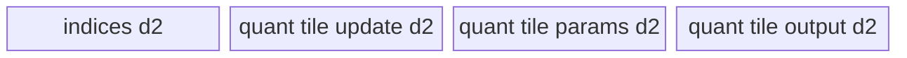

# InplaceQuantScatter 950 ACLNN 算子知识

## 算子速览

| 项目 | 内容 |
|---|---|
| 实际入口 | `aclnnInplaceQuantScatterV2GetWorkspaceSize` / `aclnnInplaceQuantScatterV2`，公开 ACLNN 两段式接口；950 取版本族中的最新公开版本 V2。 |
| 计算语义 | 以 FP32 中间值计算 `q = updates / quantScales + quantZeroPoints`（zero-point 可缺省），按 `roundMode` 转成 `selfRef` dtype，再按 `indices` 沿 `axis` 原地散射到 `selfRef`。 |
| 输入输出 | `selfRef`: 3–8D ND，INT8/FLOAT8_E4M3FN/FLOAT8_E5M2/HIFLOAT8；`indices`: 1D/2D INT32/INT64；`updates`: FP16/BF16；scale/zero-point 与末维等长。 |
| 执行类型 | 单 Kernel `AIV_VECTOR`；ACLNN 的 `Contiguous` 与 `ViewCopy` 是框架边界，不属于算子拥有的 Kernel body。 |
| Kernel 路线 | R-001 小数据整批；R-002 逐 batch；R-003 大 axis、小 quant；R-004 大 axis、大 quant；R-005 大 batch、小 quant；R-006 大 batch、大 quant。 |
| 核心资源 | GM + depth=2 的 VECIN/VECOUT `TQue` + MicroAPI 寄存器；算子 Tiling 固定申请 16 MiB workspace，但本 Kernel 不读 `workSpace`。 |
| 来源闭包 | `source_closed`：V2 声明/实现 → L0 launcher → 950 OpDef/Tiling/POD → 六种模板 entry/body → binary config/CMake 均闭合。 |
| 验证状态 | 已完成源码闭包检查；本次知识提取未执行编译、真机、数值或性能测试。 |

## 接口与语义

### 计算语义

设 `updates` 原始 rank 为 `d∈[3,8]`，归一化后的 `axis∈[1,d-2]`，`quantAxis=d-1`。Host 将 `selfRef`/`updates` 合并为四维：`[dim0, product(1..axis-1), dim(axis), product(axis+1..d-1)]`。对每个 update 元素 `x`，L2 固定传 `reciprocalScale=false`，故 Device 先把 FP16/BF16 `x` 与 scale/zero-point 升为 FP32，再计算：

```text
q_fp32 = x_fp32 / scale_fp32
if quantZeroPoints exists: q_fp32 += zeroPoint_fp32
q = cast(q_fp32, selfRef.dtype, roundMode)
```

随后依据 `indices` 定位原地输出。1D indices 的第 `u0` 项给出 axis 偏移，`selfRef[u0, ..., indices[u0] + u_axis, ...] = q`；2D indices 的一行 `[dst0, axisOffset]` 同时改写第 0 维与 axis 偏移。源码不校验索引值越界，也要求不同 indices 映射的目标片段不重叠；否则多核写同一 GM 区域的结果不稳定。

### 输入、输出与属性

| 参数 | shape/layout | dtype | 约束、默认值与语义 |
|---|---|---|---|
| `selfRef` | 3–8D，ND，可非连续；允许空 Tensor 在 ACLNN 层提前返回 | INT8、FLOAT8_E4M3FN、FLOAT8_E5M2、HIFLOAT8 | 输入/原地输出；与 `updates` rank 相同。空 Tensor 不进入算子 Kernel。 |
| `indices` | 1D，或 `[N,2]`；ND，可非连续 | INT32、INT64 | `updates.dim0 == indices.dim0`；取值范围不在 Host/Tiling 中检查。 |
| `updates` | 3–8D，ND，可非连续 | FP16、BF16 | 与 `selfRef` rank 相同；dim0 不大于 var dim0，axis 维不大于 var axis 维，其它维相等。 |
| `quantScales` | 1–8D、元素数等于 `updates` 末维，ND | FP32（配 FP16 updates）或 BF16（配 BF16 updates） | V2 ACLNN 固定 `reciprocalScale=false`，因此是除数。 |
| `quantZeroPoints` | 1–8D、元素数等于 scale，ND | INT32（配 FP16）或 BF16（配 BF16） | `aclnn_quant_scatter_v2.cpp` 与 OpDef 实际允许空指针；公开 V2 参数表未标为可选，属于文档/实现表述差异。 |
| `axis` | 标量属性 | INT64 | 支持 `[1,d-2]` 或等价负轴 `[-d,-2]`。 |
| `quantAxis` | 标量属性 | INT64 | 仅 `-1` 或 `d-1`。 |
| `reduction` | 标量属性 | INT64 | ACLNN 参数未用于分支，L2 固定传字符串 `"update"`；仅 update 语义。 |
| `roundMode` | C 字符串 | — | INT8/FLOAT8 仅 `rint`；HIFLOAT8 仅 `round`/`hybrid`。必选指针未单独做 null 检查。 |
| `selfRef` 输出 | 与输入同 shape/layout/dtype | 同输入 | L0 返回连续临时结果，`ViewCopy` 将其写回用户 `selfRef` view。 |

### 入口与版本

950 的公开文档同时列出 `aclnnInplaceQuantScatter` 与 `aclnnInplaceQuantScatterV2`；V2 增加 `roundMode` 且公开支持 950，所以本卡按“同架构最新实际支持版本”选择 V2。V2 第一段创建 `aclOpExecutor`、校验平台必须是 RegBase、做输入连续化、添加一个 `QuantUpdateScatter` AICore launcher，再添加 `ViewCopy`；第二段由 `CommonOpExecutorRun` 在调用方 stream 上执行。A2/A3 公开文档只支持旧版，但固定提交没有 A2/A3 的 Host/Tiling/Kernel 构建接线，故不把 950 body外推为 A2/A3 实现。

## Host/Launcher 执行流程

### 参数校验与前处理

`aclnnInplaceQuantScatterV2GetWorkspaceSize` 的顺序是：创建 executor → `CheckPlatform` 要求 `AclnnUtil::IsRegbase` → 检查 `selfRef/indices/updates/quantScales` 非空 → 校验五路 dtype 及 `(FP16,FP32,INT32)` 或 `(BF16,BF16,BF16)` 组合 → 校验 `selfRef` 与 `updates` rank 相同 → 按输出 dtype 校验 `roundMode`。若 `selfRef/indices/updates/quantScales` 任一为空，workspace 置 0 并返回成功，不检查 axis、quantAxis 与 reduction，也不添加 Kernel。非空时依次对五路输入做 `l0op::Contiguous`（zero-point 条件执行），调用 L0 `QuantUpdateScatter`，最后 `ViewCopy` 回用户 view；任一步返回 null 都终止 executor 构建。

### 参数、Workspace 与生命周期

L0 固定构造 `reduce="update"`、`reciprocalScale=false`，原样传 `axis`、`quantAxis`、`roundMode`。算子 Tiling 将 `workspace[0]` 固定为 `16,777,216` bytes，Kernel entry 虽有 `workSpace` 参数但六个 body 均不绑定或访问它；该 slice 的同步用途在固定仓不可见。ACLNN 返回的 `workspaceSize` 是 executor 聚合值，还可能含非连续输入的 `Contiguous` 临时区和 `ViewCopy` 所需空间，其精确切片/offset 由外部 executor 框架生成，固定仓不可见。workspace 与 executor 由调用方保持到第二段完成，stream ordering 由 `CommonOpExecutorRun` 负责。

### 启动图与失败传播

```text
aclnnInplaceQuantScatterV2GetWorkspaceSize
  -> [framework boundary] Contiguous(selfRef, indices, updates, scale, optional zeroPoint)
  -> l0op::QuantUpdateScatter / ADD_TO_LAUNCHER_LIST_AICORE
       -> Tiling4QuantUpdateScatter::DoTiling
       -> quant_update_scatter<SplitMode,ZeroPointsType,DivMode,CastRoundMode>
            (single AIV_VECTOR node, blockDim=tilingData.coreNum)
  -> [framework boundary] ViewCopy(result, user selfRef)
aclnnInplaceQuantScatterV2
  -> CommonOpExecutorRun(workspace, workspaceSize, executor, stream)
```

算子拥有的 launch graph 只有一个 Device 节点：输入/输出直接是 GM Tensor，POD 为 `QuantUpdateScatterTilingData`，workspace slice 为 `[0,16MiB)` 但 body 未消费。L0 `ADD_TO_LAUNCHER_LIST_AICORE` 失败即返回 null，第一段转成 `ACLNN_ERR_INNER_NULLPTR`；Tiling 任一校验或容量检查失败则不 launch；executor 中前一 framework node 失败会阻断后续节点，精确 cleanup 实现属于固定仓外框架边界。

## Route 与参数设计

### 分核与资源计算

合并后记 `U=[u0,u1,u2,u3]`、`V=[v0,v1,v2,v3]`，`L=updates` 原始末维，`La=ceilAlign(L,32/sizeof(VarType))`，`C=u2*u3/L`，`B=u0*u1`。初始分核为 `each=ceilDiv(B,AIVCoreNum)`、`coreNum=ceilDiv(B,each)`、`last=B-each*(coreNum-1)`；R-003/R-004 改为沿 `u2` 分核。`srcBsStride=u2*u3`，`dstBsStride=v2*v3`，首维 stride 分别为 `u1*u2*u3` 与 `v1*v2*v3`。

可用 UB 先扣除 `ceilAlign(sizeof(POD),32)+16384`，再扣 indices、scale、zero-point 的 depth=2 预算；Host 用 `GetUpdateUbRatio` 按 updates/output/quant dtype 字节比切分剩余空间。`updateUbSize=u2*u3/L*La*each*sizeof(Updates)*2`。所有 Route 都用 depth=2 queue；尾行用 `DataCopyPad`，MicroAPI 用 `UpdateMask(count)` 避免无效 lane 写出。

### Route 选择

| 顺序 | Route | Key/模板 | 精确选择条件与优先级 | 不适用去向 |
|---:|---|---|---|---|
| 1 | R-003 大 axis、小 quant | `SplitMode=3` | `u2*(u3/L*La)*sizeof(U)*2 > maxUpdatesSize` 且 `u0*u1 < u2` 且 `maxInnerLoopEle > u3/L*La` | 条件最后项否 → R-004；中项否 → R-005/R-006 |
| 2 | R-004 大 axis、大 quant | `SplitMode=4` | 首项同上，且 `u0*u1 < u2`，且 `maxInnerLoopEle <= u3/L*La` | 无；计算 tile 为 0 时 Tiling 失败边界 |
| 3 | R-005 大 batch、小 quant | `SplitMode=5` | 首项同上，且 `u0*u1 >= u2`，且 `maxInnerLoopEle > u3/L*La` | 最后一项否 → R-006 |
| 4 | R-006 大 batch、大 quant | `SplitMode=6` | 首项同上，且 `u0*u1 >= u2`，且 `maxInnerLoopEle <= u3/L*La` | 无；计算 tile 为 0 时失败边界 |
| 5 | R-002 逐 batch | `SplitMode=2` | 首项为假，且 `updateUbSize > maxUpdatesSize` | 否 → R-001 |
| 6 | R-001 小数据整批 | `SplitMode=1` | 首项为假，且 `updateUbSize <= maxUpdatesSize` | 命中终点 |

```text
if updateDim23Align * sizeof(Updates) * 2 > maxUpdatesSize:
  recompute maxInnerLoopEle after reserving 32B indices + full scale/zeroPoint
  if u0*u1 < u2:
    if maxInnerLoopEle > updateDim3Align: R-003 else R-004
  else:
    if maxInnerLoopEle > updateDim3Align: R-005 else R-006
else if updateUbSize > maxUpdatesSize:
  R-002
else:
  R-001
```

### 模板/实现执行矩阵

| Route | key/selector | dtype/shape/platform 完整命中条件 | 执行拓扑与 Kernel 节点 | 实际模板/body | 内存与同步特征 | tail/fallback |
|---|---|---|---|---|---|---|
| R-001 小数据整批 | `GET_TPL_TILING_KEY(1,Z,1,R)` | 950；UB 可同时容纳每核全部 update 与全量 quant；`Z∈{NONE,INT32,BF16}`，V2 固定 div，`R` 服从 dtype | 单 `AIV_VECTOR` | `QuantUpdateScatterRegbase<Var,Idx,Upd,Scale,Zero,1,R>` | 每核一次搬全部 indices/updates/scale/zero；逐 bs 量化并散射 | 末维 mask；末核 `lastCoreBsNum` |
| R-002 逐 batch | `...(2,Z,1,R)` | axis×quant 面可放，但每核全部 batch 不可放 | 单 `AIV_VECTOR` | `QuantUpdateScatterLargeBatchRegbase<...>` | indices/scale/zero 常驻，逐 bs 搬 update/output | 逐 bs；末核处理 last |
| R-003 大 axis、小 quant | `...(3,Z,1,R)` | 单 axis×quant 面不可放；沿 axis 分核有效，且一 tile 可含至少一个完整 quant 行 | 单 `AIV_VECTOR` | `QuantUpdateScatterLargeEleLittleQuantRegbase<...>` | 每核负责连续 axis rows；scale/zero 常驻 | full/tail row；末核独立 loop 参数 |
| R-004 大 axis、大 quant | `...(4,Z,1,R)` | 单 quant 对齐行也超过小-quant tile，沿 axis 分核 | 单 `AIV_VECTOR` | `QuantUpdateScatterLargeEleLargeQuantRegbase<...>` | update/scale/zero 都沿 quant 轴切片 | `innerLoopTail` mask/短 DMA |
| R-005 大 batch、小 quant | `...(5,Z,1,R)` | axis×quant 面不可放但 batch 域不小于 axis 域；tile 可容纳完整 quant 行 | 单 `AIV_VECTOR` | `QuantUpdateScatterLargeBatchLittleQuantRegbase<...>` | 每核分 batch，scale/zero 常驻，沿 axis rows 分 tile | full/tail row |
| R-006 大 batch、大 quant | `...(6,Z,1,R)` | 同 R-005 但一 tile 不足完整 quant 行 | 单 `AIV_VECTOR` | `QuantUpdateScatterLargeBatchLargeQuantRegbase<...>` | 每核分 batch，update/scale/zero 沿 quant 轴切片 | `innerLoopTail` |

### 隐藏性能 Guard

| Guard | Host/Tiling 条件 | Device/资源原因 | 影响 Route | 不满足时去向 | 源码符号 |
|---|---|---|---|---|---|
| 950/RegBase | ACLNN `IsRegbase` 且 CMake `ascend950` | body 使用 arch35 MicroAPI 与 RegBase cast | 全部 | ACLNN 参数错误 | `CheckPlatform`; `SUPPORT_COMPUTE_UNIT` |
| UB reserve | `calcUb=platformUB-ceilAlign(sizeof(POD),32)-16384` | 给 tiling/runtime 留固定保留区 | 全部 | tile 缩小或失败 | `GetTilingParam` |
| 32B 输出行 | `La=ceilAlign(L,32/sizeof(Var))` | UB 行与 `DataCopyPad`/packed store 的地址步长 | 全部 | 自动 padding；`L==0` 失败 | `UpdateTilingParam` |
| 路线一级门 | `updateDim23Align*sizeof(U)*2 > maxUpdatesSize` | 一个 axis×quant 面的 double-buffer update 不可放 | R-003..006 | 否则 R-001/002 | `GetTilingNeg2` |
| 小/大 quant | `maxInnerLoopEle > updateDim3Align`（严格大于） | 小-quant body要求 tile 含一个以上对齐 quant 行 | R-003/R-005 | 否则 R-004/R-006 | `GetTilingNeg2` |
| optional zero | `quantZeroPointsElements==0` → `TPL_NONE` | 不绑定 GM、不分配 queue、不执行 add | 全部 | 有输入则 INT32/BF16 specialization | `UpdateTilingParam`; entry `TypeFromEnum` |
| round/dtype | HIFLOAT8→round/hybrid；其它→rint | cast trait 由编译期 round mode固定 | 全部 | Tiling/API 失败 | `CheckRoundMode`; cast traits |
| indices 不重叠 | API 约束，源码不检测 | 多核直接写 var GM，无 atomic | 全部 | 调用方违反则结果不稳定 | V2 文档约束；各 `CopyOutVar` |

### POD/ABI

`QuantUpdateScatterTilingData` 由宏声明 29 个 `int64_t` 字段。固定仓未展开 `BEGIN_TILING_DATA_DEF`，因此真实 `sizeof/alignof/offsetof` 不可见；下表保留声明顺序、producer 与 consumer，不能把“29×8”当作已证明 ABI 大小。

| 结构 | 字段 | 类型/位宽 | ABI 布局 | 单位 | Host/launcher producer | Device consumer | 边界 |
|---|---|---|---|---|---|---|---|
| `QuantUpdateScatterTilingData` | `coreNum` | int64/64 | 第1字段；offset不可见 | AIV core | `UpdateTilingParam/Calc...` | 所有 `Process` core guard | >0 |
| 同上 | `eachCoreBsNum` | int64/64 | 第2字段；offset不可见 | bs/axis row | `UpdateTilingParam`，R3/4可重算 | core地址公式 | 非末核份额 |
| 同上 | `lastCoreBsNum` | int64/64 | 第3字段；offset不可见 | bs/axis row | 同上 | 末核循环 | `total-each*(coreNum-1)` |
| 同上 | `srcBsStride` | int64/64 | 第4字段；offset不可见 | update元素 | `u2*u3` | update GM base | 正值 |
| 同上 | `dstBsStride` | int64/64 | 第5字段；offset不可见 | var元素 | `v2*v3` | output GM base | 正值 |
| 同上 | `indexElements` | int64/64 | 第6字段；offset不可见 | index元素 | indices shape size | R1/R2 indices DMA | rank1=N，rank2=2N |
| 同上 | `varDim1` | int64/64 | 第7字段；offset不可见 | 元素维 | `v1` | bs/2D index地址 | 合并维 |
| 同上 | `varDim2` | int64/64 | 第8字段；offset不可见 | 元素维 | `v2` | 间接参与 stride | 合并维 |
| 同上 | `varDim3` | int64/64 | 第9字段；offset不可见 | 元素维 | `v3` | axis/quant地址 | 合并末维 |
| 同上 | `innerLoopEle` | int64/64 | 第10字段；offset不可见 | update元素 | `CalcTilingDataFor...` | R3–R6 tile/offset | R1/R2不读 |
| 同上 | `innerLoopTimes` | int64/64 | 第11字段；offset不可见 | loop | 同上 | R3–R6 full loops | 可为0 |
| 同上 | `innerLoopTail` | int64/64 | 第12字段；offset不可见 | update元素 | 同上 | R3–R6 tail | 0表示无尾 |
| 同上 | `indicesShapeRank` | int64/64 | 第13字段；offset不可见 | rank | `PrepareTilingParams` | indices DMA/地址分支 | 1或2 |
| 同上 | `quantScalesElements` | int64/64 | 第14字段；offset不可见 | scale元素 | scale shape size | R1/R2/R3/R5 DMA | 等于L |
| 同上 | `quantZeroPointsElements` | int64/64 | 第15字段；offset不可见 | zero元素 | optional shape size/0 | optional DMA | 0或L |
| 同上 | `innerLoopTimesLastCore` | int64/64 | 第16字段；offset不可见 | loop | R3 calc | R3末核 | 其它Route不读 |
| 同上 | `innerLoopTailLastCore` | int64/64 | 第17字段；offset不可见 | update元素 | R3 calc | 通过末核tail派生 | R3 |
| 同上 | `innerLoopFullRpt` | int64/64 | 第18字段；offset不可见 | 完整 quant 行/tile | R3/R5 calc；R4/R6置0 | R3/R5 buffer/loop | 小-quant Route >0 |
| 同上 | `innerLoopFullRptLastCore` | int64/64 | 第19字段；offset不可见 | 行/tile | R3 calc | R3末核 | 其它Route不读 |
| 同上 | `innerLoopTailRpt` | int64/64 | 第20字段；offset不可见 | quant行 | R3/R5 calc | R3/R5 tail | 可为0 |
| 同上 | `innerLoopTailRptLastCore` | int64/64 | 第21字段；offset不可见 | quant行 | R3 calc | R3末核 | 可为0 |
| 同上 | `srcFirBsStride` | int64/64 | 第22字段；offset不可见 | update元素 | `u1*u2*u3` | R3/R4 update地址 | 首维 stride |
| 同上 | `dstFirSecBsStride` | int64/64 | 第23字段；offset不可见 | var元素 | `v1*v2*v3` | R3/R4 output地址 | 首维 stride |
| 同上 | `updateDim0` | int64/64 | 第24字段；offset不可见 | 维长 | `u0` | R3/R4外循环 | >0 |
| 同上 | `updateDim1` | int64/64 | 第25字段；offset不可见 | 维长 | `u1` | bs拆分/外循环 | >0 |
| 同上 | `updateDim2` | int64/64 | 第26字段；offset不可见 | 维长 | `u2` | copyBlock/quantLoop | >0 |
| 同上 | `updateDim3` | int64/64 | 第27字段；offset不可见 | 维长 | `u3` | copyBlock/quantLoop | >0 |
| 同上 | `updateOriLastDim` | int64/64 | 第28字段；offset不可见 | 元素 | 原始末维L | DMA blockLen/mask | `L!=0` |
| 同上 | `updateOriLastDimAlign` | int64/64 | 第29字段；offset不可见 | var元素对齐 | `ceilAlign(L,32/sizeof(Var))` | UB行 stride | >=L |

### Route 源码闭包

| Route | Key/selector | Host/Tiling producer | POD/参数 | Kernel entry/router 节点 | Kernel body/直接依赖 | 构建接线 |
|---|---|---|---|---|---|---|
| R-001 | SplitMode 1 + Z/Div/Round | tiling cpp `GetTilingNeg2` | 29字段 POD | apt cpp `quant_update_scatter` branch 1 | `QuantUpdateScatterRegbase`; base cast traits | ascend950 json + CMake |
| R-002 | SplitMode 2 + Z/Div/Round | 同上 | 同上 | entry branch 2 | `QuantUpdateScatterLargeBatchRegbase` | 同上 |
| R-003 | SplitMode 3 + Z/Div/Round | 同上 + `CalcTilingDataForLargeEleLittleQuant` | 同上 | entry branch 3 | `QuantUpdateScatterLargeEleLittleQuantRegbase` | 同上 |
| R-004 | SplitMode 4 + Z/Div/Round | 同上 + `CalcTilingDataForLargeEleLargeQuant` | 同上 | entry branch 4 | `QuantUpdateScatterLargeEleLargeQuantRegbase` | 同上 |
| R-005 | SplitMode 5 + Z/Div/Round | 同上 + `CalcTilingDataForLargeBatchLittleQuant` | 同上 | entry branch 5 | `QuantUpdateScatterLargeBatchLittleQuantRegbase` | 同上 |
| R-006 | SplitMode 6 + Z/Div/Round | 同上 + `CalcTilingDataForLargeBatchLargeQuant` | 同上 | entry branch 6 | `QuantUpdateScatterLargeBatchLargeQuantRegbase` | 同上 |

## Kernel 实现

### 公共执行流程

entry 解析 POD，声明 `KERNEL_TYPE_AIV_ONLY`，把 `ZeroPointsType` 映射为 INT32/BF16/占位 bool，再按 `SplitMode` 编译期实例化一个 body。所有 body 先把 updates/scale/optional zero-point 从 GM 搬到 VECIN queue，在 `__VEC_SCOPE__` 中以 `VL=VECTOR_REG_WIDTH/sizeof(float)` 处理：FP16/BF16 unpack 并升 FP32，执行 Div（V2 固定）与可选 Add，再按输出 dtype cast 并以 `DIST_PACK4_B32` 写 VECOUT。INT8 路径固定为 FP32→INT16(`CAST_RINT`,`NO_SAT`)→FP16(`NO_SAT`)→INT8(`NO_SAT`)；FP8 E4M3/E5M2 使用 `SAT+CAST_RINT`，HIFLOAT8 使用 `SAT+CAST_ROUND/CAST_HYBRID`。indices 从 UB 通过 `MTE2_S` event 对标量可见，算出 GM offset 后以 `S_MTE3` event 对搬出可见。`inQueueVar_` 只声明而从不分配；entry 的 `out` 与 `workSpace` 参数也不被六个 body 使用，结果直接写 `varGm_`。每条 Route 都是单 Kernel。

### Route R-001：小数据整批

#### 适用条件

##### 选择证据

| 层级 | 文件 | 符号 | 源码谓词/参数 | 结果/下一跳 |
|---|---|---|---|---|
| Tiling | `index/quant_update_scatter/op_host/arch35/quant_update_scatter_tiling_arch35.cpp` | `GetTilingNeg2` | `updateDim23Align*Ubytes*2 <= maxUpdatesSize && updateUbSize<=maxUpdatesSize` | SplitMode 1 |
| Router | `index/quant_update_scatter/op_kernel/quant_update_scatter_apt.cpp` | `if constexpr SplitMode==1` | Z/Div/Round 模板参数 | `QuantUpdateScatterRegbase` |

#### Device 数据流

##### 函数级调用链

```text
quant_update_scatter<1,Z,1,R>
  -> QuantUpdateScatterRegbase::Init
  -> Process -> CopyInScale/CopyInIndices/CopyInUpdate[/CopyInOffset]
             -> per bs QuantUpdate[WithoutOffset]
             -> CalcDstOffset -> CopyOutVar
```

##### 源码等价伪码

```text
load full scale, full indices, all updates for this core, optional full zeroPoint
for bs in [0, coreBsNum):
  for row in [0,C), for quant chunk i in [0,ceil(L/VL)):
    mask=UpdateMask(L); y=float(update)/float(scale); if Z: y+=float(zero); cast+pack(y)
  dst = index-derived bs base + axisOffset*v3
  DataCopyPad C rows of L bytes/values from padded UB rows to var GM
free persistent input queues
```

#### 内存与数据搬运

##### 资源与搬运表

| 层级/缓冲区 | offset/地址公式 | extent/容量公式 | dtype/layout | producer | consumer | owner/lifetime | 对齐/复用 |
|---|---|---|---|---|---|---|---|
| updates GM | `block*each*srcBsStride` | `coreBs*C*L`有效 | U/4D合并 | ACLNN input | CopyInUpdate | caller | 每行 pad到La |
| indicesQ | 0 | `ceil32(indexElements*Ibytes)`/slot | I | DMA | CalcDstOffset | whole Process | depth2 |
| updatesQ | per bs/C row | `each*C*La*Ubytes`/slot | U | DMA | QuantUpdate | whole Process | depth2 |
| scaleQ/zeroQ | 0 | `La*Sbytes` / optional `La*Zbytes` | S/Z | DMA | MicroAPI | whole Process | depth2；zero条件分配 |
| outQ | 0 | `C*La*Vbytes`/slot | V | MicroAPI | CopyOutVar | one bs | depth2 |
| var GM | index公式 | `C*L`有效 | V | CopyOutVar | caller | output lifetime | 原地散射 |

##### 分层内存布局


##### 字节账与复用顺序

```text
UB_total = 2*ceil32(N*I) + 2*each*C*La*U + 2*La*S + optional(2*La*Z) + 2*C*La*V
dynamic_ub = N/A
workspace_total = 16MiB operator slice + framework executor temporaries (exact aggregate fixed仓不可见)
=> Host 的 updateUbSize/maxUpdatesSize 双门保证选本 Route
```

| 复用子区 | 写入者 | 读取者/消费点 | 下一次覆盖 | 同步或释放依据 | 安全条件 |
|---|---|---|---|---|---|
| outQ slot | 每个 bs 的 QuantUpdate | CopyOutVar | 下一 bs AllocTensor | DeQue/FreeTensor | CopyOut 完成后才复用 |
| update/scale/zero slot | CopyIn | MicroAPI | 无下一覆盖 | Process尾 FreeTensor | 全 bs 消费期间保持 |

#### 同步、精度与尾块

##### 同步与数值边界表

| 阶段 | primitive/机制 | producer | consumer/等待点 | 保护对象 | 精度/尾块 |
|---|---|---|---|---|---|
| GM→UB→Vector | TQue EnQue/DeQue | CopyIn | QuantUpdate | input slots | DataCopyPad补齐La |
| index标量 | MTE2_S flag/wait | indices DMA | GetValue | index UB | rank1/rank2分支 |
| 量化 | MicroAPI mask | FP32 Div/Add | cast | valid lanes | mask按L递减；FP32中间 |
| UB→GM | S_MTE3 + outQ | CalcDstOffset/compute | DataCopyPad | offset与outQ | 只写L，不写padding |

#### 关键实现

##### 符号证据表

| 阶段 | 文件 | 符号/模板实例 | 实现事实 |
|---|---|---|---|
| Host/Tiling producer | `index/quant_update_scatter/op_host/arch35/quant_update_scatter_tiling_arch35.cpp` | `UpdateTilingParam/GetTilingNeg2` | 分核、La与Route 1 |
| Kernel entry/router | `index/quant_update_scatter/op_kernel/quant_update_scatter_apt.cpp` | `quant_update_scatter<1,...>` | key到body |
| Device body/helper | `index/quant_update_scatter/op_kernel/arch35/quant_update_scatter_regbase.h`; `index/quant_update_scatter/op_kernel/arch35/quant_update_scatter_base.h` | `Process/QuantUpdate/CalcDstOffset` | 整批搬运、FP32量化、散射 |

### Route R-002：逐 batch

#### 适用条件

##### 选择证据

| 层级 | 文件 | 符号 | 源码谓词/参数 | 结果/下一跳 |
|---|---|---|---|---|
| Tiling | `index/quant_update_scatter/op_host/arch35/quant_update_scatter_tiling_arch35.cpp` | `GetTilingNeg2` | 一级门假且 `updateUbSize>maxUpdatesSize` | SplitMode 2 |
| Router | `index/quant_update_scatter/op_kernel/quant_update_scatter_apt.cpp` | branch 2 | 模板参数 | LargeBatch body |

#### Device 数据流

##### 函数级调用链

```text
entry -> LargeBatch::Init -> Process
  -> load indices/scale/optional zero once
  -> for bs: CopyInUpdate(bs) -> QuantUpdate -> CalcDstOffset -> CopyOutVar
```

##### 源码等价伪码

```text
for bs assigned to core:
  DMA C rows of L update values into padded rows
  vectorize C rows with shared scale/zero; free update slot
  compute index-derived destination; DMA C rows to var; free out slot
```

#### 内存与数据搬运

##### 资源与搬运表

| 层级/缓冲区 | offset/地址公式 | extent/容量公式 | dtype/layout | producer | consumer | owner/lifetime | 对齐/复用 |
|---|---|---|---|---|---|---|---|
| indicesQ | 0 | `ceil32(N*I)`/slot | I | DMA once | all bs | Process | depth2 |
| updateQ | `globalBs*srcStride` | `ceil32(C*La*U)`/slot | U | per-bs DMA | vector | one bs | depth2 reuse |
| scale/zeroQ | 0 | `ceil32(L*S)` / optional `ceil32(L*Z)` | S/Z | DMA once | all bs | Process | depth2 |
| outQ/varGM | index-derived | `ceil32(C*La*V)`/slot，写C*L | V | vector | DMA | one bs | depth2 |

##### 分层内存布局


##### 字节账与复用顺序

```text
UB_total=2*ceil32(N*I)+2*ceil32(C*La*U)+2*ceil32(L*S)+optional(2*ceil32(L*Z))+2*ceil32(C*La*V)
dynamic_ub=N/A; workspace_total=16MiB + fixed仓不可见的框架临时区
```

| 复用子区 | 写入者 | 读取者/消费点 | 下一次覆盖 | 同步或释放依据 | 安全条件 |
|---|---|---|---|---|---|
| updateQ/outQ slot | 当前bs | QuantUpdate/CopyOut | 下一bs | FreeTensor | 当前bs搬出完成 |

#### 同步、精度与尾块

##### 同步与数值边界表

| 阶段 | primitive/机制 | producer | consumer/等待点 | 保护对象 | 精度/尾块 |
|---|---|---|---|---|---|
| per-bs pipeline | TQue | DMA | vector/DMA | slot | 行pad，末维mask |
| destination | MTE2_S/S_MTE3 | index DMA/scalar | output DMA | GM offset | last core用lastBs |

#### 关键实现

##### 符号证据表

| 阶段 | 文件 | 符号/模板实例 | 实现事实 |
|---|---|---|---|
| Host/Tiling producer | `index/quant_update_scatter/op_host/arch35/quant_update_scatter_tiling_arch35.cpp` | `GetTilingNeg2` | Route 2门 |
| Kernel entry/router | `index/quant_update_scatter/op_kernel/quant_update_scatter_apt.cpp` | branch 2 | LargeBatch实例 |
| Device body/helper | `index/quant_update_scatter/op_kernel/arch35/quant_update_scatter_large_batch_regbase.h` | `Process/CopyInUpdate` | 逐bs queue复用 |

### Route R-003：大 axis、小 quant

#### 适用条件

##### 选择证据

| 层级 | 文件 | 符号 | 源码谓词/参数 | 结果/下一跳 |
|---|---|---|---|---|
| Tiling | `index/quant_update_scatter/op_host/arch35/quant_update_scatter_tiling_arch35.cpp` | `GetTilingNeg2` | 一级门真、`u0*u1<u2`、`maxInnerLoopEle>updateDim3Align` | SplitMode 3 |
| Tiling | `index/quant_update_scatter/op_host/arch35/quant_update_scatter_tiling_arch35.cpp` | `CalcTilingDataForLargeEleLittleQuant` | 沿u2重分核，算full/tail row | POD loop字段 |

#### Device 数据流

##### 函数级调用链

```text
entry -> LargeEleLittleQuant::Init -> Process
  -> load scale/optional zero once
  -> for u0: load one index row
     -> for u1, full/tail axis tile: CopyInUpdate -> QuantUpdate -> CalcDstOffset -> CopyOutVar
```

##### 源码等价伪码

```text
axisStart=block*each
for u0,u1:
  for tile of F axis rows:
    DMA F*(u3/L) rows; vectorize each L-wide row with shared scale/zero
    dst=firstDim/index base + (axisOffset+axisStart+tileStart)*v3
    DMA valid rows; repeat for per-core tail
```

#### 内存与数据搬运

##### 资源与搬运表

| 层级/缓冲区 | offset/地址公式 | extent/容量公式 | dtype/layout | producer | consumer | owner/lifetime | 对齐/复用 |
|---|---|---|---|---|---|---|---|
| indicesQ | `u0*rank` | 32B/slot | I | per-u0 DMA | address | one u0 | depth2 |
| updateQ | `u0*srcFirst+u1*srcBs+(block*each+tile)*u3` | `F*(u3/L)*La*U`/slot | U | DMA | vector | one tile | depth2 |
| scale/zeroQ | 0 | `La*S/Z` | S/Z | once | all tiles | Process | optional zero |
| outQ/varGM | axisStart公式 | `F*(u3/L)*La*V`/slot | V | vector | DMA | one tile | depth2 |

##### 分层内存布局


##### 字节账与复用顺序

```text
UB_total=2*32 + 2*F*(u3/L)*La*U + 2*La*S + optional(2*La*Z) + 2*F*(u3/L)*La*V
workspace_total=16MiB + framework temporaries; dynamic_ub=N/A
```

| 复用子区 | 写入者 | 读取者/消费点 | 下一次覆盖 | 同步或释放依据 | 安全条件 |
|---|---|---|---|---|---|
| update/out slot | axis tile | vector/DMA | next tile | FreeTensor | full/tail count不越F容量 |

#### 同步、精度与尾块

##### 同步与数值边界表

| 阶段 | primitive/机制 | producer | consumer/等待点 | 保护对象 | 精度/尾块 |
|---|---|---|---|---|---|
| axis tile | TQue | padded DMA | vector/output DMA | tile | full/tailRpt，L mask |
| scalar address | MTE2_S/S_MTE3 | index | output DMA | GM base | 末核用独立loop/tail字段 |

#### 关键实现

##### 符号证据表

| 阶段 | 文件 | 符号/模板实例 | 实现事实 |
|---|---|---|---|
| Host/Tiling producer | `index/quant_update_scatter/op_host/arch35/quant_update_scatter_tiling_arch35.cpp` | `CalcTilingDataForLargeEleLittleQuant` | 沿axis分核与tile |
| Kernel entry/router | `index/quant_update_scatter/op_kernel/quant_update_scatter_apt.cpp` | branch 3 | body实例 |
| Device body/helper | `index/quant_update_scatter/op_kernel/arch35/quant_update_scatter_large_ele_little_quant_regbase.h` | `Process/CalcDstOffset` | axis tile及末核tail |

### Route R-004：大 axis、大 quant

#### 适用条件

##### 选择证据

| 层级 | 文件 | 符号 | 源码谓词/参数 | 结果/下一跳 |
|---|---|---|---|---|
| Tiling | `index/quant_update_scatter/op_host/arch35/quant_update_scatter_tiling_arch35.cpp` | `GetTilingNeg2` | 一级门真、`u0*u1<u2`、`maxInnerLoopEle<=updateDim3Align` | SplitMode 4 |
| Tiling | `index/quant_update_scatter/op_host/arch35/quant_update_scatter_tiling_arch35.cpp` | `CalcTilingDataForLargeEleLargeQuant` | tile沿原始末维切 | innerLoopEle/times/tail |

#### Device 数据流

##### 函数级调用链

```text
entry -> LargeEleLargeQuant::Init -> Process
  -> for u0(load index),u1,assigned axis/quant row,quant tile:
       CopyInUpdate + CopyInScale + optional CopyInOffset
       -> QuantUpdate[WithoutOffset] -> CalcDstOffset -> CopyOutVar
```

##### 源码等价伪码

```text
for each assigned axis×quant row:
  for k in full quant tiles and optional tail:
    DMA contiguous len update/scale/zero; FP32 div/add; cast with mask(len)
    write len contiguous var elements at axis+quant offset
```

#### 内存与数据搬运

##### 资源与搬运表

| 层级/缓冲区 | offset/地址公式 | extent/容量公式 | dtype/layout | producer | consumer | owner/lifetime | 对齐/复用 |
|---|---|---|---|---|---|---|---|
| indicesQ | `u0*rank` | 32B/slot | I | DMA | address | u0 | depth2 |
| update/scale/zeroQ | quant tile offset | `ceil32(T*U/S/Z)`/slot | respective | DMA | vector | one tile | all depth2 |
| outQ/varGM | axis+quant tile offset | `ceil32(T*V)`/slot，写len | V | vector | DMA | one tile | depth2 |

##### 分层内存布局


##### 字节账与复用顺序

```text
Btile = innerLoopTimes!=0 ? innerLoopEle : innerLoopTail
UB_total=2*32+2*ceil32(Btile*U)+2*ceil32(Btile*S)+optional(2*ceil32(Btile*Z))+2*ceil32(Btile*V)
dynamic_ub=N/A; workspace_total=16MiB + framework temporaries
```

| 复用子区 | 写入者 | 读取者/消费点 | 下一次覆盖 | 同步或释放依据 | 安全条件 |
|---|---|---|---|---|---|
| all tile queues | current quant tile | vector/DMA | next tile | each QuantUpdate/CopyOut frees | len<=Btile |

#### 同步、精度与尾块

##### 同步与数值边界表

| 阶段 | primitive/机制 | producer | consumer/等待点 | 保护对象 | 精度/尾块 |
|---|---|---|---|---|---|
| quant tile | TQue | three DMAs | vector/output | matching slices | innerLoopTail短DMA+mask |
| cast | dtype trait | FP32 q | packed store | output lanes | HIFLOAT round/hybrid；其它rint |

#### 关键实现

##### 符号证据表

| 阶段 | 文件 | 符号/模板实例 | 实现事实 |
|---|---|---|---|
| Host/Tiling producer | `index/quant_update_scatter/op_host/arch35/quant_update_scatter_tiling_arch35.cpp` | `CalcTilingDataForLargeEleLargeQuant` | quant tile |
| Kernel entry/router | `index/quant_update_scatter/op_kernel/quant_update_scatter_apt.cpp` | branch 4 | body实例 |
| Device body/helper | `index/quant_update_scatter/op_kernel/arch35/quant_update_scatter_large_ele_large_quant_regbase.h` | `CopyInScale/QuantUpdate` | quant参数随tile搬运 |

### Route R-005：大 batch、小 quant

#### 适用条件

##### 选择证据

| 层级 | 文件 | 符号 | 源码谓词/参数 | 结果/下一跳 |
|---|---|---|---|---|
| Tiling | `index/quant_update_scatter/op_host/arch35/quant_update_scatter_tiling_arch35.cpp` | `GetTilingNeg2` | 一级门真、`u0*u1>=u2`、`maxInnerLoopEle>updateDim3Align` | SplitMode 5 |
| Tiling | `index/quant_update_scatter/op_host/arch35/quant_update_scatter_tiling_arch35.cpp` | `CalcTilingDataForLargeBatchLittleQuant` | 保持按batch分核，沿完整quant行切axis | loop字段 |

#### Device 数据流

##### 函数级调用链

```text
entry -> LargeBatchLittleQuant::Init -> Process
  -> load scale/optional zero once
  -> for bs(load one index), full/tail row tile:
       CopyInUpdate -> QuantUpdate -> CalcDstOffset -> CopyOutVar
```

##### 源码等价伪码

```text
for assigned bs:
  index row -> dst batch/axis base
  for F complete quant rows (plus tail rows):
    padded row DMA; shared quant params; FP32 vector quantize
    scatter F rows at innerLoopIdx*innerLoopEle
```

#### 内存与数据搬运

##### 资源与搬运表

| 层级/缓冲区 | offset/地址公式 | extent/容量公式 | dtype/layout | producer | consumer | owner/lifetime | 对齐/复用 |
|---|---|---|---|---|---|---|---|
| indicesQ | updateDim0 row | 32B/slot | I | per-bs DMA | address | one bs | depth2 |
| updateQ/outQ | bs base + row tile | `F*La*U/V`/slot | U/V | DMA/vector | vector/DMA | one tile | depth2 |
| scale/zeroQ | 0 | `La*S/Z` | S/Z | once | all tiles | Process | optional zero |

##### 分层内存布局


##### 字节账与复用顺序

```text
UB_total=2*32+2*F*La*U+2*La*S+optional(2*La*Z)+2*F*La*V
dynamic_ub=N/A; workspace_total=16MiB + framework temporaries
```

| 复用子区 | 写入者 | 读取者/消费点 | 下一次覆盖 | 同步或释放依据 | 安全条件 |
|---|---|---|---|---|---|
| row tile queues | current tile | vector/output DMA | next tile/bs | FreeTensor | count<=F |

#### 同步、精度与尾块

##### 同步与数值边界表

| 阶段 | primitive/机制 | producer | consumer/等待点 | 保护对象 | 精度/尾块 |
|---|---|---|---|---|---|
| complete-row tile | TQue + mask | padded DMA | vector/output | row tile | tailBlockCount可0 |
| address | MTE2_S/S_MTE3 | one index row | output DMA | GM base | 1D/2D公式不同 |

#### 关键实现

##### 符号证据表

| 阶段 | 文件 | 符号/模板实例 | 实现事实 |
|---|---|---|---|
| Host/Tiling producer | `index/quant_update_scatter/op_host/arch35/quant_update_scatter_tiling_arch35.cpp` | `CalcTilingDataForLargeBatchLittleQuant` | F/full/tail |
| Kernel entry/router | `index/quant_update_scatter/op_kernel/quant_update_scatter_apt.cpp` | branch 5 | body实例 |
| Device body/helper | `index/quant_update_scatter/op_kernel/arch35/quant_update_scatter_large_batch_little_quant_regbase.h` | `Process/CalcDstOffset` | batch×row tile |

### Route R-006：大 batch、大 quant

#### 适用条件

##### 选择证据

| 层级 | 文件 | 符号 | 源码谓词/参数 | 结果/下一跳 |
|---|---|---|---|---|
| Tiling | `index/quant_update_scatter/op_host/arch35/quant_update_scatter_tiling_arch35.cpp` | `GetTilingNeg2` | 一级门真、`u0*u1>=u2`、`maxInnerLoopEle<=updateDim3Align` | SplitMode 6 |
| Tiling | `index/quant_update_scatter/op_host/arch35/quant_update_scatter_tiling_arch35.cpp` | `CalcTilingDataForLargeBatchLargeQuant` | 按batch分核并沿末维切片 | innerLoop fields |

#### Device 数据流

##### 函数级调用链

```text
entry -> LargeBatchLargeQuant::Init -> Process
  -> for bs(load index), axis×quant row, quant tile:
       CopyInUpdate/Scale/[Offset] -> QuantUpdate -> CalcDstOffset -> CopyOutVar
```

##### 源码等价伪码

```text
for assigned bs, for each axis×quant row:
  for quant tile k:
    load matching update/scale/zero contiguous slices
    FP32 div/add, dtype-specific cast, write contiguous slice
  process optional innerLoopTail
```

#### 内存与数据搬运

##### 资源与搬运表

| 层级/缓冲区 | offset/地址公式 | extent/容量公式 | dtype/layout | producer | consumer | owner/lifetime | 对齐/复用 |
|---|---|---|---|---|---|---|---|
| indicesQ | updateDim0 row | 32B/slot | I | per-bs DMA | address | bs | depth2 |
| update/scale/zeroQ | `bs*srcStride+quantLoop*L+inner*T` | `ceil32(T*typeBytes)`/slot | respective | DMA | vector | tile | depth2 |
| outQ/varGM | matching dst quant offset | `ceil32(T*V)`/slot | V | vector | DMA | tile | depth2 |

##### 分层内存布局



##### 字节账与复用顺序

```text
Btile=innerLoopTimes!=0 ? innerLoopEle : innerLoopTail
UB_total=2*32+2*ceil32(Btile*U)+2*ceil32(Btile*S)+optional(2*ceil32(Btile*Z))+2*ceil32(Btile*V)
dynamic_ub=N/A; workspace_total=16MiB + framework temporaries
```

| 复用子区 | 写入者 | 读取者/消费点 | 下一次覆盖 | 同步或释放依据 | 安全条件 |
|---|---|---|---|---|---|
| all quant-tile queues | current tile | vector/output | next tile | FreeTensor | len<=Btile |

#### 同步、精度与尾块

##### 同步与数值边界表

| 阶段 | primitive/机制 | producer | consumer/等待点 | 保护对象 | 精度/尾块 |
|---|---|---|---|---|---|
| quant tile | TQue | DMAs | vector/output | tile slices | tail短DMA+mask |
| float8 control | ctrl SPR save/set/restore | entry/base | cast/entry exit | saturation mode | arch3510 float8/hifloat8 |

#### 关键实现

##### 符号证据表

| 阶段 | 文件 | 符号/模板实例 | 实现事实 |
|---|---|---|---|
| Host/Tiling producer | `index/quant_update_scatter/op_host/arch35/quant_update_scatter_tiling_arch35.cpp` | `CalcTilingDataForLargeBatchLargeQuant` | quant tile |
| Kernel entry/router | `index/quant_update_scatter/op_kernel/quant_update_scatter_apt.cpp` | branch 6 | body实例 |
| Device body/helper | `index/quant_update_scatter/op_kernel/arch35/quant_update_scatter_large_batch_large_quant_regbase.h` | `Process/QuantUpdate` | batch×quant tile |

## 算子特定优化

### Trick T-001：按 UB 与并行域双轴选择六种编译期 body

#### 触发与源码依据

- 适用 Route：R-001–R-006
- 触发条件：先判断完整 axis×quant 面是否超过 UB，再比较 `u0*u1` 与 `u2` 决定沿 batch 或 axis 分核，最后判断一个 tile 能否容纳完整 quant 行。
- Golden 来源：[`index/quant_update_scatter/op_host/arch35/quant_update_scatter_tiling_arch35.cpp:193-240`](../../../../../../../cann-ops-raw/ascendc/ops-nn/955f8b33985b6d72989ebff341bb9c2c564a51bc/index/quant_update_scatter/op_host/arch35/quant_update_scatter_tiling_arch35.cpp#L193-L240)

**官方源码（固定 Commit 连续逐字摘录）**：

```cpp
int64_t updateNewShapeDim2 = updateNewShape_.GetDim(DIM_2);
if (updateNewShape_.GetDim(DIM_0) * updateNewShape_.GetDim(DIM_1) < updateNewShapeDim2) {
    tilingData_.set_eachCoreBsNum(Ops::Base::CeilDiv(updateNewShapeDim2, actualCoreNum_));
    tilingData_.set_coreNum(Ops::Base::CeilDiv(updateNewShapeDim2, tilingData_.get_eachCoreBsNum()));
    tilingData_.set_lastCoreBsNum(
        updateNewShapeDim2 - tilingData_.get_eachCoreBsNum() * (tilingData_.get_coreNum() - 1));

    if (maxInnerLoopEle > updateDim3Align) {
        splitMode_ = TPL_MODE_LARGE_ELE_LITTLE_QUANT;
        OP_CHECK_IF(
            ge::GRAPH_SUCCESS != CalcTilingDataForLargeEleLittleQuant(),
            OP_LOGE(context_->GetNodeName(), "CalcTilingDataForLargeEleLittleQuant failed."),
            return ge::GRAPH_FAILED);
    } else {
        maxUpdatesSize_ = static_cast<int64_t>((calcUbSize_ - indicesNeededUb) * GetUpdateUbRatio(true));
        splitMode_ = TPL_MODE_LARGE_ELE_LARGE_QUANT;
        CalcTilingDataForLargeEleLargeQuant();
    }
} else {
    if (maxInnerLoopEle > updateDim3Align) {
        splitMode_ = TPL_MODE_LARGE_BATCH_LITTLE_QUANT;
        CalcTilingDataForLargeBatchLittleQuant();
    } else {
        maxUpdatesSize_ = static_cast<int64_t>((calcUbSize_ - indicesNeededUb) * GetUpdateUbRatio(true));
        splitMode_ = TPL_MODE_LARGE_BATCH_LARGE_QUANT;
        CalcTilingDataForLargeBatchLargeQuant();
    }
}
```

#### 机制与设计原因

该 selector 不把所有大输入压到同一运行时分支 body：batch 域较小时改沿 axis 分核以提高可用 AIV 数；quant 行能完整驻留时让 scale/zero 常驻并按完整行搬运，否则让 update、scale、zero 同步沿末维切片。`GET_TPL_TILING_KEY` 把 SplitMode、zero dtype、DivMode、round mode一并固化到 entry 模板，Device 主循环不再判断这些策略。

#### 迁移边界

- 适用：融合“逐通道量化 + 稀疏原地写”的 AIV 算子。
- 前提：目标片段不重叠，末维是 quant 轴，UB 公式包含 queue depth 与所有 dtype 字节。
- 失效：shape/axis 不满足时 Tiling 失败；资源边界变化时必须重新推导六 Route 门，不能沿用常数。
- 未验证：本次知识提取未执行编译、真机、数值或性能测试。

#### 错误做法

固定仓未提供可验证反例；源码明确的失败终点是小-quant tile 推导为 0 时返回 `GRAPH_FAILED`。

### Trick T-002：zero-point 缺省时编译期消除 GM、UB 与 Add

#### 触发与源码依据

- 适用 Route：R-001–R-006
- 触发条件：Host 令 `quantZeroPointsElements==0`，选择 `ZeroPointsType=TPL_NONE`，entry 把它映射为占位 `bool`。
- Golden 来源：[`index/quant_update_scatter/op_kernel/arch35/quant_update_scatter_regbase.h:71-89`](../../../../../../../cann-ops-raw/ascendc/ops-nn/955f8b33985b6d72989ebff341bb9c2c564a51bc/index/quant_update_scatter/op_kernel/arch35/quant_update_scatter_regbase.h#L71-L89)

**官方源码（固定 Commit 连续逐字摘录）**：

```cpp
if constexpr (!IsSameType<OffsetsType, bool>::value) {
    offsetsGm_.SetGlobalBuffer(reinterpret_cast<__gm__ OffsetsType*>(quant_zero_points));
}
this->ParseTilingData(tiling, tilingData_);

copyBlockCount_ = tilingData_.updateDim2 * tilingData_.updateDim3 / tilingData_.updateOriLastDim;
pipe_.InitBuffer(
    inQueueIndices_, BUFFER_NUM,
    this->CeilAlign(tilingData_.indexElements * sizeof(IndicesType), this->BLOCK_SIZE));
pipe_.InitBuffer(
    inQueueUpdates_, BUFFER_NUM,
    tilingData_.eachCoreBsNum * copyBlockCount_ * tilingData_.updateOriLastDimAlign * sizeof(UpdatesType));
pipe_.InitBuffer(inQueueScales_, BUFFER_NUM, tilingData_.updateOriLastDimAlign * sizeof(ScalesType));
if constexpr (!IsSameType<OffsetsType, bool>::value) {
    pipe_.InitBuffer(inQueueZeroPoints_, BUFFER_NUM, tilingData_.updateOriLastDimAlign * sizeof(OffsetsType));
}
```

#### 机制与设计原因

`TPL_NONE→bool` 只作为合法模板占位；所有 zero-point GM 绑定、queue 分配、CopyIn 和 FP32 Add 都受相同 `if constexpr` 保护。相比运行时传零数组，该路线从源码上消除了相应 GM 搬运和 UB 常驻区，并改变 Host 的 `GetUpdateUbRatio` 资源账。

#### 迁移边界

- 适用：可选逐通道偏移且“缺省”严格等价于不加偏移的量化。
- 前提：Host selector、TypeFromEnum 和每个 body 的条件分配/计算分支必须一致。
- 失效：存在 zero-point 时必须选择 INT32/BF16 specialization，并满足与 scale 等长及 dtype 组合。
- 未验证：本次知识提取未执行编译、真机、数值或性能测试。

#### 错误做法

固定仓未提供可验证反例；不得仅跳过 Add 却仍按含 zero-point 的 UB 比例切 tile，否则 Host/Device 资源模型不一致。

## 模板与实现对比

| 对比维度 | R-001 小数据 | R-002 逐batch | R-003/004 沿axis | R-005/006 按batch大输入 | 设计选择依据 |
|---|---|---|---|---|---|
| 命中条件/优先级 | 全核份额可驻留 | 单面可驻留、全份额不可 | batch域小于axis域 | batch域不小于axis域 | UB一级门与并行域比较 |
| 模板与 dtype | Regbase | LargeBatch | LargeEle Little/LargeQuant | LargeBatch Little/LargeQuant | dtype/Z/round为正交模板轴 |
| 循环与分核 | 按B分核，整批搬 | 按B，逐bs | 改沿u2分核 | 按B | 避免小并行域闲核 |
| Queue/TBuf/寄存器/dynamic UB/通信 window | 全份额queue | 一bs queue | 行tile或quant tile | 行tile或quant tile | 均depth2、无TBuf/dynamic UB/通信 |
| 内存总占用与复用 | 最大常驻 | bs级复用 | tile级复用 | tile级复用 | Host ratio与InitBuffer闭合 |
| 搬运/Vector/SIMT/NDDMA/通信 API | 多行DataCopyPad+MicroAPI | per-bs同API | per-axis tile | per-bs tile | 全部AIV，无SIMT/NDDMA/通信 |
| 同步、精度与 tail | queue+event，L mask | 同左 | full/tail row或quant | 同左 | FP32 Div/Add后dtype cast |
| fallback/失败边界 | 无 | 资源再大进R3–6 | tile为0失败 | tile为0失败 | 没有通用Device fallback |

## 平台差异

| 项目 | A2 | A3 | 950 |
|---|---|---|---|
| 支持状态 | 旧版公开 API 文档标支持，但固定提交实现链缺失，未生成卡 | 同A2 | V2公开支持且 source_closed |
| Host/Launcher | 固定仓不可见 | 固定仓不可见 | RegBase Check + arch35六Route |
| Kernel/资源 | 固定仓不可见 | 固定仓不可见 | 单AIV Kernel，depth2 queue，16MiB未消费workspace slice |

## 限制与失败边界

- 仅 950 V2：CMake、OpDef 与 binary config 都只接线 `ascend950`；不得用目录名把此 body 外推到 A2/A3。
- 非空路径的 Tiling 要求 rank 3–8、axis/quantAxis/reduce、shape 与 quant 参数等长关系全部有效；ACLNN 空 Tensor 快返发生在这些 Tiling 校验之前。
- indices 越界与目标片段重叠不检查；原地多核写无 atomic，调用方必须保证不重叠。
- `roundMode` 指针在构造 `std::string` 前未做 null 检查；调用方必须传合法字符串。
- scale 的零值、NaN/Inf 不在 ACLNN 或 Tiling 中检查；除法及后续 cast 的数值结果服从对应 MicroAPI，固定仓没有额外修正路径。
- `QuantUpdateScatterTilingData` 宏展开后的 `sizeof/alignof/offsetof`、executor 聚合 workspace 精确切片、16MiB同步 workspace 的实际用途及框架 Contiguous/ViewCopy 的 Device body均为固定仓不可见。
- Host/Kernel 公式含多处 `int64_t` shape 乘积，固定源码未见显式乘法溢出检查；极大 shape 的安全上界固定仓不可见。
- 本次知识提取未执行编译、单元测试、真机、数值或性能测试。

## 源码索引

### 链路索引

| 链路阶段 | 文件 | 关键符号 | 支撑内容 |
|---|---|---|---|
| 入口声明/约束 | `index/quant_update_scatter/docs/aclnnInplaceQuantScatterV2.md` | 产品表/函数原型 | 950公开性、语义与约束 |
| 入口声明/约束 | `index/quant_update_scatter/op_api/aclnn_quant_scatter_v2.h` | V2两段接口 | ABI参数 |
| 入口实现 | `index/quant_update_scatter/op_api/aclnn_quant_scatter_v2.cpp` | `CheckParams/GetWorkspaceSize` | 校验、连续化、L0与ViewCopy |
| 入口实现 | `index/quant_update_scatter/op_api/quant_update_scatter.cpp` | `l0op::QuantUpdateScatter` | AICore launcher |
| Host/Tiling/Launcher | `index/quant_update_scatter/op_host/quant_update_scatter_def.cpp` | `QuantUpdateScatter` OpDef | dtype、attrs、ascend950接线 |
| Host/Tiling/Launcher | `index/quant_update_scatter/op_host/arch35/quant_update_scatter_tiling_arch35.h` | POD/Tiling类 | 字段与常数 |
| Host/Tiling/Launcher | `index/quant_update_scatter/op_host/arch35/quant_update_scatter_tiling_arch35.cpp` | `DoTiling/GetTilingNeg2` | 校验、六Route、workspace |
| Kernel entry/body | `index/quant_update_scatter/op_kernel/quant_update_scatter_apt.cpp` | `quant_update_scatter` | AIV entry与六分支 |
| Kernel entry/body | `index/quant_update_scatter/op_kernel/arch35/quant_update_scatter_base.h` | base/cast traits | 类型映射、精度模式 |
| Kernel entry/body | `index/quant_update_scatter/op_kernel/arch35/quant_update_scatter_struct.h` | `ASCENDC_TPL_ARGS_DECL/SEL` | 四个模板轴与可实例化值 |
| Kernel entry/body | `index/quant_update_scatter/op_kernel/arch35/quant_update_scatter_tpl_def.h` | `TPL_*` | Split/Zero/Div/Round常量 |
| Kernel entry/body | `index/quant_update_scatter/op_kernel/arch35/quant_update_scatter_regbase.h` | R-001 body | 整批实现 |
| Kernel entry/body | `index/quant_update_scatter/op_kernel/arch35/quant_update_scatter_large_batch_regbase.h` | R-002 body | 逐batch实现 |
| Kernel entry/body | `index/quant_update_scatter/op_kernel/arch35/quant_update_scatter_large_ele_little_quant_regbase.h` | R-003 body | axis分核/整quant行 |
| Kernel entry/body | `index/quant_update_scatter/op_kernel/arch35/quant_update_scatter_large_ele_large_quant_regbase.h` | R-004 body | axis分核/quant切片 |
| Kernel entry/body | `index/quant_update_scatter/op_kernel/arch35/quant_update_scatter_large_batch_little_quant_regbase.h` | R-005 body | batch分核/整quant行 |
| Kernel entry/body | `index/quant_update_scatter/op_kernel/arch35/quant_update_scatter_large_batch_large_quant_regbase.h` | R-006 body | batch分核/quant切片 |
| 构建接线 | `index/quant_update_scatter/op_host/config/ascend950/quant_update_scatter_binary.json` | 16 dtype组合 | 950 binary配置 |
| 构建接线 | `index/quant_update_scatter/CMakeLists.txt` | `SUPPORT_COMPUTE_UNIT/TILING_DIR` | ascend950+arch35活动接线 |

每行文件均存在于 Frontmatter `sources`；路径均相对于 `ops-nn` 固定提交仓根。

### 实现复用检查

| 检查项 | 可复用事实 | 不得改变的约束 | 源码符号 |
|---|---|---|---|
| ABI/POD | 29个int64声明及 producer/consumer关系 | 字段顺序、宏序列化、inactive Route字段 | `QuantUpdateScatterTilingData/ParseTilingData` |
| 调用顺序 | Contiguous→QuantUpdateScatter→ViewCopy | 空Tensor快返与失败短路 | V2 GetWorkspaceSize |
| workspace/内存 | 六Route depth2 queue及16MiB slice | InitBuffer容量、La、owner/lifetime | 各Init；DoTiling |
| 同步 | queue + MTE2_S/S_MTE3 | index标量可见后才能形成GM offset | 各CalcDstOffset |
| 精度与尾块 | FP32 Div/Add、dtype cast、UpdateMask | V2固定Div；round/dtype组合；只写有效L/len | base traits；QuantUpdate |
| 失败边界 | Tiling逐层校验，无通用fallback | indices不越界/不重叠由调用方保证 | Verify*；API文档 |
