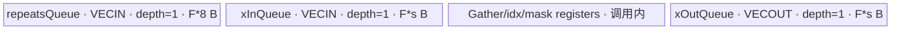

# RepeatInterleaveInt 950 ACLNN 算子知识

## 算子速览

| 项目 | 内容 |
|---|---|
| 实际入口 | `aclnnRepeatInterleaveIntGetWorkspaceSize` + `aclnnRepeatInterleaveInt`，公开 ACLNN 两段式接口，无后继版本符号 |
| 计算语义 | 先把 `self` 展平为长度 `E=numel(self)` 的一维序列，再令 `out[i * r + j] = self_flat[i]`，其中 `0 <= j < r`、`r=repeats`、有效契约为 `outputSize=E*r` |
| 输入输出 | `self`：ND、0～8 维、公开类型 `UINT8/INT8/INT16/INT32/INT64/BOOL/FLOAT16/BFLOAT16/FLOAT`；`repeats/outputSize`：`int64_t`；`out`：同 dtype 的一维 `[outputSize]` |
| 执行类型 | R-001 无 Device 节点；R-002 为框架 `Contiguous/Reshape/ViewCopy` 路径；R-003～R-005 的算子自有节点为单 Kernel `AIV_VECTOR`，BOOL 还经过框架 `Cast(BOOL→INT8→BOOL)` |
| Kernel 路线 | R-001 空输出；R-002 `repeats==1` 快路径；R-003 key 101 Gather；R-004 key 101 批量寄存器复制；R-005 key 101 超大 repeats 分片复制 |
| 核心资源 | 单个 `repeat_interleave` 节点使用 GM、3 个 depth=1 的 `TQue`、MicroAPI 寄存器和系统 workspace；无 Cube/AIC、SIMT、NDDMA、通信节点 |
| 来源闭包 | `source_closed`：公开入口、950 平台选择、算子自有 Host/Tiling/POD、key 101 router、scalar body、Gather helper 和 950 构建接线闭合；框架张量规范化与 executor 壳按明确边界记录 |
| 验证状态 | 已完成源码闭包检查；本次知识提取未执行编译、真机、数值或性能测试。 |

## 接口与语义

### 计算语义

设按存储逻辑展平后的输入为 `x[0..E-1]`，标量重复次数为 `r`。有效调用满足 `r>=0`、`outputSize=E*r`，输出为：

```text
y[k] = x[floor(k / r)], 0 <= k < E*r                 # r > 0
y.shape = [outputSize]
```

`r==0` 时合法输出为空；`r==1` 时只展平并复制。该接口不接受 tensor-valued repeats，也不接受 dim；这两种语义分别属于其他公开入口，不在本卡范围。

### 输入、输出与属性

| 参数 | shape/layout | dtype | 约束、默认值与语义 |
|---|---|---|---|
| `self` | ND，0～8 维；可非连续 | 公开文档列出的 `UINT8/INT8/INT16/INT32/INT64/BOOL/FLOAT16/BFLOAT16/FLOAT` | 支持空 Tensor；0D 在非空普通路径被规范成 `[1]`，随后全部展平 |
| `repeats` | Host 标量 | `int64_t` | 必须非负；表示每个展平元素的重复次数 |
| `outputSize` | Host 标量 | `int64_t` | 公开契约要求严格等于 `numel(self)*repeats`；源码未单独检查此等式 |
| `out` | ND 格式的一维 `[outputSize]`；可非连续 | 与 `self` 相同 | 支持空 Tensor；普通 Kernel 路径在创建内部结果后检查 shape 相等 |
| `workspaceSize` | 标量输出 | `uint64_t*` | executor 汇总所有已排队节点的 workspace 大小 |
| `executor` | Host 对象输出 | `aclOpExecutor**` | 第一段创建并移交，第二段消费 |
| `workspace` | Device 地址 | `void*` | 由调用方按第一段大小申请；普通 RepeatInterleave Kernel 要求其系统区与 user 区地址都非空 |
| `stream` | runtime stream | `aclrtStream` | 第二段在该 stream 上执行 executor 中的节点 |

### 入口与版本

固定源码的公开声明是 `aclnnRepeatInterleaveIntGetWorkspaceSize`/`aclnnRepeatInterleaveInt`。文档产品表明确 950（Ascend 950PR/950DT）、A3、A2 均支持；本卡只对应 950。普通计算最终加入 L0 `RepeatInterleave`。同目录没有更新的 `RepeatInterleaveIntV*` 公开入口。

## Host/Launcher 执行流程

### 参数校验与前处理

第一段严格按以下顺序执行：

1. `OP_CHECK_COMM_INPUT` 检查 `workspaceSize` 和 `executor` 输出指针，随后创建 `uniqueExecutor`。
2. `CheckParamsInt` 检查 `self/out` 非空、`self` dtype 在当前平台列表内、`out.dtype==self.dtype`、`repeats>=0`、`rank(self)<=8`。
3. `self->IsEmpty() || out->IsEmpty()` 时直接返回 `workspaceSize=0`，不创建计算节点。
4. `repeats==1` 时依次排入 `Contiguous(self)`、将结果 `Reshape` 为 `[numel(self)]`、`ViewCopy` 到 `out`，不启动 RepeatInterleave Kernel。
5. 其余情况调用 `InitializeTensor`：先 `Contiguous`；若输入为 0D，再 `BroadcastTo([1])`。950 的 `IntToTensor` 直接把 Host `repeats` 转为一元素 `INT64` tensor，不经旧平台的 scalar+broadcast 组合。
6. BOOL 输入先经 `Cast(BOOL→INT8)`；随后 `Reshape([E])`，调用 `l0op::RepeatInterleave(flattenSelf,repeatsTensor,axis=0,outputSize)`，检查内部结果与 `out` shape 相等，BOOL 再 `Cast(INT8→BOOL)`，最后 `ViewCopy`。
7. 取 `uniqueExecutor->GetWorkspaceSize()` 并把 executor 所有权移交给调用方。第二段只调用 `CommonOpExecutorRun(workspace,workspaceSize,executor,stream)`。

`Contiguous/BroadcastTo/Reshape/Cast/ViewCopy` 和 `CommonOpExecutorRun` 的内部 Kernel/内存布局不在固定算子源码中；这里将它们作为框架边界，但保留了调用条件、顺序和张量交接。

### 参数、Workspace 与生命周期

令 `C=PlatformAscendC::GetCoreNumAiv()`、`UB=GetCoreMemSize(UB)`、`E=numel(self)`、`s=sizeof(T)`。950 普通路径的算子自有节点参数如下：

```text
self -> Contiguous/(0D BroadcastTo) -> Reshape([E])
repeats(int64 Host) -> ConvertToTensor([r], INT64)
[BOOL only] Cast self to INT8
-> l0op::RepeatInterleave(axis=0, outputSize)
->[BOOL only] Cast result to BOOL -> ViewCopy(out)
```

`RepeatInterleaveBaseTiling::GetWorkspaceSize` 为该节点写入：

```text
repeat_kernel_workspace = 16 * 1024 * 1024 + C * 128 bytes
```

Kernel entry 先 `SetSysWorkspace(workspace)`，再取 `GetUserWorkspace(workspace)`；scalar body 不读写 `userWs`，但 entry 对空指针直接返回。ACLNN executor 如何给多个框架节点分配 slice、各 slice 的精确 offset 和额外框架 workspace 固定仓不可见；其 owner 是第一段生成、第二段在同一 executor/stream 中消费的 workspace。

### 启动图与失败传播

| Route | Host 节点顺序 | entry / blockDim / POD | 输入输出与 workspace | ordering、lifetime 与失败传播 |
|---|---|---|---|---|
| R-001 | 无节点 | N/A | 输出为空，`workspaceSize=0` | 第一段直接返回成功 |
| R-002 | `Contiguous→Reshape→ViewCopy` | 框架边界 | `self→flatten→out`；框架 workspace 汇总值固定仓不可见 | executor 保持加入顺序；任一步返回空指针即返回错误 |
| R-003～R-005 非 BOOL | `Contiguous/(0D BroadcastTo)→Reshape→RepeatInterleave→ViewCopy` | `repeat_interleave<<<usedCoreNum>>>`；key 101；`RepeatInterleaveTilingKernelDataNorm` | Repeat 节点读 `x/repeats`、写内部 `y`；系统 workspace 为 `16 MiB+C*128 B` | 同一 executor、同一第二段 stream；producer 失败阻断后续 `ViewCopy` |
| R-003～R-005 BOOL | 上述序列在 Repeat 前后各插入一个 `Cast` | Repeat 节点按 `T=int8_t,U=int64_t` 实例化 | `BOOL→INT8→Repeat→BOOL`；Cast slice 固定仓不可见 | executor 顺序保证类型转换结果先生产再消费；任一空结果立即报错 |

这是单个算子自有 Device Kernel 的拓扑。内部 `RepeatInterleave` 输出由 executor 分配并活到后续 Cast/ViewCopy 消费结束；框架对象的精确释放点固定仓不可见。

## Route 与参数设计

### 分核与资源计算

ACLNN 在调用 L0 前已经把输入变成 `[E]`、axis 固定为 0、repeats tensor shape 固定为 `[1]`，所以 Tiling 合并维度恒为：

```text
mergedDims = [E, 1, 1]                       # [batch, repeat_axis, cp]
eachCoreBatchCount = ceil(E / C)
usedCoreNum = ceil(E / eachCoreBatchCount)
tailCoreBatchCount = E - eachCoreBatchCount*(usedCoreNum-1)
totalRepeatSum = outputSize
repeatsCount = outputSize / E = r             # 依赖公开 outputSize 契约
isSplitCP = 0                                  # cp*sizeof(T)=sizeof(T) <= 8 < 128
```

`SplitRepeatsShape` 也不可达，因为 repeats shape 的唯一维长是 1。Host 用 repeats dtype `INT64` 计算：

```text
F = ubFactor = floor_to_multiple_of_32( UB / 2 / (2*s + 8) ) elements
UB_allocated_by_scalar_body = F*(2*s + 8) bytes <= UB/2
```

block `b` 覆盖 `eachCoreBatchCount` 个输入元素，尾 block 改用 `tailCoreBatchCount`。输出基址是 `b*eachCoreBatchCount*r`。

### Route 选择

| 顺序 | Route | Key/模板 | 精确选择条件与优先级 | 不适用去向 |
|---:|---|---|---|---|
| 1 | R-001 空输出 | 无 Kernel | 校验成功后 `self->IsEmpty() \|\| out->IsEmpty()` | R-002 |
| 2 | R-002 恒等复制 | 无 Repeat Kernel | 非空且 `repeats==1` | R-003 |
| 3 | R-003 小重复 Gather | key 101，`RepeatInterleaveScalarImpl<T,int64_t>` | 普通路径；`s<32` 且 `r*s<=256`；对本接口 `cp=1`，这是 Device `ProcessWholeCp` 的首个判断 | R-004 |
| 4 | R-004 批量寄存器复制 | key 101，同模板 | `r*s>256` 且 `floor(F/r)>0`，即 `r<=F` | R-005 |
| 5 | R-005 repeats 分片复制 | key 101，同模板 | `r*s>256` 且 `floor(F/r)==0`，即 `r>F` | 无；Host 已选 key 101 |

```text
if self.empty || out.empty: R-001
else if repeats == 1: R-002
else:
  flatten to [E]; repeats tensor is [1] INT64
  key = 101
  if sizeof(T) < 32 && repeatsCount*sizeof(T) <= 256: R-003
  else if floor(ubFactor/repeatsCount) > 0: R-004
  else: R-005
```

### 模板/实现执行矩阵

| Route | key/selector | dtype/shape/platform 完整命中条件 | 执行拓扑与 Kernel 节点 | 实际模板/body | 内存与同步特征 | tail/fallback |
|---|---|---|---|---|---|---|
| R-001 | Host early return | 950；`self` 或 `out` 为空 | 0 Device 节点 | N/A | workspace 0 | 直接成功；不校验 `outputSize` 等式 |
| R-002 | Host fast path | 950；非空；`repeats==1` | 仅框架节点 | `Contiguous/Reshape/ViewCopy` | 框架资源固定仓不可见 | 任一空返回终止 |
| R-003 | 101 + Device Gather guard | 950；非空；`r!=1`；`r*s<=256` | 单 AIV Repeat 节点，外加框架前后处理 | `RepeatInterleaveScalarImpl<T,int64_t>::ProcessWholeCp→ProcessCpMatchToUbGather` | 3 个 depth=1 Queue；MTE3→V event 保护 out Queue 复用 | 每核输入尾数和每次 Gather 尾输出均显式计算 |
| R-004 | 101 + grouped guard | 950；非空；`r!=1`；`r*s>256`；`r<=F` | 同上 | `ProcessCpMatchToUb→CopyOneCpToRepeatOutScalarVf` | 同一 UB 布局；每个输出 tile 前等待上次 GM store | `tailCpNum` 处理输入 tile 尾部 |
| R-005 | 101 + sliced guard | 950；非空；`r!=1`；`r>F` | 同上 | `ProcessCpMatchToUb→CopyOneCpToRepeatOutLargeScalarVf` | 同一 UB 布局；单输入元素按 `F` 次重复分片 | `tailRepeatTimes=r-(ceil(r/F)-1)*F` |

### 隐藏性能 Guard

| Guard | Host/Tiling 条件 | Device/资源原因 | 影响 Route | 不满足时去向 | 源码符号 |
|---|---|---|---|---|---|
| 平台资源有效 | `C>0 && UB>0` | 无 AIV 核或 UB 不能生成合法 POD | R-003～R-005 | Tiling prepare 失败 | `TilingPrepareRepeatInterleaveForAscendC` |
| UB 元素对齐 | `F=floor32(UB/2/(2*s+8))` | scalar body 的输入、输出、repeats Queue 均按 `F` 分配；Host 仅使用最多半个 UB | R-003～R-005 | 无别的 key；资源异常会使实现无有效 tile | `GetUbFactor` |
| Gather 小 CP | `cp*s<32 && cp*r*s<=256`；本接口 `cp=1` | 让一个 cp 的重复结果不超过源码固定的 256-byte VREG 门槛 | R-003 | R-004/R-005 | `ProcessWholeCp` |
| Gather batch 容量 | `cpPerBatch=max(1,elementsPerReg/(r*cp))` | 控制单寄存器批次中的 cp 数，1-byte dtype 只按 `vRegBytes/2` 计算 | R-003 | 尾批次用动态 mask | `CopyCpToRepeatOutGatherAicore` |
| 输出 tile 可容纳完整 repeats | `floor(F/r)>0` | 一个 xOut Queue tile 能容纳至少一个完整重复组 | R-004 | R-005 | `CopyXToMatchOut` |
| Kernel workspace 非空 | `workspace!=nullptr && GetUserWorkspace(workspace)!=nullptr` | entry 先建立系统 workspace 语义，即使 scalar body 不访问 user 区 | R-003～R-005 | entry 静默返回、无输出 | `repeat_interleave` |
| 合法 key | `TILING_KEY_IS(101)` | router 只有 101 才构造 scalar body | R-003～R-005 | 未知 key 静默结束 | `repeat_interleave` |

### POD/ABI

`RepeatInterleaveTilingKernelDataNorm` 只含 `int64_t` 字段；固定定义顺序给出 8-byte 对齐、总大小 112 B。以下 offset 是该同质字段布局的字节 offset。

| 结构 | 字段 | 类型/位宽 | ABI 布局 | 单位 | Host/launcher producer | Device consumer | 边界 |
|---|---|---|---|---|---|---|---|
| `RepeatInterleaveTilingKernelDataNorm` | `totalCoreNum` | `int64_t/64` | offset 0；align 8 | core | `set_totalCoreNum(C)` | scalar body 不读取 | key 101 为有效值但 inactive |
| 同上 | `usedCoreNum` | `int64_t/64` | offset 8 | core | `set_usedCoreNum(usedCoreNum_)` | entry launch 的 blockDim 由 context 另行传递；body 不读取 | `1..C` |
| 同上 | `eachCoreBatchCount` | `int64_t/64` | offset 16 | 输入元素/core | `ceil(E/C)` | `ComputeStartOffset`、`ProcessWholeCp` | 非尾核覆盖数 |
| 同上 | `tailCoreBatchCount` | `int64_t/64` | offset 24 | 输入元素 | `E-each*(used-1)` | 最后一核 `ProcessWholeCp` | 仅尾核读取 |
| 同上 | `isSplitCP` | `int64_t/64` | offset 32 | bool flag | key 101 本接口恒写 0 | `Process`、`ComputeStartOffset` | 本接口 split 分支 inactive |
| 同上 | `normalCP` | `int64_t/64` | offset 40 | 元素 | 默认 0 | 仅 inactive `ProcessSplitCp` | key 101 本接口不读 |
| 同上 | `tailCP` | `int64_t/64` | offset 48 | 元素 | 默认 0 | 仅 inactive `ProcessSplitCp` | key 101 本接口不读 |
| 同上 | `cpSlice` | `int64_t/64` | offset 56 | slice | 默认 0 | 仅 split 分支 | `isSplitCP=0` 时不得读取 |
| 同上 | `ubFactor` | `int64_t/64` | offset 64 | 元素/Queue | `floor32(UB/2/(2*s+8))` | `Init` 分配 3 Queue，并派生 tile 上限 | 必须大于 0 |
| 同上 | `repeatsCount` | `int64_t/64` | offset 72 | 次/输入元素 | `outputSize/inputShape[axis]` | `Init`、Gather 与复制循环 | 依赖调用方满足 `outputSize=E*r` |
| 同上 | `totalRepeatSum` | `int64_t/64` | offset 80 | 输出轴元素 | `yShape[axis]=outputSize` | scalar body 不读取 | key 101 inactive 字段 |
| 同上 | `mergedDims[0]` | `int64_t/64` | offset 88 | 输入元素 | `MergDimForScalar: E` | 间接决定分核；scalar body不直接读该项 | 本接口为 `E` |
| 同上 | `mergedDims[1]` | `int64_t/64` | offset 96 | repeat-axis 单位 | `MergDimForScalar: 1` | `ProcessWholeCp` 乘入核覆盖数 | 本接口恒 1 |
| 同上 | `mergedDims[2]` | `int64_t/64` | offset 104 | cp 元素 | `MergDimForScalar: 1` | 所有地址、Gather、输出长度 | 本接口恒 1 |

### Route 源码闭包

| Route | Key/selector | Host/Tiling producer | POD/参数 | Kernel entry/router 节点 | Kernel body/直接依赖 | 构建接线 |
|---|---|---|---|---|---|---|
| R-001 | Host empty branch | `op_api/aclnn_repeat_interleave.cpp::aclnnRepeatInterleaveIntGetWorkspaceSize` | 无 POD | 无 | 无 | ACLNN API 同目录构建 |
| R-002 | Host `repeats==1` | 同上 | 框架张量参数 | 无 Repeat entry | 框架 `Contiguous/Reshape/ViewCopy` 边界 | 同上 |
| R-003 | 101 + Gather guard | `repeat_interleave_tiling_normal.cpp::{GetUbFactor,GetTilingKey,PostTiling}` | `RepeatInterleaveTilingKernelDataNorm` | `repeat_interleave_apt.cpp::repeat_interleave` | `repeat_interleave_scalar.h::ProcessCpMatchToUbGather` + `repeat_interleave_gather.h` | `CMakeLists.txt` + `repeat_interleave_def.cpp` + ascend950 binary JSON |
| R-004 | 101 + `r<=F` | 同上 | 同上 | 同上 | `repeat_interleave_scalar.h::ProcessCpMatchToUb/CopyOneCpToRepeatOutScalarVf` | 同上 |
| R-005 | 101 + `r>F` | 同上 | 同上 | 同上 | `repeat_interleave_scalar.h::CopyOneCpToRepeatOutLarge/CopyOneCpToRepeatOutLargeScalarVf` | 同上 |

## Kernel 实现

### 公共执行流程

普通计算由 L0 `RepeatInterleave` 分配 `[outputSize]` 内部张量并把 `RepeatInterleave(x,repeats,y,axis=0)` 加入 AICore launcher。950 selector 只产生 key 101；entry 校验 workspace，设置系统 workspace，解析 `RepeatInterleaveTilingKernelDataNorm`，构造 `RepeatInterleaveScalarImpl<DTYPE_X,DTYPE_REPEATS>`，依次 `Init→Process`。

所有普通 Route 的公共流是：

```text
GM x tile -> xInQueue(VECIN) -> MicroAPI register copy/gather
          -> xOutQueue(VECOUT) -> DataCopyPad -> GM y
```

`repeatsGm_` 被绑定但不读取，重复次数来自 POD `repeatsCount`。`repeatsQueue_` 仍按 `F*sizeof(int64_t)` 分配，但 key 101 body 不使用它。

### Route R-001：空输出

#### 适用条件

##### 选择证据

| 层级 | 文件 | 符号 | 源码谓词/参数 | 结果/下一跳 |
|---|---|---|---|---|
| API | `op_api/aclnn_repeat_interleave.cpp` | `aclnnRepeatInterleaveIntGetWorkspaceSize` | `self->IsEmpty() \|\| out->IsEmpty()` | `workspaceSize=0`，移交空 executor 并成功返回 |

#### Device 数据流

##### 函数级调用链

```text
aclnnRepeatInterleaveIntGetWorkspaceSize -> early return
# 无 Host launch node，无 Device body
```

##### 源码等价伪码

```text
if self.empty || out.empty:
    workspaceSize = 0
    release executor
    return SUCCESS
```

#### 内存与数据搬运

##### 资源与搬运表

| 层级/缓冲区 | offset/地址公式 | extent/容量公式 | dtype/layout | producer | consumer | owner/lifetime | 对齐/复用 |
|---|---|---|---|---|---|---|---|
| workspace | N/A | 0 B | N/A | API | 无 | 调用方无需分配 | N/A |

##### 分层内存布局

N/A：该 Route 没有 AIV Kernel、UB 或中间 Device buffer。

##### 字节账与复用顺序

```text
UB_total = 0
dynamic_ub = N/A
workspace_total = 0
```

| 复用子区 | 写入者 | 读取者/消费点 | 下一次覆盖 | 同步或释放依据 | 安全条件 |
|---|---|---|---|---|---|
| N/A | N/A | N/A | N/A | N/A | 无 Device 节点 |

#### 同步、精度与尾块

##### 同步与数值边界表

| 阶段 | primitive/机制 | producer | consumer/等待点 | 保护对象 | 精度/尾块 |
|---|---|---|---|---|---|
| Host early return | N/A | API | 调用方 | 空输出 | 不执行数值计算 |

#### 关键实现

##### 符号证据表

| 阶段 | 文件 | 符号/模板实例 | 实现事实 |
|---|---|---|---|
| Host/Tiling producer | `op_api/aclnn_repeat_interleave.cpp` | `aclnnRepeatInterleaveIntGetWorkspaceSize` | 空 Tensor 分支直接返回 workspace 0 |
| Kernel entry/router | N/A | N/A | 无 Kernel |
| Device body/helper | N/A | N/A | 无 Device body |

### Route R-002：repeats 等于 1 的框架快路径

#### 适用条件

##### 选择证据

| 层级 | 文件 | 符号 | 源码谓词/参数 | 结果/下一跳 |
|---|---|---|---|---|
| API | `op_api/aclnn_repeat_interleave.cpp` | `aclnnRepeatInterleaveIntGetWorkspaceSize` | 非空且 `repeats==1` | `Contiguous→Reshape([E])→ViewCopy(out)`，返回 executor workspace |

#### Device 数据流

##### 函数级调用链

```text
l0op::Contiguous(self)
  -> l0op::Reshape([E])
    -> l0op::ViewCopy(flattenSelf, out)
```

##### 源码等价伪码

```text
self_contiguous = Contiguous(self)
flatten = Reshape(self_contiguous, [numel(self)])
ViewCopy(flatten, out)
workspaceSize = executor.GetWorkspaceSize()
```

#### 内存与数据搬运

##### 资源与搬运表

| 层级/缓冲区 | offset/地址公式 | extent/容量公式 | dtype/layout | producer | consumer | owner/lifetime | 对齐/复用 |
|---|---|---|---|---|---|---|---|
| `self_contiguous` | 框架决定 | `E*s` 逻辑字节 | self dtype/ND | `Contiguous` | `Reshape` | executor | 物理分配/alias 固定仓不可见 |
| `flatten` | metadata view | `[E]` | self dtype/ND | `Reshape` | `ViewCopy` | executor | 是否 alias 固定仓不可见 |
| `out` | 用户 Tensor | `E*s` 有效字节 | self dtype/ND | `ViewCopy` | 调用方 | 用户 | 非连续写回由框架处理 |

##### 分层内存布局

N/A：不启动算子自有 AIV Kernel；框架节点的 UB 布局固定仓不可见。

##### 字节账与复用顺序

```text
UB_total = 固定仓不可见（框架节点）
dynamic_ub = N/A
workspace_total = executor.GetWorkspaceSize()，内部 slice 固定仓不可见
```

| 复用子区 | 写入者 | 读取者/消费点 | 下一次覆盖 | 同步或释放依据 | 安全条件 |
|---|---|---|---|---|---|
| `self_contiguous/flatten` | 框架 | `ViewCopy` | executor 回收 | 同一 executor 顺序 | `ViewCopy` 完成前保持有效 |

#### 同步、精度与尾块

##### 同步与数值边界表

| 阶段 | primitive/机制 | producer | consumer/等待点 | 保护对象 | 精度/尾块 |
|---|---|---|---|---|---|
| 框架复制 | executor stream ordering | `Contiguous/Reshape` | `ViewCopy` | 展平输入 | 无算术、dtype 不变；非连续 tail 由框架处理 |

#### 关键实现

##### 符号证据表

| 阶段 | 文件 | 符号/模板实例 | 实现事实 |
|---|---|---|---|
| Host/Tiling producer | `op_api/aclnn_repeat_interleave.cpp` | `aclnnRepeatInterleaveIntGetWorkspaceSize` | `repeats==1` 绕过 RepeatInterleave |
| Kernel entry/router | N/A | N/A | 无 Repeat Kernel |
| Device body/helper | 框架边界 | `Contiguous/Reshape/ViewCopy` | 固定仓只见调用顺序，不见内部 body |

### Route R-003：小重复 Gather

#### 适用条件

##### 选择证据

| 层级 | 文件 | 符号 | 源码谓词/参数 | 结果/下一跳 |
|---|---|---|---|---|
| API | `op_api/aclnn_repeat_interleave.cpp` | `aclnnRepeatInterleaveIntGetWorkspaceSize` | 非空、`repeats!=1` | flatten 后调用 `l0op::RepeatInterleave(...,0,outputSize)` |
| Tiling | `op_host/arch35/repeat_interleave_tiling_normal.cpp` | `GetTilingKey` | repeats shape `[1]` 使 `repeatsCount_>-1` | key 101 |
| Router | `op_kernel/repeat_interleave_apt.cpp` | `repeat_interleave` | `TILING_KEY_IS(101)` | `RepeatInterleaveScalarImpl<T,int64_t>` |
| Device | `op_kernel/arch35/repeat_interleave_scalar.h` | `ProcessWholeCp` | `1*s<32 && 1*r*s<=256` | `ProcessCpMatchToUbGather` |

#### Device 数据流

##### 函数级调用链

```text
l0op::RepeatInterleave -> repeat_interleave(key=101)
  -> RepeatInterleaveScalarImpl<T,int64_t>::Init
  -> Process -> ProcessWholeCp
    -> ProcessCpMatchToUbGather
      -> CopyInX -> CopyXToMatchOutGather
        -> CopyOneCpToRepeatOutGather
          -> CopyCpToRepeatOutGatherAicore/Vf
        -> CopyMatchOutToY
```

##### 源码等价伪码

```text
start = blockIdx * eachCoreBatchCount
count = last_block ? tailCoreBatchCount : eachCoreBatchCount
for each input tile of at most F elements:
    DataCopyPad GM x[start+tile] -> xInQueue
    cpPerBatch = max(1, elementsPerReg / r)
    for each register batch:
        idx = Arange(0..)
        srcIdx = floor(idx/r)                 # cp=1 的化简
        v = DataCopyGather(xInLocal, srcIdx, dynamic_mask)
        DataCopyUnAlign v -> xOutLocal
    wait MTE3->V before xOutLocal reuse
    DataCopyPad xOutLocal -> GM y[(start+tile)*r]
```

#### 内存与数据搬运

##### 资源与搬运表

| 层级/缓冲区 | offset/地址公式 | extent/容量公式 | dtype/layout | producer | consumer | owner/lifetime | 对齐/复用 |
|---|---|---|---|---|---|---|---|
| GM `x` | `startCpIdx+tileOffset` | `tileCpNum` 元素 | `T/[E]` | API 前处理 | `CopyInX` | 用户/框架 | `DataCopyPad`, blockCount=1, byte blockLen |
| `xInQueue_` | Queue base | `F*s` B | `T` | `CopyInX` | Gather helper | `TPipe`, 当前 tile | depth 1；消费后 Free |
| `repeatsQueue_` | Queue base | `F*8` B | INT64 | `InitBuffer` | key 101 不消费 | `TPipe`, Kernel lifetime | depth 1；保守占位 |
| `xOutQueue_` | Queue base | `F*s` B | `T` | Gather helper | `CopyMatchOutToY` | `TPipe`, 当前 tile | depth 1；MTE3→V 后覆盖 |
| Gather registers | 寄存器内部 | `idx/srcIdx/value/mask/unalign` | dtype-dependent | helper | helper | 单 VF 调用 | 1-byte dtype 用 wide gather 后 DeInterleave |
| GM `y` | `(startCpIdx+tileOffset)*r` | `tileCpNum*r` 元素 | `T/[E*r]` | `CopyMatchOutToY` | 后续框架节点 | executor | 单块紧凑写出 |
| workspace | 系统区 + user 区 | `16 MiB+C*128 B` | byte | runtime | entry | executor/caller | scalar body 不访问 user 区 |

##### 分层内存布局



##### 字节账与复用顺序

```text
UB_total = F*8 + F*s + F*s = F*(2*s+8) bytes
F = floor32(UB/2/(2*s+8))
UB_total <= UB/2 <= UB
dynamic_ub = N/A
workspace_total(repeat node) = 16 MiB + C*128 B
```

| 复用子区 | 写入者 | 读取者/消费点 | 下一次覆盖 | 同步或释放依据 | 安全条件 |
|---|---|---|---|---|---|
| `xInQueue_` | `CopyInX` | Gather helper | 下一输入 tile | `DeQue` 后 `FreeTensor` | 当前 Gather 完成 |
| `xOutQueue_` | Gather helper | `CopyMatchOutToY` | 下一 register batch/tile | `HardEvent::MTE3_V` 后重写；最终 Free | 上一次 UB→GM 完成 |

#### 同步、精度与尾块

##### 同步与数值边界表

| 阶段 | primitive/机制 | producer | consumer/等待点 | 保护对象 | 精度/尾块 |
|---|---|---|---|---|---|
| GM→UB | `TQue EnQue/DeQue` | `CopyInX` | Gather helper | x tile | `DataCopyPad` 按有效 `dataLen` |
| Gather | dynamic `MaskReg` | idx 计算 | `DataCopyGather` | 有效输出 lane | 纯拷贝，无 cast/round；tail 用 `tailOutElems` |
| UB→GM→下次 V | `SetFlag/WaitFlag<MTE3_V>` | `CopyMatchOutToY` | 下一次写 `xOutQueue_` | depth=1 输出 Queue | 防止 GM store 未完成即覆盖 |
| 1-byte dtype | `DataCopyGather` 到 wide reg + `DeInterleave` | gather | unaligned store | 有效偶数字节 | 保持原始 byte，无数值计算 |

#### 关键实现

##### 符号证据表

| 阶段 | 文件 | 符号/模板实例 | 实现事实 |
|---|---|---|---|
| Host/Tiling producer | `op_host/arch35/repeat_interleave_tiling_normal.cpp` | `GetUbFactor/GetTilingKey/PostTiling` | key 101、F、blockDim 与 POD |
| Kernel entry/router | `op_kernel/repeat_interleave_apt.cpp` | `repeat_interleave` key 101 | POD 解析并实例化 scalar body |
| Device body/helper | `op_kernel/arch35/repeat_interleave_scalar.h` | `ProcessWholeCp/ProcessCpMatchToUbGather` | Gather guard、tile 循环和 Queue 同步 |
| Device body/helper | `op_kernel/arch35/repeat_interleave_gather.h` | `CopyCpToRepeatOutGatherAicore` | source index、batch 与动态 tail mask |

### Route R-004：批量寄存器复制

#### 适用条件

##### 选择证据

| 层级 | 文件 | 符号 | 源码谓词/参数 | 结果/下一跳 |
|---|---|---|---|---|
| API/Tiling/Router | 同 R-003 | 同 R-003 | 普通路径且 key 101 | scalar body |
| Device | `op_kernel/arch35/repeat_interleave_scalar.h` | `ProcessWholeCp` | Gather guard false，且 `cp*s<128`（本接口恒真） | `ProcessCpMatchToUb` |
| Device | 同上 | `CopyXToMatchOut` | `repeatValueCntInUbFactor=floor(F/r)>0` | 批量处理最多 `floor(F/r)` 个输入元素 |

#### Device 数据流

##### 函数级调用链

```text
repeat_interleave(key=101) -> Init -> ProcessWholeCp
  -> ProcessCpMatchToUb -> CopyInX -> CopyXToMatchOut
    -> CopyOneCpToRepeatOut -> CopyOneCpToRepeatOutScalarVf
    -> CopyMatchOutToY
```

##### 源码等价伪码

```text
K = floor(F/r)
for input tile of at most F elements:
    copy x tile GM->UB
    for group of at most K input elements:
        wait previous MTE3 store before V writes xOut
        for each input element:
            load its one-element cp to RegTensor
            append the RegTensor r times to xOutLocal
        copy valid group*r elements xOutLocal->GM y
```

#### 内存与数据搬运

##### 资源与搬运表

| 层级/缓冲区 | offset/地址公式 | extent/容量公式 | dtype/layout | producer | consumer | owner/lifetime | 对齐/复用 |
|---|---|---|---|---|---|---|---|
| GM `x` | `start+tile` | `tileCpNum<=F` | `T/[E]` | API | `CopyInX` | 用户/框架 | 有效字节搬运 |
| `xInQueue_` | Queue base | `F*s` B | T | `CopyInX` | scalar VF | TPipe | depth 1 |
| `repeatsQueue_` | Queue base | `F*8` B | INT64 | Init | 未使用 | TPipe | depth 1 |
| `xOutQueue_` | Queue base | `F*s` B | T | scalar VF | `CopyMatchOutToY` | TPipe | 每组最多 `K*r<=F` 元素 |
| GM `y` | `(start+tile)*r + groupOffset*r` | `groupCount*r` | `T/[E*r]` | `CopyMatchOutToY` | 框架 | executor | 紧凑写出 |
| workspace | 系统区 + user 区 | `16 MiB+C*128 B` | byte | runtime | entry | executor/caller | user 区不被 body 使用 |

##### 分层内存布局


##### 字节账与复用顺序

```text
UB_total = F*(2*s+8) <= UB/2
K = floor(F/r) >= 1
workspace_total(repeat node) = 16 MiB + C*128 B
```

| 复用子区 | 写入者 | 读取者/消费点 | 下一次覆盖 | 同步或释放依据 | 安全条件 |
|---|---|---|---|---|---|
| `xInQueue_` | CopyIn | scalar VF | 下一 tile | 处理完全部 group 后 Free | VF 不再读当前 tile |
| `xOutQueue_` | scalar VF | GM store | 下一 group | `MTE3_V` event | `groupCount*r<=F` |

#### 同步、精度与尾块

##### 同步与数值边界表

| 阶段 | primitive/机制 | producer | consumer/等待点 | 保护对象 | 精度/尾块 |
|---|---|---|---|---|---|
| 输入 Queue | `EnQue/DeQue` | CopyIn | VF | x tile | 最后一 tile 用 `tailCpCnt` |
| 寄存器复制 | `DataCopyUnAlign` | xIn | xOut | 一个输入元素及其 r 个副本 | 位级复制，无 cast/round |
| 输出复用 | `MTE3_V` event | GM store | 下一 VF | xOut depth=1 | 最后 group 用 `tailCpNum` |

#### 关键实现

##### 符号证据表

| 阶段 | 文件 | 符号/模板实例 | 实现事实 |
|---|---|---|---|
| Host/Tiling producer | `op_host/arch35/repeat_interleave_tiling_normal.cpp` | `GetUbFactor/GetTilingKey` | F 和 key 101 |
| Kernel entry/router | `op_kernel/repeat_interleave_apt.cpp` | `repeat_interleave` | scalar 模板实例 |
| Device body/helper | `op_kernel/arch35/repeat_interleave_scalar.h` | `CopyXToMatchOut/CopyOneCpToRepeatOutScalarVf` | K 分组、寄存器重复与 event |

### Route R-005：超大 repeats 分片复制

#### 适用条件

##### 选择证据

| 层级 | 文件 | 符号 | 源码谓词/参数 | 结果/下一跳 |
|---|---|---|---|---|
| API/Tiling/Router | 同 R-003 | 同 R-003 | 普通路径且 key 101 | scalar body |
| Device | `op_kernel/arch35/repeat_interleave_scalar.h` | `CopyXToMatchOut` | `repeatValueCntInUbFactor=floor(F/r)==0` | 每个输入元素的 r 个副本按 F 分片 |

#### Device 数据流

##### 函数级调用链

```text
repeat_interleave(key=101) -> Init -> ProcessWholeCp
  -> ProcessCpMatchToUb -> CopyInX -> CopyXToMatchOut
    -> CopyOneCpToRepeatOutLarge -> CopyOneCpToRepeatOutLargeScalarVf
    -> CopyMatchOutToY
```

##### 源码等价伪码

```text
L = ceil(r/F)
for input tile:
    copy x tile GM->UB
    for each input element p:
        for q in [0, L-2]:
            wait previous MTE3 store
            load x[p] once to RegTensor; append F copies to xOut
            store y[p*r + q*F : ...+F]
        tail = r-(L-1)*F
        append/store tail copies
```

#### 内存与数据搬运

##### 资源与搬运表

| 层级/缓冲区 | offset/地址公式 | extent/容量公式 | dtype/layout | producer | consumer | owner/lifetime | 对齐/复用 |
|---|---|---|---|---|---|---|---|
| GM `x` | `start+tile` | `tileCpNum<=F` | `T/[E]` | API | CopyIn | 用户/框架 | 每个输入 tile 一次装入 |
| `xInQueue_` | Queue base | `F*s` B | T | CopyIn | large scalar VF | TPipe | 当前 tile 内跨多个输出分片复用 |
| `repeatsQueue_` | Queue base | `F*8` B | INT64 | Init | 未使用 | TPipe | depth 1 |
| `xOutQueue_` | Queue base | `F*s` B | T | large scalar VF | GM store | TPipe | 每片 F 或 tail 元素 |
| GM `y` | `(start+p)*r + q*F` | `F` 或 tail | `T/[E*r]` | `CopyMatchOutToY` | 框架 | executor | 分片连续、互不重叠 |
| workspace | 系统区 + user 区 | `16 MiB+C*128 B` | byte | runtime | entry | executor/caller | user 区不被 body 使用 |

##### 分层内存布局


##### 字节账与复用顺序

```text
UB_total = F*(2*s+8) <= UB/2
L = ceil(r/F), tailRepeatTimes = r-(L-1)*F
workspace_total(repeat node) = 16 MiB + C*128 B
```

| 复用子区 | 写入者 | 读取者/消费点 | 下一次覆盖 | 同步或释放依据 | 安全条件 |
|---|---|---|---|---|---|
| `xInQueue_` | CopyIn | 每个输入元素的所有分片 | 下一 tile | 外层 cp 和分片循环结束后 Free | 当前 tile 保持只读 |
| `xOutQueue_` | large scalar VF | GM store | 下一分片 | `MTE3_V` event | 每片不超过 F 元素 |

#### 同步、精度与尾块

##### 同步与数值边界表

| 阶段 | primitive/机制 | producer | consumer/等待点 | 保护对象 | 精度/尾块 |
|---|---|---|---|---|---|
| 输入 Queue | `EnQue/DeQue` | CopyIn | large VF | x tile | 输入尾 tile 有效长度 |
| 分片复制 | `DataCopyUnAlign` | 单元素 RegTensor | xOut | F/tail 个副本 | 位级复制，无精度变化 |
| 输出复用 | `MTE3_V` event | GM store | 下一分片 VF | xOut depth=1 | 最后一片只写 `tailRepeatTimes` |

#### 关键实现

##### 符号证据表

| 阶段 | 文件 | 符号/模板实例 | 实现事实 |
|---|---|---|---|
| Host/Tiling producer | `op_host/arch35/repeat_interleave_tiling_normal.cpp` | `GetUbFactor/GetTilingKey` | F 和 key 101 |
| Kernel entry/router | `op_kernel/repeat_interleave_apt.cpp` | `repeat_interleave` | scalar 模板实例 |
| Device body/helper | `op_kernel/arch35/repeat_interleave_scalar.h` | `CopyXToMatchOut/CopyOneCpToRepeatOutLargeScalarVf` | 按 F 分片并处理 tail |

## 算子特定优化

### Trick T-001：repeats 等于 1 时绕过 RepeatInterleave Kernel

#### 触发与源码依据

- 适用 Route：R-002
- 触发条件：校验成功、输入输出非空且 `repeats==1`
- Golden 来源：[`op_api/aclnn_repeat_interleave.cpp:541-552`](../../../../../../../cann-ops-raw/ascendc/ops-nn/955f8b33985b6d72989ebff341bb9c2c564a51bc/index/repeat_interleave/op_api/aclnn_repeat_interleave.cpp#L541-L552)

**官方源码（固定 Commit 连续逐字摘录）**：

```cpp
// repeats等于1，直接返回原tensor
if (repeats == 1) {
    auto selfContiguous = l0op::Contiguous(self, uniqueExecutor.get());
    CHECK_RET(selfContiguous != nullptr, ACLNN_ERR_INNER_NULLPTR);
    auto flattenShape = GetFlattenShape(selfContiguous, uniqueExecutor.get());
    auto flattenSelf = l0op::Reshape(selfContiguous, flattenShape, uniqueExecutor.get());
    CHECK_RET(flattenSelf != nullptr, ACLNN_ERR_INNER_NULLPTR);
    auto viewcopyResult = l0op::ViewCopy(flattenSelf, out, uniqueExecutor.get());
    CHECK_RET(viewcopyResult != nullptr, ACLNN_ERR_INNER_NULLPTR);
    *workspaceSize = uniqueExecutor->GetWorkspaceSize();
    uniqueExecutor.ReleaseTo(executor);
    return ACLNN_SUCCESS;
}
```

#### 机制与设计原因

重复一次等价于展平复制。Host 不创建 repeats tensor、不做 BOOL 往返 Cast、不加入 RepeatInterleave Kernel，只保留连续化、metadata reshape 和最终写回，源码可证明减少了一次算子自有 Kernel 及其 3 个 Queue 分配。

#### 迁移边界

- 适用：标量 repeat 的恒等复制，并且输出逻辑要求展平。
- 前提：`out` shape/dtype 满足公开契约；非连续输入/输出仍交由框架处理。
- 失效：`repeats!=1` 必须进入 R-003～R-005；空输出先由 R-001 截获。
- 未验证：本次知识提取未执行编译、真机、数值或性能测试。

#### 错误做法

固定仓未提供可验证反例；迁移时若漏掉 flatten，会把本接口误实现为保形状的恒等算子。

### Trick T-002：小重复结果用索引 Gather 一次生成多个副本

#### 触发与源码依据

- 适用 Route：R-003
- 触发条件：`mergedDims[2]*sizeof(T)<32` 且 `mergedDims[2]*repeatsCount*sizeof(T)<=256`
- Golden 来源：[`op_kernel/arch35/repeat_interleave_scalar.h:413-430`](../../../../../../../cann-ops-raw/ascendc/ops-nn/955f8b33985b6d72989ebff341bb9c2c564a51bc/index/repeat_interleave/op_kernel/arch35/repeat_interleave_scalar.h#L413-L430)

**官方源码（固定 Commit 连续逐字摘录）**：

```cpp
int64_t startCpIdx = GetBlockIdx() * tilingData_.eachCoreBatchCount * tilingData_.mergedDims[1];
constexpr uint64_t VREG_SIZE = 256;
if (tilingData_.mergedDims[2] * sizeof(T) < GATHER_CP_THRESHOLD &&
    tilingData_.mergedDims[2] * tilingData_.repeatsCount * sizeof(T) <= VREG_SIZE) {
    ProcessCpMatchToUbGather(startCpIdx, curCoreCpCount);
    return;
}
if (tilingData_.mergedDims[2] * sizeof(T) < MIN_CP_SIZE_THRESHOLD) {
    /* 从每个核要复制的起始轴开始依次处理,不需要对cp轴分loop */
    ProcessCpMatchToUb(startCpIdx, curCoreCpCount);
    return;
}
```

#### 机制与设计原因

本接口 `cp=1`，Gather helper 从输出 lane `idx` 计算 `srcIdx=floor(idx/r)`，用 `DataCopyGather` 直接从输入 tile 组装重复后的寄存器结果，再 unaligned store 到 xOut Queue。与逐输入元素执行 r 次 append 相比，它把重复关系编码为索引，且按寄存器容量批处理多个 cp；动态 mask 只提交有效 tail。1-byte dtype 先 gather 到 16-bit wide register，再 `DeInterleave` 取有效字节。

#### 迁移边界

- 适用：每个 cp 很短且单 cp 重复结果不超过固定 256-byte 门槛的纯数据复制。
- 前提：索引类型和 `elementsPerReg` 计算与 dtype 一致；保持 1-byte 特化的 wide gather/deinterleave。
- 失效：超过门槛转入 R-004 或 R-005，不得继续沿用可能超出单寄存器设计域的批量参数。
- 未验证：本次知识提取未执行编译、真机、数值或性能测试。

#### 错误做法

固定仓未提供可验证反例；源码只提供门槛外的普通复制 fallback。

### Trick T-003：从输出 shape 推导重复次数，scalar body 不读取 repeats GM

#### 触发与源码依据

- 适用 Route：R-003～R-005
- 触发条件：repeats tensor 是标量或一元素 tensor；本接口 950 `IntToTensor` 恒生成 `[1]` INT64
- Golden 来源：[`op_host/arch35/repeat_interleave_tiling_normal.cpp:89-108`](../../../../../../../cann-ops-raw/ascendc/ops-nn/955f8b33985b6d72989ebff341bb9c2c564a51bc/index/repeat_interleave/op_host/arch35/repeat_interleave_tiling_normal.cpp#L89-L108)

**官方源码（固定 Commit 连续逐字摘录）**：

```cpp
if (repeatShape_.GetDimNum() == 0 || repeatShape_.GetDim(0) == 1) {
    repeatsCount_ = yShape_.GetDim(axis_) / inputShape_.GetDim(axis_);
}
averageRepeatTime_ = yShape_.GetDim(axis_) / inputShape_.GetDim(axis_);
int64_t ubFactor = 0;
ge::DataType computeDtype;
if (isUseInt64_ == 0) {
    computeDtype = ge::DataType::DT_INT32;
} else if (isUseInt64_ == 1) {
    computeDtype = ge::DataType::DT_INT64;
}
```

#### 机制与设计原因

Tiling 把 `outputSize/E` 写入 POD `repeatsCount`，Device scalar body 用它生成地址和循环，虽绑定 `repeatsGm_` 却不执行 GM load。该机制消除了 Repeat Kernel 内对一元素 repeats tensor 的搬运和解析；代价是严格依赖公开契约 `outputSize=E*repeats`。源码仍为 `repeatsQueue_` 预留 `F*8` B，因此这里不能声称消除了全部 repeats UB 成本。

#### 迁移边界

- 适用：Host 已知输出长度，且 repeats 对所有输入元素相同。
- 前提：在进入 Tiling 前验证或保证输出长度与 repeats 一致，除法无零维输入问题。
- 失效：tensor-valued repeats 必须走 key 102/201/202 的其他语义实现，不属于本卡。
- 未验证：本次知识提取未执行编译、真机、数值或性能测试。

#### 错误做法

固定源码的真实风险边界是 API 未显式检查 `outputSize=E*repeats`；若调用方违约，POD 中的重复次数来自 shape 比值而不是 Host `repeats` 值。

## 模板与实现对比

| 对比维度 | R-001 空输出 | R-002 repeats=1 | R-003 Gather | R-004 批量复制 | R-005 repeats 分片 | 设计选择依据 |
|---|---|---|---|---|---|---|
| 命中条件/优先级 | 空 self/out | 非空、r=1 | `r*s<=256` | `r*s>256 && r<=F` | `r>F` | Host 先处理无工作/恒等场景，Device 再按寄存器和 UB 容量分流 |
| 模板与 dtype | N/A | 框架 dtype | `ScalarImpl<T,int64_t>` | 同左 | 同左 | BOOL 在 Repeat 前转 INT8 |
| 循环与分核 | 无 | 框架 | block 分 E，tile 分 F，Gather batch | block/tile 后按 K 个输入分组 | block/tile 后每输入按 F 个副本分片 | 避免任何输出 tile 超过 F |
| Queue/TBuf/寄存器/dynamic UB/通信 window | 无 | 固定仓不可见 | 3 Queue + idx/gather regs | 3 Queue + input/unalign regs | 同 R-004 | 无 dynamic UB、通信 window |
| 内存总占用与复用 | 0 | 固定仓不可见 | `F*(2s+8)`，xOut event 复用 | 同左 | 同左 | Host 预算不超过 UB/2 |
| 搬运/Vector/SIMT/NDDMA/通信 API | 无 | 框架 | `DataCopyPad/DataCopyGather/DataCopyUnAlign` | `DataCopyPad/DataCopyUnAlign` | 同 R-004 | 全部是 AIV Vector/MicroAPI |
| 同步、精度与 tail | 无 | dtype 不变 | Queue + MTE3_V；dynamic mask | Queue + MTE3_V；tail cp | Queue + MTE3_V；tail repeats | 位级复制，无累加/cast/round |
| fallback/失败边界 | 直接成功 | 节点空指针失败 | 门槛外到 R-004 | r>F 到 R-005 | 无后续 body | workspace/key 非法时 entry 静默返回 |

## 平台差异

| 项目 | A2 | A3 | 950 |
|---|---|---|---|
| 支持状态 | 公开文档支持，但固定 Commit 缺少可闭合实现，未生成正式卡 | 公开文档支持，但固定 Commit 缺少可闭合实现，未生成正式卡 | 公开支持且源码闭合 |
| Host/Launcher | 公开 API 符号可见，但该入口调用的 `RepeatInterleave` 在固定 Commit 没有 A2 Host/Tiling/POD | 同 A2 | `RepeatInterleave`，key 101 scalar 路线 |
| Kernel/资源 | 目录 CMake、OpDef 和 binary JSON 均只连接 ascend950；A2 body 不可见 | 同 A2 | arch35 AIV，3 个 Queue，workspace `16MiB+C*128B` |

## 限制与失败边界

- `outputSize=E*repeats` 是公开调用契约，但 `CheckParamsInt` 不显式验证。普通路径只检查内部结果 shape 与 `out`；空路径和 `repeats==1` 快路径更早返回。违约调用不得依赖本卡伪码的数值结果。
- `GetTensorElementsNum` 和多处 shape 乘法使用 `int64_t`，固定源码未提供乘法溢出检查；Tiling 的 `yShapeNum` 使用 `uint64_t`，也未见溢出处理。
- 普通路径 `E>0`，因此 `outputSize/E` 有定义；合法 `repeats==0` 对应空 out，会被 R-001 截获。
- key 101 entry 对空 `workspace/userWs` 或未知 key 静默返回，没有 Device 侧错误码；必须依赖 Host/executor 构造正确参数。
- BOOL 路线及非连续/0D 规范化依赖框架 `Cast/Contiguous/BroadcastTo/Reshape/ViewCopy`。固定仓可见其顺序和张量语义，但不可见这些框架节点的 Kernel、UB 和 workspace slice。
- 平台实际 `C`、`UB` 值由运行时 platform info 产生，固定源码不写死，因此只保留符号公式。
- A2/A3 的公开 API 支持表可见，但该入口所调用的 `RepeatInterleave` 在固定 Commit 只有 ascend950 构建接线，没有 A2/A3 Host/Tiling/POD/Kernel body，未达到 `source_closed`，不创建无后缀卡。
- 本次知识提取未执行编译、单元测试、真机、数值或性能测试。

## 源码索引

### 链路索引

| 链路阶段 | 文件 | 关键符号 | 支撑内容 |
|---|---|---|---|
| 入口声明/约束 | `index/repeat_interleave/docs/aclnnRepeatInterleaveInt.md` | 产品支持表、函数原型 | A2/A3/950 公开性、语义、dtype/shape 约束 |
| 入口声明/约束 | `index/repeat_interleave/op_api/aclnn_repeat_interleave.h` | `aclnnRepeatInterleaveInt*` | C ABI 声明 |
| 入口实现 | `index/repeat_interleave/op_api/aclnn_repeat_interleave.cpp` | `CheckParamsInt/IntToTensor/aclnnRepeatInterleaveIntGetWorkspaceSize` | 校验、快路径、950 前处理、launch graph |
| Host/Launcher | `index/repeat_interleave/op_api/repeat_interleave.cpp` | `l0op::RepeatInterleave` | 内部输出 shape 与 AICore launcher |
| Host/Tiling/Launcher | `index/repeat_interleave/op_host/arch35/repeat_interleave_tiling_arch35.cpp` | `RepeatInterleaveTilingForAscendC/TilingPrepare...` | AIV 核数与 UB producer、Tiling 注册 |
| Host/Tiling/Launcher | `index/repeat_interleave/op_host/arch35/repeat_interleave_tiling_base.cpp` | `GetShapeAttrsInfo/MergDimForScalar/GetWorkspaceSize` | shape、dtype、merged dims、workspace |
| Host/Tiling/Launcher | `index/repeat_interleave/op_host/arch35/repeat_interleave_tiling_normal.h` | `RepeatInterleaveTilingKernelDataNorm` | POD 字段顺序 |
| Host/Tiling/Launcher | `index/repeat_interleave/op_host/arch35/repeat_interleave_tiling_normal.cpp` | `GetUbFactor/GetTilingKey/PostTiling` | block、F、key 101、POD producer |
| Kernel entry/body | `index/repeat_interleave/op_kernel/repeat_interleave_apt.cpp` | `repeat_interleave` | workspace guard、key router、模板实例 |
| Kernel entry/body | `index/repeat_interleave/op_kernel/arch35/repeat_interleave_scalar.h` | `RepeatInterleaveScalarImpl` | key 101 的 Queue、循环、地址、同步和 tail |
| Kernel entry/body | `index/repeat_interleave/op_kernel/arch35/repeat_interleave_gather.h` | `CopyCpToRepeatOutGatherAicore` | Gather source index、dtype 特化、动态 mask |
| 构建接线 | `index/repeat_interleave/op_host/repeat_interleave_def.cpp` | `RepeatInterleave::AICore().AddConfig` | ascend950 OpDef 与 kernel 文件名 |
| 构建接线 | `index/repeat_interleave/op_host/config/ascend950/repeat_interleave_binary.json` | `op_list` | 950 dtype 对应 binary 条目 |
| 构建接线 | `index/repeat_interleave/CMakeLists.txt` | `SUPPORT_COMPUTE_UNIT/SUPPORT_TILING_DIR` | ascend950 + arch35 活动构建选择 |

每行只写一个文件，并确保该文件存在于 Frontmatter `sources`。

### 实现复用检查

| 检查项 | 可复用事实 | 不得改变的约束 | 源码符号 |
|---|---|---|---|
| ABI/POD | key 101 使用 112 B 全 `int64_t` POD | 字段顺序、offset、`mergedDims=[E,1,1]`、`repeatsCount=outputSize/E` | `RepeatInterleaveTilingKernelDataNorm` |
| 调用顺序 | 规范化→flatten→Repeat→可选回 cast→ViewCopy | BOOL 的前后 Cast 和 executor 失败短路不可交换 | `aclnnRepeatInterleaveIntGetWorkspaceSize` |
| workspace/内存 | Repeat 节点 workspace `16MiB+C*128B`；UB `F*(2s+8)` | workspace 非空；3 Queue 均 depth 1；xOut 不得在 MTE3 完成前覆盖 | `GetWorkspaceSize/Init` |
| 同步 | Queue 交接 + `HardEvent::MTE3_V` | depth=1 输出 buffer 的 GM store→下一次 Vector 写顺序 | `CopyXToMatchOut*` |
| 精度与尾块 | 原 dtype 位级复制；Gather dynamic mask、group tail、repeat tail | 1-byte Gather 的 wide+DeInterleave；仅写有效元素 | Gather/scalar helpers |
| 失败边界 | Host 空指针/shape/dtype 错误短路；entry workspace/key guard | 不得把静默无输出当成功计算；必须履行 outputSize 契约 | `CheckParamsInt/repeat_interleave` |
