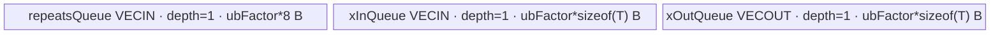
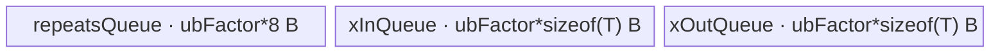

# RepeatInterleaveIntWithDim 950 ACLNN 算子知识

## 算子速览

| 项目 | 内容 |
|---|---|
| 实际入口 | `aclnnRepeatInterleaveIntWithDimGetWorkspaceSize` + `aclnnRepeatInterleaveIntWithDim`，公开两段式 ACLNN，无更高版本符号 |
| 计算语义 | 对 `self` 的 `dim` 轴每个切片连续复制 `repeats` 次；`out.shape[dim] = self.shape[dim] * repeats`，其它维不变 |
| 输入输出 | `self/out` 为 ND、1–8 维；公开 dtype 为 UINT8/INT8/INT16/INT32/INT64/BOOL/FLOAT16/BFLOAT16/FLOAT；`repeats/dim/outputSize` 为 `int64_t` 标量 |
| 执行类型 | 核心节点为单 Kernel `AIV_VECTOR`；BOOL 在核心节点前后经过框架 `Cast`，非连续输入和最终输出经过框架 `Contiguous/ViewCopy` |
| Kernel 路线 | API 空域短路、`repeats==1` 拷贝短路；其余固定 key `101`，Device 内分 R-001 CP 分核、R-002 小 CP Gather、R-003 中 CP 整组展开、R-004 中 CP 分段展开、R-005 大 CP LoopMode |
| 核心资源 | GM `x/y`，三个 depth=1 的 `VECIN/VECOUT` Queue，MicroAPI 寄存器；系统 workspace 为 `16 MiB + AIV核数*128 B`，kernel body 不读 user workspace |
| 来源闭包 | `source_closed`：公开 ACLNN→950 selector→`RepeatInterleave` Host/Tiling/POD→key 101 entry→`RepeatInterleaveScalarImpl`/gather helper→950 构建与二进制配置均闭合 |
| 验证状态 | 已完成源码闭包检查；本次知识提取未执行编译、真机、数值或性能测试。 |

## 接口与语义

### 计算语义

设规范化后的轴为 `d = dim < 0 ? dim + rank(self) : dim`，`r = repeats`。对任意轴前索引 `p`、轴索引 `i`、轴后索引 `q`：

```text
out[p, i*r + j, q] = self[p, i, q],  0 <= j < r
out.shape[d] = outputSize = self.shape[d] * r
```

公开约束要求 `r >= 0` 和 `outputSize = self.shape[d] * r`。该接口是常数重复次数语义，不包含 tensor-repeats、无 dim、Grad、原地或量化变体。

### 输入、输出与属性

| 参数 | shape/layout | dtype | 约束、默认值与语义 |
|---|---|---|---|
| `self` | ND，公开 1–8 维，可非连续、可空 | UINT8、INT8、INT16、INT32、INT64、BOOL、FLOAT16、BFLOAT16、FLOAT | 被复制数据；950 API 实现还列出 UINT16/UINT32/UINT64，但公开文档未把它们纳入本接口契约 |
| `repeats` | Host 标量 | `int64_t` | 非负；`0` 与合法 `outputSize=0` 走空域短路，`1` 走拷贝短路，`>=2` 进入核心算子 |
| `dim` | Host 标量 | `int64_t` | `[-rank(self), rank(self)-1]`；0 维 `self` 不允许；负值在 launcher 前规范化 |
| `outputSize` | Host 标量 | `int64_t` | 公开契约要求等于 `self.shape[d] * repeats`；用于分配核心临时输出 shape |
| `out` | ND，shape 与 `self` 同 rank，可非连续 | 与 `self` 相同 | `out.shape[d]=outputSize`，其它维与 `self` 相同；API 运行后用完整 shape 相等检查核心结果 |
| `workspaceSize` | Host 输出 | `uint64_t*` | 返回 executor 中全部节点的 Device workspace 总量 |
| `executor` | Host 输出 | `aclOpExecutor**` | 第一段构建，第二段在指定 stream 上消费 |

### 入口与版本

固定提交公开声明和文档只给出无版本后缀的 `aclnnRepeatInterleaveIntWithDim` 两段式接口。文档产品表明确支持 Ascend 950PR/950DT。950 API 的 `IsRegbase()` 分支把 `repeats` 直接转换成 shape `[1]`、DT_INT64 tensor；随后调用 `l0op::RepeatInterleaveV2`。其 selector 对非 ASCEND910B/ASCEND910_93 立即返回 false，所以 950 实际启动旧 op type `RepeatInterleave`，但 body 是本提交新增的 `arch35` 950 实现。

## Host/Launcher 执行流程

### 参数校验与前处理

调用顺序如下：

1. `OP_CHECK_COMM_INPUT` 校验 `workspaceSize/executor`，创建 executor。
2. `CheckParamsDimInt` 校验 `self/out` 非空、950 dtype 列表、输出 dtype 与输入一致、`repeats>=0`、`dim` 有效且 rank 非 0、rank 不超过 8。源码没有再次计算 `outputSize == self.shape[d]*repeats`，该关系来自公开调用契约和后续 shape 一致检查。
3. `self->IsEmpty() || outputSize==0` 时返回 `workspaceSize=0`，executor 不含核心节点。
4. `repeats==1` 时添加框架 `Contiguous(self)` 和 `ViewCopy(..., out)`，不添加 `RepeatInterleave`。
5. 其它情况：`InitializeTensor` 添加 `Contiguous`；因本入口已经拒绝 rank 0，不走其 `BroadcastTo` 分支。950 `IntToTensor` 用 `FVector<int64_t>{repeats}` 和 `ConvertToTensor` 生成 shape `[1]` 常量 tensor。
6. BOOL 输入先 `Cast(BOOL→INT8)`；规范化 `dim`；`RepeatInterleaveV2` 在 950 selector 中退回 `RepeatInterleave`；核心输出 shape 按 `outputSize` 设置。
7. 核心结果必须与 `out` shape 完全一致；BOOL 再 `Cast(INT8→BOOL)`；最后 `ViewCopy` 到用户 `out`。
8. 第二段 `aclnnRepeatInterleaveIntWithDim` 仅调用 `CommonOpExecutorRun(workspace, workspaceSize, executor, stream)`。

### 参数、Workspace 与生命周期

ACLNN executor 拥有框架临时 tensor、Host 常量 repeats tensor和节点列表；第一段用 `GetWorkspaceSize()` 返回整个图的 workspace，第二段在调用者提供的同等大小内存和 stream 上运行。核心 `RepeatInterleave` Tiling 单独请求：

```text
kernel_workspace = 16 * 1024 * 1024 + totalAivCoreNum * 128 bytes
```

entry 要求 `workspace` 与 `GetUserWorkspace(workspace)` 均非空，再调用 `SetSysWorkspace`；key 101 body 的 `Init/Process` 没有读取传入的 user workspace。框架 `Contiguous/Cast/ViewCopy/ConvertToTensor/CommonOpExecutorRun` 的内部 workspace 切片属于允许的框架边界，固定算子目录不公开其逐 slice offset。

### 启动图与失败传播

```text
空域: ACLNN phase-1 -> workspaceSize=0 -> phase-2 无 Device 核心节点

repeats==1:
  [框架 Contiguous] -> [框架 ViewCopy(out)]

repeats>=2（公开合法域）:
  [框架 Contiguous]
  -> [BOOL only: 框架 Cast BOOL->INT8]
  -> RepeatInterleave(x, repeats=[r], axis=d)  # 单 AIV kernel, key=101
  -> [BOOL only: 框架 Cast INT8->BOOL]
  -> [框架 ViewCopy(out)]
```

核心节点由 `ADD_TO_LAUNCHER_LIST_AICORE(RepeatInterleave, ...)` 加入同一 executor；Tiling 设 `blockDim=usedCoreNum`、`scheduleMode=1`、local memory size 为平台 UB。executor 在同一 stream 中维护节点顺序与临时 tensor lifetime；任一 launcher 添加失败返回 null，API 用 `CHECK_RET` 阻断后续节点；phase-2 返回 `CommonOpExecutorRun` 状态。

## Route 与参数设计

### 分核与资源计算

对本入口的 repeats shape `[1]`，Host 恒走 scalar merge：

```text
N  = product(self.shape[0..d])       # 含 repeat 轴，单位：切片数
CP = product(self.shape[d+1..rank))  # 每个轴元素后的连续元素数
mergedDims = [N, 1, CP]
C = total AIV core count
eachCoreBatchCount = ceil_div(N, C)
usedCoreNum = ceil_div(N, eachCoreBatchCount)
tailCoreBatchCount = N - eachCoreBatchCount*(usedCoreNum-1)
R = output.shape[d] / input.shape[d] # 公开合法域等于 repeats
```

若 `usedCoreNum < C/2 && CP*sizeof(T) > 128`，再切 CP：

```text
ratio    = floor(C / usedCoreNum)
normalCP = max(ceil_div(CP, ratio), 128/sizeof(T))
cpSlice  = ceil_div(CP, normalCP)
usedCoreNum *= cpSlice
tailCP   = CP - normalCP*(cpSlice-1)
isSplitCP = 1
```

本入口 repeats shape 恰为 1，因此 `SplitRepeatsShape` 的 `repeatShape[0] != 1` 谓词永远不成立，key 201/202 不可达。UB tile 为：

```text
U = int64_t
ubFactorRaw = UB / 2 / (2*sizeof(T) + sizeof(U))
ubFactor    = floor(ubFactorRaw / 32) * 32 elements
```

### Route 选择

| 顺序 | Route | Key/模板 | 精确选择条件与优先级 | 不适用去向 |
|---:|---|---|---|---|
| 1 | R-001 CP 分核 LoopMode | `101`; `RepeatInterleaveScalarImpl<T,int64_t>` | Host `isSplitCP==1` | `isSplitCP==0` 到 R-002 |
| 2 | R-002 小 CP Gather | `101`; gather helper | `isSplitCP==0 && CP*sizeof(T)<32 && CP*R*sizeof(T)<=256` | 到 R-003 |
| 3 | R-003 中 CP 整组展开 | `101`; unaligned register copy | `isSplitCP==0 && CP*sizeof(T)<128 && !R-002 && floor(ubFactor/CP)/R>0` | 到 R-004 |
| 4 | R-004 中 CP 分段展开 | `101`; unaligned register copy | `isSplitCP==0 && CP*sizeof(T)<128 && !R-002 && floor(ubFactor/CP)/R==0` | 到 R-005 |
| 5 | R-005 大 CP LoopMode | `101`; UB_TO_OUT LoopMode | `isSplitCP==0 && CP*sizeof(T)>=128` | 无；固定仓未提供其它 key fallback |

```text
if Host splitCP:
    R-001
else if CP_bytes < 32 and CP*R*sizeof(T) <= 256:
    R-002
else if CP_bytes < 128:
    if floor(ubFactor/CP)/R > 0: R-003
    else:                       R-004
else:
    R-005
```

### 模板/实现执行矩阵

| Route | key/selector | dtype/shape/platform 完整命中条件 | 执行拓扑与 Kernel 节点 | 实际模板/body | 内存与同步特征 | tail/fallback |
|---|---|---|---|---|---|---|
| R-001 | 101 + `isSplitCP=1` | 950、repeats `[1]` INT64、`used<C/2`、`CP*sizeof(T)>128` | 单 AIV kernel | `ProcessSplitCp→CopyInX→CopyOutY` | 3 Queue；UB_TO_OUT LoopMode 直接重复 GM 写 | CP 尾 slice + UB 尾 loop |
| R-002 | 101 + Device guard | `isSplitCP=0` 且小 CP/输出组不超过 256 B | 单 AIV kernel | `ProcessCpMatchToUbGather→CopyCpToRepeatOutGatherAicore` | gather index/数据寄存器；MTE3→V event 防覆盖 | `tailOutElems` mask；否则 R-003 |
| R-003 | 101 + Device guard | 中 CP，且一份 UB 输出可容纳至少一个完整 repeat group | 单 AIV kernel | `ProcessCpMatchToUb→CopyOneCpToRepeatOutScalarVf` | 一次载入多个 CP，寄存器展开到 xOutQueue；MTE3→V | tail CP group |
| R-004 | 101 + Device guard | 中 CP，完整 repeat group 大于 xOutQueue tile | 单 AIV kernel | `CopyOneCpToRepeatOutLargeScalarVf` | 每个 CP 按 `cpCountInUbFactor` 次数分段展开/写出 | tail repeatTimes |
| R-005 | 101 + Device guard | `isSplitCP=0 && CP*sizeof(T)>=128` | 单 AIV kernel | `ProcessWholeCp→CopyInX→CopyOutY` | 只在 UB 物化一份输入 tile，LoopMode 重复写 GM | UB 尾 loop |

BOOL 的核心模板参数 `T=int8_t`，前后 Cast 是框架边界；其它公开 dtype 的 `T` 与输入一致。`U` 在本入口恒为 `int64_t`。

### 隐藏性能 Guard

| Guard | Host/Tiling 条件 | Device/资源原因 | 影响 Route | 不满足时去向 | 源码符号 |
|---|---|---|---|---|---|
| CP 跨核 | `used<C/2 && CP*sizeof(T)>128` | N 轴不足半核且连续 CP 足够大时增加并行 slice | R-001 | whole-CP 路线 | `RepeatInterleaveTilingKernelNorm::GetUbFactor/SplitCP` |
| Gather | `CP*sizeof(T)<32 && CP*R*sizeof(T)<=256` | 一个重复组不超过单 VREG 256 B，用索引 gather 构造输出 | R-002 | 中/大 CP | `RepeatInterleaveScalarImpl::ProcessWholeCp` |
| UB 完整 repeat group | `floor(ubFactor/CP)/R>0` | xOutQueue 可容纳至少一个 CP 的全部 R 次输出 | R-003 | R-004 | `CopyXToMatchOut` |
| LoopMode | `CP*sizeof(T)>=128` 或 Host 已 split CP | 避免在 UB 物化 R 份大 CP，用 MTE3 loop 重复同一 tile | R-001/R-005 | 小 CP 展开 | `CopyOutY` |
| 32 元素对齐 | `ubFactor=floor(raw/32)*32` | Queue 分配与 tile 统一到 32 元素粒度 | 全部 | `ubFactor` 可能降为 0；源码无显式 fallback | `GetUbFactor` |
| workspace 非空 | entry 中 `workspace!=nullptr && GetUserWorkspace(workspace)!=nullptr` | 初始化系统 workspace 后才进入 body | 全部 | entry 直接 return，无输出 | `repeat_interleave` |
| 固定 key 101 | repeats shape `[1]` 使 `repeatsCount>=0` | 选择 scalar body；201/202 与 102 对本入口不可达 | 全部 | 无未知 key 报错，router静默结束 | `GetTilingKey`/`repeat_interleave` |

### POD/ABI

`RepeatInterleaveTilingKernelDataNorm` 由 `BEGIN_TILING_DATA_DEF` 宏声明。固定仓可确认字段顺序、每字段均为 `int64_t` 和 Host/Device 使用同一结构；宏实现位于外部构建依赖，故精确 `sizeof/alignof/offsetof` 在固定仓不可见，不能臆造。

| 结构 | 字段 | 类型/位宽 | ABI 布局 | 单位 | Host/launcher producer | Device consumer | 边界 |
|---|---|---|---|---|---|---|---|
| `RepeatInterleaveTilingKernelDataNorm` | `totalCoreNum` | `int64_t`/64 | 声明序号 0；精确 offset 不可见 | core | `compileInfo.coreNumAscendc` | scalar body 不读取 | 本 Route inactive consumer |
| 同上 | `usedCoreNum` | `int64_t`/64 | 序号 1；精确 offset 不可见 | core | 分 N/CP 后的核数 | scalar body 不读取；blockDim 使用同值 | 必须大于 0 |
| 同上 | `eachCoreBatchCount` | `int64_t`/64 | 序号 2；精确 offset 不可见 | N slice | `ceil_div(N,C)` | `ProcessWholeCp/ComputeStartOffset` | 最后一核改读 tail |
| 同上 | `tailCoreBatchCount` | `int64_t`/64 | 序号 3；精确 offset 不可见 | N slice | `N-each*(used-1)` | `ProcessWholeCp` 最后一核 | 非尾核不读 |
| 同上 | `isSplitCP` | `int64_t`/64 | 序号 4；精确 offset 不可见 | bool flag | `SplitCP` 置 1，默认 0 | `Process/ComputeStartOffset` | 决定 R-001 或 whole-CP |
| 同上 | `normalCP` | `int64_t`/64 | 序号 5；精确 offset 不可见 | element | `max(ceil_div(CP,ratio),128/sizeof(T))` | `ProcessSplitCp` | whole-CP inactive |
| 同上 | `tailCP` | `int64_t`/64 | 序号 6；精确 offset 不可见 | element | `CP-normalCP*(cpSlice-1)` | `ProcessSplitCp` 尾 slice | whole-CP inactive |
| 同上 | `cpSlice` | `int64_t`/64 | 序号 7；精确 offset 不可见 | slice | `ceil_div(CP,normalCP)` | block→N/CP 映射 | whole-CP inactive |
| 同上 | `ubFactor` | `int64_t`/64 | 序号 8；精确 offset 不可见 | element | `floor((UB/2/(2*sizeof(T)+8))/32)*32` | Queue 容量、tile/loop | 无显式非零 guard |
| 同上 | `repeatsCount` | `int64_t`/64 | 序号 9；精确 offset 不可见 | repeat count | `out.shape[d]/in.shape[d]` | `Init`、所有输出地址/循环 | 依赖公开 outputSize 契约；应为 `repeats>=2` |
| 同上 | `totalRepeatSum` | `int64_t`/64 | 序号 10；精确 offset 不可见 | element | `yShape[d]` | scalar body 不读取 | 本 Route inactive consumer |
| 同上 | `mergedDims[0]` | `int64_t`/64 | 数组元素 0；精确 offset 不可见 | N slice | `product(shape[0..d])` | 仅间接形成分核字段 | Device 不直接读 |
| 同上 | `mergedDims[1]` | `int64_t`/64 | 数组元素 1；精确 offset 不可见 | repeat-axis group | scalar merge 固定 1 | Process 循环上界 | 本入口恒 1 |
| 同上 | `mergedDims[2]` | `int64_t`/64 | 数组元素 2；精确 offset 不可见 | element/CP | `product(shape[d+1..])` | 地址、guard、搬运长度 | 必须为正；空域已短路 |

### Route 源码闭包

| Route | Key/selector | Host/Tiling producer | POD/参数 | Kernel entry/router 节点 | Kernel body/直接依赖 | 构建接线 |
|---|---|---|---|---|---|---|
| R-001 | 101 + `isSplitCP=1` | `repeat_interleave_tiling_normal.cpp::GetUbFactor/SplitCP` | Norm POD | `repeat_interleave_apt.cpp::repeat_interleave` | `repeat_interleave_scalar.h::ProcessSplitCp/CopyOutY` | CMake + OpDef + ascend950 binary JSON |
| R-002 | 101 + gather guard | 同上 | Norm POD | 同上 | `ProcessWholeCp/ProcessCpMatchToUbGather` + `repeat_interleave_gather.h` | 同上 |
| R-003 | 101 + fit guard | 同上 | Norm POD | 同上 | `ProcessCpMatchToUb/CopyXToMatchOut/CopyOneCpToRepeatOutScalarVf` | 同上 |
| R-004 | 101 + chunk guard | 同上 | Norm POD | 同上 | `CopyXToMatchOut/CopyOneCpToRepeatOutLargeScalarVf` | 同上 |
| R-005 | 101 + CP≥128 | 同上 | Norm POD | 同上 | `ProcessWholeCp/CopyInX/CopyOutY` | 同上 |

## Kernel 实现

### 公共执行流程

`repeat_interleave(x,repeats,y,workspace,tiling)` 是唯一核心 entry。它校验 workspace、设置 system workspace、创建 `TPipe`，声明 `KERNEL_TYPE_MIX_AIV_1_0`，key 101 解析 Norm POD并实例化 `RepeatInterleaveScalarImpl<DTYPE_X,DTYPE_REPEATS>`。`Init` 绑定三个 GM tensor，分配三个 depth=1 Queue；`repeatsQueue_` 被分配但 scalar body 不搬运或读取 repeats GM，真实重复次数来自 POD `repeatsCount`。`Process` 只在 `GetBlockIdx()<GetBlockNum()` 时执行，再按 `isSplitCP` 进入 CP-split 或 whole-CP。

### Route R-001：CP 分核 LoopMode

#### 适用条件

##### 选择证据

| 层级 | 文件 | 符号 | 源码谓词/参数 | 结果/下一跳 |
|---|---|---|---|---|
| API selector | `op_api/repeat_interleave.cpp` | `IsRepeatInterleaveV2Support` | 950 不是 910B/910_93 | 选择 `RepeatInterleave` |
| Tiling | `op_host/arch35/repeat_interleave_tiling_normal.cpp` | `GetUbFactor` | `used<C/2 && CP*sizeof(T)>128` | `SplitCP()`，key 仍为 101 |
| Router | `op_kernel/repeat_interleave_apt.cpp` | `repeat_interleave` | `TILING_KEY_IS(101)` | scalar body |
| Device | `op_kernel/arch35/repeat_interleave_scalar.h` | `Process` | `isSplitCP==1` | `ProcessSplitCp` |

#### Device 数据流

##### 函数级调用链

```text
RepeatInterleaveTilingForAscendC -> RepeatInterleaveTilingKernelNorm::DoTiling
Host launch repeat_interleave(x,repeats,y,workspace,NormPOD)
  -> RepeatInterleaveScalarImpl::Init
  -> Process -> ProcessSplitCp
    -> CopyInX -> DataCopyPad(GM->xInQueue)
    -> CopyOutY -> CopyXToOut(MicroAPI copy)
                -> SetLoopModePara -> DataCopyPad(UB->GM repeated R times)
```

##### 源码等价伪码

```text
# 伪码
cpTile = block%cpSlice == cpSlice-1 ? tailCP : normalCP
cpBase = (block%cpSlice)*normalCP
nBase  = (block/cpSlice)*mergedDims[1]
for repeatDimIdx in [nBase, nBase+mergedDims[1]):
  for tileOffset in range(0, cpTile, ubFactor):
    valid = min(ubFactor, cpTile-tileOffset)
    xIn = GM_x[repeatDimIdx*CP + cpBase + tileOffset : +valid]
    xOut[0:valid] = xIn[0:valid]
    loop_mode(loop1=R, dstStride=CP*sizeof(T))
    GM_y[repeatDimIdx*R*CP + cpBase + tileOffset] <- xOut[0:valid], repeated R times
```

#### 内存与数据搬运

##### 资源与搬运表

| 层级/缓冲区 | offset/地址公式 | extent/容量公式 | dtype/layout | producer | consumer | owner/lifetime | 对齐/复用 |
|---|---|---|---|---|---|---|---|
| GM x | `repeatDimIdx*CP+cpTileOffset+loop*ubFactor` | `valid` elements | T/flattened `[N,CP]` | caller/framework | `CopyInX` | executor input | tail 用精确 byte blockLen |
| `xInQueue_` | 0 | `ubFactor*sizeof(T)` | T | MTE2 | MicroAPI copy | TPipe, tile lifetime | depth 1 |
| `xOutQueue_` | 0 | `ubFactor*sizeof(T)` | T | `CopyXToOut` | MTE3 LoopMode | TPipe, tile lifetime | depth 1；每次释放 |
| `repeatsQueue_` | 0 | `ubFactor*8` | INT64 | 未写 | 未读 | TPipe, kernel lifetime | depth 1，仍计入 UB |
| GM y | `repeatDimIdx*R*CP+cpTileOffset+loopOffset` | `R*valid`，以 stride 分布 | T/flattened output | LoopMode MTE3 | 后续框架节点 | executor temp | `PaddingMode::Compact` |

##### 分层内存布局



##### 字节账与复用顺序

```text
UB_total = ubFactor*(8 + 2*sizeof(T)) <= platform_UB/2
dynamic_ub = N/A（AIV 固定 local memory，Host SetLocalMemorySize(UB)）
workspace_total(core op) = 16 MiB + totalAivCoreNum*128 B
```

| 复用子区 | 写入者 | 读取者/消费点 | 下一次覆盖 | 同步或释放依据 | 安全条件 |
|---|---|---|---|---|---|
| xInQueue slot | `CopyInX` | `CopyXToOut` | 下一 tile | EnQue/DeQue/FreeTensor | 消费后才能覆盖 |
| xOutQueue slot | `CopyXToOut` | LoopMode MTE3 | 下一 tile | EnQue/DeQue/FreeTensor | MTE3 完成后释放 |

#### 同步、精度与尾块

##### 同步与数值边界表

| 阶段 | primitive/机制 | producer | consumer/等待点 | 保护对象 | 精度/尾块 |
|---|---|---|---|---|---|
| GM→UB | Queue | MTE2 | DeQue in compute | x tile | `blockLen=valid*sizeof(T)`，无 padding参与结果 |
| UB copy | MicroAPI mask | xIn | xOut | 有效 bytes | `UpdateMask<int8_t>(remaining bytes)`，位级复制，无 cast |
| UB→GM | LoopMode + Queue | xOut | MTE3/FreeTensor | R 个目标 CP | `loop1Size=R`，尾 CP/tile 用精确 valid |

#### 关键实现

##### 符号证据表

| 阶段 | 文件 | 符号/模板实例 | 实现事实 |
|---|---|---|---|
| Host/Tiling producer | `op_host/arch35/repeat_interleave_tiling_normal.cpp` | `SplitCP/PostTiling` | CP 切片、blockDim、POD |
| Kernel entry/router | `op_kernel/repeat_interleave_apt.cpp` | `repeat_interleave`, key 101 | Norm POD→scalar body |
| Device body/helper | `op_kernel/arch35/repeat_interleave_scalar.h` | `ProcessSplitCp/CopyOutY` | block→N×CP 映射、LoopMode 重复写出 |

### Route R-002：小 CP Gather

#### 适用条件

##### 选择证据

| 层级 | 文件 | 符号 | 源码谓词/参数 | 结果/下一跳 |
|---|---|---|---|---|
| Tiling | `repeat_interleave_tiling_normal.cpp` | `GetUbFactor` | CP 未切分 | `isSplitCP=0`, key 101 |
| Device | `repeat_interleave_scalar.h` | `ProcessWholeCp` | `CP*sizeof(T)<32 && CP*R*sizeof(T)<=256` | gather path |
| Helper | `repeat_interleave_gather.h` | `CopyCpToRepeatOutGatherAicore` | T size 1/2/4/8 | B8 deinterleave 或普通 gather |

#### Device 数据流

##### 函数级调用链

```text
repeat_interleave -> ScalarImpl::Init -> Process -> ProcessWholeCp
  -> ProcessCpMatchToUbGather -> CopyInX
  -> CopyXToMatchOutGather -> CopyOneCpToRepeatOutGather
  -> CopyCpToRepeatOutGatherAicore -> CopyCpToRepeatOutGatherVf
  -> CopyMatchOutToY
```

##### 源码等价伪码

```text
# 伪码
for each UB-sized group of cpNum source CPs:
  load cpNum*CP source elements
  source_index[k] = floor(k/(R*CP))*CP + k%CP
  gather source_index to registers
  write cpNum*R*CP valid elements to xOut UB
  store contiguous output; tailOutElems controls final mask
```

#### 内存与数据搬运

##### 资源与搬运表

| 层级/缓冲区 | offset/地址公式 | extent/容量公式 | dtype/layout | producer | consumer | owner/lifetime | 对齐/复用 |
|---|---|---|---|---|---|---|---|
| GM x | current CP group | `cpNum*CP` | T | caller | `CopyInX` | input | exact bytes |
| xInQueue | 0 | `ubFactor*sizeof(T)` | T | MTE2 | gather | tile | depth 1 |
| registers | generated indices | one VREG batch | index + T | Arange/Div/Mul/Add | DataCopyGather | VF call | tail mask |
| xOutQueue | 0 | `ubFactor*sizeof(T)` | T | gather | `CopyMatchOutToY` | tile | MTE3→V event before reuse |
| repeatsQueue | 0 | `ubFactor*8` | INT64 | 未写 | 未读 | kernel | depth 1 |

##### 分层内存布局



##### 字节账与复用顺序

```text
UB_total = ubFactor*(8 + 2*sizeof(T)) <= UB/2
register_bytes = 固定仓未公开编译后物理占用；源码可见 index/data/mask/unalign RegTensor 生命周期
workspace_total = 16 MiB + C*128 B
```

| 复用子区 | 写入者 | 读取者/消费点 | 下一次覆盖 | 同步或释放依据 | 安全条件 |
|---|---|---|---|---|---|
| xOutQueue slot | gather VF | `CopyMatchOutToY` | 下一 batch | `MTE3_V SetFlag/WaitFlag` + Queue | 上次 MTE3 完成后再由 Vector 改写 |

#### 同步、精度与尾块

##### 同步与数值边界表

| 阶段 | primitive/机制 | producer | consumer/等待点 | 保护对象 | 精度/尾块 |
|---|---|---|---|---|---|
| gather | `DataCopyGather` | xIn UB | vDstReg | source lanes | 索引纯整数；不改变 T bit pattern |
| B8 | `DeInterleave<uint8_t>` | widened gather | output bytes | even bytes | 1-byte T 通过 16-bit gather 后抽取有效 bytes |
| tail | `UpdateMask` + unaligned post | VF | xOut | tail lanes | `tailOutElems` 只提交有效元素 |
| reuse | MTE3→V event | GM store | next VF write | xOutQueue | 显式 Set/Wait |

#### 关键实现

##### 符号证据表

| 阶段 | 文件 | 符号/模板实例 | 实现事实 |
|---|---|---|---|
| Host/Tiling producer | `op_host/arch35/repeat_interleave_tiling_normal.cpp` | `GetUbFactor/PostTiling` | whole-CP 和 tile 参数 |
| Kernel entry/router | `op_kernel/repeat_interleave_apt.cpp` | key 101 branch | scalar template |
| Device body/helper | `op_kernel/arch35/repeat_interleave_scalar.h`; `repeat_interleave_gather.h` | `ProcessCpMatchToUbGather`; `CalcGatherSrcIdx` | gather索引、B8特殊化、tail mask |

### Route R-003：中 CP 整组展开

#### 适用条件

##### 选择证据

| 层级 | 文件 | 符号 | 源码谓词/参数 | 结果/下一跳 |
|---|---|---|---|---|
| Device | `repeat_interleave_scalar.h` | `ProcessWholeCp` | gather false 且 `CP*sizeof(T)<128` | `ProcessCpMatchToUb` |
| Device | 同上 | `CopyXToMatchOut` | `repeatValueCntInUbFactor=floor(ubFactor/CP)/R > 0` | 多 CP 整组展开 |

#### Device 数据流

##### 函数级调用链

```text
repeat_interleave -> Init -> ProcessWholeCp -> ProcessCpMatchToUb
  -> CopyInX(cpNum*CP)
  -> CopyXToMatchOut -> CopyOneCpToRepeatOut
  -> CopyOneCpToRepeatOutScalarVf -> CopyMatchOutToY
```

##### 源码等价伪码

```text
# 伪码
groupCapacity = floor(ubFactor/CP)/R
for cpGroup in chunks(cpNum, groupCapacity):
  for each CP in cpGroup:
    reg = unaligned_load(CP elements)
    repeat R times: unaligned_store(reg, advancing xOut)
  contiguous_store xOut[0:len(cpGroup)*R*CP] to GM y
```

#### 内存与数据搬运

##### 资源与搬运表

| 层级/缓冲区 | offset/地址公式 | extent/容量公式 | dtype/layout | producer | consumer | owner/lifetime | 对齐/复用 |
|---|---|---|---|---|---|---|---|
| xInQueue | 0 | `ubFactor*sizeof(T)` | T | MTE2 | unaligned load | tile | depth 1 |
| inputRegTensor | current CP | `CP` valid elements | T | DataCopyUnAlign | repeated stores | VF iteration | overwritten next CP |
| xOutQueue | 0 | `ubFactor*sizeof(T)` | T | repeated stores | MTE3 | batch | depth 1 |
| repeatsQueue | 0 | `ubFactor*8` | INT64 | 未写 | 未读 | kernel | reserved |

##### 分层内存布局


##### 字节账与复用顺序

```text
UB_total = ubFactor*(8 + 2*sizeof(T)) <= UB/2
workspace_total = 16 MiB + C*128 B
```

| 复用子区 | 写入者 | 读取者/消费点 | 下一次覆盖 | 同步或释放依据 | 安全条件 |
|---|---|---|---|---|---|
| inputRegTensor | unaligned load | R unaligned stores | next CP | VF program order | R stores完成后覆盖 |
| xOutQueue | VF | MTE3 | next group | MTE3→V event | 上次 store 可见 |

#### 同步、精度与尾块

##### 同步与数值边界表

| 阶段 | primitive/机制 | producer | consumer/等待点 | 保护对象 | 精度/尾块 |
|---|---|---|---|---|---|
| Queue | EnQue/DeQue | MTE2 | VF | xIn | exact valid bytes |
| unaligned VF | UnalignReg | inputReg | output stream | CP tail | `dataCount=CP`，无数值运算 |
| reuse | MTE3→V event | GM store | next VF | xOut | 防止提前覆盖 |

#### 关键实现

##### 符号证据表

| 阶段 | 文件 | 符号/模板实例 | 实现事实 |
|---|---|---|---|
| Host/Tiling producer | `repeat_interleave_tiling_normal.cpp` | `GetUbFactor` | ubFactor/分核 |
| Kernel entry/router | `repeat_interleave_apt.cpp` | key 101 | scalar body |
| Device body/helper | `repeat_interleave_scalar.h` | `CopyXToMatchOut/CopyOneCpToRepeatOutScalarVf` | 整组展开和事件复用 |

### Route R-004：中 CP 分段展开

#### 适用条件

##### 选择证据

| 层级 | 文件 | 符号 | 源码谓词/参数 | 结果/下一跳 |
|---|---|---|---|---|
| Device | `repeat_interleave_scalar.h` | `ProcessWholeCp` | gather false 且 `CP*sizeof(T)<128` | staged path |
| Device | 同上 | `CopyXToMatchOut` | `floor(ubFactor/CP)/R == 0` | 每个 CP 的 R 次输出分段 |

#### Device 数据流

##### 函数级调用链

```text
repeat_interleave -> ProcessWholeCp -> ProcessCpMatchToUb -> CopyInX
  -> CopyXToMatchOut -> CopyOneCpToRepeatOutLarge
  -> CopyOneCpToRepeatOutLargeScalarVf -> CopyMatchOutToY
```

##### 源码等价伪码

```text
# 伪码
copiesPerChunk = floor(ubFactor/CP)
for each source CP:
  for repeatChunk in chunks(R, copiesPerChunk):
    reg = unaligned_load(CP)
    emit min(copiesPerChunk, remainingR) copies into xOut
    store this repeat chunk to its exact GM offset
```

#### 内存与数据搬运

##### 资源与搬运表

| 层级/缓冲区 | offset/地址公式 | extent/容量公式 | dtype/layout | producer | consumer | owner/lifetime | 对齐/复用 |
|---|---|---|---|---|---|---|---|
| xInQueue | current CP group | `ubFactor*sizeof(T)` | T | MTE2 | register load | batch | depth 1 |
| inputRegTensor | `cpIdx*CP` | CP | T | unaligned load | chunk stores | one chunk | may reload each repeat chunk |
| xOutQueue | 0 | `ubFactor*sizeof(T)` | T | repeated stores | MTE3 | chunk | depth 1 |
| GM y | `cpIdx*R + repeatChunkOffset` times CP | chunk repeats*CP | T | MTE3 | downstream | output | exact tail chunk |

##### 分层内存布局


##### 字节账与复用顺序

```text
UB_total = ubFactor*(8 + 2*sizeof(T)) <= UB/2
workspace_total = 16 MiB + C*128 B
```

| 复用子区 | 写入者 | 读取者/消费点 | 下一次覆盖 | 同步或释放依据 | 安全条件 |
|---|---|---|---|---|---|
| xOutQueue | `CopyOneCpToRepeatOutLarge` | `CopyMatchOutToY` | next chunk | MTE3→V event | 每个 chunk 写回后再覆盖 |

#### 同步、精度与尾块

##### 同步与数值边界表

| 阶段 | primitive/机制 | producer | consumer/等待点 | 保护对象 | 精度/尾块 |
|---|---|---|---|---|---|
| chunk reuse | MTE3→V event | chunk GM store | next VF | xOut | 每段显式等待 |
| tail repeats | `tailRepeatTimes` | Host-derived R/device loop | VF | final copies | 精确剩余次数；传给 helper 时窄化为 `uint16_t` |
| numeric | bit copy | x | y | all T | 无 cast/round；BOOL 核心外已转 INT8 |

#### 关键实现

##### 符号证据表

| 阶段 | 文件 | 符号/模板实例 | 实现事实 |
|---|---|---|---|
| Host/Tiling producer | `repeat_interleave_tiling_normal.cpp` | `GetUbFactor` | UB 容量 |
| Kernel entry/router | `repeat_interleave_apt.cpp` | key 101 | scalar body |
| Device body/helper | `repeat_interleave_scalar.h` | `CopyXToMatchOut/CopyOneCpToRepeatOutLargeScalarVf` | 分段 repeat、tail 和事件 |

### Route R-005：大 CP LoopMode

#### 适用条件

##### 选择证据

| 层级 | 文件 | 符号 | 源码谓词/参数 | 结果/下一跳 |
|---|---|---|---|---|
| Tiling | `repeat_interleave_tiling_normal.cpp` | `GetUbFactor` | 未触发 CP split | whole CP |
| Device | `repeat_interleave_scalar.h` | `ProcessWholeCp` | `CP*sizeof(T)>=128` | CP 按 ubFactor 分 loop |

#### Device 数据流

##### 函数级调用链

```text
repeat_interleave -> Init -> ProcessWholeCp
  -> CopyInX -> CopyXToOutScalarVf
  -> SetLoopModePara(UB_TO_OUT) -> DataCopyPad -> ResetLoopModePara
```

##### 源码等价伪码

```text
# 伪码
for each assigned source CP:
  for tile in chunks(CP, ubFactor):
    load valid source elements to xIn
    bit-copy valid bytes once to xOut
    configure UB_TO_OUT loop1Size=R, dstStride=CP*sizeof(T)
    store the same xOut tile to R destination CPs
```

#### 内存与数据搬运

##### 资源与搬运表

| 层级/缓冲区 | offset/地址公式 | extent/容量公式 | dtype/layout | producer | consumer | owner/lifetime | 对齐/复用 |
|---|---|---|---|---|---|---|---|
| GM x | `repeatDimIdx*CP+loop*ubFactor` | valid | T | input | MTE2 | input | exact tail bytes |
| xInQueue | 0 | `ubFactor*sizeof(T)` | T | MTE2 | MicroAPI copy | tile | depth 1 |
| xOutQueue | 0 | `ubFactor*sizeof(T)` | T | MicroAPI copy | MTE3 LoopMode | tile | one physical copy feeds R writes |
| repeatsQueue | 0 | `ubFactor*8` | INT64 | 未写 | 未读 | kernel | reserved |
| GM y | `repeatDimIdx*R*CP+loopOffset` | R*valid strided | T | LoopMode | downstream | output | dst stride CP bytes |

##### 分层内存布局


##### 字节账与复用顺序

```text
UB_total = ubFactor*(8 + 2*sizeof(T)) <= UB/2
workspace_total = 16 MiB + C*128 B
```

| 复用子区 | 写入者 | 读取者/消费点 | 下一次覆盖 | 同步或释放依据 | 安全条件 |
|---|---|---|---|---|---|
| xInQueue | MTE2 | VF | next tile | Queue FreeTensor | VF 完成 |
| xOutQueue | VF | R次 MTE3 | next tile | Queue FreeTensor after DataCopyPad | LoopMode 完成并 reset |

#### 同步、精度与尾块

##### 同步与数值边界表

| 阶段 | primitive/机制 | producer | consumer/等待点 | 保护对象 | 精度/尾块 |
|---|---|---|---|---|---|
| VF copy | byte mask | xIn | xOut | valid bytes | `size=ceil(totalBytes/VREG)`，UpdateMask 处理尾 VREG |
| repeated store | LoopMode | xOut | GM y | R destinations | `blockLen=valid*sizeof(T)`；不写 tile 尾外元素 |
| mode lifetime | Set/ResetLoopModePara | current store | next operation | MTE3 config | 每次 store 后 reset |

#### 关键实现

##### 符号证据表

| 阶段 | 文件 | 符号/模板实例 | 实现事实 |
|---|---|---|---|
| Host/Tiling producer | `repeat_interleave_tiling_normal.cpp` | `GetUbFactor/PostTiling` | ubFactor、blockDim |
| Kernel entry/router | `repeat_interleave_apt.cpp` | key 101 | scalar body |
| Device body/helper | `repeat_interleave_scalar.h` | `ProcessWholeCp/CopyOutY/CopyXToOutScalarVf` | 大 CP 分 tile与LoopMode |

## 算子特定优化

### Trick T-001：小 CP 以寄存器索引 Gather 一次构造重复组

#### 触发与源码依据

- 适用 Route：R-002
- 触发条件：`CP*sizeof(T)<32 && CP*R*sizeof(T)<=256`
- Golden 来源：[`op_kernel/arch35/repeat_interleave_scalar.h:421-430`](../../../../../../../cann-ops-raw/ascendc/ops-nn/955f8b33985b6d72989ebff341bb9c2c564a51bc/index/repeat_interleave/op_kernel/arch35/repeat_interleave_scalar.h#L421-L430)

**官方源码（固定 Commit 连续逐字摘录）**：

```cpp
constexpr uint64_t VREG_SIZE = 256;
if (tilingData_.mergedDims[2] * sizeof(T) < GATHER_CP_THRESHOLD &&
    tilingData_.mergedDims[2] * tilingData_.repeatsCount * sizeof(T) <= VREG_SIZE) {
    ProcessCpMatchToUbGather(startCpIdx, curCoreCpCount);
    return;
}
if (tilingData_.mergedDims[2] * sizeof(T) < MIN_CP_SIZE_THRESHOLD) {
    ProcessCpMatchToUb(startCpIdx, curCoreCpCount);
    return;
}
```

#### 机制与设计原因

`CalcGatherSrcIdx` 用 `Arange/Div/Mul/Sub/Add` 生成“组号×CP + 组内 offset”索引，`DataCopyGather` 直接把每个 CP 的 R 份逻辑重复排列进寄存器/输出 UB。`CP*R*sizeof(T)<=256` 保证一个重复组不超过 VREG；1-byte T 使用宽型 gather 后 `DeInterleave` 抽取有效 bytes。该机制改变了小 CP 的计算管线，避免逐 CP×逐 repeat 的标量式 unaligned load/store 循环。

#### 迁移边界

- 适用：小连续记录的常数次数复制。
- 前提：950 MicroAPI Gather；重复组不超过 256 B；索引类型与 T 宽度特殊化一致。
- 失效：超过阈值后转 R-003/R-004，CP 达 128 B 后转 R-005。
- 未验证：本次知识提取未执行编译、真机、数值或性能测试。

#### 错误做法

固定仓的真实 fallback 是不满足 256 B guard 时改走 staged 或 LoopMode；若无条件 Gather，源码中的索引宽度、单 VREG 输出组假设不再成立。

### Trick T-002：大 CP 只在 UB 保留一份，以 MTE3 LoopMode 写出 R 份

#### 触发与源码依据

- 适用 Route：R-001、R-005
- 触发条件：Host CP split 或 whole-CP 的 `CP*sizeof(T)>=128`
- Golden 来源：[`op_kernel/arch35/repeat_interleave_scalar.h:318-335`](../../../../../../../cann-ops-raw/ascendc/ops-nn/955f8b33985b6d72989ebff341bb9c2c564a51bc/index/repeat_interleave/op_kernel/arch35/repeat_interleave_scalar.h#L318-L335)

**官方源码（固定 Commit 连续逐字摘录）**：

```cpp
CopyXToOut(dataCount);
LocalTensor<T> xOutLocal = xOutQueue_.DeQue<T>();
LoopModeParams loopParams;
loopParams.loop1Size = repeatsScalarValue_;
loopParams.loop2Size = 1;
loopParams.loop1SrcStride = 0;
loopParams.loop2SrcStride = 0;
loopParams.loop1DstStride = tilingData_.mergedDims[2] * sizeof(T);
loopParams.loop2DstStride = 0;
SetLoopModePara(loopParams, DataCopyMVType::UB_TO_OUT);
DataCopyExtParams outParams;
outParams.blockCount = 1;
outParams.blockLen = dataCount * sizeof(T);
outParams.srcStride = 0;
outParams.dstStride = 0;
DataCopyPad<T, PaddingMode::Compact>(yGm_[offset], xOutLocal, outParams);
ResetLoopModePara(DataCopyMVType::UB_TO_OUT);
```

#### 机制与设计原因

`loop1SrcStride=0` 令每次 MTE3 读取同一 UB tile，`loop1DstStride=CP*sizeof(T)` 将 R 份写到相邻输出 CP。UB 只物化一份 `dataCount`，占用不随 R 增长；`blockLen` 来自当前 full/tail tile，`PaddingMode::Compact` 防止尾块无效 bytes 扩散到 GM。

#### 迁移边界

- 适用：输出是固定 stride 的重复块。
- 前提：UB_TO_OUT LoopMode 可用，目标 stride 等于完整 CP bytes，R 与 API outputSize 契约一致。
- 失效：小 CP 由 Gather/UB staged 展开更适合；非固定 repeats tensor 不能复用此 scalar 路线。
- 未验证：本次知识提取未执行编译、真机、数值或性能测试。

#### 错误做法

真实源码每次调用后 `ResetLoopModePara`；遗漏 reset 会把本次 MTE3 配置泄漏到后续搬运，是固定源码直接避免的错误生命周期。

### Trick T-003：N 轴核数不足时继续切连续 CP 轴

#### 触发与源码依据

- 适用 Route：R-001
- 触发条件：`usedCoreNum < totalCoreNum/2 && CP*sizeof(T)>128`
- Golden 来源：[`op_host/arch35/repeat_interleave_tiling_normal.cpp:76-86`](../../../../../../../cann-ops-raw/ascendc/ops-nn/955f8b33985b6d72989ebff341bb9c2c564a51bc/index/repeat_interleave/op_host/arch35/repeat_interleave_tiling_normal.cpp#L76-L86)

**官方源码（固定 Commit 连续逐字摘录）**：

```cpp
// 核数不满一半，继续切分CP轴
int64_t cpAxis = 2;
if ((usedCoreNum_ < totalCoreNum_ / DOUBLE) &&
    (mergedDim_[cpAxis] * ge::GetSizeByDataType(inputDtype_) > MIN_CP_THRESHOLD)) {
    SplitCP();
}
// CP轴切分后，核数还是不满，则切分repeats shape
if ((usedCoreNum_ < totalCoreNum_ / DOUBLE) &&
    (repeatShape_.GetDim(0) > MIN_SHAPE_THRESHOLD || (mergedDim_[cpAxis] == 1 && repeatShape_.GetDim(0) != 1)) &&
    (totalRepeatSum_ > MIN_TOTAL_REPEATS_SUM)) {
```

#### 机制与设计原因

初次按 N 分核后不足半核时，`SplitCP` 用剩余核比例估算 `normalCP`，并保持每片至少 `128/sizeof(T)` 元素。Device 用 `block/cpSlice` 取 N、`block%cpSlice` 取 CP slice，使同一输入轴元素的连续数据由多个 AIV 核处理。本入口 repeats shape 固定 `[1]`，后续 repeat-shape split guard 不成立，避免误把 key 201/202 纳入公开 Route。

#### 迁移边界

- 适用：外部 batch/轴元素少但轴后连续 CP 大的数据复制。
- 前提：不同 CP slice 写入 GM 区间不重叠，`cpSlice/normalCP/tailCP` 与 blockDim 一致。
- 失效：CP 不超过 128 B 或 N 分核已达到半核时保持 whole-CP 路线。
- 未验证：本次知识提取未执行编译、真机、数值或性能测试。

#### 错误做法

固定仓未提供可验证反例；源码通过 `block/cpSlice` 与 `block%cpSlice` 的配对映射避免不同核写到同一 CP slice。

## 模板与实现对比

| 对比维度 | R-001 CP split | R-002 Gather | R-003 fit | R-004 chunk | R-005 LoopMode | 设计选择依据 |
|---|---|---|---|---|---|---|
| 命中条件/优先级 | Host split | 小于32 B且组≤256 B | 中 CP且整组入 UB | 中 CP且整组不入 UB | CP≥128 B | 先 Host 并行度，再 Device CP bytes/UB |
| 模板与 dtype | scalar T/INT64 | 同左+gather宽度特化 | scalar | scalar | scalar | key 均为101 |
| 循环与分核 | N×CP slice×UB tile | N core×CP group×VREG batch | CP group×R | CP×repeat chunk | N core×CP tile×R MTE3 | 控制输出物化粒度 |
| Queue/TBuf/寄存器/dynamic UB/通信 window | 3 Queue+byte copy reg | 3 Queue+index/data regs | 3 Queue+UnalignReg | 同左 | 3 Queue+byte reg | 无 TBuf/dynamic UB/通信 |
| 内存总占用与复用 | 均为 `ubFactor*(8+2*sizeof(T))` | 同左 | 同左 | 同左 | 同左 | repeatsQueue 虽未用仍计账 |
| 搬运/Vector API | LoopMode MTE3 | DataCopyGather | Unalign load/store | Unalign分段 | LoopMode MTE3 | CP 尺寸决定展开位置 |
| 同步、精度与 tail | Queue，CP/tile尾 | MTE3→V，mask尾 | MTE3→V，CP组尾 | MTE3→V，repeat尾 | Queue，tile尾 | 全部位复制，无核心算术精度变化 |
| fallback/失败边界 | 否则 whole CP | 否则 staged | 容量不足到 R-004 | 无更低路线 | 终点 | unknown key 静默结束 |

## 平台差异

| 项目 | A2 | A3 | 950 |
|---|---|---|---|
| 支持状态 | 公开文档支持，但固定仓缺 Host/Tiling/Kernel 源码闭包 | 同 A2 | 公开支持且 source_closed |
| Host/Launcher | `IsRepeatInterleaveV2Support` 可选 V1/V2，但两者旧平台源码在固定仓不可见 | 同 A2 | selector 固定落 `RepeatInterleave`，arch35 Host/Tiling 闭合 |
| Kernel/资源 | binary config 只声明 V2 compute unit，真实 POD/body/UB 不可见 | 同 A2 | key101 scalar AIV body、3 Queue、系统 workspace 公式闭合 |

## 限制与失败边界

- 公开调用者必须保证 `outputSize=self.shape[d]*repeats`；ACLNN 参数检查未直接重算该等式，核心 Tiling 从 output/input 轴长反推 `repeatsCount`。
- `ubFactor` 会向下对齐到 32 元素；固定源码没有 `ubFactor>0` 的显式失败检查，实际平台 UB 必须使三个 Queue 可分配。
- R-004 把 `cpCountInUbFactor`/`tailRepeatTimes` 传给 `uint16_t repeatTimes`，部分 VF 循环变量也是 `uint16_t`；固定 Host 没有独立的 16-bit guard。不得在缺少平台 UB 与取值证明时外推超大 repeats。
- entry 对 null workspace/user workspace 直接 return，不返回 Device 错误码；正常 launcher 依赖 Tiling 请求的系统 workspace 保证其非空。
- 950 API 实现接受 UINT16/UINT32/UINT64，OpDef/binary 也有对应实例，但公开接口文档未声明，本文不把它们提升为公开支持契约。
- 框架 `Contiguous/Cast/ViewCopy/ConvertToTensor/CommonOpExecutorRun` 的内部实现与 workspace slice 在固定算子目录外，按 Skill 允许的框架边界标注；算子拥有的 selector、POD、kernel 与核心 workspace 已闭合。
- A2/A3 公开入口存在，但固定提交没有对应 V1/V2 Host/Tiling/POD/Kernel 源码，未生成无后缀正式卡。
- 本次知识提取未执行编译、真机、数值或性能测试。

## 源码索引

### 链路索引

| 链路阶段 | 文件 | 关键符号 | 支撑内容 |
|---|---|---|---|
| 入口声明/约束 | `index/repeat_interleave/docs/aclnnRepeatInterleaveIntWithDim.md` | 产品表、函数原型、参数表 | 950公开支持、语义与约束 |
| 入口声明/约束 | `index/repeat_interleave/op_api/aclnn_repeat_interleave.h` | `aclnnRepeatInterleaveIntWithDim*` | 两段式 C ABI |
| 入口实现 | `index/repeat_interleave/op_api/aclnn_repeat_interleave.cpp` | `CheckParamsDimInt`, `IntToTensor`, `aclnnRepeatInterleaveIntWithDimGetWorkspaceSize` | 校验、短路、前后处理与 executor |
| 入口实现 | `index/repeat_interleave/op_api/repeat_interleave.cpp` | `IsRepeatInterleaveV2Support`, `RepeatInterleaveV2` | 950 V2→V1 selector与 launcher |
| Host/Tiling | `index/repeat_interleave/op_host/arch35/repeat_interleave_tiling_base.cpp` | `GetShapeAttrsInfo/MergDimForScalar/GetWorkspaceSize` | shape merge、校验、workspace |
| Host/Tiling | `index/repeat_interleave/op_host/arch35/repeat_interleave_tiling_normal.h` | `RepeatInterleaveTilingKernelDataNorm` | POD 字段定义 |
| Host/Tiling | `index/repeat_interleave/op_host/arch35/repeat_interleave_tiling_normal.cpp` | `GetUbFactor/GetTilingKey/PostTiling` | 分核、tile、key101与序列化 |
| Host/Tiling | `index/repeat_interleave/op_host/arch35/repeat_interleave_tiling_arch35.cpp` | `RepeatInterleaveTilingForAscendC/TilingPrepare...` | AIV核数/UB producer与注册 |
| Kernel entry/body | `index/repeat_interleave/op_kernel/repeat_interleave_apt.cpp` | `repeat_interleave` | workspace guard、key router、模板实例 |
| Kernel entry/body | `index/repeat_interleave/op_kernel/arch35/repeat_interleave_scalar.h` | `RepeatInterleaveScalarImpl` | 全部 key101 Device routes |
| Kernel entry/body | `index/repeat_interleave/op_kernel/arch35/repeat_interleave_gather.h` | `CalcGatherSrcIdx/CopyCpToRepeatOutGatherAicore` | 小 CP Gather helper |
| 构建接线 | `index/repeat_interleave/op_host/repeat_interleave_def.cpp` | `OpAICoreConfig::AddConfig("ascend950")` | 950 OpDef 注册 |
| 构建接线 | `index/repeat_interleave/CMakeLists.txt` | `SUPPORT_COMPUTE_UNIT/SUPPORT_TILING_DIR` | ascend950 + arch35 活动构建 |
| 构建接线 | `index/repeat_interleave/op_host/config/ascend950/repeat_interleave_binary.json` | `RepeatInterleave` op_list | 950 dtype binary实例 |
| 构建接线 | `scripts/kernel/binary_config/ascendc_config.json` | `RepeatInterleave` | compute unit 与 compile option |

### 实现复用检查

| 检查项 | 可复用事实 | 不得改变的约束 | 源码符号 |
|---|---|---|---|
| ABI/POD | scalar repeats 恒用 Norm POD/key101 | 字段顺序/64-bit单位；精确 offset 依赖同一 tiling macro ABI | `RepeatInterleaveTilingKernelDataNorm` |
| 调用顺序 | 校验→短路→Contiguous/常量化→可选Cast→核心→可选Cast→ViewCopy | 950 selector必须落 `RepeatInterleave`；失败必须阻断后续节点 | ACLNN GetWorkspaceSize函数、`RepeatInterleaveV2` |
| workspace/内存 | 3个depth1 Queue；系统 workspace 公式 | repeatsQueue 虽未消费也不能从 UB 账中删除；entry要求 workspace/userWs | `Init/GetWorkspaceSize/repeat_interleave` |
| 同步 | Queue和 staged 路线的 MTE3→V event；LoopMode每次 reset | xOut 被 MTE3 消费完前不得由 Vector 覆盖 | `CopyXToMatchOut*`, `CopyOutY` |
| 精度与尾块 | 核心按 T bit-copy；BOOL在框架边界转INT8；full/tail CP、tile、mask闭合 | 不引入算术 cast/round；只写有效 blockLen/mask | scalar VF helpers |
| 失败边界 | Tiling shape/dtype失败；launcher添加失败；workspace null静默return | 不把 A2/A3缺失 body或 950未公开 unsigned dtype推测为正式闭包 | `CheckShape/CheckDtype`, entry guards |