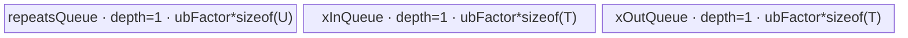

# RepeatInterleaveWithDim 950 ACLNN 算子知识

## 算子速览

| 项目 | 内容 |
|---|---|
| 实际入口 | `aclnnRepeatInterleaveWithDimGetWorkspaceSize` + `aclnnRepeatInterleaveWithDim`，公开 ACLNN、固定仓仅此版本 |
| 计算语义 | 沿归一化轴 `d`，把 `self[...,i,...]` 连续复制 `repeats[i]` 次；单元素/0D `repeats` 广播到整条轴 |
| 输入输出 | 公开契约：`self/out` 为 UINT8、INT8/16/32/64、BOOL、FLOAT16、BFLOAT16、FLOAT，`repeats` 为 INT32/INT64，ND；`self` rank 1～8，`repeats` 0D/1D |
| 执行类型 | 非空核心为单个 `repeat_interleave` AIV_VECTOR Kernel；BOOL 前后 Cast、Contiguous/BroadcastTo/ViewCopy 是 executor 框架边界，无 Cube/AIC 或 MIX_CV |
| Kernel 路线 | R-001 scalar/单元素 repeats（key 101）；R-002 普通 tensor repeats（102）；R-003 分片 repeats+INT32 offset（201）；R-004 分片 repeats+INT64 offset（202） |
| 核心资源 | GM、AIV UB Queue、MicroAPI 寄存器；201/202 另用 user workspace 每核 128-byte 槽传递分片和，`SyncAll` 后计算跨核输出偏移 |
| 来源闭包 | source_closed：公开 ACLNN→950 selector 固定落 `RepeatInterleave`→arch35 Tiling/POD→key 101/102/201/202 router→全部 body/helper→ascend950 config/CMake 闭合 |
| 验证状态 | 已完成源码闭包检查；本次知识提取未执行编译、真机、数值或性能测试。 |

## 接口与语义

### 计算语义

令 `d = dim < 0 ? dim + rank(self) : dim`，`N=prod(self.shape[0:d])`、`R=self.shape[d]`、`CP=prod(self.shape[d+1:])`。若 `repeats` 是 0D 或只有一个元素，令 `r_i=repeats[0]`；否则 `r_i=repeats[i]`。对每个外层批次 `n` 和轴位置 `i`，把长度 `CP` 的连续片 `self[n,i,:]` 按原顺序写出 `r_i` 次，故输出轴长 `O=sum_i(r_i)`，输出地址为 `(n*O + sum_{j<i}r_j + k)*CP`，`0<=k<r_i`。算法只复制位模式，不做数值运算；BOOL 在 ACLNN 层暂时 Cast 为 INT8，核心复制后 Cast 回 BOOL。

### 输入、输出与属性

| 参数 | shape/layout | dtype | 约束、默认值与语义 |
|---|---|---|---|
| `self` | ND，rank 1～8，可非连续、可空 | 公开：UINT8、INT8/16/32/64、BOOL、FLOAT16、BFLOAT16、FLOAT | 被重复的数据；950 ACLNN 实现列表还接受 UINT16/32/64，但公开文档未承诺，不能扩展公开契约 |
| `repeats` | 0D 或 1D、ND，可非连续；1D 长度为 1 或 `self.shape[d]` | INT32、INT64 | 值须为自然数；0D/长度 1 广播，长度 `R` 时逐轴位置取值 |
| `dim` | INT64 标量属性 | INT64 | 必须在 `[-rank(self), rank(self)-1]`，负值在 API 层加 rank |
| `outputSize` | INT64 标量属性 | INT64 | 调用方保证等于广播后的 `sum(r_i)`；API 用它构造临时输出 shape，但不读取 Device `repeats` 验证和值 |
| `out` | ND、可非连续；除 `d` 轴为 `outputSize` 外与 `self` 同形 | 与 `self` 相同 | 核心先写连续临时 Tensor，再由 `ViewCopy` 提交到用户 view |

### 入口与版本

固定仓公开两段式 `aclnnRepeatInterleaveWithDim`，无 V2 ACLNN 符号。第一段构造 executor，第二段由 `CommonOpExecutorRun` 在用户 stream 上运行。第一段内部调用 `l0op::RepeatInterleaveV2`，但该 L0 selector 只在 `ASCEND910B/ASCEND910_93` 考虑 V2；950 不满足平台谓词，固定落到 `ADD_TO_LAUNCHER_LIST_AICORE(RepeatInterleave, ...)`。公开文档明确 950 支持，OpDef、binary config、全局 binary config 和 CMake 同时只把本仓新增的 `RepeatInterleave` body 接到 `ascend950`。

## Host/Launcher 执行流程

### 参数校验与前处理

`aclnnRepeatInterleaveWithDimGetWorkspaceSize` 依次检查公共输出指针、创建 executor、检查 `self/repeats/out` 非空，检查 950 dtype、`out.dtype==self.dtype`、`repeats.rank<=1`、`dim` 范围、1D `repeats` 长度和 `self.rank<=8`。若 `self` 为空或 `outputSize==0`，直接返回 `workspaceSize=0`，不添加 Kernel；非空 `self` 配空 `repeats` 则返回参数错误。其余路径对 `self/repeats` 做 `Contiguous`，0D `repeats` 再 `BroadcastTo([1])`；BOOL `self` Cast 到 INT8；规范化负 `dim`；添加 RepeatInterleave 节点；校验其推导 shape 与 `out` 一致；BOOL 结果 Cast 回 BOOL；最后 `ViewCopy` 到 `out`。任一步返回空 Tensor 指针或 shape 不符都会终止 executor 构造。

### 参数、Workspace 与生命周期

ACLNN 返回的是整个 executor 的 workspace，总量由框架汇总，固定仓没有展开 Contiguous/Cast/ViewCopy 的内部切片。核心 `RepeatInterleave` Tiling 报 `16 MiB + totalCoreNum*128` 字节：前者为 system workspace，`GetUserWorkspace` 之后的 user 区供 201/202 的 `recordSumGm_[blockIdx*128/sizeof(U)]` 使用；101/102 body 不读 user 区，但 entry 仍要求 `workspace` 和 `GetUserWorkspace(workspace)` 非空。executor 持有连续临时 Tensor、可选 Cast 结果和核心输出直到 `CommonOpExecutorRun` 完成；所有节点使用第二段传入的同一 stream，前一节点失败会阻断后续节点。

### 启动图与失败传播

非 BOOL：`Contiguous(self)` / `Contiguous(repeats)`（0D 时再 BroadcastTo）→单个 `RepeatInterleave` AICore 节点→`ViewCopy`。BOOL：在核心前后各多一个 Cast。核心节点由 `RepeatInterleaveTilingForAscendC` 产生 `blockDim=usedCoreNum`、schedule mode 1、本地内存大小和 POD，entry 为 `repeat_interleave(x,repeats,y,workspace,tiling)`。核心只产生一个 Device 节点，没有跨核心 Kernel 的 GM 边；201/202 的跨核偏移在同一 Kernel 内借 user workspace 与 `SyncAll` 交接。entry 的 workspace 空指针、user workspace 空指针或未知 key 都直接返回；API/L0 添加 launcher 失败返回错误，executor 后继节点不运行。

## Route 与参数设计

### 分核与资源计算

Host 先折叠三维。逐元素 repeats 时为 `[N,R,CP]`；0D/单元素 repeats 时为 `[N*R,1,CP]`。初始 `eachCoreBatchCount=ceil(merged[0]/totalCoreNum)`，`usedCoreNum=ceil(merged[0]/eachCoreBatchCount)`，末核批数为 `merged[0]-eachCoreBatchCount*(usedCoreNum-1)`。若 `usedCoreNum<totalCoreNum/2` 且 `CP*sizeof(T)>128`，按 `normalCP=max(ceil(CP, totalCoreNum/usedCoreNum), 128/sizeof(T))` 切 CP，`cpSlice=ceil(CP/normalCP)`。若仍低于半核，且 `(repeatsLen>64 || (CP==1 && repeatsLen!=1)) && outputSize>1024`，把 repeats 轴切成 `repeatsSlice` 片并进入 201/202。

普通路线 `ubFactor=floor32(ubSize/2/(2*sizeof(T)+sizeof(U)))`。分片路线先从可用 UB 扣 `totalCoreNum*32*2`，再取 `ubFactor=floor32((剩余UB-32*sizeof(V))/(2*sizeof(T)+sizeof(U)))`，其中 `V` 是 INT32/INT64 offset 累加类型。workspace 为 `16 MiB+totalCoreNum*128`。

### Route 选择

| 顺序 | Route | Key/模板 | 精确选择条件与优先级 | 不适用去向 |
|---:|---|---|---|---|
| 1 | R-003 分片 INT32 | 201 / `RepeatInterleaveSmall<T,U,int32_t>` | 已触发 `isSplitShape`，且 `repeats.dtype!=INT64 && numel(y)<=INT32_MAX` | 条件不全则检查 R-004 |
| 2 | R-004 分片 INT64 | 202 / `RepeatInterleaveSmall<T,U,int64_t>` | 已触发 `isSplitShape`，且 `repeats.dtype==INT64 \|\| numel(y)>INT32_MAX` | 未分片则检查 scalar |
| 3 | R-001 scalar/单元素 | 101 / `RepeatInterleaveScalarImpl<T,U>` | 未触发 repeats 分片，且原 `repeats` 为 0D 或长度 1，Tiling 写 `repeatsCount=outputSize/self.shape[d]` | 否则 R-002 |
| 4 | R-002 普通 tensor | 102 / `RepeatInterleaveImpl<T,U>` | 未触发 repeats 分片且 `repeats` 为长度 `R` 的 1D Tensor | 无其它 fallback；校验/Tiling 失败 |

```text
isSplitShape = under_half_core_after_CP_split
               && (repeatsLen > 64 || (CP == 1 && repeatsLen != 1))
               && outputSize > 1024
if isSplitShape:
  if repeats.dtype != INT64 && numel(y) <= INT32_MAX: key=201
  else: key=202
else if repeats is 0D or repeatsLen == 1: key=101
else: key=102
```

### 模板/实现执行矩阵

| Route | key/selector | dtype/shape/platform 完整命中条件 | 执行拓扑与 Kernel 节点 | 实际模板/body | 内存与同步特征 | tail/fallback |
|---|---|---|---|---|---|---|
| R-001 scalar | 101 | 950，非空，广播 repeats，未触发分片 | 单 AIV `repeat_interleave` | `RepeatInterleaveScalarImpl<DTYPE_X,DTYPE_REPEATS>`，含 Gather/unaligned/loop-mode 子路径 | 三个 depth=1 Queue；MTE3→V 事件保护输出 UB 复用 | CP<32B 且重复后≤256B 用 Gather；CP<128B 用寄存器复制；大 CP 用 DMA loop；可切 CP |
| R-002 tensor | 102 | 950，非空，长度 R 的 repeats，未触发分片 | 单 AIV | `RepeatInterleaveImpl<DTYPE_X,DTYPE_REPEATS>` | repeats depth1、x/y depth2；MTE2→S 后标量读 repeats | CP<128B 把多个 CP 聚合进 UB；大 CP 用 loop-mode DMA；可切 CP |
| R-003 split32 | 201 | 分片谓词且 offset 可 INT32 | 单 AIV，Kernel 内跨核 workspace 边 | `RepeatInterleaveSmall<T,U,int32_t>` | 五个 depth1 Queue；每核 128B workspace 槽，DCCI+`SyncAll` | CP>256B 用逐 CP loop-mode；否则整体/拆分 UB 输出；大 repeat 再循环 |
| R-004 split64 | 202 | 分片谓词且 INT64 repeats 或输出元素数超 INT32 | 同 R-003 | `RepeatInterleaveSmall<T,U,int64_t>` | 与 R-003 相同，归约/offset RegTensor 为 INT64 | 与 R-003 相同 |

### 隐藏性能 Guard

| Guard | Host/Tiling 条件 | Device/资源原因 | 影响 Route | 不满足时去向 | 源码符号 |
|---|---|---|---|---|---|
| CP 分核 | `usedCoreNum<totalCoreNum/2 && CP*sizeof(T)>128` | 扩大并行核数且保证每片至少 128B | R-001/R-002 | 保持 batch 分核 | `RepeatInterleaveTilingKernelNorm::SplitCP/GetUbFactor` |
| repeats 分片 | 低于半核且长度/CP 谓词、`outputSize>1024` | 用 repeats 轴补并行，需跨核前缀和 | R-003/R-004 | R-001/R-002 | `GetUbFactor/SplitRepeatsShape` |
| offset 位宽 | `repeats.dtype==INT64 \|\| numel(y)>INT32_MAX` | 前缀和及输出 offset 避免 INT32 窄化 | R-004 | R-003 | `UseInt64/GetTilingKey` |
| scalar Gather | `CP*sizeof(T)<32 && CP*repeatsCount*sizeof(T)<=256` | 寄存器 Gather 一次生成小 CP 的重复布局 | R-001 内部 | 普通 unaligned MicroAPI | `RepeatInterleaveScalarImpl::ProcessWholeCp` |
| scalar/normal 大 CP | `CP*sizeof(T)>=128` | 单 CP 超过阈值，按 `ubFactor` 分 loop 并用 MTE loop mode 广播 | R-001/R-002 内部 | 小 CP 聚合路径 | `ProcessWholeCp/CopyOutY` |
| small 大 CP | `CP*sizeof(T)>256` | CP 先 pad 到 32B 对齐跨度，逐项 loop-mode 输出 | R-003/R-004 | 整体/拆分 UB 生成 | `RepeatInterleaveSmall::Process/CopyOutY` |
| UB 对齐 | `ubFactor=floor(公式/32)*32` | Queue 容量和 DataCopy 对齐 | 全部 | Tiling 无显式 fallback；过小 UB 会令因子为 0 | `RepeatInterleaveTilingKernelNorm::GetUbFactor` |

### POD/ABI

字段均由 `TILING_DATA_FIELD_DEF(int64_t,...)` 生成；固定仓未展开宏实现，因此可证明每字段为有符号 64 位及声明/序列化顺序，但 `sizeof/alignof/offsetof` 的具体宏展开固定仓不可见。

| 结构 | 字段 | 类型/位宽 | ABI 布局 | 单位 | Host/launcher producer | Device consumer | 边界 |
|---|---|---|---|---|---|---|---|
| `RepeatInterleaveTilingKernelDataNorm` | `totalCoreNum` | int64/64 | 第1字段；精确 offset 不可见 | core | compile info 的 AIV 核数 | 仅保留在 POD | >0 |
| 同上 | `usedCoreNum` | int64/64 | 第2字段 | core | 分核/CP 切分结果 | POD 保留，entry blockDim 同值 | `<=totalCoreNum` |
| 同上 | `eachCoreBatchCount` | int64/64 | 第3字段 | merged batch | `ceil(merged[0]/totalCoreNum)` | `ProcessWholeCp/ComputeStartOffset` | 末核另用 tail |
| 同上 | `tailCoreBatchCount` | int64/64 | 第4字段 | merged batch | 余批数 | 最后 block | 非末核 inactive |
| 同上 | `isSplitCP` | int64/64 | 第5字段 | bool flag | `SplitCP` 写 1 | `Process`/offset 分支 | 0/1 |
| 同上 | `normalCP` | int64/64 | 第6字段 | element | `SplitCP` | 非末 CP slice | `isSplitCP=0` 时 inactive |
| 同上 | `tailCP` | int64/64 | 第7字段 | element | `CP-normalCP*(slice-1)` | 末 CP slice | 同上 |
| 同上 | `cpSlice` | int64/64 | 第8字段 | slice | `ceil(CP/normalCP)` | block→batch/slice 映射 | 同上 |
| 同上 | `ubFactor` | int64/64 | 第9字段 | element | UB 公式并 floor32 | Queue 容量、loop/tile | 必须正且 CP 除法不为 0 |
| 同上 | `repeatsCount` | int64/64 | 第10字段 | repeats/axis item | 广播时 `outputSize/inputAxis`，否则 -1 | scalar body、102 是否直接读 scalar | 102 为 -1 |
| 同上 | `totalRepeatSum` | int64/64 | 第11字段 | output-axis element | `y.shape[axis]` | tensor路线 batch 输出基址 | scalar 可由 repeatsCount 等价求出 |
| 同上 | `mergedDims[0]` | int64/64 | 数组第1项 | batch | `MergDim` | block/batch 地址 | 广播时含原 axis |
| 同上 | `mergedDims[1]` | int64/64 | 数组第2项 | repeat-axis element | tensor为 R，广播为1 | repeat 模、循环 | >0 |
| 同上 | `mergedDims[2]` | int64/64 | 数组第3项 | CP element | axis 后维乘积 | 所有地址/stride | >0 才能安全计算因子 |
| `RepeatInterleaveTilingKernelDataSmall` | `totalCoreNum` | int64/64 | 第1字段；精确 offset 不可见 | core | compile info | UB/workspace 上界上下文 | >0 |
| 同上 | `usedCoreNum` | int64/64 | 第2字段 | core | `usedCoreNumBefore*repeatsSlice` | block guard、workspace gather | `<=totalCoreNum` |
| 同上 | `eachCoreBatchCount` | int64/64 | 第3字段 | batch | 初始 batch 分核 | POD 保留 | 分片条件下通常为1 |
| 同上 | `tailCoreBatchCount` | int64/64 | 第4字段 | batch | 初始余批 | POD 保留 | 同上 |
| 同上 | `normalRepeatsCount` | int64/64 | 第5字段 | repeats element | `ceil(repeatsLen,ratio)` | slice GM 起点/循环 | 末片另用 tail |
| 同上 | `tailRepeatsCount` | int64/64 | 第6字段 | repeats element | 余 repeats | 末 slice | 非末片 inactive |
| 同上 | `repeatsSlice` | int64/64 | 第7字段 | slice/batch | `ceil(repeatsLen/normalCount)` | `batchNO/sliceNO` | >0 |
| 同上 | `ubFactor` | int64/64 | 第8字段 | element | 分片 UB 公式 | 五 Queue/分组容量 | floor32 |
| 同上 | `totalRepeatSum` | int64/64 | 第9字段 | output-axis element | `y.shape[axis]` | batch 输出基址 | 调用方 outputSize |
| 同上 | `averageRepeatTime` | int64/64 | 第10字段 | repeat count | `outputSize/inputAxis` | 分组归约 mainLen | 输入轴非零 |
| 同上 | `mergedDims[0..2]` | int64[3] | 末尾数组 | element | `MergDim` | batch/repeat/CP 地址 | 与 Norm 同义 |

### Route 源码闭包

| Route | Key/selector | Host/Tiling producer | POD/参数 | Kernel entry/router 节点 | Kernel body/直接依赖 | 构建接线 |
|---|---|---|---|---|---|---|
| R-001 | 101 | `repeat_interleave_tiling_normal.cpp::GetTilingKey` | Norm POD | `repeat_interleave_apt.cpp::repeat_interleave` | `repeat_interleave_scalar.h` + `repeat_interleave_gather.h` | OpDef + ascend950 binary JSON + CMake |
| R-002 | 102 | 同上 | Norm POD | 同上 | `repeat_interleave.h::RepeatInterleaveImpl` | 同上 |
| R-003 | 201 | `UseInt64/GetTilingKey` | Small POD，V=int32 | 同上 | `repeat_interleave_small.h::RepeatInterleaveSmall<T,U,int32_t>` | 同上 |
| R-004 | 202 | `UseInt64/GetTilingKey` | Small POD，V=int64 | 同上 | `repeat_interleave_small.h::RepeatInterleaveSmall<T,U,int64_t>` | 同上 |

## Kernel 实现

### 公共执行流程

四条路线都由 Host 以 `usedCoreNum` 启动同一个 AIV entry。entry 检查 workspace，设置 system workspace，取得 user workspace，创建 `TPipe`，按 key 解码对应 POD/模板并调用 `Init→Process`。所有 body 把 `self` 的 CP 连续片搬到 UB，按 repeats 在 UB 生成重复片或用 UB→OUT loop mode 直接广播，最后写连续 `y`。没有算术精度变化；INT32/INT64 只影响 repeats/offset 读取和 201/202 前缀和。unknown key 没有 else 报错，直接无输出返回。

### Route R-001：scalar/单元素 repeats

#### 适用条件

##### 选择证据

| 层级 | 文件 | 符号 | 源码谓词/参数 | 结果/下一跳 |
|---|---|---|---|---|
| API | `op_api/aclnn_repeat_interleave.cpp` | `aclnnRepeatInterleaveWithDimGetWorkspaceSize` | 950 调 `RepeatInterleaveV2` | 进入 L0 selector |
| L0 | `op_api/repeat_interleave.cpp` | `IsRepeatInterleaveV2Support` | SoC 不是 910B/910_93 | 添加 `RepeatInterleave` |
| Tiling | `op_host/arch35/repeat_interleave_tiling_normal.cpp` | `GetTilingKey` | `!isSplitShape && repeatsCount>-1` | key 101 |
| Router | `op_kernel/repeat_interleave_apt.cpp` | `repeat_interleave` | `TILING_KEY_IS(101)` | `RepeatInterleaveScalarImpl<T,U>` |

#### Device 数据流

##### 函数级调用链

```text
RepeatInterleaveTilingForAscendC -> repeat_interleave(x,repeats,y,workspace,NormPOD)
  -> RepeatInterleaveScalarImpl::Init
  -> Process
    -> ProcessWholeCp -> Gather / ProcessCpMatchToUb / large-CP CopyInX+CopyOutY
    or ProcessSplitCp -> CopyInX -> CopyOutY
```

##### 源码等价伪码

```text
repeat = POD.repeatsCount
batch = splitCP ? block/cpSlice : block*eachCoreBatchCount
yBase = batch*repeat*CP
if splitCP: cpTile=[slice*normalCP, tail-or-normal]
for each assigned source CP item/tile:
  if CPbytes<32 && CP*repeat*sizeof(T)<=256: build gather source indices, gather repeated result
  else if CPbytes<128: load several CPs, unaligned-register copy each CP repeat times
  else: for tile in ceil(CP/ubFactor): GM->xQueue; UB->OUT loop1Size=repeat, dstStride=CPbytes
  write only valid tail bytes/elements
```

#### 内存与数据搬运

##### 资源与搬运表

| 层级/缓冲区 | offset/地址公式 | extent/容量公式 | dtype/layout | producer | consumer | owner/lifetime | 对齐/复用 |
|---|---|---|---|---|---|---|---|
| GM x | `repeatDimIdx*CP+cpTileOffset+loopOffset` | `dataCount` | T/flattened `[batch,1,CP]` | caller | `CopyInX` | caller/executor | tail uses exact byte count |
| `xInQueue_` | UB queue | `ubFactor*sizeof(T)` | T | `DataCopyPad` | MicroAPI/CopyXToOut | pipe until FreeTensor | depth1 |
| `xOutQueue_` | UB queue | `ubFactor*sizeof(T)` | T | Gather/unaligned copy | `DataCopyPad` to y | pipe, repeatedly DeQue/EnQue | depth1; MTE3→V before overwrite |
| `repeatsQueue_` | allocated but scalar body does not load repeats | `ubFactor*sizeof(U)` | U | N/A | N/A | whole Kernel | depth1, reserved |
| GM y | `yBase + repeatedOffset*CP + cpTileOffset+loopOffset` | valid repeated data | T | output Queue/loop-mode DMA | next executor node | executor | compact tail |

##### 分层内存布局



##### 字节账与复用顺序

```text
UB_total = ubFactor*(sizeof(U)+2*sizeof(T))
ubFactor = floor32(ubSize/2/(2*sizeof(T)+sizeof(U)))
dynamic_ub = N/A
workspace_total(core) = 16 MiB + totalCoreNum*128 B; body不消费user区
```

| 复用子区 | 写入者 | 读取者/消费点 | 下一次覆盖 | 同步或释放依据 | 安全条件 |
|---|---|---|---|---|---|
| xOutQueue | MicroAPI Gather/copy | `CopyMatchOutToY`/`CopyOutY` | 下一组 CP | DeQue/EnQue/FreeTensor；MTE3→V | 前一 GM 写完成后才能 V 覆盖 |
| xInQueue | `CopyInX` | MicroAPI 或 byte copy | 下一 tile | Queue DeQue/FreeTensor | 当前计算消费完成 |

#### 同步、精度与尾块

##### 同步与数值边界表

| 阶段 | primitive/机制 | producer | consumer/等待点 | 保护对象 | 精度/尾块 |
|---|---|---|---|---|---|
| GM→UB | Queue | MTE2 `DataCopyPad` | DeQue | x tile | exact `dataCount*sizeof(T)` |
| UB reuse | `MTE3_V` event | 前次 UB→GM | 下次 MicroAPI 写 xOut | output UB | 防提前覆盖 |
| 小 CP | Gather/Unalign Reg | xIn UB | xOut UB | 位模式 | mask/tailOutElems 限制有效 lane |
| 大 CP | MTE loop mode | xOut UB | GM y | CP tile | `loop1Size=repeatsCount`，尾 tile 精确 blockLen |

#### 关键实现

##### 符号证据表

| 阶段 | 文件 | 符号/模板实例 | 实现事实 |
|---|---|---|---|
| Host/Tiling producer | `op_host/arch35/repeat_interleave_tiling_normal.cpp` | `GetUbFactor/GetTilingKey/PostTiling` | key101、POD、blockDim、UB |
| Kernel entry/router | `op_kernel/repeat_interleave_apt.cpp` | `repeat_interleave` key101 | Norm POD→scalar body |
| Device body/helper | `op_kernel/arch35/repeat_interleave_scalar.h` | `RepeatInterleaveScalarImpl` | 三条 CP 子路径、地址、loop-mode、同步 |
| Device helper | `op_kernel/arch35/repeat_interleave_gather.h` | `CopyCpToRepeatOutGatherAicore` | 小 CP Gather index、mask 和 8-bit deinterleave |

### Route R-002：普通 tensor repeats

#### 适用条件

##### 选择证据

| 层级 | 文件 | 符号 | 源码谓词/参数 | 结果/下一跳 |
|---|---|---|---|---|
| Tiling | `repeat_interleave_tiling_base.cpp` | `MergDimForTensor` | repeats 1D 且长度 R | `[N,R,CP]` |
| Tiling | `repeat_interleave_tiling_normal.cpp` | `GetTilingKey` | `!isSplitShape && repeatsCount==-1` | key102 |
| Router | `repeat_interleave_apt.cpp` | `repeat_interleave` | key102 | `RepeatInterleaveImpl<T,U>` |

#### Device 数据流

##### 函数级调用链

```text
repeat_interleave -> RepeatInterleaveImpl::Init -> ComputeStartOffset -> Process
  -> ProcessWholeCp or ProcessSplitCp
  -> CopyInRepeats -> ComputeRepeatsOnCurDim
  -> CopyInX -> CopyXToMatchOut/CopyOutY -> CopyMatchOutToY/GM y
```

##### 源码等价伪码

```text
for assigned batch/CP slice:
  yBase = batch*totalRepeatSum*CP
  cache up to ubFactor repeats values; reload when i leaves cached interval
  ri = repeatsLocal[i % R]
  if CPbytes<128: aggregate CPs in x UB; emit each CP ri times in chunks <=ubFactor/CP
  else: for CP tile: copy x tile; UB->OUT with loop1Size=ri and dstStride=CPbytes
  cumulativeFinished += ri
```

#### 内存与数据搬运

##### 资源与搬运表

| 层级/缓冲区 | offset/地址公式 | extent/容量公式 | dtype/layout | producer | consumer | owner/lifetime | 对齐/复用 |
|---|---|---|---|---|---|---|---|
| repeats GM/Queue | `i%R` | `min(ubFactor,R-offset)` / `ubFactor*sizeof(U)` | U | MTE2 | scalar `GetValue` | depth1 | MTE2→S before scalar read |
| xInQueue | `i*CP+cpTile+loop` | `ubFactor*sizeof(T)` each buffer | T | MTE2 | MicroAPI/byte copy | depth2 | double buffer |
| xOutQueue | cumulative repeated output | `ubFactor*sizeof(T)` each | T | Vector | MTE3 | depth2 | chunks large ri |
| y GM | `batch*O*CP + finished*CP + cpTile+loop` | valid output | T | MTE3 | ViewCopy | executor | exact tail |

##### 分层内存布局


##### 字节账与复用顺序

```text
UB_total = ubFactor*sizeof(U) + 2*ubFactor*sizeof(T) + 2*ubFactor*sizeof(T)
Host ubFactor 使用额外 /2 保守系数：floor32(ubSize/2/(2*sizeof(T)+sizeof(U)))
dynamic_ub = N/A
workspace_total = 16 MiB + totalCoreNum*128 B
```

| 复用子区 | 写入者 | 读取者/消费点 | 下一次覆盖 | 同步或释放依据 | 安全条件 |
|---|---|---|---|---|---|
| repeatsQueue | `CopyInRepeats` | `ComputeRepeatsOnCurDim` | 缓存区间外下一批 | DeQue/FreeTensor；MTE2→S | 标量读取后释放 |
| x queues | CopyIn/Vector | Vector/CopyOut | 下一 CP/tile | depth2 Queue protocol | 不跨 FreeTensor 覆盖 |

#### 同步、精度与尾块

##### 同步与数值边界表

| 阶段 | primitive/机制 | producer | consumer/等待点 | 保护对象 | 精度/尾块 |
|---|---|---|---|---|---|
| repeats read | `MTE2_S` | DataCopyPad | `GetValue` | U scalar | 原 dtype读取后扩为 int64成员 |
| CP复制 | Unalign Reg | x UB | y UB | T位模式 | `repeatTimes` 传入 uint16 helper，超范围无 Host guard |
| 大 CP广播 | loop mode | xOut UB | y GM | T位模式 | ri=0 时 loop size 0 的行为依赖 primitive；公开要求自然数含0 |

#### 关键实现

##### 符号证据表

| 阶段 | 文件 | 符号/模板实例 | 实现事实 |
|---|---|---|---|
| Host/Tiling producer | `op_host/arch35/repeat_interleave_tiling_normal.cpp` | `GetUbFactor/GetTilingKey` | key102、分核、UB |
| Kernel entry/router | `op_kernel/repeat_interleave_apt.cpp` | key102 | Norm POD→normal body |
| Device body/helper | `op_kernel/arch35/repeat_interleave.h` | `RepeatInterleaveImpl` | repeats缓存、CP聚合/切片、DMA 参数与 tail |

### Route R-003：分片 repeats、INT32 offset

#### 适用条件

##### 选择证据

| 层级 | 文件 | 符号 | 源码谓词/参数 | 结果/下一跳 |
|---|---|---|---|---|
| Tiling | `repeat_interleave_tiling_normal.cpp` | `SplitRepeatsShape` | 低利用率及阈值谓词 | 产生 repeats slices |
| Tiling | 同上 | `UseInt64/GetTilingKey` | `repeats.dtype!=INT64 && numel(y)<=INT32_MAX` | key201 |
| Router | `repeat_interleave_apt.cpp` | key201 | Small POD | `RepeatInterleaveSmall<T,U,int32_t>` |

#### Device 数据流

##### 函数级调用链

```text
repeat_interleave -> RepeatInterleaveSmall<T,U,int32_t>::Init -> Process
  -> CalcRepeatsPartStart -> CustomReduceSum<int32>
  -> (large repeats) CalcOutputStartOfset: workspace write -> DCCI -> SyncAll -> gather -> prefix reduce
  -> CopyIn/CopyInAlign -> CopyOut/CopyOutSplit/CopyOutY -> GM y
```

##### 源码等价伪码

```text
batch=block/repeatsSlice; slice=block%repeatsSlice
sliceCount = last ? tailRepeatsCount : normalRepeatsCount
sliceSum = reduce(repeats[slice range])
if R*sizeof(U)>=16384:
  workspace[block*128/sizeof(U)] = sliceSum; DCCI; SyncAll
  outputPrefix = reduce(workspace slots before this slice in same batch)
else: outputPrefix = reduce(repeats[0:sliceStart])
generate repeated CPs into outputQueue; split when sum or count exceeds UB factor
write y[(batch*totalRepeatSum+outputPrefix)*CP:]
```

#### 内存与数据搬运

##### 资源与搬运表

| 层级/缓冲区 | offset/地址公式 | extent/容量公式 | dtype/layout | producer | consumer | owner/lifetime | 对齐/复用 |
|---|---|---|---|---|---|---|---|
| input/repeats/output Queues | slice-local | 各 `ubFactor*sizeof(T/U)` | T/U | CopyIn | Vector/GM | depth1 | 分组循环复用 |
| outputOffsetBuf | UB | `32*sizeof(int32)` | INT32 | ReduceSum | scalar read | depth1 | V→S |
| recordOffsetBuf | UB | `usedCoreNum*32` bytes | U padded records | workspace gather | prefix ReduceSum | depth1 | MTE2→V |
| user workspace | `blockIdx*(128/sizeof(U))` element | 每核128B槽；实际写1个U | U strided records | 当前核 | 所有核 prefix gather | executor | DCCI+SyncAll；Kernel结束后释放 |

##### 分层内存布局


##### 字节账与复用顺序

```text
UB_total = ubFactor*(sizeof(U)+2*sizeof(T)) + 32*sizeof(int32) + usedCoreNum*32
Host reserves totalCoreNum*64 before choosing ubFactor, then subtracts 32*sizeof(int32)
workspace_total = 16 MiB + totalCoreNum*128 B
dynamic_ub = N/A
```

| 复用子区 | 写入者 | 读取者/消费点 | 下一次覆盖 | 同步或释放依据 | 安全条件 |
|---|---|---|---|---|---|
| workspace core slot | 本核 `CalcOutputStartOfset` | 同 Kernel 全核 gather | Kernel结束 | DCCI+`SyncAll` | 每核独占128B cacheline槽 |
| output Queue | IndexRepeat/Group | CopyOutData | 下一分组 | DeQue/FreeTensor | 当前 GM 写完成 |

#### 同步、精度与尾块

##### 同步与数值边界表

| 阶段 | primitive/机制 | producer | consumer/等待点 | 保护对象 | 精度/尾块 |
|---|---|---|---|---|---|
| 分片和发布 | DCCI + `SyncAll` | 各核 workspace store | workspace gather | 跨核前缀和 | INT32 累加条件由 Host key保证输出元素数上界 |
| Reduce | V→S | `CustomReduceSumVf` | `GetValue(0)` | sum buffer | INT32；INT32 repeats通过 SAT Cast 到 INT32等值 |
| 输出生成 | MTE2→S / Queue | repeats load | repeatTimes读取 | U及output UB | 每片/每组 tail 精确计数 |

#### 关键实现

##### 符号证据表

| 阶段 | 文件 | 符号/模板实例 | 实现事实 |
|---|---|---|---|
| Host/Tiling producer | `repeat_interleave_tiling_normal.cpp` | `SplitRepeatsShape/UseInt64/PostTiling` | key201、Small POD与资源 |
| Kernel entry/router | `repeat_interleave_apt.cpp` | key201 | `V=int32_t` |
| Device body/helper | `repeat_interleave_small.h` | `RepeatInterleaveSmall<T,U,int32_t>` | 前缀和、workspace、输出分组和 tail |

### Route R-004：分片 repeats、INT64 offset

#### 适用条件

##### 选择证据

| 层级 | 文件 | 符号 | 源码谓词/参数 | 结果/下一跳 |
|---|---|---|---|---|
| Tiling | `repeat_interleave_tiling_normal.cpp` | `UseInt64` | repeats INT64 或 `numel(y)>2147483647` | `isUseInt64=1` |
| Tiling | 同上 | `GetTilingKey` | `isSplitShape` | key202 |
| Router | `repeat_interleave_apt.cpp` | key202 | Small POD | `RepeatInterleaveSmall<T,U,int64_t>` |

#### Device 数据流

##### 函数级调用链

```text
repeat_interleave -> RepeatInterleaveSmall<T,U,int64_t>::Init -> Process
  -> 与 R-003 相同的 reduce/workspace-prefix/output pipeline，V 改为 int64_t
```

##### 源码等价伪码

```text
执行与 R-003 同序；所有 CustomReduceSum 的 dst、sumOutputLocal、outputStartOffset 使用 INT64。
若 U=INT32，LoadData 以 DIST_UNPACK_B32 载入后按 ZERO/SAT/ZEROING/CAST_NONE Cast 到 INT64。
```

#### 内存与数据搬运

##### 资源与搬运表

| 层级/缓冲区 | offset/地址公式 | extent/容量公式 | dtype/layout | producer | consumer | owner/lifetime | 对齐/复用 |
|---|---|---|---|---|---|---|---|
| 三个数据 Queue | 同 R-003 | `ubFactor*(U+2T)` | T/U | 同 R-003 | 同 R-003 | Kernel | depth1 |
| outputOffsetBuf | UB | `32*sizeof(int64)` | INT64 | ReduceSum | scalar offset | Kernel | V→S |
| recordOffsetBuf/workspace | 同 R-003 | `usedCoreNum*32B` / 每核128B槽 | U记录、INT64消费 | 各核 | prefix Reduce | Kernel | DCCI+SyncAll |

##### 分层内存布局


##### 字节账与复用顺序

```text
UB_total = ubFactor*(sizeof(U)+2*sizeof(T)) + 32*sizeof(int64) + usedCoreNum*32
workspace_total = 16 MiB + totalCoreNum*128 B
dynamic_ub = N/A
```

| 复用子区 | 写入者 | 读取者/消费点 | 下一次覆盖 | 同步或释放依据 | 安全条件 |
|---|---|---|---|---|---|
| workspace/Queue | 同 R-003 | 同 R-003 | Kernel结束/下一分组 | `SyncAll`/FreeTensor | 与 R-003 相同，offset 用 INT64 |

#### 同步、精度与尾块

##### 同步与数值边界表

| 阶段 | primitive/机制 | producer | consumer/等待点 | 保护对象 | 精度/尾块 |
|---|---|---|---|---|---|
| 前缀和 | INT64 Reduce + V→S | repeats/workspace | 地址计算 | 大输出 offset | 避免 INT32 溢出 |
| 其余 | Queue/MTE/DCCI/SyncAll | 同 R-003 | 同 R-003 | 数据与记录 | tail 与 R-003 相同 |

#### 关键实现

##### 符号证据表

| 阶段 | 文件 | 符号/模板实例 | 实现事实 |
|---|---|---|---|
| Host/Tiling producer | `repeat_interleave_tiling_normal.cpp` | `UseInt64/GetTilingKey` | key202 条件 |
| Kernel entry/router | `repeat_interleave_apt.cpp` | key202 | `V=int64_t` |
| Device body/helper | `repeat_interleave_small.h` | `RepeatInterleaveSmall<T,U,int64_t>` | INT64 reduce/offset，其他 pipeline 共用 |

## 算子特定优化

### Trick T-001：小 CP 的寄存器 Gather 生成重复布局

#### 触发与源码依据

- 适用 Route：R-001
- 触发条件：`mergedDims[2]*sizeof(T)<32` 且 `mergedDims[2]*repeatsCount*sizeof(T)<=256`
- Golden 来源：[`index/repeat_interleave/op_kernel/arch35/repeat_interleave_scalar.h:421-425`](../../../../../../../cann-ops-raw/ascendc/ops-nn/955f8b33985b6d72989ebff341bb9c2c564a51bc/index/repeat_interleave/op_kernel/arch35/repeat_interleave_scalar.h#L421-L425)

**官方源码（固定 Commit 连续逐字摘录）**：

```cpp
constexpr uint64_t VREG_SIZE = 256;
if (tilingData_.mergedDims[2] * sizeof(T) < GATHER_CP_THRESHOLD &&
    tilingData_.mergedDims[2] * tilingData_.repeatsCount * sizeof(T) <= VREG_SIZE) {
    ProcessCpMatchToUbGather(startCpIdx, curCoreCpCount);
    return;
}
```

#### 机制与设计原因

该路线不逐次重新装载同一个 CP，而由 `repeat_interleave_gather.h` 根据输出 lane 计算源索引：先除以 `repeats*CP` 得 CP group，再以 `idx%CP` 得组内偏移，随后 `DataCopyGather` 形成重复结果。第二个条件保证一个 CP 重复后的字节数不超过 256-byte VReg；8-bit 数据用宽型 Gather 后 `DeInterleave` 取有效字节。它减少小片反复的 unaligned load/store 控制开销，收益机制来自源码，但未做性能量化。

#### 迁移边界

- 适用：固定次数广播、每个源片很短且单片重复结果可放入 VReg 的复制类算子。
- 前提：950 MicroAPI Gather，可构造不溢出的源索引，`CPbytes<32` 且重复后不超过 256B。
- 失效：条件不满足时回到 R-001 的 unaligned copy 或大 CP loop-mode 子路径。
- 未验证：本次知识提取未执行编译、真机、数值或性能测试。

#### 错误做法

固定仓提供的真实反例边界是忽略 256B 条件仍强行 Gather：官方代码明确在超限时不进入该分支，而走可分块路径。

### Trick T-002：repeats 轴补并行并用 cacheline 独占槽做同 Kernel 前缀和

#### 触发与源码依据

- 适用 Route：R-003、R-004
- 触发条件：batch/CP 分核后仍低于半核，repeats 长度/CP 条件满足且 `outputSize>1024`
- Golden 来源：[`index/repeat_interleave/op_host/arch35/repeat_interleave_tiling_normal.cpp:76-87`](../../../../../../../cann-ops-raw/ascendc/ops-nn/955f8b33985b6d72989ebff341bb9c2c564a51bc/index/repeat_interleave/op_host/arch35/repeat_interleave_tiling_normal.cpp#L76-L87)

**官方源码（固定 Commit 连续逐字摘录）**：

```cpp
// 核数不满一半，继续切分CP轴
int64_t cpAxis = 2;
if ((usedCoreNum_ < totalCoreNum_ / DOUBLE) &&
    (mergedDim_[cpAxis] * ge::GetSizeByDataType(inputDtype_) > MIN_CP_THRESHOLD)) {
    SplitCP();
}
// CP轴切分后，核数还是不满，则切分repeats shape
if ((usedCoreNum_ < totalCoreNum_ / DOUBLE) &&
    (repeatShape_.GetDim(0) > MIN_SHAPE_THRESHOLD || (mergedDim_[cpAxis] == 1 && repeatShape_.GetDim(0) != 1)) &&
    (totalRepeatSum_ > MIN_TOTAL_REPEATS_SUM)) {
    SplitRepeatsShape();
}
```

#### 机制与设计原因

Host 按 batch→CP→repeats 的顺序逐级补并行，只在前两级仍不足半核且输出规模足够时支付前缀和成本。Device 每核先求本 slice 的 repeats 和，把一个 U 值写入独占 128B workspace 槽，清理 cache 后 `SyncAll`，再跨槽 Gather 并 Reduce 得本 slice 的输出前缀。这样多个核可并行生成同一 batch 的不同 repeats 区间，同时避免槽间 false sharing；INT32/INT64 key 按输出地址范围选择累加位宽。

#### 迁移边界

- 适用：输出 offset 由不规则长度前缀和决定、而外层 batch 并行不足的变长展开算子。
- 前提：同一 Kernel 可全核同步；workspace 至少每核 128B；Host 能证明 offset 位宽；分片工作量足以覆盖同步成本。
- 失效：未达阈值时用 R-001/R-002；无全核同步或 cache 可见性保证时必须改成独立 scan Kernel/显式多 Kernel 图。
- 未验证：本次知识提取未执行编译、真机、数值或性能测试。

#### 错误做法

源码可验证的错误边界是仅按 C++ store 顺序读取其它核记录：官方实现显式执行 `DataCacheCleanAndInvalid` 和 `SyncAll`，省略任一可见性/全核到达条件都不能证明前缀和正确。

## 模板与实现对比

| 对比维度 | R-001 scalar | R-002 tensor | R-003 split32 | R-004 split64 | 设计选择依据 |
|---|---|---|---|---|---|
| 命中条件/优先级 | 广播 repeats，未分片 | 逐项 repeats，未分片 | 分片且 INT32 offset 足够 | 分片且需 INT64 | 先决定分片，再决定位宽/广播 |
| 模板与 dtype | `ScalarImpl<T,U>` | `Impl<T,U>` | `Small<T,U,int32>` | `Small<T,U,int64>` | V 只影响前缀和 |
| 循环与分核 | batch/可选CP，内部3种CP路径 | batch/可选CP，缓存repeats | batch×repeats slice | 同 R-003 | 低利用率才拆 repeats |
| Queue/TBuf/寄存器/dynamic UB/通信 window | 3个depth1 Queue+Gather Reg | repeats depth1、x/y depth2 | 5个depth1 Queue+Reduce Reg | 同左，sum INT64 | 均无 dynamic UB/通信 window |
| 内存总占用与复用 | `ubFactor*(U+2T)` | 实际 depth 计为 `ubFactor*(U+4T)` | `ubFactor*(U+2T)+32V+cores*32` | V为8字节 | Host 普通式带保守 /2 |
| 搬运/Vector/SIMT/NDDMA/通信 API | Gather/Unalign/loop-mode | Unalign/loop-mode | Reduce/Unalign/loop-mode | 同左 | 全为 AIV Vector/DMA |
| 同步、精度与 tail | Queue、MTE3→V；位复制 | Queue、MTE2→S；位复制 | 加 DCCI/SyncAll；INT32 offset | INT64 offset | tail 均按确切 blockLen/count |
| fallback/失败边界 | 内部切换，不跨 key | 分片阈值转201/202 | 无下级 fallback | 无下级 fallback | unknown key 无输出 |

## 平台差异

| 项目 | A2 | A3 | 950 |
|---|---|---|---|
| 支持状态 | 公开文档支持；本固定仓缺 Host/Tiling/POD/body，未达 source_closed | 同 A2 | 公开支持且源码闭合 |
| Host/Launcher | L0 可选择 `RepeatInterleaveV2`，但对应实现固定仓不可见 | 同 A2 | `IsRepeatInterleaveV2Support` 平台谓词为 false，固定落 `RepeatInterleave` |
| Kernel/资源 | 全局 config 仅列 V2 名称，具体资源不可见 | 同 A2 | arch35 key101/102/201/202，AIV UB；分片路线每核128B workspace槽 |

## 限制与失败边界

- `outputSize` 与 Device `repeats` 的和值一致性是公开调用约束，ACLNN Host 不读取 Device 值验证；错误值可能先形成错误临时 shape，不能依赖 Kernel 修正。
- 公开要求 repeats 为自然数。固定 Kernel 多处把 repeats/loop 次数窄化为 `uint16_t`，Host 未见 `<=65535` guard；超大单项 repeats 的复用安全边界固定仓未证明。
- Tiling 的 shape 乘积、`numel(y)`、地址和 `ubFactor` 多用 int64/uint64，部分 DMA `blockLen` 转为 uint32；固定仓未见全链路溢出/窄化 guard。
- 普通 R-002 的 Queue 实际 depth 为 x/y 各2，而 Host `ubFactor` 公式以 `(2*T+U)` 后再除2保守估算；卡中按 `InitBuffer` 计真实字节，不能用逻辑 tile 长度替代。
- 950 实现/OpDef/binary config接入 UINT16/UINT32/UINT64，但公开 ACLNN 文档未列这些 dtype；正式接口复用应遵守公开 dtype 表。
- Contiguous、BroadcastTo、Cast、ViewCopy 与 executor workspace 切片属于框架边界，固定仓未展开其 Kernel/POD；核心 RepeatInterleave 的 selector、POD、entry/body、同步和构建已闭合。
- entry 对未知 key、workspace/user workspace 空指针仅提前返回，不在 Device 侧写错误码；错误传播依赖 Host/runtime。
- 本次知识提取未执行编译、真机、数值或性能测试。

## 源码索引

### 链路索引

| 链路阶段 | 文件 | 关键符号 | 支撑内容 |
|---|---|---|---|
| 入口声明/约束 | `index/repeat_interleave/docs/aclnnRepeatInterleaveWithDim.md` | 产品表、函数原型、参数表 | 950公开性、语义、dtype/shape约束 |
| 入口声明/约束 | `index/repeat_interleave/op_api/aclnn_repeat_interleave.h` | `aclnnRepeatInterleaveWithDim*` | C ABI |
| 入口实现 | `index/repeat_interleave/op_api/aclnn_repeat_interleave.cpp` | `CheckParamsDim`、两段式入口 | 校验、前处理、executor图、失败 |
| L0 selector | `index/repeat_interleave/op_api/repeat_interleave.cpp` | `IsRepeatInterleaveV2Support/RepeatInterleaveV2` | 950固定落V1 launcher |
| Host/Tiling | `index/repeat_interleave/op_host/arch35/repeat_interleave_tiling_base.cpp` | BaseTiling | shape/dtype、合维、workspace |
| Host/Tiling/POD | `index/repeat_interleave/op_host/arch35/repeat_interleave_tiling_normal.h` | 两个 POD | 字段顺序与类型 |
| Host/Tiling | `index/repeat_interleave/op_host/arch35/repeat_interleave_tiling_normal.cpp` | NormTiling | 分核、key、UB、POD producer |
| Host注册 | `index/repeat_interleave/op_host/arch35/repeat_interleave_tiling_arch35.cpp` | IMPL_OP_OPTILING | AIV核数/UB producer与注册 |
| Kernel entry/body | `index/repeat_interleave/op_kernel/repeat_interleave_apt.cpp` | `repeat_interleave` | key router |
| Kernel entry/body | `index/repeat_interleave/op_kernel/arch35/repeat_interleave.h` | `RepeatInterleaveImpl` | R-002 body |
| Kernel entry/body | `index/repeat_interleave/op_kernel/arch35/repeat_interleave_scalar.h` | `RepeatInterleaveScalarImpl` | R-001 body |
| Kernel helper | `index/repeat_interleave/op_kernel/arch35/repeat_interleave_gather.h` | Gather helpers | R-001小CP优化 |
| Kernel entry/body | `index/repeat_interleave/op_kernel/arch35/repeat_interleave_small.h` | `RepeatInterleaveSmall` | R-003/R-004 body与同步 |
| 构建接线 | `index/repeat_interleave/op_host/repeat_interleave_def.cpp` | `OpAICoreConfig` | ascend950 OpDef |
| 构建接线 | `index/repeat_interleave/op_host/config/ascend950/repeat_interleave_binary.json` | `RepeatInterleave` binaries | 950 dtype实例 |
| 构建接线 | `index/repeat_interleave/CMakeLists.txt` | `SUPPORT_COMPUTE_UNIT` | ascend950+arch35 |
| 构建接线 | `scripts/kernel/binary_config/ascendc_config.json` | `RepeatInterleave` | 950活动binary config |

### 实现复用检查

| 检查项 | 可复用事实 | 不得改变的约束 | 源码符号 |
|---|---|---|---|
| ABI/POD | Norm/Small 两套全 int64 字段顺序 | key101/102不能按Small解析；201/202不能按Norm解析 | `repeat_interleave_tiling_normal.h` |
| 调用顺序 | Contiguous/可选Cast→Repeat→可选Cast→ViewCopy | BOOL前后Cast与最终ViewCopy不可遗漏 | ACLNN GetWorkspaceSize入口 |
| workspace/内存 | 16MiB system+每核128B；Small独占cacheline槽 | 不得紧缩槽stride或在SyncAll前复用 | `GetWorkspaceSize/CalcOutputStartOfset` |
| 同步 | Queue事件；Small DCCI+SyncAll | 标量读前MTE2→S、UB覆盖前MTE3→V | 各 body 同步点 |
| 精度与尾块 | T位复制；offset按201/202选位宽；exact blockLen | 不得把INT64 offset降为INT32或让padding lane写GM | `UseInt64`、CopyOut方法 |
| 失败边界 | API参数错误、Tiling失败、unknown key无输出 | 不得把缺少Host guard解释为支持超大repeat/溢出shape | `CheckParamsDim/GetTilingKey/repeat_interleave` |