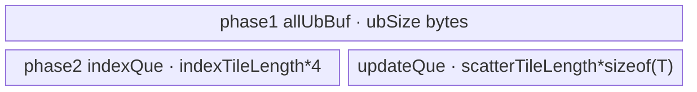

# ScatterNd A2/A3 ACLNN 算子知识

## 算子速览

| 项目 | 内容 |
|---|---|
| 实际入口 | `aclnnScatterNdGetWorkspaceSize` / `aclnnScatterNd`，公开 ACLNN 两段式接口；公开实现复用 `ScatterNdUpdate` 后端。 |
| 计算语义 | 先复制 `data`，再令每个合法索引元组 `indices[p]` 指向的切片等于 `updates[p]`；公开文档承诺默认确定性，排序路线的同键 tie 顺序在固定仓不可见。 |
| 输入输出 | `data/updates/out` 为 ND、同 dtype（FP16/FP32/BOOL/BF16），`indices` 为 ND INT32/INT64；`out.shape=data.shape`。 |
| 执行类型 | ACLNN 前后处理是框架节点；核心 `scatter_nd_update` 为 AIV_VECTOR 单 Kernel，内部可串联 LinearIndex 与 Scatter 两阶段并以 `SyncAll` 交接。 |
| Kernel 路线 | R-001 排序线性索引（key 11/21）；R-002 非排序线性索引（key 10/20）；R-003 INT64 大索引（key 30）。 |
| 核心资源 | GM 输入/输出、用户 workspace 的线性索引/原位置切片、AIV UB `TBuf/TQue`、MTE2/V/MTE3 event；无 Cube、L1/L0C。 |
| 来源闭包 | source_closed：公开入口、参数检查、executor、L0 selector、arch32 Tiling/POD、全部默认确定性 key、entry/body/helper 与 A2/A3 构建接线均已闭合。 |
| 验证状态 | 已完成源码闭包检查；本次知识提取未执行编译、真机、数值或性能测试。 |

## 接口与语义

### 计算语义

设 `K=indices.shape[-1]`，`P=prod(indices.shape[:-1])`，`S=prod(data.shape[K:])`。对连续化后的 `data` 建立输出副本；对第 `p` 个索引元组 `i=(i0,...,iK-1)`，线性行号为 `L=sum(i[d]*prod(data.shape[d+1:K]))`，将 `updates[p, :]` 的 `S` 个元素覆盖到输出第 `L` 个切片。公开约束要求索引非负且不越界。R-002/R-003 按输入行顺序覆盖，重复目标最终取最后一行；R-001 对同一线性地址仅提交一个由排序结果携带的原位置，但固定仓未给出 `Sort` 对同键的稳定性契约，因此不能把其 winner 推断为最大原始位置。

### 输入、输出与属性

| 参数 | shape/layout | dtype | 约束、默认值与语义 |
|---|---|---|---|
| `data` | ND，rank 1~8，可非连续 | FP16/FP32/BOOL/BF16 | 基底数据；dtype 与 `updates/out` 相同。BF16 仅支持 A2/A3/950 对应架构。 |
| `indices` | ND，rank 1~8，可非连续 | INT32/INT64 | `K<=rank(data)`；公开接口要求非负且不越界。核心 arch32 Tiling 实际按最后维 `K` 计算。 |
| `updates` | `indices.shape[:-1]+data.shape[K:]`，ND，可非连续 | 同 `data` | 每个索引元组对应一个长度 `S` 的切片。 |
| `out` | shape 与 `data` 相同，ND，可非连续 | 同 `data` | `ViewCopy` 写入最终输出。 |
| `workspaceSize` | 标量指针 | `uint64_t*` | 第一段接口返回 executor 中所有节点所需 workspace。 |
| `executor` | 不适用 | `aclOpExecutor**` | 持有 Contiguous、ScatterNdUpdate 与 ViewCopy 节点，第二段消费。 |

### 入口与版本

固定提交只公开这一组无版本后缀入口。`index/scatter_nd/op_api/aclnn_scatter_nd.cpp` 为空壳，真实实现位于 CMake 闭合依赖 `index/scatter_nd_update/op_api/aclnn_scatter_nd.cpp`。公开文档同时列 A2、A3；`scatter_nd_update` 的 CMake/OpDef 分别以 `ascend910b`、`ascend910_93` 接入同一 arch32 Tiling 与 `scatter_nd_update` kernel。公共文档声明默认确定性；本卡 Route 描述未定义 `HIGH_PERFORMANCE=1` 的高精度/默认编译体。源码构建系统还可产生显式 high-performance 变体，其重复索引跨核写入不保证确定性，不属于公开默认语义。

## Host/Launcher 执行流程

### 参数校验与前处理

`CheckParams` 依次检查四个 tensor 非空、`data` 属于 FP16/FP32/BOOL/BF16、`indices` 属于 INT32/INT64、`updates/out` dtype 等于 `data`，再检查 rank 1~8、`out.shape=data.shape`、`rank(updates)=rank(data)+rank(indices)-K-1`、`K<=rank(data)` 及逐维 shape 拼接关系。任一失败返回公开文档对应的 `ACLNN_ERR_PARAM_NULLPTR` 或 `ACLNN_ERR_PARAM_INVALID`。任一 `data/indices/updates` 为空时直接返回 workspace 0 与空 executor，不启动核心 Kernel。非空时依次把三个输入送入 `l0op::Contiguous`；这些是允许的框架边界。

### 参数、Workspace 与生命周期

`CREATE_EXECUTOR` 创建 owner；`l0op::ScatterNdUpdate(dataContiguous, indicesContiguous, updatesContiguous, false, executor)` 以 `dataContiguous` 为原地 `var/self`，随后 `ViewCopy(updateRet,out)`。`uniqueExecutor->GetWorkspaceSize()` 汇总框架节点与核心用户 workspace；第二段 `CommonOpExecutorRun(workspace,workspaceSize,executor,stream)` 在同一 stream 顺序执行。核心 Tiling 设 `sysWorkspace=GetLibApiWorkSpaceSize()`，用户区为对齐后的 `P` 个 INT32 线性索引，排序 Route 再追加 `P` 个 INT32 原位置；`GetUserWorkspace` 在 kernel entry 中越过系统区。

### 启动图与失败传播

```text
Contiguous(data) -> Contiguous(indices) -> Contiguous(updates)
  -> ScatterNdUpdateAiCore(self=dataC, indicesC, updatesC, use_locking=false)
     -> scatter_nd_update(var, indices, updates, varRef, workspace, tiling)
        -> [R-001/R-002: LinearIndexKernel]
        -> SyncAll + TPipe::Destroy -> [Scatter kernel]
        -> [R-003: LargeIndexKernel only]
  -> ViewCopy(updated self, out)
```

所有 executor 节点共享调用者传入的 stream；节点失败使 `ADD_TO_LAUNCHER_LIST_AICORE`、`ViewCopy` 或 `CommonOpExecutorRun` 返回失败并阻断后续。R-001 的 workspace 边为 `linearIndex[0:P_aligned)` 与 `originalPos[P_aligned:2*P_aligned)`；R-002 只有第一片；producer 是 `LinearIndexKernel::CopyOut`，consumer 是排序/非排序 Scatter，entry 内 `SyncAll()` 保证跨 AIV 核可见，`TPipe::Destroy` 后新建 pipe 避免 UB 生命周期串扰。R-003 无用户数据边。

## Route 与参数设计

### 分核与资源计算

`totalLength=prod(data.shape[0:K])`，`P=prod(indices.shape[:-1])`，`S=prod(data.shape[K:])`。`coreNum=min(AIV_core_num,totalLength,P)`，至少 1。线性索引 tile 的 `coeff=(INT64?2K+3:K+3)`，`blockLength=min(floor((UB/coeff/4)/32)*32,4096)`；按 `blockNum=P/blockLength`、余数及 `front/tailCoreNum` 分配。Scatter 按输出行域分核，`tailRow=totalLength/coreNum`，`frontRow=tailRow+1`；更新 UB 元素数为 `floor((UB-2*4096*4)/32)*32/sizeof(T)`，切片再按 `S` 分 tile。workspace 的 `P_aligned=ceil(P/8)*8`，总量为系统区加 `P_aligned*4`（所有线性路线）再加 `P_aligned*4`（排序路线）。

### Route 选择

| 顺序 | Route | Key/模板 | 精确选择条件与优先级 | 不适用去向 |
|---:|---|---|---|---|
| 1 | R-003 INT64 大索引 | key 30 | `indices=INT64 && totalLength>INT32_MAX`；`needLargeIndexKernel=true` 强制 `sortFlag=0` | 否则判断排序阈值 |
| 2 | R-001 排序线性索引 | key 11/21 | `totalLength<=2^24-1`；INT32→11，INT64→21 | 否则 R-002 |
| 3 | R-002 非排序线性索引 | key 10/20 | 未命中 R-003 且 `totalLength>2^24-1`；INT32→10，INT64→20 | 无其它 key；未知 key 无 body |

```text
if indices is INT64 and totalLength > INT32_MAX: key=30
else if totalLength <= (2^24-1): key=(indices INT32 ? 11 : 21)
else: key=(indices INT32 ? 10 : 20)
```

### 模板/实现执行矩阵

| Route | key/selector | dtype/shape/platform 完整命中条件 | 执行拓扑与 Kernel 节点 | 实际模板/body | 内存与同步特征 | tail/fallback |
|---|---|---|---|---|---|---|
| R-001 排序 | 11/21 | A2/A3；`totalLength<=2^24-1`；index INT32/INT64 | 单 launch、两阶段 | `LinearIndexKernel<true,int/int64_t>` → `ScatterNdUpdateKernel<T,isView>` | 两个 workspace 切片；全核 `SyncAll`；排序后按输出域消费 | 4096 行 tile 与余行；每 slice tile 单独搬运 |
| R-002 非排序 | 10/20 | A2/A3；`2^24-1<totalLength` 且非 INT64 大索引 | 单 launch、两阶段 | `LinearIndexKernel<false,int/int64_t>` → `ScatterNdUpdateKernelNoSort<T,isView>` | 一个 workspace 切片；`SyncAll`；每核扫描全部 index tile，仅写所属输出域 | index/scatter 双 tail；未知 key 无动作 |
| R-003 大索引 | 30 | INT64 且 `totalLength>INT32_MAX` | 单 launch、单阶段 | `LargeIndexKernel<T,isView>` | 不窄化线性地址，不用用户 workspace；每核输出域互斥 | 扫全部 index block，过滤到本核 `[start,end)` |

### 隐藏性能 Guard

| Guard | Host/Tiling 条件 | Device/资源原因 | 影响 Route | 不满足时去向 | 源码符号 |
|---|---|---|---|---|---|
| FP32 精确整数排序 | `totalLength<=2^24-1` | R-001 把 INT32 线性索引 cast 为 FP32 后 `Sort`；超过精确整数范围会失真 | R-001 | R-002 | `ScatterNdUpdateArch32Tiling::IsSort` |
| INT64 大地址 | `totalLength>INT32_MAX` 且 indices INT64 | 普通路径把线性地址存 INT32；大域改为标量 INT64 累加 | R-003 | 普通线性路线 | `needLargeIndexKernel_` / `LargeIndexKernel::ComputeLinearIndex` |
| UB 线性 tile | `blockLength=floor(UB/(coeff*4)/32)*32`, cap 4096 | `allUbBuf` 同时容纳输出、原 indices、cast/add/range 与排序临时区 | R-001/R-002 | 最小回退 32 元素 | `Tiling4LinearIndex` / `InitBuffersUnified` |
| View stride | 仅允许 dim1..末维连续；stride0 可大于期望 | `ResolveOutOffset` 只修正首维 storage stride | 全部 | Tiling 失败或走连续偏移 | `HandleViewStride` |
| 空域 | API 任一输入 empty | executor 不添加核心节点 | 全部 | workspace 0，成功返回 | `aclnnScatterNdGetWorkspaceSize` |

### POD/ABI

宏生成的四个结构按声明顺序序列化；固定仓未提供 `sizeof/alignof/offsetof` 静态断言，ABI 数值布局因此标为固定仓不可见。

| 结构 | 字段 | 类型/位宽 | ABI 布局 | 单位 | Host/launcher producer | Device consumer | 边界 |
|---|---|---|---|---|---|---|---|
| `ScatterNdUpdateScatterTiling` | `scatterLength` | uint64/64 | 固定仓不可见 | 元素/索引行 | `ParseScatterShapes` | 三个 Scatter body 的行跨度 | `S` |
| 同上 | `tailRow` | uint64/64 | 同上 | 输出行 | `totalLength/coreNum` | `CalcBlockDistribution` | 可为 0 |
| 同上 | `frontRow` | uint64/64 | 同上 | 输出行 | `tailRow+1` | 同上 | 主核 |
| 同上 | `frontNum` | uint64/64 | 同上 | core | `totalLength%coreNum` | 同上 | 可为 0 |
| 同上 | `tailNum` | uint64/64 | 同上 | core | `tailRow?coreNum-frontNum:0` | 分核审计 | inactive 可 0 |
| 同上 | `ubLengthForUpdates` | uint64/64 | 同上 | T 元素 | UB 余量公式 | update queue/TBuf 容量 | 已扣排序保留区 |
| 同上 | `scatterAlignLength` | uint64/64 | 同上 | T 元素 | `ceilAlign(S,32/sizeof(T))` | sort body 批行容量 | 32B 对齐 |
| 同上 | `formDim` | uint64/64 | 同上 | 行 | `scatterAlignLength/ubLengthForUpdates` | `copyRow` producer | 可为 0 |
| 同上 | `copyRow` | uint64/64 | 同上 | 行 | tile>1?1:按 UB 容量 | R-001 update 批 | 至少 1 |
| 同上 | `scatterTileNum` | uint64/64 | 同上 | tile | `ceilDiv(S,tileLength)` | 所有 Scatter 循环 | 至少 1 |
| 同上 | `scatterTileLength` | uint64/64 | 同上 | T 元素 | `min(S,ubLength)` | GM/UB 地址步长 | 0 时置 1 |
| 同上 | `scatterTileTail` | uint64/64 | 同上 | T 元素 | `S-(n-1)*tile` | 最后 tile | 可为 0 |
| 同上 | `scatterTileAlignLength` | uint64/64 | 同上 | T 元素 | tile 32B 对齐 | R-001 UB 行距 | padding 不写 GM |
| `ScatterNdUpdateLinearIndexTiling` | `coreNum` | uint64/64 | 同上 | AIV core | 平台核数与域 min | LinearIndex 分核 | 至少 1 |
| 同上 | `ubSize` | uint64/64 | 同上 | byte | `GetCoreMemSize(UB)` | `allUbBuf` 总容量 | >0 |
| 同上 | `indexDim` | uint64/64 | 同上 | 维 | `indices.shape[-1]` | 线性地址循环 | API 保证 `<=rank(data)` |
| 同上 | `blockLength` | uint64/64 | 同上 | 索引行 | UB 公式/cap 4096 | index tile | 32 对齐 |
| 同上 | `blockNum` | uint64/64 | 同上 | 完整 tile | `P/blockLength` | 主循环 | 可为 0 |
| 同上 | `blockRemainLength` | uint64/64 | 同上 | 行 | `P%blockLength` | tail | 可为 0 |
| 同上 | `tailBlockNum` | uint64/64 | 同上 | tile/core | `blockNum/coreNum` | LinearIndex | 尾核组 |
| 同上 | `frontBlockNum` | uint64/64 | 同上 | tile/core | `tailBlockNum+1` | LinearIndex | 前核组 |
| 同上 | `frontCoreNum` | uint64/64 | 同上 | core | `blockNum%coreNum` | LinearIndex | 可为 0 |
| 同上 | `tailCoreNum` | uint64/64 | 同上 | core | 条件式 | LinearIndex | 可为 0 |
| 同上 | `sortWorkspace` | uint64/64 | 同上 | INT32 元素 | `ceilAlign(P,8)` | workspace 第二片偏移 | R-003 inactive |
| 同上 | `indicesMask[8]` | uint64[8] | 同上 | 行 stride | data 前 K 维逆向累乘 | 线性地址 | 仅前 K 项 active |
| 同上 | `isInt64Indices` | uint64/64 | 同上 | bool | dtype 判断 | 审计/tiling | 0/1 |
| 同上 | `needLargeIndexKernel` | uint64/64 | 同上 | bool | INT64 且大域 | key 30/审计 | 0/1 |
| `ScatterNdUpdateViewTiling` | `isViewStride0` | uint64/64 | 同上 | bool | `HandleViewStride` | entry 模板 `isView` | 0/1 |
| 同上 | `varStride0Elements` | uint64/64 | 同上 | T 元素 | 实际 stride0 或期望值 | `ResolveOutOffset` | 仅 view 差异有效 |
| 同上 | `firstDimStrideRows` | uint64/64 | 同上 | 行 | `K>1?indicesMask[0]:1` | view 行号拆分 | 非零 |
| `ScatterNdUpdateHpTiling` | `hpCoreNum` | uint64/64 | 同上 | core | `min(coreNum,P)` | HP body 分核 | 默认确定性 body inactive |
| 同上 | `hpFrontIndexNum` | uint64/64 | 同上 | 索引行/core | `P/hpCoreNum+1` | HP 前核 | inactive |
| 同上 | `hpTailIndexNum` | uint64/64 | 同上 | 索引行/core | `P/hpCoreNum` | HP 尾核 | inactive |
| 同上 | `hpFrontCoreNum` | uint64/64 | 同上 | core | `P%hpCoreNum` | HP 分核 | inactive |
| 同上 | `hpTailCoreNum` | uint64/64 | 同上 | core | 条件尾差 | HP 分核 | inactive |
| 同上 | `hpIndexTileLength` | uint64/64 | 同上 | 索引行 | HP UB 余量，32 对齐、cap4096 | HP index tile | inactive |
| 同上 | `hpScatterTileLength` | uint64/64 | 同上 | T 元素 | 半 UB 与双缓冲公式 | HP slice tile | inactive |
| 同上 | `hpScatterTileNum` | uint64/64 | 同上 | tile | `ceilDiv(S,hpScatterTileLength)` | HP slice loop | inactive |
| 同上 | `hpScatterTileTail` | uint64/64 | 同上 | T 元素 | `S-(n-1)*tile` | HP tail | inactive |
| 同上 | `hpRowBytesAligned` | uint64/64 | 同上 | byte | row/tile 32B 对齐 | HP ping-pong slot | inactive |
| 同上 | `hpRowsPerBatch` | uint64/64 | 同上 | 行 | 每 half-UB 容量，cap256 | HP batch DMA | inactive |

### Route 源码闭包

| Route | Key/selector | Host/Tiling producer | POD/参数 | Kernel entry/router 节点 | Kernel body/直接依赖 | 构建接线 |
|---|---|---|---|---|---|---|
| R-001 | 11/21 | `arch32/scatter_nd_update_tiling.cpp::Init/SetTilingKeyMode` | `ScatterNdUpdateArch32TilingData` | `scatter_nd_update.cpp::RunLinearIndexAndScatter<true>` | `LinearIndexKernel`、`ScatterNdUpdateKernel`、common helpers | `scatter_nd_update/CMakeLists.txt` + OpDef ascend910b/910_93 |
| R-002 | 10/20 | 同上 | 同上 | `RunLinearIndexAndScatter<false>` | `LinearIndexKernel`、`ScatterNdUpdateKernelNoSort` | 同上 |
| R-003 | 30 | 同上 | 同上 | `RunLargeIndex` | `LargeIndexKernel`、`ResolveOutOffset` | 同上 |

## Kernel 实现

### 公共执行流程

入口参数顺序为 `var,indices,updates,varRef,workspace,tiling`；语义输出实际写 `varRef`（L0 注册把 `self` 同时作为输入输出）。entry 拒绝空 workspace/user workspace，解析 POD 后按 key 与 `isViewStride0` 实例化。所有路线均把目标输出域划成互斥 `[start,end)`，所以不同核不写同一输出行；重复索引在拥有该行的核内解析。DMA 通过 `DataCopyPad`，尾长以字节传入；MTE2→标量/Vector、V→MTE3、MTE3→标量依赖由 common event helpers 闭合。

### Route R-001：排序线性索引

#### 适用条件

##### 选择证据

| 层级 | 文件 | 符号 | 源码谓词/参数 | 结果/下一跳 |
|---|---|---|---|---|
| Tiling | `op_host/arch32/scatter_nd_update_tiling.cpp` | `IsSort/SetTilingKeyMode` | `totalLength<=2^24-1` 且非 large | key 11/21 |
| Router | `op_kernel/scatter_nd_update.cpp` | `scatter_nd_update` | `TILING_KEY_IS(11/21)` | `LinearIndexKernel<true>` + sorted Scatter |

#### Device 数据流

##### 函数级调用链

```text
scatter_nd_update
  -> LinearIndexKernel<true,IndexT>::Process
    -> CopyIn -> optional CastToInt32 -> ComputeLinearIndexFromIndices
    -> ComputeForSort -> CopyOut(linearIndex, originalPos)
  -> SyncAll -> TPipe::Destroy -> new TPipe
  -> ScatterNdUpdateKernel<T,isView>::Process
    -> CopyIndicesIn -> UpdateSearchParam -> CopyUpdateIn -> CopyOut
```

##### 源码等价伪码

```text
for assigned index tile:                 # 伪码
  load indices[P_tile,K]; INT64 时 CAST_NONE -> INT32
  linear[p] = sum(indices[p,d] * indicesMask[d])
  cast linear to FP32; pad tail with -1; Sort(descending, carry original position)
  store sorted linear and original position to workspace
SyncAll()
for every workspace tile intersecting this core's output-row interval [start,end):
  scan descending group from right to left; for each new linear value choose the carried position first encountered
  for each slice tile: load updates[pos,tile] -> UB; store to output[linear,tile]
```

#### 内存与数据搬运

##### 资源与搬运表

| 层级/缓冲区 | offset/地址公式 | extent/容量公式 | dtype/layout | producer | consumer | owner/lifetime | 对齐/复用 |
|---|---|---|---|---|---|---|---|
| workspace linear | user+0 | `P_aligned*4` | INT32 1D | LinearIndex | sorted Scatter | executor/kernel launch | 8 元素对齐 |
| workspace pos | user+`P_aligned*4` | `P_aligned*4` | INT32 1D | Sort | sorted Scatter | 同上 | 同上 |
| `allUbBuf` | UB base | `ubSize` | INT32 视图复用 | LinearIndex | Vector Sort/CopyOut | phase 1 | 子区按 coeff 切片 |
| `indiceQue/posIdxQue` | TQue VECIN | 各 `blockLength*4` | INT32 | workspace DMA | binary search | phase 2 | depth 1（常量名虽为 1） |
| `updateQue` | TQue VECOUT | `ubLengthForUpdates*sizeof(T)` | T | updates DMA | output DMA | 每批 Alloc→Free | depth 1 |

##### 分层内存布局


##### 字节账与复用顺序

```text
phase1 UB_total = ubSize
phase2 UB_total = 2*blockLength*4 + ubLengthForUpdates*sizeof(T)
workspace_total = sysWorkspace + 2*P_aligned*4
=> blockLength 的 coeff 公式与 update UB 公式分别约束两个 pipe 生命周期
```

| 复用子区 | 写入者 | 读取者/消费点 | 下一次覆盖 | 同步或释放依据 | 安全条件 |
|---|---|---|---|---|---|
| `allUbBuf` | CopyIn/Vector | Sort/CopyOut | 下一 index tile | phase 内 event；phase 后 `Destroy` | `SyncAll` 后才销毁 |
| `updateQue` | `CopyUpdateIn` | `CopyOut` | 下一批更新 | EnQue/DeQue/FreeTensor | `inUbNum<=copyRow` |

#### 同步、精度与尾块

##### 同步与数值边界表

| 阶段 | primitive/机制 | producer | consumer/等待点 | 保护对象 | 精度/尾块 |
|---|---|---|---|---|---|
| index load | `MTE2_S` | DMA | scalar/vector | indices UB | INT64→INT32 `CAST_NONE` 仅在 `totalLength<=INT32_MAX` |
| sort | `PIPE_V` barriers | Cast/Sort/Extract | next vector op | FP32 sort tuples | `2^24-1` guard保证整数精确；tail pad -1 |
| phase edge | `SyncAll` | all LinearIndex cores | Scatter phase | workspace | 跨核可见 |
| output | `MTE3_S` | UB→GM | buffer reuse | output slice | 仅 `tileLength` 有效字节 |

#### 关键实现

##### 符号证据表

| 阶段 | 文件 | 符号/模板实例 | 实现事实 |
|---|---|---|---|
| Host/Tiling producer | `op_host/arch32/scatter_nd_update_tiling.cpp` | `Tiling4LinearIndex/Tiling4Scatter` | FP32 排序 guard、分核、UB/workspace 公式 |
| Kernel entry/router | `op_kernel/scatter_nd_update.cpp` | `RunLinearIndexAndScatter` | phase 顺序与 `SyncAll` |
| Device body/helper | `arch32/scatter_nd_update_linear_index.h` / `scatter_nd_update.h` | `ComputeForSort/CopyOut` | 排序携带原位置并对每个重复线性地址只提交一次 |

### Route R-002：非排序线性索引

#### 适用条件

##### 选择证据

| 层级 | 文件 | 符号 | 源码谓词/参数 | 结果/下一跳 |
|---|---|---|---|---|
| Tiling | `arch32/scatter_nd_update_tiling.cpp` | `IsSort` | `totalLength>2^24-1` 且未命中 INT64 large | key 10/20 |
| Router | `op_kernel/scatter_nd_update.cpp` | key 10/20 branch | `IsSort=false` | no-sort body |

#### Device 数据流

##### 函数级调用链

```text
LinearIndexKernel<false,IndexT>::Process -> workspace linearIndex
  -> SyncAll
  -> ScatterNdUpdateKernelNoSort<T,isView>::Process
     -> index tile scan -> ProcessOneIndex -> DoScatterCopy
```

##### 源码等价伪码

```text
compute and store linear[p] for all p; SyncAll                     # 伪码
for index tiles in original order:
  load linear[]
  for p in tile:
    if linear[p] in this core's [start,end):
      for slice tile: load updates[p] and overwrite output[linear[p]]
```

#### 内存与数据搬运

##### 资源与搬运表

| 层级/缓冲区 | offset/地址公式 | extent/容量公式 | dtype/layout | producer | consumer | owner/lifetime | 对齐/复用 |
|---|---|---|---|---|---|---|---|
| workspace linear | user+0 | `P_aligned*4` | INT32 | LinearIndex | no-sort Scatter | launch | `P` 8 对齐 |
| `allUbBuf` | UB | `ubSize` | packed | phase1 | phase1 | first pipe | no sort tuple |
| `indexQue` | UB | `indexTileLength*4` | INT32 | workspace | scalar filter | phase2 | `indexTileLength` 8 对齐 |
| `updateQue` | UB | `scatterTileLength*sizeof(T)` | T | updates | output | per index/tile | 有效尾字节 |

##### 分层内存布局



##### 字节账与复用顺序

```text
phase1 UB_total = ubSize
phase2 UB_total = indexTileLength*4 + scatterTileLength*sizeof(T)
workspace_total = sysWorkspace + P_aligned*4
```

| 复用子区 | 写入者 | 读取者/消费点 | 下一次覆盖 | 同步或释放依据 | 安全条件 |
|---|---|---|---|---|---|
| index queue | workspace DMA | scalar scan | next tile | EnQue/DeQue/FreeTensor | scan 完成后释放 |
| update queue | updates DMA | output DMA | next slice | `MTE3_S` + FreeTensor | GM store 已提交 |

#### 同步、精度与尾块

##### 同步与数值边界表

| 阶段 | primitive/机制 | producer | consumer/等待点 | 保护对象 | 精度/尾块 |
|---|---|---|---|---|---|
| phase edge | `SyncAll` | LinearIndex | no-sort Scatter | workspace | 无 FP32 sort |
| output | `MTE2_S/MTE3_S` | DMA | scalar/reuse | tile | 最后 index/scatter tile 用 tail 长度 |

#### 关键实现

##### 符号证据表

| 阶段 | 文件 | 符号/模板实例 | 实现事实 |
|---|---|---|---|
| Host/Tiling producer | `arch32/scatter_nd_update_tiling.cpp` | `SetTilingKeyMode/CalcWorkSpaceSize` | key 10/20 与单片 workspace |
| Kernel entry/router | `op_kernel/scatter_nd_update.cpp` | `RunLinearIndexAndScatter<false>` | 两阶段 launch 内拓扑 |
| Device body/helper | `arch32/scatter_nd_update_no_sort.h` | `Process/ProcessOneIndex` | 原序扫描、输出域过滤、尾 tile |

### Route R-003：INT64 大索引

#### 适用条件

##### 选择证据

| 层级 | 文件 | 符号 | 源码谓词/参数 | 结果/下一跳 |
|---|---|---|---|---|
| Tiling | `arch32/scatter_nd_update_tiling.cpp` | `Init` | INT64 且 `totalLength>INT32_MAX` | `needLargeIndexKernel=true`, key30 |
| Router | `op_kernel/scatter_nd_update.cpp` | `RunLargeIndex` | key30 | `LargeIndexKernel` |

#### Device 数据流

##### 函数级调用链

```text
scatter_nd_update -> RunLargeIndex -> LargeIndexKernel<T,isView>::Process
  -> CopyInInt64 -> ComputeLinearIndex(GetValue) -> ScatterUpdate -> output GM
```

##### 源码等价伪码

```text
for every input-index block:                                 # 伪码
  load INT64 indices to UB
  for every row: L=int64 sum(indices[row,d]*mask[d])
    if L belongs to this core's output interval:
      tile updates[row,:] through UB and overwrite output[L,:]
```

#### 内存与数据搬运

##### 资源与搬运表

| 层级/缓冲区 | offset/地址公式 | extent/容量公式 | dtype/layout | producer | consumer | owner/lifetime | 对齐/复用 |
|---|---|---|---|---|---|---|---|
| `indicesBuf` | UB | `ceilAlign(blockLength*K*2,8)*4` | INT64 | indices GM | scalar address | kernel | 32B 对齐 |
| `updateBuf` | UB | `ceilAlign(ubLength*sizeof(T),32)` | T | updates | output | per slice | 单 TBuf 复用 |
| workspace | N/A | 仅系统 workspace | N/A | N/A | N/A | executor | 无用户中间片 |

##### 分层内存布局


##### 字节账与复用顺序

```text
UB_total = ceilAlign(blockLength*K*2,8)*4 + ceilAlign(ubLengthForUpdates*sizeof(T),32)
workspace_total = sysWorkspace
```

| 复用子区 | 写入者 | 读取者/消费点 | 下一次覆盖 | 同步或释放依据 | 安全条件 |
|---|---|---|---|---|---|
| `indicesBuf` | `CopyInInt64` | scalar loop | next block | `MTE2_S` | current block exhausted |
| `updateBuf` | update DMA | output DMA | next slice | `MTE3_S` | store completed |

#### 同步、精度与尾块

##### 同步与数值边界表

| 阶段 | primitive/机制 | producer | consumer/等待点 | 保护对象 | 精度/尾块 |
|---|---|---|---|---|---|
| index | `MTE2_S` | DMA | INT64 scalar sum | indices UB | 不窄化；最后 block 用余行 |
| scatter | `MTE3_S` | UB→GM | next reuse | updateBuf | 最后 tile 用 `scatterTileTail` |

#### 关键实现

##### 符号证据表

| 阶段 | 文件 | 符号/模板实例 | 实现事实 |
|---|---|---|---|
| Host/Tiling producer | `arch32/scatter_nd_update_tiling.cpp` | `needLargeIndexKernel_` | INT64 大域 guard |
| Kernel entry/router | `op_kernel/scatter_nd_update.cpp` | `RunLargeIndex` | 单阶段，不读用户 workspace |
| Device body/helper | `arch32/scatter_nd_update_large_index.h` | `ComputeLinearIndex/ScatterUpdate` | INT64 地址与输出域过滤 |

## 算子特定优化

### Trick T-001：FP32 可精确区间内排序并携带原位置

#### 触发与源码依据

- 适用 Route：R-001
- 触发条件：`totalLength<=2^24-1`
- Golden 来源：[`scatter_nd_update_linear_index.h:227-240`](../../../../../../../cann-ops-raw/ascendc/ops-nn/955f8b33985b6d72989ebff341bb9c2c564a51bc/index/scatter_nd_update/op_kernel/arch32/scatter_nd_update_linear_index.h#L227-L240)

**官方源码（固定 Commit 连续逐字摘录）**：

```cpp
        Duplicate<int>(posIdxLocal, -1, computeRowAligned);
        PipeBarrier<PIPE_V>();
        CreateVecIndex<int>(posIdxLocal, 0U, computeRow);
        LocalTensor<uint32_t> posIdxULocal = posIdxLocal.ReinterpretCast<uint32_t>();
        PipeBarrier<PIPE_V>();
        Sort<float, true>(resLocal, indicesLocalFp32, posIdxULocal, sortTmpLocal, repeatTimes);
        PipeBarrier<PIPE_V>();
        Extract(indicesLocalFp32, posIdxULocal, resLocal, repeatTimes);
```

#### 机制与设计原因

Host 只在 FP32 能逐整数精确表示线性地址时选择排序；Device 将 INT32 地址 cast 到 FP32，`Sort<float,true>` 同时携带原位置，再按输出域二分缩小扫描范围。重复地址在 Scatter 阶段只提交一次，避免每个输出核无条件遍历并搬运全部更新值；同键排序稳定性固定仓不可见，故不外推具体 winner。

#### 迁移边界

- 适用：需要按目标地址分组且值域可由 FP32 精确承载的覆盖式 scatter。
- 前提：A2/A3、默认确定性实现、线性地址 `<=2^24-1`、workspace 可容纳两个 INT32 切片。
- 失效：超过阈值必须改用 R-002；INT64 且超过 INT32_MAX 改用 R-003。
- 未验证：本次知识提取未执行编译、真机、数值或性能测试。

#### 错误做法

把超过 `2^24-1` 的线性地址直接 cast 成 FP32 再排序会合并本来不同的整数键；源码明确以 R-002 避免该做法。

## 模板与实现对比

| 对比维度 | R-001 排序 | R-002 非排序 | R-003 大索引 | 设计选择依据 |
|---|---|---|---|---|
| 命中条件/优先级 | 小于等于 FP32 精确整数上限 | 超阈值、普通 INT32 地址 | INT64 且输出前 K 维积超 INT32 | 地址表示范围优先 |
| 模板与 dtype | sort=true，IndexT 32/64 | sort=false，IndexT 32/64 | 原生 INT64 | 是否可窄化/排序 |
| 循环与分核 | workspace tile + 输出域二分 | workspace tile + 全索引扫描 | 每核全索引扫描 | 小域用排序减少候选 |
| Queue/TBuf/寄存器/dynamic UB/通信 window | allUb + 3 queues | allUb + 2 queues | 2 TBuf | 均无 dynamic UB/通信 |
| 内存总占用与复用 | 2 个用户 workspace 片 | 1 个用户 workspace 片 | 无用户片 | 排序携带原位置 |
| 搬运/Vector/SIMT/NDDMA/通信 API | DMA+Vector Cast/Sort/Extract | DMA+Vector 线性地址 | DMA+标量 INT64 | 全部 AIV，无 NDDMA/通信 |
| 同步、精度与 tail | `SyncAll`；FP32 guard | `SyncAll`；无 FP32 | 无 phase sync；INT64 | 各有 index/slice tail |
| fallback/失败边界 | 超阈值→R-002 | INT64 大域→R-003 | 无更大 fallback | 未知 key 不执行 body |

## 平台差异

| 项目 | A2 | A3 | 950 |
|---|---|---|---|
| 支持状态 | 公开支持；ascend910b | 公开支持；ascend910_93 | 另见 `_950` 卡 |
| Host/Launcher | 共用 arch32 Tiling | 共用 arch32 Tiling | arch35 route flags |
| Kernel/资源 | 共用 arch32 AIV body | 共用 arch32 AIV body | AIV+SIMT、16MiB 保留 workspace |

## 限制与失败边界

- 公开接口要求索引非负且不越界；arch32 body 只按线性地址所属输出域过滤，不能替代逐维合法性校验。
- 固定源码对 INT32 indices 且 `totalLength>INT32_MAX` 未给出显式失败 guard；该组合仍形成 key10 并使用 INT32 线性地址，工程复用不得把它视为已证明安全。
- 固定仓未给出 Tiling 宏展开后的 `sizeof/alignof/offsetof`，也未展开 Contiguous/ViewCopy 与 executor 的内部 workspace 切片；这些仅作为框架边界。
- 显式 `HIGH_PERFORMANCE=1` body 会把 index 行直接分核并省略 `SyncAll`，重复目标存在跨核竞争；公开文档的默认确定性语义不得迁移到该变体。
- 本次知识提取未执行编译、真机、数值或性能测试。

## 源码索引

### 链路索引

| 链路阶段 | 文件 | 关键符号 | 支撑内容 |
|---|---|---|---|
| 入口声明/约束 | `index/scatter_nd/docs/aclnnScatterNd.md` | `aclnnScatterNd` | 平台、dtype、shape、默认确定性 |
| 入口实现 | `index/scatter_nd_update/op_api/aclnn_scatter_nd.cpp` | `aclnnScatterNdGetWorkspaceSize` | 校验、Contiguous、L0、ViewCopy |
| L0 selector | `index/scatter_nd_update/op_api/scatter_nd_update.cpp` | `ScatterNdUpdate` | AICore/AICPU dtype 分流；本入口 dtype 在 A2/A3 走 AICore |
| Host/Tiling/Launcher | `index/scatter_nd_update/op_host/arch32/scatter_nd_update_tiling.h` | POD declarations | ABI 字段 |
| Host/Tiling/Launcher | `index/scatter_nd_update/op_host/arch32/scatter_nd_update_tiling.cpp` | `ScatterNdUpdateArch32Tiling` | key、分核、workspace、POD producer |
| Kernel entry/body | `index/scatter_nd_update/op_kernel/scatter_nd_update.cpp` | `scatter_nd_update` | router 与 phase graph |
| Kernel entry/body | `index/scatter_nd_update/op_kernel/arch32/scatter_nd_update_linear_index.h` | `LinearIndexKernel` | 线性地址与排序 |
| Kernel entry/body | `index/scatter_nd_update/op_kernel/arch32/scatter_nd_update.h` | `ScatterNdUpdateKernel` | 排序消费 |
| Kernel entry/body | `index/scatter_nd_update/op_kernel/arch32/scatter_nd_update_no_sort.h` | `ScatterNdUpdateKernelNoSort` | 非排序消费 |
| Kernel entry/body | `index/scatter_nd_update/op_kernel/arch32/scatter_nd_update_large_index.h` | `LargeIndexKernel` | INT64 大地址 |
| Kernel entry/body | `index/scatter_nd_update/op_kernel/arch32/scatter_nd_update_common.h` | event/offset helpers | 同步与 view 偏移 |
| 构建接线 | `index/scatter_nd_update/CMakeLists.txt` | `SUPPORT_COMPUTE_UNIT` | ascend910b/910_93→arch32 |
| 构建接线 | `index/scatter_nd_update/op_host/scatter_nd_update_def.cpp` | `ScatterNdUpdate` | 两平台 OpDef 与 kernel 文件名 |

### 实现复用检查

| 检查项 | 可复用事实 | 不得改变的约束 | 源码符号 |
|---|---|---|---|
| ABI/POD | 四子结构按声明序列化 | 位宽、数组 8 项、inactive HP 字段仍在 ABI | `ScatterNdUpdateArch32TilingData` |
| 调用顺序 | 三个 Contiguous→ScatterNdUpdate→ViewCopy | R-001/R-002 必须 LinearIndex→SyncAll→Scatter | ACLNN impl / `RunLinearIndexAndScatter` |
| workspace/内存 | `P_aligned` INT32 切片公式 | 排序第二片 offset、user/system workspace 边界 | `CalcWorkSpaceSize/SetGmAddr` |
| 同步 | event helpers + `SyncAll` | 不得提前消费 workspace 或覆盖 UB | `RunScatterAfterSync` |
| 精度与尾块 | FP32 排序仅在 `2^24-1` 内 | INT64 大域不可窄化；只搬有效 tail 字节 | `IsSort/ComputeForSort` |
| 失败边界 | null/shape/dtype、workspace null、unknown key | 不得推测 fallback | `CheckParams/scatter_nd_update` |