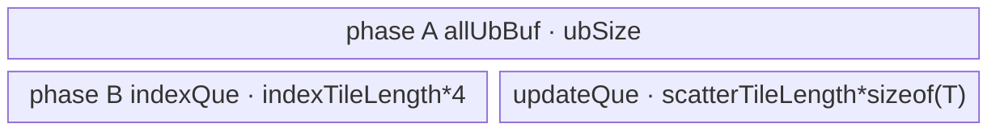

# ScatterNdUpdate A2/A3 ACLNN 算子知识

## 算子速览

| 项目 | 内容 |
|---|---|
| 实际入口 | `aclnnScatterNdUpdateGetWorkspaceSize` + `aclnnScatterNdUpdate`，公开两段式 ACLNN，无更高公开版本。 |
| 计算语义 | 对每个索引行 `p=indices[r,:]`，以输入行序执行 `varRef[p[0],...,p[K-1],:] = updates[r,:]`；重复索引最终保留后出现的 update。 |
| 输入输出 | `varRef` 原地输入/输出；`indices:int32/int64`；公开文档在 A2/A3 上列出 `float16/bfloat16/float32/int64/int8/bool`，均为 ND。 |
| 执行类型 | 单个 AIV Kernel entry；key 10/11/20/21 在一个 entry 内执行“线性化索引 AIV_VECTOR → `SyncAll` → scatter AIV_VECTOR”，key 30 为直接 int64 标量索引计算 + DMA scatter。 |
| Kernel 路线 | R-001 int32-sort；R-002 int32-no-sort；R-003 int64-cast-sort；R-004 int64-cast-no-sort；R-005 int64-large。 |
| 核心资源 | GM `indices/updates/varRef`；用户 workspace 中 int32 线性索引及可选原位置；每核 UB `TBuf/TQue`；核内硬事件与全核 `SyncAll`。 |
| 来源闭包 | `source_closed`：公开 ACLNN、连续化/视图边界、L0 AiCore launcher、arch32 Tiling/POD、entry、五个 key 的全部 body/helper、配置和构建接线均闭合。 |
| 验证状态 | 已完成源码闭包检查；本次知识提取未执行编译、真机、数值或性能测试。 |

## 接口与语义

### 计算语义

令 `varRef.shape=[D0,...,D(N-1)]`，`indices.shape=[I0,...,I(M-2),K]`，`R=prod(I0..I(M-2))`，`S=prod(DK..D(N-1))`。第 `r` 个索引行的连续目标行号为 `L_r=Σ(indices[r,d] * prod(D(d+1)..D(K-1)))`，连续布局目标元素偏移为 `L_r*S+c`。`updates.shape=[I0,...,I(M-2),DK,...,D(N-1)]`，第 `r` 行的 `S` 个元素覆盖该目标切片。A2/A3 首轴 view 路线把偏移改为 `(L_r / firstDimStrideRows)*varStride0Elements + (L_r % firstDimStrideRows)*S + c`。

### 输入、输出与属性

| 参数 | shape/layout | dtype | 约束、默认值与语义 |
|---|---|---|---|
| `varRef` | ND，公开文档 rank `[1,8]`；可连续或仅首轴 stride 大于连续期望值 | 公开：`float16/bfloat16/float32/int64/int8/bool` | 输入/输出同一逻辑张量；dtype 必须与 `updates` 相同。 |
| `indices` | ND，至少 2 维，末维 `K∈[1,7]` 且 `K<=rank(varRef)` | `int32/int64` | 索引不允许越界；ACLNN 会先转连续。 |
| `updates` | `indices[:-1] + varRef[K:]`，ND | 与 `varRef` 相同 | ACLNN 会先转连续。 |
| `workspaceSize` | 标量 Host 输出 | `uint64_t` | executor 中所有连续化、ViewCopy 和 ScatterNdUpdate 节点 workspace 总量。 |
| `executor` | Host 对象 | `aclOpExecutor**` | 第一段构造，第二段消费。 |
| `stream` | runtime stream | `aclrtStream` | `CommonOpExecutorRun` 在该 stream 上执行 executor。 |

### 入口与版本

固定仓公开唯一版本为 `aclnnScatterNdUpdate`。文档产品表明确 A2/A3 支持；`scatter_nd_update_def.cpp` 为 `ascend910b/ascend910_93` 注册 arch32 AiCore，`CMakeLists.txt` 将两者映射到 `arch32`。公开文档列出的 dtype 均包含在 ACLNN/L0 的 A2/A3 AiCore 表中，因此公开调用不会触发 `ScatterNdUpdateAiCPU`；实现表额外列出 `int16/int32`，但它们不扩入本卡公开 dtype 合同。`Contiguous`、`CreateView`、`ViewCopy` 和 executor 为允许的框架边界；它们的内部 Kernel 固定仓不可见。

## Host/Launcher 执行流程

### 参数校验与前处理

1. `CREATE_EXECUTOR` 后 `CheckParams` 检查三个 tensor 非空、平台 dtype、`indices∈{int32,int64}`、`varRef.dtype==updates.dtype`。
2. API 对三者 rank 大于 8 仅记 warning；空 tensor 直接返回 workspace 0，不添加 ScatterNdUpdate 节点。
3. 取 `K=indices.shape[-1]`。当 `K<=4`、arch 为 `DAV_2201` 且 `varRef` 仅 stride0 非连续（dim≥1 连续且 `stride0>prod(shape[1:])`）时，`ProcessNonContiguousCase` 连续化 indices/updates、用原 shape/storage/stride/offset `CreateView(varRef)`，直接添加 ScatterNdUpdate。
4. 其余情况连续化 `varRef/indices/updates`；若原 `varRef` 非连续，则 ScatterNdUpdate 后添加 `ViewCopy(scatterUpdateRes,varRef)`。
5. L0 `ScatterNdUpdate` 以 `use_locking=false` 添加 `ADD_TO_LAUNCHER_LIST_AICORE(ScatterNdUpdate, self,indices,updates -> self)`。

### 参数、Workspace 与生命周期

arch32 Tiling 从平台取得 `coreNumAiv` 和完整 `ubSize`。令 `R=indices元素数/K`，`P=prod(varRef前K维)`，`S=prod(varRef从K维起)`，`coreNum=min(AIV核数,P,R)`，至少 1。`sortWorkspace=align_up(R,8)` 个 int32 元素：所有可线性化路线分配第一片 `[0,sortWorkspace*4)` 存 `linearIndex`；sort 路线再分配第二片 `[sortWorkspace*4,2*sortWorkspace*4)` 存原 update 行号。总 workspace 为平台库系统 workspace 加上述用户片；entry 用 `GetUserWorkspace(workspace)` 取得用户区。executor 持有连续化临时 tensor、可选 ViewCopy 和 workspace 需求，第二段在 stream 上按添加顺序执行；任一 `CHECK_RET` 失败即不发布 executor。

### 启动图与失败传播

这是单 Kernel launch graph，不是多 Kernel：

| 节点/边 | Host/entry | blockDim/POD | 数据与 workspace | ordering/lifetime/失败 |
|---|---|---|---|---|
| 框架前处理 | `Contiguous`/`CreateView` | 框架不可见 | 产生连续 indices/updates 与连续或 view varRef | executor 顺序；空指针即第一段失败。 |
| K0 | `ScatterNdUpdateAiCore` → `scatter_nd_update` | `coreNum`；`ScatterNdUpdateArch32TilingData` | 输入三 GM；输出 `varRef`；用户 workspace 两个可选 int32 slice | entry 检查 `workspace` 和 `GetUserWorkspace`；未知 key 无分支、无写出。 |
| K0 phase A | `LinearIndexKernel`（key 10/11/20/21） | 同一 grid | producer 写 workspace linearIndex/position | 各核 `Process` 完成后 `SyncAll()`，保证 phase B 全局可见。 |
| K0 phase B | `ScatterNdUpdateKernel` 或 `ScatterNdUpdateKernelNoSort` | 同一 grid | consumer 读 workspace，写 varRef | `tpipe.Destroy()` 后重建 pipe，避免两个阶段 UB 生命周期重叠。 |
| K0 direct | `LargeIndexKernel`（key 30） | 同一 grid | 不用用户索引 workspace，直接读 int64 indices/updates 并写 varRef | 每核拥有互斥目标行区间，无跨核同地址写。 |
| 框架后处理 | 可选 `ViewCopy` | 框架不可见 | 连续临时结果 → 原 view storage | 与 K0 同 executor/stream；前节点失败会阻断。 |

## Route 与参数设计

### 分核与资源计算

`indicesMask[d]=prod(varRef.shape[d+1:K])`。线性索引块 `coeff=(int64?2K:K)+3`，`blockLength=min(floor((ubSize/coeff/4)/32)*32,4096)`；再由 `R/blockLength` 将完整块均分到 `coreNum`，余行只给最后活动核。scatter 目标域 `P` 用 `frontRow=floor(P/coreNum)+1`、`frontNum=P%coreNum` 和 `tailRow=floor(P/coreNum)` 切成互斥行区间。每个 update tile 最大元素数 `ubLengthForUpdates=floor((ubSize-4096*2*4)/32)*32/sizeof(T)`，`scatterTileLength=min(S,ubLengthForUpdates)`，尾 tile 精确为 `S-(tileNum-1)*tileLength`。

### Route 选择

| 顺序 | Route | Key/模板 | 精确选择条件与优先级 | 不适用去向 |
|---:|---|---|---|---|
| 1 | R-001 int32-sort | 11 | `indices=int32 && P<=2^24-1` | R-002 |
| 2 | R-002 int32-no-sort | 10 | `indices=int32 && P>2^24-1` | 无其它 int32 route |
| 3 | R-003 int64-cast-sort | 21 | `indices=int64 && P<=2^24-1` | R-004/R-005 |
| 4 | R-004 int64-cast-no-sort | 20 | `indices=int64 && 2^24-1<P<=2^31-1` | R-005 |
| 5 | R-005 int64-large | 30 | `indices=int64 && P>2^31-1` | 终点 |

```text
if indices.dtype == int32:
  key = 11 if P <= 2^24-1 else 10
else if P > 2^31-1:
  key = 30
else:
  key = 21 if P <= 2^24-1 else 20
```

### 模板/实现执行矩阵

| Route | key/selector | dtype/shape/platform 完整命中条件 | 执行拓扑与 Kernel 节点 | 实际模板/body | 内存与同步特征 | tail/fallback |
|---|---|---|---|---|---|---|
| R-001 | 11 | int32；`P<=16777215`；arch32 | 单 entry 两阶段 | `LinearIndexKernel<true,int>` → `ScatterNdUpdateKernel<T,isView>` | workspace 两片；`SyncAll`; sort 降序去重 | block/row/tile 三层 tail |
| R-002 | 10 | int32；`P>16777215`；arch32 | 单 entry 两阶段 | `LinearIndexKernel<false,int>` → `ScatterNdUpdateKernelNoSort<T,isView>` | workspace 一片；目标域分核后各核扫描全 index | int32 线性值上界见限制 |
| R-003 | 21 | int64；`P<=16777215`；arch32 | 单 entry 两阶段 | `LinearIndexKernel<true,int64_t>`（先 cast int32）→ sorted scatter | workspace 两片；`SyncAll` | 同 R-001 |
| R-004 | 20 | int64；`16777215<P<=2147483647` | 单 entry 两阶段 | `LinearIndexKernel<false,int64_t>`（cast int32）→ no-sort scatter | workspace 一片；`SyncAll` | 同 R-002 |
| R-005 | 30 | int64；`P>2147483647` | 单 entry直接路径 | `LargeIndexKernel<T,isView>` | 无用户索引 workspace；int64 标量线性化 | 每块/每行/每 tile tail |

### 隐藏性能 Guard

| Guard | Host/Tiling 条件 | Device/资源原因 | 影响 Route | 不满足时去向 | 源码符号 |
|---|---|---|---|---|---|
| float 精确排序 | `P<=2^24-1` | sort 路线把 int32 linearIndex cast 为 fp32；该范围整数可精确表示 | R-001/R-003 | no-sort | `IsSort`、`ComputeForSort` |
| int32 线性化 | int64 indices 且 `P<=INT32_MAX` | Vector `Muls/Add` 和 workspace 均为 int32 | R-003/R-004 | R-005 | `IsLinearIndex` |
| UB index block | `blockLength=floor(ubSize/((K or 2K)+3)/4/32)*32<=4096` | 覆盖 indices、linearIndex、range、addTmp 和可选 sort 临时区 | R-001..R-004 | 最小 32；固定仓无失败 guard | `Tiling4LinearIndex` |
| update UB | `ubSize>4096*2*4` 隐含 | Host 用无符号减法计算剩余 UB | R-001..R-005 | 固定仓未显式失败 | `Tiling4Scatter` |
| view 直写 | API `K<=4` 且仅 stride0 非连续；Tiling 再校验 dim≥1 stride | 目标偏移可由两段行号恢复 | 全 route 的 `isView=true` 实例 | 连续化 + ViewCopy，或 Tiling 失败 | `IsSupportNonContiguousArch32`、`HandleViewStride` |
| workspace 指针 | entry `workspace!=nullptr && GetUserWorkspace(workspace)!=nullptr` | key 10/11/20/21 必须写用户区 | 全 route | entry 直接 return | `scatter_nd_update` |

### POD/ABI

arch32 POD 由 `BEGIN_TILING_DATA_DEF` 生成；字段均为 `uint64_t`，数组为 8 个 `uint64_t`。宏定义来自固定仓外部头，故整体 `sizeof/alignof` 与嵌套结构精确 `offsetof` 固定仓不可见；下表保留声明顺序、producer 和 consumer。

| 结构 | 字段 | 类型/位宽 | ABI 布局 | 单位 | Host/launcher producer | Device consumer | 边界 |
|---|---|---|---|---|---|---|---|
| `ScatterNdUpdateScatterTiling` | `scatterLength` | uint64/64 | 声明序 0 | 元素/行 | `S` | 所有 scatter 地址 | `>=1`（非空入口） |
| 同上 | `tailRow` | uint64/64 | 序 1 | 行/core | `P/coreNum` | `CalcBlockDistribution` | 可 0 |
| 同上 | `frontRow` | uint64/64 | 序 2 | 行/core | `tailRow+1` | 同上 | 正整数 |
| 同上 | `frontNum` | uint64/64 | 序 3 | core | `P%coreNum` | 同上 | `<coreNum` |
| 同上 | `tailNum` | uint64/64 | 序 4 | core | `tailRow?coreNum-frontNum:0` | 仅日志/ABI | 可 0 |
| 同上 | `ubLengthForUpdates` | uint64/64 | 序 5 | T 元素 | 剩余 UB/sizeof(T) | update buffer | 隐含 UB 下界 |
| 同上 | `scatterAlignLength` | uint64/64 | 序 6 | T 元素 | `align_up(S,32/sizeof(T))` | Host 派生 `formDim` | Device 保存但少用 |
| 同上 | `formDim` | uint64/64 | 序 7 | 次数 | `scatterAlignLength/ubLengthForUpdates` | sorted scatter | 可 0 |
| 同上 | `copyRow` | uint64/64 | 序 8 | 行/batch | tile>1?1:容量/S | sorted scatter batch | `>=1` |
| 同上 | `scatterTileNum` | uint64/64 | 序 9 | tile | `ceil(S/tileLength)` | scatter loop | `>=1` |
| 同上 | `scatterTileLength` | uint64/64 | 序 10 | T 元素 | `min(S,ubLength)` | DMA/address | `>=1` |
| 同上 | `scatterTileTail` | uint64/64 | 序 11 | T 元素 | `S-(n-1)*tile` | last tile | 可 0 仅空域已提前退出 |
| 同上 | `scatterTileAlignLength` | uint64/64 | 序 12 | T 元素 | `align_up(tile,32B)` | sorted UB row stride | 对齐 |
| `ScatterNdUpdateLinearIndexTiling` | `coreNum` | uint64/64 | 序 0 | core | `min(AIV,P,R)` | phase A 分块 | 至少 1 |
| 同上 | `ubSize` | uint64/64 | 序 1 | byte | platform UB | `allUbBuf` | `>0` |
| 同上 | `indexDim` | uint64/64 | 序 2 | dim | `K` | linearization | `[1,7]` |
| 同上 | `blockLength` | uint64/64 | 序 3 | index row | UB 公式，最多 4096 | phase A tile | 32 对齐 |
| 同上 | `blockNum` | uint64/64 | 序 4 | block | `R/blockLength` | loops | 可 0 |
| 同上 | `blockRemainLength` | uint64/64 | 序 5 | row | `R%blockLength` | tail | `<blockLength` |
| 同上 | `tailBlockNum` | uint64/64 | 序 6 | block/core | `blockNum/coreNum` | phase A | 可 0 |
| 同上 | `frontBlockNum` | uint64/64 | 序 7 | block/core | `tailBlockNum+1` | phase A | 可 0 特例 |
| 同上 | `frontCoreNum` | uint64/64 | 序 8 | core | `blockNum%coreNum` 或 1 | phase A | 至少 1 when blockNum=0 |
| 同上 | `tailCoreNum` | uint64/64 | 序 9 | core | `coreNum-frontCoreNum` 条件值 | phase A | 可 0 |
| 同上 | `sortWorkspace` | uint64/64 | 序 10 | int32 元素 | `align_up(R,8)` | workspace slice offset | 8 对齐 |
| 同上 | `indicesMask` | uint64[8] | 序 11 | 行 stride | shape 后缀积 | vector/scalar linearization | 仅前 K 有效 |
| 同上 | `isInt64Indices` | uint64/64 | 序 12 | bool | dtype 比较 | 日志/HP dormant body | 0/1 |
| 同上 | `needLargeIndexKernel` | uint64/64 | 序 13 | bool | int64且P>INT32_MAX | 日志/POD | 0/1 |
| `ScatterNdUpdateViewTiling` | `isViewStride0` | uint64/64 | 序 0 | bool | `HandleViewStride` | entry template选择 | 0/1 |
| 同上 | `varStride0Elements` | uint64/64 | 序 1 | T 元素 | input stride0或期望值 | `ResolveOutOffset` | `>=expected` |
| 同上 | `firstDimStrideRows` | uint64/64 | 序 2 | 逻辑行 | `K>1?indicesMask[0]:1` | view offset | `>=1` |
| `ScatterNdUpdateHpTiling` | `hpCoreNum` | uint64/64 | 序 0 | core | `min(coreNum,R)` | 当前 ACLNN 默认构建不消费 | dormant HP 编译分支 |
| 同上 | `hpFrontIndexNum` | uint64/64 | 序 1 | row/core | `tail+1` | dormant HP | inactive |
| 同上 | `hpTailIndexNum` | uint64/64 | 序 2 | row/core | `R/hpCoreNum` | dormant HP | inactive |
| 同上 | `hpFrontCoreNum` | uint64/64 | 序 3 | core | `R%hpCoreNum` | dormant HP | inactive |
| 同上 | `hpTailCoreNum` | uint64/64 | 序 4 | core | 条件差值 | dormant HP | inactive |
| 同上 | `hpIndexTileLength` | uint64/64 | 序 5 | row | UB 余量公式 | dormant HP | inactive |
| 同上 | `hpScatterTileLength` | uint64/64 | 序 6 | T 元素 | 半 UB 公式 | dormant HP | inactive |
| 同上 | `hpScatterTileNum` | uint64/64 | 序 7 | tile | ceil | dormant HP | inactive |
| 同上 | `hpScatterTileTail` | uint64/64 | 序 8 | T 元素 | tail | dormant HP | inactive |
| 同上 | `hpRowBytesAligned` | uint64/64 | 序 9 | byte | align_up(row,32) | dormant HP | inactive |
| 同上 | `hpRowsPerBatch` | uint64/64 | 序 10 | row | UB/row，最大256 | dormant HP | inactive |

### Route 源码闭包

| Route | Key/selector | Host/Tiling producer | POD/参数 | Kernel entry/router 节点 | Kernel body/直接依赖 | 构建接线 |
|---|---|---|---|---|---|---|
| R-001 | 11 | `ScatterNdUpdateArch32Tiling::Init/SetTilingKeyMode` | arch32 POD | `scatter_nd_update` → `RunLinearIndexAndScatter<...,true,int,...>` | `LinearIndexKernel`; `ScatterNdUpdateKernel`; common helpers | def `ascend910b/910_93`; CMake arch32; binary json |
| R-002 | 10 | 同上 | 同上 | `...,false,int,ScatterNdUpdateKernelNoSort` | `LinearIndexKernel`; no-sort; common | 同上 |
| R-003 | 21 | 同上 | 同上 | `...,true,int64_t,...` | linear cast + sorted scatter | 同上 |
| R-004 | 20 | 同上 | 同上 | `...,false,int64_t,...` | linear cast + no-sort | 同上 |
| R-005 | 30 | 同上 | 同上 | `RunLargeIndex` | `LargeIndexKernel`; `ResolveOutOffset` | 同上 |

## Kernel 实现

### 公共执行流程

entry 解析 POD 并按 key 选择模板。key 10/11/20/21 先在每核 UB 中批量读取 index row，以 `indicesMask` 做 Gather/Muls/Add 得到 int32 linearIndex，写用户 workspace；sort 变体同时写原 update 行号。随后 `RunScatterAfterSync` 执行全核 `SyncAll`，销毁旧 `TPipe` 并创建 phase-B pipe。phase B 将目标线性行域按核互斥分割，因此重复索引只会落在同一核：sort route 二分定位本核范围并倒序去重，no-sort route 每核扫描 workspace 后按输入次序更新。key 30 不需要全核阶段边，直接让每核扫描全部 index block，但只写自身目标行域。

### Route R-001：int32-sort

#### 适用条件

##### 选择证据

| 层级 | 文件 | 符号 | 源码谓词/参数 | 结果/下一跳 |
|---|---|---|---|---|
| API | `op_api/scatter_nd_update.cpp` | `IsAiCoreSupport` | A2/A3公开 dtype | AiCore |
| Tiling | `op_host/arch32/scatter_nd_update_tiling.cpp` | `IsSort/SetTilingKeyMode` | int32，`P<=2^24-1` | key 11 |
| Router | `op_kernel/scatter_nd_update.cpp` | `TILING_KEY_IS(11)` | key 11 | sorted templates |

#### Device 数据流

##### 函数级调用链

```text
scatter_nd_update
  -> LinearIndexKernel<true,int>::Process
     -> CopyIn -> ComputeLinearIndexFromIndices -> ComputeForSort -> CopyOut(workspace)
  -> SyncAll -> TPipe::Destroy -> new TPipe
  -> ScatterNdUpdateKernel<T,isView>::Process
     -> CopyIndicesIn -> UpdateSearchParam -> CopyUpdateIn -> CopyOut(varRef)
```

##### 源码等价伪码

```text
for assigned index block/tail:
  DMA indices; linear[r] = sum(indices[r,d] * indicesMask[d])
  fp32_key = cast(linear); pad tail key/position with -1
  Sort<float,true>(key, original_position); write key and global position to workspace
SyncAll()
for every workspace block and this core's target interval [start,end):
  DMA sorted key/position; binary-search matching descending subrange
  for update tile, scan matching positions backward:
    DMA updates[position, tile]
    skip consecutive duplicate target already emitted
    DMA to ResolveOutOffset(target,tile)
```

#### 内存与数据搬运

##### 资源与搬运表

| 层级/缓冲区 | offset/地址公式 | extent/容量公式 | dtype/layout | producer | consumer | owner/lifetime | 对齐/复用 |
|---|---|---|---|---|---|---|---|
| workspace linear | user+0 | `sortWorkspace*4` | int32 row | phase A | phase B | executor/K0 | 32B aligned extent |
| workspace position | user+`sortWorkspace*4` | `sortWorkspace*4` | int32 row | phase A sort | phase B | executor/K0 | 独立 slice |
| `allUbBuf` | UB 0 | `ubSize` bytes | aliased int/fp32 views | LinearIndex | same | phase A TPipe | 按模板分区 |
| `indiceQue/posIdxQue` | phase-B UB | 各 `blockLength*4` | int32 | DMA | scalar search | phase B | depth=1 |
| `updateQue` | phase-B UB | `ubLengthForUpdates*sizeof(T)` | T rows | updates DMA | output DMA | batch lifetime | depth=1 |

##### 分层内存布局


##### 字节账与复用顺序

```text
phaseA_UB = ubSize
phaseB_UB = 2*blockLength*4 + ubLengthForUpdates*sizeof(T)
phaseA and phaseB do not coexist because TPipe is destroyed/recreated
workspace_total = systemWorkspace + 2*align_up(R,8)*4
```

| 复用子区 | 写入者 | 读取者/消费点 | 下一次覆盖 | 同步或释放依据 | 安全条件 |
|---|---|---|---|---|---|
| `allUbBuf` aliases | CopyIn/linear/sort | next vector stage | next block | `PipeBarrier`/hard events | `blockLength` UB公式成立 |
| phase boundary UB | `LinearIndexKernel` | 无 | phase-B pipe | `SyncAll` + `Destroy` | 全核 phase A 完成 |
| `updateQue` | `CopyUpdateIn` | `CopyOut` | next batch | EnQue/DeQue/FreeTensor | `copyRow*alignedTile<=capacity` |

#### 同步、精度与尾块

##### 同步与数值边界表

| 阶段 | primitive/机制 | producer | consumer/等待点 | 保护对象 | 精度/尾块 |
|---|---|---|---|---|---|
| indices DMA→scalar/vector | MTE2_S | DataCopyPad | linearization | indices UB | int32 exact |
| vector stages | `PipeBarrier<PIPE_V>` | Gather/Muls/Add/Cast/Sort | next vector op | aliased allUb | fp32 sort only when `P<=2^24-1` |
| phase A→B | `SyncAll` | workspace writers | scatter readers | whole user workspace | block/tail fully committed |
| update DMA→output | MTE2_S/MTE3_S | update load/store | reuse | update UB/output | last block and tile use exact byte length |

#### 关键实现

##### 符号证据表

| 阶段 | 文件 | 符号/模板实例 | 实现事实 |
|---|---|---|---|
| Host/Tiling producer | `op_host/arch32/scatter_nd_update_tiling.cpp` | `Tiling4LinearIndex/Tiling4Scatter` | block、workspace、tile和key |
| Kernel entry/router | `op_kernel/scatter_nd_update.cpp` | `RunLinearIndexAndScatter<...,true,int,...>` | 两阶段及全核同步 |
| Device body/helper | `op_kernel/arch32/scatter_nd_update_linear_index.h` | `ComputeForSort` | fp32 sort与position |
| Device body/helper | `op_kernel/arch32/scatter_nd_update.h` | `UpdateSearchParam/CopyOut` | 二分范围、倒序去重、view偏移 |

### Route R-002：int32-no-sort

#### 适用条件

##### 选择证据

| 层级 | 文件 | 符号 | 源码谓词/参数 | 结果/下一跳 |
|---|---|---|---|---|
| Tiling | `op_host/arch32/scatter_nd_update_tiling.cpp` | `IsSort/SetTilingKeyMode` | int32且`P>2^24-1` | key 10 |
| Router | `op_kernel/scatter_nd_update.cpp` | `TILING_KEY_IS(10)` | key 10 | no-sort body |

#### Device 数据流

##### 函数级调用链

```text
LinearIndexKernel<false,int>::Process -> workspace linearIndex
  -> SyncAll
ScatterNdUpdateKernelNoSort<T,isView>::Process
  -> tile workspace indices -> filter [start,end) -> per-index/per-update-tile DoScatterCopy
```

##### 源码等价伪码

```text
produce linearIndex workspace without fp32 sort
SyncAll()
for each workspace index tile:
  DMA linear indices
  for i in original row order:
    if start <= linear[i] < end:
      for update tile: DMA updates[i,tile] -> owned output row
```

#### 内存与数据搬运

##### 资源与搬运表

| 层级/缓冲区 | offset/地址公式 | extent/容量公式 | dtype/layout | producer | consumer | owner/lifetime | 对齐/复用 |
|---|---|---|---|---|---|---|---|
| workspace linear | 0 | `sortWorkspace*4` | int32 | phase A | phase B | K0 | user slice |
| `indexQue` | UB | `indexTileLength*4` | int32 | DMA | scalar filter | tile | depth=1 |
| `updateQue` | UB | `scatterTileLength*sizeof(T)` | T | DMA | output DMA | per index/tile | depth=1 |

##### 分层内存布局



##### 字节账与复用顺序

```text
indexTileLength=floor((ubLengthForUpdates*sizeof(T)-scatterTileLength*sizeof(T))/4/8)*8
phaseB_UB=indexTileLength*4 + scatterTileLength*sizeof(T)
workspace_total=systemWorkspace+align_up(R,8)*4
```

| 复用子区 | 写入者 | 读取者/消费点 | 下一次覆盖 | 同步或释放依据 | 安全条件 |
|---|---|---|---|---|---|
| indexQue | workspace DMA | scalar loop | next tile | EnQue/DeQue/FreeTensor | tail uses `curTileLen` |
| updateQue | updates DMA | output DMA | next output | hard event + FreeTensor | exact tile byte count |

#### 同步、精度与尾块

##### 同步与数值边界表

| 阶段 | primitive/机制 | producer | consumer/等待点 | 保护对象 | 精度/尾块 |
|---|---|---|---|---|---|
| phase edge | `SyncAll` | phase A | phase B | workspace | no fp32 cast |
| per DMA | MTE2_S/MTE3_S | GM/UB | scalar/store | tiles | input row order preserved per owned output interval |

#### 关键实现

##### 符号证据表

| 阶段 | 文件 | 符号/模板实例 | 实现事实 |
|---|---|---|---|
| Host/Tiling producer | `op_host/arch32/scatter_nd_update_tiling.cpp` | `IsSort` | 大于 fp32精确整数范围时禁用 sort |
| Kernel entry/router | `op_kernel/scatter_nd_update.cpp` | key 10 branch | no-sort实例 |
| Device body/helper | `op_kernel/arch32/scatter_nd_update_no_sort.h` | `Process/ProcessOneIndex` | 每核扫描并按输入顺序写自身目标域 |

### Route R-003：int64-cast-sort

#### 适用条件

##### 选择证据

| 层级 | 文件 | 符号 | 源码谓词/参数 | 结果/下一跳 |
|---|---|---|---|---|
| Tiling | arch32 Tiling | `needLargeIndexKernel/IsSort` | int64且`P<=2^24-1` | key 21 |
| Router | arch32 entry | key 21 | int64 index template | cast-sort |

#### Device 数据流

##### 函数级调用链

```text
LinearIndexKernel<true,int64_t>::CopyIn -> CastToInt32 -> ComputeLinearIndexFromIndices
  -> ComputeForSort -> workspace -> SyncAll -> ScatterNdUpdateKernel
```

##### 源码等价伪码

```text
DMA int64 indices; Cast(..., CAST_NONE) to int32; vector-linearize; fp32-sort;
then identical to R-001 phase B.
```

#### 内存与数据搬运

##### 资源与搬运表

| 层级/缓冲区 | offset/地址公式 | extent/容量公式 | dtype/layout | producer | consumer | owner/lifetime | 对齐/复用 |
|---|---|---|---|---|---|---|---|
| int64 input alias | `allUbBuf+blockLength` | `blockLength*K*8` | int64 | DMA | Cast | phase A | overlaps later sort views after cast |
| workspace/phase B | 同 R-001 | 同 R-001 | int32/T | 同 R-001 | 同 R-001 | 同 R-001 | 同 R-001 |

##### 分层内存布局


##### 字节账与复用顺序

```text
phaseA coefficient=(2*K+3) int32 words per row, capped by ubSize
phaseB/workspace same as R-001
```

| 复用子区 | 写入者 | 读取者/消费点 | 下一次覆盖 | 同步或释放依据 | 安全条件 |
|---|---|---|---|---|---|
| int64 input region | DMA | Cast | sort work | vector barrier | all values valid int32 indices per shape domain |

#### 同步、精度与尾块

##### 同步与数值边界表

| 阶段 | primitive/机制 | producer | consumer/等待点 | 保护对象 | 精度/尾块 |
|---|---|---|---|---|---|
| int64→int32 | `Cast(...CAST_NONE)` + PIPE_V | DMA int64 | linearize | UB alias | P<=2^24 also <=int32 |
| later phases | 同 R-001 | 同 R-001 | 同 R-001 | workspace/output | 同 R-001 |

#### 关键实现

##### 符号证据表

| 阶段 | 文件 | 符号/模板实例 | 实现事实 |
|---|---|---|---|
| Host/Tiling producer | arch32 Tiling cpp | `Init` | int64与范围决定 key |
| Kernel entry/router | arch32 entry | key 21 | `IndexT=int64_t` |
| Device body/helper | linear_index.h | `CastToInt32` | cast 后复用 int32 vector管线 |

### Route R-004：int64-cast-no-sort

#### 适用条件

##### 选择证据

| 层级 | 文件 | 符号 | 源码谓词/参数 | 结果/下一跳 |
|---|---|---|---|---|
| Tiling | arch32 Tiling | `IsLinearIndex/IsSort` | int64且`2^24-1<P<=INT32_MAX` | key 20 |
| Router | arch32 entry | key 20 | int64 + no-sort | R-004 |

#### Device 数据流

##### 函数级调用链

```text
LinearIndexKernel<false,int64_t>::CopyIn -> CastToInt32 -> linear workspace
  -> SyncAll -> ScatterNdUpdateKernelNoSort<T,isView>
```

##### 源码等价伪码

```text
DMA/cast int64 indices to int32; linearize without fp32; write workspace;
each target-owning core scans rows in source order and copies update tiles.
```

#### 内存与数据搬运

##### 资源与搬运表

| 层级/缓冲区 | offset/地址公式 | extent/容量公式 | dtype/layout | producer | consumer | owner/lifetime | 对齐/复用 |
|---|---|---|---|---|---|---|---|
| phase A allUb | 0 | ubSize | int64/int32 aliases | DMA/Cast/vector | workspace | phase A | coefficient `2K+3` |
| phase B | 同 R-002 | 同 R-002 | int32/T | workspace/updates | output | phase B | exact tails |

##### 分层内存布局


##### 字节账与复用顺序

```text
phaseA_UB=ubSize; phaseB_UB=indexTileLength*4+scatterTileLength*sizeof(T)
workspace_total=systemWorkspace+align_up(R,8)*4
```

| 复用子区 | 写入者 | 读取者/消费点 | 下一次覆盖 | 同步或释放依据 | 安全条件 |
|---|---|---|---|---|---|
| allUb aliases | DMA/Cast | vector linearization | next block | PIPE_V | int64 index value fits int32 domain |

#### 同步、精度与尾块

##### 同步与数值边界表

| 阶段 | primitive/机制 | producer | consumer/等待点 | 保护对象 | 精度/尾块 |
|---|---|---|---|---|---|
| int64 cast | CAST_NONE | CopyIn | linearization | index UB | P<=INT32_MAX |
| phase/tails | 同 R-002 | 同 R-002 | 同 R-002 | workspace/output | exact tail lengths |

#### 关键实现

##### 符号证据表

| 阶段 | 文件 | 符号/模板实例 | 实现事实 |
|---|---|---|---|
| Host/Tiling producer | arch32 Tiling cpp | `SetTilingKeyMode` | key20 |
| Kernel entry/router | arch32 entry | key20 | cast/no-sort route |
| Device body/helper | linear_index.h + no_sort.h | `ProcessOne`; `Process` | 两阶段完整 body |

### Route R-005：int64-large

#### 适用条件

##### 选择证据

| 层级 | 文件 | 符号 | 源码谓词/参数 | 结果/下一跳 |
|---|---|---|---|---|
| Tiling | arch32 Tiling | `needLargeIndexKernel=!IsLinearIndex(P)` | int64且P>INT32_MAX | key30 |
| Router | arch32 entry | key30 | `RunLargeIndex` | direct large body |

#### Device 数据流

##### 函数级调用链

```text
scatter_nd_update -> RunLargeIndex<T> -> LargeIndexKernel<T,isView>::Process
  -> ProcessOneBlock -> CopyInInt64 -> ComputeLinearIndex(scalar int64)
  -> ScatterUpdate -> DataCopyPad updates -> ResolveOutOffset -> DataCopyPad output
```

##### 源码等价伪码

```text
for every index block/tail on every core:
  DMA int64 indices
  for row: linear64=sum(index*stride)
    if linear64 in this core's [start,end):
      for update tile: DMA update -> owned output address
```

#### 内存与数据搬运

##### 资源与搬运表

| 层级/缓冲区 | offset/地址公式 | extent/容量公式 | dtype/layout | producer | consumer | owner/lifetime | 对齐/复用 |
|---|---|---|---|---|---|---|---|
| `indicesBuf` | UB | `align_up(blockLength*K*2,8)*4` | int64 | DMA | scalar | block | 32B aligned int-word sizing |
| `updateBuf` | UB | `align_up(ubLengthForUpdates*sizeof(T),32)` | T | updates DMA | output DMA | tile | TBuf |
| workspace | N/A user slice | 0 operator bytes | N/A | N/A | N/A | system reserve only | entry still requires workspace pointer |

##### 分层内存布局


##### 字节账与复用顺序

```text
UB_total=align_up(blockLength*K*8,32)+align_up(ubLengthForUpdates*sizeof(T),32)
workspace_total=systemWorkspace
```

| 复用子区 | 写入者 | 读取者/消费点 | 下一次覆盖 | 同步或释放依据 | 安全条件 |
|---|---|---|---|---|---|
| indicesBuf | CopyInInt64 | scalar GetValue | next block | MTE2_S | copyRow tail exact |
| updateBuf | update DMA | output DMA | next tile | MTE2_S/MTE3_S | target belongs to current core |

#### 同步、精度与尾块

##### 同步与数值边界表

| 阶段 | primitive/机制 | producer | consumer/等待点 | 保护对象 | 精度/尾块 |
|---|---|---|---|---|---|
| indices | MTE2_S | GM DMA | scalar | int64 UB | no narrowing |
| output | MTE2_S/MTE3_S | update load | next overwrite | T tile | exact block/tile tail |
| cross-core | ownership partition | each core | N/A | output row interval | no SyncAll needed |

#### 关键实现

##### 符号证据表

| 阶段 | 文件 | 符号/模板实例 | 实现事实 |
|---|---|---|---|
| Host/Tiling producer | arch32 Tiling cpp | `Init/SetTilingKeyMode` | large判定和key30 |
| Kernel entry/router | arch32 entry | `RunLargeIndex` | view模板选择 |
| Device body/helper | `scatter_nd_update_large_index.h` | `ComputeLinearIndex/ScatterUpdate` | int64标量和DMA scatter |

## 算子特定优化

### Trick T-001：以 fp32 精确整数上界切换 sort/no-sort

#### 触发与源码依据

- 适用 Route：R-001/R-003；失效后 R-002/R-004。
- 触发条件：`P<=2^24-1`。
- Golden 来源：[`scatter_nd_update_tiling.cpp:62-64`](../../../../../../../cann-ops-raw/ascendc/ops-nn/955f8b33985b6d72989ebff341bb9c2c564a51bc/index/scatter_nd_update/op_host/arch32/scatter_nd_update_tiling.cpp#L62-L64)

**官方源码（固定 Commit 连续逐字摘录）**：

```cpp
inline bool ScatterNdUpdateArch32Tiling::IsLinearIndex(uint64_t totalLength) const { return totalLength <= MAX_LENGTH_INT32; }

inline bool ScatterNdUpdateArch32Tiling::IsSort(uint64_t totalLength) const { return totalLength <= MAX_FLOAT_EXPRESS_INT32; }
```

#### 机制与设计原因

排序 body 把 linearIndex cast 成 fp32 交给 `Sort<float,true>`；Host 只在 fp32 能精确表示所有目标行号时启用。排序后每核用二分定位自己的目标区间并跳过连续重复项，避免 no-sort route 的“每核扫描全部索引”。超出上界仍保持 int32 线性化，但禁用会改变索引等价关系的 fp32 sort。

#### 迁移边界

- 适用：整数 key 能在排序 dtype 中逐值精确表示的 scatter/update。
- 前提：目标线性行号不超过 `2^24-1`，排序还保留原 update 行号。
- 失效：改用不经 fp32 的 R-002/R-004；超过 int32 则 R-005。
- 未验证：本次知识提取未执行编译、真机、数值或性能测试。

#### 错误做法

固定仓给出的真实规避是：`P>2^24-1` 时不得继续 fp32 sort，否则不同 int32 行号可能在 cast 后合并。

### Trick T-002：首轴 view 直接寻址省去 varRef 物化

#### 触发与源码依据

- 适用 Route：所有 R-001..R-005 的 `isView=true` 实例。
- 触发条件：A2/A3、`K<=4`、dim≥1 连续且 `stride0>prod(shape[1:])`。
- Golden 来源：[`scatter_nd_update_common.h:61-83`](../../../../../../../cann-ops-raw/ascendc/ops-nn/955f8b33985b6d72989ebff341bb9c2c564a51bc/index/scatter_nd_update/op_kernel/arch32/scatter_nd_update_common.h#L61-L83)

**官方源码（固定 Commit 连续逐字摘录）**：

```cpp
uint64_t i0 = linearIndex / firstDimStrideRows;
uint64_t rest = linearIndex - i0 * firstDimStrideRows;
return i0 * varStride0Elements + rest * scatterLength;
```

#### 机制与设计原因

API 用 `CreateView` 透传 stride；Device 把扁平目标行重新拆成第 0 维与其余 indexed 维，只有第 0 维使用 storage stride。这样 ScatterNdUpdate 直接写原 storage，不需要把整个 `varRef` 连续化再 `ViewCopy`。

#### 迁移边界

- 适用：只有首轴存在 padding 的 ND view。
- 前提：非首轴严格连续、stride0 大于连续期望、K≤4。
- 失效：一般非连续 view 走连续化 + ViewCopy。
- 未验证：本次知识提取未执行编译、真机、数值或性能测试。

#### 错误做法

固定仓 Host/Tiling 都拒绝将非首轴任意 stride 套用该二段公式。

## 模板与实现对比

| 对比维度 | R-001/R-003 sort | R-002/R-004 no-sort | R-005 large | 设计选择依据 |
|---|---|---|---|---|
| 命中条件/优先级 | P≤2^24-1 | fp32上界<P≤int32（int32 API路线未显式限int32） | int64且P>int32 | 数值表示范围 |
| 模板与 dtype | int32 workspace；int64先cast | int32 workspace；int64先cast | int64 scalar | 避免窄化 |
| 循环与分核 | sort后每核二分目标域 | 每核扫全索引、写自身目标域 | 每核直接扫全int64索引 | 目标 ownership 保确定性 |
| Queue/TBuf/寄存器/dynamic UB/通信 window | allUb + 3 queues | allUb + 2 queues | 2 TBuf | 都无通信/dynamic UB |
| 内存总占用与复用 | 两片 workspace | 一片 workspace | 无用户索引片 | sort位置恢复开销 |
| 搬运/Vector/SIMT/NDDMA/通信 API | Gather/Muls/Add/Cast/Sort + DMA | Gather/Muls/Add + DMA | scalar + DMA | 均为AIV，无Cube |
| 同步、精度与 tail | `SyncAll`; fp32精确guard | `SyncAll`; int32 | 无全核同步；int64 | block/tile tail精确 |
| fallback/失败边界 | 超上界 no-sort | int64超界 large | 最终 route | unknown key无输出 |

## 平台差异

| 项目 | A2 | A3 | 950 |
|---|---|---|---|
| 支持状态 | 支持 | 支持 | 支持，见独立 `_950` 卡 |
| Host/Launcher | `ascend910b` arch32 | `ascend910_93` arch32 | arch35 RegBase |
| Kernel/资源 | 与A3共用 arch32，实际 core/UB 来自平台 | 与A2共用 arch32 | SIMT/Vector混合、确定性 workspace mask |

## 限制与失败边界

- 公开接口不允许越界 indices；arch32 no-sort/scalar body仅按线性值检查本核区间，不能替代逐维合法性校验。
- API 对 rank>8 只 warning，而 POD 仅有 8 个 mask/stride槽；公开文档限制 rank≤8，应以文档约束调用。
- int32 indices 在 `P>INT32_MAX` 时 Host 仍产生 key10，Device int32 `Muls/Add` 可能溢出；固定仓没有 int32-large fallback，工程复用不得补猜行为。
- `Tiling4Scatter` 的无符号 UB 减法没有显式“小于 32768B”失败分支；实际平台 UB 满足与否由固定平台资源决定。
- key30算子用户 workspace 需求为0，但 entry仍要求 runtime `workspace` 与 `GetUserWorkspace` 非空；系统 workspace 的指针约定属于框架边界。
- `HIGH_PERFORMANCE` 编译分支存在非确定性 fused body，但公开文档默认确定性，当前二进制配置未给出启用该宏的算子级接线，因此它不作为 ACLNN 正式 Route。
- Contiguous/ViewCopy、executor调度、平台库系统 workspace 的内部实现固定仓不可见。

## 源码索引

### 链路索引

| 链路阶段 | 文件 | 关键符号 | 支撑内容 |
|---|---|---|---|
| 入口声明/约束 | `index/scatter_nd_update/docs/aclnnScatterNdUpdate.md` | 产品表/原型/约束 | 平台、shape、dtype、确定性 |
| 入口实现 | `index/scatter_nd_update/op_api/aclnn_scatter_nd_update.cpp` | `aclnnScatterNdUpdateGetWorkspaceSize` | 校验、连续/view分流、executor |
| 入口实现 | `index/scatter_nd_update/op_api/scatter_nd_update.cpp` | `l0op::ScatterNdUpdate` | AiCore选择与launcher |
| Host/Tiling/Launcher | `index/scatter_nd_update/op_host/arch32/scatter_nd_update_tiling.h` | arch32 POD | ABI字段 |
| Host/Tiling/Launcher | `index/scatter_nd_update/op_host/arch32/scatter_nd_update_tiling.cpp` | `Init/SetKernelTiling` | key、分核、UB、workspace |
| Kernel entry/body | `index/scatter_nd_update/op_kernel/scatter_nd_update.cpp` | `scatter_nd_update` | key router与phase图 |
| Kernel entry/body | `index/scatter_nd_update/op_kernel/arch32/scatter_nd_update_linear_index.h` | `LinearIndexKernel` | 线性化/排序/workspace |
| Kernel entry/body | `index/scatter_nd_update/op_kernel/arch32/scatter_nd_update.h` | `ScatterNdUpdateKernel` | sorted scatter |
| Kernel entry/body | `index/scatter_nd_update/op_kernel/arch32/scatter_nd_update_no_sort.h` | `ScatterNdUpdateKernelNoSort` | no-sort scatter |
| Kernel entry/body | `index/scatter_nd_update/op_kernel/arch32/scatter_nd_update_large_index.h` | `LargeIndexKernel` | int64 large |
| Kernel entry/body | `index/scatter_nd_update/op_kernel/arch32/scatter_nd_update_common.h` | helpers | view地址/同步/linearization |
| 构建接线 | `index/scatter_nd_update/op_host/scatter_nd_update_def.cpp` | `ScatterNdUpdate` OpDef | arch32平台及dtype |
| 构建接线 | `index/scatter_nd_update/CMakeLists.txt` | `SUPPORT_COMPUTE_UNIT/TILING_DIR` | A2/A3→arch32 |

### 实现复用检查

| 检查项 | 可复用事实 | 不得改变的约束 | 源码符号 |
|---|---|---|---|
| ABI/POD | 四个嵌套Tiling结构 | 字段声明顺序、全uint64、8槽数组 | arch32 tiling.h |
| 调用顺序 | linearIndex→SyncAll→重建pipe→scatter | workspace producer不得与consumer并行 | `RunLinearIndexAndScatter` |
| workspace/内存 | 一片linear + 可选一片position | offset均以int32元素计，系统区先由框架剥离 | `CalcWorkSpaceSize/SetGmAddr` |
| 同步 | phase边全核同步，tile边硬事件/queue | 不能仅用单核pipe event替代SyncAll | common helpers/entry |
| 精度与尾块 | fp32 sort阈值；int64 large不窄化 | 2^24、INT32_MAX边界和exact tail | `IsSort/IsLinearIndex` |
| 失败边界 | unknown key、null workspace无输出 | 不得静默假定fallback | entry router |