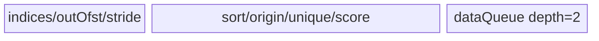

# ScatterNdUpdate 950 ACLNN 算子知识

## 算子速览

| 项目 | 内容 |
|---|---|
| 实际入口 | `aclnnScatterNdUpdateGetWorkspaceSize` + `aclnnScatterNdUpdate`，公开两段式 ACLNN。 |
| 计算语义 | 以 `indices` 行定位 `varRef` 切片并用对应 `updates` 覆盖；确定性模式用 workspace `atomic_max` 选取重复目标的最大输入行号。 |
| 输入输出 | ND；`indices:int32/int64`；950公开文档列出 `float16/bfloat16/float32/int64/int8/bool/float8_e4m3fn/float8_e5m2/hifloat8`。 |
| 执行类型 | 单个 `KERNEL_TYPE_AIV_ONLY` entry，内部 Route 分别为 AIV_VECTOR、AIV 内嵌 SIMT，确定性 Route 为 Vector+SIMT+全核同步的单 Kernel 多阶段图；无 Cube/AIC。 |
| Kernel 路线 | R-001 deterministic-SIMD；R-002 deterministic-SIMT；R-003 SIMD-mask；R-004 SIMD；R-005 SIMT-sort；R-006 plain-SIMT。 |
| 核心资源 | GM inputs/output；确定性 workspace mask/varIdx；AIV UB queues/buffers/RegTensor；`asc_vf_call` 的 1024 线程 SIMT；`SyncAll`、hard event、UB barrier、atomic_max。 |
| 来源闭包 | `source_closed`：公开 API、view/连续化边界、L0 launcher、arch35 selector/POD、100/200 key router、六个 body 与 sort helper、workspace和构建接线闭合。 |
| 验证状态 | 已完成源码闭包检查；本次知识提取未执行编译、真机、数值或性能测试。 |

## 接口与语义

### 计算语义

令 `K=indices.shape[-1]`、`R=prod(indices.shape[:-1])`、`S=prod(varRef.shape[K:])`。每个输入行 `r` 生成 storage 元素偏移 `o_r=Σ(indices[r,d]*strideList[d])`，更新 `varRef[o_r+c]=updates[r*S+c]`。当确定性开关为 1 且 `R>1`，Device 先用 workspace mask 记录每个目标行的最大 `r`，再仅允许该行写回，从而实现“重复索引后者覆盖前者”。非连续 view 直接使用输入 storage stride。

### 输入、输出与属性

| 参数 | shape/layout | dtype | 约束、默认值与语义 |
|---|---|---|---|
| `varRef` | ND，rank `[1,8]`；连续或索引轴非连续、非索引轴连续的 view | 950公开九种 dtype，见速览 | 原地输入/输出；与 updates dtype 相同。 |
| `indices` | ND，至少2维，末维K∈[1,7]且K≤var rank | int32/int64 | 不支持越界；先连续化。 |
| `updates` | `indices[:-1]+varRef[K:]` | 与varRef相同 | 先连续化。 |
| `workspaceSize/executor` | Host输出 | uint64/对象 | 包含连续化、Scatter和可选ViewCopy执行图。 |
| `workspace/stream` | Device地址/stream | void*/aclrtStream | 第二段消费。 |

### 入口与版本

固定仓没有 `aclnnScatterNdUpdateV2` 等更高公开版本。公开产品表明确 Ascend 950PR/950DT 支持；OpDef 添加 `ascend950` 并将 `opFile.value` 指向 `scatter_nd_update_apt`，CMake 将 `ascend950` 映射到 `arch35`，binary json 枚举 950 dtype组合。公开文档的九种 dtype 均包含在 ACLNN与L0的950 AiCore表中，无公开 dtype 会走 AiCPU；实现表额外列出 `uint8`，但公开文档未列出，故不扩入本卡公开合同。

## Host/Launcher 执行流程

### 参数校验与前处理

API先检查空指针、平台dtype、indices dtype及var/updates一致。空tensor直接返回0 workspace。`K<=4`、`DAV_3510` 且“索引轴部分非连续、非索引轴连续”时，indices/updates转连续并对varRef `CreateView` 后直接下发；否则三输入转连续，并在原varRef非连续时于Scatter后附加 `ViewCopy`。L0以 `use_locking=false` 添加一个 AiCore launcher。Tiling再次检查var非空、indices≥2维、K∈[1,7]、updates shape公式和view非索引轴连续性。

### 参数、Workspace 与生命周期

平台 UB 先减 `32KiB` DCache/stack 保留，并通过 `SetLocalMemorySize` 下发。普通路线仅请求固定 `16MiB` reserved workspace。确定性路线额外请求 `(varStorageInAxis+R+1)*sizeof(TYPE_T)`，其中 key100 的 `TYPE_T=uint32_t`，key200 的 `TYPE_T=uint64_t`。Device将 `[0,varInAxis)` 用作 mask，`varIdx` 起点为 `varStorageInAxis+1`，长度为R；非连续 storage 下 `varStorageInAxis=storageShape[0]/S`，因此 Host 的较大 storage 行域覆盖 mask 与间隔。workspace由executor持有至第二段完成；单 entry 内两次 `SyncAll` 确保初始化、mask原子和最终写回的阶段可见性。

### 启动图与失败传播

| 节点/边 | Host/entry | blockDim/POD | 数据与 workspace | ordering/lifetime/失败 |
|---|---|---|---|---|
| framework preprocess | `Contiguous/CreateView` | 不可见 | 临时tensor/view | executor顺序；失败不发布executor |
| K0 | `ScatterNdUpdateAiCore`→`scatter_nd_update` | 普通SIMT为`blockNum`；det/SIMD为`totalCoreNum`; RegBase POD | inputs→varRef | key 100/200；未知key无写出 |
| K0 deterministic phase0 | `InitMaskGm` | 全核 | workspace mask清0 | `SyncAll` before `CalcMask` |
| K0 deterministic phase1 | `CalcMask` | `calcMaskUsedCoreNum`；每次SIMT 1024 threads | indices→workspace mask/varIdx | atomic_max；完成后第二次`SyncAll` |
| K0 deterministic phase2 | deterministic SIMD/SIMT | `usedCoreNumBefore` | updates + mask/varIdx→varRef | mask筛出最大输入行；pipe reset后复用UB |
| framework postprocess | 可选`ViewCopy` | 不可见 | 临时结果→原view | 同stream、后继顺序；前节点失败阻断 |

## Route 与参数设计

### 分核与资源计算

公共派生：`R=indiceShapeSize/K`，`S=updateShapeSize/R`，`varInAxis=logicalVarSize/S`，`varStorageInAxis=storageVarSize/S`。key100要求 `indiceShapeSize<UINT32_MAX && updateShapeSize<UINT32_MAX && outputStorageShapeSize<INT32_MAX`，否则key200。普通SIMT：`blockTilingSize=max(align_up(ceil(updateSize/AIV),ubBlock/sizeof(T)),128)`，`blockNum=ceil(updateSize/blockTilingSize)`；`ubTilingSize`由半UB同时容纳update与对应indices。确定性路线按R分 `calcMaskUsedCoreNum=min(AIV,ceil(R/128))`，写回按 `eachCoreIndexCount=ceil(R/AIV)`；`afterAxis*sizeof(T)<128` 选SIMT写回，否则SIMD写回。SIMD路线优先按after-axis分核，当 `S>AIV*128/sizeof(T)` 或 `R<AIV/2`，否则按indices分核。所有 UB factor 都由 `(ubSize-256)/2`、32B对齐和实际sort临时量反推。

### Route 选择

| 顺序 | Route | Key/模板 | 精确选择条件与优先级 | 不适用去向 |
|---:|---|---|---|---|
| 1 | R-001 deterministic-SIMD | 100/200 | deterministic=1、R>1、`S*sizeof(T)>=128`；与mask/SIMD flag互斥 | R-004/R-005/R-006 |
| 2 | R-002 deterministic-SIMT | 100/200 | deterministic=1、R>1、`S*sizeof(T)<128`；与mask互斥 | R-001 |
| 3 | R-003 SIMD-mask | 100/200 + `ScatterNdUpdateSimdMask` | `isSimdNonDeterminstic=1` 且 `varInAxis<0.1*ubSize`、`R>5*varInAxis`、`R>1000*usedCoreNum`、`S>19`；router文本优先于其它flag | R-004 |
| 4 | R-004 SIMD | 100/200 | deterministic不成立且`S*sizeof(T)>=128`，且未命中mask | R-005/R-006 |
| 5 | R-005 SIMT-sort | 100/200 | 上述均否且`R/varInAxis>=3` | R-006 |
| 6 | R-006 plain-SIMT | 100/200 | 其余非空合法输入 | 终点 |

```text
derive flags in Host: deterministic -> simdNonDet -> simdWithSort -> simtWithSort
router priority:
  if isMask: R-003
  else if isDeterminstic && isDeterminSimt: R-002
  else if isDeterminstic: R-001
  else if isSimdNonDeterminstic: R-004
  else if isSimtWithSort: R-005
  else: R-006
```

### 模板/实现执行矩阵

| Route | key/selector | dtype/shape/platform 完整命中条件 | 执行拓扑与 Kernel 节点 | 实际模板/body | 内存与同步特征 | tail/fallback |
|---|---|---|---|---|---|---|
| R-001 | 100/200 | det,R>1,rowBytes≥128 | 单entry三阶段 Vector+SIMT+Vector | `DeterministicCommon` + `DeterministicSimd` | workspace mask/varIdx；2×SyncAll；2-depth update queue | indices/update loop tails |
| R-002 | 100/200 | det,R>1,rowBytes<128 | 单entry三阶段 Vector+SIMT+SIMT | common + `DeterministicSimt` | 同上，SIMT 1024线程写元素 | exact updateCount |
| R-003 | 100/200 | mask复合谓词 | 单entry AIV_VECTOR | `ScatterNdUpdateSimdMask` | UB int8 mask；无GM mask | one-line/multi-line subpath |
| R-004 | 100/200 | non-det,rowBytes≥128,not mask | 单entry AIV_VECTOR | `ScatterNdUpdateSimd` | 可按after或indices分核；数据依赖sort子路径 | row/col tails |
| R-005 | 100/200 | non-det,rowBytes<128,R/varRows≥3 | 单entry AIV+SIMT | `ScatterNdUpdateSimtSort` | UB radix sort/unique；SIMT GM直写 | UB batch tail；低重复批次no-sort |
| R-006 | 100/200 | fallback | 单entry SIMT | `ScatterNdUpdateSimt` | update/indices double queue；1024线程 | block/UB tail |

### 隐藏性能 Guard

| Guard | Host/Tiling 条件 | Device/资源原因 | 影响 Route | 不满足时去向 | 源码符号 |
|---|---|---|---|---|---|
| 地址位宽 | 三个size均在阈值内 | key100可用uint32 loop/type | 全route模板位宽 | key200/必要时OFFSET int64 | `GetTilingKey`, apt router |
| DCache保留 | platformUB>32KiB | 950 local memory扣除DCache/stack | 全route | tiling失败 | `GetPlatformInfo` |
| deterministic row threshold | `S*sizeof(T) <128` | 小行用SIMT聚合更多元素线程 | R-002 vs R-001 | 对方route | `CalcDeterministicCoreSplit` |
| SIMD split | `S>AIV*128/sizeof(T) \|\| R<AIV/2` | 大after-axis优先跨核分列 | R-004 | split-indices | `DoOpTilingForSimdNonDetermin` |
| runtime sort | `maxScore>0.01` | index histogram显示重复后才承担sort/unique | R-001/2 CalcMask、R-004、R-005 | unsorted subpath | `IndexStatistic*`, `SORT_HIST_THRESHOLD` |
| mask容量 | `varInAxis<0.1*ubSize` 等四条件 | 每核UB常驻int8 mask才可行 | R-003 | R-004 | `CalculateMask` |
| noncontiguous | K≤4且non-index轴连续 | strideList直接构造storage offset | 全route | API连续化+ViewCopy或tiling失败 | API/`HandleNonContiguousCase` |

### POD/ABI

`ScatterNdUpdateRegBaseTilingData` 是直接C++类，成员按声明顺序；固定仓未提供编译器生成的完整 `sizeof/alignof/offsetof` 清单，因此ABI列以“声明序/自然类型”记载，不推测尾padding。所有producer均为 `SetTilingData` 对应赋值，所有consumer均为下表所指body。

| 结构 | 字段 | 类型/位宽 | ABI 布局 | 单位 | Host/launcher producer | Device consumer | 边界 |
|---|---|---|---|---|---|---|---|
| RegBase | `blockNum` | uint64/64 | 序0 | block | Block/SortTiling | SIMT Process | 空域后blockDim强制1 |
| RegBase | `rankSize` | uint32/32 | 序1 | dim | K | 全body | [1,7] |
| RegBase | `blockTilingSize` | uint64/64 | 序2 | update元素或row | Block/SortTiling | SIMT/Sort | route相关单位 |
| RegBase | `tailBlockTilingSize` | uint64/64 | 序3 | 同上 | tail公式 | last block | 精确tail |
| RegBase | `ubTilingSize` | uint32/32 | 序4 | update元素或row | Ub/SortTiling | SIMT/Sort | UB上界 |
| RegBase | `sliceSize` | uint64/64 | 序5 | T元素 | S | 全body | 非空>0 |
| RegBase | `outPutShape` | uint64[8] | 序6 | 元素 | logical shape | SIMT bound | 前rank有效 |
| RegBase | `strideList` | uint64[8] | 序7 | T元素 | view stride或连续后缀积 | offset计算 | 前rank有效 |
| RegBase | `outputStorageShapeSize` | uint64/64 | 序8 | T元素 | storage size | 位宽/bounds | 可大于logical |
| RegBase | `varInAxis` | int64/64 | 序9 | row | logicalSize/S | bounds/mask | >0 |
| RegBase | `varStorageInAxis` | int64/64 | 序10 | row | storageSize/S | workspace offset | >=varInAxis |
| RegBase | `indexRankSize` | int64/64 | 序11 | dim | K | SIMD base | [1,7] |
| RegBase | `afterAxis` | int64/64 | 序12 | T元素/row | S | all scatter | >0 |
| RegBase | `updateLoopSize` | int64/64 | 序13 | loop | ceil(split/factor) | SIMD/det | >=1 |
| RegBase | `updateTailNum` | int64/64 | 序14 | T元素 | tail公式 | last col loop | >0 |
| RegBase | `indicesLoopSize` | int64/64 | 序15 | loop | split-after | SIMD | inactive otherwise |
| RegBase | `indiceTailNum` | int64/64 | 序16 | row | split-after tail | SIMD | inactive otherwise |
| RegBase | `usedCoreNumBefore` | int64/64 | 序17 | core | ceil partition | SIMD/det | <=AIV |
| RegBase | `usedCoreNumAfter` | int64/64 | 序18 | core | Host字段 | 固定body未读取 | inactive/0 |
| RegBase | `indicesFactor` | int64/64 | 序19 | row/tile | UB搜索 | SIMD/det | >=1 |
| RegBase | `afterAxisFactor` | int64/64 | 序20 | T元素/tile | UB搜索 | queues/loops | 32B对齐主块 |
| RegBase | `eachCoreAfterAxisCount` | int64/64 | 序21 | T元素/core | ceil(S/AIV) | split-after address | main core |
| RegBase | `tailCoreAfterAxisCount` | int64/64 | 序22 | T元素 | tail | tail core | exact |
| RegBase | `tailUpdateLoopSize` | int64/64 | 序23 | loop | tail core ceil | SIMD | split-after only |
| RegBase | `tailUpdateAxisNum` | int64/64 | 序24 | T元素 | tail tail | SIMD | split-after only |
| RegBase | `ubQuantaIndxFactor` | int64/64 | 序25 | row | Host default/legacy | 固定body未读取 | inactive |
| RegBase | `ubRowFactor` | int64/64 | 序26 | row | Host default/legacy | 固定body未读取 | inactive |
| RegBase | `eachCoreIndexCount` | int64/64 | 序27 | row/core | ceil(R/AIV) | SIMD/det | main core |
| RegBase | `tailCoreIndexCount` | int64/64 | 序28 | row/core | tail | last active core | exact |
| RegBase | `eachCoreVarCount` | int64/64 | 序29 | 元素/core | Host default/legacy | 固定body未读取 | inactive |
| RegBase | `tailCoreVarCount` | int64/64 | 序30 | 元素/core | Host default/legacy | 固定body未读取 | inactive |
| RegBase | `isSplitAfterAxis` | int64/64 | 序31 | bool | SIMD策略 | SIMD Process | 0/1 |
| RegBase | `isDeterminstic` | int64/64 | 序32 | bool | context deterministic && R>1 | router | 0/1 |
| RegBase | `isSimtWithSort` | int64/64 | 序33 | bool | R/varRows>=3 | router | lower priority |
| RegBase | `isSimdWithSort` | int64/64 | 序34 | bool | SIMD且高重复且每核>64 | SIMD runtime statistic | 0/1 |
| RegBase | `isSimdNonDeterminstic` | int64/64 | 序35 | bool | !det && rowBytes>=128 | router | 0/1 |
| RegBase | `isMask` | int64/64 | 序36 | bool | CalculateMask复合条件 | router | 0/1 |
| RegBase | `isSplitOneLine` | int64/64 | 序37 | bool | mask大行分支 | mask body | 0/1 |
| RegBase | `IsContiguous` | int64/64 | 序38 | bool | input view判定 | 固定body未直接读取 | 0/1 |
| RegBase | `normCoreHandleIdx` | int64/64 | 序39 | row/core | det mask partition | CalcMask | >=1 det |
| RegBase | `tailCoreHandleIdx` | int64/64 | 序40 | row | det tail | CalcMask | exact |
| RegBase | `calcMaskUsedCoreNum` | int32/32 | 序41 | core | min(AIV,ceil(R/128)) | InitBase/CalcMask | >=1 det |
| RegBase | `maskNormBlockLen` | int64/64 | 序42 | row | varStorage/AIV | 固定body未读取 | inactive |
| RegBase | `maskTailBlockLen` | int64/64 | 序43 | row | tail | 固定body未读取 | inactive |
| RegBase | `isDeterminSimt` | int64/64 | 序44 | bool | rowBytes<128 | router | det only |
| RegBase | `indicesUbFactor` | int64/64 | 序45 | row | det UB binary search | CalcMask queue | >=1 |
| RegBase | `normBlockLoop` | int64/64 | 序46 | loop | ceil(norm/UBfactor) | CalcMask | det only |
| RegBase | `tailBlockLoop` | int64/64 | 序47 | loop | ceil(tail/UBfactor) | CalcMask | det only |
| RegBase | `normBlockTail` | int64/64 | 序48 | row | norm tail | CalcMask | det only |
| RegBase | `tailBlockTail` | int64/64 | 序49 | row | tail tail | CalcMask | det only |

### Route 源码闭包

| Route | Key/selector | Host/Tiling producer | POD/参数 | Kernel entry/router 节点 | Kernel body/直接依赖 | 构建接线 |
|---|---|---|---|---|---|---|
| R-001 | det SIMD,100/200 | `CalculateDerivedParams/DoOpTilingForDeterministic` | RegBase POD | apt key branches | common deterministic + deterministic_simd + sort utils | ascend950 arch35/apt |
| R-002 | det SIMT,100/200 | 同上 | 同上 | apt | common deterministic + deterministic_simt | 同上 |
| R-003 | mask,100/200 | `CalculateMask/DoOpTilingForSimdMask` | 同上 | apt first priority | simd_mask + common | 同上 |
| R-004 | SIMD,100/200 | `DoOpTilingForSimdNonDetermin` | 同上 | apt | simd + common + sort utils | 同上 |
| R-005 | SIMT sort,100/200 | `SortTiling` | 同上 | apt | simt_sort + common | 同上 |
| R-006 | fallback,100/200 | `BlockTiling/UbTiling` | 同上 | apt else | simt | 同上 |

## Kernel 实现

### 公共执行流程

entry固定 `KERNEL_TASK_TYPE_DEFAULT(KERNEL_TYPE_AIV_ONLY)`，先用 key 100/200决定循环/地址类型，再按POD flag优先级实例化body。1-byte update类型通过 `GetComputeType` 映射为 `int8_t`，只改变模板计算类型，GM字节保持一致。所有路线以 `strideList` 线性化indices；key200在storage超INT32时显式用 `OFFSET_T=int64_t`。普通路线单阶段完成，确定性路线在同一Kernel内执行 mask初始化、原子选胜者、写回三阶段。

### Route R-001：deterministic-SIMD

#### 适用条件

##### 选择证据

| 层级 | 文件 | 符号 | 源码谓词/参数 | 结果/下一跳 |
|---|---|---|---|---|
| Host | tiling_regbase.cpp | `CalculateDerivedParams` | `GetDeterministic()==1 && R>1` | deterministic |
| Host | 同上 | `CalcDeterministicCoreSplit` | `S*sizeof(T)>=128` | `isDeterminSimt=0` |
| Router | apt.cpp | det && !simt | key模板位宽 | deterministic SIMD |

#### Device 数据流

##### 函数级调用链

```text
DeterministicSimd::Init -> DeterministicCommon::InitBase -> InitMaskGm
Process -> SyncAll -> CalcMask(indices -> offset -> optional sort -> atomic_max workspace)
        -> SyncAll -> pipe.Reset -> per winning row CopyInUpdate -> CopyOutUpdate
```

##### 源码等价伪码

```text
parallel clear mask[0:varInAxis]
SyncAll
for assigned index tiles: vector-linearize; if histogram>0.01 sort/unique; atomic_max(mask[targetRow], globalRow); save varIdx
SyncAll
for assigned input rows r: if valid && mask[varIdx[r]/S]==r:
  for update tile: DMA updates[r,*] -> varRef[varIdx[r]+*]
```

#### 内存与数据搬运

##### 资源与搬运表

| 层级/缓冲区 | offset/地址公式 | extent/容量公式 | dtype/layout | producer | consumer | owner/lifetime | 对齐/复用 |
|---|---|---|---|---|---|---|---|
| workspace mask | 0 | `(varStorageInAxis+1)*sizeof(TYPE_T)` reserved | uint32/uint64 row winner | Init/atomic | writeback | K0 | atomic target |
| workspace varIdx | `(varStorageInAxis+1)*sizeof(TYPE_T)` | `R*sizeof(TYPE_T)` | flattened element offset | CalcMask | writeback | K0 | no overlap |
| det indices queue | UB | `align_up(indicesUbFactor*K*sizeof(I),32)` | I | DMA | vector offset | mask phase | depth1 |
| det sort/unique buffers | UB | aligned offset/origin/count + 2*32 pads + 128*4 score | mixed | vector/sort | SIMT mask | mask phase | runtime sort |
| update queue | after `pipe.Reset` | `2*align_up(afterAxisFactor*sizeof(T),32)` | T | DMA | output DMA | write phase | depth2 |

##### 分层内存布局


##### 字节账与复用顺序

```text
mask_UB = align32(F*K*sizeof(I))+align32(F*sizeof(OFFSET))+8*sizeof(I)+512
        + align32(F*sizeof(OFFSET))+64+align32(F*4)+align32(F*4)+64+sortTmp(F)
write_UB = 2*align32(afterAxisFactor*sizeof(T))
workspace_total=16MiB+(varStorageInAxis+R+1)*sizeof(TYPE_T)
```

| 复用子区 | 写入者 | 读取者/消费点 | 下一次覆盖 | 同步或释放依据 | 安全条件 |
|---|---|---|---|---|---|
| mask phase UB | index/sort helpers | atomic SIMT | pipe.Reset | second SyncAll then Reset | no mask-phase local data needed later |
| update queue | CopyInUpdate | CopyOutUpdate | next tile | EnQue/DeQue/FreeTensor | winner check before allocation |

#### 同步、精度与尾块

##### 同步与数值边界表

| 阶段 | primitive/机制 | producer | consumer/等待点 | 保护对象 | 精度/尾块 |
|---|---|---|---|---|---|
| init→mask | SyncAll | InitGlobalMemory | CalcMask | workspace mask | 0 is sentinel；row号从0参与atomic |
| offset/sort | MTE2_V,V_S,S_V | DMA/vector/sort | SIMT | UB aliases | OFFSET位宽按key/storage |
| winner | `asc_atomic_max` | each index tile | post SyncAll writeback | mask entry | 最大global row获胜 |
| update | queue/DMA | updates | output | exact tile | last uses updateTailNum |

#### 关键实现

##### 符号证据表

| 阶段 | 文件 | 符号/模板实例 | 实现事实 |
|---|---|---|---|
| Host/Tiling producer | tiling_regbase.cpp | `CalcDeterministic*` | core/UB/workspace factors |
| Kernel entry/router | apt.cpp | deterministic SIMD branches | 100/200/offset模板 |
| Device body/helper | common.h | `InitBase/CalcMask` | mask布局、sort、atomic |
| Device body/helper | deterministic_simd.h | `Process` | winner筛选和DMA写回 |

### Route R-002：deterministic-SIMT

#### 适用条件

##### 选择证据

| 层级 | 文件 | 符号 | 源码谓词/参数 | 结果/下一跳 |
|---|---|---|---|---|
| Host | tiling_regbase.cpp | `CalcDeterministicCoreSplit` | det且`S*sizeof(T)<128` | simt flag1 |
| Router | apt.cpp | det&&simt | key模板 | R-002 |

#### Device 数据流

##### 函数级调用链

```text
InitBase -> InitMaskGm -> SyncAll -> CalcMask -> SyncAll -> InitUpdateBuffer
  -> CopyInUpdate -> asc_vf_call<SimtComputeData>(1024 threads) -> conditional GM store
```

##### 源码等价伪码

```text
same winner-mask phases as R-001
for update batch in UB, each thread handles i+=1024:
  r=globalUpdate/S; c=globalUpdate-r*S; idx=varIdx[r]
  if valid && mask[idx/S]==r: output[idx+c]=ub[i]
```

#### 内存与数据搬运

##### 资源与搬运表

| 层级/缓冲区 | offset/地址公式 | extent/容量公式 | dtype/layout | producer | consumer | owner/lifetime | 对齐/复用 |
|---|---|---|---|---|---|---|---|
| workspace/mask UB | 同R-001 | 同R-001 | 同R-001 | 同R-001 | SIMT | K0 | 同R-001 |
| `inQueX` | reset UB | `2*align32(afterAxisFactor*sizeof(T))` | T | DMA | SIMT threads | batch | depth2 |

##### 分层内存布局


##### 字节账与复用顺序

```text
UB/workspace same formulas as R-001; dynamic_ub=N/A (asc_vf_call uses fixed local UB supplied by queues)
```

| 复用子区 | 写入者 | 读取者/消费点 | 下一次覆盖 | 同步或释放依据 | 安全条件 |
|---|---|---|---|---|---|
| inQueX | DataCopyPad | SimtComputeData | next batch | EnQue/DeQue then FreeTensor | updateCount exact |

#### 同步、精度与尾块

##### 同步与数值边界表

| 阶段 | primitive/机制 | producer | consumer/等待点 | 保护对象 | 精度/尾块 |
|---|---|---|---|---|---|
| mask phases | 同R-001 | 同R-001 | 同R-001 | workspace | exact winner |
| SIMT write | 1024 threads, stride blockDim.x | UB update | GM | each update element | quotient用magic/shift；tail updateCount |

#### 关键实现

##### 符号证据表

| 阶段 | 文件 | 符号/模板实例 | 实现事实 |
|---|---|---|---|
| Host/Tiling producer | tiling_regbase.cpp | `CalcDeterministicCoreSplit/UpdateSplit` | 小行SIMT和batch |
| Kernel entry/router | apt.cpp | deterministic simt branches | 模板选择 |
| Device body/helper | deterministic_simt.h | `SimtComputeData/Process` | 线程映射与winner检查 |

### Route R-003：SIMD-mask

#### 适用条件

##### 选择证据

| 层级 | 文件 | 符号 | 源码谓词/参数 | 结果/下一跳 |
|---|---|---|---|---|
| Host | tiling_regbase.cpp | `CalculateMask` | 四项复合谓词 | isMask=1 |
| Router | apt.cpp | `tilingData.isMask==1` | highest priority | SIMD-mask |

#### Device 数据流

##### 函数级调用链

```text
SimdMask::Init -> allocate/zero per-core int8 mask -> ComputeOutOfset
Process -> ProcessMaskOneLine or ProcessMaskMultiLine -> CopyUpdatesIn -> CopyOut -> set mask
```

##### 源码等价伪码

```text
maskUB[0:varStorageRows]=0
for this core's rows/batches: vector-linearize indices
  if target valid and maskUB[target]==0: DMA update row/tile to output; maskUB[target]=1
```

#### 内存与数据搬运

##### 资源与搬运表

| 层级/缓冲区 | offset/地址公式 | extent/容量公式 | dtype/layout | producer | consumer | owner/lifetime | 对齐/复用 |
|---|---|---|---|---|---|---|---|
| maskBuf | UB | `align_up(varInAxis,ubBlock)` bytes | int8/row | Duplicate0/write | duplicate guard | whole kernel/core | no cross-core sharing |
| indices/outOfst/stride | UB | F*K*sizeof(I)+F*sizeof(OFFSET)+8*sizeof(I) | mixed | DMA/vector | scalar | tile | TBuf |
| dataQueue | UB | `2*F*afterFactor*sizeof(T)` | T | DMA | output | loop | depth2 |

##### 分层内存布局


##### 字节账与复用顺序

```text
UB_total=align(varInAxis,ubBlock)+F*K*sizeof(I)+F*sizeof(OFFSET)+8*sizeof(I)+2*F*afterFactor*sizeof(T)
workspace_total=16MiB
```

| 复用子区 | 写入者 | 读取者/消费点 | 下一次覆盖 | 同步或释放依据 | 安全条件 |
|---|---|---|---|---|---|
| mask entry | earlier row on core | later duplicate | never | V_S before scalar | per-core only |
| dataQueue | update DMA | output DMA | next batch | queue/hard event | exact row/col tail |

#### 同步、精度与尾块

##### 同步与数值边界表

| 阶段 | primitive/机制 | producer | consumer/等待点 | 保护对象 | 精度/尾块 |
|---|---|---|---|---|---|
| indices | MTE2_V | DMA | offset vector | indices UB | OFFSET width |
| mask/output | V_S + queue | vector/DMAs | scalar decisions | mask/data | one-line for large row |

#### 关键实现

##### 符号证据表

| 阶段 | 文件 | 符号/模板实例 | 实现事实 |
|---|---|---|---|
| Host/Tiling producer | tiling_regbase.cpp | `CalculateMask/DoOpTilingForSimdMask` | mask容量与factor |
| Kernel entry/router | apt.cpp | isMask branches | route priority |
| Device body/helper | simd_mask.h | `Init/ProcessMask*` | UB mask去重与DMA |

### Route R-004：SIMD

#### 适用条件

##### 选择证据

| 层级 | 文件 | 符号 | 源码谓词/参数 | 结果/下一跳 |
|---|---|---|---|---|
| Host | tiling_regbase.cpp | `CalculateDerivedParams` | !det且rowBytes>=128 | SIMD |
| Host | 同上 | `DoOpTilingForSimdNonDetermin` | split阈值 | split-after/indices |
| Router | apt.cpp | isSimdNonDeterminstic | R-004 | SIMD body |

#### Device 数据流

##### 函数级调用链

```text
ScatterNdUpdateSimd::Init -> InitBaseBuffer
Process -> ProcessSplitAfter or ProcessSplitIndices
  -> CopyIndiceIn -> ComputeOutOfset -> optional IndexStatistic/SortAndComputeUniqueIdx
  -> CopyUpdatesIn -> CopyOut(with/without sort)
```

##### 源码等价伪码

```text
partition columns across cores for very wide/small-R cases, else partition index rows
for row tile: DMA indices; vector flattened offsets
if host enabled sort and runtime duplicate score>0.01: radix-sort offsets and retain one origin per unique target
for col tile: strided DMA update rows; scalar-loop DMA each selected row to output
```

#### 内存与数据搬运

##### 资源与搬运表

| 层级/缓冲区 | offset/地址公式 | extent/容量公式 | dtype/layout | producer | consumer | owner/lifetime | 对齐/复用 |
|---|---|---|---|---|---|---|---|
| base indices/offset/stride | UB | `F*K*sizeof(I)+F*sizeof(OFFSET)+8*sizeof(I)` | mixed | DMA/vector | sort/output | tile | persistent TBuf |
| sort/origin/unique/score | UB | aligned F arrays + sort tmp/128 fp32 | mixed | statistic/sort | sorted output | conditional data path | allocated by base |
| dataQueue | UB | `2*F*afterFactor*sizeof(T)` | T row-major aligned | strided DMA | output DMA | col loop | depth2 |

##### 分层内存布局



##### 字节账与复用顺序

```text
UB_total = F*K*sizeof(I)+F*sizeof(OFFSET)+8*sizeof(I)+512
         + align(F*sizeof(OFFSET)+64,32)+2*F*4+2*align((F+1)*4,32)
         + 2*F*afterFactor*sizeof(T) + sortTmp(F)
workspace_total=16MiB
```

| 复用子区 | 写入者 | 读取者/消费点 | 下一次覆盖 | 同步或释放依据 | 安全条件 |
|---|---|---|---|---|---|
| sort queues | Sort/unique | sorted CopyOut | next row tile | EnQue/DeQue/Free | runtime score branch matched |
| dataQueue | strided update DMA | per-row output | next col tile | queue/V_S | colLen align stride一致 |

#### 同步、精度与尾块

##### 同步与数值边界表

| 阶段 | primitive/机制 | producer | consumer/等待点 | 保护对象 | 精度/尾块 |
|---|---|---|---|---|---|
| index→offset | MTE2_V | DMA | MicroAPI | UB | masked vf tail |
| sort→scalar | S_V/V_S | radix sort/vector | scalar CopyOut | sort arrays | unique tail sentinel -1 |
| update | queue | strided DMA | output DMA | rows/cols | exact row/col tails |

#### 关键实现

##### 符号证据表

| 阶段 | 文件 | 符号/模板实例 | 实现事实 |
|---|---|---|---|
| Host/Tiling producer | tiling_regbase.cpp | `DoOpTilingSplitAfter/SimdSplitIndices` | 两种分核和UB搜索 |
| Kernel entry/router | apt.cpp | SIMD branches | 位宽模板 |
| Device body/helper | simd.h/common.h | `Process*`, `SortAndComputeUniqueIdx` | 数据流/动态sort |

### Route R-005：SIMT-sort

#### 适用条件

##### 选择证据

| 层级 | 文件 | 符号 | 源码谓词/参数 | 结果/下一跳 |
|---|---|---|---|---|
| Host | tiling_regbase.cpp | `CalculateDerivedParams/SortTiling` | low-rowBytes、non-det、R/varRows>=3 | sort tiling |
| Router | apt.cpp | isSimtWithSort | R-005 | SIMT-sort |

#### Device 数据流

##### 函数级调用链

```text
SimtSort::Process -> ComputeSortDimension* -> ComputeOutOfset
  -> IndexStatistic -> SortDataMove(Sort+unique+SIMT) or NoSortDataMove(SIMT)
```

##### 源码等价伪码

```text
for assigned row batch: DMA indices; vector offsets; compute duplicate score
if score>0.01: radix-sort+unique, SIMT writes unique targets using selected origin row
else: SIMT writes every row directly from GM updates
each thread handles flattened (row,sliceElement) with stride 1024
```

#### 内存与数据搬运

##### 资源与搬运表

| 层级/缓冲区 | offset/地址公式 | extent/容量公式 | dtype/layout | producer | consumer | owner/lifetime | 对齐/复用 |
|---|---|---|---|---|---|---|---|
| indicesQueue | UB | `align(F*K*sizeof(I),32)` | I | DMA | offset | batch | depth1 |
| offset/sort/origin/unique/score/stride | UB | Host SortTiling逐项预算 | mixed | vector/sort | SIMT | batch | aligned |
| updates | GM direct | R*S*sizeof(T) | T | input | SIMT | executor | no update UB materialization |

##### 分层内存布局


##### 字节账与复用顺序

```text
UB_total = align(F*K*sizeof(I))+align(F*sizeof(OFFSET))+align(F*sizeof(OFFSET))+64
         + align(F*4)+align((F+1)*4)+align(8*sizeof(I))+512+sortTmp(F) <= localMemorySize
workspace_total=16MiB
```

| 复用子区 | 写入者 | 读取者/消费点 | 下一次覆盖 | 同步或释放依据 | 安全条件 |
|---|---|---|---|---|---|
| sort arrays | radix sort/unique | SIMT | next batch | hard events/free | score branch |

#### 同步、精度与尾块

##### 同步与数值边界表

| 阶段 | primitive/机制 | producer | consumer/等待点 | 保护对象 | 精度/尾块 |
|---|---|---|---|---|---|
| DMA→vector | MTE2_V | indices | offset | UB | batch tail |
| vector/sort→SIMT | V_S/S_V | offset/sort | threads | local arrays | sentinel+unique count |
| threads | 1024-thread stride | GM update | GM output | each flattened element | bounds check target |

#### 关键实现

##### 符号证据表

| 阶段 | 文件 | 符号/模板实例 | 实现事实 |
|---|---|---|---|
| Host/Tiling producer | tiling_regbase.cpp | `SortTiling` | UB binary search/block分配 |
| Kernel entry/router | apt.cpp | SimtSort branches | route |
| Device body/helper | simt_sort.h | `SortDataMove/NoSortDataMove` | 动态sort和线程GM直写 |

### Route R-006：plain-SIMT

#### 适用条件

##### 选择证据

| 层级 | 文件 | 符号 | 源码谓词/参数 | 结果/下一跳 |
|---|---|---|---|---|
| Host | tiling_regbase.cpp | `DoOpTiling` else | 非空且其它flag均否 | BlockTiling/UbTiling |
| Router | apt.cpp | final else | R-006 | plain SIMT |

#### Device 数据流

##### 函数级调用链

```text
ScatterNdUpdateSimt::Init -> Process -> ComputeData
  -> rank>=2: CopyIn(indices,updates) -> SimtCompute
  -> rank==1: CopyInUpdate -> SimtComputeDimensionOne(indices GM direct)
```

##### 源码等价伪码

```text
partition flattened updates into aligned blocks and UB tiles
for each tile, 1024 threads stride over update elements:
  row=global/S; col=global-row*S; flatten corresponding indices with strideList
  if valid: output[target+col]=updateLocal[i]
```

#### 内存与数据搬运

##### 资源与搬运表

| 层级/缓冲区 | offset/地址公式 | extent/容量公式 | dtype/layout | producer | consumer | owner/lifetime | 对齐/复用 |
|---|---|---|---|---|---|---|---|
| inQueX | UB | `2*round32(ubTilingSize*sizeof(T))` | T | DMA | SIMT | tile | depth2 |
| inQueIdx | UB rank>=2 | `2*round32((ceil(ub/S)*K+2)*sizeof(I))` | I | DMA | SIMT | tile | depth2 |
| stride/outputShape | UB rank>=2 | each `8*sizeof(TYPE_T)` | TYPE | scalar init | SIMT | kernel | DataSyncBarrier |

##### 分层内存布局


##### 字节账与复用顺序

```text
rank1 UB_total=2*round32(U*sizeof(T))
rank>=2 UB_total=2*round32(U*sizeof(T))+2*round32((ceil(U/S)*K+2)*sizeof(I))+16*sizeof(TYPE_T)
workspace_total=16MiB; dynamic_ub=N/A
```

| 复用子区 | 写入者 | 读取者/消费点 | 下一次覆盖 | 同步或释放依据 | 安全条件 |
|---|---|---|---|---|---|
| input queues | DataCopyPad | SIMT | next UB tile | EnQue/DeQue/FreeTensor | `curr*` tail sizes |

#### 同步、精度与尾块

##### 同步与数值边界表

| 阶段 | primitive/机制 | producer | consumer/等待点 | 保护对象 | 精度/尾块 |
|---|---|---|---|---|---|
| metadata | `DataSyncBarrier<UB>` | scalar writes | SIMT | stride/shape | all 8 slots visible |
| queues | queue protocol | DMA | SIMT | indices/updates | exact block/UB tail |
| SIMT | thread stride1024 | UB/GM | GM output | each element | magic/shift integer division；bounds guard |

#### 关键实现

##### 符号证据表

| 阶段 | 文件 | 符号/模板实例 | 实现事实 |
|---|---|---|---|
| Host/Tiling producer | tiling_regbase.cpp | `BlockTiling/UbTiling` | block/UB参数 |
| Kernel entry/router | apt.cpp | final else | key/offset模板 |
| Device body/helper | simt.h | `SimtCompute*/Process` | 线程映射、rank1快路、tail |

## 算子特定优化

### Trick T-001：确定性通过“最大输入行号”mask解耦冲突检测与写回

#### 触发与源码依据

- 适用 Route：R-001/R-002。
- 触发条件：`context deterministic==1 && R>1`。
- Golden 来源：[`scatter_nd_update_common.h:377-410`](../../../../../../../cann-ops-raw/ascendc/ops-nn/955f8b33985b6d72989ebff341bb9c2c564a51bc/index/scatter_nd_update/op_kernel/arch35/scatter_nd_update_common.h#L377-L410)

**官方源码（固定 Commit 连续逐字摘录）**：

```cpp
asc_atomic_max(workspaceMaskAddr + indicesValue / sliceSize, static_cast<TYPE_T>(indicesStartGmOffset + i));
varIdxGmAddr[indicesStartGmOffset + i] = static_cast<TYPE_T>(indicesValue);
```

#### 机制与设计原因

第一阶段只竞争一个整数winner，不对T类型数据做atomic；第二阶段通过winner筛选后用普通DMA/SIMT store写任意公开dtype。因此重复索引的最后输入行语义与数据dtype解耦。两次`SyncAll`分别保护mask清零和所有atomic完成。

#### 迁移边界

- 适用：需要按最大序号确定last-write-wins的scatter。
- 前提：workspace可容纳mask+varIdx，输入行号能装入TYPE_T，所有参与核处于同一可`SyncAll` grid。
- 失效：不能跨独立Kernel直接沿用本地`SyncAll`；需stream/event或另一launch边。
- 未验证：本次知识提取未执行编译、真机、数值或性能测试。

#### 错误做法

固定仓反例边界是非确定性 routes：省略全局winner mask时重复目标允许并发覆盖，不能宣称last-write-wins。

### Trick T-002：基于运行时重复度才启用 radix sort

#### 触发与源码依据

- 适用 Route：R-001/R-002的mask阶段、R-004、R-005。
- 触发条件：当前index tile的`IndexStatistic*`得到`maxScore>0.01`。
- Golden 来源：[`scatter_nd_update_common.h:612-644`](../../../../../../../cann-ops-raw/ascendc/ops-nn/955f8b33985b6d72989ebff341bb9c2c564a51bc/index/scatter_nd_update/op_kernel/arch35/scatter_nd_update_common.h#L612-L644)

**官方源码（固定 Commit 连续逐字摘录）**：

```cpp
if (maxScore > SORT_HIST_THRESHOLD) {
    asc_vf_call<ScatterNdUpdateSimtWriteVarIdx<PARAMS_T, INDICES_T, TYPE_T, OFFSET_T>>(
```

#### 机制与设计原因

Host只粗筛shape，Device再对真实offset分布采样。重复度高时sort+unique减少后续相同目标处理；低时直接unsorted SIMT/Vector路径，避免固定支付radix sort。sort的offset、原行号、unique边界均留在UB，不物化额外GM中间结果。

#### 迁移边界

- 适用：输入数据重复度不可由shape推断的scatter/segment。
- 前提：UB已按最坏sort临时量预算，offset位宽与Sort模板一致。
- 失效：UB不足或排序不能保持所需origin mapping时使用unsorted路径。
- 未验证：本次知识提取未执行编译、真机、数值或性能测试。

#### 错误做法

固定仓未提供可验证反例。

## 模板与实现对比

| 对比维度 | R-001/2 deterministic | R-003 mask | R-004 SIMD | R-005 sort-SIMT | R-006 plain-SIMT | 设计选择依据 |
|---|---|---|---|---|---|---|
| 命中条件/优先级 | det,R>1 | extreme duplicate + small var | wide row | low row,ratio≥3 | fallback | router固定优先级 |
| 模板与 dtype | TYPE uint32/64,OFFSET按key | updateType/I/OFFSET | 同左 | 同左 | 同左 | 地址范围 |
| 循环与分核 | mask核+index写回核 | indices分核 | after或indices | row batch | flattened updates | shape/资源 |
| Queue/TBuf/寄存器/dynamic UB/通信 window | 两阶段UB复用 | UB int8 mask | 全套sort buffers | 无update UB | 双输入queue | 均无通信/dynamic UB |
| 内存总占用与复用 | 额外GM mask/varIdx | 仅UB mask | UB最复杂 | sort UB | 最小 | 确定性/重复度代价 |
| 搬运/Vector/SIMT/NDDMA/通信 API | DMA+MicroAPI+atomic SIMT | DMA+Vector | DMA+Sort | GM直写SIMT | UB→SIMT | 无NDDMA/Cube |
| 同步、精度与 tail | 2×SyncAll | hard event | hard event | hard event | UB barrier | exact tails |
| fallback/失败边界 | global det off→其它 | predicate false→SIMD | row小→SIMT | ratio低→plain | final | unknown key无输出 |

## 平台差异

| 项目 | A2 | A3 | 950 |
|---|---|---|---|
| 支持状态 | 支持，见无后缀卡 | 支持，见无后缀卡 | 支持 |
| Host/Launcher | arch32 | arch32 | RegBase arch35，100/200 key |
| Kernel/资源 | workspace线性索引+目标域ownership | 同A2 | SIMD/SIMT、det mask workspace、32KiB UB保留 |

## 限制与失败边界

- 公开indices不得越界。部分SIMT代码逐维比较使用`indiceVal > outputShape[dim]`而非`>=`，调用者不能依赖Device纠正非法输入。
- API空tensor在Host直接结束；Tiling的空域blockDim=1和body `sliceSize==0` return属于额外保护。
- deterministic workspace初始化以0为默认且winner行号也从0开始；正确性依赖后续`mask==row`判定与varIdx有效性，复用时不得改成无符号负哨兵假设。
- R-003的mask是每核私有UB，不解决跨核重复目标；它属于非确定性route。
- key100/200不仅决定总元素数，还决定TYPE/OFFSET模板；不得只按indices dtype选择。
- `RESERVED_WORKSPACE_SIZE=16MiB`的框架用途固定仓不可见；Device直接以workspace起点使用确定性slice，运行时如何呈现系统/用户区属于框架边界。
- `Contiguous/ViewCopy`与executor内部Kernel、stream失败清理固定仓不可见。

## 源码索引

### 链路索引

| 链路阶段 | 文件 | 关键符号 | 支撑内容 |
|---|---|---|---|
| 入口声明/约束 | `index/scatter_nd_update/docs/aclnnScatterNdUpdate.md` | 产品表/约束 | 950、dtype、shape、确定性 |
| 入口实现 | `index/scatter_nd_update/op_api/aclnn_scatter_nd_update.cpp` | workspace API | 校验、view/continuous、executor |
| 入口实现 | `index/scatter_nd_update/op_api/scatter_nd_update.cpp` | L0 | AiCore launcher |
| Host/Tiling/Launcher | `index/scatter_nd_update/op_host/arch35/scatter_nd_update_tiling_arch35.cpp` | register/parse | RegBase接线、core/UB |
| Host/Tiling/Launcher | `index/scatter_nd_update/op_host/arch35/scatter_nd_update_tiling_regbase.h` | `ScatterNdUpdateTiling` | selector状态、字段与方法声明 |
| Host/Tiling/Launcher | `index/scatter_nd_update/op_host/arch35/scatter_nd_update_tiling_regbase.cpp` | selector/tiling | 所有flags/factors/workspace/key |
| Kernel entry/body | `index/scatter_nd_update/op_kernel/scatter_nd_update_apt.cpp` | entry | key+flag router |
| Kernel entry/body | `index/scatter_nd_update/op_kernel/arch35/scatter_nd_update_struct.h` | RegBase POD | ABI |
| Kernel entry/body | `index/scatter_nd_update/op_kernel/arch35/scatter_nd_update_common.h` | base/deterministic common | offset/sort/mask/atomic/workspace |
| Kernel entry/body | `index/scatter_nd_update/op_kernel/arch35/scatter_nd_update_deterministic_simd.h` | deterministic SIMD | DMA writeback |
| Kernel entry/body | `index/scatter_nd_update/op_kernel/arch35/scatter_nd_update_deterministic_simt.h` | deterministic SIMT | thread writeback |
| Kernel entry/body | `index/scatter_nd_update/op_kernel/arch35/scatter_nd_update_simd_mask.h` | SIMD mask | UB mask route |
| Kernel entry/body | `index/scatter_nd_update/op_kernel/arch35/scatter_nd_update_simd.h` | SIMD | split/sort/DMA |
| Kernel entry/body | `index/scatter_nd_update/op_kernel/arch35/scatter_nd_update_simt_sort.h` | SIMT sort | dynamic sort+GM direct |
| Kernel entry/body | `index/scatter_nd_update/op_kernel/arch35/scatter_nd_update_simt.h` | plain SIMT | flattened element mapping |
| Kernel entry/body | `index/scatter_nd_update/op_kernel/arch35/indices_sort_utils.h` | statistics helpers | duplicate score |
| 构建接线 | `index/scatter_nd_update/op_host/scatter_nd_update_def.cpp` | ascend950 config | apt binary/dtype |
| 构建接线 | `index/scatter_nd_update/CMakeLists.txt` | tiling dir | ascend950→arch35 |

### 实现复用检查

| 检查项 | 可复用事实 | 不得改变的约束 | 源码符号 |
|---|---|---|---|
| ABI/POD | 单RegBase POD供全部route | 声明顺序、类型、100/200对应模板 | struct/SetTilingData |
| 调用顺序 | deterministic init→SyncAll→mask→SyncAll→write | 两个全核barrier不可省 | deterministic Process |
| workspace/内存 | mask起点0、varIdx起点varStorage+1 | TYPE_T宽度、owner、R长度 | InitBase/GetWorkspaceSize |
| 同步 | hard event/queue/UB barrier/atomic/SyncAll | producer-consumer对应层级 | common与各body |
| 精度与尾块 | OFFSET位宽、magic division、runtime sort threshold | key/storage guard、tail count | router/math/sort |
| 失败边界 | shape、UB、unknown key、empty return | 不得将non-det route描述为确定性 | Host/router |