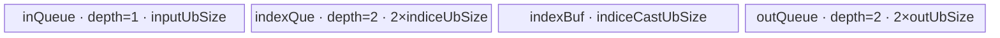

# Take 950 ACLNN 算子知识

## 算子速览

| 项目 | 内容 |
|---|---|
| 实际入口 | `aclnnTakeGetWorkspaceSize` / `aclnnTake`，公开 ACLNN 两段式接口，无独立版本后缀 |
| 计算语义 | 将 `self` 按逻辑元素顺序展平为长度 `S` 的一维张量，逐元素计算 `out[i] = self[index[i]]`；`out.shape = index.shape` |
| 输入输出 | `self/out` 为 ND、同 dtype；`index` 为 ND、INT32/INT64；公开有效索引域为 `[0,S)` |
| 执行类型 | R-001 AICPU；R-002 AIV_VECTOR；R-003 SIMT；R-004 AIV_VECTOR（PCIe 地址 fallback）；各 Route 的核心 Gather 都是单 Kernel |
| Kernel 路线 | R-001 AICPU dtype fallback；R-002 LastGather 全载；R-003 TwoDim SIMT；R-004 TwoDim PCIe AIV |
| 核心资源 | executor workspace；R-002 使用 GM、3 个 TQue、1 个 TBuf、Vector 寄存器；R-003 直接 GM+SIMT 寄存器并保留动态 local memory；R-004 使用 GM、双缓冲绑定队列和 indices TBuf；R-001 使用 AICPU 内存拷贝 |
| 来源闭包 | `source_closed`：公开 ACLNN→连续化/Reshape 框架边界→`l0op::GatherV2` selector→950 arch35 Tiling/POD→`gather_v2` router→全部 Take 可达 body，以及 AICPU fallback 与构建接线均闭合 |
| 验证状态 | 已完成源码闭包检查；本次知识提取未执行编译、真机、数值或性能测试。 |

## 接口与语义

### 计算语义

令 `S = self.numel`、`G = index.numel`，`self1D = reshape(contiguous(self), [S])`。非空输入执行 `GatherV2(self1D, axis=0, index, batch_dims=0, negative_index_support=true)`，然后把连续结果写回 `out` 的 view：

```text
for i in [0, G): out_flat[i] = self1D[index_flat[i]]
out.shape = index.shape
```

公开文档把合法索引限定为 `[0,S)`，因此负索引和越界索引不属于可依赖的接口语义。固定实现向 GatherV2 传入 `negative_index_support=true`，950 Kernel 会把负值加 `S`，但这只是实现事实，不能扩展公开契约。

### 输入、输出与属性

| 参数 | shape/layout | dtype | 约束、默认值与语义 |
|---|---|---|---|
| `self` | 0–8 维公开约束，ND；允许非连续 | UINT64、INT64、UINT32、FLOAT32、INT32、UINT16、INT16、FLOAT16、BFLOAT16、INT8、UINT8、DOUBLE、COMPLEX64、COMPLEX128、BOOL | 作为展平后的取数源；源码对 `self` 超过 8 维只告警，但公开文档写 0–8 维 |
| `index` | 0–8 维，ND；允许非连续 | INT32、INT64 | `out.shape` 必须与其一致；公开有效值域 `[0,S)` |
| `out` | 与 `index` shape 一致，ND；允许非连续 | 与 `self` 相同 | ViewCopy 把连续 Gather 结果提交到其 storage/view |
| `workspaceSize` | 标量输出 | UINT64 | executor 汇总连续化、GatherV2 和 ViewCopy 所需空间；950 GatherV2 Tiling 自身声明 16 MiB workspace |
| `executor` | Host 对象 | `aclOpExecutor*` | 第一段构建并转移所有权，第二段消费 |
| `stream` | runtime stream | `aclrtStream` | `CommonOpExecutorRun` 在该 stream 上按 executor 顺序执行 |

### 入口与版本

公开文档明确支持 Ascend 950PR/950DT，接口是无版本后缀的 `aclnnTake`。`aclnnTake.h` 声明两段式 ABI；`aclnn_take.cpp` 是唯一实现。950 的 `GatherV2` OpDef 注册 `ascend950` AICore config，binary config 枚举 950 dtype 组合，顶层 CMake 将 `ascend950`/`mc62` 映射到 `arch35` Tiling。未发现更新的 Take 版本族。

## Host/Launcher 执行流程

### 参数校验与前处理

`aclnnTakeGetWorkspaceSize` 的顺序为：创建 executor；检查三指针非空；检查 `self/out` dtype 相同且在列表中、`index` 为 INT32/INT64、950 允许 BF16；检查 `out.shape == index.shape`、`index.rank <= 8`、禁止“空 self + 非空 index”；拒绝私有 storage format。任一失败立即返回。

`self` 或 `index` 为空时直接返回 `workspaceSize=0`，executor 不含 Gather 节点。非空时依次添加 `Contiguous(self)`、`Contiguous(index)`，按 `GetViewShapeSize(self)` 生成 `[S]` 并 `Reshape`，调用 `GatherV2(self1D, 0, indexContiguous, ..., 0, true)`，最后 `ViewCopy(gatherResult,out)`。Contiguous/Reshape/ViewCopy 的自动生成 launcher 是明确的框架边界。

### 参数、Workspace 与生命周期

`selfSize` 由 view shape 各维用 `int64_t` 连乘得到，固定源码没有额外溢出检查；它被存入 executor 分配的 `aclIntArray`。Gather 输出由 executor 按 `index` shape、`self` dtype、ND format 分配。950 GatherV2 Tiling 把 workspace slice 固定为 `16*1024*1024` 字节；第一段最终用 `uniqueExecutor->GetWorkspaceSize()` 返回包含框架节点在内的总 workspace，因此总量不能只用 16 MiB 替代。workspace 和临时 tensor 由 executor 管理，用户提供的 workspace 在 `aclnnTake` 调用期间有效。

### 启动图与失败传播

```text
aclnnTakeGetWorkspaceSize
  -> [按需] Contiguous(self)              # 框架边界
  -> [按需] Contiguous(index)             # 框架边界
  -> Reshape(selfContiguous, [S])          # metadata/framework 边界
  -> l0op::GatherV2
       -> R-001 AICPU GatherV2，或
       -> A5 GatherV2 Tiling -> 单个 gather_v2 AICore entry
            -> R-002 AIV LastGather，或 R-003 SIMT / R-004 PCIe AIV
  -> ViewCopy(gatherResult, out)            # 框架边界
aclnnTake -> CommonOpExecutorRun(..., stream)
```

核心 Gather 节点输入为连续 `self1D/index` 与 executor 生成的 INT64 标量 `axis=0`，输出为连续临时 tensor。Gather 成功后 ViewCopy 才消费该 GM tensor；同一 executor/stream 保证节点顺序和可见性。任一 `Contiguous/Reshape/GatherV2/ViewCopy` 添加失败返回空指针并阻断后续节点。AICore launch 的 workspace slice 为 16 MiB、由 executor 所有；当前三个 AICore body 不读 `workspace` 参数。

## Route 与参数设计

### 分核与资源计算

Take 固定化后，`MargeAxis` 得到：

```text
S = self.numel; G = index.numel; D = sizeof(self dtype); I = sizeof(index dtype)
batchSize=1; outerSize=1; gatherDimSize=S; gatherSize=G; innerSize=1; ySize=G
improveDtypeSize=D
```

R-002 的初始 `blockFactor=ceil(1/aivNum)=1`、`tailBlockFactor=1`、`needCoreNum=1`；当 `G>=S`、`G>minCols` 且资源允许时，用 `coreInCols=min(ceil(G/minCols),aivNum)` 沿 indices 再分核，`gFactor=ceil(G/coreInCols)`。Take 下 `blockFactor` 始终为 1，所以 `inputNum=1`，输出队列和 indices 队列均为 depth 2。

R-003 先从 2048 threads 起步；当 `threadNum>=256 && ceil(G/threadNum)<aivNum/2` 时连续减半。若 `G<threadNum`，只启 1 core；否则 `perCore=align_up(ceil(G/aivNum),threadNum)`、`needCore=ceil(G/perCore)`。R-004 沿用同一 POD/key/blockDim，但 body 用实际 `GetBlockNum()` 重新均分 index 行。

### Route 选择

| 顺序 | Route | Key/模板 | 精确选择条件与优先级 | 不适用去向 |
|---:|---|---|---|---|
| 1 | R-001 AICPU fallback | `ADD_TO_LAUNCHER_LIST_AICPU(GatherV2)` | 950 `IsRegbase()` 下 `self.dtype` 不在 `{FLOAT,FLOAT16,BF16,INT32,INT64,INT16,UINT16,INT8,UINT8,BOOL,DOUBLE,COMPLEX64}`；对 aclnnTake 即 UINT32、UINT64、COMPLEX128 | AICore selector |
| 2 | R-002 LastGather 全载 | `1100000101/102/104/108`；`Gatherv2SimdLastGather<rawD,DTYPE_INDICES,true>` | AICore dtype，且 `(S*D<=UB/2 \|\| S*D<=UB-32768) && (D<=2 ? S<65536 : S<INT32_MAX) && floor(G/S)>1 && G*D>=32 && D<=8` | SIMT_TWO_DIM |
| 3 | R-004 PCIe AIV fallback | 与 R-003 相同 key；`Gatherv2SimdTwoDimPcie<DTYPE_INDICES>` | R-002 不命中，且 router 发现 `x/indices/axis/y` 任一地址在 `[0x40000000000,0x80000000000)` | R-003 |
| 4 | R-003 TwoDim SIMT | `20000000{01,02,04,08}` 或 64-bit 地址型 `20000001{01,02,04,08}`；`Gatherv2SimtTwoDim<rawD,DTYPE_INDICES,uint32_t/uint64_t>` | R-002 不命中、地址不在 PCIe 区间；地址型由 `S>INT32_MAX \|\| G>INT32_MAX` 决定 | 无；Tiling 失败则 launch 失败 |

```text
if empty(self) || empty(index): no-op success
else if !IsAiCoreSupport(self,index,axis): R-001
else if IsLastGatherAndFullLoad(): R-002
else:                              # IsGaAllLoad=false; IsSimtTwoDim=true for flattened Take
  key = 2000000000 + D + (S>INT32_MAX || G>INT32_MAX ? 100 : 0)
  if any GM address in PCIe window: R-004
  else:                            R-003
```

### 模板/实现执行矩阵

| Route | key/selector | dtype/shape/platform 完整命中条件 | 执行拓扑与 Kernel 节点 | 实际模板/body | 内存与同步特征 | tail/fallback |
|---|---|---|---|---|---|---|
| R-001 AICPU | l0op dtype selector | 950 aclnnTake 的 UINT32/UINT64/COMPLEX128 | 单 AICPU `GatherV2` task | `DoGatherV2Compute<T,Index>`→`CopyGatherV2Data` | CPU 逐元素 `BiggerMemCpy`；无 AIV UB/POD | 空域已由 ACLNN 截断；非法 dtype/axis/copy 返回错误 |
| R-002 LastGather | 1100000101/102/104/108 | 上述全载谓词；D=1/2/4/8，index INT32/INT64 | 单 AIV Kernel | `Gatherv2SimdLastGather<rawD,DTYPE_INDICES,true>` | self 分片全载 UB；indices/out 双缓冲；queue 同步 | `splitMode` 决定 indices 全载或切片；Vector mask 处理尾列 |
| R-003 SIMT | 2000000001…0108 | AICore dtype、R-002 false、普通 GM 地址 | 单 SIMT Kernel | `Gatherv2SimtTwoDim<rawD,DTYPE_INDICES,addrT>` | 直接 GM load/store；SIMT thread loop；无显式 TQue/TBuf | 每线程 `index<currentCoreElements`；OOB 写 0 |
| R-004 PCIe AIV | 同 R-003 | R-003 Host 条件且任一地址落入 PCIe window | 单 AIV Kernel | `Gatherv2SimdTwoDimPcie<DTYPE_INDICES>` | 8192B index cache、双缓冲数据 queue、HardEvent | `colsAlign<=ubAviable*D` 走整行，否则切列；OOB填0 |

### 隐藏性能 Guard

| Guard | Host/Tiling 条件 | Device/资源原因 | 影响 Route | 不满足时去向 | 源码符号 |
|---|---|---|---|---|---|
| dtype selector | `IsRegbase()` 的 AICore dtype 集合 | 950 AICore binary/body 只由该 selector 可达 | 全部 | R-001 | `op_api/gather_v2.cpp::IsAiCoreSupport` |
| 整轴全载 | `S*D<=UB/2 \|\| S*D<=UB-32768` | R-002 把 `ubRows*S` 个 raw 元素载入 input queue | R-002 | R-003/R-004 | `Gatherv2TilingBase::IsLastGatherAndFullLoad` |
| VGather 索引宽度 | `D<=2 ? S<65536 : S<INT32_MAX` | raw D=1/2 使用 16-bit gather index，D=4/8 使用 32-bit | R-002 | R-003/R-004 | `IsLastGatherAndFullLoad`, `IndexTypeGet` |
| 重用阈值 | `floor(G/S)>1 && G*D>=32` | 只有重复读取足够多时才全载 self | R-002 | R-003/R-004 | `IsLastGatherAndFullLoad` |
| 地址宽度 | `S>INT32_MAX \|\| G>INT32_MAX` | SIMT 地址计算需 uint64 | R-003/R-004 | 选择 64-bit key | `GetTilingKey` |
| PCIe 地址 | 任一地址位于固定窗口 | SIMT 直接 GM 路径被运行时替换为搬运型 AIV | R-003/R-004 | 普通地址走 R-003 | `gather_v2` entry |
| dynamic local memory | SIMT route 设置 `UB-128KiB` | Host 为 SIMT launch 保留 local memory；body 未显式索引该区 | R-003/R-004 | Tiling/launch 失败 | `PostTiling` |

### POD/ABI

`BEGIN_TILING_DATA_DEF` 生成布局的 `sizeof/alignof/offsetof` 未在固定仓显式展开，所以下表不臆测数值；字段声明顺序、源码类型和 producer/consumer 已闭合。

| 结构 | 字段 | 类型/位宽 | ABI 布局 | 单位 | Host/launcher producer | Device consumer | 边界 |
|---|---|---|---|---|---|---|---|
| `GatherV2LastTilingData` | `needCoreNum` | int16/16 | 固定仓未展开 | core | `LastGatherTiling: needCoreNum_` | `Process`、尾 core 判断 | ≥1 |
| 同上 | `indicesNum` | int16/16 | 同上 | queue depth | 常量 2 | `InitBuffer(indexQue_)` | Take 恒 2 |
| 同上 | `splitIndices` | int16/16 | 同上 | bool-like | 常量 1 | 当前 body 未读取 | inactive |
| 同上 | `inputNum` | int16/16 | 同上 | queue depth | `LastGatherUbTiling`；Take 为 1 | `InitBuffer(inQueue_)` | 1 |
| 同上 | `splitMode` | int16/16 | 同上 | enum | `indiceUbSize>=gFactor*I ? 0:1` | `Process` | 0/1 |
| 同上 | `coreInCols` | int16/16 | 同上 | core group | 沿 G 的二次分核 | `Init:pBlock_/gBlock_` | ≥1 |
| 同上 | `inputUbSize` | int32/32 | 同上 | byte | `align(ubRows*S*D,B)` | input queue capacity | UB bound |
| 同上 | `outUbSize` | int32/32 | 同上 | byte | `align(ubRows*ubCols*D,B)` | depth-2 out queue | UB bound |
| 同上 | `indiceUbSize` | int32/32 | 同上 | byte | `align(ubCols*I,B)` | depth-2 index queue | UB bound |
| 同上 | `indiceCastUbSize` | int32/32 | 同上 | byte | `max(align((I==8)*ubCols*4,indexAlign),indexAlign)` | `indexBuf_` | 至少 indexAlign |
| 同上 | `ubCols` | int32/32 | 同上 | element | UB 搜索结果 | indices/output tile、stride | >0 |
| 同上 | `ubRows` | int32/32 | 同上 | row | UB 搜索结果 | input tile/row loop | >0 |
| 同上 | `gatherDimSize` | int32/32 | 同上 | element | `S` 窄化写入 | index normalization/gather dim | R-002 guard `<INT32_MAX` |
| 同上 | `gatherSize` | int64/64 | 同上 | element | `G` | output stride/offset | >0 |
| 同上 | `blockFactor` | int64/64 | 同上 | row/core | `ceil(outer/aiv)=1` | per-core input rows | Take 为 1 |
| 同上 | `tailBlockFactor` | int64/64 | 同上 | row | `1` | tail core rows | Take 为 1 |
| 同上 | `gFactor` | int64/64 | 同上 | index/core | `ceil(G/coreInCols)` | GM base和当前列数 | >0 |
| `GatherV2TilingDataSimtTwoDim` | `needCoreNum` | int16/16 | 固定仓未展开 | core | `SimtTwoDimTiling` | SIMT Process | ≥1 |
| 同上 | `negativeIndexSupport` | int16/16 | 同上 | bool-like | Take 传 true | SIMT/PCIe body | 1 |
| 同上 | `threadNum` | int32/32 | 同上 | thread/core | 2048 起逐次减半 | `asc_vf_call(dim3(threadNum))` | 128–2048 |
| 同上 | `gatherDimSize` | int64/64 | 同上 | element | `S` | bounds/x offset | >0 |
| 同上 | `innerSize` | int64/64 | 同上 | element | 1 | div/address；PCIe列长 | Take 为 1 |
| 同上 | `perCoreElements` | int64/64 | 同上 | output element | core 切分 | SIMT base/count | >0 |
| 同上 | `lastCoreElements` | int64/64 | 同上 | output element | 尾核余量 | SIMT tail | >0 |
| 同上 | `gatherSize` | int64/64 | 同上 | element | `G` | PCIe body 重新分核 | >0 |
| 同上 | `dtypeSize` | int64/64 | 同上 | byte/element | `D` | PCIe byte offset/UB | 1/2/4/8 |

### Route 源码闭包

| Route | Key/selector | Host/Tiling producer | POD/参数 | Kernel entry/router 节点 | Kernel body/直接依赖 | 构建接线 |
|---|---|---|---|---|---|---|
| R-001 AICPU | `IsAiCoreSupport=false` | `op_api/gather_v2.cpp::GatherV2` | AICPU context attrs `batch_dims=0`,`negative_index_support=true` | `REGISTER_CPU_KERNEL("GatherV2")` | `GatherV2CpuKernel::Compute`→`CopyGatherV2Data` | `op_kernel_aicpu/CMakeLists.txt` |
| R-002 LastGather | 1100000101/102/104/108 | `DoOpTiling`→`LastGatherTiling` | `GatherV2LastTilingData` | `op_kernel/gather_v2_apt.cpp::gather_v2` | `gather_v2_simd_last_gather.h` 全部方法 | 顶层 CMake、950 binary config、OpDef |
| R-003 SIMT | 2000000001…0108 | `DoOpTiling`→`SimtTwoDimTiling` | `GatherV2TilingDataSimtTwoDim` | `gather_v2` 普通地址分支 | `Gatherv2SimtTwoDim::{Init,Process,GatherSimt}` | 同上 |
| R-004 PCIe AIV | 同 R-003，entry 地址分支 | 与 R-003 相同 | 同 R-003 | `gather_v2` PCIe 地址分支 | `Gatherv2SimdTwoDimPcie` 全部方法 | 同上 |

## Kernel 实现

### 公共执行流程

AICore entry 参数为 `(x,indices,axis,y,workspace,tiling)`，声明 `KERNEL_TYPE_AIV_ONLY`；`workspace` 和 `axis` 在三条 Take 可达 body 中不读取。entry 先按 TilingKey 编译期分派，再在 SIMT keys 内按物理地址选择 R-003/R-004。raw template type 仅按 D 选择 `int8_t/int16_t/int32_t/int64_t`，因此 Gather 是逐位搬运，不做浮点运算或舍入。所有核心路线均为单 Kernel；跨节点可见性由 executor stream 保证。

### Route R-001：AICPU dtype fallback

#### 适用条件

##### 选择证据

| 层级 | 文件 | 符号 | 源码谓词/参数 | 结果/下一跳 |
|---|---|---|---|---|
| API selector | `index/gather_v2/op_api/gather_v2.cpp` | `IsAiCoreSupport` | 950 regbase dtype 集合检查失败 | `GatherV2AiCPU` |
| launcher | 同上 | `GatherV2AiCPU` | 输入 x/indices/axis，属性 0/true | AICPU `GatherV2` task |
| CPU router | `index/gather_v2/op_kernel_aicpu/gather_v2_aicpu.cpp` | `Compute`,`IndicesCompute` | index INT32/INT64，再按 x dtype map | `DoGatherV2Compute<T,Index>` |

#### Device 数据流

##### 函数级调用链

```text
GatherV2AiCPU -> GatherV2CpuKernel::Compute
  -> NormalCheck -> GetInputAndCheck
  -> IndicesCompute<int32_t/int64_t>
  -> DoGatherV2Compute<T,Index>
  -> InitGatherV2Info<T> -> CopyGatherV2Data<T,Index>
```

##### 源码等价伪码

```text
axis=0; batch_dims=0; gather_dim=S; batch=outer=inner=1; batch_indices=G; slice_bytes=sizeof(T)
for j in [0,G):
  idx=index[j]; if idx<0: idx+=S
  require idx<S
  BiggerMemCpy(out+j, D, self+idx, D)
```

#### 内存与数据搬运

##### 资源与搬运表

| 层级/缓冲区 | offset/地址公式 | extent/容量公式 | dtype/layout | producer | consumer | owner/lifetime | 对齐/复用 |
|---|---|---|---|---|---|---|---|
| x GM | `idx` | S elements | T/1D | ACLNN input | `BiggerMemCpy` | caller | 无缓存复用 |
| index GM | `j` | G elements | Index/flattened ND | ACLNN input | CPU loop | caller | 顺序读取 |
| y GM | `j` | G elements | T/index shape | CPU loop | ViewCopy | executor temp | 每元素一次写 |

##### 分层内存布局

N/A：该 Route 是 AICPU 顺序循环，以 CPU 地址和 `BiggerMemCpy` 直接搬运，不使用 AIV UB/TQue/TBuf。

##### 字节账与复用顺序

```text
UB_total = N/A
dynamic_ub = N/A
workspace_total = executor 总量；该 AICPU body 未声明算子私有 slice
```

| 复用子区 | 写入者 | 读取者/消费点 | 下一次覆盖 | 同步或释放依据 | 安全条件 |
|---|---|---|---|---|---|
| N/A | 每次 memcpy 直接写 y | ViewCopy | executor 后续节点 | 同 stream task 顺序 | CPU task 成功后才运行 ViewCopy |

#### 同步、精度与尾块

##### 同步与数值边界表

| 阶段 | primitive/机制 | producer | consumer/等待点 | 保护对象 | 精度/尾块 |
|---|---|---|---|---|---|
| copy | `BiggerMemCpy` | x element | y element | D bytes | 位拷贝，无 cast；逐 j 无对齐尾块 |
| task edge | executor stream | AICPU task | ViewCopy | y GM | 失败阻断后续节点 |

#### 关键实现

##### 符号证据表

| 阶段 | 文件 | 符号/模板实例 | 实现事实 |
|---|---|---|---|
| Host/Tiling producer | `index/gather_v2/op_api/gather_v2.cpp` | `GatherV2`, `GatherV2AiCPU` | dtype selector与AICPU task参数 |
| Kernel entry/router | `index/gather_v2/op_kernel_aicpu/gather_v2_aicpu.cpp` | `Compute`, `IndicesCompute` | index/x dtype分派 |
| Device body/helper | 同上 | `InitGatherV2Info`, `CopyGatherV2Data` | 地址公式、负值转换、逐元素拷贝 |

### Route R-002：LastGather 整轴全载 AIV

#### 适用条件

##### 选择证据

| 层级 | 文件 | 符号 | 源码谓词/参数 | 结果/下一跳 |
|---|---|---|---|---|
| Tiling | `index/gather_v2/op_host/arch35/gather_v2_tiling.cpp` | `DoOpTiling` | `IsLastGatherAndFullLoad()`，且更早 `IsSimdTwoDim()` 对 Take 恒 false | `LastGatherTiling` |
| key | 同上 | `GetTilingKey` | base 1100000000 + D + negative 100 | 1100000101/102/104/108 |
| router | `index/gather_v2/op_kernel/gather_v2_apt.cpp` | `gather_v2` | key 精确匹配 | rawD 模板、`NEG_INDICE_SUPPORT=true` |

#### Device 数据流

##### 函数级调用链

```text
GatherTiling -> Gatherv2TilingBase::LastGatherTiling
gather_v2 -> Gatherv2SimdLastGather<rawD,DTYPE_INDICES,true>::Init -> Process
  -> NoSplitIndicesProcess 或 SplitIndicesProcess
  -> CopyInX / CopyInIndices
  -> [INT64 index] Cast(...CAST_NONE) -> ConvertNegIndices
  -> GatherComputeMultiRows -> GatherComputeMultiRowsVF -> LoadIndices -> DataCopyGather
  -> CopyOut
```

##### 源码等价伪码

```text
pBlock=block/coreInCols; gBlock=block%coreInCols
x_base=pBlock*S; index_base=gBlock*gFactor; y_base=pBlock*G+gBlock*gFactor
for each ubRows input group: DMA self slice into inQueue
  for each ubCols index tile (or reuse one fully loaded index tile):
    DMA indices; if int64 cast to int32; if negative add S
    for vector chunk and each input row:
      validMask=(0<=idx<S); DataCopyGather(raw bits, self_ub, idx, validMask)
      masked store valid output lanes into outQueue
    strided DMA rows from outQueue to y
```

#### 内存与数据搬运

##### 资源与搬运表

| 层级/缓冲区 | offset/地址公式 | extent/容量公式 | dtype/layout | producer | consumer | owner/lifetime | 对齐/复用 |
|---|---|---|---|---|---|---|---|
| x GM | `pBlock*blockFactor*S + i*ubRows*S` | `curRows*S` | rawD/1D | self1D | CopyInX | caller | contiguous DataCopyPad |
| index GM | `gBlock*gFactor + j*ubCols` | `curCols` | INT32/64 | index | CopyInIndices | caller | contiguous；splitMode=0 时一次载入复用 |
| y GM | base + `i*ubRows*G+j*ubCols` | `curRows*curCols` | rawD/index shape | CopyOut | ViewCopy | executor temp | blockLen=`curCols*D`; dstStride=`(G-curCols)*D` bytes |
| `inQueue_` | UB allocator | `inputNum*inputUbSize` | rawD | CopyInX | vector gather | pipe/iteration | Take depth=1 |
| `indexQue_` | UB allocator | `2*indiceUbSize` | Index | CopyInIndices | cast/normalize/gather | pipe/tile | depth=2 |
| `indexBuf_` | UB allocator | `indiceCastUbSize` | INT32 | int64 Cast或保底区 | normalize/gather | kernel | TBuf |
| `outQueue_` | UB allocator | `2*outUbSize` | rawD | Vector | CopyOut | pipe/tile | depth=2 |

##### 分层内存布局



##### 字节账与复用顺序

```text
UB_total = inputUbSize + 2*indiceUbSize + indiceCastUbSize + 2*outUbSize
inputUbSize=align(ubRows*S*D,B)
indiceUbSize=align(ubCols*I,B)
outUbSize=align(ubRows*ubCols*D,B)
UB_total <= UB，由 LastGatherUbTiling 的搜索与保留块约束
dynamic_ub=N/A
workspace_total=16 MiB Gather slice + framework/executor slices
```

| 复用子区 | 写入者 | 读取者/消费点 | 下一次覆盖 | 同步或释放依据 | 安全条件 |
|---|---|---|---|---|---|
| `inQueue_` slot | CopyInX | GatherComputeMultiRows | 下一 input loop | DeQue 后、计算完 FreeTensor | 完成所有 index tiles 后释放 |
| `indexQue_` slot | CopyInIndices | Cast/Convert/Gather | 下一 index tile | DeQue/FreeTensor | INT64 Cast 完即先释放 queue，结果留在 TBuf |
| `indexBuf_` | INT64 Cast | normalize/gather | 下一 tile | 同步 API 调用序 | 仅 INT64 index 有有效 cast 内容 |
| `outQueue_` slot | vector gather | CopyOut | 下一列 tile | EnQue→DeQue→FreeTensor | CopyOut 完成后覆盖 |

#### 同步、精度与尾块

##### 同步与数值边界表

| 阶段 | primitive/机制 | producer | consumer/等待点 | 保护对象 | 精度/尾块 |
|---|---|---|---|---|---|
| x/index DMA | TQue EnQue/DeQue | MTE2 | vector | input/index slot | DataCopyPad 按有效元素数搬运 |
| int64 index | `Cast(...CAST_NONE)` | index queue | indexBuf | index值 | R-002 guard令 S<INT32_MAX；随后以INT32 gather |
| gather | MicroAPI mask + `DataCopyGather` | x/index UB | outQueue | 输出向量 | `UpdateMask(curCols)`保护尾 lane；range mask保护公开域 |
| output | EnQue/DeQue/FreeTensor | vector | MTE3 | out slot | strided CopyOut只写 `curRows*curCols` |

#### 关键实现

##### 符号证据表

| 阶段 | 文件 | 符号/模板实例 | 实现事实 |
|---|---|---|---|
| Host/Tiling producer | `index/gather_v2/op_host/arch35/gather_v2_tiling.cpp` | `IsLastGatherAndFullLoad`, `LastGatherTiling`, `LastGatherUbTiling` | 谓词、分核、UB字段与splitMode |
| Kernel entry/router | `index/gather_v2/op_kernel/gather_v2_apt.cpp` | keys 1100000101…0108 | D到raw模板、negative=true映射 |
| Device body/helper | `index/gather_v2/op_kernel/arch35/gather_v2_simd_last_gather.h` | `Process`及全部 helper | 全载、切片、Vector gather、tail和queue生命周期 |

### Route R-003：TwoDim 普通地址 SIMT

#### 适用条件

##### 选择证据

| 层级 | 文件 | 符号 | 源码谓词/参数 | 结果/下一跳 |
|---|---|---|---|---|
| Tiling | `index/gather_v2/op_host/arch35/gather_v2_tiling.cpp` | `DoOpTiling` | R-002 false；Take 的 `batch=outer=1` 令 `IsSimtTwoDim=true` | `SimtTwoDimTiling` |
| key | 同上 | `GetTilingKey` | D + 32/64-bit address guard | SIMT two-dim key |
| router | `index/gather_v2/op_kernel/gather_v2_apt.cpp` | `gather_v2` | 四地址均不在 PCIe window | SIMT rawD/addrT |

#### Device 数据流

##### 函数级调用链

```text
gather_v2 -> Gatherv2SimtTwoDim<rawD,DTYPE_INDICES,addrT>::Init -> Process
  -> GetUintDivMagicAndShift(innerSize=1)
  -> asc_vf_call<GatherSimt<true>>(threadNum,...)
  -> each thread: index load -> negative normalize -> bounds -> x load -> y store
```

##### 源码等价伪码

```text
for local=threadIdx.x; local<coreElements; local+=blockDim.x:
  yIndex=block*perCore+local
  gatherI=yIndex; idx=index[gatherI]
  if idx<0: idx+=S
  y[yIndex]=(0<=idx<S) ? x[idx] : raw_zero
```

#### 内存与数据搬运

##### 资源与搬运表

| 层级/缓冲区 | offset/地址公式 | extent/容量公式 | dtype/layout | producer | consumer | owner/lifetime | 对齐/复用 |
|---|---|---|---|---|---|---|---|
| x GM | `idx` | S raw elements | rawD/1D | caller | thread load | caller | 随机访问 |
| index GM | `yIndex` | G Index elements | flattened ND | caller | thread load | caller | 连续线程读取连续 index |
| y GM | `yIndex` | G raw elements | rawD/index shape | thread store | ViewCopy | executor temp | 单写无冲突 |
| dynamic local memory | launch-local | `UB-128KiB` | 未被 body 显式寻址 | Host `SetLocalMemorySize` | SIMT launch环境 | Kernel lifetime | 不可据源码扣除 |

##### 分层内存布局

N/A：SIMT body 直接访问 GM，只使用标量/魔数寄存器；Host 仍为 launch 设置 `UB-128KiB` local memory，源码未给出其内部布局。

##### 字节账与复用顺序

```text
UB_total = 0（body 无显式 TQue/TBuf）
dynamic_ub = UB_platform - 128KiB
workspace_total = 16 MiB Gather slice + framework/executor slices
```

| 复用子区 | 写入者 | 读取者/消费点 | 下一次覆盖 | 同步或释放依据 | 安全条件 |
|---|---|---|---|---|---|
| N/A | 每线程直接写唯一 yIndex | ViewCopy | Kernel完成后 | executor stream顺序 | core区间不重叠且thread步进互斥 |

#### 同步、精度与尾块

##### 同步与数值边界表

| 阶段 | primitive/机制 | producer | consumer/等待点 | 保护对象 | 精度/尾块 |
|---|---|---|---|---|---|
| thread loop | `asc_vf_call`, grid-stride | thread | GM store | yIndex | `local<currentCoreElements`保护尾核 |
| address | `uint32_t/uint64_t`模板 | Tiling key | x/y offset | 大张量地址 | guard在S或G超INT32_MAX时用64位 |
| value | raw template load/store | x | y | D字节值 | 无cast/round；OOB写0 |

#### 关键实现

##### 符号证据表

| 阶段 | 文件 | 符号/模板实例 | 实现事实 |
|---|---|---|---|
| Host/Tiling producer | `index/gather_v2/op_host/arch35/gather_v2_tiling.cpp` | `SimtTwoDimTiling`, `GetTilingKey`, `PostTiling` | thread/core/address型/dynamic local memory |
| Kernel entry/router | `index/gather_v2/op_kernel/gather_v2_apt.cpp` | SIMT keys普通地址分支 | 模板映射与PCIe排除条件 |
| Device body/helper | `index/gather_v2/op_kernel/arch35/gather_v2_simt_two_dim.h` | `Process`, `GatherSimt<true>` | thread映射、负值处理、bounds、GM访问 |

### Route R-004：TwoDim PCIe 地址 AIV fallback

#### 适用条件

##### 选择证据

| 层级 | 文件 | 符号 | 源码谓词/参数 | 结果/下一跳 |
|---|---|---|---|---|
| Host | `index/gather_v2/op_host/arch35/gather_v2_tiling.cpp` | `SimtTwoDimTiling` | 与R-003相同 | 同POD/key |
| router | `index/gather_v2/op_kernel/gather_v2_apt.cpp` | SIMT key branches | 任一参数地址 `>=LOW && <HIGH` | `Gatherv2SimdTwoDimPcie` |
| body | `gather_v2_simd_two_dim_pcie.h` | `Process` | Take: `colsAlign=align(D,B)`；与 `ubAviable*D` 比较 | `NoSplitColProcess` 或 `SplitColProcess` |

#### Device 数据流

##### 函数级调用链

```text
gather_v2 -> Gatherv2SimdTwoDimPcie<DTYPE_INDICES>::Init -> Process
  -> NoSplitColProcess 或 SplitColProcess
    -> GetIndex -> CopyIn(index chunk) -> MTE2_S event
    -> CopyIn(x bytes) / recent-index UB Copy / Duplicate(0)
    -> EnQue -> CopyOut -> V_MTE3 event -> DataCopyPad
```

##### 源码等价伪码

```text
recompute rows per actual block count; cache indices in 8192B chunks
if align(D,B)<=ubAviable*D:
  tile multiple output rows; for each row normalize index
  if valid and index equals one of last 3 xIndex: copy prior UB row
  else if valid: DMA D bytes x[index] -> aligned UB row
  else: fill D bytes zero
else:
  for each output row, split innerSize by ubAviable and DMA/fill each column tile
enqueue tile; DMA only valid D bytes per Take output to y
```

#### 内存与数据搬运

##### 资源与搬运表

| 层级/缓冲区 | offset/地址公式 | extent/容量公式 | dtype/layout | producer | consumer | owner/lifetime | 对齐/复用 |
|---|---|---|---|---|---|---|---|
| x GM | `idx*D` bytes | D bytes/output | byte view | caller | CopyIn | caller | random PCIe DMA |
| index GM | chunk base | up to `8192/I` values | Index | caller | GetIndex scalar read | caller | chunk cached |
| y GM | row*D | D bytes | byte view/index shape | CopyOut | ViewCopy | executor | blockCount rows |
| `inQueue_` | UB allocator | `2*ubAviable*D` | bytes | CopyIn/Copy/Duplicate | CopyOut | pipe/tile | depth=2；row stride colsAlign |
| `indexBuf_` | UB allocator | 8192 bytes | Index | CopyIn | GetValue | kernel/chunk | TBuf复用 |

##### 分层内存布局


##### 字节账与复用顺序

```text
Ulocal = UB_platform - 131072
ubAviable=floor((Ulocal-8192)/B)*B/D/2
UB_total=2*ubAviable*D + 8192 <= Ulocal
dynamic_ub=UB_platform-128KiB（Host设置）
workspace_total=16 MiB Gather slice + framework/executor slices
```

| 复用子区 | 写入者 | 读取者/消费点 | 下一次覆盖 | 同步或释放依据 | 安全条件 |
|---|---|---|---|---|---|
| indexBuf chunk | CopyIn | GetValue | idx越过chunk时 | MTE2_S Set/Wait | scalar读取前等待DMA |
| dataQueue slot | CopyIn/Copy/Duplicate | CopyOut | 下一tile | EnQue/DeQue/FreeTensor与V_MTE3 | 输出DMA完成后释放 |
| 最近3行 | CopyIn | `Copy`重复索引 | tile内后续行 | MTE2_V Set/Wait | 仅引用当前未提交覆盖的xLocal |

#### 同步、精度与尾块

##### 同步与数值边界表

| 阶段 | primitive/机制 | producer | consumer/等待点 | 保护对象 | 精度/尾块 |
|---|---|---|---|---|---|
| index DMA | MTE2_S event | CopyIn | scalar GetValue | indexBuf | chunk尾取min |
| UB duplicate copy | MTE2_V event | DMA | vector Copy | 最近行 | 最多回看3个索引 |
| output | V_MTE3 event+queue | vector/UB | MTE3 | dataQueue | DataCopyPad只提交D有效字节 |
| value | byte copy/zero | x/constant | y | raw值 | 无cast；OOB填0 |

#### 关键实现

##### 符号证据表

| 阶段 | 文件 | 符号/模板实例 | 实现事实 |
|---|---|---|---|
| Host/Tiling producer | `index/gather_v2/op_host/arch35/gather_v2_tiling.cpp` | `SimtTwoDimTiling`, `PostTiling` | 共享POD/blockDim/local memory |
| Kernel entry/router | `index/gather_v2/op_kernel/gather_v2_apt.cpp` | PCIe地址条件 | SIMT key内运行时转AIV |
| Device body/helper | `index/gather_v2/op_kernel/arch35/gather_v2_simd_two_dim_pcie.h` | `Init`, `GetIndex`, `NoSplitColProcess`, `CopyOut` | UB布局、缓存、事件与tail |

## 算子特定优化

### Trick T-001：重复取数时整轴驻留 UB

#### 触发与源码依据

- 适用 Route：R-002
- 触发条件：完整条件即 R-002 的 `IsLastGatherAndFullLoad` 谓词。
- Golden 来源：[`index/gather_v2/op_host/arch35/gather_v2_tiling.cpp:527-533`](../../../../../../../cann-ops-raw/ascendc/ops-nn/955f8b33985b6d72989ebff341bb9c2c564a51bc/index/gather_v2/op_host/arch35/gather_v2_tiling.cpp#L527-L533)

**官方源码（固定 Commit 连续逐字摘录）**：

```cpp
bool Gatherv2TilingBase::IsLastGatherAndFullLoad() {
  bool isGatherDimFullLoad = (gatherDimSize_ * improveDtypeSize_ <= ubSize_ / NUM_TWO || gatherDimSize_ * improveDtypeSize_ <= ubSize_ - NUM_TWO * MIN_OUT_UB_SIZE);
  bool isLastGather = innerSize_ == 1;
  bool isVGatherSupport = (improveDtypeSize_ <= static_cast<int32_t>(sizeof(int16_t))) ? gatherDimSize_ < B8_AND_B16_GATHER_UPPER : gatherDimSize_ < INT32_MAX;
  bool enableUbGather = batchSize_ == 1 && isLastGather &&  isGatherDimFullLoad &&  isVGatherSupport && gatherSize_ / gatherDimSize_ > 1
                && gatherSize_ * improveDtypeSize_ >= 32 && improveDtypeSize_ <= static_cast<int32_t>(sizeof(int64_t));
  return enableUbGather;
}
```

#### 机制与设计原因

当输出索引数量至少为输入长度的两倍时，R-002 把 self 整段（Take 下为整条 1D 输入）载入 UB，并对多批 indices 使用 MicroAPI gather，避免每个输出都从 GM 随机读取。dtype 大小还决定 16/32-bit Vector 索引寄存器和可支持的 S 上界。

#### 迁移边界

- 适用：一维随机 gather、输入可驻留 UB 且索引复用高。
- 前提：950 AICore dtype、D≤8、输入/输出规模满足完整谓词。
- 失效：转 R-003；若地址落 PCIe window 则转 R-004。
- 未验证：本次知识提取未执行编译、真机、数值或性能测试。

#### 错误做法

不能忽略 `S` 的 16/32-bit VGather 上界或仅按逻辑元素数估算 UB；固定源码的 fallback 是 SIMT/PCIe 路线。

### Trick T-002：PCIe 路线复用最近三次随机读取

#### 触发与源码依据

- 适用 Route：R-004
- 触发条件：SIMT key 的任一 GM 地址落入 PCIe window，且 `align(D,B)<=ubAviable*D` 命中 `NoSplitColProcess`。
- Golden 来源：[`index/gather_v2/op_kernel/arch35/gather_v2_simd_two_dim_pcie.h:179-205`](../../../../../../../cann-ops-raw/ascendc/ops-nn/955f8b33985b6d72989ebff341bb9c2c564a51bc/index/gather_v2/op_kernel/arch35/gather_v2_simd_two_dim_pcie.h#L179-L205)

**官方源码（固定 Commit 连续逐字摘录）**：

```cpp
INDICES_T index = GetIndex(yIdx, indiceEndIdx);
if (tilingData_->negativeIndexSupport != 0) {
    index = index < 0 ? index + tilingData_->gatherDimSize : index;
}
int64_t xIndex = index * tilingData_->innerSize;
int64_t offset = xIndex * tilingData_->dtypeSize;
if (likely(index >= 0 && index < tilingData_->gatherDimSize)) {
    if (unlikely(xIndex == preIdx0 || xIndex == preIdx1 || xIndex == preIdx2)) {
        event_t eventIdMTE2toV = static_cast<event_t>(GetTPipePtr()->FetchEventID(HardEvent::MTE2_V));
        SetFlag<HardEvent::MTE2_V>(eventIdMTE2toV);
        WaitFlag<HardEvent::MTE2_V>(eventIdMTE2toV);
        int32_t backStep = (xIndex == preIdx0) ? backOffset0 :
                           (xIndex == preIdx1) ? backOffset1 : backOffset2;
        Copy(xLocal[j * colsAlign], xLocal[backStep], tilingData_->innerSize * tilingData_->dtypeSize);
    } else {
        CopyIn(xLocal[j * colsAlign], xGm_, offset, 1, tilingData_->innerSize * tilingData_->dtypeSize);
```

#### 机制与设计原因

PCIe 随机读取成本由源码结构可见地高于 UB 内复制。body 维护最近三个 `xIndex→UB offset`，命中时以 `Copy` 复用已到达 UB 的 D 字节，并用 MTE2_V 事件确保 DMA 对 Vector 可见；未命中才发起新 CopyIn。

#### 迁移边界

- 适用：PCIe/远端地址上的 gather，索引具有短距离重复。
- 前提：复用源仍在当前 xLocal tile，且事件顺序不变。
- 失效：超过三项回看窗口或跨 tile 时重新从 GM 搬运。
- 未验证：本次知识提取未执行编译、真机、数值或性能测试。

#### 错误做法

不能跨已释放的 queue slot 复用旧 offset，也不能删掉 MTE2_V 等待；固定仓未提供其它可验证反例。

## 模板与实现对比

| 对比维度 | R-001 AICPU | R-002 LastGather | R-003 SIMT | R-004 PCIe AIV | 设计选择依据 |
|---|---|---|---|---|---|
| 命中条件/优先级 | AICore dtype不支持 | 高复用且self可全载 | LastGather false、普通地址 | SIMT key但PCIe地址 | 先dtype，再Host shape/资源，再entry地址 |
| 模板与 dtype | `T,Index`真实dtype | raw D +真实Index+true | raw D+真实Index+addrT | 真实Index，x/y按byte | 位拷贝保持所有数值dtype |
| 循环与分核 | batch/outer/index三层 | pBlock/gBlock、input/index/vector列 | core/thread grid-stride | core/row/tile | 复用、并行与介质不同 |
| Queue/TBuf/寄存器/dynamic UB/通信 window | 无AIV资源 | 3 Queue+1 TBuf+Vector reg | SIMT reg；dynamic local memory | 双Queue+index TBuf | 由body真实分配决定 |
| 内存总占用与复用 | 逐元素copy | Host闭合UB公式；self/index复用 | 直接GM | local UB内最近3行复用 | 禁止把逻辑长度当分配量 |
| 搬运/Vector/SIMT/NDDMA/通信 API | `BiggerMemCpy` | DataCopyPad、Cast、DataCopyGather | `asc_vf_call`直接load/store | DataCopyPad、Copy、Duplicate | 无NDDMA/通信/Cube节点 |
| 同步、精度与 tail | task顺序；位拷贝 | Queue；mask；无浮点计算 | thread guard；OOB零 | HardEvent+Queue；有效字节 | 均无舍入；tail机制不同 |
| fallback/失败边界 | dtype/copy错误 | 谓词失败转SIMT | PCIe转R-004 | 无后续Route | 公开索引域外不可依赖 |

## 平台差异

| 项目 | A2 | A3 | 950 |
|---|---|---|---|
| 支持状态 | 公开文档支持，但本卡不覆盖 | 公开文档支持，但本卡不覆盖 | 支持；本卡闭合 |
| Host/Launcher | 固定仓 API selector 可见，A2 AiCore Tiling/body缺失 | 固定仓 API selector 可见，A3 AiCore Tiling/body缺失 | regbase dtype selector+950 arch35 Tiling闭合 |
| Kernel/资源 | 固定仓不可见 | 固定仓不可见 | AICPU + LastGather AIV + SIMT/PCIe AIV 全部闭合 |

## 限制与失败边界

- 公开契约要求 index 在 `[0,S)`；虽然 950 实现设置 `negative_index_support=true` 并含 OOB 分支，不应据此依赖负索引或越界行为。
- `GetViewShapeSize` 用 `int64_t` 连乘且无显式溢出保护；POD 生成宏的精确 `sizeof/alignof/offsetof` 在固定仓未展开。
- 空 `index` 或空 `self`（二者均空）直接 no-op；空 self 配非空 index 返回参数错误，不进入 Tiling 的 empty key。
- GatherV2 私有 workspace 固定 16 MiB，但 ACLNN 返回的是 executor 汇总值；Contiguous/ViewCopy 的额外 slice 由框架决定。
- A2/A3 虽有公开支持证据，但固定仓仅接线 950 arch35 AICore；其可达 AICore body 不闭合，故未生成无后缀正式卡。
- 本次知识提取未执行编译、真机、数值或性能测试。

## 源码索引

### 链路索引

| 链路阶段 | 文件 | 关键符号 | 支撑内容 |
|---|---|---|---|
| 入口声明/约束 | `index/gather_v2/docs/aclnnTake.md` | 产品支持表、公式、参数表 | 950公开支持与接口契约 |
| 入口声明/约束 | `index/gather_v2/op_api/aclnn_take.h` | `aclnnTakeGetWorkspaceSize`, `aclnnTake` | 两段式ABI |
| 入口实现 | `index/gather_v2/op_api/aclnn_take.cpp` | `CheckParams`, `aclnnTakeGetWorkspaceSize`, `aclnnTake` | 校验、前处理、launch graph、executor |
| 入口实现 | `index/gather_v2/op_api/gather_v2.cpp` | `IsAiCoreSupport`, `GatherV2AiCore`, `GatherV2AiCPU`, `GatherV2` | dtype selector与launcher |
| Host/Tiling/Launcher | `index/gather_v2/op_host/arch35/gather_v2_tiling.h` | 两个可达POD、`Gatherv2TilingBase` | POD字段与Tiling类 |
| Host/Tiling/Launcher | `index/gather_v2/op_host/arch35/gather_v2_tiling.cpp` | `MargeAxis`, `DoOpTiling`, `LastGatherTiling`, `SimtTwoDimTiling`, `PostTiling` | Take Route、资源、key、workspace |
| Host/Tiling/Launcher | `index/gather_v2/op_host/arch35/gather_v2_tiling_arch35.cpp` | `GatherTiling`, `TilingPrepareForGatherV2`, `IMPL_OP_OPTILING` | Tiling注册与平台资源producer |
| Kernel entry/body | `index/gather_v2/op_kernel/gather_v2_apt.cpp` | `gather_v2` | key与运行时地址router |
| Kernel entry/body | `index/gather_v2/op_kernel/arch35/gather_v2_simd_last_gather.h` | `Gatherv2SimdLastGather` | R-002完整body |
| Kernel entry/body | `index/gather_v2/op_kernel/arch35/gather_v2_simt_two_dim.h` | `Gatherv2SimtTwoDim` | R-003完整body |
| Kernel entry/body | `index/gather_v2/op_kernel/arch35/gather_v2_simd_two_dim_pcie.h` | `Gatherv2SimdTwoDimPcie` | R-004完整body |
| Kernel entry/body | `index/gather_v2/op_kernel_aicpu/gather_v2_aicpu.cpp` | `GatherV2CpuKernel`, `CopyGatherV2Data` | R-001完整body |
| 构建接线 | `index/gather_v2/op_host/gather_v2_def.cpp` | `GatherV2`, `AICore().AddConfig("ascend950")` | 950 OpDef |
| 构建接线 | `index/gather_v2/op_host/config/ascend950/gather_v2_binary.json` | `op_list` | 950 binary dtype实例 |
| 构建接线 | `index/gather_v2/CMakeLists.txt` | `SUPPORT_COMPUTE_UNIT`, `SUPPORT_TILING_DIR` | ascend950→arch35接线 |
| 构建接线 | `index/gather_v2/op_kernel_aicpu/CMakeLists.txt` | `gather_v2_cust_obj` | AICPU build接线 |

### 实现复用检查

| 检查项 | 可复用事实 | 不得改变的约束 | 源码符号 |
|---|---|---|---|
| ABI/POD | Take固定化为S/G/D/I及两个AICore POD | 字段顺序、位宽、单位；未展开offset不得猜测 | `gather_v2_tiling.h` |
| 调用顺序 | Contiguous→Reshape→GatherV2→ViewCopy | executor同stream顺序和失败阻断 | `aclnnTakeGetWorkspaceSize` |
| workspace/内存 | Gather slice 16MiB；各Route字节账可复用 | 总workspace须取executor；queue depth必须计入 | `GetWorkspaceSize`, 各`Init` |
| 同步 | R-002 Queue；R-004 HardEvent+Queue；R-003 thread独占 | 不得提前覆盖/释放UB slot | 各Route body |
| 精度与尾块 | raw位搬运；Vector mask、thread guard、有效字节DMA | 保持dtype-size模板、index range和tail公式 | `LoadIndices`, `GatherSimt`, `CopyOut` |
| 失败边界 | dtype selector、Tiling失败、AICPU copy失败 | 公开索引域外行为不可作为接口保证 | `IsAiCoreSupport`, `CheckParams`, `Compute` |
