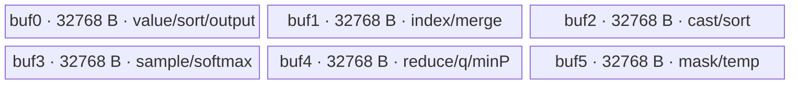

# TopKTopPSample A2/A3 ACLNN 算子知识

## 算子速览

| 项目 | 内容 |
|---|---|
| 实际入口 | `aclnnTopKTopPSampleV2GetWorkspaceSize` / `aclnnTopKTopPSampleV2`，公开 ACLNN 两段式接口 |
| 计算语义 | 每行按 TopK→TopP→MinP 过滤；随后输出过滤中间量，或执行 ArgMax，或按 `probs/(abs(q)+eps)` 执行 Q-Sample 后 ArgMax |
| 输入输出 | `logits[B,S]`、`topK[B]`、`topP[B]`，可选 `q[B,S]`、`minPs[B]`；输出 `logitsSelectIdx[B]` 及三个受属性控制的 `[B,S]` 输出 |
| 执行类型 | 单 Kernel：`top_k_top_p_sample_v2`，仅 AIV 执行 `AIV_VECTOR`；AIC 线程在 `Process` 起点返回 |
| Kernel 路线 | R-001 FP16（key 1001）；R-002 BF16（key 1027）；R-003 FP32（key 1000） |
| 核心资源 | 6 个 32 KiB `VECCALC TBuf`，总 UB 192 KiB；用户 workspace 为 `6*B*S*sizeof(float)`，另加平台系统 workspace |
| 来源闭包 | `source_closed`：公开 ACLNN 文档→OpDef/自动连续化边界→Tiling/POD→dtype router→完整 AIV body/排序 helper→A2/A3 binary config 闭合 |
| 验证状态 | 已完成源码闭包检查；本次知识提取未执行编译、真机、数值或性能测试。 |

## 接口与语义

### 计算语义

对第 `b` 行，`1 <= topK[b] <= min(S, align8(min(ksMax,1024)))` 时取降序前 K；`0 < topP[b] < 1` 时保留前缀使累计概率首次达到 `topP[b]`，`topP<=0` 退化为 K=1，`topP>=1` 跳过 TopP。可选 MinP 以 `minPs[b]*max(prob)` 为阈值紧凑保留元素；`minPs>=1` 仅留最大元素，`minPs<=0` 或空指针跳过。`inputIsLogits=true` 时先以 FP32 执行稳定 softmax；否则输入按概率使用。末端三选一：`isNeedSampleResult=true` 输出紧凑的 value/index；否则 `q==nullptr` 取 ArgMax，`q!=nullptr` 取 `argmax(prob/(abs(q)+eps))` 并映射回原索引。

### 输入、输出与属性

| 参数 | shape/layout | dtype | 约束、默认值与语义 |
|---|---|---|---|
| `logits` | `[B,S]`, ND | FP16/BF16/FP32 | 非空，`B>0`，`0<S<=2^20`；非连续输入由 OpDef `AutoContiguous` 处理 |
| `topK` | `[B]`, ND | INT32 | 非空；非正值或大于有效上限且小于 S 时跳过 TopK |
| `topP` | `[B]`, ND | 与 logits 相同 | 非空；`<=0` 留一个，`(0,1)` 过滤，`>=1` 跳过 |
| `q` | 可选 `[B,S]`, ND | FP32 | 存在时要求 `isNeedSampleResult=false`；按紧凑候选前缀逐元素对应 |
| `minPs` | 可选 `[B]`, ND | 与 logits 相同 | `<=0` 跳过，`(0,1)` 阈值过滤，`>=1` 留一个 |
| 属性 | 标量 | `eps:float`; `topKGuess:int32`; `ksMax:uint32`; 三个 bool | 默认 `1e-8/32/1024/true`；`ksMax` 向上 8 对齐并截到 1024 |
| `logitsSelectIdx` | `[B]`, ND | INT64 | `isNeedSampleResult=false` 时有效 |
| `logitsTopKPSelect` | `[B,S]`, ND | FP32 | `isNeedLogits=true` 时按原位置散射候选，其余填 `-inf` 或 0 |
| `logitsIdx` / `logitsSortMasked` | `[B,S]`, ND | INT64 / FP32 | `isNeedSampleResult=true` 时输出紧凑前缀 |

### 入口与版本

固定仓同时有 `aclnnTopKTopPSample` 与 `aclnnTopKTopPSampleV2`。V2 增加 MinP、FP32 logits、`ksMax/inputIsLogits/isNeedSampleResult` 及中间输出，且公开文档明确支持 A2/A3/950；因此 A2/A3 取版本族中实际支持的最新 V2。两段式 ACLNN 的生成实现未在固定仓展开，文档原型和 `AutoContiguous` 作为框架边界；算子拥有的 OpDef、Tiling、POD、router 和 body 均已闭合。

## Host/Launcher 执行流程

### 参数校验与前处理

`RunKernelTiling` 依次取得平台 AIV 核数、UB 和系统 workspace，读取六个属性，再执行输入 shape→输入 dtype→输出 shape→输出 dtype 校验。它拒绝 `S>1048576`、`topK/topP` 维数不是 logits 维数减一、batch 不一致、q 与 logits 不同形、q 与 `isNeedSampleResult=true` 并存、minPs shape/dtype 不匹配及受控输出的 shape/dtype 不匹配。OpDef 为五个输入声明 `AutoContiguous`。所有失败均返回 `GRAPH_FAILED`，不会保存 POD 或启动 Kernel。

### 参数、Workspace 与生命周期

令 `N=B*S`。Host 设置用户 workspace `usrSize=N*4*6=24N` 字节，并令总 workspace 为 `usrSize+sysWorkspaceSize`；Kernel 用 `GetUserWorkspace` 跳过系统区。用户区依次为 `logitsGlobalUser[N]`、`sortPartGlobalUser[2N]`、`sortAllGlobalUser[2N]`、`srcIndexGlobalUser[N]`，分别占 4N、8N、8N、4N 字节。executor 持有两段式接口构造的执行计划；调用方持有 workspace 至 stream 完成。

### 启动图与失败传播

```text
aclnnTopKTopPSampleV2GetWorkspaceSize
  -> ACLNN 生成边界：AutoContiguous / executor 构造
  -> TilingForTopKTopPSampleV2 -> RunKernelTiling
aclnnTopKTopPSampleV2(workspace, executor, stream)
  -> 单节点 K0: top_k_top_p_sample_v2<<<blockDim=numCore>>>
       POD=TopKTopPSampleV2TilingData, user-workspace=[0,24*B*S)
       AIV -> TopKTopPSampleV2Kernel<T>::Process
       AIC -> return
```

仅一个 Device 节点，无跨 Kernel 边。K0 内 workspace 由同一核按其批次切片读写；`SetWaitFlag`/`PipeBarrier` 保证 MTE/Vector/Scalar 顺序，`isNeedLogits` 或 `isNeedSampleResult` 时 Host 设 `BATCH_MODE`，Kernel 初始化输出后 `SyncAll`。未知 key 直接返回且不写输出；Tiling 校验失败阻断 launch。

## Route 与参数设计

### 分核与资源计算

`numCore=min(B, vectorCoreNum)`；`headCoreNum=B%numCore`，前 `headCoreNum` 核各处理 `ceil(B/numCore)` 行，余核各处理 `floor(B/numCore)` 行。Kernel 以 `startTaskId` 偏移所有 GM 基址，再用本地 `rowId` 循环。通用 tile 为 8192 元素；`innerLoopTime=ceil(S/8192)`，尾长 `S%8192` 并按 32 元素对齐。全排序先按 1024 元素分段：`eightKPartNum=ceil(S/1024)`，尾段同样按 32 元素对齐。`ubSize` 被读取但固定仓 Host 未据此做 192 KiB 上界检查。

### Route 选择

| 顺序 | Route | Key/模板 | 精确选择条件与优先级 | 不适用去向 |
|---:|---|---|---|---|
| 1 | R-001 FP16 | 1001 / `TopKTopPSampleV2Kernel<half>` | logits dtype `DT_FLOAT16` | 检查 FP32 |
| 2 | R-003 FP32 | 1000 / `TopKTopPSampleV2Kernel<float>` | logits dtype `DT_FLOAT` | BF16 默认分支 |
| 3 | R-002 BF16 | 1027 / `TopKTopPSampleV2Kernel<bfloat16_t>` | 已通过 dtype 校验且非前两类，即 `DT_BF16` | 无；校验阶段已拒绝其它 dtype |

```text
if dtype == FP16: key=1001
else if dtype == FP32: key=1000
else: key=1027  # 仅在先前 dtype 校验通过后可达 BF16
router: 1001 -> <half>; 1027 -> <bfloat16_t>; 1000 -> <float>; otherwise return
```

### 模板/实现执行矩阵

| Route | key/selector | dtype/shape/platform 完整命中条件 | 执行拓扑与 Kernel 节点 | 实际模板/body | 内存与同步特征 | tail/fallback |
|---|---|---|---|---|---|---|
| R-001 FP16 | 1001 | FP16 logits/topP/minPs；其余公共校验；A2/A3 config | 单 AIV K0 | `TopKTopPSampleV2Kernel<half>::Process` | 输入先 `Cast(...CAST_NONE)` 到 FP32；共享 192 KiB UB/24N 用户 workspace | 8192/1024 分块，尾块 32 元素对齐 |
| R-002 BF16 | 1027 | BF16 logits/topP/minPs；其余公共校验；A2/A3 config | 单 AIV K0 | `TopKTopPSampleV2Kernel<bfloat16_t>::Process` | scalar 用 `ToFloat`，向量输入 cast FP32；其余同 R-001 | 同 R-001 |
| R-003 FP32 | 1000 | FP32 logits/topP/minPs；其余公共校验；A2/A3 config | 单 AIV K0 | `TopKTopPSampleV2Kernel<float>::Process` | 直接 FP32 搬运，无输入 cast；其余相同 | 同 R-001 |

### 隐藏性能 Guard

| Guard | Host/Tiling 条件 | Device/资源原因 | 影响 Route | 不满足时去向 | 源码符号 |
|---|---|---|---|---|---|
| TopK 有效域 | `k>0 && k<=min(S,ksMAX)` | 本地滚动 TopK 最大保留 1024 | 全部 | 跳过 TopK；若 `p<=0` 强制 K=1 | `Process` |
| GuessK | `!doTopK && 0<p<1`，Device 再截 `min(topKGuess,S,1024)` | 先小集合排序，累计和达到 p 即免全排序 | 全部 | 未达到 p 转 `SortAll` 全排序 | `Process`, `TopPCompute` |
| 排序对齐 | TopK tile 8192；Sort 基元长度按 32 元素补齐 | `Sort`/`MrgSort` 和 32B DMA 的粒度 | 全部 | 尾部填 `FLOAT_MIN` 后参与排序但不提交为有效数据 | `Sort32Block`, `SortSPartAll` |
| UB 固定占用 | 6×32768 B | 六个 `TBuf<VECCALC>` | 全部 | Host 未实现基于 `ubSize` 的 fallback；平台资源不足无源码 fallback | `InitAndSetBuffer` |
| 输出全局初始化 | `isNeedLogits \|\| isNeedSampleResult` | 稀疏散射前必须定义未写位置 | 全部 | 不请求相应输出则不初始化；请求时设 BATCH_MODE 并 `SyncAll` | `SetOpTilingData`, `InitAndSetBuffer` |
| Q 与中间输出互斥 | q 存在且 `isNeedSampleResult!=0` | 末端模式二选一 | 全部 | Tiling 失败 | `CheckOpInputShape` |

### POD/ABI

`BEGIN_TILING_DATA_DEF` 的展开定义不在任务源码集合中，因此 `sizeof/alignof/offsetof` 标为固定仓不可见；所有字段的声明类型和 Host/Device 对应均可见。

| 结构 | 字段 | 类型/位宽 | ABI 布局 | 单位 | Host/launcher producer | Device consumer | 边界 |
|---|---|---|---|---|---|---|---|
| `TopKTopPSampleV2TilingData` | `numCore` | uint32/32 | 固定仓不可见 | core | 未显式 `set_numCore` | 未读取 | inactive |
| 同上 | `rowNum` | uint32/32 | 同上 | row | `rowNum=B` | workspace 行域、排序参数 | B 必须正 |
| 同上 | `rowLen` | uint32/32 | 同上 | element/row | `rowLen=S` | 所有地址和循环 | `S<=2^20` |
| 同上 | `headCoreNum` | uint32/32 | 同上 | core | `B%numCore` | former/tail 核分支 | `<numCore` |
| 同上 | `perHeadCoreRowNum` | uint32/32 | 同上 | row/core | `ceil(B/numCore)` | 头核行数/起点 | active |
| 同上 | `tailCoreRowNum` | uint32/32 | 同上 | row/core | `floor(B/numCore)` | 尾核行数/起点 | active |
| 同上 | `perHeadCorePartNum` | uint32/32 | 同上 | part | reset 后保持 0 | 未读取 | inactive |
| 同上 | `tailCorePartNum` | uint32/32 | 同上 | part | reset 后保持 0 | 未读取 | inactive |
| 同上 | `innerLoopEle` | uint32/32 | 同上 | element | 常量 8192 | 保存到成员；主要循环用编译期 8192 | active/冗余 |
| 同上 | `innerLoopTime` | uint32/32 | 同上 | loop | `ceil(S/8192)` | cast/TopK/Softmax 循环 | active |
| 同上 | `innerLoopEleTail` | uint32/32 | 同上 | element | `S%8192` | 尾有效长度 | 0 表示整块 |
| 同上 | `innerLoopEleTailPad` | uint32/32 | 同上 | element | `ceil(tail/32)*32` | 尾 GM 步进 | active on tail |
| 同上 | `softmaxLoopTime` | uint32/32 | 同上 | loop | `ceil(S/8192)` | `GetRowMax`/softmax/full sort | active |
| 同上 | `softmaxLoopEleTail` | uint32/32 | 同上 | element | `S%8192` | softmax 尾有效长度 | active on tail |
| 同上 | `softmaxLoopEleTailPad` | uint32/32 | 同上 | element | `ceil(tail/32)*32` | softmax 尾步进 | active on tail |
| 同上 | `eightKPartNum` | uint32/32 | 同上 | part | `ceil(S/1024)` | 全排序段数 | GuessK 失败时 active |
| 同上 | `eightKPartTail` | uint32/32 | 同上 | element | `S%1024` | 最后一排序段有效长 | 同上 |
| 同上 | `eightKPartTailPad` | uint32/32 | 同上 | element | `ceil(tail/32)*32` | 最后一段补齐长 | 同上 |
| 同上 | `mrgMode` | uint32/32 | 同上 | enum | 常量 1 | 保存但未参与分支 | inactive |
| 同上 | `headOffset` | uint32/32 | 同上 | element | `headCoreNum*ceil(B/C)*S`，producer 中先算 uint64 再窄化 | 未读取 | inactive；存在窄化 |
| 同上 | `isNeedLogits` | uint32/32 | 同上 | bool flag | bool 属性转 0/1 | 初始化/散射输出 | active |
| 同上 | `eps` | float/32 | 同上 | value | ACLNN double 经属性层 float producer | `abs(q)+eps` | active when q |
| 同上 | `topKGuess` | int32/32 | 同上 | element | int32 属性 | GuessK，Device 上限 1024 | 可为非正导致直接全排序 |
| 同上 | `ksMAX` | uint32/32 | 同上 | element | `align32B(ksMax*sizeof(float))/4` 再截 1024 | TopK enable guard | Host 属性读为 uint32 |
| 同上 | `inputIsLogits` | uint32/32 | 同上 | bool flag | bool 属性转 0/1 | softmax/默认填充值 | active |
| 同上 | `isNeedSampleResult` | uint32/32 | 同上 | bool flag | bool 属性转 0/1 | 末端输出模式 | active |

### Route 源码闭包

| Route | Key/selector | Host/Tiling producer | POD/参数 | Kernel entry/router 节点 | Kernel body/直接依赖 | 构建接线 |
|---|---|---|---|---|---|---|
| R-001 | 1001 | `top_k_top_p_sample_v2_tiling.cpp::RunKernelTiling/SetOpTilingKey` | `TopKTopPSampleV2TilingData` | `top_k_top_p_sample_v2.cpp::top_k_top_p_sample_v2` | `TopKTopPSampleV2Kernel<half>`；`TopKTopPSampleV2SortKernel<half>` | ascend910b/ascend910_93 binary JSON + op_host CMake |
| R-002 | 1027 | 同上 | 同上 | 同上 | `<bfloat16_t>` 两模板 | 同上 |
| R-003 | 1000 | 同上 | 同上 | 同上 | `<float>` 两模板 | 同上 |

## Kernel 实现

### 公共执行流程

三个 dtype Route 共用单 Kernel 类。每核基址已偏移到 `startTaskId`，逐本地行读取 p/k/minP；按运行时条件选择 TopK、GuessK 或全排序；FP32 中间结果始终驻 UB 或用户 workspace。TopK 以 8192 元素滚动排序并只保留至多 1024 个；GuessK 成功时只处理候选，失败才把 1024 元素段排序到 `sortPart`，再多级四路归并，并在归并流中累计概率、达到 p 即停止。随后 MinP 在本地有序前缀上缩短长度，或对 workspace 前缀用 `CompareScalar+GatherMask` 原地压紧。最后按属性执行散射 logits、中间结果输出或 ArgMax/Q-Sample。

### Route R-001：FP16 输入升精度实现

#### 适用条件

##### 选择证据

| 层级 | 文件 | 符号 | 源码谓词/参数 | 结果/下一跳 |
|---|---|---|---|---|
| Host | `op_host/top_k_top_p_sample_v2_tiling.cpp` | `SetOpTilingKey` | `dataType==DT_FLOAT16` | key 1001 |
| Router | `op_kernel/top_k_top_p_sample_v2.cpp` | `top_k_top_p_sample_v2` | `TILING_KEY_IS(1001)` | `TopKTopPSampleV2Kernel<half>` |
| Device | `op_kernel/top_k_top_p_sample_v2.h` | `Init/Process` | `ASCEND_IS_AIV`; AIC 直接 return | AIV_VECTOR body |

#### Device 数据流

##### 函数级调用链

```text
top_k_top_p_sample_v2<key=1001>
  -> InitTilingParams -> InitAndSetBuffer
  -> Process per row
     -> TopKLoopProcess -> Sort32Block[/Sort32BlockNext] -> Extract
     -> SoftMaxCompute / LogitsCast+GetRowMax+SoftMaxFstCompute+SoftMaxFullCompute
     -> TopPCompute OR TopKGuess; miss -> TopKTopPSampleV2SortKernel::SortAll
     -> minPComputeLocal / minPComputeGloabal
     -> CopyOutLogits[/Global]
     -> CopyOutMiddle OR CopyOutIndex OR QSampleCompute[/Global]+ArgMaxAndGather
```

##### 源码等价伪码

```text
for local_row in [0, rtCoreRowNum):
  p=fp32(topP[row]); k=topK[row]; minp=optional fp32(minPs[row])
  doK=(0<k<=min(S,ksMAX)); doP=(0<p<1); doGuess=(!doK&&doP)
  if doK || p<=0: rolling_topk(cast_fp32(logits), k or 1); candidate=UB
  normalize candidate with max-subtracted FP32 softmax when inputIsLogits
  if doK&&doP: scan prefix until cumsum>=p
  else if doGuess:
    sort min(topKGuess,S,1024); if prefix sum misses p:
      sort 1024-element GM segments -> 4-way hierarchical merge -> stop at p
  else if !doK&&p>=1: build indices and row max over workspace
  if minp>0: keep values>=minp*max; minp>=1 keeps first only
  optionally scatter original logits to output
  if isNeedSampleResult: emit compact values and int64 indices
  else if q: score=candidate/(abs(q)+eps); emit original index of argmax(score)
  else: emit original index of candidate argmax
```

#### 内存与数据搬运

##### 资源与搬运表

| 层级/缓冲区 | offset/地址公式 | extent/容量公式 | dtype/layout | producer | consumer | owner/lifetime | 对齐/复用 |
|---|---|---|---|---|---|---|---|
| `buf0..buf5` | 独立 UB | 各 8192×4=32768 B | 多 dtype 视图 | `InitBuffer` | 全部 helper | `TPipe`/整 Kernel | 反复 reinterpret/覆盖 |
| logits workspace | `0` | N FP32 | row-major | cast/softmax/full merge output | TopP/MinP/Q/output | ACLNN workspace/K0 | 每核按 row slice |
| sortPart | `N+2*rowOffset` float | 2N FP32 槽 | value/index 交错 | `SortSPartAll` | 一级归并 | 同上 | 每元素 2 float 槽 |
| sortAll | `3N+2*rowOffset` float | 2N FP32 槽 | value/index 交错 | 中间归并 | 下一归并 | 同上 | 与 sortPart ping-pong |
| source index | `5N+rowOffset` uint32 | N uint32 | row-major | CreateVecIndex/merge | gather/output | 同上 | 可由 MinP 原地压紧 |
| outputs | 本核 `startTaskId` 行基址 | row 或 row×S | ND | CopyOut helpers | caller | caller | 有效长度精确 DMA |

##### 分层内存布局



##### 字节账与复用顺序

```text
UB_total = 6 * 8192 * sizeof(float) = 196608 B
Host ubSize check = N/A（读取 ubSize，但没有比较）
dynamic_ub = N/A
workspace_total = 6*B*S*sizeof(float) + sysWorkspaceSize
=> S<=2^20；TopK 局部候选<=1024，流式 tile<=8192
```

| 复用子区 | 写入者 | 读取者/消费点 | 下一次覆盖 | 同步或释放依据 | 安全条件 |
|---|---|---|---|---|---|
| buf0/buf1 | TopK/sort value+index | Extract/MinP/output | 下一 tile/阶段 | `PipeBarrier`, event | consumer 完成后覆盖 |
| buf2/buf3/buf4 | cast/softmax/reduce | scalar 累计、排序、QSample | 下一循环 | MTE2_V、V_S、S_V | event 成对等待 |
| buf5 | sort temp/mask/q | Sort/GatherMask/Div | 下一阶段 | `PipeBarrier` | 活跃视图不重叠使用 |
| sortPart/sortAll | 相邻归并层 | 下一归并层 | ping-pong 下一轮 | MTE3_MTE2 | 当前写回可见后读取 |

#### 同步、精度与尾块

##### 同步与数值边界表

| 阶段 | primitive/机制 | producer | consumer/等待点 | 保护对象 | 精度/尾块 |
|---|---|---|---|---|---|
| GM→UB→V | `MTE2_V` | DataCopyPad | Cast/Vector | 当前 tile | FP16 cast FP32；只算 `countLen` |
| Vector 链 | `PipeBarrier<PIPE_V>` | Sort/Exp/Reduce/Div | 下一 Vector op | 同一 TBuf | softmax 先减 max，全 FP32 |
| V/Scalar | `V_S`/`S_V` | Reduce/排序结果 | `GetValue`/下一 Vector | 标量阈值、索引 | 累计 TopP 为 FP32 scalar |
| UB→GM→UB | `V_MTE3`, `MTE3_MTE2` | workspace 写回 | 下一 tile/归并 | workspace slice | 尾 DMA 为有效字节，补齐 lane 填 `FLOAT_MIN` |
| 多核输出 | `SyncAll` | InitGlobalMemory | 稀疏写 | 输出 GM | 仅受控输出启用 |

#### 关键实现

##### 符号证据表

| 阶段 | 文件 | 符号/模板实例 | 实现事实 |
|---|---|---|---|
| Host/Tiling producer | `op_host/top_k_top_p_sample_v2_tiling.cpp` | `SetOpTilingData`, `RunKernelTiling` | core/tile/workspace/POD/key |
| Kernel entry/router | `op_kernel/top_k_top_p_sample_v2.cpp` | `top_k_top_p_sample_v2`, key 1001 | 映射 `<half>`，unknown key return |
| Device body/helper | `op_kernel/top_k_top_p_sample_v2.h` | `<half>::Process`, `TopKLoopProcess`, softmax/MinP/Q helpers | 完整运行时决策、FP32 管线、输出 |
| Device sort helper | `op_kernel/top_k_top_p_sample_v2_sort_cumsum.h` | `<half>::SortAll` | 1024 分段、四路层次归并、流式 cumsum |

### Route R-002：BF16 输入升精度实现

#### 适用条件

##### 选择证据

| 层级 | 文件 | 符号 | 源码谓词/参数 | 结果/下一跳 |
|---|---|---|---|---|
| Host | `op_host/top_k_top_p_sample_v2_tiling.cpp` | `SetOpTilingKey` | dtype 通过校验且非 FP16/FP32 | key 1027 |
| Router | `op_kernel/top_k_top_p_sample_v2.cpp` | entry | key 1027 | `<bfloat16_t>` |
| Device | `op_kernel/top_k_top_p_sample_v2.h` | `Process` | `if constexpr bfloat16_t` | scalar `ToFloat`，向量 cast FP32 |

#### Device 数据流

##### 函数级调用链

```text
entry<1027> -> TopKTopPSampleV2Kernel<bfloat16_t>::Init/Process
  -> 与 R-001 相同的 TopK/softmax/GuessK/full-sort/MinP/output helper 图
```

##### 源码等价伪码

```text
p=ToFloat(BF16 topP); minp=ToFloat(BF16 minPs)
每个 BF16 logits tile -> Cast(..., CAST_NONE) -> 复用 R-001 的 FP32 伪码
```

#### 内存与数据搬运

##### 资源与搬运表

| 层级/缓冲区 | offset/地址公式 | extent/容量公式 | dtype/layout | producer | consumer | owner/lifetime | 对齐/复用 |
|---|---|---|---|---|---|---|---|
| input tile | 行偏移+tile | 有效 `countLen*sizeof(bfloat16_t)` | BF16 ND | DataCopyPad | Cast | buf0 view/本 tile | 尾按有效字节 |
| FP32 UB/workspace | 同 R-001 | 192 KiB UB；24N B 用户区 | FP32 | Cast | 共用 helper | 同 R-001 | 同 R-001 |

##### 分层内存布局


##### 字节账与复用顺序

```text
UB_total=196608 B; workspace_total=24*B*S+sysWorkspaceSize; dynamic_ub=N/A
```

| 复用子区 | 写入者 | 读取者/消费点 | 下一次覆盖 | 同步或释放依据 | 安全条件 |
|---|---|---|---|---|---|
| buf0 BF16/FP32 视图 | DataCopyPad | Cast/后续 helper | Cast 完成后 | MTE2_V + PIPE_V | 不在源仍活跃时覆盖 |

#### 同步、精度与尾块

##### 同步与数值边界表

| 阶段 | primitive/机制 | producer | consumer/等待点 | 保护对象 | 精度/尾块 |
|---|---|---|---|---|---|
| BF16→FP32 | MTE2_V + Cast | input DMA | sort/softmax | input tile | `CAST_NONE`，随后全 FP32；其余同 R-001 |

#### 关键实现

##### 符号证据表

| 阶段 | 文件 | 符号/模板实例 | 实现事实 |
|---|---|---|---|
| Host/Tiling producer | `op_host/top_k_top_p_sample_v2_tiling.cpp` | `SetOpTilingKey` | BF16 key 1027 |
| Kernel entry/router | `op_kernel/top_k_top_p_sample_v2.cpp` | entry | `<bfloat16_t>` |
| Device body/helper | `op_kernel/top_k_top_p_sample_v2.h` | `<bfloat16_t>::Process` | `ToFloat` + FP32 cast，余下图同源码模板 |

### Route R-003：FP32 原生输入实现

#### 适用条件

##### 选择证据

| 层级 | 文件 | 符号 | 源码谓词/参数 | 结果/下一跳 |
|---|---|---|---|---|
| Host | `op_host/top_k_top_p_sample_v2_tiling.cpp` | `SetOpTilingKey` | `dataType==DT_FLOAT` | key 1000 |
| Router | `op_kernel/top_k_top_p_sample_v2.cpp` | entry | key 1000 | `<float>` |
| Device | `op_kernel/top_k_top_p_sample_v2.h` | `LogitsCast/TopKLoopProcess` | `DTYPE=float` constexpr branch | 直接搬入 FP32 |

#### Device 数据流

##### 函数级调用链

```text
entry<1000> -> TopKTopPSampleV2Kernel<float>::Init/Process
  -> 与 R-001 相同 helper 图，输入路径跳过 Cast
```

##### 源码等价伪码

```text
FP32 logits tile -> DataCopyPad(localValueCast, src, countLen*4)
-> 复用 R-001 的 FP32 排序、softmax、过滤和输出伪码
```

#### 内存与数据搬运

##### 资源与搬运表

| 层级/缓冲区 | offset/地址公式 | extent/容量公式 | dtype/layout | producer | consumer | owner/lifetime | 对齐/复用 |
|---|---|---|---|---|---|---|---|
| FP32 input tile | 行偏移+tile | `countLen*4` B | FP32 ND | DataCopyPad | sort/softmax | 当前 TBuf/tile | 无 Cast |
| UB/workspace | 同 R-001 | 196608 B / 24N B | FP32 | 共用 helper | 共用 helper | 同 R-001 | 同 R-001 |

##### 分层内存布局


##### 字节账与复用顺序

```text
UB_total=196608 B; workspace_total=24*B*S+sysWorkspaceSize; dynamic_ub=N/A
```

| 复用子区 | 写入者 | 读取者/消费点 | 下一次覆盖 | 同步或释放依据 | 安全条件 |
|---|---|---|---|---|---|
| FP32 tile TBuf | MTE2 | Vector sort/softmax | 下一 tile | MTE2_V/PipeBarrier | 有效 `countLen` 完成 |

#### 同步、精度与尾块

##### 同步与数值边界表

| 阶段 | primitive/机制 | producer | consumer/等待点 | 保护对象 | 精度/尾块 |
|---|---|---|---|---|---|
| FP32 直入 | MTE2_V | DataCopyPad | Vector | tile | 无输入量化；其余同 R-001 |

#### 关键实现

##### 符号证据表

| 阶段 | 文件 | 符号/模板实例 | 实现事实 |
|---|---|---|---|
| Host/Tiling producer | `op_host/top_k_top_p_sample_v2_tiling.cpp` | `SetOpTilingKey` | FP32 key 1000 |
| Kernel entry/router | `op_kernel/top_k_top_p_sample_v2.cpp` | entry | `<float>` |
| Device body/helper | `op_kernel/top_k_top_p_sample_v2.h` | `<float>::Process` | FP32 直搬，复用完整模板 body |

## 算子特定优化

### Trick T-001：GuessK 成功时避免全行排序

#### 触发与源码依据

- 适用 Route：R-001/R-002/R-003
- 触发条件：TopK 跳过、`0<topP<1`、`min(topKGuess,S,1024)>0` 且候选累计和达到 p。
- Golden 来源：[`op_kernel/top_k_top_p_sample_v2.h:166-225`](https://gitcode.com/cann/ops-nn/blob/955f8b33985b6d72989ebff341bb9c2c564a51bc/index/top_k_top_p_sample_v2/op_kernel/top_k_top_p_sample_v2.h#L166-225)

**官方源码（固定 Commit 连续逐字摘录）**：

```cpp
} else if (doGuessTopK) {
    kCount = this->topKGuess > this->rowLen ? this->rowLen : this->topKGuess;
    this->k_pad = Align(kCount, EIGHT);
    if (kCount > 0) {
        TopKLoopProcess(rowId, kCount, logitsGlobalUser);
```

#### 机制与设计原因

先滚动维护至多 GuessK 个候选，再用 FP32 累计概率检查是否已覆盖 p；成功时不物化 `2N+2N` 的完整排序中间流。只有 miss 才调用 `SortAll`。GuessK 受 Device 1024 上限约束，避免局部 TopK 缓冲超过固定容量。

#### 迁移边界

- 适用：长词表、TopK 未启用而 TopP 前缀较短。
- 前提：GuessK 正数且不超过 S/1024 上限；输入归一化语义正确。
- 失效：累计和未达到 p 或 GuessK 非正，必须进入全排序 fallback。
- 未验证：本次知识提取未执行编译、真机、数值或性能测试。

#### 错误做法

把 GuessK miss 当作最终结果会截断合法 TopP 集合；源码明确用 `if (!ifFind)` 进入 `SortAll`。

### Trick T-002：四路层次归并中流式累计并早停

#### 触发与源码依据

- 适用 Route：R-001/R-002/R-003 的 GuessK miss。
- 触发条件：完整 TopP 排序路径。
- Golden 来源：[`op_kernel/top_k_top_p_sample_v2_sort_cumsum.h:185-209`](https://gitcode.com/cann/ops-nn/blob/955f8b33985b6d72989ebff341bb9c2c564a51bc/index/top_k_top_p_sample_v2/op_kernel/top_k_top_p_sample_v2_sort_cumsum.h#L185-209)

**官方源码（固定 Commit 连续逐字摘录）**：

```cpp
ReduceSum(mrgRsLocal, mrgRsValLocal, mrgRsLocal, partTotalMrg);
float tempSumVal = *sumVal + mrgRsLocal.GetValue(0);
if (tempSumVal < topp) {
    *sumVal += mrgRsLocal.GetValue(0);
} else {
    SumErreyOne(mrgRsValLocal, partTotalMrg, sumVal, topp, topPNum, ifRet);
}
```

#### 机制与设计原因

1024 元素段先排序，`MrgSort4Que` 每次最多归并四路，每一批结果立即执行 softmax 换算、ReduceSum 与阈值判断；整批仍不足才继续，跨越 p 的批次才逐标量定位。这减少了无需保留的尾部归并/写回，同时 `sortPart/sortAll` ping-pong 支持超过四段的层次归并。

#### 迁移边界

- 适用：需要有序前缀且停止条件可由单调累计值判定。
- 前提：降序流、非负概率、跨批累计顺序不变。
- 失效：若累计量非单调或需要完整稳定排序，不能早停。
- 未验证：本次知识提取未执行编译、真机、数值或性能测试。

#### 错误做法

去掉 MTE3→MTE2 等待后立即把刚写的归并层作为输入，会破坏 workspace 可见性；源码在每轮和 ping-pong 交换前等待。

### Trick T-003：无过滤 Q-Sample 融合 softmax 第二遍与 ArgMax

#### 触发与源码依据

- 适用 Route：R-001/R-002/R-003。
- 触发条件：TopK/TopP/MinP 均跳过，`inputIsLogits=true` 且 q 存在。
- Golden 来源：[`op_kernel/top_k_top_p_sample_v2.h:701-725`](https://gitcode.com/cann/ops-nn/blob/955f8b33985b6d72989ebff341bb9c2c564a51bc/index/top_k_top_p_sample_v2/op_kernel/top_k_top_p_sample_v2.h#L701-725)

**官方源码（固定 Commit 连续逐字摘录）**：

```cpp
} else{
    DataCopyPad(sampleDistTemp, qGlobal[gmOffset], {1, (uint32_t)(countLen * sizeof(float)), 0, 0, 0}, {false, 0, 0, 0});
    Abs(sampleDistTemp, sampleDistTemp, countLen);
    Adds(sampleDistTemp, sampleDistTemp, this->eps, countLen);
    Div(localValueCast, localValueCast, sampleDistTemp, countLen);
    ReduceMax(localValueCast, localValueCast, localValueCast, countLen, true);
```

#### 机制与设计原因

softmax 的第二遍直接加载 q、计算 `abs(q)+eps`、相除并做 tile ArgMax，不再把完整概率写入 workspace；Scalar 合并 tile 最大值和偏移。它省去一轮 `N` 个 FP32 的写回/重读。

#### 迁移边界

- 适用：无 TopK/TopP/MinP、只需最终 Q-Sample 索引。
- 前提：q 存在、无需中间输出；每 tile ArgMax 能按偏移归并。
- 失效：任何过滤或中间输出需要紧凑候选/索引时改走 workspace 路径。
- 未验证：本次知识提取未执行编译、真机、数值或性能测试。

#### 错误做法

若仍需 `logitsSortMasked/logitsIdx` 而套用融合，会丢失中间数组；Host 已禁止 q 与 `isNeedSampleResult=true` 同时出现。

## 模板与实现对比

| 对比维度 | R-001 FP16 | R-002 BF16 | R-003 FP32 | 设计选择依据 |
|---|---|---|---|---|
| 命中条件/优先级 | key 1001 | key 1027 | key 1000 | Host dtype 决策树 |
| 模板与 dtype | `<half>` | `<bfloat16_t>` | `<float>` | 三个已注册 binary |
| 循环与分核 | 共同 B 分核、8192/1024 tile | 同 | 同 | shape 驱动 |
| Queue/TBuf/寄存器/dynamic UB/通信 window | 6×32 KiB TBuf；无 Queue/dynamic UB/通信 | 同 | 同 | 单 AIV body |
| 内存总占用与复用 | 192 KiB + 24N workspace | 同 | 同 | FP32 中间统一 |
| 搬运/Vector/SIMT/NDDMA/通信 API | DMA+Cast+Sort/MrgSort/Vector | 同，BF16 scalar ToFloat | DMA 无 Cast | 仅输入精度不同 |
| 同步、精度与 tail | FP16→FP32 | BF16→FP32 | 原生 FP32 | 计算均 FP32，tail 32 元素补齐 |
| fallback/失败边界 | GuessK miss→全排序 | 同 | 同 | 运行时语义一致 |

## 平台差异

| 项目 | A2 | A3 | 950 |
|---|---|---|---|
| 支持状态 | V2 公开支持 | V2 公开支持 | V2 公开支持；见 `_950` 卡 |
| Host/Launcher | ascend910b config；公共 Tiling | ascend910_93 config；公共 Tiling | ascend950 config；公共 Tiling |
| Kernel/资源 | 同一 AIV body、三 dtype binary | 同一 AIV body、三 dtype binary | 同一 body；`__NPU_ARCH__==3510` 时行处理前 `asc_dcci_entire_out()` |

## 限制与失败边界

- `B>0` 与 `S>0` 是公开约束；Tiling 代码未显式拒绝零维，若违反会在 `numCore` 计算处出现除零风险，因此不得依赖未定义空域。
- Host 把 `ksMax` 以 `uint32_t` 读取、向上按 8 元素对齐并截到 1024；ACLNN 原型为 `int64_t`，生成桥接的负值转换细节固定仓不可见。
- `headOffset` 的 uint64 计算写入 uint32 POD 且 Device 不读取；正式实现不要把它当作地址来源。
- 未知 TilingKey 静默返回，不产生输出；平台 UB 值虽读取但未与固定 192 KiB 比较，无资源 fallback。
- ACLNN 生成实现、executor 内部和系统 workspace 的具体布局属于固定仓不可见框架边界。
- 本次知识提取未执行编译、真机、数值或性能测试。

## 源码索引

### 链路索引

| 链路阶段 | 文件 | 关键符号 | 支撑内容 |
|---|---|---|---|
| 入口声明/约束 | `index/top_k_top_p_sample_v2/docs/aclnnTopKTopPSampleV2.md` | 两段式原型、产品表 | 公开性、A2/A3 支持、接口语义 |
| 入口实现 | `index/top_k_top_p_sample_v2/op_host/top_k_top_p_sample_v2_def.cpp` | `TopKTopPSampleV2` | dtype、AutoContiguous、平台注册 |
| Host/Tiling/Launcher | `index/top_k_top_p_sample_v2/op_host/top_k_top_p_sample_v2_tiling.h` | `TopKTopPSampleV2TilingData` | POD 字段 |
| Host/Tiling/Launcher | `index/top_k_top_p_sample_v2/op_host/top_k_top_p_sample_v2_tiling.cpp` | `RunKernelTiling` | 校验、公式、key、workspace |
| Kernel entry/body | `index/top_k_top_p_sample_v2/op_kernel/top_k_top_p_sample_v2.cpp` | `top_k_top_p_sample_v2` | dtype router |
| Kernel entry/body | `index/top_k_top_p_sample_v2/op_kernel/top_k_top_p_sample_v2.h` | `TopKTopPSampleV2Kernel` | 主体、UB、同步、输出 |
| Kernel entry/body | `index/top_k_top_p_sample_v2/op_kernel/top_k_top_p_sample_v2_sort_cumsum.h` | `TopKTopPSampleV2SortKernel` | 分段与层次归并 |
| 构建接线 | `index/top_k_top_p_sample_v2/op_host/config/ascend910b/top_k_top_p_sample_v2_binary.json` | 三个 `bin_filename` | A2 三 dtype binary |
| 构建接线 | `index/top_k_top_p_sample_v2/op_host/config/ascend910_93/top_k_top_p_sample_v2_binary.json` | 三个 `bin_filename` | A3 三 dtype binary |
| 构建接线 | `index/top_k_top_p_sample_v2/op_host/CMakeLists.txt` | `add_modules_sources(... OPTYPE top_k_top_p_sample_v2 ACLNNTYPE aclnn)` | Host/Tiling 与 ACLNN 构建接线 |

### 实现复用检查

| 检查项 | 可复用事实 | 不得改变的约束 | 源码符号 |
|---|---|---|---|
| ABI/POD | shape、tile、属性均由同一 POD 传递 | 字段声明顺序/32 位类型；inactive 字段不可擅自启用 | `TopKTopPSampleV2TilingData` |
| 调用顺序 | TopK→TopP→MinP→末端模式 | GuessK miss 必须全排序；q/中间输出互斥 | `Process` |
| workspace/内存 | 1N+2N+2N+1N 四片 | offset、FP32/uint32 解释及 owner/lifetime | `InitAndSetBuffer` |
| 同步 | MTE/Vector/Scalar event 与 PipeBarrier | workspace ping-pong 前必须 MTE3→MTE2 | `SetWaitFlag`, `MrgSort4Que` |
| 精度与尾块 | 所有计算升到 FP32；softmax 减 max | 尾有效字节与 32 元素排序补齐不可混淆 | `SoftMax*`, `SortSPartAll` |
| 失败边界 | 校验失败阻断；unknown key return | 不可推测 fallback 输出 | `RunKernelTiling`, entry router |