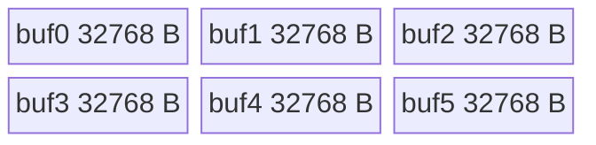

# TopKTopPSample 950 ACLNN 算子知识

## 算子速览

| 项目 | 内容 |
|---|---|
| 实际入口 | `aclnnTopKTopPSampleV2GetWorkspaceSize` / `aclnnTopKTopPSampleV2`，公开 ACLNN |
| 计算语义 | 每行依次进行可选 TopK、TopP、MinP，再输出中间量、ArgMax 或 `probs/(abs(q)+eps)` 的 Q-Sample ArgMax |
| 输入输出 | `logits[B,S]`、`topK[B]`、`topP[B]`、可选 `q[B,S]`/`minPs[B]`；一维索引输出与三个受属性控制的二维输出 |
| 执行类型 | 单 Kernel `AIV_VECTOR`；AIC 在 `Process` 起点直接返回；950 行处理前执行 `asc_dcci_entire_out()` |
| Kernel 路线 | R-001 FP16/key 1001；R-002 BF16/key 1027；R-003 FP32/key 1000 |
| 核心资源 | 6×32 KiB `VECCALC TBuf`；用户 workspace `24*B*S` 字节，外加系统 workspace |
| 来源闭包 | `source_closed`：公开 950 产品支持→ascend950 OpDef/binary→公共 Tiling/POD→dtype router→AIV body/排序 helper 闭合 |
| 验证状态 | 已完成源码闭包检查；本次知识提取未执行编译、真机、数值或性能测试。 |

## 接口与语义

### 计算语义

对每行，合法 TopK 为 `0<k<=min(S,ksMAX)`；`0<p<1` 保留降序累计概率首次达到 p 的前缀，`p<=0` 只留最大项，`p>=1` 跳过。可选 MinP 保留 `value>=minP*max(value)` 的紧凑前缀；`minP>=1` 只留最大项。`inputIsLogits=true` 时所有候选以 FP32 做减最大值的 softmax。末端由 `isNeedSampleResult` 和 q 是否存在选择中间输出、普通 ArgMax 或 Q-Sample ArgMax。

### 输入、输出与属性

| 参数 | shape/layout | dtype | 约束、默认值与语义 |
|---|---|---|---|
| logits | `[B,S]` ND | FP16/BF16/FP32 | 非空、`B>0`、`0<S<=2^20`；支持非连续，OpDef 自动连续化 |
| topK/topP | `[B]` ND | INT32 / 与 logits 相同 | 非空；分别控制 TopK/TopP |
| q/minPs | 可选 `[B,S]` / `[B]` | FP32 / 与 logits 相同 | q 与中间输出模式互斥；minPs 空或非正即跳过 |
| 属性 | 标量 | float/int32/uint32/bool | `eps=1e-8`, `topKGuess=32`, `ksMax=1024`, `inputIsLogits=true`，其余 bool=false |
| 四个输出 | `[B]` 或 `[B,S]` ND | INT64/FP32 | `logitsSelectIdx` 与 `logitsIdx/logitsSortMasked` 由末端模式互斥控制；logits 输出受 `isNeedLogits` 控制 |

### 入口与版本

旧 `aclnnTopKTopPSample` 的公开产品表明确 950 不支持；V2 的公开产品表明确 Ascend 950PR/950DT 支持，OpDef 注册 `ascend950`，binary config 含 FP16/BF16/FP32 三项。因此 950 必须选择 V2，不能用旧版 body。ACLNN 生成桥接与 executor 内部属于固定仓不可见框架边界；算子 Host/Tiling/Kernel 均可见。

## Host/Launcher 执行流程

### 参数校验与前处理

OpDef 对五个输入启用 `AutoContiguous`。Tiling 顺序为 GetCompileInfo→GetAttr→输入 shape→输入 dtype→输出 shape→输出 dtype；拒绝 S 超过 `2^20`、batch/shape 不一致、topP/minPs dtype 不等于 logits、q 非 FP32、q 与 `isNeedSampleResult=true` 共存及输出不匹配。失败返回 `GRAPH_FAILED` 并阻断启动。

### 参数、Workspace 与生命周期

`N=B*S`。用户 workspace 为 6N 个 4 字节槽：logits 1N、交错 sortPart 2N、交错 sortAll 2N、uint32 index 1N；总请求再加 `PlatformAscendC::GetLibApiWorkSpaceSize()`。`GetUserWorkspace` 定位用户区。workspace/executor 由调用方持有到同一 stream 完成。

### 启动图与失败传播

```text
GetWorkspaceSize -> TilingForTopKTopPSampleV2 -> RunKernelTiling
execute(stream) -> K0 top_k_top_p_sample_v2<<<numCore>>>
  -> AIV: Init -> asc_dcci_entire_out() per row -> Process body
  -> AIC: return
```

K0 是唯一节点，无跨 Kernel 边。受控输出先 `InitGlobalMemory`，随后 MTE3→MTE2 event 和 `SyncAll`；Kernel 内 workspace producer/consumer 依赖 `PipeBarrier` 及 HardEvent。未知 key 直接返回。

## Route 与参数设计

### 分核与资源计算

`numCore=min(B,AIV核数)`；头 `B%numCore` 个核处理 `ceil(B/numCore)` 行，其余处理 `floor(B/numCore)` 行。每核通过 `startTaskId` 预偏移 GM。常规 tile 为 8192 元素，尾部向上对齐 32 元素；完整排序分段为 1024 元素并以四路 merge 递归归并。Host 读取 950 UB 大小但未将其与固定 196608 B 比较。

### Route 选择

| 顺序 | Route | Key/模板 | 精确选择条件与优先级 | 不适用去向 |
|---:|---|---|---|---|
| 1 | R-001 FP16 | 1001 / `<half>` | dtype FP16 | FP32 判断 |
| 2 | R-003 FP32 | 1000 / `<float>` | dtype FP32 | BF16 默认分支 |
| 3 | R-002 BF16 | 1027 / `<bfloat16_t>` | 先前 dtype 校验通过且非 FP16/FP32 | 无 |

```text
FP16 -> 1001; FP32 -> 1000; validated remaining BF16 -> 1027
router maps keys to TopKTopPSampleV2Kernel<T>; unknown -> return
```

### 模板/实现执行矩阵

| Route | key/selector | dtype/shape/platform 完整命中条件 | 执行拓扑与 Kernel 节点 | 实际模板/body | 内存与同步特征 | tail/fallback |
|---|---|---|---|---|---|---|
| R-001 | 1001 | FP16 且公共校验通过；ascend950 binary | 单 AIV K0 | `TopKTopPSampleV2Kernel<half>` | FP16→FP32；192 KiB UB；24N workspace | 32 元素补齐；GuessK miss 全排序 |
| R-002 | 1027 | BF16 且公共校验通过；ascend950 binary | 单 AIV K0 | `<bfloat16_t>` | BF16→FP32，scalar `ToFloat`；其余同上 | 同上 |
| R-003 | 1000 | FP32 且公共校验通过；ascend950 binary | 单 AIV K0 | `<float>` | FP32 直搬；其余同上 | 同上 |

### 隐藏性能 Guard

| Guard | Host/Tiling 条件 | Device/资源原因 | 影响 Route | 不满足时去向 | 源码符号 |
|---|---|---|---|---|---|
| TopK 上限 | `0<k<=min(S,ksMAX)`，`ksMAX=min(align8(ksMax),1024)` | 本地候选最大 1024 | 全部 | 跳过 TopK；p<=0 强制 K=1 | `GetAttr`, `Process` |
| GuessK | `!doTopK&&0<p<1`，候选至多 1024 | 小候选命中避免全排序 | 全部 | `ifFind==0` 进入 `SortAll` | `Process` |
| UB | 6×32768 B | 固定六 TBuf | 全部 | 固定仓无资源 fallback | `InitAndSetBuffer` |
| 排序/DMA tail | 8192/1024 tile，尾向上 32 元素 | Sort 与块搬运粒度 | 全部 | padding 填 `FLOAT_MIN`，仅有效字节输出 | `Sort32Block`, `SortSPartAll` |
| 950 cache | `__NPU_ARCH__==3510` | 行处理前使外部缓存状态可见 | 全部 | 非 3510 不编译该调用 | `Process` |

### POD/ABI

宏展开的 `sizeof/alignof/offsetof` 固定仓不可见。下列字段均由 Host setter 写入、Device 同名成员读取；`numCore/perHeadCorePartNum/tailCorePartNum/headOffset/mrgMode` 是未消费或无效控制字段。

| 结构 | 字段 | 类型/位宽 | ABI 布局 | 单位 | Host/launcher producer | Device consumer | 边界 |
|---|---|---|---|---|---|---|---|
| `TopKTopPSampleV2TilingData` | `numCore` | uint32/32 | 固定仓不可见 | core | 未 set | 未读 | inactive |
| 同上 | `rowNum` | uint32/32 | 同上 | row | B | workspace/params | `B>0` |
| 同上 | `rowLen` | uint32/32 | 同上 | element | S | 地址/循环 | `S<=2^20` |
| 同上 | `headCoreNum` | uint32/32 | 同上 | core | `B%C` | 分核 | active |
| 同上 | `perHeadCoreRowNum` | uint32/32 | 同上 | row/core | `ceil(B/C)` | 头核范围 | active |
| 同上 | `tailCoreRowNum` | uint32/32 | 同上 | row/core | `floor(B/C)` | 尾核范围 | active |
| 同上 | `perHeadCorePartNum` | uint32/32 | 同上 | part | 0 | 未读 | inactive |
| 同上 | `tailCorePartNum` | uint32/32 | 同上 | part | 0 | 未读 | inactive |
| 同上 | `innerLoopEle` | uint32/32 | 同上 | element | 8192 | 成员 | 冗余 |
| 同上 | `innerLoopTime` | uint32/32 | 同上 | loop | `ceil(S/8192)` | 主 tile 循环 | active |
| 同上 | `innerLoopEleTail` | uint32/32 | 同上 | element | `S%8192` | 尾有效长 | active on tail |
| 同上 | `innerLoopEleTailPad` | uint32/32 | 同上 | element | `ceil(tail/32)*32` | 尾步进 | active on tail |
| 同上 | `softmaxLoopTime` | uint32/32 | 同上 | loop | `ceil(S/8192)` | softmax | active |
| 同上 | `softmaxLoopEleTail` | uint32/32 | 同上 | element | `S%8192` | softmax tail | active on tail |
| 同上 | `softmaxLoopEleTailPad` | uint32/32 | 同上 | element | `ceil(tail/32)*32` | softmax tail | active on tail |
| 同上 | `eightKPartNum` | uint32/32 | 同上 | part | `ceil(S/1024)` | full sort | Guess miss |
| 同上 | `eightKPartTail` | uint32/32 | 同上 | element | `S%1024` | sort tail | Guess miss |
| 同上 | `eightKPartTailPad` | uint32/32 | 同上 | element | `ceil(tail/32)*32` | sort tail | Guess miss |
| 同上 | `mrgMode` | uint32/32 | 同上 | enum | 1 | 保存未用 | inactive |
| 同上 | `headOffset` | uint32/32 | 同上 | element | uint64 公式后窄化 | 未读 | inactive |
| 同上 | `isNeedLogits` | uint32/32 | 同上 | flag | bool→0/1 | 初始化/输出 | active |
| 同上 | `eps` | float/32 | 同上 | value | attr | Q denominator | q 时 active |
| 同上 | `topKGuess` | int32/32 | 同上 | element | attr | GuessK | Device cap 1024 |
| 同上 | `ksMAX` | uint32/32 | 同上 | element | align8+cap | TopK guard | active |
| 同上 | `inputIsLogits` | uint32/32 | 同上 | flag | bool→0/1 | softmax/默认值 | active |
| 同上 | `isNeedSampleResult` | uint32/32 | 同上 | flag | bool→0/1 | 末端模式 | active |

### Route 源码闭包

| Route | Key/selector | Host/Tiling producer | POD/参数 | Kernel entry/router 节点 | Kernel body/直接依赖 | 构建接线 |
|---|---|---|---|---|---|---|
| R-001 | 1001 | `RunKernelTiling/SetOpTilingKey` | `TopKTopPSampleV2TilingData` | entry key 1001 | `<half>::Process` + sort helper | ascend950 binary JSON |
| R-002 | 1027 | 同上 | 同上 | entry key 1027 | `<bfloat16_t>` + sort helper | 同上 |
| R-003 | 1000 | 同上 | 同上 | entry key 1000 | `<float>` + sort helper | 同上 |

## Kernel 实现

### 公共执行流程

所有 Route 为同一模板的 dtype 实例。每行先读取 k/p/minP；TopK 使用 8192 元素滚动 topK，GuessK 只维护 `min(topKGuess,S,1024)`；miss 时 1024 分段排序、四路层次归并并流式累计到 p。MinP 在 UB 有序前缀上缩短长度，或用 `CompareScalar+GatherMask` 在 workspace 原地紧凑。可选 logits 通过原索引散射；中间输出把 uint32 索引 cast 为 int64；Q-Sample 计算 `candidate/(abs(q)+eps)` 后 ReduceMax 并映射原索引。950 唯一源码差异是在每行决策前编译进 `asc_dcci_entire_out()`。

### Route R-001：FP16 输入升精度

#### 适用条件

##### 选择证据

| 层级 | 文件 | 符号 | 源码谓词/参数 | 结果/下一跳 |
|---|---|---|---|---|
| Host | `op_host/top_k_top_p_sample_v2_tiling.cpp` | `SetOpTilingKey` | FP16 | 1001 |
| Router | `op_kernel/top_k_top_p_sample_v2.cpp` | entry | key 1001 | `<half>` |
| Device | `op_kernel/top_k_top_p_sample_v2.h` | `Process` | AIV；arch 3510 cache flush | FP16→FP32 body |

#### Device 数据流

##### 函数级调用链

```text
entry<1001> -> InitTilingParams -> InitAndSetBuffer -> Process
  -> TopKLoopProcess / LogitsCast+SoftMax* -> TopPCompute
  -> Guess miss: TopKTopPSampleV2SortKernel<half>::SortAll
  -> MinP -> CopyOutLogits/Middle/Index or QSample+ArgMaxAndGather
```

##### 源码等价伪码

```text
for row: asc_dcci_entire_out(); load k,p,minp
select TopK/GuessK/full-sort runtime path; cast FP16 to FP32
normalize if requested; TopP prefix; MinP compact
select sparse logits / middle output / argmax / qsample output
```

#### 内存与数据搬运

##### 资源与搬运表

| 层级/缓冲区 | offset/地址公式 | extent/容量公式 | dtype/layout | producer | consumer | owner/lifetime | 对齐/复用 |
|---|---|---|---|---|---|---|---|
| six TBuf | UB 独立区 | 各 32768 B | 多视图 | InitBuffer | all helpers | TPipe/K0 | 阶段复用 |
| user workspace | 0/1N/3N/5N float offsets | 1N+2N+2N+1N | FP32/uint32 | cast/sort | filter/output | executor/K0 | per-row slices |
| outputs | current core row base | exact valid bytes | ND | CopyOut | caller | caller | sparse outputs pre-init |

##### 分层内存布局



##### 字节账与复用顺序

```text
UB_total=6*32768=196608 B; dynamic_ub=N/A
workspace_total=6*B*S*sizeof(float)+sysWorkspaceSize
```

| 复用子区 | 写入者 | 读取者/消费点 | 下一次覆盖 | 同步或释放依据 | 安全条件 |
|---|---|---|---|---|---|
| UB tensors | DMA/Vector | next Vector/Scalar/MTE3 | next tile/stage | HardEvent/PipeBarrier | consumer completes |
| sortPart/sortAll | merge level | next level | ping-pong | MTE3_MTE2 | write visible before read |

#### 同步、精度与尾块

##### 同步与数值边界表

| 阶段 | primitive/机制 | producer | consumer/等待点 | 保护对象 | 精度/尾块 |
|---|---|---|---|---|---|
| cache | `asc_dcci_entire_out` | prior cache state | row body | 950 cache | per row |
| input | MTE2_V + Cast | FP16 DMA | FP32 vector | tile | CAST_NONE |
| compute/output | PipeBarrier + V_S/S_V/V_MTE3/MTE3_MTE2 | vector/scalar/DMA | next stage | UB/workspace | tail 32-element padded, valid bytes output |

#### 关键实现

##### 符号证据表

| 阶段 | 文件 | 符号/模板实例 | 实现事实 |
|---|---|---|---|
| Host/Tiling producer | `op_host/top_k_top_p_sample_v2_tiling.cpp` | `RunKernelTiling` | POD/key/workspace |
| Kernel entry/router | `op_kernel/top_k_top_p_sample_v2.cpp` | key 1001 | `<half>` |
| Device body/helper | `op_kernel/top_k_top_p_sample_v2.h` | `<half>::Process` | 950 cache、完整 pipeline |

### Route R-002：BF16 输入升精度

#### 适用条件

##### 选择证据

| 层级 | 文件 | 符号 | 源码谓词/参数 | 结果/下一跳 |
|---|---|---|---|---|
| Host/Router | tiling cpp / kernel cpp | selector/entry | validated BF16 / key 1027 | `<bfloat16_t>` |
| Device | kernel h | `Process` | BF16 constexpr | scalar ToFloat、vector Cast |

#### Device 数据流

##### 函数级调用链

```text
entry<1027> -> <bfloat16_t>::Process -> same helper graph as R-001
```

##### 源码等价伪码

```text
asc_dcci_entire_out(); BF16 scalar ToFloat; BF16 tiles Cast to FP32; execute common pipeline
```

#### 内存与数据搬运

##### 资源与搬运表

| 层级/缓冲区 | offset/地址公式 | extent/容量公式 | dtype/layout | producer | consumer | owner/lifetime | 对齐/复用 |
|---|---|---|---|---|---|---|---|
| input/UB/workspace | 同 R-001 | UB 196608 B；workspace 24N B | BF16→FP32 | DMA/Cast | common helpers | K0 | same reuse |

##### 分层内存布局


##### 字节账与复用顺序

```text
UB_total=196608 B; workspace_total=24*N+sysWorkspaceSize; dynamic_ub=N/A
```

| 复用子区 | 写入者 | 读取者/消费点 | 下一次覆盖 | 同步或释放依据 | 安全条件 |
|---|---|---|---|---|---|
| BF16/FP32 TBuf views | DMA/Cast | Vector | next tile | MTE2_V/PIPE_V | source no longer active |

#### 同步、精度与尾块

##### 同步与数值边界表

| 阶段 | primitive/机制 | producer | consumer/等待点 | 保护对象 | 精度/尾块 |
|---|---|---|---|---|---|
| input | Cast CAST_NONE | BF16 | FP32 pipeline | tile | scalar uses ToFloat; tail same R-001 |

#### 关键实现

##### 符号证据表

| 阶段 | 文件 | 符号/模板实例 | 实现事实 |
|---|---|---|---|
| Host/Tiling producer | tiling cpp | `SetOpTilingKey` | key 1027 |
| Kernel entry/router | kernel cpp | entry | BF16 instance |
| Device body/helper | kernel h | `<bfloat16_t>::Process` | BF16→FP32 and 950 cache |

### Route R-003：FP32 原生输入

#### 适用条件

##### 选择证据

| 层级 | 文件 | 符号 | 源码谓词/参数 | 结果/下一跳 |
|---|---|---|---|---|
| Host/Router | tiling cpp / kernel cpp | selector/entry | FP32 / key 1000 | `<float>` |
| Device | kernel h | constexpr float branches | direct FP32 DMA | common pipeline |

#### Device 数据流

##### 函数级调用链

```text
entry<1000> -> <float>::Process -> common helper graph without input Cast
```

##### 源码等价伪码

```text
asc_dcci_entire_out(); FP32 DataCopyPad directly; execute common pipeline
```

#### 内存与数据搬运

##### 资源与搬运表

| 层级/缓冲区 | offset/地址公式 | extent/容量公式 | dtype/layout | producer | consumer | owner/lifetime | 对齐/复用 |
|---|---|---|---|---|---|---|---|
| input/UB/workspace | 同 R-001 | UB 196608 B；workspace 24N B | FP32 | DMA | common helpers | K0 | no cast |

##### 分层内存布局


##### 字节账与复用顺序

```text
UB_total=196608 B; workspace_total=24*N+sysWorkspaceSize; dynamic_ub=N/A
```

| 复用子区 | 写入者 | 读取者/消费点 | 下一次覆盖 | 同步或释放依据 | 安全条件 |
|---|---|---|---|---|---|
| FP32 tile | DMA | Vector | next tile | MTE2_V/PipeBarrier | valid count complete |

#### 同步、精度与尾块

##### 同步与数值边界表

| 阶段 | primitive/机制 | producer | consumer/等待点 | 保护对象 | 精度/尾块 |
|---|---|---|---|---|---|
| input/compute | MTE2_V/PipeBarrier | FP32 DMA/vector | next op | tile | native FP32; 32-element sort padding |

#### 关键实现

##### 符号证据表

| 阶段 | 文件 | 符号/模板实例 | 实现事实 |
|---|---|---|---|
| Host/Tiling producer | tiling cpp | selector | key 1000 |
| Kernel entry/router | kernel cpp | entry | FP32 instance |
| Device body/helper | kernel h | `<float>::Process` | direct FP32 + 950 cache |

## 算子特定优化

### Trick T-001：GuessK 命中绕过完整排序

#### 触发与源码依据

- 适用 Route：全部。
- 触发条件：TopK 未启用、`0<p<1`、GuessK 候选累计和达到 p。
- Golden 来源：[`top_k_top_p_sample_v2.h:166-225`](https://gitcode.com/cann/ops-nn/blob/955f8b33985b6d72989ebff341bb9c2c564a51bc/index/top_k_top_p_sample_v2/op_kernel/top_k_top_p_sample_v2.h#L166-225)

**官方源码（固定 Commit 连续逐字摘录）**：

```cpp
} else if (doGuessTopK) {
    kCount = this->topKGuess > this->rowLen ? this->rowLen : this->topKGuess;
    this->k_pad = Align(kCount, EIGHT);
```

#### 机制与设计原因

先以不超过 1024 的局部 TopK 验证 p，命中即避免 1024 分段、2N 交错中间流和层次归并；miss 才 `SortAll`，保持语义完整。

#### 迁移边界

- 适用：长词表且 TopP 前缀短。
- 前提：GuessK 正数、概率语义正确。
- 失效：Guess miss 必须全排序。
- 未验证：本次知识提取未执行编译、真机、数值或性能测试。

#### 错误做法

固定仓的真实反例是 `if (!ifFind)` fallback；省略它会产生不完整 TopP 集合。

### Trick T-002：归并、累计与早停融合

#### 触发与源码依据

- 适用 Route：全部 GuessK miss 路线。
- 触发条件：全行 TopP 排序。
- Golden 来源：[`top_k_top_p_sample_v2_sort_cumsum.h:185-209`](https://gitcode.com/cann/ops-nn/blob/955f8b33985b6d72989ebff341bb9c2c564a51bc/index/top_k_top_p_sample_v2/op_kernel/top_k_top_p_sample_v2_sort_cumsum.h#L185-209)

**官方源码（固定 Commit 连续逐字摘录）**：

```cpp
ReduceSum(mrgRsLocal, mrgRsValLocal, mrgRsLocal, partTotalMrg);
float tempSumVal = *sumVal + mrgRsLocal.GetValue(0);
if (tempSumVal < topp) {
    *sumVal += mrgRsLocal.GetValue(0);
}
```

#### 机制与设计原因

每批四路归并结果立即计算累计概率；未跨阈值整批推进，跨阈值才标量定位，并通过 sortPart/sortAll ping-pong 处理多层归并，减少不需要的尾部物化。

#### 迁移边界

- 适用：单调累计阈值上的有序前缀选择。
- 前提：降序且概率非负。
- 失效：需要完整排序或累计量非单调时不可早停。
- 未验证：本次知识提取未执行编译、真机、数值或性能测试。

#### 错误做法

固定仓以 MTE3→MTE2 event 证明 ping-pong 可见性；删去等待会读到未完成写回。

## 模板与实现对比

| 对比维度 | R-001 FP16 | R-002 BF16 | R-003 FP32 | 设计选择依据 |
|---|---|---|---|---|
| 命中条件/优先级 | 1001 | 1027 | 1000 | dtype selector |
| 模板与 dtype | half | bfloat16_t | float | ascend950 三 binary |
| 循环与分核 | 共同 B/core 与 tile | 同 | 同 | 公共 POD |
| Queue/TBuf/寄存器/dynamic UB/通信 window | 六 TBuf，无 Queue/dynamic UB/通信 | 同 | 同 | AIV-only |
| 内存总占用与复用 | 192 KiB + 24N | 同 | 同 | FP32 中间统一 |
| 搬运/Vector/SIMT/NDDMA/通信 API | Cast+Vector | Cast+Vector | Vector | 无 SIMT/NDDMA/通信 |
| 同步、精度与 tail | FP16→FP32 | BF16→FP32 | FP32 | 950 cache flush；32 元素 tail |
| fallback/失败边界 | Guess miss→full sort | 同 | 同 | common body |

## 平台差异

| 项目 | A2 | A3 | 950 |
|---|---|---|---|
| 支持状态 | V2 支持 | V2 支持 | V2 公开支持；旧版不支持 |
| Host/Launcher | ascend910b | ascend910_93 | ascend950 config，公共 Tiling |
| Kernel/资源 | 公共 AIV body | 公共 AIV body | 公共 body，额外编译 `asc_dcci_entire_out()` |

## 限制与失败边界

- 公共约束为 `B>0, 0<S<=2^20`；Tiling 未显式保护零 B，不能依赖空域行为。
- 固定 192 KiB UB 没有与 Host 取得的 `ubSize` 比较，也没有资源 fallback。
- ACLNN 原型的 int64 `ksMax` 到 Host uint32 属性的生成桥接、POD 宏 ABI offset、系统 workspace 内部布局固定仓不可见。
- `headOffset` 有 uint64→uint32 窄化但 Device 未消费；未知 key 静默返回。
- 本次知识提取未执行编译、真机、数值或性能测试。

## 源码索引

### 链路索引

| 链路阶段 | 文件 | 关键符号 | 支撑内容 |
|---|---|---|---|
| 入口声明/约束 | `index/top_k_top_p_sample_v2/docs/aclnnTopKTopPSampleV2.md` | API/产品表 | V2 与 950 公开性 |
| 入口实现 | `index/top_k_top_p_sample_v2/op_host/top_k_top_p_sample_v2_def.cpp` | OpDef | ascend950 注册/AutoContiguous |
| Host/Tiling/Launcher | `index/top_k_top_p_sample_v2/op_host/top_k_top_p_sample_v2_tiling.h` | POD | ABI 字段 |
| Host/Tiling/Launcher | `index/top_k_top_p_sample_v2/op_host/top_k_top_p_sample_v2_tiling.cpp` | `RunKernelTiling` | 校验、公式、key、workspace |
| Kernel entry/body | `index/top_k_top_p_sample_v2/op_kernel/top_k_top_p_sample_v2.cpp` | entry | dtype router |
| Kernel entry/body | `index/top_k_top_p_sample_v2/op_kernel/top_k_top_p_sample_v2.h` | main template | 950 cache、UB、完整 pipeline |
| Kernel entry/body | `index/top_k_top_p_sample_v2/op_kernel/top_k_top_p_sample_v2_sort_cumsum.h` | sort template | full-sort fallback |
| 构建接线 | `index/top_k_top_p_sample_v2/op_host/config/ascend950/top_k_top_p_sample_v2_binary.json` | three binaries | 950 dtype 实例 |
| 构建接线 | `index/top_k_top_p_sample_v2/op_host/CMakeLists.txt` | `add_modules_sources(... ACLNNTYPE aclnn)` | Host/Tiling 与 ACLNN 构建接线 |

### 实现复用检查

| 检查项 | 可复用事实 | 不得改变的约束 | 源码符号 |
|---|---|---|---|
| ABI/POD | 公共 shape/tile/attr producer-consumer | 字段次序/位宽；未知 offset 不推测 | POD definition |
| 调用顺序 | TopK→TopP→MinP→output | Guess miss 和末端互斥 | `Process` |
| workspace/内存 | 1N+2N+2N+1N | offset、dtype、owner/lifetime | `InitAndSetBuffer` |
| 同步 | 950 cache flush + HardEvent/PipeBarrier | 写回后再读及输出初始化屏障 | `Process`, sort helper |
| 精度与尾块 | FP32 中间、max-subtracted softmax | cast/abs(q)+eps/32-element pad | `SoftMax*`, `QSample*`, sort helper |
| 失败边界 | Host 校验阻断、unknown key return | 不得补造 fallback | `RunKernelTiling`, entry |