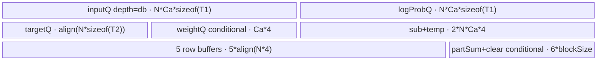

# CrossEntropyLoss 950 ACLNN 算子知识

## 算子速览

| 项目 | 内容 |
|---|---|
| 实际入口 | `aclnnCrossEntropyLossGetWorkspaceSize` + `aclnnCrossEntropyLoss`，公开两段式 ACLNN；自动 inner bridge/executor 为框架边界。 |
| 计算语义 | 稳定 log-softmax + class-index cross entropy；支持 weight、ignoreIndex、label smoothing 和 none/mean/sum，同时写完整 logProb；公开 zloss 功能当前不支持。 |
| 输入输出 | `input/logProb:[N,C]` FP16/BF16/FP32；`target:[N]` INT32/INT64；weight 可选 FP32 `[C]`；loss `[N]` 或 `[1]`。 |
| 执行类型 | 单 Kernel `cross_entropy_loss`，所有可达路线均为 `AIV_VECTOR`/MicroAPI；entry `KERNEL_TYPE_MIX_AIV_1_0`，无 Cube/AIC/MIX_CV。 |
| Kernel 路线 | R-001 empty（schId 1）；R-002 full-load（schId 2）；R-003 Big-C streaming（schId 0）。tuple key 还编译期编码 reduction/weight/smoothing/ignore。 |
| 核心资源 | GM、AIV TQue/TBuf/RegTensor；full-load/Big-C 的 reduction 路线通过 user workspace 写每核 3 个 32-element-stride FP32 槽并 `SyncAll()`。 |
| 来源闭包 | `source_closed`：公开 ACLNN→Ascend 950 OpDef→RegBase selector/POD/tuple key→empty/full-load/Big-C body→binary config/CMake 闭合。 |
| 验证状态 | 已完成源码闭包检查；本次知识提取未执行编译、真机、数值或性能测试。 |

## 接口与语义

### 计算语义

对每行 `n`：`m=max_c x[n,c]`，`s=sum_c exp(x[n,c]-m)`，`logProb[n,c]=x[n,c]-m-log(s)`。target 未忽略时，target 项为 `-weight[target]*logProb[target]`（weight 缺省为 1）；smoothing 项为 `-(labelSmoothing/C)*sum_c(weight[c]*logProb[c])`，与 target 项按 `1-labelSmoothing` 组合。忽略样本对 loss、weight denominator 与 smoothing 均贡献 0。`none` 输出每行，`sum` 求和，`mean` 再除有效 weight 总和。空 N：none 不写，mean 写 NaN，sum 写 0。`zloss/lse_for_zloss` 未绑定，固定 body 不写。

### 输入、输出与属性

| 参数 | shape/layout | dtype | 约束、默认值与语义 |
|---|---|---|---|
| `input` | `[N,C]` ND | FP16/BF16/FP32 | rank 必须为2；若 N 非0，C不能为0；支持框架连续化。 |
| `target` | `[N]` ND | INT32/INT64 | rank 1，N 与 input 相等；有效值 `[0,C)` 或 ignoreIndex。 |
| `weightOptional` | 可选 `[C]` ND | FP32 | 存在时长度必须为 C。 |
| `reductionOptional` | Host string | — | `none/mean/sum`→0/1/2；非法失败。 |
| `ignoreIndex` | scalar | INT64 | 缺省 -100；tuple 中 `ignorex=(ignoreIndex>=0)` 只用于消除无需 mask 的 Big-C 分支。 |
| `labelSmoothing` | scalar | double→float | `[0,1]`；POD保存 `1-s` 与 `s/C`。 |
| `lseSquareScaleForZloss` / `returnZloss` | scalar | double/bool | 公开当前不支持；Tiling/Kernel 不消费。 |
| `lossOut` | none `[N]`，否则 `[1]` | 同 input | 空 N 特殊语义见上。 |
| `logProbOut` | `[N,C]` | 同 input | 非空路线写完整 log-softmax。 |
| `zlossOut` / `lseForZlossOut` | 公开要求非空 | 同 input | 固定 Device body不写。 |

### 入口与版本

固定 Commit 的公开接口产品表明确支持 Ascend 950PR/950DT。`cross_entropy_loss_def.cpp` 的 `ascend950` RegBase config 组合 input 三 dtype×target 两 dtype，binary config 对六种 dtype 对均提供 `ALL` 实例。`Tiling4CrossEntropyLoss` 通过 `IsRegbaseSocVersion` 转入 `Tiling4CrossEntropyLossRegbase`；950 不复用 A2/A3 POD/body。固定仓无更高公开版本。

## Host/Launcher 执行流程

### 参数校验与前处理

公开第一段检查必需指针、接口 dtype/shape/属性。算子 Tiling 的真实顺序为 `Init`（AIV core、UB、UB block size、清零 POD）→`CheckInputDtype`→`CheckInputShape`→`CalTilingData`→`GetAttrTilingData`→`GetTilingKey`→`FillTilingData`。dtype 限三种 logits、两种 target 与 FP32 weight；input rank=2、target rank=1、N一致、weight length=C，并拒绝 `N!=0 && C==0`。reduction 非法与 smoothing 越界均失败。

### 参数、Workspace 与生命周期

`realCoreNum=(N>coreNum || N==0)?coreNum:N`；N 行以 `frontCoreNum=N-floor(N/realCoreNum)*realCoreNum` 个 former core 多分一行。`IsAllC` 先按 db=2 估算能完整载入对齐 C 的最大行数，少于一个 UB block 元素时再试 db=1；仍不足则进入 Big-C。none 仅申请固定 16 MiB system workspace；mean/sum 追加 `coreNum*blockSize*4*3` bytes。Device `GetUserWorkspace` 指向追加区；实际布局以 `realCoreNum` 为 stride，未使用的物理 core 预留不消费。owner 是 executor，存活到 stream 完成。

### 启动图与失败传播

单节点：`cross_entropy_loss<schId,reduction,isWeight,labelS,ignorex>(...,workspace,tiling)`，grid=`realCoreNum`，POD=`CrossEntropyLossRegBaseTilingData`。router：schId 0→`CrossEntropyLossBigC`，2→`CrossEntropyLossFullLoad`，其它合法选择仅 1→`CrossEntropyLossEmpty`。tuple key selector只允许 schId 0/2 的 reduction×weight×smoothing×ignore 组合，以及 schId1强制后三标志为0。Host 任一 gate/资源初始化失败阻断 launch；single Kernel 无节点间 workspace 边。mean/sum 的节点内跨核边为 `per-core partial -> user workspace -> SyncAll -> core0 final`。

## Route 与参数设计

### 分核与资源计算

令 `B=floor(N/realCoreNum)`、`F=N-B*realCoreNum`。former core处理 `B+1` 行、其余处理 B 行。full-load 对 `C` 按 UB block 对齐为 `Ca`，Host 分别试 db2/db1，并调用 `GetReduceSumMaxMinTmpSize([aNum,Ca],FP32,AR)` 纳入归约临时区；只在最终 `aNum>=blockSize/sizeof(input)` 时命中。Big-C 固定每次最多64行；C tile `cOnceNum=floor_block((UB-needNub)/cUbParams)`，若尾余 UB 不足二叉 cache，就逐 block 减小，直到容纳 `(cacheStart+1)*blockSize`。`cLoopTimes=ceil(C/cOnceNum)`，`kTimes` 为不超过它的最大 2 次幂，`kTimesTail=cLoopTimes-kTimes`。

### Route 选择

| 顺序 | Route | Key/模板 | 精确选择条件与优先级 | 不适用去向 |
|---:|---|---|---|---|
| 1 | R-001 Empty | tuple `schId=1,reduction∈{0,1,2},0,0,0` | `N==0 \|\| C==0`；shape gate已排除 N非0且C=0，因此公开可达重点是 N=0 | 结束 |
| 2 | R-002 Full-load | `schId=2` + reduction/weight/labelS/ignore flags | 非空且 `IsAllC()`：db2可容纳至少 block 元素行，或回退db1仍满足 | R-003 |
| 3 | R-003 Big-C | `schId=0` +全 flags | 非空且 `IsAllC()==false` | 若算不出正 `cOnceNum`，固定仓没有显式失败 gate |

```text
if N==0 || C==0: schId=1
else if IsAllC(db2) or IsAllC(db1 fallback): schId=2
else: schId=0; ComputeNotAllC(); shrink cOnceNum until cache fits
key = GET_TPL_TILING_KEY(schId,reduction,isWeight,labelS,ignorex)
```

### 模板/实现执行矩阵

| Route | key/selector | dtype/shape/platform 完整命中条件 | 执行拓扑与 Kernel 节点 | 实际模板/body | 内存与同步特征 | tail/fallback |
|---|---|---|---|---|---|---|
| R-001 Empty | schId1×3 reductions | 950；N=0；三 logits dtype×两 target dtype | 单 AIV Kernel | `CrossEntropyLossEmpty<T1,reduction>` | 只绑定 loss；无 UB/workspace消费 | none不写、mean NaN、sum 0 |
| R-002 Full-load | schId2×reduction3×weight2×label2；ignore key两值合并（body行为相同） | 非空、全 C+若干 N 行能装 UB | 单 AIV Kernel | `CrossEntropyLossFullLoad<T1,T2,...>` | N×Ca 批量搬运；AR Reduce；条件 queue/buffer；reduction workspace+SyncAll | N/C padding mask；db2不足转db1，再不足R-003 |
| R-003 Big-C | schId0×reduction3×weight2×label2×ignore2 | 非空、全载失败 | 单 AIV Kernel | `CrossEntropyLossBigC<T1,T2,...>` | 每行多遍 C streaming；double input queue；二叉 partial-sum cache；条件 buffer | C tail按 block/vreg mask；无下一 route |

### 隐藏性能 Guard

| Guard | Host/Tiling 条件 | Device/资源原因 | 影响 Route | 不满足时去向 | 源码符号 |
|---|---|---|---|---|---|
| empty | `N==0 \|\| C==0` | 避免常规地址/除法 | R-001 | R-002 check | `GetTilingKey` |
| full-load db2→db1 | `aNum_res>=blockSize/dtypeX` | 全 C 与至少一 block 行留在 UB；优先双缓冲 | R-002 | db2不足试db1，仍不足 R-003 | `IsAllC` |
| Reduce tmp | `GetReduceSumMaxMinTmpSize` 返回 maxValue | AR reduce需额外 UB | R-002 | 减小 aNum/改R-003 | `IsAllC` |
| Big-C cache fit | `cacheBytes<=tailUb` | 二叉 fold cache必须覆盖 `cacheStart+1` blocks | R-003 | 每次将 cOnceNum减一个 block | `ComputeUbTiling` |
| N tile 64 | `onceN=min(coreRows,64)` | target/loss/weight/smooth固定64元素缓冲 | R-003 | tail由 nTail 字段 | `ComputeNotAllC` |
| reduction workspace | `reduction!=0` | 跨核标量归约 | R-002/R-003 | none 不分配 user部分和 | `DoTiling/Init/Process` |
| ignore compile flag | `ignoreIndex>=0` | Big-C 仅可能与合法非负 target 相等时生成 mask | R-003 | 负 ignore省 Compare/Select | `GetAttrTilingData/ComputeMul` |

### POD/ABI

`CrossEntropyLossRegBaseTilingData` 是显式标准布局：18个 int64 后跟2个 float，按自然 8-byte 对齐推导 `sizeof=152, alignof=8`。

| 结构 | 字段 | 类型/位宽 | ABI 布局 | 单位 | Host/launcher producer | Device consumer | 边界 |
|---|---|---|---|---|---|---|---|
| `CrossEntropyLossRegBaseTilingData` | `realCoreNum` | int64/64 | off 0 | core | `min`规则/N=0取coreNum | 两 body core guard/workspace | >0 |
| 同上 | `frontCoreNum` | int64/64 | off 8 | core | `N-B*realCoreNum` | former/tail选择 | 可0 |
| 同上 | `frontCoreNSize` | int64/64 | off 16 | row | `B` | 核起点 | — |
| 同上 | `onceNSize` | int64/64 | off 24 | row | full:aNum；big:min(B+1,64) | former N tile | — |
| 同上 | `onceNSizeT` | int64/64 | off 32 | row | big:min(B,64)；full初始化路径实际未单独赋值 | Big-C tail core；full body不用此字段 | full inactive/0 |
| 同上 | `nLoopTimesB` | int64/64 | off 40 | loop | Host分块 | former循环 | — |
| 同上 | `nLoopTimesT` | int64/64 | off 48 | loop | Host分块 | tail循环 | — |
| 同上 | `nTailNumB` | int64/64 | off 56 | row | former尾 | body tail | 0表示无额外 tail（full规则可取onceN） |
| 同上 | `nTailNumT` | int64/64 | off 64 | row | tail core尾 | body tail | — |
| 同上 | `ignoreIndex` | int64/64 | off 72 | class index | attr/default | ignore比较 | — |
| 同上 | `cLoopTimes` | int64/64 | off 80 | loop | Big-C ceil(C/cOnce) | Big-C C循环 | full/empty inactive |
| 同上 | `cOnceNum` | int64/64 | off 88 | element | full Ca / Big-C UB tile | queue容量、地址 | block对齐 |
| 同上 | `cOnceNumTail` | int64/64 | off 96 | element | Big-C C尾 | Big-C tail | full/empty inactive |
| 同上 | `C` | int64/64 | off 104 | element | input dim1 | 地址、公式 | empty可0 |
| 同上 | `kTimesTail` | int64/64 | off 112 | loop | `cLoops-kTimes` | Big-C paired tail | full/empty inactive |
| 同上 | `kTimes` | int64/64 | off 120 | loop | 最大2次幂 | Big-C fold | full/empty inactive |
| 同上 | `cacheStart` | int64/64 | off 128 | cache block index | bit count | cache最终和位置 | full/empty inactive |
| 同上 | `db` | int64/64 | off 136 | queue depth | full 1/2；empty1 | full inputQueue | Big-C自身固定2 |
| 同上 | `labelSmooth1` | float/32 | off 144 | scale | `1-labelSmoothing` | loss组合 | empty强制label flag0但字段仍写 |
| 同上 | `labelSmoothC` | float/32 | off 148 | scale | `C==0?0:s/C` | smoothing组合 | labelS=0 inactive |

### Route 源码闭包

| Route | Key/selector | Host/Tiling producer | POD/参数 | Kernel entry/router 节点 | Kernel body/直接依赖 | 构建接线 |
|---|---|---|---|---|---|---|
| R-001 | schId1 | `cross_entropy_loss_tiling_arch35.cpp::GetTilingKey` | RegBase POD | `arch35/cross_entropy_loss.cpp` | `cross_entropy_loss_empty.h` | ascend950 JSON + CMake arch35 source |
| R-002 | schId2 | `IsAllC/ComputeAllC` | 同上 | 同上 | `cross_entropy_loss_full_load.h` | 同上 |
| R-003 | schId0 | `ComputeNotAllC/ComputeUbTiling` | 同上 | 同上 | `cross_entropy_loss_ar_big_c.h` | 同上 |

## Kernel 实现

### 公共执行流程

entry 读取显式 POD、取得 user workspace，并由五维 tuple 实例化 body。R-002/R-003 都先以整行 max稳定化，再求 FP32 exp sum，形成 logProb、gather target、应用 ignore/weight/smoothing。T1为16-bit时 MicroAPI unpack/cast到FP32，最终 `CAST_RINT`/pack；FP32不转换。reduction none直接写每行；mean/sum写每核 loss/weight/smooth三个部分和，`SyncAll()` 后核0归约并写标量。

### Route R-001：Empty

#### 适用条件

##### 选择证据

| 层级 | 文件 | 符号 | 源码谓词/参数 | 结果/下一跳 |
|---|---|---|---|---|
| Host | `op_host/cross_entropy_loss_tiling_arch35.cpp` | `GetTilingKey` | `N==0 \|\| C==0` | schId1、core=1、其它flags=0 |
| Router | `op_kernel/arch35/cross_entropy_loss.cpp` | `schId else` | schId1 | `CrossEntropyLossEmpty` |

#### Device 数据流

##### 函数级调用链

```text
cross_entropy_loss -> CrossEntropyLossEmpty::Init(bind loss only) -> Process
  -> none:return | mean:loss[0]=NaN | sum:loss[0]=0
  -> DataCacheCleanAndInvalid
```

##### 源码等价伪码

```text
if reduction==none: return
if reduction==mean: loss[0]=NaN
if reduction==sum: loss[0]=0
clean_and_invalidate_loss_cache()
```

#### 内存与数据搬运

##### 资源与搬运表

| 层级/缓冲区 | offset/地址公式 | extent/容量公式 | dtype/layout | producer | consumer | owner/lifetime | 对齐/复用 |
|---|---|---|---|---|---|---|---|
| loss GM | 0 | one element for mean/sum | T1 | Device scalar store | caller | caller | none不写 |

##### 分层内存布局

N/A：该路线不初始化 AIV UB、queue、workspace 或中间 buffer，只做标量 GM store与 cache clean。

##### 字节账与复用顺序

```text
UB_total = 0
dynamic_ub = N/A
workspace_total = reduction==none ? 16 MiB : 16 MiB + 3*coreNum*blockSize*4
Device consumption = 0（empty body不读取已分配的user slice）
```

| 复用子区 | 写入者 | 读取者/消费点 | 下一次覆盖 | 同步或释放依据 | 安全条件 |
|---|---|---|---|---|---|
| N/A | N/A | N/A | N/A | N/A | 无本地缓冲 |

#### 同步、精度与尾块

##### 同步与数值边界表

| 阶段 | primitive/机制 | producer | consumer/等待点 | 保护对象 | 精度/尾块 |
|---|---|---|---|---|---|
| empty store | `DataCacheCleanAndInvalid` | scalar store | kernel completion | loss GM可见性 | mean NaN/sum 0/none无写 |

#### 关键实现

##### 符号证据表

| 阶段 | 文件 | 符号/模板实例 | 实现事实 |
|---|---|---|---|
| Host/Tiling producer | `op_host/cross_entropy_loss_tiling_arch35.cpp` | `GetTilingKey` | empty selector与forced flags |
| Kernel entry/router | `op_kernel/arch35/cross_entropy_loss.cpp` | schId1 | empty实例 |
| Device body/helper | `op_kernel/arch35/cross_entropy_loss_empty.h` | `Process` | 空域输出语义 |

### Route R-002：Full-load

#### 适用条件

##### 选择证据

| 层级 | 文件 | 符号 | 源码谓词/参数 | 结果/下一跳 |
|---|---|---|---|---|
| Host | `op_host/cross_entropy_loss_tiling_arch35.cpp` | `IsAllC` | db2或db1的 `aNum_res>=blockSize/dtypeX` | schId2；否则R-003 |
| Router | `op_kernel/arch35/cross_entropy_loss.cpp` | `schId==2` | tuple flags | `CrossEntropyLossFullLoad` |

#### Device 数据流

##### 函数级调用链

```text
FullLoad::Process -> ProcessEachCore -> ComputeEachCoreOnce
  -> CopyInInput(NxC,pad to Ca) -> VfReduceMax
  -> VfSubExp -> ReduceSum(AR) -> VfComputeLogSub -> CopyOutPadLogProp
  -> CopyInTarget/optional CopyInWeight -> optional VfComputeSmoothLoss
  -> VfComputeIgnore(gather target, weight, masks) -> VfComputeLossOut
  -> none:VfComputeNone/CopyOutPadLoss
     reduction:ComputePartSum -> DataCopyWorkspace -> SyncAll -> core0 ComputeNLast/VfAllSum/DataCopyOutLoss
```

##### 源码等价伪码

```text
for N tile assigned to core:
  copy rows, pad C..Ca with dtype minimum
  rowMax = ReduceMax(rows,Ca); sub=x-rowMax; exp=Exp(sub)
  sum = ReduceSum_AR(exp); logp=sub-log(sum); write only C columns
  copy targets; optional copy weight[C]
  gather logp[row,target], mask ignore, gather effective weight
  optional smooth = -ReduceSum_AR(logp*weight)
  lossTarget = -gatheredLogp*effectiveWeight
  none: loss=(1-s)*lossTarget+(s/C)*smooth; write N valid rows
  else: accumulate three FP32 partials
if reduction: strided-write partials; SyncAll; core0 reduce and write scalar
```

#### 内存与数据搬运

##### 资源与搬运表

| 层级/缓冲区 | offset/地址公式 | extent/容量公式 | dtype/layout | producer | consumer | owner/lifetime | 对齐/复用 |
|---|---|---|---|---|---|---|---|
| inputQueue | UB | `db*Ntile*Ca*sizeof(T1)` | T1 `[Ntile,Ca]` | GM pad | max/sub | TPipe | C padding=min |
| targetQueue | UB | `alignBlock(Ntile*sizeof(T2))` | T2 | GM | gather/mask | TPipe | depth1 |
| logPropQueue | UB | `Ntile*Ca*sizeof(T1)` | T1 | FP32 cast/copy | GM | TPipe | writes only C/row |
| lossQueue | UB | none only，aligned Ntile T1 | T1 | combined loss | GM | TPipe | conditional |
| weightQueue | UB | weight only，`Ca*4` | FP32 | GM | gather/smoothing | TPipe | conditional |
| sub/temp | UB | each `Ntile*Ca*4` | FP32 | MicroAPI | AR/logp | TPipe | temp后复用为logp |
| five row buffers | UB | each `alignBlock(Ntile*4)` | FP32 | reductions/gather | loss | TPipe | weightYn/max/sum/smooth/loss |
| partSum/clear | UB | reduction each `3*blockSize` | FP32 | local reduce | workspace/final | TPipe | conditional |
| workspace | offsets `core*32`, plus `realCore*32` and `2*realCore*32` elements | 3 partial floats/core, sparse stride32 | FP32 | each core | core0 | executor | `SyncAll` |

##### 分层内存布局



##### 字节账与复用顺序

```text
UB_actual = db*N*Ca*sizeof(T1) + N*Ca*sizeof(T1)
          + align(N*sizeof(T2)) + (none?align(N*sizeof(T1)):0) + (weight?Ca*4:0)
          + 2*N*Ca*4 + 5*align(N*4) + (reduction?6*blockSize:0)
UB_actual <= UB（Host IsAllC 加上 Reduce API max tmp 的保守模型选择 N/db）
dynamic_ub = N/A
workspace_user = reduction? 3*coreNum*blockSize*4 : 0
```

| 复用子区 | 写入者 | 读取者/消费点 | 下一次覆盖 | 同步或释放依据 | 安全条件 |
|---|---|---|---|---|---|
| inputQueue slot | CopyIn | max/sub | next tile | DeQue/FreeTensor | db由POD 1/2 |
| tempUb | Exp then logProb | AR then output/gather | next tile | pipeline order | logProb输出和gather完成 |
| clearUb | local partial accumulate | workspace DMA/core0 output | kernel结束 | VToMTE3+SyncAll | reduction only |

#### 同步、精度与尾块

##### 同步与数值边界表

| 阶段 | primitive/机制 | producer | consumer/等待点 | 保护对象 | 精度/尾块 |
|---|---|---|---|---|---|
| queue | EnQue/DeQue/Free | MTE2/V/MTE3 | next owner | queue slot | C padded min；GM只写C |
| MicroAPI tail | `UpdateMask`/pregAlign | register ops | store/reduce | C/N lanes | 16-bit unpack→FP32；output CAST_RINT |
| cross-core | VToMTE3 + `SyncAll` | sparse workspace writes | core0 | 3 partial arrays | FP32 final，mean除weight sum |

#### 关键实现

##### 符号证据表

| 阶段 | 文件 | 符号/模板实例 | 实现事实 |
|---|---|---|---|
| Host/Tiling producer | `op_host/cross_entropy_loss_tiling_arch35.cpp` | `IsAllC/ComputeAllC` | db与Ntile选择 |
| Kernel entry/router | `op_kernel/arch35/cross_entropy_loss.cpp` | schId2 | full-load实例 |
| Device body/helper | `op_kernel/arch35/cross_entropy_loss_full_load.h` | `Init/ComputeEachCoreOnce/Vf*/ComputeNLast` | UB、MicroAPI、tail、workspace |

### Route R-003：Big-C streaming

#### 适用条件

##### 选择证据

| 层级 | 文件 | 符号 | 源码谓词/参数 | 结果/下一跳 |
|---|---|---|---|---|
| Host | `op_host/cross_entropy_loss_tiling_arch35.cpp` | `GetTilingKey/ComputeNotAllC` | 非空且 `IsAllC()==false` | schId0 |
| Router | `op_kernel/arch35/cross_entropy_loss.cpp` | `schId==0` | 全 tuple flags | `CrossEntropyLossBigC` |

#### Device 数据流

##### 函数级调用链

```text
BigC::Process -> per N tile -> DataCopyTarget
  -> per row: CleanMaxUb -> ComputeMax(stream all C tiles)
  -> ComputeReduceTail + ComputeReduceAfter
       -> ComputeSubExp[/Tail] -> ReduceSum -> UpdateCache(binary fold)
  -> ComputeSoftAndSmooth
       -> no smoothing: ComputeSubAndLoss/ComputeSubLast/GatherLoss/write logProb
       -> smoothing: ComputeEfSoftmaxTail/After + weight tile + write logProb/smooth cache
  -> ComputeMul(ignore/weight) -> none:ComputeMulAdd/write | reduction:ComputeReduceN
  -> reduction:DataCopyWorkspace -> SyncAll -> core0 ComputeNLast
```

##### 源码等价伪码

```text
for N tile (<=64), for each row:
  max=-FLT_MAX; for each C tile: max=max(max,reduce_max(tile))
  for paired-tail tiles and power-of-two main tiles:
    partial=reduce_sum(exp(tile-max)); UpdateCache(partial,index)
  total=cache[cacheStart]
  for each C tile: logp=(x-max)-log(total); gather target; write logp
                   if smoothing accumulate logp*weight through same binary cache
after row loop: apply ignore mask, target weight and -1
none: combine smoothing and write rows
reduction: reduce <=64 rows into per-core accumulators
after all N tiles: sparse workspace write -> SyncAll -> core0 final reduce/write
```

#### 内存与数据搬运

##### 资源与搬运表

| 层级/缓冲区 | offset/地址公式 | extent/容量公式 | dtype/layout | producer | consumer | owner/lifetime | 对齐/复用 |
|---|---|---|---|---|---|---|---|
| inputQueue | C tile | `2*cOnce*sizeof(T1)` | T1 | GM | max/exp/logp | TPipe | depth2 |
| outQueue | C tile | `cOnce*4` bytes | T1视图/FP32 reinterpret | logProb | GM | TPipe | depth1，支持16-bit pack |
| targetQueue | N tile | `64*sizeof(T2)` | T2 | GM | gather/ignore | TPipe | depth1 |
| weightQueue | C tile | `cOnce*4` | FP32 | GM | smoothing | TPipe | weight&&smoothing conditional |
| tmp/tmp1 | C tile | `cOnce*4` each | FP32 | exp/logp*smooth | reduce/fold | TPipe | tmp1 smoothing conditional |
| cacheUb | `cacheID*blockSize` | `(cacheStart+1)*blockSize` | FP32 scalar per block | UpdateCache | final sum | TPipe | binary-carry reuse |
| max/sum | one UB block each | `2*blockSize` | FP32 | row reduce | exp/cache | TPipe | 每行清/复用 |
| loss/smooth/weight | N tile | each `64*4` conditional | FP32 | gather/compute | N reduce/output | TPipe | flags消除 |
| clear | reduction | 96 bytes | FP32 | N partials | workspace/final | TPipe | loss@0 weight@8 smooth@16 floats |
| workspace | 同R-002 sparse3 slices | 3 partial floats/core | FP32 | each core | core0 | executor | SyncAll |

##### 分层内存布局


##### 字节账与复用顺序

```text
UB_total = 2*cOnce*sizeof(T1) + cOnce*4 + 64*sizeof(T2)
         + (weight&&smooth?cOnce*4:0) + (1+smooth)*cOnce*4
         + 2*blockSize + (cacheStart+1)*blockSize + 64*4
         + conditional(weight/smooth/clear 64*4/64*4/96)
UB_total <= UB（ComputeUbTiling按相同条件项并为cache循环缩小cOnce）
dynamic_ub = N/A
workspace_user = reduction?3*coreNum*blockSize*4:0
```

| 复用子区 | 写入者 | 读取者/消费点 | 下一次覆盖 | 同步或释放依据 | 安全条件 |
|---|---|---|---|---|---|
| inputQueue slots | DataCopyInputx | max/exp/logp | two tiles later | EnQue/DeQue/Free | depth2容量 |
| cache block | `UpdateCache(index)` | 后续carry/final `cacheStart` | 该二进制层下一次carry | register add完成 | cLoop/kTimes映射不变 |
| outQueue physical cOnce*4 | FP32 reinterpret/cast T1 | DataCopyOut1 | next C tile | queue生命周期 | 物理容量按4B/element可容纳T1 |

#### 同步、精度与尾块

##### 同步与数值边界表

| 阶段 | primitive/机制 | producer | consumer/等待点 | 保护对象 | 精度/尾块 |
|---|---|---|---|---|---|
| scalar↔vector | VToS/SToV | gather/cache scalar access | vector继续 | target/logp/cache | target int64按需要cast/pack |
| C tail | `UpdateMask`、alignC、DataCopyPad | GM/Reg | Reduce/GM | 无效 lanes | FP16 min=-65504，其余-FLT_MAX；有效长度写回 |
| binary sum | `UpdateCache` | tile partial | final log(sum) | cache blocks | FP32，降低线性标量累加依赖链 |
| cross-core | VToMTE3 + SyncAll | partial workspace | core0 | loss/weight/smooth | FP32 final，16-bit最后pack |

#### 关键实现

##### 符号证据表

| 阶段 | 文件 | 符号/模板实例 | 实现事实 |
|---|---|---|---|
| Host/Tiling producer | `op_host/cross_entropy_loss_tiling_arch35.cpp` | `ComputeNotAllC/ComputeUbTiling` | N=64、C tile、二叉cache上界 |
| Kernel entry/router | `op_kernel/arch35/cross_entropy_loss.cpp` | schId0 | Big-C实例 |
| Device body/helper | `op_kernel/arch35/cross_entropy_loss_ar_big_c.h` | `Process/ComputeMax/UpdateCache/ComputeSubLast/ComputeNLast` | streaming、多遍、cache、workspace |

## 算子特定优化

### Trick T-001：全载优先并按 UB 自动降为单缓冲

#### 触发与源码依据

- 适用 Route：R-002。
- 触发条件：非空，db2或db1的 `aNum_res>=blockSize/dtypeX`。
- Golden 来源：[`op_host/cross_entropy_loss_tiling_arch35.cpp:237-247`](../../../../../../../cann-ops-raw/ascendc/ops-nn/955f8b33985b6d72989ebff341bb9c2c564a51bc/loss/cross_entropy_loss/op_host/cross_entropy_loss_tiling_arch35.cpp#L237-L247)

**官方源码（固定 Commit 连续逐字摘录）**：

```cpp
        if (aNum_res < perBlock) {
            return false;
        } else {
            ComputeAllC(aNum_res, perBlock, blockNum);
            BaseTiling_.db = DOUBLE_BUFFER_1;
            return true;
        }
    } else {
        ComputeAllC(aNum_res, perBlock, blockNum);
        BaseTiling_.db = DOUBLE_BUFFER_2;
        return true;
```

#### 机制与设计原因

Host 把 AR Reduce 的真实临时区纳入容量，优先用 db2 批量处理多行和完整 C；只在双缓冲不够一个 block 行时重算 db1，而不是立即进入多遍 Big-C。这样保留 full-load 的一次 input搬入、矩阵式 AR reduce 与连续 logProb 输出，同时避免 UB 超配。

#### 迁移边界

- 适用：完整归约轴可能装 UB，且 Reduce API可返回临时区大小的算子。
- 前提：Host模型必须与所有条件队列/TBuf一致，db进入POD并控制实际 queue depth。
- 失效：db1仍不能容纳最小行块时必须转 R-003 streaming。
- 未验证：本次知识提取未执行编译、真机、数值或性能测试。

#### 错误做法

固定仓的真实 fallback 是 R-003；忽略 Reduce API临时区会使 full-load 容量判断失真。

### Trick T-002：Big-C 用二叉 carry cache 汇总 C tile

#### 触发与源码依据

- 适用 Route：R-003。
- 触发条件：`cLoopTimes>1` 的 streaming C 归约；Host已确保 cache UB 足够。
- Golden 来源：[`op_kernel/arch35/cross_entropy_loss_ar_big_c.h:431-452`](../../../../../../../cann-ops-raw/ascendc/ops-nn/955f8b33985b6d72989ebff341bb9c2c564a51bc/loss/cross_entropy_loss/op_kernel/arch35/cross_entropy_loss_ar_big_c.h#L431-L452)

**官方源码（固定 Commit 连续逐字摘录）**：

```cpp
__aicore__ inline void UpdateCache(LocalTensor<float>& srcUb, LocalTensor<float>& dstUb, int32_t index)
{
    const int64_t cacheID = ScalarGetCountOfValue<1>(index ^ (index + 1)) - 1;
    int32_t stride = ONE_BLOCK_NUM_B32;
    auto dstUbAddr = (__ubuf__ float*)dstUb.GetPhyAddr();
    auto cahUbAddr = (__ubuf__ float*)dstUb.GetPhyAddr() + cacheID * stride;
    auto srcUbAddr = (__ubuf__ float*)srcUb.GetPhyAddr();

    const uint16_t innerLoopTimes = static_cast<uint16_t>(cacheID);

    __VEC_SCOPE__
    {
        RegTensor<float> aReg, bReg;
        MaskReg pMask = CreateMask<float, MaskPattern::VL1>();
        AscendC::MicroAPI::DataCopy(aReg, srcUbAddr);
        for (uint16_t j = 0; j < innerLoopTimes; ++j) {
            AddrReg srcOffsetJ = AscendC::MicroAPI::CreateAddrReg<float>(j, stride);
            AscendC::MicroAPI::DataCopy(bReg, dstUbAddr, srcOffsetJ);
            AscendC::MicroAPI::Add<float, AscendC::MicroAPI::MaskMergeMode::ZEROING>(aReg, aReg, bReg, pMask);
        }
        AscendC::MicroAPI::DataCopy(cahUbAddr, aReg, pMask);
    }
```

#### 机制与设计原因

每个 C tile先归约为一个 FP32 partial，`cacheID` 用二进制进位层决定本次需合并的旧 partial 数，最终和位于 `cacheStart`。Host反向计算 cache层数并在不够时缩小 C tile以腾出 cache。相较把所有 tile partial物化，该结构只需 `O(log cLoopTimes)` 个 UB block，并缩短串行标量累加链。

#### 迁移边界

- 适用：长轴分块归约且每块已缩成少量标量。
- 前提：Host与Device必须使用相同 `kTimes/kTimesTail/cacheStart` 和 index顺序；cache block不能提前覆盖。
- 失效：cache不够时先缩小 cOnce；若仍无法得到正 tile，固定仓无额外 fallback。
- 未验证：本次知识提取未执行编译、真机、数值或性能测试。

#### 错误做法

固定仓未提供可验证反例；破坏 tile index顺序或 cacheID算法会读取错误层的旧部分和。

### Trick T-003：tuple key 编译期消除可选语义缓冲与分支

#### 触发与源码依据

- 适用 Route：R-002、R-003。
- 触发条件：Host根据 optional weight、`labelSmoothing>0`、`ignoreIndex>=0` 与 reduction生成 tuple key。
- Golden 来源：[`op_kernel/arch35/cross_entropy_loss.cpp:25-30`](../../../../../../../cann-ops-raw/ascendc/ops-nn/955f8b33985b6d72989ebff341bb9c2c564a51bc/loss/cross_entropy_loss/op_kernel/arch35/cross_entropy_loss.cpp#L25-L30)

**官方源码（固定 Commit 连续逐字摘录）**：

```cpp
template <uint64_t schId, uint64_t reduction, uint64_t isWeight, uint64_t labelS, uint64_t ignorex>
__global__ __aicore__ void cross_entropy_loss(
    GM_ADDR input, GM_ADDR target, GM_ADDR weight, GM_ADDR loss, GM_ADDR log_prob, GM_ADDR zloss, GM_ADDR lse_for_zloss,
    GM_ADDR workspace, GM_ADDR tiling)
{
    KERNEL_TASK_TYPE_DEFAULT(KERNEL_TYPE_MIX_AIV_1_0);
```

#### 机制与设计原因

五个模板轴让 `if constexpr` 删除 weight queue、smoothing tmp/row buffer、reduction clear/workspace以及 Big-C ignore mask；Host UB公式使用相同布尔项。它同时降低不需要语义的搬运、计算与内存，不是普通封装。

#### 迁移边界

- 适用：可选输入/属性在 launch 前已知且显著改变资源图。
- 前提：binary config与template selector必须覆盖所有Host可产生tuple。
- 失效：新增语义值必须同步key声明、selector、Host producer与body。
- 未验证：本次知识提取未执行编译、真机、数值或性能测试。

#### 错误做法

固定仓未提供可验证反例；Host布尔项与Device模板轴不一致会造成未分配buffer被读取或合法key缺失。

## 模板与实现对比

| 对比维度 | R-001 Empty | R-002 Full-load | R-003 Big-C | 设计选择依据 |
|---|---|---|---|---|
| 命中条件/优先级 | N=0 | 全C+最小行块装UB | full-load失败 | shape与UB容量 |
| 模板与 dtype | T1×reduction | T1×T2×四flags | T1×T2×四flags | 六dtype对+语义编译特化 |
| 循环与分核 | 1核 | 每核N tiles，C整载 | N<=64 tiles×逐行多遍C | 减少GM重读优先 |
| Queue/TBuf/寄存器/dynamic UB/通信 window | 无 | N×Ca queues + AR buffers | depth2 C tile + O(logC) cache | 无dynamic UB/通信 |
| 内存总占用与复用 | 0 | db2→db1 | Host缩C tile给cache | UB硬上界 |
| 搬运/Vector/SIMT/NDDMA/通信 API | scalar GM | DataCopyPad+MicroAPI+AR Reduce | DataCopyPad+MicroAPI+binary fold | 均AIV，无其它族 |
| 同步、精度与 tail | cache clean | queue+SyncAll，C padding/N mask | queue/scalar events+SyncAll，C mask | FP32中间与有效lane |
| fallback/失败边界 | 结束 | db1不足R-003 | 无下一Route | Host gate闭合 |

## 平台差异

| 项目 | A2 | A3 | 950 |
|---|---|---|---|
| 支持状态 | 公开支持，见无后缀卡 | 公开支持，见无后缀卡 | 公开支持 |
| Host/Launcher | 非RegBase，dtype key 1/2/3 | 同A2 | RegBase tuple selector，empty/full/big-C |
| Kernel/资源 | target仅INT64；传统Vector API/TBuf分区 | 同A2 | target INT32/INT64；MicroAPI、显式POD、条件queue/cache |

## 限制与失败边界

- zloss相关属性和两个输出当前不支持，Kernel不写，不能读取为有效结果。
- Big-C Host缩小 `cOnceNum` 的循环没有显式 `cOnceNum<=0` 失败终点；极端UB不足的行为固定仓不可见。
- `CrossEntropyLossBigC::Process` 的 guard 是 `blockIdx_ > realCoreNum_` 而非 `>=`；正常 launch grid恰为 `realCoreNum`，因此不会生成等于边界的block，复用时不得扩大grid。
- full-load 的 `onceNSizeT` 在POD清零后未由 `ComputeAllC` 单独赋值，但 full body tail core使用 `onceNSize`，该字段在本Route inactive。
- 自动 ACLNN bridge/连续化/executor壳固定仓不可见，按允许的框架边界处理；算子自有全链路已闭合。
- 未执行编译、真机、数值或性能测试。

## 源码索引

### 链路索引

| 链路阶段 | 文件 | 关键符号 | 支撑内容 |
|---|---|---|---|
| 入口声明/约束 | `loss/cross_entropy_loss/docs/aclnnCrossEntropyLoss.md` | ACLNN prototypes | 公开平台、语义、参数与限制 |
| 入口实现 | `loss/cross_entropy_loss/op_host/cross_entropy_loss_def.cpp` | `CrossEntropyLoss` | Ascend950 dtype/平台注册 |
| Host/Tiling/Launcher | `loss/cross_entropy_loss/op_host/cross_entropy_loss_tiling.cpp` | `Tiling4CrossEntropyLoss` | RegBase外层selector |
| Host/Tiling/Launcher | `loss/cross_entropy_loss/op_host/cross_entropy_loss_tiling_arch35.cpp` | `CrossEntropyLossRegbaseTiling` | gates、route、UB、workspace、POD producer |
| Host/Tiling/Launcher | `loss/cross_entropy_loss/op_kernel/arch35/cross_entropy_loss_tiling_data.h` | POD struct | 明确ABI字段 |
| Host/Tiling/Launcher | `loss/cross_entropy_loss/op_kernel/arch35/cross_entropy_loss_tiling_key.h` | tuple declarations/selector | 合法key集合 |
| Kernel entry/body | `loss/cross_entropy_loss/op_kernel/arch35/cross_entropy_loss.cpp` | `cross_entropy_loss` | router与执行族 |
| Kernel entry/body | `loss/cross_entropy_loss/op_kernel/arch35/cross_entropy_loss_empty.h` | `CrossEntropyLossEmpty` | empty body |
| Kernel entry/body | `loss/cross_entropy_loss/op_kernel/arch35/cross_entropy_loss_full_load.h` | `CrossEntropyLossFullLoad` | full-load body |
| Kernel entry/body | `loss/cross_entropy_loss/op_kernel/arch35/cross_entropy_loss_ar_big_c.h` | `CrossEntropyLossBigC` | Big-C body/cache |
| 构建接线 | `loss/cross_entropy_loss/op_host/config/ascend950/cross_entropy_loss_binary.json` | six dtype binaries | 950 binary接线 |
| 构建接线 | `loss/cross_entropy_loss/op_host/CMakeLists.txt` | `add_modules_sources(... ACLNNTYPE aclnn)` | ACLNN Host模块接线 |
| 构建接线 | `loss/cross_entropy_loss/op_kernel/CMakeLists.txt` | arch35 source/ascend950 | 950 active build |
| Kernel entry/body | `common/inc/op_kernel/platform.h` | `GetUbBlockSize/GetVRegSize` | 950 UB block与Vector register宽度直接依赖 |

### 实现复用检查

| 检查项 | 可复用事实 | 不得改变的约束 | 源码符号 |
|---|---|---|---|
| ABI/POD | 152-byte显式struct与逐字段producer/consumer | 18个int64后2个float、tuple不在POD内 | `CrossEntropyLossRegBaseTilingData/FillTilingData` |
| 调用顺序 | max→exp-sum→logProb/gather→loss→跨核归约 | 同一行max/sum及workspace ordering | 两个body `Process` |
| workspace/内存 | none无user区；归约3个sparse slices | offset=`core*32`与slice stride=`realCore*32` elements | `DataCopyWorkspace/ComputeNLast` |
| 同步 | queue、V/S/MTE events、SyncAll | workspace读前全核同步；queue释放后复用 | `Process/ComputeNLast` |
| 精度与尾块 | FP32中间、16-bit最终RINT；C/N mask/pad | padding值、有效C写回、mean denominator | `VfReduceMax/ComputeSub*/DataCopyOut*` |
| 失败边界 | empty→full→big优先级，full db fallback | shape/dtype gates、正常grid恰为realCoreNum | `GetTilingKey/IsAllC` |