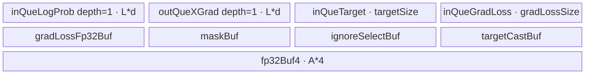

# CrossEntropyLossGrad A2/A3 ACLNN 算子知识

## 算子速览

| 项目 | 内容 |
|---|---|
| 实际入口 | `aclnnCrossEntropyLossGradGetWorkspaceSize` + `aclnnCrossEntropyLossGrad`，公开两段式 ACLNN，无版本后缀 |
| 计算语义 | 对 `aclnnCrossEntropyLoss` 求 `logProb` 梯度；公开范围内 `labelSmoothing=0`、zloss 输入/属性不生效 |
| 输入输出 | `logProb/out:[N,C]`，`target:[N] int64`，`gradLoss:[N]`（none）或标量（mean/sum）；数据为 ND，主 dtype 为 fp16/bf16/fp32，`weight:[C] fp32` 可选 |
| 执行类型 | 单节点 `AIV_VECTOR`；源码仅使用 Vector/Scalar、GM↔UB DMA 与核间 `SyncAll`，没有 Cube/AIC 或 `MIX_CV` |
| Kernel 路线 | R-001/R-002/R-003：无 weight 的 none/mean/sum；R-004/R-005/R-006：有 weight 的 none/mean/sum |
| 核心资源 | GM 输入输出；depth=1 的 `TQue`；fp32 `TBuf` 中间量；mean 路线用 workspace 每核写一个 fp32 后全核归约 |
| 来源闭包 | source_closed：公开 ACLNN 文档/OpDef → Tiling/POD → key router → 两个实际 body → binary config/CMake 已闭合；两段式自动生成 bridge 属框架边界 |
| 验证状态 | 已完成源码闭包检查；本次知识提取未执行编译、真机、数值或性能测试。 |

## 接口与语义

### 计算语义

公开支持的 `labelSmoothing=0` 下，令 `m_i = 1[target_i != ignoreIndex]`，`w_i=1`（weight 缺省）或 `weight[target_i]`。`none/sum` 的行系数为 `g_i=gradLoss_i*m_i` 或 `g=gradLoss*m_i`；`mean` 为 `g=gradLoss*m_i / sum_i(w_i*m_i)`。实际输出为：

```text
nll_i = g_i * w_i
out[i,j] = exp(logProb[i,j]) * nll_i - 1[j == target_i] * nll_i
```

负的 `ignoreIndex` 等于 target 时，A2/A3 body 跳过 target 位置减法并将 ignore mask 置 0。公开文档给出的平滑与 zloss 公式不属于当前支持输入域：`labelSmoothing` 只允许 0，`gradZlossOptional`、`lseForZlossOptional`、`lseSquareScaleForZloss` 不生效。

### 输入、输出与属性

| 参数 | shape/layout | dtype | 约束、默认值与语义 |
|---|---|---|---|
| `gradLoss` | none 为 `[N]`；mean/sum 为 0D；ND | fp16/bf16/fp32 | 与 `logProb/out` 同 dtype |
| `logProb` | `[N,C]`，ND | fp16/bf16/fp32 | `C>0`；自动连续化 |
| `target` | `[N]`，ND | int64 | 值在 `[0,C)`，或等于 `ignoreIndex`；只支持类别索引 |
| `weightOptional` | `[C]`，ND | fp32 | 缺省等价全 1；存在时参与 nll 和 mean 分母 |
| `gradZlossOptional` | 文档为 none 时 `[N]`、其余 0D | 同主 dtype | 保留参数，当前不生效 |
| `lseForZlossOptional` | `[N]` | 同主 dtype | 保留参数，当前不生效 |
| `reductionOptional` | 属性 | string | `none/mean/sum`，默认 `mean` |
| `ignoreIndex` | 属性 | int64 | 默认 `-100` |
| `labelSmoothing` | 属性 | double→OpDef float | 当前只支持 `0.0` |
| `lseSquareScaleForZloss` | 属性 | double→OpDef float | 当前不支持 |
| `out` | `[N,C]`，ND | 同 `logProb` | 输出 shape 由 `logProb` 推导 |

### 入口与版本

固定仓公开的是无后缀 `aclnnCrossEntropyLossGrad` 两段式接口。第一段返回 workspace 字节数与 executor，第二段把 executor 提交到调用方 stream。`op_host/CMakeLists.txt` 以 `ACLNNTYPE aclnn` 接入自动生成 ACLNN bridge；固定仓没有手写 GetWorkspaceSize/execute 函数体，因此连续化、executor 内部对象布局和框架系统 workspace 切片是明确的框架边界。README/API 支持表同时公开 A2 与 A3；OpDef、binary config 和 CMake 将它们落实为 `ascend910b`、`ascend910_93` 同一实现。

## Host/Launcher 执行流程

### 参数校验与前处理

OpDef 对 `grad_loss/log_prob/target` 和可选输入声明 `AutoContiguous`。公开 API 首先检查必选指针、dtype/shape；Tiling 再检查 `target.dim0 == logProb.dim0`，weight 存在时 `weight.dim0 == logProb.dim1`。A2/A3 Tiling 未显式拒绝非法 reduction 字符串：未命中 none/mean/sum 时 `reductionKey` 保持 0；调用者必须遵守公开枚举。dtype 由 `log_prob` 选择 bf16/fp16/fp32 key；公开契约要求 `gradLoss/logProb/out` 同 dtype。

### 参数、Workspace 与生命周期

`rowVal=N`、`colVal=C`。Tiling 从平台读取 `maxUbSize` 与 AIV 核数 `P`，设置 `blockDim=usedCoreNum`。用户 workspace 为 `align_up(P*4,32)` 字节，每核在 `workspace[coreIndex]` 写一个 fp32 部分和；其后追加 `GetLibApiWorkSpaceSize()` 系统区。只有 mean 路线读取用户区；同一 Kernel 内 `SyncAll` 保证所有核写入完成后读取 `[0,usedCoreNum)`。workspace 由 ACLNN 调用者分配，executor 持有 tiling/launch 描述，到第二段提交后按框架生命周期管理。

### 启动图与失败传播

```text
aclnnCrossEntropyLossGradGetWorkspaceSize
  -> ACLNN 自动生成 bridge / AutoContiguous（固定仓框架边界）
  -> Tiling4CrossEntropyLossGrad
     -> GetTilingInput -> GetTilingAttr -> InitSplitInfo -> CELossGradCoreSplitInfo
  -> 返回 executor 与 workspaceSize
aclnnCrossEntropyLossGrad(workspace, workspaceSize, executor, stream)
  -> 单节点 cross_entropy_loss_grad<<<usedCoreNum, stream>>>
  -> x_grad GM
```

唯一 Device 节点 entry 为 `cross_entropy_loss_grad(grad_loss,log_prob,target,weight,grad_zloss,lse_for_zloss,x_grad,workspace,tiling)`；POD 为 `CrossEntropyLossGradTilingData`。不存在 Kernel 间边。Tiling 的 null/shape 失败返回 `GRAPH_FAILED` 并阻断 launch；ACLNN 第二段的提交错误按公开 `aclnnStatus` 返回。mean 的 workspace 边是节点内部各核 producer→同节点各核 consumer，owner 为调用方 ACLNN workspace，生命周期覆盖整个 launch。

## Route 与参数设计

### 分核与资源计算

令平台 AIV 核数为 `P`：`frontCoreNum = N%P != 0 ? N%P : P`，`tailCoreNum = N<=P ? 0 : P-frontCoreNum`，`usedCoreNum=front+tail`，前核处理 `ceil(N/P)` 行，尾核处理 `floor(N/P)` 行。令前核行数为 `Nr`，主 dtype 字节为 `d`。

```text
targetSize       = align_up(Nr*8,32)
targetCastSize   = ignoreSize = align_up(Nr*4,32)
maskSize         = align_up(Nr,32)
targetWeightSize = weight ? align_up(Nr*4,32) : 0
none: gradLossSize=align_up(Nr*d,32)，d=2 时 gradLossFp32Size=align_up(Nr*4,32)
mean: tBuf2Size=32，tBuf3Size=align_up(max(P,Nr)*4,32)
```

余量除以 `12`（fp32）或 `8`（fp16/bf16），得到候选每次 C 元素数，再向下按 512B 对应的元素数对齐：fp32 按 128，16 位按 256。`colLoop=C/alignColLoopNum`，`colLoopNumTail=C%alignColLoopNum`。源码没有在 `alignColLoopNum==0` 后返回失败，超小 UB/极端资源不足是失败边界。

### Route 选择

| 顺序 | Route | Key/模板 | 精确选择条件与优先级 | 不适用去向 |
|---:|---|---|---|---|
| 1 | R-001 无权重 none | `10/20/30` → `WeightNone<T>` | weight null 且 reduction=`none`；key 十位由 bf16/fp16/fp32 决定 | 按 weight/reduction 转后续路线 |
| 2 | R-002 无权重 mean | `10/20/30` → `WeightNone<T>` | weight null 且 reduction=`mean` | R-003 或有权重路线 |
| 3 | R-003 无权重 sum | `10/20/30` → `WeightNone<T>` | weight null 且 reduction=`sum` | 有权重路线/非法属性边界 |
| 4 | R-004 有权重 none | `11/21/31` → `WeightNotNone<T>` | weight 非 null 且 reduction=`none` | R-005/R-006 |
| 5 | R-005 有权重 mean | `11/21/31` → `WeightNotNone<T>` | weight 非 null 且 reduction=`mean` | R-006 |
| 6 | R-006 有权重 sum | `11/21/31` → `WeightNotNone<T>` | weight 非 null 且 reduction=`sum` | 非支持输入失败 |

```text
dtypeKey = bf16?1 : fp16?2 : fp32?3 : 0
weightKey = weight==null ? 0 : 1
tilingKey = dtypeKey*10 + weightKey
reduction = none?0 : mean?1 : sum?2
router: 10/11/20/21/30/31；未知 key 不执行任何分支
```

### 模板/实现执行矩阵

| Route | key/selector | dtype/shape/platform 完整命中条件 | 执行拓扑与 Kernel 节点 | 实际模板/body | 内存与同步特征 | tail/fallback |
|---|---|---|---|---|---|---|
| R-001 | 10/20/30 | A2/A3，weight null，none | 单 AIV | `WeightNone<T>::Process` none 分支 | grad queue；无跨核 workspace | C 尾块按真实字节 DMA |
| R-002 | 10/20/30 | A2/A3，weight null，mean | 单 AIV | 同类 mean 分支 | `SyncAll` 汇总有效样本数 | 分母为全核 mask 和 |
| R-003 | 10/20/30 | A2/A3，weight null，sum | 单 AIV | 同类 sum 分支 | 无 grad queue/跨核归约 | C 尾块 |
| R-004 | 11/21/31 | A2/A3，weight `[C]`，none | 单 AIV | `WeightNotNone<T>::Process` none 分支 | 增加 targetWeight TBuf | C 尾块 |
| R-005 | 11/21/31 | A2/A3，weight `[C]`，mean | 单 AIV | 同类 mean 分支 | 全核汇总 `weight[target]*mask` | C 尾块 |
| R-006 | 11/21/31 | A2/A3，weight `[C]`，sum | 单 AIV | 同类 sum 分支 | targetWeight，无跨核归约 | C 尾块 |

### 隐藏性能 Guard

| Guard | Host/Tiling 条件 | Device/资源原因 | 影响 Route | 不满足时去向 | 源码符号 |
|---|---|---|---|---|---|
| 512B C tile | `alignColLoopNum=floor(min(colLoopNum,C),512/d)` | 保持主 C tile 对齐，队列按最大主/尾块容量分配 | 全部 | 无替代 route；0 值是资源失败边界 | `CELossGradCoreSplitInfo` |
| mean workspace | `reductionKey==1` | 每核先写 fp32 部分和，再 `SyncAll` 汇总 | R-002/R-005 | sum/none 不分配这些 TBuf | `WeightAfterMaskSum` / `TargetWeightSum` |
| 16 位升精度 | `T != float` | exp、乘法和减法均在 fp32 TBuf 完成，末尾 RINT | bf16/fp16 全路线 | fp32 直接计算 | `ComputeLog` |
| C tail | `colLoopNumTail!=0` | DMA 只搬有效字节，前后 `PipeBarrier<PIPE_ALL>` | 全部 | 余数为 0 时跳过 | `ComputerEachBatch` |
| 公开平滑边界 | API 仅支持 `labelSmoothing==0` | A2/A3 body 的非零分支没有完成公开平滑输出闭包 | 全部正式路线 | 非零不属于公开支持域 | API 文档“当前仅支持输入0.0” |

### POD/ABI

`CrossEntropyLossGradTilingData` 由 `BEGIN_TILING_DATA_DEF` 生成；固定仓没有展开后的 C++ struct，因此 `sizeof/alignof/offsetof` 不可见。字段顺序、源码类型与 producer/consumer 闭合如下。

| 结构 | 字段 | 类型/位宽 | ABI 布局 | 单位 | Host/launcher producer | Device consumer | 边界 |
|---|---|---|---|---|---|---|---|
| `CrossEntropyLossGradTilingData` | `reduction` | int64/64 | 固定仓不可见 | enum | `GetTilingAttr` | `Process` 分支 | 0/1/2 |
| 同上 | `ignoreIndex` | int64/64 | 固定仓不可见 | label 值 | attr cast | `ComputeIgnoreMask`/target guard | 默认 -100 |
| 同上 | `labelSmoothing` | float/32 | 固定仓不可见 | 比例 | attr cast | Grad/ComputeLog | 公开只允许 0 |
| 同上 | `rowVal` | int64/64 | 固定仓不可见 | 行 | `logProb.dim0` | 语义/分核 | N |
| 同上 | `colVal` | int64/64 | 固定仓不可见 | 元素/行 | `logProb.dim1` | C 循环/地址 | C>0 |
| 同上 | `frontCoreNum` | int64/64 | 固定仓不可见 | core | `InitSplitInfo` | `Init` offset | `[1,P]` |
| 同上 | `tailCoreNum` | int64/64 | 固定仓不可见 | core | 同上 | 间接决定 blockDim | N≤P 时 0 |
| 同上 | `usedCoreNum` | int64/64 | 固定仓不可见 | core | `front+tail` | workspace 汇总 | blockDim |
| 同上 | `frontRowNum` | int64/64 | 固定仓不可见 | row/core | `ceil(N/P)` | `Init` | 前核 |
| 同上 | `tailRowNum` | int64/64 | 固定仓不可见 | row/core | `floor(N/P)` | `Init` | 尾核 |
| 同上 | `alignColLoopNum` | int64/64 | 固定仓不可见 | element | UB 余量向下 512B 对齐 | C 地址/主循环 | 必须非 0 |
| 同上 | `colLoop` | int64/64 | 固定仓不可见 | loop | `C/alignColLoopNum` | C 主循环 | 整数除 |
| 同上 | `colLoopNumTail` | int64/64 | 固定仓不可见 | element | `C%alignColLoopNum` | tail DMA | 0 可不执行 |
| 同上 | `targetSize` | int64/64 | 固定仓不可见 | byte | `align_up(Nr*8,32)` | target queue | depth 1 |
| 同上 | `targetCastSize` | int64/64 | 固定仓不可见 | byte | `align_up(Nr*4,32)` | fp32 target/grad TBuf | depth 1 |
| 同上 | `gradLossSize` | int64/64 | 固定仓不可见 | byte | none 条件公式 | grad queue | 其他 route 为 0 |
| 同上 | `gradLossFp32Size` | int64/64 | 固定仓不可见 | byte | 16 位 none 条件公式 | fp32 grad TBuf | fp32/非-none 为 0 |
| 同上 | `ignoreSize` | int64/64 | 固定仓不可见 | byte | `align_up(Nr*4,32)` | ignoreSelect | 始终分配 |
| 同上 | `maskSize` | int64/64 | 固定仓不可见 | byte | `align_up(Nr,32)` | uint8 compare mask | 始终分配 |
| 同上 | `targetWeightSize` | int64/64 | 固定仓不可见 | byte | weight 条件公式 | targetWeight TBuf | 无 weight 为 0 |
| 同上 | `tBuf2Size` | int64/64 | 固定仓不可见 | byte | mean 时 32 | reduce scalar TBuf | 非 mean 为 0 |
| 同上 | `tBuf3Size` | int64/64 | 固定仓不可见 | byte | mean 时 `align_up(max(P,Nr)*4,32)` | 全核部分和 TBuf | 非 mean 为 0 |

### Route 源码闭包

| Route | Key/selector | Host/Tiling producer | POD/参数 | Kernel entry/router 节点 | Kernel body/直接依赖 | 构建接线 |
|---|---|---|---|---|---|---|
| R-001..R-003 | 10/20/30 + reduction | `cross_entropy_loss_grad_tiling.cpp:Tiling4CrossEntropyLossGrad` | `CrossEntropyLossGradTilingData` | `op_kernel/cross_entropy_loss_grad.cpp:cross_entropy_loss_grad` | `base.h` + `weight_none.h` | `op_kernel/CMakeLists.txt` + ascend910b/910_93 JSON |
| R-004..R-006 | 11/21/31 + reduction | 同上，`weightKey=1` | 同上 | 同一 entry | `base.h` + `weight_not_none.h` | 同上 |

## Kernel 实现

### 公共执行流程

每核按 former/tail 公式绑定连续行片；先把 target 搬入 UB，int64→fp32 后比较 `ignoreIndex`，生成 1/0 的 `ignoreSelect`。none 从对应行的 gradLoss 搬入并升到 fp32；mean/sum 从 GM 标量读取。随后逐行、逐 C tile 搬 `logProb`，升 fp32、`Exp`、乘行 nll 系数，再在目标列用 Scalar `GetValue/SetValue` 减去同一系数，最后 RINT 回 16 位或直接 fp32 Copy，按有效 `calcLen` 写 GM。公开不使用 `grad_zloss/lse_for_zloss`。

### Route R-001：无权重 none

#### 适用条件

##### 选择证据

| 层级 | 文件 | 符号 | 源码谓词/参数 | 结果/下一跳 |
|---|---|---|---|---|
| Tiling | `op_host/cross_entropy_loss_grad_tiling.cpp` | `GetTilingInput/GetTilingAttr` | weight null；reduction `none` | key 个位 0；POD reduction 0 |
| Router | `op_kernel/cross_entropy_loss_grad.cpp` | `cross_entropy_loss_grad` | key 10/20/30 | `WeightNone<bf16/half/float>` |

#### Device 数据流

##### 函数级调用链

```text
cross_entropy_loss_grad -> WeightNone<T>::Init -> Base::Init/InitUB
  -> Process -> ComputeIgnoreMask -> GradReductionNone
  -> per row/tile: CopyInLog -> ComputeLog -> CopyOutLog
```

##### 源码等价伪码

```text
coreRows = former_or_tail_rows(blockIdx); compute mask[target != ignore]
rowGradFp32 = cast(gradLoss[row]) * mask
for row in coreRows, for tile in C:
  tmp = exp(cast_fp32(logProb[row,tile])) * rowGradFp32[row]
  if target[row] belongs tile and target is not negative ignore: tmp[target-tileBase] -= rowGradFp32[row]
  out[row,tile] = cast_rint_T(tmp[0:valid])
```

#### 内存与数据搬运

##### 资源与搬运表

| 层级/缓冲区 | offset/地址公式 | extent/容量公式 | dtype/layout | producer | consumer | owner/lifetime | 对齐/复用 |
|---|---|---|---|---|---|---|---|
| logProb/xGrad GM | `logOffset + row*C + tile*A` | valid `calcLen` | T/ND | GM/ComputeLog | ComputeLog/GM | 调用方；整次 launch | `DataCopyPad`, 真实字节 |
| log inQ/outQ | 0 | `L*d` 各一份 | T | CopyIn/Compute | Compute/CopyOut | TPipe，单 tile | depth 1 |
| target inQ | 0 | `targetSize` | int64 | ComputeIgnoreMask | Cast | TPipe，单次 mask | depth 1 |
| grad inQ/fp32Buf | 0 | `gradLossSize + gradLossFp32Size` | T/fp32 | GradReductionNone | targetCast | TPipe，单次 | fp32 输入时 fp32Buf 为 0 |
| mask/ignore/targetCast | 各独立 | `maskSize+ignoreSize+targetCastSize` | u8/fp32/fp32 | compare/select/Grad | ComputeLog | Kernel 生命周期 | 不别名 |
| fp32Buf4 | 0 | `A*4` | fp32 | Exp/Muls | Cast/Copy | 路线对象；逐 tile 覆盖 | 同一 TBuf 原地 Exp/Muls |

##### 分层内存布局



##### 字节账与复用顺序

```text
L=max(A,align_up(Ctail,64)); A=alignColLoopNum
UB_total=2*L*d+targetSize+gradLossSize+gradLossFp32Size+maskSize+ignoreSize+targetCastSize+A*4
UB_total <= maxUbSize；dynamic_ub=N/A；workspace_total=align_up(P*4,32)+system_workspace（本 route 用户片不读）
```

| 复用子区 | 写入者 | 读取者/消费点 | 下一次覆盖 | 同步或释放依据 | 安全条件 |
|---|---|---|---|---|---|
| `fp32Buf4` | Cast/Exp/Muls | output Cast/Copy | 下一 C tile | 顺序执行；out 入队后覆盖 | 单 buffer、前一 tile 已 CopyOut |
| in/out queue slot | DMA/Compute | Compute/DMA | 下一 tile | EnQue→DeQue→FreeTensor | depth 1 严格串行 |

#### 同步、精度与尾块

##### 同步与数值边界表

| 阶段 | primitive/机制 | producer | consumer/等待点 | 保护对象 | 精度/尾块 |
|---|---|---|---|---|---|
| queue | EnQue/DeQue/FreeTensor | MTE2/Vector | Vector/MTE3 | log/out slot | tail 仅 valid bytes |
| tail | `PipeBarrier<PIPE_ALL>` | CopyIn/Compute | Compute/CopyOut/下一轮 | 尾块 TBuf | `calcLen=C%A` |
| precision | Cast/Exp/Muls/Cast RINT | T input | T output | fp32Buf4 | 16 位只在输入/输出降精度 |

#### 关键实现

##### 符号证据表

| 阶段 | 文件 | 符号/模板实例 | 实现事实 |
|---|---|---|---|
| Host/Tiling producer | `op_host/cross_entropy_loss_grad_tiling.cpp` | `CELossGradCoreSplitInfo` | none 缓冲与 C tile |
| Kernel entry/router | `op_kernel/cross_entropy_loss_grad.cpp` | key 10/20/30 | dtype→WeightNone |
| Device body/helper | `op_kernel/cross_entropy_loss_grad_weight_none.h` | `Process/ComputeLog` | none 行梯度、exp 与 target 减法 |

### Route R-002：无权重 mean

#### 适用条件

##### 选择证据

| 层级 | 文件 | 符号 | 源码谓词/参数 | 结果/下一跳 |
|---|---|---|---|---|
| Host | `op_host/cross_entropy_loss_grad_tiling.cpp` | `GetTilingAttr` | `strcmp(reduction,"mean")==0` | reduction=1，schedule mode=1 |
| Device | `weight_none.h` | `Process/WeightAfterMaskSum` | reduction==1 | 全核 mask 求和后计算 |

#### Device 数据流

##### 函数级调用链

```text
WeightNone::Process -> ComputeIgnoreMask -> WeightAfterMaskSum
  -> ReduceSum(core mask) -> workspace[core] -> SyncAll -> ReduceSum(all cores)
  -> GradReductionMeanSum -> targetCast=mask*grad/sumMask -> per-row ComputeLog/CopyOut
```

##### 源码等价伪码

```text
partial=sum(mask); workspace[core]=partial; SyncAll(); denom=sum(workspace[0:usedCoreNum])
nll[row]=mask[row]*gradLossScalar/denom
按 R-001 的 C tile 管线计算 exp(logProb)*nll-onehot(target)*nll
```

#### 内存与数据搬运

##### 资源与搬运表

| 层级/缓冲区 | offset/地址公式 | extent/容量公式 | dtype/layout | producer | consumer | owner/lifetime | 对齐/复用 |
|---|---|---|---|---|---|---|---|
| 公共 GM/queue/TBuf | 同 R-001，去掉 grad queue/fp32 grad | 同公共公式 | 同上 | 同上 | 同上 | 同一 launch | depth 1 |
| blockBuf2/weightMask | 0 | `32+tBuf3Size` | fp32 | ReduceSum/workspace DMA | denominator | Kernel | mean 专有 |
| workspace user | `coreIndex*4` | `align_up(P*4,32)` | fp32 vector | 各核 | 各核 | ACLNN workspace | `SyncAll` 后读 |

##### 分层内存布局


##### 字节账与复用顺序

```text
UB_total=2*L*d+targetSize+maskSize+ignoreSize+targetCastSize+A*4+32+tBuf3Size
workspace_total=align_up(P*4,32)+system_workspace
```

| 复用子区 | 写入者 | 读取者/消费点 | 下一次覆盖 | 同步或释放依据 | 安全条件 |
|---|---|---|---|---|---|
| workspace `[core]` | 当前核 DMA | 所有核 DMA in | launch 结束 | `SyncAll` | blockDim=usedCoreNum |

#### 同步、精度与尾块

##### 同步与数值边界表

| 阶段 | primitive/机制 | producer | consumer/等待点 | 保护对象 | 精度/尾块 |
|---|---|---|---|---|---|
| 核间归约 | `SyncAll` + `MTE2_V` event | 每核部分和 | 全核 ReduceSum | workspace | fp32 denominator；0 分母源码无 guard |
| 主计算 | 同 R-001 | 同 R-001 | 同 R-001 | 同 R-001 | mean 除法先于 C 计算 |

#### 关键实现

##### 符号证据表

| 阶段 | 文件 | 符号/模板实例 | 实现事实 |
|---|---|---|---|
| Host/Tiling producer | `op_host/cross_entropy_loss_grad_tiling.cpp` | mean 分支 | tBuf2/tBuf3/workspace |
| Kernel entry/router | `op_kernel/cross_entropy_loss_grad.cpp` | key 10/20/30 | WeightNone |
| Device body/helper | `weight_none.h` | `WeightAfterMaskSum/Process` | 全核分母与 mean |

### Route R-003：无权重 sum

#### 适用条件

##### 选择证据

| 层级 | 文件 | 符号 | 源码谓词/参数 | 结果/下一跳 |
|---|---|---|---|---|
| Host | `cross_entropy_loss_grad_tiling.cpp` | `GetTilingAttr` | reduction=`sum` | reduction=2 |
| Device | `weight_none.h` | `Process` final else | 非 0/1（公开为 2） | 标量 grad×mask |

#### Device 数据流

##### 函数级调用链

```text
WeightNone::Process -> ComputeIgnoreMask -> GradReductionMeanSum
  -> targetCast=mask*gradLossScalar -> per-row CopyInLog/ComputeLog/CopyOutLog
```

##### 源码等价伪码

```text
nll[row]=mask[row]*gradLossScalar
for each valid C tile: out=exp(logProb)*nll; out[target]-=nll; copy valid tail
```

#### 内存与数据搬运

##### 资源与搬运表

| 层级/缓冲区 | offset/地址公式 | extent/容量公式 | dtype/layout | producer | consumer | owner/lifetime | 对齐/复用 |
|---|---|---|---|---|---|---|---|
| GM/queues/base TBuf/fp32Buf4 | 同 R-001，无 grad queue | `2*L*d+targetSize+maskSize+ignoreSize+targetCastSize+A*4` | T/int64/fp32 | 同公共流程 | 同公共流程 | Kernel | tile 复用 |

##### 分层内存布局


##### 字节账与复用顺序

```text
UB_total=2*L*d+targetSize+maskSize+ignoreSize+targetCastSize+A*4
workspace 用户片不访问；无跨核同步
```

| 复用子区 | 写入者 | 读取者/消费点 | 下一次覆盖 | 同步或释放依据 | 安全条件 |
|---|---|---|---|---|---|
| fp32Buf4/queues | Compute/Copy | CopyOut | 下一 tile | queue 生命周期 | 同 R-001 |

#### 同步、精度与尾块

##### 同步与数值边界表

| 阶段 | primitive/机制 | producer | consumer/等待点 | 保护对象 | 精度/尾块 |
|---|---|---|---|---|---|
| C pipeline | queue + tail barrier | DMA/Vector | Vector/DMA | 单 tile | fp32 计算，RINT 输出；valid tail |

#### 关键实现

##### 符号证据表

| 阶段 | 文件 | 符号/模板实例 | 实现事实 |
|---|---|---|---|
| Host/Tiling producer | `cross_entropy_loss_grad_tiling.cpp` | sum 分支 | reduction=2、无 mean TBuf |
| Kernel entry/router | `cross_entropy_loss_grad.cpp` | WeightNone keys | dtype 实例 |
| Device body/helper | `weight_none.h` | `Process` sum 分支 | scalar grad 与逐 tile body |

### Route R-004：有权重 none

#### 适用条件

##### 选择证据

| 层级 | 文件 | 符号 | 源码谓词/参数 | 结果/下一跳 |
|---|---|---|---|---|
| Tiling | `cross_entropy_loss_grad_tiling.cpp` | `GetTilingInput` | optional weight 非 null | key 个位 1 |
| Router | `cross_entropy_loss_grad.cpp` | key 11/21/31 | dtype | `WeightNotNone<T>` |

#### Device 数据流

##### 函数级调用链

```text
WeightNotNone::Process -> ComputeIgnoreMask -> GradReductionNone
  -> TargetWeight(scalar GM gather) -> targetWeight*=targetCast
  -> per-row CopyInLog/ComputeLog/CopyOutLog
```

##### 源码等价伪码

```text
targetWeight[row]=ignore-negative?0:weight[target[row]]
nll[row]=targetWeight[row]*gradLoss[row]*mask[row]
out tile=exp(logProb tile)*nll; target lane -= nll; cast/copy valid bytes
```

#### 内存与数据搬运

##### 资源与搬运表

| 层级/缓冲区 | offset/地址公式 | extent/容量公式 | dtype/layout | producer | consumer | owner/lifetime | 对齐/复用 |
|---|---|---|---|---|---|---|---|
| weight GM | `target[row]` | one scalar per row | fp32/[C] | caller | TargetWeight | caller | scalar gather |
| targetWeightBuf | 0 | `targetWeightSize` | fp32 | TargetWeight/Mul | ComputeLog | Kernel | row slice |
| 其余 | 同 R-001 | R-001 + targetWeight | mixed | 公共流程 | 公共流程 | Kernel | depth 1 |

##### 分层内存布局


##### 字节账与复用顺序

```text
UB_total(R-004)=UB_total(R-001)+targetWeightSize
workspace 用户片不访问
```

| 复用子区 | 写入者 | 读取者/消费点 | 下一次覆盖 | 同步或释放依据 | 安全条件 |
|---|---|---|---|---|---|
| targetWeight | scalar gather，随后原地 Mul | ComputeLog 每行 GetValue | launch 结束 | PipeBarrier before dependent vector op | target 行数不超过容量 |

#### 同步、精度与尾块

##### 同步与数值边界表

| 阶段 | primitive/机制 | producer | consumer/等待点 | 保护对象 | 精度/尾块 |
|---|---|---|---|---|---|
| target weight | `PipeBarrier<PIPE_ALL>` | target/mask/grad | Mul/Compute | row TBuf | fp32 weight |
| C tile | 同 R-001 | 同上 | 同上 | tile | 同 R-001 |

#### 关键实现

##### 符号证据表

| 阶段 | 文件 | 符号/模板实例 | 实现事实 |
|---|---|---|---|
| Host/Tiling producer | `cross_entropy_loss_grad_tiling.cpp` | weight size/key | targetWeightSize |
| Kernel entry/router | `cross_entropy_loss_grad.cpp` | 11/21/31 | WeightNotNone |
| Device body/helper | `weight_not_none.h` | `TargetWeight/Process/ComputeLog` | gather、加权 nll |

### Route R-005：有权重 mean

#### 适用条件

##### 选择证据

| 层级 | 文件 | 符号 | 源码谓词/参数 | 结果/下一跳 |
|---|---|---|---|---|
| Host | `cross_entropy_loss_grad_tiling.cpp` | weight/reduction producers | weight 非 null、mean | key 11/21/31，reduction=1 |
| Device | `weight_not_none.h` | `TargetWeightSum` | reduction==MEAN | weighted denominator |

#### Device 数据流

##### 函数级调用链

```text
TargetWeight -> targetWeight*ignoreMask -> ReduceSum(core)
 -> workspace[core] -> SyncAll -> ReduceSum(all) -> grad/denom*mask*targetWeight
 -> per-row ComputeLog -> CopyOut
```

##### 源码等价伪码

```text
denom=sum_all_cores(weight[target]*mask)
nll[row]=gradLossScalar/denom*mask[row]*weight[target[row]]
out=exp(logProb)*nll-onehot(target)*nll
```

#### 内存与数据搬运

##### 资源与搬运表

| 层级/缓冲区 | offset/地址公式 | extent/容量公式 | dtype/layout | producer | consumer | owner/lifetime | 对齐/复用 |
|---|---|---|---|---|---|---|---|
| targetWeight | 0 | `targetWeightSize` | fp32 | scalar gather | weighted reduction/Compute | Kernel | row local |
| blockBuf2/weightMask | 0 | `32+tBuf3Size` | fp32 | core/all-core reduce | denominator | Kernel | mean only |
| workspace | `coreIndex` | P fp32 aligned | fp32 | each core | all cores | caller | SyncAll |
| log/out/tmp | 同 R-004 | same | same | same | same | Kernel | tile reuse |

##### 分层内存布局


##### 字节账与复用顺序

```text
UB_total(R-005)=2*L*d+targetSize+maskSize+ignoreSize+targetCastSize+targetWeightSize+A*4+32+tBuf3Size
workspace_total=align_up(P*4,32)+system_workspace
```

| 复用子区 | 写入者 | 读取者/消费点 | 下一次覆盖 | 同步或释放依据 | 安全条件 |
|---|---|---|---|---|---|
| workspace `[core]` | TargetWeightSum | all-core DMA/read | launch end | SyncAll + MTE2_V | usedCoreNum entries有效 |

#### 同步、精度与尾块

##### 同步与数值边界表

| 阶段 | primitive/机制 | producer | consumer/等待点 | 保护对象 | 精度/尾块 |
|---|---|---|---|---|---|
| weighted mean | PipeBarrier + SyncAll + MTE2_V | gather/Mul/core sum | denominator | row TBuf/workspace | fp32；0 分母无显式 guard |
| output | queue/tail barriers | ComputeLog | CopyOut | tile | 同 R-004 |

#### 关键实现

##### 符号证据表

| 阶段 | 文件 | 符号/模板实例 | 实现事实 |
|---|---|---|---|
| Host/Tiling producer | `cross_entropy_loss_grad_tiling.cpp` | mean+weight sizing | workspace/TBuf |
| Kernel entry/router | `cross_entropy_loss_grad.cpp` | 11/21/31 | weighted class |
| Device body/helper | `weight_not_none.h` | `TargetWeightSum/Process` | weighted all-core denominator |

### Route R-006：有权重 sum

#### 适用条件

##### 选择证据

| 层级 | 文件 | 符号 | 源码谓词/参数 | 结果/下一跳 |
|---|---|---|---|---|
| Host | `cross_entropy_loss_grad_tiling.cpp` | `GetTilingAttr/GetTilingInput` | weight 非 null、sum | weighted key + reduction 2 |
| Device | `weight_not_none.h` | `Process` REDUCTION_SUM | exact equality | scalar grad×mask×weight |

#### Device 数据流

##### 函数级调用链

```text
ComputeIgnoreMask -> GradReductionMeanSum -> TargetWeight -> Mul(targetWeight,targetCast)
 -> per row/tile CopyInLog -> ComputeLog -> CopyOutLog
```

##### 源码等价伪码

```text
nll[row]=gradLossScalar*mask[row]*weight[target[row]]
out tile=exp(logProb tile)*nll; target lane -= nll; write valid tail
```

#### 内存与数据搬运

##### 资源与搬运表

| 层级/缓冲区 | offset/地址公式 | extent/容量公式 | dtype/layout | producer | consumer | owner/lifetime | 对齐/复用 |
|---|---|---|---|---|---|---|---|
| base+weighted buffers | 同 R-004，去掉 grad queue | `2*L*d+targetSize+maskSize+ignoreSize+targetCastSize+targetWeightSize+A*4` | mixed | 公共/weighted | ComputeLog | Kernel | depth 1/tile reuse |

##### 分层内存布局


##### 字节账与复用顺序

```text
UB_total=2*L*d+targetSize+maskSize+ignoreSize+targetCastSize+targetWeightSize+A*4
workspace 用户片不访问
```

| 复用子区 | 写入者 | 读取者/消费点 | 下一次覆盖 | 同步或释放依据 | 安全条件 |
|---|---|---|---|---|---|
| targetWeight/fp32Buf4 | gather/Compute | row Compute/output | next tile/launch end | PipeBarrier/queue | same as R-004 |

#### 同步、精度与尾块

##### 同步与数值边界表

| 阶段 | primitive/机制 | producer | consumer/等待点 | 保护对象 | 精度/尾块 |
|---|---|---|---|---|---|
| row→tile | PipeBarrier/queue | row coefficient | ComputeLog | fp32 row data | C tail valid bytes；RINT for 16-bit |

#### 关键实现

##### 符号证据表

| 阶段 | 文件 | 符号/模板实例 | 实现事实 |
|---|---|---|---|
| Host/Tiling producer | `cross_entropy_loss_grad_tiling.cpp` | sum/weight | key/POD |
| Kernel entry/router | `cross_entropy_loss_grad.cpp` | 11/21/31 | dtype→weighted body |
| Device body/helper | `weight_not_none.h` | `Process/ComputeLog` | sum weighted formula |

## 算子特定优化

### Trick T-001：按 C 维 512B 主块、真实字节尾块

#### 触发与源码依据

- 适用 Route：R-001～R-006
- 触发条件：Tiling 计算出的 UB 候选 tile 小于或覆盖 C，均向下取 512B 对齐主块；`C%alignColLoopNum!=0` 时进入尾块。
- Golden 来源：[`loss/cross_entropy_loss_grad/op_host/cross_entropy_loss_grad_tiling.cpp:178-205`](../../../../../../../cann-ops-raw/ascendc/ops-nn/955f8b33985b6d72989ebff341bb9c2c564a51bc/loss/cross_entropy_loss_grad/op_host/cross_entropy_loss_grad_tiling.cpp#L178-L205)

**官方源码（固定 Commit 连续逐字摘录）**：

```cpp
if (colLoopNum < colVal) {
  alignColLoopNum = GetAlign(colLoopNum, (ALIGN_SIZE / FP32_INT32_DTYPE_SIZE));
} else {
  alignColLoopNum = GetAlign(colVal, (ALIGN_SIZE / FP32_INT32_DTYPE_SIZE));
}
uint64_t colLoop = GetDiv(colVal, alignColLoopNum);
uint64_t colLoopNumTail = GetDivRem(colVal, alignColLoopNum);
```

#### 机制与设计原因

主块用 UB 余量除以实际每列常驻字节（fp32 为输入 4+输出 4+fp32 临时 4，16 位为 2+2+4），再按 512B 对应元素数向下对齐，使稳定主循环拥有固定 Queue/TBuf 容量。尾块不补写 GM：`DataCopyPad` 的 `blockLen=calcLen*sizeof(T)`，输出同样只提交有效字节。这样源码可证明避免为 C 尾部额外搬运有效域之外的数据。

#### 迁移边界

- 适用：逐行 pointwise/one-hot 修正且 C 维可分 tile 的 AIV 算子。
- 前提：UB 余量足以得到非零对齐主块，且地址公式保持行主序 ND。
- 失效：`alignColLoopNum==0` 时本实现没有 fallback，必须由 Host 增加失败检查或另一路线。
- 未验证：本次知识提取未执行编译、真机、数值或性能测试。

#### 错误做法

固定仓未提供可验证反例。

### Trick T-002：mean 的单 Kernel 全核标量归约

#### 触发与源码依据

- 适用 Route：R-002、R-005
- 触发条件：`reduction==REDUCTION_MEAN`。
- Golden 来源：[`loss/cross_entropy_loss_grad/op_kernel/cross_entropy_loss_grad_weight_not_none.h:92-103`](../../../../../../../cann-ops-raw/ascendc/ops-nn/955f8b33985b6d72989ebff341bb9c2c564a51bc/loss/cross_entropy_loss_grad/op_kernel/cross_entropy_loss_grad_weight_not_none.h#L92-L103)

**官方源码（固定 Commit 连续逐字摘录）**：

```cpp
ReduceSum(blockBuf2Local, weightMaskLocal, weightMaskLocal, targetNum);
DataCopyPad(workspaceGm[this->coreIndex], blockBuf2Local, {1, (uint32_t)(1 * sizeof(float)), 0, 0, 0});
#ifndef __CCE_KT_TEST__
  SyncAll();
#endif
DataCopyPad(weightMaskLocal, workspaceGm, {1, (uint32_t)(this->usedCoreNum * sizeof(float)), 0, 0, 0}, {false, 0, 0, 0});
```

#### 机制与设计原因

每核只向 GM workspace 写一个 fp32 部分和，`SyncAll` 后每核读取紧凑的 `usedCoreNum` 个标量并在 UB 再归约。它避免新增第二个 Kernel 和大中间 Tensor，workspace 数据量由 N 降为 O(core)。

#### 迁移边界

- 适用：所有核都参与且需要同一全局标量的单 Kernel AIV 实现。
- 前提：blockDim 等于 `usedCoreNum`，平台支持 `SyncAll`，workspace 至少覆盖每核一个 fp32。
- 失效：无法全核同步时需多 Kernel/原子或框架归约路线。
- 未验证：本次知识提取未执行编译、真机、数值或性能测试。

#### 错误做法

固定仓未提供可验证反例。

## 模板与实现对比

| 对比维度 | R-001/R-002/R-003 无权重 | R-004/R-005/R-006 有权重 | 设计选择依据 |
|---|---|---|---|
| 命中条件/优先级 | key 个位 0 | key 个位 1 | optional weight 是否存在 |
| 模板与 dtype | `WeightNone<bf16/half/float>` | `WeightNotNone<...>` | key 十位 1/2/3 |
| 循环与分核 | 同一 former/tail core 与 N×C tile | 同左 | shape 相同 |
| Queue/TBuf/寄存器/dynamic UB/通信 window | base + fp32Buf4 | 再加 targetWeight | weight gather 结果复用 |
| 内存总占用与复用 | none 加 grad buffers；mean 加 reduce buffers | 同类条件再加 targetWeight | Tiling 按 route 扣减 UB |
| 搬运/Vector/SIMT/NDDMA/通信 API | DataCopyPad/Cast/Exp/Muls/Select | 加 scalar weight GM gather/Mul | 均为 AIV_VECTOR |
| 同步、精度与 tail | mean 才 SyncAll；fp32 中间；真实字节 tail | 同左 | reduction 决定同步 |
| fallback/失败边界 | 未知 key 空执行；A=0 无 fallback | 同左，target 越界可能非法 GM 访问 | 公开调用须满足约束 |

## 平台差异

| 项目 | A2 | A3 | 950 |
|---|---|---|---|
| 支持状态 | 支持 | 支持 | 支持，见独立 `_950` 卡 |
| Host/Launcher | `ascend910b` classic Tiling | `ascend910_93` 共用 classic Tiling | regbase Tiling，新增 full-load/empty route |
| Kernel/资源 | classic Vector API，512B tile | 同 A2 | MicroAPI，VReg/UB block 平台查询，POD 不同 |

## 限制与失败边界

- 公开仅支持 2D `logProb`、1D int64 target、fp32 weight，`C>0`；target 越界没有 Device 安全 fallback。
- `labelSmoothing` 公开只允许 0；zloss 参数保留但不生效，不应从 kernel 参数存在推导为已支持。
- A2/A3 `GetTilingAttr` 对非法 reduction 没有显式 else 失败，调用方必须使用公开枚举。
- 所有样本被 ignore 或权重和为 0 时，mean body 直接除以 0，固定仓没有额外数值 guard。
- 自动生成 ACLNN bridge、executor 内部布局、系统 workspace 的内部用途固定仓不可见；本卡未执行编译、真机、数值或性能测试。

## 源码索引

### 链路索引

| 链路阶段 | 文件 | 关键符号 | 支撑内容 |
|---|---|---|---|
| 入口声明/约束 | `docs/aclnnCrossEntropyLossGrad.md` | 两段式函数原型 | API、平台、dtype/shape/属性 |
| 入口实现 | `op_host/cross_entropy_loss_grad_def.cpp` | `CrossEntropyLossGrad::CrossEntropyLossGrad` | AutoContiguous、OpDef、平台注册 |
| Host/Tiling/Launcher | `op_host/cross_entropy_loss_grad_tiling.cpp` | `Tiling4CrossEntropyLossGrad` | key、分核、UB、workspace |
| Host/Tiling/Launcher | `op_host/cross_entropy_loss_grad_tiling.h` | `CrossEntropyLossGradTilingData` | POD 字段顺序与类型 |
| Kernel entry/body | `op_kernel/cross_entropy_loss_grad.cpp` | `cross_entropy_loss_grad` | 六 key router |
| Kernel entry/body | `op_kernel/cross_entropy_loss_grad_base.h` | `CrossEntropyLossGradBase` | 公共 UB、mask、DMA、精度 |
| Kernel entry/body | `op_kernel/cross_entropy_loss_grad_weight_none.h` | `CrossEntropyLossGradWeightNone` | 无权重路线 |
| Kernel entry/body | `op_kernel/cross_entropy_loss_grad_weight_not_none.h` | `CrossEntropyLossGradWeightNotNone` | 有权重路线 |
| 构建接线 | `op_host/config/ascend910b/cross_entropy_loss_grad_binary.json` | `op_list` | bf16/fp16/fp32 int64 binary |
| 构建接线 | `op_kernel/CMakeLists.txt` | `add_kernel_sources` | ascend910b/ascend910_93 |

### 实现复用检查

| 检查项 | 可复用事实 | 不得改变的约束 | 源码符号 |
|---|---|---|---|
| ABI/POD | classic Host/Device 共用字段语义 | 字段顺序、int64/float 位宽；展开 ABI 固定仓不可见 | `CrossEntropyLossGradTilingData` |
| 调用顺序 | mask/行系数先于逐行 C tile | targetCast 在 ComputeLog 前有效 | 各 `Process` |
| workspace/内存 | mean 每核一个 fp32 部分和 | `SyncAll` 前不可读；容量至少 P*4 对齐 | `TargetWeightSum/WeightAfterMaskSum` |
| 同步 | Queue 生命周期和 mean 全核 barrier | depth 1 不得提前覆盖 | `PipeM2V/SyncAll` |
| 精度与尾块 | 16 位输入升 fp32、末尾 RINT；DMA 只写 valid | cast 顺序、target 减法与 tail 长度 | `ComputeLog/CopyOutLog` |
| 失败边界 | Tiling shape 失败阻断 launch | 不得把非法 reduction、A=0、越界 target 当作 fallback | `GetTilingInput/GetTilingAttr` |