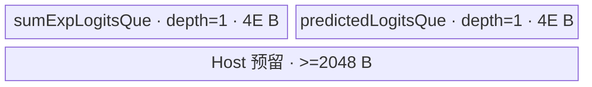

# FusedCrossEntropyLossWithMaxSum A2/A3 ACLNN 算子知识

## 算子速览

| 项目 | 内容 |
|---|---|
| 实际入口 | `aclnnFusedCrossEntropyLossWithMaxSumGetWorkspaceSize` + `aclnnFusedCrossEntropyLossWithMaxSum`，公开两段式 ACLNN，无版本后缀。 |
| 计算语义 | 对每行计算 `loss=log(sumExpLogits)-predictedLogits`；提供 `vocabParallelLogits` 时另算 `softmax=exp(vocabParallelLogits-logitsMax[:,None])/sumExpLogits[:,None]`。 |
| 输入输出 | 三个行向量和 `loss` 为 1D FP32；可选 vocab 为 2D FP16/BF16/FP32，softmax 为同 shape 的 FP32；均为 ND。`labelSmoothing` 仅支持 0。 |
| 执行类型 | 单 Kernel `fused_cross_entropy_loss_with_max_sum`，`AIV_VECTOR`；无 Cube/AIC/MIX_CV 可达节点。 |
| Kernel 路线 | R-001：vocab FP32，key 0；R-002：vocab FP16/BF16，keys 1/2；R-003：vocab 缺省、仅算 loss，key 3。 |
| 核心资源 | GM；R-001/R-002 使用 6 个 `TQue`，其中 vocab VECIN depth 2；R-003 仅使用两个 VECIN Queue；workspace 是平台 LibApi 系统区，Kernel body 只做非空检查。 |
| 来源闭包 | `source_closed`：公开 ACLNN→参数检查/连续化/executor→L0 launcher→OpDef/Tiling/POD→key router→AIV body→A2/A3 binary/build 接线闭合。 |
| 验证状态 | 已完成源码闭包检查；本次知识提取未执行编译、真机、数值或性能测试。 |

## 接口与语义

### 计算语义

令 `B=logitsMax.shape[0]`。对 `0<=b<B`，必选输出为：

```text
lossOut[b] = log(sumExpLogits[b]) - predictedLogits[b]
```

若 `vocabParallelLogitsOptional` 存在，令其 storage shape 为 `[BT,V]`，Device 对每个由 Tiling 分配的 `b` 和 `0<=v<V` 计算：

```text
softMaxOutOptional[b,v]
  = exp(float(vocabParallelLogitsOptional[b,v]) - logitsMax[b]) / sumExpLogits[b]
```

FP16/BF16 vocab 先以 `CAST_NONE` 升为 FP32，`Adds`、`Exp`、`Muls` 和输出均为 FP32。公开文档要求 vocab 第 0 维与 `logitsMax` 一致，但 ACLNN `CheckShape` 只检查 vocab/softmax 都是 2D 且彼此 shape 相同，没有实现这项交叉输入校验。

### 输入、输出与属性

| 参数 | shape/layout | dtype | 约束、默认值与语义 |
|---|---|---|---|
| `logitsMax` | 1D/ND | FP32 | 必选；与 `sumExpLogits`、`predictedLogits`、`lossOut` shape 相同。 |
| `sumExpLogits` | 1D/ND | FP32 | 必选；Device 执行 `Log` 并在 softmax 路线读取倒数；源码未校验正值或非零。 |
| `predictedLogits` | 1D/ND | FP32 | 必选；其 UB tensor 被原地覆盖为 loss。 |
| `labelSmoothing` | 标量属性 | C++ `float` | 仅允许精确等于 0；非 0 返回 `ACLNN_ERR_PARAM_INVALID`，Kernel 不读取该属性。 |
| `inputOptional` | 公开文档限定为空指针 | 文档写 FP32 | ACLNN 实现未校验且 Kernel 忽略；复用时应遵循公开约束，只传空指针。 |
| `weightOptional` | 公开文档限定为空指针 | 文档写 FP32 | ACLNN 实现未校验且 Kernel 忽略；复用时应遵循公开约束，只传空指针。 |
| `vocabParallelLogitsOptional` | 2D/ND，可空 | FP16/BF16/FP32 | 非空时必须同时提供 `softMaxOutOptional`；Tiling 取 storage shape `[BT,V]`。 |
| `lossOut` | 1D/ND | FP32 | 必选，与前三个必选输入 shape 相同；允许非连续，由 `ViewCopy` 收口。 |
| `softMaxOutOptional` | 2D/ND | FP32 | vocab 非空时必选且 shape 相同；vocab 为空时不执行其 `ViewCopy`。 |

### 入口与版本

固定仓公开的是无版本后缀的 `aclnnFusedCrossEntropyLossWithMaxSum` 两段式接口。第一段创建 executor、校验参数、将四个可能参与计算的输入连续化、登记一个 `FusedCrossEntropyLossWithMaxSum` AICore 节点，并登记输出 `ViewCopy`；第二段把 workspace、executor、stream 交给 `CommonOpExecutorRun`。`Contiguous`、`ViewCopy` 与 executor 的通用实现属于框架边界，算子自有 Host/Tiling/Kernel 已闭合。

公开 README 与 ACLNN 文档同时声明 A2、A3 支持，Ascend 950PR/950DT 不支持；OpDef、binary config 和 Kernel CMake 也只接线 `ascend910b`、`ascend910_93`。

## Host/Launcher 执行流程

### 参数校验与前处理

校验按 `CheckParams` 的真实顺序执行：

1. `logitsMax`、`sumExpLogits`、`predictedLogits`、`lossOut` 必须非空；vocab 非空时 softmax 输出也必须非空。
2. 三个必选输入与 loss 必须为 FP32；vocab 非空时为 FP32/FP16/BF16，softmax 为 FP32。
3. `logitsMax` 必须恰为 1D；其 shape 必须与另外两个必选输入和 loss 相同。vocab 非空时 vocab 必须恰为 2D，softmax 与其 shape 相同。
4. `labelSmoothing != 0` 失败。
5. 依次对 `logitsMax`、`sumExpLogits`、`predictedLogits` 做 `l0op::Contiguous`；vocab 非空时也连续化。任一步返回空指针即终止 executor 构造。
6. L0 根据输入 view shape 分配临时 loss；vocab 非空时分配同 vocab shape 的 FP32 临时 softmax，否则分配 shape `[0]` 的占位输出。随后登记 AICore launcher 和一个或两个 `ViewCopy`。

`inputOptional`、`weightOptional` 没有连续化、shape/dtype/null 校验，原样加入 launcher 参数，但 Device entry 不使用它们。

### 参数、Workspace 与生命周期

`TilingPrepareForFusedCrossEntropyLossWithMaxSum` 从平台取得 `GetCoreNumAiv()`、UB 字节数和 `GetLibApiWorkSpaceSize()`。算子节点的 workspace slice 大小被设为 `sysWorkspaceSize`；Device entry 要求传入 `workspace` 且 `GetUserWorkspace(workspace)` 非空，但 body 不读写 user workspace。第一段 ACLNN 返回的是 executor 内所有 `Contiguous`、算子节点与 `ViewCopy` 的聚合 workspace，精确聚合布局由框架管理，固定算子源码不可见。

executor 从第一段释放给调用者，在第二段完成前必须有效；调用者提供的 workspace 至少为返回字节数，stream 传给 `CommonOpExecutorRun`。临时连续 Tensor、临时输出及 launcher 参数均由 executor 持有；最终 `ViewCopy` 后才写入用户视图。

### 启动图与失败传播

算子自有启动图只有一个 Device 节点：

```text
aclnn...GetWorkspaceSize
  -> Contiguous(logitsMax)
  -> Contiguous(sumExpLogits)
  -> Contiguous(predictedLogits)
  -> [vocab != nullptr] Contiguous(vocab)
  -> l0op::FusedCrossEntropyLossWithMaxSum
       -> ADD_TO_LAUNCHER_LIST_AICORE(FusedCrossEntropyLossWithMaxSum)
            -> TilingFusedCrossEntropyLossWithMaxSum
            -> fused_cross_entropy_loss_with_max_sum<<<blockDim, stream>>>
  -> ViewCopy(tempLoss, lossOut)
  -> [vocab != nullptr] ViewCopy(tempSoftmax, softMaxOutOptional)
```

Device 节点参数依次为六个输入、两个输出、workspace、tiling；entry 重排为 `{vocab, logitsMax, sumExp, predicted, softmax, loss}` 供 body 使用。`blockDim` 由 Tiling 生成；POD 为 `FusedCrossEntropyLossWithMaxSumTilingData`。前后处理、Kernel 与 `ViewCopy` 位于同一 executor/stream 序列，任一 Host 构造步骤失败不释放可执行 executor；运行期状态由 `CommonOpExecutorRun` 返回。算子没有跨 Kernel workspace 边。

## Route 与参数设计

### 分核与资源计算

有 vocab 时，Tiling 取 `bt=storageShape[0]`、`v=storageShape[1]`，使用全部平台 AIV 核数 `C`：

```text
formerCoreNum = bt % C
latterbtCountLen = floor(bt/C)
formerbtCountLen = latterbtCountLen + 1
每核前缀 = 前 formerCoreNum 核各处理 formerbtCountLen 行
每核后缀 = 其余核各处理 latterbtCountLen 行
行 tile 固定为 128 (=512/sizeof(float))
每核行 full_loop = floor(core_rows/128)
每核行 tail = core_rows % 128

usable = floor((UB_bytes - 4*512 - 2048)/3 / 512) * 512  字节
elementsNumber = usable/4                              元素
vocab_full_loop = floor(v/elementsNumber)
vocab_tail = v % elementsNumber
```

无 vocab 时，`bt` 来自必选输入 0；先令 `usedCoreNum=ceil(bt/4096)`，`C=min(platformAivCoreNum,usedCoreNum)`，再做相同的 former/latter 行分配。其行 tile 为：

```text
elementsNumber = floor(((UB_bytes-2048)/2)/4/8)*8  个 FP32 元素
full_loop = floor(core_rows/elementsNumber)
tail = core_rows % elementsNumber
```

所有 shape 维先被 `static_cast<uint32_t>` 窄化。源码未检查平台核数为 0、UB 减法下溢、shape 超过 `uint32_t` 或空 `bt`；尤其无 vocab 且 `bt=0` 时 `C=0`，随后 `% C`/`/ C` 无有效保护。

### Route 选择

| 顺序 | Route | Key/模板 | 精确选择条件与优先级 | 不适用去向 |
|---:|---|---|---|---|
| 1 | R-003 loss-only | key 3；`FusedCrossEntropyLossWithMaxSum<float>::ProcessForMemory` | `GetOptionalInputTensor(5)==nullptr`，`Init()` 立即调用 `TilingForMenory()` | 非空则继续按 dtype |
| 2 | R-001 vocab FP32 | key 0；`FusedCrossEntropyLossWithMaxSum<float>::Process` | vocab 非空且 `tensor->GetDataType()==DT_FLOAT` | 非 FP32 继续 |
| 3 | R-002 vocab FP16 | key 1；`FusedCrossEntropyLossWithMaxSum<half>::Process` | vocab 非空且 dtype 为 `DT_FLOAT16` | 非 FP16 继续 |
| 4 | R-002 vocab BF16 | key 2；`FusedCrossEntropyLossWithMaxSum<bfloat16_t>::Process` | vocab 非空且不是 FP32/FP16；ACLNN/OpDef 已将可达值限制为 BF16 | 不可达 dtype 在 ACLNN 失败 |

```text
if optional input[5] == nullptr:
    key = 3
else if dtype == FP32:
    key = 0
else if dtype == FP16:
    key = 1
else:
    key = 2  # 公开入口的剩余合法 dtype 只有 BF16
```

### 模板/实现执行矩阵

| Route | key/selector | dtype/shape/platform 完整命中条件 | 执行拓扑与 Kernel 节点 | 实际模板/body | 内存与同步特征 | tail/fallback |
|---|---|---|---|---|---|---|
| R-001 vocab FP32 | 0 | vocab 非空、FP32、2D，A2/A3 | 单 AIV Kernel | `FusedCrossEntropyLossWithMaxSum<float>::Process/BtCompute/Compute`；FP32 `GMToUB` overload | 6 Queue；MTE2→V、V→MTE3、MTE3→MTE2、MTE2→S、MTE3→V hard event | 行尾 `<128`；vocab 尾 `<elementsNumber`；未知 key 静默无输出 |
| R-002 vocab FP16/BF16 | 1/2 | vocab 非空、FP16/BF16、2D，A2/A3 | 单 AIV Kernel | `FusedCrossEntropyLossWithMaxSum<half/bfloat16_t>`；模板 `GMToUB<C>` + FP32 body | 与 R-001 同物理 Queue；第二个 vocab Queue 槽作为低精度搬入 staging，然后 `Cast` | 与 R-001 相同 |
| R-003 loss-only | 3 | vocab 空，A2/A3 | 单 AIV Kernel | `FusedCrossEntropyLossWithMaxSum<float>::ProcessForMemory/BtComputeForMemory` | 2 Queue；sumExp 原地 `Log`；无 softmax 数据流 | 行尾 `<elementsNumber`；`bt=0` Host 无保护 |

### 隐藏性能 Guard

| Guard | Host/Tiling 条件 | Device/资源原因 | 影响 Route | 不满足时去向 | 源码符号 |
|---|---|---|---|---|---|
| vocab 是否存在 | `GetOptionalInputTensor(5)==nullptr` | 不需要 softmax 时可删除四个 Queue 与 vocab 循环 | 全部 | 空→R-003；非空→R-001/R-002 | `FusedCrossEntropyLossWithMaxSumTiling::Init` |
| vocab dtype | FP32/FP16/else | 决定 GM 指针类型及是否执行 `Cast` | R-001/R-002 | ACLNN 拒绝合法集合之外 dtype | `Init`；Kernel entry router |
| UB tile | `elementsNumber=floor(((UB-4096)/3)/512)*128` | 完整路线总 Queue 为 `12E+2048` 字节，并保留至少 2048 字节余量 | R-001/R-002 | 无 fallback；UB 太小会发生无保护的无符号下溢/零除 | `Init`；`InitParams` |
| loss-only UB tile | `E=floor(((UB-2048)/2)/4/8)*8` | 两个 FP32 Queue 共 `8E` 字节 | R-003 | 无 fallback | `TilingForMenory` |
| 行标量 cache | 行 tile 128 | `logitsMax/sumExp/predicted/log` 各固定 512 字节 | R-001/R-002 | 固定策略 | `PER_TIME_COMPUTE_LINE`；`CACEH_LINE` |
| workspace 非空 | `workspace!=nullptr && GetUserWorkspace(workspace)!=nullptr` | entry 在构造 body 前直接返回 | 全部 | 静默无输出 | `fused_cross_entropy_loss_with_max_sum` |
| 空域 | 无显式合法性检查 | R-003 的 `bt=0` 令 `coreNum=0`；完整路线的 `v=0` 会走仅分配两个 Queue 的 Init 分支但仍调用 `Process/BtCompute` | 全部 | 固定仓无安全 fallback | `Init`；`TilingForMenory`；`InitParams` |

### POD/ABI

`FusedCrossEntropyLossWithMaxSumTilingData` 按下表顺序声明 11 个 `uint32_t`。宏 `BEGIN_TILING_DATA_DEF/TILING_DATA_FIELD_DEF` 的展开不在固定仓内，故精确 `sizeof/alignof/offsetof` 固定仓不可见；Host/Device 使用同名注册结构与 `GET_TILING_DATA`。R-003 未显式写 `singleCalculationQuantity`、`singleCalculationReservedQuantity`、`vLen`；其中 `ProcessForMemory` 不读取前两者，但 `InitParams` 会读取 `vLen` 来选择 Queue 布局，默认初始化语义在固定仓不可见。

| 结构 | 字段 | 类型/位宽 | ABI 布局 | 单位 | Host/launcher producer | Device consumer | 边界 |
|---|---|---|---|---|---|---|---|
| `FusedCrossEntropyLossWithMaxSumTilingData` | `formerbtCountLen` | `uint32_t`/32 | 第 1 个声明字段；精确 offset 不可见 | 行/核 | `set_formerbtCountLen` | `InitParams` 前核 `btCountLen` | R-001/2 固定用于地址；R-003 也赋值 |
| 同上 | `latterbtCountLen` | `uint32_t`/32 | 第 2 个；精确 offset 不可见 | 行/核 | `set_latterbtCountLen` | `InitParams` 后核 `btCountLen` | 可为 0 |
| 同上 | `formerbtCountTime` | `uint32_t`/32 | 第 3 个；精确 offset 不可见 | 循环次数 | `set_formerbtCountTime` | `Process`/`ProcessForMemory` | 整除后的 full loop |
| 同上 | `latterbtCountTime` | `uint32_t`/32 | 第 4 个；精确 offset 不可见 | 循环次数 | `set_latterbtCountTime` | 同上 | 整除后的 full loop |
| 同上 | `formerCoreNum` | `uint32_t`/32 | 第 5 个；精确 offset 不可见 | core | `set_formerCoreNum(bt%C)` | `InitParams` 选择前/后核并算 base | `[0,C)` |
| 同上 | `formerCoreReservedbtNum` | `uint32_t`/32 | 第 6 个；精确 offset 不可见 | 行/元素 | `set_formerCoreReservedbtNum` | `Process` 尾调用 | R-001/2 单位为行且 `<128`；R-003 为元素且 `<E` |
| 同上 | `latterCoreReservedbtNum` | `uint32_t`/32 | 第 7 个；精确 offset 不可见 | 行/元素 | `set_latterCoreReservedbtNum` | `Process` 尾调用 | 同上 |
| 同上 | `singleCalculationQuantity` | `uint32_t`/32 | 第 8 个；精确 offset 不可见 | vocab tile 次数 | `set_singleCalculationQuantity(v/E)` | `BtCompute` 内层 `k` 循环 | R-003 未赋值且不由执行 body 读取 |
| 同上 | `singleCalculationReservedQuantity` | `uint32_t`/32 | 第 9 个；精确 offset 不可见 | vocab 元素 | `set_singleCalculationReservedQuantity(v%E)` | `BtCompute` vocab tail | R-003 未赋值且不由执行 body 读取 |
| 同上 | `elementsNumber` | `uint32_t`/32 | 第 10 个；精确 offset 不可见 | FP32 元素 | 两 Route 公式后 `set_elementsNumber` | Queue 容量、vocab tile 或 loss 行 tile | 必须非 0，Host 未检查 |
| 同上 | `vLen` | `uint32_t`/32 | 第 11 个；精确 offset 不可见 | vocab 列数 | 完整路线 `set_vLen(v)`；R-003 未赋值 | `InitParams` Queue 分支及 vocab 地址步长 | R-003 默认值固定仓不可见；完整路线 `v=0` 不安全 |

### Route 源码闭包

| Route | Key/selector | Host/Tiling producer | POD/参数 | Kernel entry/router 节点 | Kernel body/直接依赖 | 构建接线 |
|---|---|---|---|---|---|---|
| R-001 vocab FP32 | 0 | `..._tiling.cpp::Init` | `FusedCrossEntropyLossWithMaxSumTilingData` 全字段 | `...op_kernel/...cpp::fused_cross_entropy_loss_with_max_sum` key 0 | `...op_kernel/...h::Process/BtCompute/Compute`，FP32 `GMToUB` | `op_kernel/CMakeLists.txt` + ascend910b/ascend910_93 binary JSON |
| R-002 vocab FP16/BF16 | 1/2 | 同上 dtype 分支 | 同上 | 同 entry keys 1/2 | 同 body；模板 `GMToUB<C>` 与 `Cast` | 同上 |
| R-003 loss-only | 3 | `..._tiling.cpp::TilingForMenory` | 同结构的 loss-only 字段子集 | 同 entry key 3 | `ProcessForMemory/BtComputeForMemory` | 同上 |

## Kernel 实现

### 公共执行流程

三个 Route 共用一个 entry。entry 先检查 workspace，再以 `GET_TILING_DATA` 解析 POD，把 GM 参数重排后按 key 实例化模板。每个 block 通过 `formerCoreNum` 选择行数、循环数、尾长和 `baseBtOffset`。所有 GM 搬运使用 `DataCopyPad`，参数均为单 block：`blockCount=1`、`blockLen=length*sizeof(dtype)` 字节、两侧 stride 为 0；pad 参数启用右侧 padding，只有 `length` 个有效元素进入 Vector 运算或写回。

没有 `AllocTensor/EnQue/DeQue/FreeTensor` 的逐迭代流水：所有 LocalTensor 在 `InitParams` 一次分配并跨行/列 tile 复用，依靠显式 HardEvent 保证 MTE2、Vector、Scalar 与 MTE3 的阶段可见性。

### Route R-001：vocab FP32 完整路线

#### 适用条件

##### 选择证据

| 层级 | 文件 | 符号 | 源码谓词/参数 | 结果/下一跳 |
|---|---|---|---|---|
| ACLNN | `op_host/op_api/aclnn_fused_cross_entropy_loss_with_max_sum.cpp` | `CheckDtypeValid` | vocab 非空，dtype 属于 FP32/FP16/BF16 | 继续 |
| Tiling | `op_host/fused_cross_entropy_loss_with_max_sum_tiling.cpp` | `Init` | optional input 5 非空；`dataType==DT_FLOAT` | key 0 |
| Router | `op_kernel/fused_cross_entropy_loss_with_max_sum.cpp` | `fused_cross_entropy_loss_with_max_sum` | `TILING_KEY_IS(0)` | `FusedCrossEntropyLossWithMaxSum<float>::Process` |

#### Device 数据流

##### 函数级调用链

```text
ADD_TO_LAUNCHER_LIST_AICORE(FusedCrossEntropyLossWithMaxSum)
  -> fused_cross_entropy_loss_with_max_sum(..., workspace, tiling)
    -> FusedCrossEntropyLossWithMaxSum<float>::InitParams
    -> Process
      -> BtCompute(row_length<=128)
        -> GMToUB<float>(sumExp/predicted/logitsMax)
        -> Log -> Sub -> UBToGM(loss)
        -> for row -> for vocab tile: Compute
          -> GMToUB<float>(vocab) -> Adds -> Exp -> Muls -> UBToGM(softmax)
```

##### 源码等价伪码

```text
# 伪码；E=elementsNumber
if blockIdx < formerCoreNum:
    rows=formerbtCountLen; loops=formerbtCountTime; tail=formerCoreReservedbtNum
    base=blockIdx*rows
else:
    rows=latterbtCountLen; loops=latterbtCountTime; tail=latterCoreReservedbtNum
    base=formerCoreNum + blockIdx*rows

repeat loops times, then optional tail:
    len = 128 or tail
    sumUB[0:len]  = DataCopyPad(sumGM[base:base+len]); wait MTE2->V
    predUB[0:len] = DataCopyPad(predGM[base:base+len]); wait MTE2->V
    maxUB[0:len]  = DataCopyPad(maxGM[base:base+len]); wait MTE2->V
    logUB[0:len]  = Log(sumUB[0:len])
    predUB[0:len] = logUB[0:len] - predUB[0:len]
    wait V->MTE3; DataCopyPad(lossGM[base:base+len], predUB); wait MTE3->MTE2
    wait MTE2->S
    for j in [0,len):
        offset=(base+j)*vLen
        repeat floor(vLen/E) times:
            vocabUB=DataCopyPad(vocabGM[offset:offset+E]); wait MTE2->V
            vocabUB=Exp(vocabUB + (-maxUB[j]))
            wait MTE3->V
            softmaxUB=vocabUB*(1/sumUB[j])
            wait V->MTE3; DataCopyPad(softmaxGM[offset:offset+E], softmaxUB)
            offset += E
        if vLen%E>0: execute same pipeline with length=vLen%E
    base += len  # full-loop path increments 128; tail ends core
```

#### 内存与数据搬运

##### 资源与搬运表

| 层级/缓冲区 | offset/地址公式 | extent/容量公式 | dtype/layout | producer | consumer | owner/lifetime | 对齐/复用 |
|---|---|---|---|---|---|---|---|
| GM row inputs | `baseBtOffset` | 当前 `length<=128` | FP32/1D | ACLNN caller | `GMToUB<float>` | caller；整次执行 | tail 用字节长度搬运 |
| GM vocab/softmax | `(base+j)*vLen + tile*E` | `E` 或 `vLen%E` | FP32/[BT,V] row-major | caller/`Compute` | `Compute`/caller | caller 与输出 owner | 行尾、列尾均只写有效长度 |
| `vocabParallelLogitsQue_` | LocalTensor offset 0 | depth 2 × `E*4` | FP32 | `DataCopyPad` | `Adds/Exp/Muls` | `TPipe`；跨 tile 复用 | key0 仅使用首槽，第二槽仍占用 |
| `logitsMaxQue_` | 0 | 512 B | FP32 | `GMToUB` | Scalar `GetValue` | 同一行 tile | 单缓冲 |
| `sumExpLogitsQue_` | 0 | 512 B | FP32 | `GMToUB` | `Log`、Scalar reciprocal | 同一行 tile | 单缓冲 |
| `predictedLogitsQue_` | 0 | 512 B | FP32 | `GMToUB`/`Sub` | loss `UBToGM` | 同一行 tile | 原地覆盖为 loss |
| `logQue_` | 0 | 512 B | FP32 | `Log` | `Sub` | 同一行 tile | 单缓冲 |
| `softmaxLogitsQue_` | 0 | `E*4` | FP32 | `Muls` | softmax `UBToGM` | 每个 vocab tile | 输出 Queue 直接承接最终值 |

##### 分层内存布局


##### 字节账与复用顺序

```text
UB_total = 2*(E*4) + 4*512 + E*4 = 12E + 2048 bytes
Host: 12E <= UB_bytes - 4096
=> UB_total <= UB_bytes - 2048
dynamic_ub = N/A（AIV TPipe 静态 Queue）
workspace_total = sysWorkspaceSize（body 不读写，只检查 user workspace 非空）
```

| 复用子区 | 写入者 | 读取者/消费点 | 下一次覆盖 | 同步或释放依据 | 安全条件 |
|---|---|---|---|---|---|
| `predictedLogitsTensor` | MTE2 `GMToUB`，随后 Vector `Sub` | MTE3 loss copy | 下一行 tile | MTE2→V、V→MTE3、MTE3→MTE2 | loss copy 完成后才覆盖 |
| `vocabParallelLogitsTensor[0:E]` | MTE2 copy | `Adds/Exp/Muls` | 下一 vocab tile | MTE2→V；MTE3→V 防止前次输出阶段冲突 | 当前 softmax 乘法已消费 |
| `softmaxLogitsTensor` | `Muls` | MTE3 copy | 下一 vocab tile | V→MTE3；`UBToGM` 内 MTE3→MTE2 | 写回完成后复用 |

#### 同步、精度与尾块

##### 同步与数值边界表

| 阶段 | primitive/机制 | producer | consumer/等待点 | 保护对象 | 精度/尾块 |
|---|---|---|---|---|---|
| GM→UB | `DataCopyPad` + MTE2→V event | MTE2 | Vector `Log/Sub/Adds` | 当前输入 LocalTensor | `blockLen=length*4` B，仅前 `length` 有效 |
| loss 计算 | FP32 `Log`、`Sub` | Vector | V→MTE3 | `predictedLogitsTensor` | `Sub(pred,log,pred)` 实际结果为 `log-pred` |
| 标量读取 | MTE2→S event | MTE2 row loads | `GetValue(j)` | max/sum 当前行 | FP32 reciprocal；源码未处理 sum=0 |
| softmax 计算 | FP32 `Adds`→`Exp`→`Muls` | Vector | V→MTE3 | vocab/softmax LocalTensor | 列 tail 直接传有效 `length` |
| 输出→复用 | MTE3→MTE2 event | MTE3 | 下一次 MTE2 搬入 | 复用 Queue | 无跨核写冲突，每核覆盖不同行 |

#### 关键实现

##### 符号证据表

| 阶段 | 文件 | 符号/模板实例 | 实现事实 |
|---|---|---|---|
| Host/Tiling producer | `op_host/fused_cross_entropy_loss_with_max_sum_tiling.cpp` | `FusedCrossEntropyLossWithMaxSumTiling::Init` | core/行/列 tile、key 0、POD、workspace |
| Kernel entry/router | `op_kernel/fused_cross_entropy_loss_with_max_sum.cpp` | `fused_cross_entropy_loss_with_max_sum` key 0 | workspace guard、GM 重排、float 模板实例 |
| Device body/helper | `op_kernel/fused_cross_entropy_loss_with_max_sum.h` | `Process`、`BtCompute`、`Compute`、FP32 `GMToUB` | 循环、地址、Vector 顺序、events 与 tails |

### Route R-002：vocab FP16/BF16 升精度路线

#### 适用条件

##### 选择证据

| 层级 | 文件 | 符号 | 源码谓词/参数 | 结果/下一跳 |
|---|---|---|---|---|
| ACLNN | `op_host/op_api/aclnn_fused_cross_entropy_loss_with_max_sum.cpp` | `CheckDtypeValid` | vocab 为 FP16 或 BF16 | 继续 |
| Tiling | `op_host/fused_cross_entropy_loss_with_max_sum_tiling.cpp` | `Init` | `DT_FLOAT16`→1；剩余合法 BF16→2 | key 1/2 |
| Router | `op_kernel/fused_cross_entropy_loss_with_max_sum.cpp` | entry | key 1/2 | `FusedCrossEntropyLossWithMaxSum<half/bfloat16_t>::Process` |

#### Device 数据流

##### 函数级调用链

```text
fused_cross_entropy_loss_with_max_sum
  -> FusedCrossEntropyLossWithMaxSum<half|bfloat16_t>::InitParams
  -> Process -> BtCompute
    -> row loss pipeline（全部 FP32，与 R-001 相同）
    -> Compute
      -> GMToUB<C>: DataCopyPad to ReinterpretCast<C>()[E]
      -> Cast(dst float[0:E], src C[E:...], CAST_NONE)
      -> Adds -> Exp -> Muls -> FP32 softmax GM
```

##### 源码等价伪码

```text
# 行分核、loss 与列循环同 R-001；仅 vocab CopyIn 不同
tmpC = vocabParallelLogitsTensor.ReinterpretCast<C>()
DataCopyPad(tmpC[E], vocabGM[offset], blockLen=length*sizeof(C))
wait MTE2->V
Cast(vocabParallelLogitsTensor[0:length], tmpC[E:E+length], CAST_NONE)
vocabParallelLogitsTensor = Exp(vocabParallelLogitsTensor - rowMax)
softmaxLogitsTensor = vocabParallelLogitsTensor * reciprocal(rowSumExp)
wait V->MTE3
DataCopyPad(softmaxGM[offset], softmaxLogitsTensor, blockLen=length*4)
```

#### 内存与数据搬运

##### 资源与搬运表

| 层级/缓冲区 | offset/地址公式 | extent/容量公式 | dtype/layout | producer | consumer | owner/lifetime | 对齐/复用 |
|---|---|---|---|---|---|---|---|
| vocab GM | 行列公式同 R-001 | `length*sizeof(C)` 字节 | FP16/BF16 | caller | `GMToUB<C>` | caller | tail 按真实字节数 |
| vocab Queue slot 1 | float view offset 0 | `E*4` B | FP32 | `Cast` | `Adds/Exp/Muls` | 当前列 tile | 计算区 |
| vocab Queue slot 2/staging | `tmpTensor[E]` | 分配物理余量 `E*4` B；有效低精度最多 `E*sizeof(C)` | FP16/BF16 | MTE2 | `Cast` | 当前列 tile | 利用 depth 2 的第二物理槽隔离搬入与 FP32 dst |
| 其余 5 Queue | 同 R-001 | `4*512+E*4` B | FP32 | 同 R-001 | 同 R-001 | 同 R-001 | 同 R-001 |

##### 分层内存布局


##### 字节账与复用顺序

```text
UB_total = 8E + 2048 + 4E = 12E + 2048 bytes
dynamic_ub = N/A
workspace_total = sysWorkspaceSize
```

| 复用子区 | 写入者 | 读取者/消费点 | 下一次覆盖 | 同步或释放依据 | 安全条件 |
|---|---|---|---|---|---|
| vocab staging `tmpTensor[E]` | MTE2 | Vector `Cast` | 下一列 tile | MTE2→V | Cast 已消费当前低精度输入 |
| vocab FP32 区 `[0:E]` | `Cast`、`Adds`、`Exp` 原地写回 | `Muls` | 下一列 tile | Vector 顺序；输出写入独立 softmax Queue | staging 与计算区不重叠 |
| row/softmax Queue | 同 R-001 | 同 R-001 | 同 R-001 | 同 R-001 events | 同 R-001 |

#### 同步、精度与尾块

##### 同步与数值边界表

| 阶段 | primitive/机制 | producer | consumer/等待点 | 保护对象 | 精度/尾块 |
|---|---|---|---|---|---|
| 低精度搬入 | `DataCopyPad` + MTE2→V | MTE2 | `Cast` | staging | blockLen 为 `length*2` B |
| 升精度 | `Cast(...,CAST_NONE,length)` | Vector | `Adds` | FP32 compute 区 | FP16/BF16→FP32，无降精度输出 |
| 原地非线性 | `Adds`、`Exp` dst=src | Vector | `Muls` | FP32 compute 区 | 减少中间物化；tail mask 由 length 控制 |
| loss/输出 | 同 R-001 hard events | Vector/MTE3 | 下一阶段 | row 与 softmax Queue | 全 FP32 |

#### 关键实现

##### 符号证据表

| 阶段 | 文件 | 符号/模板实例 | 实现事实 |
|---|---|---|---|
| Host/Tiling producer | `op_host/fused_cross_entropy_loss_with_max_sum_tiling.cpp` | `Init` lines 132-145 | dtype 到 keys 1/2 |
| Kernel entry/router | `op_kernel/fused_cross_entropy_loss_with_max_sum.cpp` | keys 1/2 | half/BF16 模板实例 |
| Device body/helper | `op_kernel/fused_cross_entropy_loss_with_max_sum.h` | `GMToUB<C>`、`Compute` | second-slot staging、`CAST_NONE`、FP32 运算与输出 |

### Route R-003：无 vocab 的 loss-only 路线

#### 适用条件

##### 选择证据

| 层级 | 文件 | 符号 | 源码谓词/参数 | 结果/下一跳 |
|---|---|---|---|---|
| ACLNN/L0 | `op_host/op_api/aclnn_fused_cross_entropy_loss_with_max_sum.cpp`；`fused_cross_entropy_loss_with_max_sum.cpp` | workspace builder；L0 | vocab 为 null；只登记 loss `ViewCopy`，L0 生成 `[0]` 临时 softmax | 继续 |
| Tiling | `op_host/fused_cross_entropy_loss_with_max_sum_tiling.cpp` | `Init/TilingForMenory` | optional input 5 为 null | key 3，按 loss 长度裁核 |
| Router | `op_kernel/fused_cross_entropy_loss_with_max_sum.cpp` | entry | key 3 | float 模板 `ProcessForMemory` |

#### Device 数据流

##### 函数级调用链

```text
fused_cross_entropy_loss_with_max_sum key 3
  -> FusedCrossEntropyLossWithMaxSum<float>::InitParams
  -> ProcessForMemory
    -> BtComputeForMemory
      -> GMToUB<float>(sumExp)
      -> GMToUB<float>(predicted)
      -> Log(sumExpTensor, sumExpTensor)
      -> Sub(predictedTensor, sumExpTensor, predictedTensor)
      -> UBToGM(loss)
```

##### 源码等价伪码

```text
# E=floor(((UB-2048)/2)/4/8)*8
C=min(platformAivCoreNum, ceil(bt/4096))
按 bt%C 把连续行分给 C 核
每核:
  repeat floor(coreRows/E) times, then optional coreRows%E tail:
    sumUB[0:len]=DataCopyPad(sumGM[base:base+len]); wait MTE2->V
    predUB[0:len]=DataCopyPad(predGM[base:base+len]); wait MTE2->V
    sumUB[0:len]=Log(sumUB[0:len])
    predUB[0:len]=sumUB[0:len]-predUB[0:len]
    wait V->MTE3
    DataCopyPad(lossGM[base:base+len], predUB, blockLen=len*4)
    wait MTE3->MTE2
    base += E  # full loop；tail 后结束
```

#### 内存与数据搬运

##### 资源与搬运表

| 层级/缓冲区 | offset/地址公式 | extent/容量公式 | dtype/layout | producer | consumer | owner/lifetime | 对齐/复用 |
|---|---|---|---|---|---|---|---|
| sumExp GM | `baseBtOffset` | `E` 或 tail | FP32/1D | caller | `GMToUB` | caller | blockLen=`len*4` B |
| predicted GM | 同上 | 同上 | FP32/1D | caller | `GMToUB` | caller | 同上 |
| loss GM | 同上 | 同上 | FP32/1D | `UBToGM` | caller | output owner | 只写有效 len |
| `sumExpLogitsQue_` | 0 | `E*4` B | FP32 | MTE2，随后原地 `Log` | `Sub` | 当前 tile | 输入→log 原地复用 |
| `predictedLogitsQue_` | 0 | `E*4` B | FP32 | MTE2，随后 `Sub` | MTE3 | 当前 tile | 输入→loss 原地复用 |
| vocab/max/log/softmax Queue | N/A | 0（目标 Route 不需要） | N/A | N/A | N/A | N/A | `vLen<=0` 分支才不分配；R-003 的 `vLen` 未显式赋值边界见限制 |

##### 分层内存布局



##### 字节账与复用顺序

```text
UB_total = E*4 + E*4 = 8E bytes
8E <= UB_bytes - 2048
dynamic_ub = N/A
workspace_total = sysWorkspaceSize
```

| 复用子区 | 写入者 | 读取者/消费点 | 下一次覆盖 | 同步或释放依据 | 安全条件 |
|---|---|---|---|---|---|
| `sumExpLogitsTensor` | MTE2 copy，随后 `Log` 原地覆盖 | `Sub` | 下一行 tile | MTE2→V；当前 Vector 链完成 | 不再需要原始 sumExp（本 Route 不算 softmax） |
| `predictedLogitsTensor` | MTE2 copy，随后 `Sub` 原地覆盖 | MTE3 loss copy | 下一行 tile | MTE2→V、V→MTE3、MTE3→MTE2 | 写回完成后复用 |

#### 同步、精度与尾块

##### 同步与数值边界表

| 阶段 | primitive/机制 | producer | consumer/等待点 | 保护对象 | 精度/尾块 |
|---|---|---|---|---|---|
| 两路 CopyIn | 每路 `DataCopyPad` 后 MTE2→V | MTE2 | Vector | 两个 Queue | FP32，有效 `len` |
| loss | `Log`、`Sub` 原地复用 | Vector | V→MTE3 | 两个 Queue | FP32；`len=E` 或余数 |
| CopyOut/复用 | MTE3→MTE2 | MTE3 | 下一 tile CopyIn | predicted Queue | 每核独立连续区，无 Atomic |

#### 关键实现

##### 符号证据表

| 阶段 | 文件 | 符号/模板实例 | 实现事实 |
|---|---|---|---|
| Host/Tiling producer | `op_host/fused_cross_entropy_loss_with_max_sum_tiling.cpp` | `TilingForMenory` | 裁核、UB tile、key 3 与 POD 子集 |
| Kernel entry/router | `op_kernel/fused_cross_entropy_loss_with_max_sum.cpp` | key 3 | float 实例 + `ProcessForMemory` |
| Device body/helper | `op_kernel/fused_cross_entropy_loss_with_max_sum.h` | `ProcessForMemory/BtComputeForMemory` | 两 Queue、原地 Log/Sub、tail 与 events |

## 算子特定优化

### Trick T-001：缺省 vocab 时删除整条 softmax 数据流

#### 触发与源码依据

- 适用 Route：R-003。
- 触发条件：Tiling 的 optional input 5 为 `nullptr`。
- Golden 来源：[`op_host/fused_cross_entropy_loss_with_max_sum_tiling.cpp:96-99`](../../../../../../../cann-ops-raw/ascendc/ops-nn/955f8b33985b6d72989ebff341bb9c2c564a51bc/loss/fused_cross_entropy_loss_with_max_sum/op_host/fused_cross_entropy_loss_with_max_sum_tiling.cpp#L96-L99)

**官方源码（固定 Commit 连续逐字摘录）**：

```cpp
auto tensor = tilingContext_->GetOptionalInputTensor(INPUT_INDEX);
if (tensor == nullptr) {
    return TilingForMenory();
}
```

#### 机制与设计原因

Host 在可选 vocab 缺省时直接选择 key 3；Device 只搬入 `sumExpLogits/predictedLogits`，把 sumExp Queue 原地改写为 `log(sumExp)`、predicted Queue 原地改写为 loss。这样从源码可证明地消除了 vocab、logitsMax、独立 log 和 softmax Queue，也不执行逐行 vocab 循环或 softmax GM 写回；UB 由 `12E+2048` 型布局降为两个 Queue 的 `8E`，因而同一 UB 可给 loss 行轴更大的 tile。

#### 迁移边界

- 适用：确实不请求 softmax、只需 loss 的调用。
- 前提：vocab 参数必须为 null；A2/A3；必选输入为合法 FP32 1D Tensor。
- 失效：一旦 vocab 非空必须改走 R-001/R-002，不能省略 logitsMax/softmax 资源和列循环。
- 未验证：本次知识提取未执行编译、真机、数值或性能测试。

#### 错误做法

不能在 vocab 非空时强制 key 3：那会静默跳过 softmax 输出。固定仓未提供其它可验证反例。

### Trick T-002：低精度 vocab 用 depth-2 Queue 分离搬入与 FP32 原地计算

#### 触发与源码依据

- 适用 Route：R-002。
- 触发条件：vocab dtype 为 FP16 或 BF16，router 实例化非 float 模板。
- Golden 来源：[`op_kernel/fused_cross_entropy_loss_with_max_sum.h:146-156`](../../../../../../../cann-ops-raw/ascendc/ops-nn/955f8b33985b6d72989ebff341bb9c2c564a51bc/loss/fused_cross_entropy_loss_with_max_sum/op_kernel/fused_cross_entropy_loss_with_max_sum.h#L146-L156)

**官方源码（固定 Commit 连续逐字摘录）**：

```cpp
template <typename C>
__aicore__ inline void GMToUB(
    GlobalTensor<C>& gm_, LocalTensor<float>& tensor_, int64_t copyOffset_, int64_t length)
{
    LocalTensor<C> tmpTensor = tensor_.template ReinterpretCast<C>();
    DataCopyExtParams copyParams = {1, static_cast<uint32_t>(length * sizeof(C)), 0, 0, 0};
    DataCopyPadExtParams<C> padParams = {true, 0, 0, 0};
    DataCopyPad(tmpTensor[elementsNumber], gm_[copyOffset_], copyParams, padParams);
    SyncM2toV();
    Cast(tensor_, tmpTensor[elementsNumber], RoundMode::CAST_NONE, length);
}
```

#### 机制与设计原因

`vocabParallelLogitsQue_` 以 depth 2、每槽 `E*sizeof(float)` 分配。低精度 DMA 落在 reinterpret 后从索引 `E` 开始的第二物理区，`Cast` 写到索引 0 的 FP32 区；后续 `Adds` 与 `Exp` 继续原地覆盖 FP32 区，最终 `Muls` 直接写 softmax 输出 Queue。该布局避免 Cast 的源和目的重叠，并把全部指数与缩放保持为 FP32。`length*sizeof(C)` 来自当前列 tile 与模板 dtype，`CAST_NONE` 为源码固定模式。

#### 迁移边界

- 适用：低精度 GM 输入、FP32 Vector 计算与 FP32 输出的分块逐元素管线。
- 前提：物理缓冲必须保留两个 `E*4` 字节槽；MTE2→V event 必须在 Cast 前完成；输出另有 `E*4` 字节 Queue。
- 失效：若只有单槽或把 staging 放到索引 0，Cast 源/目的会重叠；FP32 vocab 则使用 R-001 overload，不需要 Cast。
- 未验证：本次知识提取未执行编译、真机、数值或性能测试。

#### 错误做法

源码中 key 0 明确使用独立 FP32 `GMToUB` overload；对 FP32 仍套低精度 staging/Cast 会增加源码原本不存在的转换。固定仓未提供性能量化反例。

## 模板与实现对比

| 对比维度 | R-001 vocab FP32 | R-002 vocab FP16/BF16 | R-003 loss-only | 设计选择依据 |
|---|---|---|---|---|
| 命中条件/优先级 | vocab 非空、FP32 | vocab 非空、FP16/BF16 | vocab 为空，最高优先分流 | 可选输入存在性先于 dtype |
| 模板与 dtype | `<float>` | `<half>`/`<bfloat16_t>` | `<float>` 但仅必选输入 | GM vocab 类型决定实例 |
| 循环与分核 | 全部 AIV 核；行 128，列 E | 同左 | 最多 `ceil(bt/4096)` 核；行 E | 是否存在列轴计算 |
| Queue/TBuf/寄存器/dynamic UB/通信 window | 6 Queue；无 TBuf/dynamic UB/window | 同物理 Queue；第二 vocab 槽作 staging | 2 Queue | 编译期模板 + Host key |
| 内存总占用与复用 | `12E+2048`；vocab/预测原地 | 同占用；staging→FP32 + 原地 Exp | `8E`；sum/pred 双原地 | 不请求 softmax时删除资源 |
| 搬运/Vector/SIMT/NDDMA/通信 API | FP32 `DataCopyPad`、Log/Sub/Adds/Exp/Muls | 低精度 `DataCopyPad` + Cast，再同左 | 两路 FP32 copy、Log/Sub | 全为 AIV Vector，无其它执行族 |
| 同步、精度与 tail | FP32；行尾/列尾 | FP32 计算；低精度搬入；同 tail | FP32；行尾 | HardEvent 显式阶段同步 |
| fallback/失败边界 | 未知 key 无输出 | dtype 非法在 ACLNN 失败 | `bt=0` 无保护；`vLen` 未显式赋值 | 固定仓没有 Device fallback |

## 平台差异

| 项目 | A2 | A3 | 950 |
|---|---|---|---|
| 支持状态 | 公开支持；`ascend910b` config | 公开支持；`ascend910_93` config | README/ACLNN 文档明确不支持，不生成 950 卡 |
| Host/Launcher | 共用同一 ACLNN、OpDef、Tiling；平台提供实际 AIV 核数、UB、LibApi workspace | 同左 | 无公开支持链路 |
| Kernel/资源 | 同一 AIV body；构建列入 `ascend910b` | 同一 AIV body；构建列入 `ascend910_93` | Kernel CMake/OpDef 未接线 ascend950 |

## 限制与失败边界

- 公开 API 只允许 `labelSmoothing=0`；`inputOptional/weightOptional` 公开文档只允许空指针，尽管当前 ACLNN 实现未检查且 Device 忽略它们。
- 公开文档要求 vocab 第 0 维与 `logitsMax` 第 0 维一致，当前 `CheckShape` 未实现这项检查；调用者必须自行维持 `[B,V]` 与三个 `[B]` Tensor 的一致性。
- shape 维度被窄化到 `uint32_t`，无溢出检查；`sumExpLogits<=0`、除零、NaN/Inf 也无特殊处理。
- 无 vocab 且 `bt=0` 会把 `coreNum` 裁为 0 后参与除法；有 vocab 且 `v=0` 会使 `InitParams` 分配 loss-only Queue，但 key 0/1/2 仍调用需要 `logitsMax/log` Queue 的 `BtCompute`。固定仓没有空域 fallback。
- R-003 的 POD producer 未显式设置 `vLen`，而 `InitParams` 读取它选择 Queue 分支；宏生成类型的默认初始化行为固定仓不可见。复用实现应显式把 inactive 字段清零，避免意外分配完整路线 Queue。
- entry 对 null workspace 或 null user workspace 直接返回，没有写输出或返回 Device 侧错误；未知 TilingKey 也静默无输出。
- POD 宏展开、通用 `Contiguous/ViewCopy/CommonOpExecutorRun` 的内部 workspace offset 与框架节点实现固定仓不可见；它们是明确标注的框架边界。
- 本次知识提取未执行编译、真机、数值或性能测试。

## 源码索引

### 链路索引

| 链路阶段 | 文件 | 关键符号 | 支撑内容 |
|---|---|---|---|
| 入口声明/约束 | `loss/fused_cross_entropy_loss_with_max_sum/docs/aclnnFusedCrossEntropyLossWithMaxSum.md` | 两段式原型、产品支持表 | 公开性、A2/A3 支持、950 不支持、参数约束 |
| 入口实现 | `loss/fused_cross_entropy_loss_with_max_sum/op_host/op_api/aclnn_fused_cross_entropy_loss_with_max_sum.cpp` | `CheckParams`、两段式 API | 校验、Contiguous、ViewCopy、executor |
| 入口实现 | `loss/fused_cross_entropy_loss_with_max_sum/op_host/op_api/fused_cross_entropy_loss_with_max_sum.cpp` | `l0op::FusedCrossEntropyLossWithMaxSum` | 临时输出与 AICore launcher 参数顺序 |
| Host/Tiling/Launcher | `loss/fused_cross_entropy_loss_with_max_sum/op_host/fused_cross_entropy_loss_with_max_sum_def.cpp` | `FusedCrossEntropyLossWithMaxSum` OpDef | dtype、ND、可选性、A2/A3 注册 |
| Host/Tiling/Launcher | `loss/fused_cross_entropy_loss_with_max_sum/op_host/fused_cross_entropy_loss_with_max_sum_tiling.h` | compile info、TilingData | POD 字段顺序与注册 |
| Host/Tiling/Launcher | `loss/fused_cross_entropy_loss_with_max_sum/op_host/fused_cross_entropy_loss_with_max_sum_tiling.cpp` | `Init`、`TilingForMenory`、TilingPrepare | route、core/tile/workspace producer |
| Kernel entry/body | `loss/fused_cross_entropy_loss_with_max_sum/op_kernel/fused_cross_entropy_loss_with_max_sum.cpp` | Device entry | workspace guard、key router、GM 重排 |
| Kernel entry/body | `loss/fused_cross_entropy_loss_with_max_sum/op_kernel/fused_cross_entropy_loss_with_max_sum.h` | 模板类及全部 helper | UB、循环、搬运、计算、同步、tail |
| 构建接线 | `loss/fused_cross_entropy_loss_with_max_sum/op_kernel/CMakeLists.txt` | `add_kernel_sources` | `ascend910b/ascend910_93` 构建 |
| 构建接线 | `loss/fused_cross_entropy_loss_with_max_sum/op_host/config/ascend910b/fused_cross_entropy_loss_with_max_sum_binary.json` | binary entry | A2 dtype/输入输出 binary 配置 |
| 构建接线 | `loss/fused_cross_entropy_loss_with_max_sum/op_host/config/ascend910_93/fused_cross_entropy_loss_with_max_sum_binary.json` | binary entry | A3 dtype/输入输出 binary 配置 |

### 实现复用检查

| 检查项 | 可复用事实 | 不得改变的约束 | 源码符号 |
|---|---|---|---|
| ABI/POD | 11 个 `uint32_t` 字段和 Host/Device 同名结构 | 字段顺序、单位；R-003 inactive 字段应显式清零 | `FusedCrossEntropyLossWithMaxSumTilingData` |
| 调用顺序 | loss 先完成，再逐行算 softmax；low-precision 先 Cast | Scalar 读取前 MTE2→S；输出前 V→MTE3 | `BtCompute`、`Compute` |
| workspace/内存 | 完整路线 `12E+2048`，loss-only `8E` | depth 2 必须计入；staging offset E；workspace 非空 guard | `InitParams`、entry |
| 同步 | 5 类 HardEvent 明确连接 MTE2/Vector/Scalar/MTE3 | 不能在 consumer 前删除对应 WaitFlag，也不能提前覆盖 Queue | `SyncM2toV/SyncM2toS/SyncM3toV/SyncM3toM2/SyncVtoM3` |
| 精度与尾块 | loss/softmax FP32；FP16/BF16 vocab 先升 FP32；DMA/Vector 长度等于真实 tail | `CAST_NONE`、行/列 tail、仅写有效范围 | `GMToUB<C>`、`Process`、`Compute` |
| 失败边界 | ACLNN 参数失败阻止 executor；entry workspace/unknown key 静默终止 | 保留公开 dtype/shape/label 约束，并补足空域/交叉 shape 保护 | `CheckParams`、Device entry、Tiling functions |
