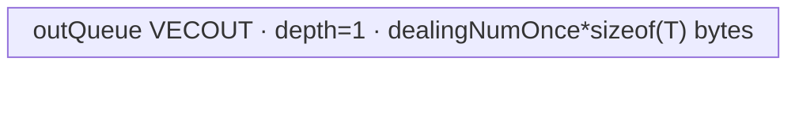
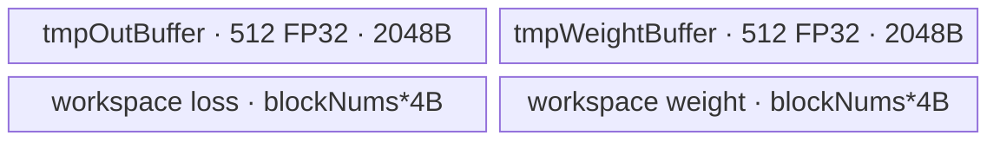

# NLLLoss2d 950 ACLNN 算子知识

## 算子速览

| 项目 | 内容 |
|---|---|
| 实际入口 | 公开两段式 API `aclnnNLLLoss2dGetWorkspaceSize` + `aclnnNLLLoss2d`，本仓未出现更高版本入口。 |
| 计算语义 | 对 `self[N,C,H,W]` 按 `target[N,H,W]` 选类：`loss_i=-weight[target_i]*self[n,target_i,h,w]`；`ignoreIndex` 项贡献 0；随后按 `none/sum/mean` 输出，其中 `mean=sum(loss)/sum(valid weight)`。 |
| 输入输出 | `self/weight/out/totalWeightOut` 为 FP32/FP16/BF16，`target` 为 INT32/INT64/UINT8，公开入口要求 `self` 4D、`target` 3D、`weight=[C]`；非连续 Tensor 经 executor 前处理。 |
| 执行类型 | 空输入为框架 `Fill/ViewCopy` 路线；非空路线是单个 `KERNEL_TYPE_MIX_AIV_1_0` 节点，外层 AIV Kernel 内调用 512-thread SIMT VF，无 AIC/Cube 或 `MIX_CV`。 |
| Kernel 路线 | R-001 API 空输入；R-002 4D `none` 的 SIMT→UB→GM；R-003 4D `sum` 的块内/跨核 FP32 归约；R-004 4D `mean` 的同型归约后除权重。低层 `schId=1` SIMD 与 `schId=2` empty 对该公开 950 入口不可达。 |
| 核心资源 | R-002 使用 depth=1 的 `VECOUT` Queue；R-003/R-004 每核两个 512×FP32 TBuf，并用 workspace 两个 FP32 core 数组；所有路线由同一 executor/stream 顺序提交。 |
| 来源闭包 | `source_closed`：公开声明/实现→950 `DAV_3510` 分支→`l0op::NLLLoss`→arch35 Tiling/POD→`nll_loss` router→`KernelNLLLossSimt` body→ascend950 binary/CMake 均已闭合；Contiguous/Cast/ViewCopy/executor 与 AscendC primitive 内部作为明确框架边界。 |
| 验证状态 | 已完成源码闭包检查；本次知识提取未执行编译、真机、数值或性能测试。 |

## 接口与语义

### 计算语义

令扁平输出索引 `i=n*H*W+h*W+w`，标签 `t_i=target[n,h,w]`。当 `t_i==ignoreIndex` 时，`l_i=0` 且权重贡献 `q_i=0`；否则 Kernel 先断言 `0<=t_i<C`，取 `q_i=weight[t_i]`，并计算 `l_i=-q_i*self[n,t_i,h,w]`。公开入口强制 `weight` 非空，因此低层的无权重分支在本入口中不活跃。

- `reduction=0/none`：`out[n,h,w]=l_i`；`totalWeightOut` 在文档中仅对非 `none` 有效，API 也不复制该输出。
- `reduction=2/sum`：`out[0]=Σ_i l_i`，`totalWeightOut[0]=Σ_i q_i`。
- `reduction=1/mean`：`out[0]=Σ_i l_i/Σ_i q_i`，`totalWeightOut[0]=Σ_i q_i`；分母为 0 时浮点除法产生的结果由 Device 浮点语义决定。

### 输入、输出与属性

| 参数 | shape/layout | dtype | 约束、默认值与语义 |
|---|---|---|---|
| `self` | 4D `[N,C,H,W]`，API 文档为 ND；可非连续 | FP32/FP16/BF16 | 950 由 `IsRegbase(DAV_3510)` 接受三种 dtype；不能为空指针。 |
| `target` | 3D `[N,H,W]`，可非连续 | INT32/INT64/UINT8 | shape 必须逐维匹配 `self` 的 N/H/W；非 ignore 标签由 Kernel `ASSERT` 检查 `[0,C)`。 |
| `weight` | 1D `[C]`，可非连续 | 与 `self` 相同 | 公开 API 的 `CheckNotNull` 强制非空；`weight[0]` 长度须等于 C。 |
| `reduction` | 标量属性 | INT64 | 仅 0/1/2，映射为 `none/mean/sum`；超范围返回 `ACLNN_ERR_PARAM_INVALID`。 |
| `ignoreIndex` | 标量属性 | INT64 | 与标签比较；默认值只属于低层 OpDef，公开 API 显式传入。 |
| `out` | `none` 时 `[N,H,W]`，否则 `Numel()==1`；可非连续 | 与 `self` 可转换，公开文档要求相同 | executor 尾部 `Cast` 后 `ViewCopy`。 |
| `totalWeightOut` | `Numel()==1`；可非连续 | 与 `self` 可转换，公开文档要求相同 | 仅 `reduction!=none` 时由 API 复制；空输入时写 0。 |
| `workspaceSize/executor` | Host 输出 | `uint64_t*` / `aclOpExecutor**` | 第一段返回完整 executor 工作区与所有节点。 |
| `workspace/executor/stream` | Device 地址、大小、执行器、流 | - | 第二段交给 `CommonOpExecutorRun`；调用者保持资源有效直至执行完成。 |

### 入口与版本

固定提交只定义 `aclnnNLLLoss2dGetWorkspaceSize/aclnnNLLLoss2d`，因此它是该提交 950 的最新公开版本。公开文档明确列出 Ascend 950PR/950DT；`common/inc/op_api/aclnn_util.h::IsRegbase` 将 `DAV_3510` 识别为 Regbase，入口据此保留 4D NCHW 形状直接调用 `l0op::NLLLoss`。`nll_loss_def.cpp`、ascend950 binary config 与两个 CMake 文件均只为 `ascend950` 接入本仓 Host/Tiling/Kernel。

本卡只描述 NLLLoss2d Forward；普通 `aclnnNLLLoss` 与 `aclnnNLLLoss2dBackward` 不是本逻辑算子的版本或 Route。

## Host/Launcher 执行流程

### 参数校验与前处理

`aclnnNLLLoss2dGetWorkspaceSize` 的实际顺序如下：

1. 创建 `aclOpExecutor`，依次检查五个 Tensor 指针、dtype、`reduction∈[0,2]`、4D/3D/weight/out/totalWeight shape；任一步失败立即返回。
2. 任一 `self/target/weight` 为空时进入 R-001：`none` 不添加写节点；`mean` 用 `FillScalar(out,NAN)`，`sum` 用 `FillScalar(out,0)`，两者再用 `FillScalar(totalWeightOut,0)`，然后返回 `workspaceSize=0`。
3. 非空 950：`promoteType=self.dtype`；`self`、`target`、`weight` 各自 `Contiguous`，并分别 `Cast` 到原 dtype。由于 `IsRegbase()==true`，跳过非 Regbase 路线中的 ReFormat、NCHW→NHWC Transpose 与二维 Reshape。
4. 调用 `l0op::NLLLoss(selfCast,targetCasted,weightCasted,reductionString,ignoreIndex)`；950 dtype 表令 `IsAiCoreSupport` 恒真，添加单个 AICore launcher 节点。
5. `loss` 经 `Cast(out.dtype)`、`ViewCopy(out)`；仅非 `none` 时，`totalWeight` 也经 `Cast(totalWeightOut.dtype)`、`ViewCopy`。
6. `GetWorkspaceSize` 固化节点及临时存储，第二段 `CommonOpExecutorRun` 在用户给定 stream 上执行；任一中间节点创建失败均返回 `ACLNN_ERR_INNER_NULLPTR`，launcher 添加失败向上表现为 null 输出。

### 参数、Workspace 与生命周期

Tiling 从平台取得 `U_platform` 与 `maxCoreNum=GetCoreNumAiv()`，设置 `U_available=U_platform-32 KiB`、`maxThread=2048`。4D 路线固定 `usedThread=min(2048,512)=512`，令 `M=N*H*W`、`coreNumSum=ceil(M/512)`、`blockDim=min(coreNumSum,maxCoreNum)`。

- R-002：`dealingNumOneCore=floor(M/blockDim)`，前 `frontCore=M mod blockDim` 个核多处理一个元素；`dealingNumOnce=U_available/sizeof(xType)`，其中源码的 `xType` 是 Host `ge::DataType` 对象而非 Device `T`，其 ABI 大小在固定仓不可见。无 operator-local reduction workspace。
- R-003/R-004：Tiling 预留 `16 MiB + 2*maxCoreNum*sizeof(float)`。Kernel 将它接收到的 workspace 起始处解释为 `tmpSum[blockDim]`，紧随其后为 `tmpWeight[blockDim]`；16 MiB 工具工作区的实际传参偏移由固定仓外运行时管理，不在本仓推断。
- executor 拥有连续化、Cast、NLLLoss 临时 Tensor 和 launcher 描述；调用者拥有公开输出、workspace 与 stream。所有节点在同一 executor/stream 中按构造顺序生效。

### 启动图与失败传播

```text
R-001 empty:
  Fill(out, NaN|0) -> ViewCopy(out) -> Fill(totalWeight,0) -> ViewCopy(totalWeight)
  # none: no fill node; workspaceSize=0

R-002/R-003/R-004 nonempty A5:
  Contiguous/Cast(self,target,weight)
    -> launcher NLLLoss(x,target,weight,y_tmp,totalWeight_tmp; reduction,ignoreIndex)
       entry nll_loss<schId=0,xDims=4,reduction>
    -> Cast/ViewCopy(y_tmp,out)
    -> [reduction!=none] Cast/ViewCopy(totalWeight_tmp,totalWeightOut)
```

唯一算子自有 Device 节点为 `NLLLossAiCore` 添加的 `nll_loss`。R-003/R-004 的 workspace 边在该节点内部是每核 partial sum/weight 的 GM 交接：各 block 写各自槽位，`SyncAll()` 后 block 0 读全部槽位归约；producer 失败则 executor 不会得到有效输出，后续 ViewCopy 也不会形成成功结果。R-002 无跨节点 operator-local workspace 边。

## Route 与参数设计

### 分核与资源计算

对公开 950 非空输入，`xDims=4` 使 Host 决策树总是选择 `Tiling4NLLLossSimt`，与 `N/H/W` 大小或 reduction 无关。`blockDim=min(ceil(M/512),maxCoreNum)`；每个 SIMT VF 固定 512 threads。

R-002 再按连续输出域分核：

```text
base = blockId < frontCore
     ? blockId*(floor(M/blockDim)+1)
     : frontCore + blockId*floor(M/blockDim)
count = floor(M/blockDim) + (blockId < frontCore)
loopTimes = count / dealingNumOnce
tail = count % dealingNumOnce
```

R-003/R-004 每线程从 `blockId*512+threadIdx` 起，以 `blockDim*512` 为步长遍历 M；512 个线程先在两个 FP32 TBuf 中树归约，再由 block 0 对 `blockDim` 个 GM partial 做第二次树归约。

### Route 选择

| 顺序 | Route | Key/模板 | 精确选择条件与优先级 | 不适用去向 |
|---:|---|---|---|---|
| 1 | R-001 API 空输入 | 无 NLLLoss key；executor Fill/ViewCopy | `self->IsEmpty() \|\| target->IsEmpty() \|\| weight->IsEmpty()` | 非空进入下一项。 |
| 2 | R-002 4D none | `GET_TPL_TILING_KEY(0,4,0)` | 非空、950 Regbase、`reduction==0`；`xDims==4` 令 selector 选择 SIMT | 其它 reduction 进入下一项。 |
| 3 | R-003 4D sum | `GET_TPL_TILING_KEY(0,4,2)` | 非空、950 Regbase、`reduction==2` | `reduction==1` 进入下一项。 |
| 4 | R-004 4D mean | `GET_TPL_TILING_KEY(0,4,1)` | 非空、950 Regbase、`reduction==1` | API 已拒绝其它值。 |

```text
if null/dtype/reduction/shape invalid: fail
else if any input empty: R-001
else if DAV_3510/Regbase:
  keep 4D -> l0op::NLLLoss -> IsAiCoreSupport=true
  Tiling: xDims==4 -> schId=0
  if reduction==none: R-002
  else if reduction==sum: R-003
  else: R-004
```

### 模板/实现执行矩阵

| Route | key/selector | dtype/shape/platform 完整命中条件 | 执行拓扑与 Kernel 节点 | 实际模板/body | 内存与同步特征 | tail/fallback |
|---|---|---|---|---|---|---|
| R-001 API 空输入 | API `IsEmpty` | 任一输入空，shape/dtype 已通过，950 | 框架 Fill/ViewCopy；无 NLLLoss Device 节点 | `NLLLossEmptyTensorCompute`/`FillScalar` | `workspaceSize=0`；executor 保证节点顺序 | none 不写；mean 写 NaN/0；sum 写 0/0；失败返回。 |
| R-002 4D none | `(schId,xDims,reduction)=(0,4,0)` | 非空 950；T∈FP32/FP16/BF16，U∈INT32/INT64/UINT8 | 单 `nll_loss` 节点，AIV outer + SIMT VF | `KernelNLLLossSimt<T,U,0,4,0>::DealingRedutionNoneFor4d` | depth=1 VECOUT Queue；每 tile `EnQue→DeQue→DataCopyPad` | 每核元素余数单独调用 VF；搬运只提交有效字节。 |
| R-003 4D sum | `(0,4,2)` | 同上且 reduction=sum | 单节点；块内 UB reduction→GM partial→跨核 reduction | `KernelNLLLossSimt<T,U,0,4,2>::Process` | 两个 2048B TBuf；`SyncAll`；两个 workspace 数组 | 线程 grid-stride 自带 M 上界；最终对非 2 次幂 block 数先折叠到最大 2 次幂。 |
| R-004 4D mean | `(0,4,1)` | 同上且 reduction=mean | 与 R-003 同拓扑，末尾除 `tmpWeight` | `KernelNLLLossSimt<T,U,0,4,1>::Process` | 同 R-003；FP32 累加，末尾按 T 转换 | 分母为 0 未显式拦截；浮点结果由除法语义产生。 |

### 隐藏性能 Guard

| Guard | Host/Tiling 条件 | Device/资源原因 | 影响 Route | 不满足时去向 | 源码符号 |
|---|---|---|---|---|---|
| 950 直通 4D | `IsRegbase()==true`，即 `NpuArch::DAV_3510` | 避免非 Regbase 的 Transpose/Reshape，低层 Kernel 原生寻址 NCHW | R-002~R-004 | 非 Regbase 进入外部组合路径，本卡不发布该实现 | `AclnnUtil::IsRegbase`; `aclnnNLLLoss2dGetWorkspaceSize` |
| SIMT route | `xDims==4` 是 selector OR 条件之一 | 4D body按 N/H/W 解码稀疏类地址 | R-002~R-004 | 对本 API 无下一 Kernel Route | `Tiling4NLLLossAC` |
| 线程与核数 | `usedThread=min(maxThread,512)`；`blockDim=min(ceil(M/512),maxCoreNum)` | 每个 VF 固定 `LAUNCH_BOUND(512)`，跨核数组按 block 数 | R-002~R-004 | 平台 `maxCoreNum<=0` 时 TilingPrepare 失败 | `Tiling4NLLLossSimt`; `TilingPrepareForNLLLoss` |
| R-002 UB 上界 | `dealingNumOnce=U_available/sizeof(xType)` | Queue 实际字节为 `dealingNumOnce*sizeof(T)` | R-002 | 无 fallback；需满足该分配不超过 LocalMemory，Host enum ABI 固定仓不可见 | `Tiling4NLLLossSimt`; `KernelNLLLossSimt::Init` |
| reduction workspace | `reduction∈{sum,mean}` | 每核产生 loss 与 weight 两个 FP32 partial | R-003/R-004 | none 不分配/读取该 operator-local slice | `Tiling4NLLLossAC`; `KernelNLLLossSimt::Init` |
| target 合法域 | `targetIndex!=ignoreIndex` 后 `ASSERT(0<=targetIndex<C)` | 防止 weight/x 越界寻址 | R-002~R-004 | Device 断言，无数值 fallback | `TargetCheck` |
| 空域 | API 先检查任一输入 `IsEmpty` | 避免 `coreNum=0` 与无元素 Kernel；按 reduction 定义空输出 | R-001 | Fill/ViewCopy 失败返回内部错误 | `NLLLossEmptyTensorCompute` |

### POD/ABI

`NLLLossACTilingData` 由 `BEGIN_TILING_DATA_DEF` 宏生成。固定仓给出字段顺序和源码类型，但宏展开后的 `sizeof/alignof/offsetof` 依赖外部 Host ABI，故逐项明确为“固定仓不可见”，不猜测 padding。

| 结构 | 字段 | 类型/位宽 | ABI 布局 | 单位 | Host/launcher producer | Device consumer | 边界 |
|---|---|---|---|---|---|---|---|
| `NLLLossACTilingData` | `ignoreIndex` | `int64_t`/64 | 宏展开 offset/总布局固定仓不可见 | 标签值 | `*attrs->GetAttrPointer<int64_t>(1)` | 各 4D SIMT helper 与标签比较 | 任意 int64；等于标签即忽略。 |
| 同上 | `xDims` | `int64_t`/64 | 同上 | 维数 | `xShape.GetDimNum()`，本入口为 4 | `Init` 保存；模板 `xDims=4` 决定编译分支 | 公开入口仅 4。 |
| 同上 | `reduction` | `uint32_t`/32 | 同上 | 枚举 0/1/2 | 字符串 `none/mean/sum` 映射 | `Init` 保存；实际分支为模板参数 | 其它字符串 Tiling 失败。 |
| 同上 | `xDimN` | `int64_t`/64 | 同上 | 元素维 | `xShape.GetDim(0)` | 4D helper 计算 M 与地址 | API 与 target[0] 相等。 |
| 同上 | `xDimC` | `uint32_t`/32 | 同上 | 类别数 | `xShape.GetDim(1)` 窄化写入 | target guard、NCHW 地址 | int64 shape→uint32 窄化未显式检查。 |
| 同上 | `xDimH` | `int64_t`/64 | 同上 | 元素维 | `xShape.GetDim(2)` | `productOfNHW/CHW/HW` | API 与 target[1] 相等。 |
| 同上 | `xDimW` | `int64_t`/64 | 同上 | 元素维 | `xShape.GetDim(3)` | `productOfNHW/CHW/HW` | API 与 target[2] 相等。 |
| 同上 | `coreNum` | `uint32_t`/32 | 同上 | AIV block 数 | `min(ceil(M/512),maxCoreNum)` | R-002 分块；block 数也由 `GetBlockNum()` 获取 | 非空 M 保证至少 1，前提 maxCoreNum>0。 |
| 同上 | `isWeightPresent` | `uint32_t`/32 | 同上 | 布尔 | optional shape 非空则 1；公开 API 恒为 1 | 所有 helper 选择 weight 或 1 | 公共低层支持 0，本入口不可达。 |
| 同上 | `coreLoopCnt` | `uint32_t`/32 | 同上 | 次数 | 参数默认 0，SIMT Tiling 未改写 | `Init` 读取但 4D可达 body 不消费 | inactive。 |
| 同上 | `calNumInterBlock` | `int32_t`/32 | 同上 | core 数 | `LargestPowerOfTwo(coreNum)` | R-003/R-004 跨核树归约 | R-002 inactive。 |
| 同上 | `mainReduceSize` | `int64_t`/64 | 同上 | 元素 | 参数默认 1；仅 SIMD Tiling 改写为 256 | 仅不可达 MIX body | 950 NLLLoss2d SIMT inactive。 |
| 同上 | `usedLogicCore` | `uint32_t`/32 | 同上 | 逻辑块数 | 参数默认 1；仅 SIMD Tiling改写 | 仅不可达 MIX body | inactive。 |
| 同上 | `loopInCore` | `int32_t`/32 | 同上 | 循环数 | 参数默认 1；仅 SIMD Tiling改写 | 仅不可达 MIX body | inactive。 |
| 同上 | `fullIndex` | `int32_t`/32 | 同上 | core/分界索引 | SIMT 写 `coreNumSum%coreNum` | `Init` 读取，4D可达 body不消费 | inactive。 |
| 同上 | `tailSize` | `int32_t`/32 | 同上 | 元素 | 参数默认 0；仅 SIMD Tiling改写 | 仅不可达 MIX body | inactive。 |
| 同上 | `padSize` | `int32_t`/32 | 同上 | FP32 元素 | 参数默认 0；仅 SIMD Tiling改写 | 仅不可达 MIX body | inactive。 |
| 同上 | `loopNum1` | `int32_t`/32 | 同上 | 次数 | 参数默认 1；仅 SIMD Tiling改写 | 仅不可达 MIX body | inactive。 |
| 同上 | `tailNum1` | `int32_t`/32 | 同上 | 次数 | 参数默认 0；仅 SIMD Tiling改写 | 仅不可达 MIX body | inactive。 |
| 同上 | `tailMoveSize` | `int32_t`/32 | 同上 | 元素 | 参数默认 1；仅 SIMD Tiling改写 | 仅不可达 MIX body | inactive。 |
| 同上 | `tailMainReduceSize` | `int32_t`/32 | 同上 | 元素 | 参数默认 1；仅 SIMD Tiling改写 | 仅不可达 MIX body | inactive。 |
| 同上 | `tailRemainSize` | `int32_t`/32 | 同上 | 元素 | 参数默认 1；仅 SIMD Tiling改写 | 仅不可达 MIX body | inactive。 |
| 同上 | `loopNum3` | `int32_t`/32 | 同上 | 次数 | 参数默认 1；仅 SIMD Tiling改写 | 仅不可达 MIX body | inactive。 |
| 同上 | `tailNum3` | `int32_t`/32 | 同上 | 次数 | 参数默认 0；仅 SIMD Tiling改写 | 仅不可达 MIX body | inactive。 |
| 同上 | `dealingNumOneCore` | `int64_t`/64 | 同上 | 输出元素 | `floor(M/coreNum)` | R-002 每核 count/base | R-003/R-004 inactive。 |
| 同上 | `frontCore` | `int32_t`/32 | 同上 | core 数 | `M%coreNum` 从 int64 窄化 | R-002 判断多一个元素的前部核 | 无显式窄化检查。 |
| 同上 | `dealingNumOnce` | `int64_t`/64 | 同上 | 输出元素/tile | `U_available/sizeof(xType)` | R-002 Queue 容量、循环与尾块 | `sizeof(xType)` 的 enum ABI 固定仓不可见。 |

### Route 源码闭包

| Route | Key/selector | Host/Tiling producer | POD/参数 | Kernel entry/router 节点 | Kernel body/直接依赖 | 构建接线 |
|---|---|---|---|---|---|---|
| R-001 API 空输入 | `IsEmpty`，无 key | `op_api/aclnn_nll_loss2d.cpp::NLLLossEmptyTensorCompute` | Fill 值与 executor，无 POD | 无 NLLLoss entry | `FillScalar`；Fill/ViewCopy 是框架边界 | 公开 ACLNN 实现随模块接入。 |
| R-002 4D none | `(0,4,0)` | `Tiling4NLLLossAC`→`Tiling4NLLLossSimt` | `NLLLossACTilingData` 的 shape/core/tile 字段 | `op_kernel/nll_loss.cpp::nll_loss<0,4,0>` | `KernelNLLLossSimt::Init/DealingRedutionNoneFor4d/SimtComputeNLLLoss4dNone/SimdDataCopyOutFor4d` | ascend950 CMake + binary config 的 weight/type/none 项。 |
| R-003 4D sum | `(0,4,2)` | 同上 | shape/core/workspace/calNumInterBlock | `nll_loss<0,4,2>` | `SimtComputeNLLLoss4dSum`→`SimtComputeBinaryReduction`→`CalBinaryReductionInterBlock` | ascend950 CMake + binary config sum 项。 |
| R-004 4D mean | `(0,4,1)` | 同上 | 同 R-003 | `nll_loss<0,4,1>` | `SimtComputeNLLLoss4dMean`→两级 reduction→最终除法/cast | ascend950 CMake + binary config mean 项。 |

## Kernel 实现

### 公共执行流程

非空路线均由 `NLLLossAiCore` 添加一个 Kernel 节点。`nll_loss<schId,xDims,reduction>` 解 POD，声明 `KERNEL_TYPE_MIX_AIV_1_0`；可达 `schId=0` 实例化 `KernelNLLLossSimt<DTYPE_X,DTYPE_TARGET,0,4,reduction>`。类绑定 x/target/weight/y/totalWeight GM，计算 `M=N*H*W`、`CHW=C*H*W`、`HW=H*W`，再由 reduction 编译期分支运行。外层 AIV block 中的 `asc_vf_call(...dim3{512}...)` 提供 SIMT 线程映射；没有 Cube 指令或 AIC task。

### Route R-001：API 空输入

#### 适用条件

##### 选择证据

| 层级 | 文件 | 符号 | 源码谓词/参数 | 结果/下一跳 |
|---|---|---|---|---|
| API | `loss/nll_loss/op_api/aclnn_nll_loss2d.cpp` | `aclnnNLLLoss2dGetWorkspaceSize` | `self->IsEmpty() \|\| target->IsEmpty() \|\| weight->IsEmpty()` | `NLLLossEmptyTensorCompute`，返回 workspace 0。 |
| API | 同上 | `NLLLossEmptyTensorCompute` | reduction 0/1/2 | none 返回；mean Fill NaN；sum Fill 0；后两者 Fill totalWeight 0。 |

#### Device 数据流

##### 函数级调用链

```text
aclnnNLLLoss2dGetWorkspaceSize
  -> NLLLossEmptyTensorCompute
    -> [mean|sum] FillScalar(out, NaN|0)
      -> l0op::Fill -> l0op::ViewCopy
    -> [mean|sum] FillScalar(totalWeightOut, 0)
      -> l0op::Fill -> l0op::ViewCopy
  -> workspaceSize=0
```

##### 源码等价伪码

```text
# 伪码
if reduction == none: return success
if reduction == mean: enqueue Fill(out, NaN)
else: enqueue Fill(out, 0)
enqueue Fill(totalWeightOut, 0)
on any null intermediate: return error
```

#### 内存与数据搬运

##### 资源与搬运表

| 层级/缓冲区 | offset/地址公式 | extent/容量公式 | dtype/layout | producer | consumer | owner/lifetime | 对齐/复用 |
|---|---|---|---|---|---|---|---|
| scalar executor Tensor | 0 | 1 element | 输出 dtype/ND | `ConvertToTensor`/`Fill` | `ViewCopy` | executor 至运行完成 | 框架管理，固定仓不可见。 |
| `out`/`totalWeightOut` GM | element 0 | 1 element（none 的 out 可为空） | 用户输出 dtype/layout | `ViewCopy` | 调用者 | 调用者拥有 | 非连续写由框架处理。 |

##### 分层内存布局

N/A：该 Route 不启动算子自有 AIV Kernel；Fill/ViewCopy 的内部 UB 布局属于固定仓外框架实现。

##### 字节账与复用顺序

```text
operator-owned UB_total = N/A
operator-owned dynamic_ub = N/A
workspace_total = 0
```

| 复用子区 | 写入者 | 读取者/消费点 | 下一次覆盖 | 同步或释放依据 | 安全条件 |
|---|---|---|---|---|---|
| executor scalar Tensor | Fill | ViewCopy | executor 后续节点/释放 | executor 同 stream 顺序 | Fill 成功后才加入 ViewCopy。 |

#### 同步、精度与尾块

##### 同步与数值边界表

| 阶段 | primitive/机制 | producer | consumer/等待点 | 保护对象 | 精度/尾块 |
|---|---|---|---|---|---|
| empty output | executor 节点顺序 | Fill | ViewCopy | scalar 临时 Tensor | mean 是 `NAN` 转输出 dtype；sum/totalWeight 是 0；none 无写入。 |

#### 关键实现

##### 符号证据表

| 阶段 | 文件 | 符号/模板实例 | 实现事实 |
|---|---|---|---|
| Host/Tiling producer | `loss/nll_loss/op_api/aclnn_nll_loss2d.cpp` | `NLLLossEmptyTensorCompute` | reduction 决定空输入写值。 |
| Kernel entry/router | 同上 | `FillScalar` | 仅添加框架 Fill/ViewCopy，无 `nll_loss` entry。 |
| Device body/helper | 固定仓不可见 | framework Fill/ViewCopy | 内部 Kernel/UB 不在固定仓；这里只把它作为框架边界。 |

### Route R-002：4D none 直出

#### 适用条件

##### 选择证据

| 层级 | 文件 | 符号 | 源码谓词/参数 | 结果/下一跳 |
|---|---|---|---|---|
| API | `loss/nll_loss/op_api/aclnn_nll_loss2d.cpp` | `aclnnNLLLoss2dGetWorkspaceSize` | 非空且 `IsRegbase()` | 4D Tensor 直接传低层 NLLLoss。 |
| Tiling | `loss/nll_loss/op_host/arch35/nll_loss_tiling_arch35.cpp` | `Tiling4NLLLossAC` | `xDims==4`，reduction=0 | `Tiling4NLLLossSimt`，key `(0,4,0)`。 |
| Router | `loss/nll_loss/op_kernel/nll_loss.cpp` | `nll_loss<0,4,0>` | `schId==0` | `KernelNLLLossSimt<T,U,0,4,0>`。 |

#### Device 数据流

##### 函数级调用链

```text
NLLLossAiCore -> nll_loss<0,4,0>(x,target,weight,y,totalWeight,workspace,tiling)
  -> KernelNLLLossSimt::Init
    -> InitBuffer(outQueue, depth=1, dealingNumOnce*sizeof(T))
  -> Process
    -> DealingRedutionNoneFor4d
      -> AllocTensor(outUb)
      -> asc_vf_call<SimtComputeNLLLoss4dNone<U,T>>(512 threads)
      -> EnQue(outUb)
      -> SimdDataCopyOutFor4d -> DeQue -> DataCopyPad -> FreeTensor
```

##### 源码等价伪码

```text
# 伪码
M=N*H*W; HW=H*W; CHW=C*HW
count=floor(M/coreNum)+(blockId<frontCore)
base=(blockId<frontCore) ? blockId*(floor(M/coreNum)+1)
                         : frontCore+blockId*floor(M/coreNum)
for each full tile [base+i*tile, tile=dealingNumOnce]:
  parallel_for lane=threadIdx; lane<tile; lane+=512:
    index=offset+lane; label=target[index]
    if label==ignoreIndex: outUb[lane]=0
    else: assert 0<=label<C
          n=index/HW; rem=index%HW
          outUb[lane]=-float(weight[label])*float(x[n*CHW+label*HW+rem]) cast T
  queue_commit(outUb)
  copy exactly tile*sizeof(T) bytes UB->y[offset]
repeat for tail=count%tile when nonzero
```

#### 内存与数据搬运

##### 资源与搬运表

| 层级/缓冲区 | offset/地址公式 | extent/容量公式 | dtype/layout | producer | consumer | owner/lifetime | 对齐/复用 |
|---|---|---|---|---|---|---|---|
| x GM | `n*CHW+label*HW+rem` | N*C*H*W | T/NCHW | caller/Contiguous | SIMT lane | caller/executor | 稀疏 gather。 |
| target GM | `index` | M | U/NHW | caller/Contiguous | SIMT lane | caller/executor | 连续读取。 |
| weight GM | `label` | C | T/C | caller/Contiguous | SIMT lane | caller/executor | 随标签 gather。 |
| `outQueue` UB | 0 | `dealingNumOnce*sizeof(T)`，depth=1 | T/contiguous tile | SIMT VF | DataCopyPad | Kernel 每 tile Alloc→Free | 同一物理 Queue 跨 tile 复用。 |
| y GM | `base+tileOffset` | 当前有效 tile/tail | T/NHW | DataCopyPad | API Cast/ViewCopy | executor→用户输出 | `blockCount=1, blockLen=valid*sizeof(T), stride=0`。 |

##### 分层内存布局



##### 字节账与复用顺序

```text
U_available = U_platform - 32 KiB
dealingNumOnce = floor(U_available / sizeof(Host xType object))
UB_total = dealingNumOnce * sizeof(T)
UB_total <= U_available requires sizeof(T) <= sizeof(Host xType object)
dynamic_ub = N/A（由 SetLocalMemorySize(U_available) 配置本地内存）
operator-local workspace = 0；Tiling 总 workspace 仍含 16 MiB AscendC tools 保留区
```

| 复用子区 | 写入者 | 读取者/消费点 | 下一次覆盖 | 同步或释放依据 | 安全条件 |
|---|---|---|---|---|---|
| `outQueue` 唯一槽 | `SimtComputeNLLLoss4dNone` | `SimdDataCopyOutFor4d` | 下一 tile `AllocTensor` | `EnQue→DeQue→FreeTensor` | 必须完成当前有效字节 CopyOut 后再复用。 |

#### 同步、精度与尾块

##### 同步与数值边界表

| 阶段 | primitive/机制 | producer | consumer/等待点 | 保护对象 | 精度/尾块 |
|---|---|---|---|---|---|
| SIMT tile | VF 完成 + Queue `EnQue/DeQue` | 512 lanes | DataCopyPad | outUb tile | lane 循环保护 `i<dealingNum`；ignore 写精确 0。 |
| multiply | C++ float cast | x/weight T | outUb T | 单个输出 | 两乘数升到 FP32，乘积取负后降为 T；固定仓未显式给 round mode。 |
| CopyOut | `DataCopyPad` | outUb | y GM | 有效 tile/tail | `blockLen=valid*sizeof(T)`，不写 Queue padding。 |

#### 关键实现

##### 符号证据表

| 阶段 | 文件 | 符号/模板实例 | 实现事实 |
|---|---|---|---|
| Host/Tiling producer | `loss/nll_loss/op_host/arch35/nll_loss_tiling_arch35.cpp` | `Tiling4NLLLossSimt` | 512-thread 核数、均匀分核、UB tile 字段。 |
| Kernel entry/router | `loss/nll_loss/op_kernel/nll_loss.cpp` | `nll_loss<0,4,0>` | key 到 SIMT class。 |
| Device body/helper | `loss/nll_loss/op_kernel/arch35/nll_loss_simt.h` | `DealingRedutionNoneFor4d`; `SimtComputeNLLLoss4dNone`; `SimdDataCopyOutFor4d` | NCHW gather、Queue 生命周期、有效字节 tail。 |

### Route R-003：4D sum 两级归约

#### 适用条件

##### 选择证据

| 层级 | 文件 | 符号 | 源码谓词/参数 | 结果/下一跳 |
|---|---|---|---|---|
| API | `loss/nll_loss/op_api/aclnn_nll_loss2d.cpp` | `GetReductionStr` | reduction=2 | 属性字符串 `sum`。 |
| Tiling | `loss/nll_loss/op_host/arch35/nll_loss_tiling_arch35.cpp` | `Tiling4NLLLossAC` | 4D 非空 | key `(0,4,2)`，workspace 增加 `2*maxCoreNum*4`。 |
| Router | `loss/nll_loss/op_kernel/nll_loss.cpp` | `nll_loss<0,4,2>` | `schId==0` | `KernelNLLLossSimt<T,U,0,4,2>`。 |

#### Device 数据流

##### 函数级调用链

```text
NLLLossAiCore -> nll_loss<0,4,2>
  -> KernelNLLLossSimt::Init
    -> tmpSumGm=workspace[0:blockNums]
    -> tmpWeightGm=workspace[blockNums:2*blockNums]
    -> InitBuffer(tmpOutBuffer,512*4); InitBuffer(tmpWeightBuffer,512*4)
  -> Process
    -> Duplicate both TBuf to 0
    -> asc_vf_call<SimtComputeNLLLoss4dSum>(512)
      -> grid-stride gather/FP32 accumulate
      -> SimtComputeBinaryReduction + thread0 writes two GM partials
    -> SyncAll
    -> block0 asc_vf_call<CalBinaryReductionInterBlock>
      -> non-power-of-two fold + binary tree + cast/write outputs
```

##### 源码等价伪码

```text
# 伪码
tmpOut[0:512]=0; tmpWeight[0:512]=0
for i=blockId*512+threadIdx; i<M; i+=blockNums*512:
  label=target[i]
  if label!=ignoreIndex:
    assert 0<=label<C
    n=i/HW; rem=i%HW; w=weight[label]
    tmpOut[threadIdx] += -float(w)*float(x[n*CHW+label*HW+rem])
    tmpWeight[threadIdx] += float(w)
barrier; binary_reduce_512(tmpOut,tmpWeight)
thread0: workspace.loss[blockId]=tmpOut[0]; workspace.weight[blockId]=tmpWeight[0]
cross_core SyncAll
if blockId==0:
  p=largest_power_of_two(blockNums)
  fold entries [p,blockNums) into [0,blockNums-p)
  binary_reduce_p(workspace.loss,workspace.weight)
  out=cast_T(workspace.loss[0]); totalWeight=cast_T(workspace.weight[0])
```

#### 内存与数据搬运

##### 资源与搬运表

| 层级/缓冲区 | offset/地址公式 | extent/容量公式 | dtype/layout | producer | consumer | owner/lifetime | 对齐/复用 |
|---|---|---|---|---|---|---|---|
| x/target/weight GM | 同 R-002 | 完整输入 | T/U/NCHW,NHW,C | executor | SIMT lanes | caller/executor | grid-stride gather。 |
| `tmpOutBuffer_` UB | 0 | 512×4=2048B | FP32/thread slots | lanes | block reduction | Kernel 整次 Process | 每线程槽跨 grid-stride 迭代原地累加。 |
| `tmpWeightBuffer_` UB | 独立 TBuf | 512×4=2048B | FP32/thread slots | lanes | block reduction | Kernel 整次 Process | 同上。 |
| `tmpSumGm_` workspace | `workspace + 0` | `blockNums*4` bytes | FP32/core | each block thread0 | block0 inter-block VF | executor workspace | `SyncAll` 前不可读。 |
| `tmpWeightGm_` workspace | `workspace + blockNums*sizeof(float)` | `blockNums*4` bytes | FP32/core | each block thread0 | block0 inter-block VF | executor workspace | 与 loss slice 相邻。 |
| y/totalWeight GM | element 0 | each 1×sizeof(T) | T/scalar | block0 thread0 | API ViewCopy | executor→caller | FP16/BF16 使用 CAST_EVEN。 |

##### 分层内存布局



##### 字节账与复用顺序

```text
UB_total = 512*4 + 512*4 = 4096 bytes per AIV block
UB_total <= U_platform-32 KiB requires U_platform >= 36 KiB
dynamic_ub = N/A（SIMT VF 使用上述静态 TBuf）
operator-visible workspace = 2*blockNums*4 bytes
Tiling reservation = 16 MiB + 2*maxCoreNum*4 bytes
```

| 复用子区 | 写入者 | 读取者/消费点 | 下一次覆盖 | 同步或释放依据 | 安全条件 |
|---|---|---|---|---|---|
| `tmpOut[threadIdx]` | 当前 lane 的 grid-stride 循环 | 块内 binary reduction | reduction 原地覆盖低半区 | `asc_syncthreads` 每层 | 所有 lane 累加结束后开始树归约。 |
| `tmpWeight[threadIdx]` | 同上 | 同上 | 同上 | 同一 barrier 图 | 与 loss 数组保持同层归约。 |
| workspace 两数组 | 每 block thread0 | block0 inter-block VF | 树归约原地覆盖低索引 | `SyncAll` | 所有核已提交 partial。 |

#### 同步、精度与尾块

##### 同步与数值边界表

| 阶段 | primitive/机制 | producer | consumer/等待点 | 保护对象 | 精度/尾块 |
|---|---|---|---|---|---|
| lane→block | `asc_syncthreads` | 512 lane slots | 每级 half reduction | 两个 UB TBuf | grid-stride `i<M` 处理尾元素；空 lane 保持 0。 |
| block→global | `SyncAll` | 各 block thread0 | block0 VF | workspace partials | `LargestPowerOfTwo` 先折叠超出 2 次幂的核。 |
| final write | `Simt::Cast<bfloat16_t,float,RoundMode::CAST_EVEN>` / `Simt::Cast<half,float,RoundMode::CAST_EVEN>` 或 FP32 直写 | workspace FP32 sum | y/totalWeight | 两个 scalar | FP16/BF16 最终一次偶数舍入。 |

#### 关键实现

##### 符号证据表

| 阶段 | 文件 | 符号/模板实例 | 实现事实 |
|---|---|---|---|
| Host/Tiling producer | `loss/nll_loss/op_host/arch35/nll_loss_tiling_arch35.cpp` | `Tiling4NLLLossSimt`; `LargestPowerOfTwo` | blockDim 与跨核树参数。 |
| Kernel entry/router | `loss/nll_loss/op_kernel/nll_loss.cpp` | `nll_loss<0,4,2>` | sum 实例。 |
| Device body/helper | `loss/nll_loss/op_kernel/arch35/nll_loss_simt.h` | `SimtComputeNLLLoss4dSum`; `SimtComputeBinaryReduction`; `CalBinaryReductionInterBlock` | FP32 两级归约、同步与最终 cast。 |

### Route R-004：4D mean 两级归约

#### 适用条件

##### 选择证据

| 层级 | 文件 | 符号 | 源码谓词/参数 | 结果/下一跳 |
|---|---|---|---|---|
| API | `loss/nll_loss/op_api/aclnn_nll_loss2d.cpp` | `GetReductionStr` | reduction=1 | 属性字符串 `mean`。 |
| Tiling | `loss/nll_loss/op_host/arch35/nll_loss_tiling_arch35.cpp` | `Tiling4NLLLossAC` | 4D 非空 | key `(0,4,1)` 与 reduction workspace。 |
| Router | `loss/nll_loss/op_kernel/nll_loss.cpp` | `nll_loss<0,4,1>` | `schId==0` | `KernelNLLLossSimt<T,U,0,4,1>`。 |

#### Device 数据流

##### 函数级调用链

```text
NLLLossAiCore -> nll_loss<0,4,1>
  -> KernelNLLLossSimt::Init (same two TBuf + two workspace slices as R-003)
  -> Process
    -> asc_vf_call<SimtComputeNLLLoss4dMean>
      -> per-lane FP32 loss/weight -> block binary reduction -> GM partial
    -> SyncAll
    -> block0 asc_vf_call<CalBinaryReductionInterBlock<U,T,1>>
      -> global loss/global weight -> division -> CAST_EVEN or FP32 write
```

##### 源码等价伪码

```text
# 伪码；遍历、地址和两级树与 R-003 相同
globalLoss, globalWeight = two_level_fp32_reduce(valid samples)
if T is BF16: out=cast_even_bf16(globalLoss/globalWeight)
else if T is FP16: out=cast_even_fp16(globalLoss/globalWeight)
else: out=globalLoss/globalWeight
totalWeight=cast_even_or_fp32(globalWeight)
```

#### 内存与数据搬运

##### 资源与搬运表

| 层级/缓冲区 | offset/地址公式 | extent/容量公式 | dtype/layout | producer | consumer | owner/lifetime | 对齐/复用 |
|---|---|---|---|---|---|---|---|
| x/target/weight GM | 同 R-002 | 完整输入 | T/U/NCHW,NHW,C | executor | SIMT lanes | caller/executor | label gather。 |
| two UB TBuf | 各 0 | 各 512×FP32 | FP32/thread | lanes | block reduction | Kernel | 与 R-003 相同。 |
| two workspace slices | 0 与 `blockNums*4` | 各 `blockNums*4` | FP32/core | block partial | block0 | executor workspace | `SyncAll` 后归约。 |
| y/totalWeight | 0 | 各 1×T | T/scalar | block0 | API ViewCopy | executor→caller | y 在 FP32 除法后降精度。 |

##### 分层内存布局


##### 字节账与复用顺序

```text
UB_total = 4096 bytes per AIV block
UB_total <= U_platform-32 KiB requires U_platform >= 36 KiB
operator-visible workspace = 2*blockNums*4 bytes
Tiling reservation = 16 MiB + 2*maxCoreNum*4 bytes
```

| 复用子区 | 写入者 | 读取者/消费点 | 下一次覆盖 | 同步或释放依据 | 安全条件 |
|---|---|---|---|---|---|
| 两个 UB lane 数组 | lane grid-stride 累加 | 块内树 | 每层低半区原地覆盖 | `asc_syncthreads` | 同 R-003。 |
| 两个 GM partial 数组 | block thread0 | block0 树 | 低索引原地覆盖 | `SyncAll` + VF barriers | 同 R-003。 |

#### 同步、精度与尾块

##### 同步与数值边界表

| 阶段 | primitive/机制 | producer | consumer/等待点 | 保护对象 | 精度/尾块 |
|---|---|---|---|---|---|
| sample accumulation | FP32 lane slots | valid samples | block tree | loss/weight | ignore 不参与；grid-stride `i<M`。 |
| two reductions | `asc_syncthreads` + `SyncAll` | lanes/blocks | next level | UB/GM partial | 相加顺序由固定二叉树决定。 |
| normalize | FP32 division | globalLoss/globalWeight | cast/write | scalar y | 无显式 zero-denominator guard；FP16/BF16 CAST_EVEN。 |

#### 关键实现

##### 符号证据表

| 阶段 | 文件 | 符号/模板实例 | 实现事实 |
|---|---|---|---|
| Host/Tiling producer | `loss/nll_loss/op_host/arch35/nll_loss_tiling_arch35.cpp` | `Tiling4NLLLossAC` | mean key、workspace。 |
| Kernel entry/router | `loss/nll_loss/op_kernel/nll_loss.cpp` | `nll_loss<0,4,1>` | mean 实例。 |
| Device body/helper | `loss/nll_loss/op_kernel/arch35/nll_loss_simt.h` | `SimtComputeNLLLoss4dMean`; `CalBinaryReductionInterBlock` | FP32 loss/weight 两级归约与除法。 |

## 算子特定优化

### Trick T-001：950 原生 4D NCHW gather 跳过物理转置

#### 触发与源码依据

- 适用 Route：R-002、R-003、R-004
- 触发条件：`IsRegbase()==true`（固定仓定义为 `DAV_3510`）且输入非空。
- Golden 来源：[`loss/nll_loss/op_api/aclnn_nll_loss2d.cpp:343-355`](../../../../../../../cann-ops-raw/ascendc/ops-nn/955f8b33985b6d72989ebff341bb9c2c564a51bc/loss/nll_loss/op_api/aclnn_nll_loss2d.cpp#L343-L355)

**官方源码（固定 Commit 连续逐字摘录）**：

```cpp
    } else {
        targetPromoteType = target->GetDataType();
        auto targetCasted = l0op::Cast(targetContiguous, targetPromoteType, uniqueExecutor.get());
        CHECK_RET(targetCasted != nullptr, ACLNN_ERR_INNER_NULLPTR);

        std::array<const aclTensor*, 2> lossOut = l0op::NLLLoss(
            selfCast, targetCasted, weightCasted, GetReductionStr(reduction), ignoreIndex, uniqueExecutor.get());
        CHECK_RET(lossOut[0] != nullptr, ACLNN_ERR_INNER_NULLPTR);
        CHECK_RET(lossOut[1] != nullptr, ACLNN_ERR_INNER_NULLPTR);

        loss = lossOut[0];
        totalWeight = lossOut[1];
    }
```

#### 机制与设计原因

入口第 294 行的 `if (!IsRegbase())` 才执行 NCHW→NHWC Transpose 和二维 Reshape；上述 950 `else` 直接把 4D `selfCast` 交给 NLLLoss。Device 用 `n=i/HW`、`rem=i%HW` 和 `n*CHW+label*HW+rem` 在 NCHW GM 中直接 gather，避免为核心损失物化一份 NHWC/二维输入。其前提不是“目录为 arch35”，而是公开平台证据、`DAV_3510` 判断与 4D Kernel 地址公式共同闭合。

#### 迁移边界

- 适用：输出域 `[N,H,W]` 的按标签稀疏 gather，可直接从 NCHW 计算源地址的损失类实现。
- 前提：950 Regbase、4D shape、标签与 N/H/W 匹配、Kernel 原生支持 NCHW 地址。
- 失效：非 Regbase 路径必须执行 Transpose/Reshape；其外部实现未在固定仓闭合，不能照搬 950 路线。
- 未验证：本次知识提取未执行编译、真机、数值或性能测试。

#### 错误做法

固定仓提供的真实失效路线是非 Regbase 分支：若 Device body 仍按二维连续 `[NHW,C]` 寻址，却直接传 NCHW，会选错元素；必须保留 Transpose/Reshape 或改写地址公式。

### Trick T-002：FP32 分层归约后一次降精度

#### 触发与源码依据

- 适用 Route：R-003、R-004
- 触发条件：非空 4D 且 `reduction` 为 sum 或 mean。
- Golden 来源：[`loss/nll_loss/op_kernel/arch35/nll_loss_simt.h:287-313`](../../../../../../../cann-ops-raw/ascendc/ops-nn/955f8b33985b6d72989ebff341bb9c2c564a51bc/loss/nll_loss/op_kernel/arch35/nll_loss_simt.h#L287-L313)

**官方源码（固定 Commit 连续逐字摘录）**：

```cpp
    if (threadIdx.x == 0) {
        if constexpr (is_same<bfloat16_t, T>::value) {
            if constexpr (reduction == REDUCTION_MEAN) {
                yGm_[0] = Simt::Cast<bfloat16_t, float, RoundMode::CAST_EVEN>((tmpSumGm_[0] / tmpWeightGm_[0]));
            } else {
                yGm_[0] = Simt::Cast<bfloat16_t, float, RoundMode::CAST_EVEN>(tmpSumGm_[0]);
            }
        } else if constexpr (is_same<half, T>::value) {
            if constexpr (reduction == REDUCTION_MEAN) {
                yGm_[0] = Simt::Cast<half, float, RoundMode::CAST_EVEN>((tmpSumGm_[0] / tmpWeightGm_[0]));
            } else {
                yGm_[0] = Simt::Cast<half, float, RoundMode::CAST_EVEN>(tmpSumGm_[0]);
            }
        } else {
            if constexpr (reduction == REDUCTION_MEAN) {
                yGm_[0] = tmpSumGm_[0] / tmpWeightGm_[0];
            } else {
                yGm_[0] = tmpSumGm_[0];
            }
        }
```

#### 机制与设计原因

每个样本的 T 值先转 FP32，线程跨步累加、512-thread 块内树和 block 0 跨核树都保持 FP32；只有最终标量写 FP16/BF16 时使用 `RoundMode::CAST_EVEN`。这避免在每个加法层级反复降精度，并把 mean 的除法也放在 FP32。两个同步层级分别保护 UB 和 GM partial 的可见性。

#### 迁移边界

- 适用：输出是少量标量且输入允许 FP16/BF16、可接受固定树形加法顺序的归约。
- 前提：每核有 4096B UB、workspace 可容纳两个 FP32 core 数组，并提供 `SyncAll`。
- 失效：`none` 不做全局归约，使用 R-002 逐元素降精度；分母为 0 的业务语义需调用方接受浮点除法结果。
- 未验证：本次知识提取未执行编译、真机、数值或性能测试。

#### 错误做法

固定仓的对照是 R-002：逐元素输出可以立即降到 T，但把该策略直接用于 sum/mean 会改变源码规定的 FP32 归约顺序与最终 CAST_EVEN 边界。

## 模板与实现对比

| 对比维度 | R-001 空输入 | R-002 4D none | R-003 4D sum | R-004 4D mean | 设计选择依据 |
|---|---|---|---|---|---|
| 命中条件/优先级 | 任一输入 empty，最高优先 | 非空、reduction=0 | 非空、reduction=2 | 非空、reduction=1 | API 先截获空域，Tiling 再按编译期 reduction key。 |
| 模板与 dtype | framework Fill | `Simt<T,U,0,4,0>` | `Simt<T,U,0,4,2>` | `Simt<T,U,0,4,1>` | T/U 由 binary config；公开 weight 恒存在。 |
| 循环与分核 | 无自有 Kernel | core 连续块→UB tile→512 lanes | 512-lane grid-stride→两级树 | 同 sum | none 需要完整张量，reduce 需要每核 partial。 |
| Queue/TBuf/寄存器/dynamic UB/通信 window | 固定仓外框架资源 | depth=1 VECOUT Queue | 两个 512 FP32 TBuf | 同 sum | 均无 Cube、NDDMA、通信 window。 |
| 内存总占用与复用 | workspace 0 | `dealingNumOnce*sizeof(T)` UB | 4096B UB + 两个 core 数组 | 同 sum | reduction workspace 仅 sum/mean。 |
| 搬运/Vector/SIMT/NDDMA/通信 API | Fill/ViewCopy | SIMT gather + DataCopyPad | SIMT gather + Duplicate + tree | 同 sum + divide | x 是标签驱动非连续 gather。 |
| 同步、精度与 tail | executor 顺序 | Queue 生命周期；逐元素 FP32 multiply→T | barrier/SyncAll；FP32 sum→CAST_EVEN | 同步同 sum；FP32 divide→CAST_EVEN | tail 分别由有效字节或 grid-stride guard 处理。 |
| fallback/失败边界 | Fill/ViewCopy null 返回 | target ASSERT/UB 前提，无 fallback | target ASSERT/workspace/sync 前提 | 同 sum，另有零分母 | 其它 key 对公开 4D 950 不可达。 |

## 平台差异

| 项目 | A2 | A3 | 950 |
|---|---|---|---|
| 支持状态 | 公开文档写支持，但固定提交无 A2 Host/Kernel/binary 构建闭包，未生成正式卡 | 同 A2 | 公开支持且 source_closed |
| Host/Launcher | 非 Regbase API 组合会 Transpose/Reshape；核心旧平台 NLLLoss 实体固定仓不可见 | 同左；l0 dtype selector存在 DAV_2201 信号但不等于本仓构建闭包 | `DAV_3510` 直传 4D，AICore launcher闭合 |
| Kernel/资源 | 固定仓不可见 | 固定仓不可见 | arch35 `KERNEL_TYPE_MIX_AIV_1_0` + SIMT VF；none Queue，sum/mean FP32 TBuf/workspace |

## 限制与失败边界

- 公开 API 强制 `weight` 非空，尽管低层 NLLLoss OpDef/Kernel支持 optional weight；不得把无 weight binary 当成本入口 Route。
- `xDimC`、`frontCore` 等发生 int64→uint32/int32 窄化，固定 Host 代码没有显式范围检查；超大 shape 不应据此推断安全。
- R-002 的 tile producer 使用 `sizeof(xType)`（Host `ge::DataType` 对象），而 UB consumer 按 `sizeof(T)` 分配；Host enum ABI 定义在固定仓外，只能保留符号公式与必要上界条件。
- Tiling 为 reduction 预留 `16 MiB + 2*maxCoreNum*4`，Kernel 可见的 16 MiB tools 区如何映射由运行时处理，固定仓不可见；算子自有 slice 的 offset/extent 已闭合。
- `TargetCheck` 是 Device `ASSERT`，不是 Host 值域验证；无越界标签 fallback。
- mean 分母为 0 时 4D SIMT body没有显式判断；不补造返回码或替代值。
- empty route、Contiguous/Cast/ViewCopy、executor 壳及 AscendC primitive 内部是固定仓外框架边界；本卡不声称其内部 UB/Kernel 已公开。
- 本次知识提取未执行编译、真机、数值或性能测试。

## 源码索引

### 链路索引

| 链路阶段 | 文件 | 关键符号 | 支撑内容 |
|---|---|---|---|
| 入口声明/约束 | `loss/nll_loss/docs/aclnnNLLLoss2d.md` | `aclnnNLLLoss2d*` | 950 产品、shape/dtype、两段式接口与错误语义。 |
| 入口声明/约束 | `loss/nll_loss/op_api/aclnn_nll_loss2d.h` | `aclnnNLLLoss2dGetWorkspaceSize`; `aclnnNLLLoss2d` | ABI 参数顺序。 |
| 入口实现 | `loss/nll_loss/op_api/aclnn_nll_loss2d.cpp` | `CheckParams`; `NLLLossEmptyTensorCompute`; `aclnnNLLLoss2dGetWorkspaceSize` | 校验、空域、950直通、executor 顺序。 |
| 入口实现 | `loss/nll_loss/op_api/nll_loss.cpp` | `IsAiCoreSupport`; `NLLLossAiCore`; `l0op::NLLLoss` | 950 dtype selector与 launcher。 |
| 平台 helper | `common/inc/op_api/aclnn_util.h` | `AclnnUtil::IsRegbase` | `DAV_3510` 判定。 |
| Host/Tiling/POD | `loss/nll_loss/op_host/arch35/nll_loss_tiling_arch35.h` | `NLLLossACTilingData` | POD 字段顺序与类型。 |
| Host/Tiling/Launcher | `loss/nll_loss/op_host/arch35/nll_loss_tiling_arch35.cpp` | `Tiling4NLLLossAC`; `Tiling4NLLLossSimt` | selector、核/线程/UB/workspace与 key。 |
| Host/Tiling/Launcher | `loss/nll_loss/op_host/nll_loss_def.cpp` | `ops::NLLLoss` | dtype/format 与 ascend950 AICore OpDef 注册。 |
| Host/Tiling/Launcher | `loss/nll_loss/op_host/nll_loss_infershape.cpp` | `InferShapeForNLLLoss`; `InferDtypeForNLLLoss` | 低层 4D none/scalar输出推导及 dtype 传播。 |
| Kernel entry/body | `loss/nll_loss/op_kernel/nll_loss.cpp` | `nll_loss` | key router和 `MIX_AIV_1_0` task。 |
| Kernel entry/body | `loss/nll_loss/op_kernel/arch35/nll_loss_tiling_key.h` | `NLL_LOSS_TPL_KEY_DECL`; `NLL_LOSS_TPL_KEY_SEL` | schId/xDims/reduction 模板轴。 |
| Kernel entry/body | `loss/nll_loss/op_kernel/arch35/nll_loss_simt.h` | `KernelNLLLossSimt` 及 SIMT helpers | 4D none/sum/mean 全部 Device body。 |
| 构建接线 | `loss/nll_loss/CMakeLists.txt` | `SUPPORT_COMPUTE_UNIT`; `SUPPORT_TILING_DIR` | ascend950/arch35 Host 接线。 |
| 构建接线 | `loss/nll_loss/op_kernel/CMakeLists.txt` | `add_kernel_sources` | ascend950 Kernel 编译接线。 |
| 构建接线 | `loss/nll_loss/op_host/config/ascend950/nll_loss_binary.json` | `op_type=NLLLoss` | 三组 T、三组 U、weight有无、三 reduction binary 组合。 |

### 实现复用检查

| 检查项 | 可复用事实 | 不得改变的约束 | 源码符号 |
|---|---|---|---|
| ABI/POD | 4D shape、core、tile、归约参数可按同字段生产 | 字段顺序/位宽、xDimC/frontCore 窄化、inactive 字段默认值 | `NLLLossACTilingData`; `SetTilingData` |
| 调用顺序 | 950 可直接传 4D NCHW 到低层 NLLLoss | 校验→Contiguous/Cast→NLLLoss→Cast/ViewCopy；totalWeight仅非 none复制 | `aclnnNLLLoss2dGetWorkspaceSize` |
| workspace/内存 | none 单 Queue；reduce 两个 512 FP32 TBuf与两 core 数组 | Queue depth=1；workspace slice相邻；Tiling reservation不得缩到小于实际 | `KernelNLLLossSimt::Init`; `Tiling4NLLLossAC` |
| 同步 | block 内 barrier、跨核 `SyncAll` 后 block0归约 | 不得在所有 partial 写完前读取或复用 workspace | `SimtComputeBinaryReduction`; `Process` |
| 精度与尾块 | NCHW gather、FP32归约、最终 CAST_EVEN可复用 | ignore/target guard、地址公式、树形顺序、valid byte tail不可改变 | `SimtComputeNLLLoss4dNone/Sum/Mean`; `CalBinaryReductionInterBlock` |
| 失败边界 | Host拒绝 null/dtype/shape/reduction；Device断言标签 | 不把 A2/A3缺失实现、无weight、普通/Backward变体补成本卡路线 | `CheckParams`; `TargetCheck`; 950 CMake/config |