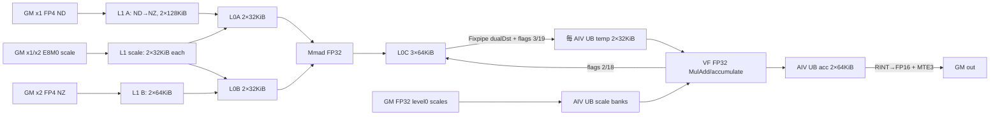
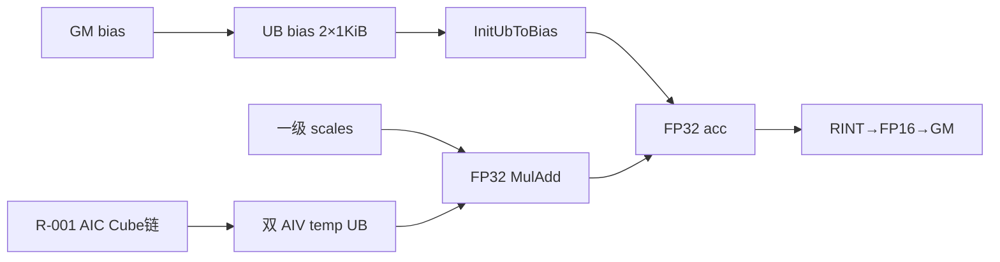
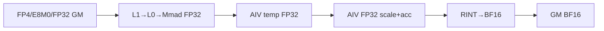
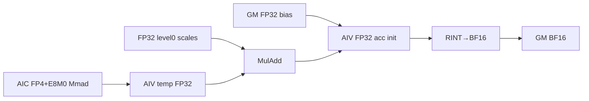

# DualLevelQuantMatmulWeightNz 950 ACLNN 算子知识

## 算子速览

| 项目 | 内容 |
|---|---|
| 实际入口 | `aclnnDualLevelQuantMatmulWeightNzGetWorkspaceSize` + `aclnnDualLevelQuantMatmulWeightNz`，公开 ACLNN 两段式接口；固定仓只存在这一版。 |
| 计算语义 | 对 `FLOAT4_E2M1` 的 `x1[M,K]` 与 NZ 权重 `x2[N,K]` 做二级反量化矩阵乘：Cube 融合每 32 个 K 元素一组的 E8M0 scale，AIV 再乘每 512 个 K 元素一组的 FP32 scale、跨组累加并加可选 FP32 bias。 |
| 输入输出 | `x1` ND、`x2` FRACTAL_NZ，二者逻辑 dtype FP4；一级 scale FP32，二级 scale E8M0；输出 ND FP16/BF16。公开入口固定 `transposeX1=false`、`transposeX2=true`、group size 512/32。 |
| 执行类型 | 单 Kernel `MIX_CV`：`KERNEL_TYPE_MIX_AIC_1_2`，1 个 AIC 配 2 个 AIV；AIC_CUBE 与两个 AIV_VECTOR 通过 CrossCore flag 和共享 UB 地址交接。 |
| Kernel 路线 | R-001 FP16/无 bias；R-002 FP16/有 bias；R-003 BF16/无 bias；R-004 BF16/有 bias。四条路线共用 ASW 分块与 MIX_CV body，差异只在 `HAS_BIAS` 和 `DTYPE_Y` specialization。 |
| 核心资源 | 每组 1 AIC+2 AIV：512 KiB L1 固定分区；L0A 64 KiB、L0B 64 KiB、L0C 使用 3×64 KiB；每 AIV 使用同一 248 KiB UB 地址图；无算子自有 workspace 数据切片。 |
| 来源闭包 | `source_closed`：公开 ACLNN 校验/视图处理 → `DualLevelQuantBatchMatmul` launcher → DAV_3510 ASW Tiling/POD → MIX_CV entry → AIC/AIV body、交接 flag、输出与构建接线均在固定 Commit 闭合；普通 `Contiguous`/`ViewCopy` 与 executor 调度是框架边界。 |
| 验证状态 | 已完成源码闭包检查；本次知识提取未执行编译、真机、数值或性能测试。 |

## 接口与语义

### 计算语义

令 `G0=512`、`G1=32`，`g=floor(k/G0)`，`h=floor(k/G1)`。固定实现等价于：

```text
acc[m,n] = bias[n]（无 bias 时为 0）
for g over K/512 groups:
  inner[m,n,g] = Σ(k in g) (
      x1[m,k] * x1Level1Scale[m,h] *
      x2[n,k] * x2Level1Scale[n,h])
  acc[m,n] += inner[m,n,g] * x1Level0Scale[m,g] * x2Level0Scale[g,n]
out[m,n] = CastRint<FP16 or BF16>(acc[m,n])
```

Device 每次 K 循环最多处理 512 元素。`LoadData(..., LoadData2DMxParams)` 把 E8M0 二级 scale 与 FP4 A/B 一起装入 L0A/L0B，`Mmad` 以 FP32 输出一个 512-K 分组的部分和；因此每个 K 分组的 L0C 都以 `cmatrixInitVal=true` 独立初始化。AIV 在 FP32 `cFp32Ub_` 中乘一级 scale 并跨 K 分组累加，最后一组才按 `CAST_RINT` 转为 `yType`；bias 在第一次 K 组前广播初始化累加缓冲。

### 输入、输出与属性

| 参数 | shape/layout | dtype | 约束、默认值与语义 |
|---|---|---|---|
| `x1` | `[M,K]` / ND | `FLOAT4_E2M1` | 必选、2D、连续、非空；`K` 必须为偶数；仅 `transposeX1=false`。 |
| `x2` | ACLNN 视图 `[N,K/2]`，经 view 恢复逻辑 `[N,K]`；storage 为 FRACTAL_NZ | 公共 API 表示 FP4，ACLNN storage descriptor 校验为 `INT8` packed，再改 view dtype 为 `FLOAT4_E2M1` | 必选、2D、连续、非空；仅 `transposeX2=true`。入口还接受 `FRACTAL_NZ_C0_2` 并把临时 view 的 storage format 改为 `FRACTAL_NZ`。 |
| `x1Level0Scale` | `[M,ceil(K/512)]` / ND | FP32 | 必选、连续、非空；每个 M 行、每个 512-K 组一个 scale。 |
| `x2Level0Scale` | `[ceil(K/512),N]` / ND | FP32 | 必选、连续、非空；每个 512-K 组、每个 N 列一个 scale。 |
| `x1Level1Scale` | `[M,ceil(K/64),2]` / ND 或 NCL storage | E8M0 | 必选、连续、非空；最后两维物理组合为每 32-K 组一个 scale。Tiling 对 origin shape 严格校验。 |
| `x2Level1Scale` | `[N,ceil(K/64),2]` / ND 或 NCL storage | E8M0 | 必选、连续、非空；同上，按 N 行组织。 |
| `optionalBias` | `[N]` / ND | FP32 | 可空；非空时必须连续、非空且严格 1D `[N]`。 |
| `transposeX1` | 标量 | bool | 仅 `false`。 |
| `transposeX2` | 标量 | bool | 仅 `true`。 |
| `level0GroupSize` | 标量 | int64 | 仅 512。 |
| `level1GroupSize` | 标量 | int64 | 仅 32。 |
| `out` | `[M,N]` / ND | FP16 或 BF16 | 必选、2D、连续、非空；M/N 必须与输入匹配。 |

### 入口与版本

固定 Commit 的公开文档、头文件和实现共同给出 `aclnnDualLevelQuantMatmulWeightNz`。第一段创建 executor，检查当前架构必须是 `DAV_3510`，完成参数校验和 packed FP4 权重 view 修正，再登记 `DualLevelQuantBatchMatmul` 与最终 `ViewCopy`；第二段由 `CommonOpExecutorRun` 在调用者 stream 上执行。OpDef 只为 `ascend950`/`ascend350` 添加 AICore config，公开产品表只支持 Ascend 950PR/950DT，并明确 A2、A3 均不支持，因此本卡只覆盖 950，不把 `arch35` 或 `ascend350` 构建名外推成其它公开平台。

## Host/Launcher 执行流程

### 参数校验与前处理

1. `CREATE_EXECUTOR` 创建两段式 executor；`CheckSocValid` 拒绝非 `DAV_3510`。
2. `CheckNotNull` 检查六个必选输入和 `out`；`IsNzFormat` 先接受 `FRACTAL_NZ`/`FRACTAL_NZ_C0_2`。
3. `CheckTensorX1/X2/.../Y/Bias` 校验连续性、rank、dtype、format；公开 ACLNN 的 `x2` packed storage descriptor 必须是 INT8。
4. `InputPreProcess` 为 `x2` 创建 view，把最后一维乘 2 恢复 FP4 逻辑 K；NZ storage shape 最后一维也乘 2，必要时把 `FRACTAL_NZ_C0_2` 临时视图改为 `FRACTAL_NZ`，最后仅修改 view dtype 为 FP4，不启动语义计算 Kernel。
5. `CheckInputOutputShape` 检查 `Kx1==Kx2`、`M/K/N>=1`、`out=[M,N]`、bias `[N]`；`CheckAttrs` 固定 false/true/512/32。
6. `EnableContiguous` 依次把 `x1`、四个 scale 和可选 bias 传给通用 `l0op::Contiguous`。此前入口已要求这些 tensor 连续；该调用及其内部实现属于通用框架边界。
7. `l0op::DualLevelQuantBatchMatmul` 分配 ND 输出，执行 infer-shape，并以 `ADD_TO_LAUNCHER_LIST_AICORE` 登记一个算子节点；随后通用 `ViewCopy(l0Result,out)` 登记最终提交。

### 参数、Workspace 与生命周期

`DualLevelQuantBatchMatmulTilingASW::GetWorkspaceSize` 直接返回成功，没有创建任何算子自有 slice；Device body 也没有计算或解引用 workspace offset。Kernel entry 只在 `workspace==nullptr` 时直接返回，因此执行器必须提供非空的框架 workspace 地址，即使该算子 body 不用其中数据。`PostTiling` 把继承自 Tiling 基类的 `workspaceSize_` 写入 framework workspace slot；其基础类初值和 executor 将 Contiguous/ViewCopy/system workspace 合并后的总字节数不在本算子固定源码内，属于框架边界，不能推测成固定常数。

第一段返回的 executor 持有临时 views、launcher list 和 workspace 需求，调用者持有 executor 与 Device workspace 到第二段提交完成。核心节点、Contiguous/ViewCopy 都由同一 executor 按登记顺序在传入 stream 上运行；本算子无裸临时 GM 指针和跨 Kernel 自有中间 slice。

### 启动图与失败传播

```text
aclnnDualLevelQuantMatmulWeightNzGetWorkspaceSize
  -> 校验 + x2 packed-FP4 view 修正 + 通用 Contiguous
  -> l0op::DualLevelQuantBatchMatmul
       -> InferShapeForDualLevelQuantBatchMatmul
       -> ADD_TO_LAUNCHER_LIST_AICORE(DualLevelQuantBatchMatmul)
  -> 通用 ViewCopy(l0Result, out)
  -> executor.GetWorkspaceSize / ReleaseTo

aclnnDualLevelQuantMatmulWeightNz(..., stream)
  -> CommonOpExecutorRun
       -> 单节点 dual_level_quant_batch_matmul，blockDim=usedCoreNum，MIX_AIC_1_2
       -> 通用 ViewCopy 提交 out
```

任一校验、infer-shape、launcher 登记或 ViewCopy 登记失败都会在第一段返回错误，不产生可执行 executor。第二段把 `CommonOpExecutorRun` 状态原样返回。Kernel 内 `workspace==nullptr` 是无输出的早退而非 fallback；`blockIdx>=usedCoreNum` 或尾块重切产生空子块时对应核无输出。

## Route 与参数设计

### 分核与资源计算

Tiling 先从 origin shape 和固定 transpose 得到 `M=x1[0]`、`K=x1[1]=x2[1]`、`N=x2[0]`。初始 L1 基本块为：

```text
baseM = ceil_align(min(M,256), 32B 对应的 FP4 元素数=64)
baseN = ceil_align(min(N,256), 16)
baseK = ceil_align(min(K,512), 64)
mBlockCnt = ceil_div(M,baseM)
nBlockCnt = ceil_div(N,baseN)
totalBlockCnt = mBlockCnt*nBlockCnt
```

若初始块数小于 AIC 数，`AdjustBasicBlock` 尝试缩小 M/N 块填核，并由 `l0aSize/2/max(tempBaseM,tempBaseN)/2` 限制新的 baseK；baseK 向相应 alignment 下取整，超过 4095 时再除 2，并关闭尾窗口重切。否则主路径按 AIC 数计算窗口轮次，最后窗口在不超过 AIC 数且 NZ-N 子块仍满足 32B 对齐的条件下增加 `mTailTile/nTailTile`。

`usedCoreNum` 在多轮或整尾窗口时为全部 AIC 数；单轮非整尾时为 `tailWinBlockCnt*mTailTile*nTailTile`。Device 固定二级 L0 tile `mL0=min(128,singleCoreM)`、`nL0=min(128,singleCoreN)`、`kL0=kL1=min(512,K-kOffset)`；每个 AIC 对应两个 AIV，AIV 用 `GetSubBlockIdx()` 沿 M 折半。

### Route 选择

| 顺序 | Route | Key/模板 | 精确选择条件与优先级 | 不适用去向 |
|---:|---|---|---|---|
| 1 | R-001 FP16/无 bias | `(SOC_RESERVED, DEFAULT, CUBEBOUND, MX, PER_GROUP, false, true, false, NZ)`；`yType=half` | DAV_3510；固定 FP4/E8M0/FP32 输入组合；`out=FP16`；bias 为空 | dtype 不同去 R-003；bias 非空去 R-002；其它条件失败 |
| 2 | R-002 FP16/有 bias | 同上但 `HAS_BIAS=true`；`yType=half` | R-001 条件且 bias 为 FP32 `[N]` | dtype 不同去 R-004；bias 为空去 R-001；其它条件失败 |
| 3 | R-003 BF16/无 bias | R-001 key；`yType=bfloat16_t` | DAV_3510；固定输入组合；`out=BF16`；bias 为空 | bias 非空去 R-004；其它条件失败 |
| 4 | R-004 BF16/有 bias | R-002 key；`yType=bfloat16_t` | R-003 条件且 bias 为 FP32 `[N]` | bias 为空去 R-003；其它条件失败 |

```text
if npuArch != DAV_3510: fail
validate attrs/dtypes/formats/shapes
select compiled DTYPE_Y specialization by out dtype:
  FP16 -> HAS_BIAS=false ? R-001 : R-002
  BF16 -> HAS_BIAS=false ? R-003 : R-004
  otherwise -> fail
all routes -> ASW template priority 0 -> MIX_CV body
```

### 模板/实现执行矩阵

| Route | key/selector | dtype/shape/platform 完整命中条件 | 执行族与 kernel 节点 | 实际模板/body | 内存与同步特征 | tail/fallback |
|---|---|---|---|---|---|---|
| R-001 FP16/无 bias | ASW priority 0；`HAS_BIAS=0` | 950/DAV_3510；FP4×FP4、E8M0 L1 scale、FP32 L0 scale；FP16 out；合法 M/N/K 与 scale shape | 单 `MIX_CV` 节点：1 AIC_CUBE→2 AIV_VECTOR | `Controller<...,half,false,true,false>`；ASW body | 固定 L1/L0/UB 图；flag 2/18 与 3/19；FP32 累加后 RINT→FP16 | M/N/K padding 与有效 GM extent；无 fallback |
| R-002 FP16/有 bias | ASW priority 0；`HAS_BIAS=1` | R-001 + FP32 bias `[N]` | 同 R-001 | `Controller<...,float,half,false,true,true>` | 同 R-001，第一次 K 组前广播 bias | 同 R-001 |
| R-003 BF16/无 bias | ASW priority 0；`HAS_BIAS=0` | R-001，但 BF16 out | 同 R-001 | `Controller<...,bfloat16_t,false,true,false>` | 同 R-001；FP32 累加后 RINT→BF16 | 同 R-001 |
| R-004 BF16/有 bias | ASW priority 0；`HAS_BIAS=1` | R-003 + FP32 bias `[N]` | 同 R-001 | `Controller<...,float,bfloat16_t,false,true,true>` | 同 R-003，第一次 K 组前广播 bias | 同 R-001 |

### 隐藏性能 Guard

| Guard | Host/Tiling 条件 | Device/资源原因 | 影响 Route | 不满足时去向 | 源码符号 |
|---|---|---|---|---|---|
| 平台与核比例 | `npuArch==DAV_3510` 且 `aivNum==2*aicNum`，两者非零 | Kernel 固定 `MIX_AIC_1_2`，AIC 每次等待两个 AIV flag | 全部 | Tiling 失败 | `DualLevelQuantBatchMatmulTilingFunc`、`TilingParseForDualLevelQuantBatchMatmul` |
| 固定量化/转置 | `transA=false && transB=true && G1=32 && G0=512` | 当前 LoadData MX 与外层 AIV group 索引均硬编码该分组 | 全部 | 校验失败 | `DLQBMMChecker::CheckAttrs` |
| dtype/layout | FP4 ND × FP4 NZ；E8M0/FP32 scales；out FP16/BF16 | 当前 GM offset、ND→NZ、NZ weight copy 与 VF cast specialization | 全部 | 校验失败 | `CheckDtypes`、`IsInputsValid` |
| scale shape | `[M,ceil(K/64),2]`、`[N,ceil(K/64),2]`、`[M,ceil(K/512)]`、`[ceil(K/512),N]` | Device 按 K/32 和 K/512 直接寻址，无 runtime shape 元数据 | 全部 | Tiling 失败 | `DLQBMMChecker::CheckInputs` |
| 初始块与对齐 | baseM≤256 且 FP4 32B 对齐；baseN≤256 且 16 对齐；baseK≤512 且 64 对齐 | L1/L0 DataCopy、Cube fractal 和 MX group 边界 | 全部 | 调整基本块；无法合法则 Tiling 失败 | `CalcBasicBlock`、`AdjustBasicBlock` |
| NZ 尾分裂 | N 向 split 后 `baseN/splitCnt` 对 FP4 的 32B 元素数对齐 | `DataCopyPad2D` 的 NZ N 片必须保持 cacheline/分形合法 | 全部 | 跳过该 splitCnt，保留较小合法 split | `IsInvalidWeightNzTailSplit` |
| 边缘重平衡 | M/N 均多块；M 侧还需非转置和内轴 256B 对齐；N 侧还需 K≥1024、转置 B 等源码谓词 | 把不整除边缘与若干主块重切，降低尾轮最长块 | 全部 | 保持 splitCnt=1 | `OptimizeEdgeBasicBlock` |
| workspace 非空 | Device entry `workspace != nullptr` | entry 的显式门禁；body 不使用 workspace 内容 | 全部 | Kernel 直接返回，无输出 | `dual_level_quant_batch_matmul` |

### POD/ABI

`#pragma pack(push,8)` 下 `DualLevelQuantBatchMatmulBasicTilingData` 总大小 64 B、对齐 8 B；字段 offset 由声明顺序、固定宽度类型和显式 pack 可闭合如下。

| 结构 | 字段 | 类型/位宽 | ABI 布局 | 单位 | Host/launcher producer | Device consumer | 边界 |
|---|---|---|---|---|---|---|---|
| `DualLevelQuantBatchMatmulBasicTilingData` | `l1BufferNum` | uint8/8 | sizeof=1, align=1, offset=0 | buffer 个数 | `SetTilingData`: 2 | 固定仓 Device 未读取 | inactive 但已初始化 |
| 同上 | `hasBias` | bool/8 | sizeof=1, align=1, offset=1 | 布尔 | `SetTilingData` | 固定仓 body 用编译期 `HAS_BIAS`，未读取 POD 字段 | inactive 但已初始化 |
| 同上 | `l2CacheDisable` | enum(uint32)/32 | sizeof=4, align=4, offset=4 | mode | `SetTilingData`: DEFAULT | 固定仓 Device 未读取 | inactive 但已初始化；offset 2..3 padding |
| 同上 | `usedCoreNum` | uint32/32 | sizeof=4, align=4, offset=8 | AIC 组数 | `CalBlockDim`/`SetTilingData` | `Controller::Process`、`BaseBlock::Init` | ≥1；blockIdx 越界早退 |
| 同上 | `mSize` | uint32/32 | offset=12 | 元素 | `matmulInfo_.mSize` 窄化写入 | `BaseBlock::Init`、GM offset | ACLNN/Tiling 未显式给出 uint32 上溢保护，这是固定实现限制 |
| 同上 | `nSize` | uint32/32 | offset=16 | 元素 | `matmulInfo_.nSize` 窄化写入 | 同上 | 同上 |
| 同上 | `kSize` | uint32/32 | offset=20 | 元素 | `matmulInfo_.kSize` 窄化写入 | K loop、scale offset | 同上；必须 >0 |
| 同上 | `mL1Size` | uint32/32 | offset=24 | 元素 | ASW `baseM` | 分核和 AIC copy | ≤256，FP4 32B 对齐 |
| 同上 | `nL1Size` | uint32/32 | offset=28 | 元素 | ASW `baseN` | 分核和 AIC/AIV N loop | ≤256，16 对齐 |
| 同上 | `kL1Size` | uint32/32 | offset=32 | 元素 | ASW `baseK` | 固定仓 Device 未读取；Device K chunk 固定 512 | inactive 但已初始化 |
| 同上 | `level0GroupSize` | uint32/32 | offset=36 | K 元素/组 | 固定 512 | 一级 scale group offset | 仅 512 |
| 同上 | `mTailTile` | uint32/32 | offset=40 | 子块数 | `CalcTailBasicBlock` | 最后一轮 blockIdx 重映射 | ≥1 |
| 同上 | `nTailTile` | uint32/32 | offset=44 | 子块数 | 同上 | 同上；N 子块对齐 16 | ≥1 |
| 同上 | `mBaseTailSplitCnt` | uint32/32 | offset=48 | 边缘块数 | `OptimizeEdgeBasicBlock` | `BaseBlock::Init/UpdateBlockParams` | 默认 1 |
| 同上 | `nBaseTailSplitCnt` | uint32/32 | offset=52 | 边缘块数 | 同上 | 同上 | 默认 1 |
| 同上 | `mTailMain` | uint32/32 | offset=56 | 元素 | `GetOuterMAxisTailCnt` | 边缘主块 M extent | splitCnt=1 时 Device 改用原尾长 |
| 同上 | `nTailMain` | uint32/32 | offset=60 | 元素 | `GetOuterNAxisTailCnt` | 边缘主块 N extent | splitCnt=1 时 Device 改用原尾长 |

### Route 源码闭包

| Route | Key/selector | Host/Tiling producer | POD/参数 | Kernel entry/router | Kernel body/直接依赖 | 构建接线 |
|---|---|---|---|---|---|---|
| R-001 FP16/无 bias | ASW key `HAS_BIAS=0` + output FP16 specialization | `AclnnDualLevelQuantMatmul...Process`；`DualLevelQuantBatchMatmulTilingASW` | 64 B basic tiling POD | `dual_level_quant_batch_matmul<...,false>` | controller、block、cube tools、vec compute/VF | `op_kernel/CMakeLists.txt`: ascend950/350 |
| R-002 FP16/有 bias | ASW key `HAS_BIAS=1` + output FP16 specialization | 同上，bias present | 同上 | `dual_level_quant_batch_matmul<...,true>` | 同上，`InitUbToBias` | 同上 |
| R-003 BF16/无 bias | ASW key `HAS_BIAS=0` + output BF16 specialization | 同 R-001 | 同上 | `dual_level_quant_batch_matmul<...,false>`，`DTYPE_Y=BF16` | 同上，最后 `Cast<BF16,float>` | 同上 |
| R-004 BF16/有 bias | ASW key `HAS_BIAS=1` + output BF16 specialization | 同 R-002 | 同上 | `dual_level_quant_batch_matmul<...,true>`，`DTYPE_Y=BF16` | 同上，bias + BF16 cast | 同上 |

## Kernel 实现

### 公共执行流程

四条 Route 共享一个单-Kernel MIX_CV 图。`blockDim=usedCoreNum` 表示 AIC 组数，task ratio 为 2；AIV 把 `GetBlockIdx()` 除以 task ratio 后与所属 AIC 使用相同逻辑 tile，`GetSubBlockIdx()` 为 0/1，各处理 AIC 产生矩阵的前/后半 M。

每个逻辑基本块对 K 按 512 循环。AIC 先等待两 AIV 归还 UB 临时片，再搬 FP4 A/B 与 E8M0 scale 到 L1，分 128×128 L0 tile做 MX-Mmad，Fixpipe 以 `dualDstCtl=1` 把 FP32 结果同时写进两个 AIV 的相同 UB offset。AIC 发 flag 3/19；两 AIV 各等本地映射到的 flag 3，读取其 M 半块，乘 FP32 一级 scales并累加，然后各发 flag 2，允许 AIC 覆盖临时片。最后 K 组在 VF 内 cast，MTE3 只把真实 M/N tail 写到 GM。

### Route R-001：FP16/无 bias

#### 适用条件

##### 选择证据

| 层级 | 文件 | 符号 | 源码谓词/参数 | 结果/下一跳 |
|---|---|---|---|---|
| ACLNN | `op_api/aclnn_dual_level_quant_matmul.cpp` | `CheckSocValid`/`CheckTensor*`/`CheckAttrs` | DAV_3510、合法输入、out FP16、bias null | 登记算子；否则返回错误 |
| Tiling | `...adaptive_sliding_window_tiling.cpp` | `GetTilingKey` | MX/PER_GROUP/false/true/`hasBias=false`/NZ | R-001 key |
| Router | `op_kernel/.../dual_level_quant_batch_matmul.cpp` | `dual_level_quant_batch_matmul` | `DTYPE_Y=half`、`HAS_BIAS=false` | `Controller<...,half,false,true,false>` |

#### Device 数据流

##### 函数级调用链

```text
dual_level_quant_batch_matmul
  -> Controller::Init / BaseBlock::Init / BasicBlock::Init
  -> Controller::Process
    -> SetAivToAic
    -> ComputeBasicBlock
      -> AIC: WaitMte1ToMte2 -> CopyGmToL1 -> Wait(AIV flags)
              -> LaunchMatmul(LoadData MX -> Mmad -> Fixpipe dualDst) -> Set(AIC flags)
      -> AIV: Copy level0 scales -> InitUbToZero -> Wait(AIC flag)
              -> MulAdd/MulDoubleAdd -> Set(AIV flag) -> final CopyUbToGm
    -> WaitAivToAic -> End
```

##### 源码等价伪码

```text
for round assigned to this AIC group:
  map blockIdx to serpentine (mIndex,nIndex); apply edge/tail split
  for k0 in range(0,K,512):
    AIC: copy A/B FP4 and E8M0 scales GM->L1; for each 128x128 tile:
      wait flag 2 and 18
      LoadData+MX scale L1->L0A/L0B
      Mmad(FP32, cmatrixInitVal=true, k=align64(realK))
      Fixpipe NoQuant L0C->both AIV UB temp[loop%2]
      set flag 3 and 19
    AIV0/AIV1: copy FP32 level0 scales; if k0==0 zero FP32 accumulator
      for its M half of each 128x128 tile:
        wait flag 3
        acc += temp * x1_l0_scale * x2_l0_scale
        on final k0 CastRint<FP16>
        set flag 2
      on final k0 copy only real tail M,N to GM
```

#### 内存与数据搬运

##### 资源与搬运表

| 层级/缓冲区 | offset/地址公式 | extent/容量公式 | dtype/layout | producer | consumer | owner/lifetime | 对齐/复用 |
|---|---|---|---|---|---|---|---|
| GM `x1` | `mGmOffset*K+kGmOffset` | real `mL1*kL1` FP4 | FP4 ND | caller | `DataCopyAGmToL1` | caller，整次执行 | ND→NZ；K packed/64 对齐 padding |
| GM `x2` | `kGmOffset*Nalign+nGmOffset*C0` | `ceil(kL1/C0) × nL1*C0/2` bytes | FP4 FRACTAL_NZ | caller | `DataCopyBGmToL1` | caller | `C0=64` FP4 elems，N align16 |
| L1 | 固定 512 KiB 图：B0 0..64K、A-scale0 64..96K、B-scale0 96..128K、A0 128..256K；A1 256..384K、B-scale1 384..416K、A-scale1 416..448K、B1 448..512K | A 2×128K；B 2×64K；A/B E8M0 scale 各2×32K | A/B fractal，scale NZ | MTE2 | LoadData MX | AIC core，一轮/双缓冲 | ping-pong，MTE1↔MTE2 event 2/3 与 4/5 |
| L0A/L0B | bank=`l0BufIdx%2` | 各2×32K=64K | FP4 + MX scale-loaded | `LoadA/BAndScaleL1ToL0` | Mmad | AIC core，Mmad 后复用 | 128×512 FP4 最大块 |
| L0C | bank=`l0BufIdx%3` | 3×(128×128×4)=192K（物理容量256K） | FP32 row-major result | Mmad | Fixpipe | AIC core，Fixpipe 后轮转 | triple buffer；K 每组独立初始化 |
| AIV UB temp | `0 + (cvLoopIdx%2)*64*128*4` | 2×32K=64K/每 AIV | FP32 row-major，stride128 | AIC Fixpipe dual destination | AIV VF | 两 AIV各自 UB，flag 保护至消费完成 | 双缓冲；有效 M 为每 AIV 半块 |
| AIV UB x1 L0 scale | 84K，bank stride 16K | 32K | FP32 | MTE2 | VF broadcast | AIV，覆盖前等 V_MTE2 flag3 | 双缓冲；每行最多32组 |
| AIV UB x2 scale | 116K，bank stride1K | 2K | FP32 | MTE2 | VF vector load | AIV | 双缓冲 |
| AIV UB bias | 118K | 2K reserved，R-001不读取 | FP32 | N/A | N/A | inactive | N/A |
| AIV UB accumulator | 120K，`cFp32BufId*64K` | 2×64K=128K | FP32，最后原地 pack FP16 | zero init/VF | MTE3 | AIV，N块完成后复用 | 两个 N-L0 buffer |
| GM `out` | `(mOffset+mL1Offset+subBlock*mUbSize)*N+nOffset+nL1Offset` | real tail `mOut*realN*2` bytes | FP16 ND | MTE3 | caller | caller | DataCopyPad，仅提交有效域 |
| workspace | N/A | 无算子自有 slice | N/A | N/A | entry 只查非空 | executor/framework | 不承载数据 |

##### 分层内存布局



##### 字节账、交接边与复用顺序

```text
operator_workspace = 0 个算子自有数据 slice；framework total 固定仓不可见
L1_total = 2*(128KiB A + 64KiB B + 32KiB A-scale + 32KiB B-scale) = 512KiB
L0_total_used = 64KiB L0A + 64KiB L0B + 192KiB L0C
UB_address_span_per_AIV = 248KiB
UB_used = 64KiB temp + 32KiB x1-scale + 2KiB x2-scale + 2KiB bias-reserved + 128KiB acc = 228KiB
另有 20KiB 地址空洞（64..84KiB）；temp LocalTensor 是覆盖 UB 地址图的别名视图，不与后段活跃区重叠使用
```

| 边/复用子区 | producer | offset/extent | dtype/layout | consumer | ordering/sync | owner/lifetime | 安全条件 |
|---|---|---|---|---|---|---|---|
| AIC→两AIV temp | `FixL0CToDst` | bank `(cvLoop%2)*32KiB`，每 AIV最多64×128 FP32 | FP32 row-major | `MulAdd*` | AIC 等 flags 2/18；写后发3/19；每AIV等3 | 各 AIV UB；消费后可覆盖 | 两 AIV 都归还对应 token |
| temp bank ping-pong | 连续 L0 tile | bank 0/1 | FP32 | 下一 VF 轮次 | `cvLoopIdx%2` + 跨核 token | 单基本块全过程 | AIC 不能越过双 AIV wait |
| accumulator N banks | `InitUbToZero`/VF | `cFp32BufId*64KiB` | FP32，最后pack FP16 | MTE3 | MTE3_V flag 0/1 | 当前 nL1Offset 到最终 K copyout | 新 N 块初始化前等待前次 MTE3 |

#### 同步、精度与尾块

##### 同步与数值边界表

| 阶段 | primitive/机制 | producer | consumer/等待点 | 保护对象 | 精度/尾块 |
|---|---|---|---|---|---|
| GM↔L1 ping-pong | `MTE1_MTE2` event 2/3、4/5 | LoadData/MTE1 | 下一 MTE2 overwrite | A/B 与 scale L1 banks | K tail scale length ceil-align64 |
| L1→L0→Mmad | `M_MTE1`、`MTE1_M` hard events | Mmad/LoadData | L0 bank reuse/Mmad | 2×L0A/B banks | Mmad K 向上对齐64，pad 为0；FP32 L0C |
| AIC→AIV | CrossCore mode4 PIPE_FIX/V，IDs 3、19 | AIC Fixpipe | 两 AIV VF | temp UB bank | Fixpipe NoQuant、dual destination |
| AIV→AIC | CrossCore mode4 IDs 2、18 | 两 AIV VF | AIC 下次 Fixpipe 前 | temp UB bank | 两个 subblock 均完成才覆盖 |
| scale/acc buffers | V_MTE2、MTE3_V、V_MTE3、MTE2_V | VF/MTE2/MTE3 | 对应流水级 | scale和acc banks | FP32 累加；末组 RINT→FP16 |
| M/N tail | padded compute + real-extent MTE3 | Cube/VF | GM output | 尾 tile | VF按寄存器全 mask 处理已 padding 区，`CopyUbToGm`只写 `realML0Size/realNL0Size` |

#### 关键实现

##### 符号证据表

| 阶段 | 文件 | 符号/模板实例 | 实现事实 |
|---|---|---|---|
| Host/Tiling producer | `op_tiling/dual_level_quant_batch_matmul_adaptive_sliding_window_tiling.cpp` | `CalcBasicBlock`、`SetTilingData` | ASW tile、usedCoreNum 和 POD |
| Kernel entry/router | `op_kernel/arch35/dual_level_quant_batch_matmul.cpp` | `dual_level_quant_batch_matmul<...,HAS_BIAS=false>` | MIX_AIC_1_2 与具体 Controller |
| Device body/helper | `...basic_block.h`、`...cube_compute.h`、`...vec_compute.h`、`...vf.h` | `ComputeAicBasicBlock`/`ComputeAivBasicBlock`/`MulAdd*` | Cube→UB→Vector、同步、FP32 累加与 FP16 cast |

### Route R-002：FP16/有 bias

#### 适用条件

##### 选择证据

| 层级 | 文件 | 符号 | 源码谓词/参数 | 结果/下一跳 |
|---|---|---|---|---|
| ACLNN | `op_api/aclnn_dual_level_quant_matmul.cpp` | `CheckTensorBias`/`CheckInputOutputShape` | bias 非空、FP32 ND、连续、shape `[N]`；out FP16 | 登记有 bias 算子 |
| Tiling | `...adaptive_sliding_window_tiling.cpp` | `GetTilingKey` | `hasBias=true` | R-002 key |
| Router | `op_kernel/.../dual_level_quant_batch_matmul.cpp` | entry specialization | `DTYPE_Y=half`、`HAS_BIAS=true` | `Controller<...,float,half,...,true>` |

#### Device 数据流

##### 函数级调用链

```text
与 R-001 相同
  -> AIV CopyX2Level0ScaleAndBiasToUb(k0==0)
  -> InitUbToBias（把 128 列 bias 广播到每个 M 行）
  -> 后续 FP32 MulAdd、末组 RINT→FP16、MTE3
```

##### 源码等价伪码

```text
if k0==0:
  copy bias[nOffset:nOffset+nL1] GM->UB bias bank
  for each accumulator N bank and each local M row:
    acc[row,:] = bias[:]
for each 512-K group: acc += cube_partial*x1_l0*x2_l0
on final group: CastRint<FP16>; copy valid M/N to GM
```

#### 内存与数据搬运

##### 资源与搬运表

| 层级/缓冲区 | offset/地址公式 | extent/容量公式 | dtype/layout | producer | consumer | owner/lifetime | 对齐/复用 |
|---|---|---|---|---|---|---|---|
| R-001 全部缓冲 | 同 R-001 | 同 R-001 | 同 R-001 | 同 R-001 | 同 R-001 | 同 R-001 | 同 R-001 |
| GM/UB bias | GM `nGmOffset`；UB 118KiB + ping bank×1KiB | 每次 `nL1Size` FP32；分配2KiB | FP32 ND | MTE2 | `InitUbToBias` | 第一次 K 组到 accumulator 初始化完成 | 与 x2 scale 共用 mte2BufIdx ping-pong轮次，不重叠地址 |

##### 分层内存布局



##### 字节账、交接边与复用顺序

```text
与 R-001 相同；bias reserved 2KiB 变为 active
UB_used_active = 64 + 32 + 2 + 2 + 128 = 228KiB，address span 248KiB
```

| 边/复用子区 | producer | offset/extent | dtype/layout | consumer | ordering/sync | owner/lifetime | 安全条件 |
|---|---|---|---|---|---|---|---|
| bias→acc | MTE2 bias copy | UB 118KiB bank，≤256 FP32 | FP32 vector | `InitUbToBias` | `SetAndWaitMte2ToV` | AIV，初始化后bank可轮转 | 仅 `kGmOffset==0` copy；初始化只在首 K 组 |
| 其它边 | 同 R-001 | 同 R-001 | 同 R-001 | 同 R-001 | 同 R-001 | 同 R-001 | 同 R-001 |

#### 同步、精度与尾块

##### 同步与数值边界表

| 阶段 | primitive/机制 | producer | consumer/等待点 | 保护对象 | 精度/尾块 |
|---|---|---|---|---|---|
| bias 初始化 | MTE2_V event 0 | bias MTE2 | `InitUbToBias` | bias bank和acc | FP32 bias，在所有 K 组前加入 |
| 其余阶段 | 同 R-001 | 同 R-001 | 同 R-001 | 同 R-001 | FP32 累加，末组 RINT→FP16；相同 tail |

#### 关键实现

##### 符号证据表

| 阶段 | 文件 | 符号/模板实例 | 实现事实 |
|---|---|---|---|
| Host/Tiling producer | `op_api/aclnn_dual_level_quant_matmul.cpp`、ASW Tiling | `CheckTensorBias`、`GetTilingKey` | bias 校验与 `HAS_BIAS=1` key |
| Kernel entry/router | `op_kernel/arch35/dual_level_quant_batch_matmul.cpp` | `HAS_BIAS=true`, `DTYPE_Y=half` | R-002 specialization |
| Device body/helper | `...vec_compute.h`、`...vf.h` | `CopyX2Level0ScaleAndBiasToUb`、`InitUbToBias` | 首 K 组拷 bias并广播初始化 |

### Route R-003：BF16/无 bias

#### 适用条件

##### 选择证据

| 层级 | 文件 | 符号 | 源码谓词/参数 | 结果/下一跳 |
|---|---|---|---|---|
| ACLNN | `op_api/aclnn_dual_level_quant_matmul.cpp` | `CheckTensorY` | out dtype BF16、bias null | 登记 BF16 算子 |
| Tiling | `...adaptive_sliding_window_tiling.cpp` | `GetTilingKey` | `hasBias=false` | 与 R-001 相同 key |
| Router | `op_kernel/.../dual_level_quant_batch_matmul.cpp` | entry specialization | `DTYPE_Y=bfloat16_t`、`HAS_BIAS=false` | R-003 body |

#### Device 数据流

##### 函数级调用链

```text
与 R-001 相同
  -> final MulAdd<bfloat16_t>/MulDoubleAdd<bfloat16_t>
  -> MicroAPI::Cast<BF16,float,CAST_RINT>
  -> MTE3 BF16
```

##### 源码等价伪码

```text
执行 R-001 的 AIC/AIV 循环和 FP32 累加；
仅最后 K 组把 acc 以 RINT cast 为 BF16，原地 packed store 后按真实 tail 输出。
```

#### 内存与数据搬运

##### 资源与搬运表

| 层级/缓冲区 | offset/地址公式 | extent/容量公式 | dtype/layout | producer | consumer | owner/lifetime | 对齐/复用 |
|---|---|---|---|---|---|---|---|
| 所有内部层级 | 同 R-001 | 同 R-001 | L0C/temp/acc 仍为 FP32 | 同 R-001 | 同 R-001 | 同 R-001 | 同 R-001 |
| GM `out` | 同 R-001 | real `mOut*realN*2` bytes | BF16 ND | MTE3 | caller | caller | 最后组 RINT→BF16 |

##### 分层内存布局



##### 字节账、交接边与复用顺序

```text
与 R-001 相同；输出元素2B，acc直到最后 K 组都保持FP32。
```

| 边/复用子区 | producer | offset/extent | dtype/layout | consumer | ordering/sync | owner/lifetime | 安全条件 |
|---|---|---|---|---|---|---|---|
| AIC/AIV 与内部复用 | 同 R-001 | 同 R-001 | FP32 | 同 R-001 | 同 R-001 | 同 R-001 | 同 R-001 |
| acc→out | final VF | packed BF16 in acc physical buffer；GM real tail | BF16 ND | MTE3/caller | V_MTE3 then MTE3_V | AIV/caller | 仅最后 K 组 cast和提交 |

#### 同步、精度与尾块

##### 同步与数值边界表

| 阶段 | primitive/机制 | producer | consumer/等待点 | 保护对象 | 精度/尾块 |
|---|---|---|---|---|---|
| 内部同步 | 同 R-001 | 同 R-001 | 同 R-001 | 同 R-001 | FP32 |
| 最终 cast/copy | `CAST_RINT` + V_MTE3/MTE3_V | VF | MTE3 | acc/out | BF16；真实 M/N tail |

#### 关键实现

##### 符号证据表

| 阶段 | 文件 | 符号/模板实例 | 实现事实 |
|---|---|---|---|
| Host/Tiling producer | `dual_level_quant_batch_matmul_def.cpp`、ACLNN 实现 | output BF16 config、`CheckTensorY` | BF16 是公开合法输出 |
| Kernel entry/router | `dual_level_quant_batch_matmul.cpp` | `DTYPE_Y=bfloat16_t`, `HAS_BIAS=false` | R-003 specialization |
| Device body/helper | `dual_level_quant_batch_matmul_vf.h` | `MulAdd<bfloat16_t>`/`MulDoubleAdd<bfloat16_t>` | FP32 累加末组 RINT→BF16 |

### Route R-004：BF16/有 bias

#### 适用条件

##### 选择证据

| 层级 | 文件 | 符号 | 源码谓词/参数 | 结果/下一跳 |
|---|---|---|---|---|
| ACLNN | `op_api/aclnn_dual_level_quant_matmul.cpp` | `CheckTensorY`/`CheckTensorBias` | out BF16；bias FP32 `[N]` | 登记 BF16+Bias 算子 |
| Tiling | `...adaptive_sliding_window_tiling.cpp` | `GetTilingKey` | `hasBias=true` | bias key |
| Router | `op_kernel/.../dual_level_quant_batch_matmul.cpp` | entry specialization | `DTYPE_Y=bfloat16_t`、`HAS_BIAS=true` | R-004 body |

#### Device 数据流

##### 函数级调用链

```text
R-002 的 bias copy/broadcast初始化
  -> 公共 Cube/AIV FP32 累加链
  -> R-003 的 final CastRint<BF16> 与 MTE3
```

##### 源码等价伪码

```text
acc = broadcast_fp32_bias
for each 512-K group: acc += cube_partial*x1_l0*x2_l0
on final group: CastRint<BF16>(acc); copy valid M/N to GM
```

#### 内存与数据搬运

##### 资源与搬运表

| 层级/缓冲区 | offset/地址公式 | extent/容量公式 | dtype/layout | producer | consumer | owner/lifetime | 对齐/复用 |
|---|---|---|---|---|---|---|---|
| Cube/temp/scales/acc | 同 R-002 | 同 R-002 | 内部 FP32 | 同 R-002 | 同 R-002 | 同 R-002 | 同 R-002 |
| GM `out` | 同 R-003 | real `mOut*realN*2` bytes | BF16 ND | final VF/MTE3 | caller | caller | RINT→BF16 |

##### 分层内存布局



##### 字节账、交接边与复用顺序

```text
同 R-002 的 228KiB active UB 和 R-003 的 BF16 output；L1/L0不变。
```

| 边/复用子区 | producer | offset/extent | dtype/layout | consumer | ordering/sync | owner/lifetime | 安全条件 |
|---|---|---|---|---|---|---|---|
| bias→acc | 同 R-002 | 同 R-002 | FP32 | 同 R-002 | 同 R-002 | 同 R-002 | 首 K 组 |
| acc→BF16 out | 同 R-003 | 同 R-003 | BF16 ND | MTE3/caller | 同 R-003 | 同 R-003 | 末 K 组 |
| AIC↔AIV | 同 R-001 | 同 R-001 | FP32 | 同 R-001 | IDs 2/18、3/19 | 同 R-001 | 双 AIV 均归还 token |

#### 同步、精度与尾块

##### 同步与数值边界表

| 阶段 | primitive/机制 | producer | consumer/等待点 | 保护对象 | 精度/尾块 |
|---|---|---|---|---|---|
| bias初始化 | 同 R-002 | 同 R-002 | 同 R-002 | bias/acc | FP32 |
| Cube/AIV交接 | 同 R-001 | 同 R-001 | 同 R-001 | temp banks | FP32/padded tail |
| 最终提交 | 同 R-003 | VF | MTE3 | acc/out | RINT→BF16，仅真实 tail |

#### 关键实现

##### 符号证据表

| 阶段 | 文件 | 符号/模板实例 | 实现事实 |
|---|---|---|---|
| Host/Tiling producer | ACLNN 实现、ASW Tiling | `CheckTensorY`/`CheckTensorBias`/`GetTilingKey` | BF16+Bias Route |
| Kernel entry/router | `dual_level_quant_batch_matmul.cpp` | `DTYPE_Y=bfloat16_t`, `HAS_BIAS=true` | R-004 specialization |
| Device body/helper | `vec_compute.h`、`vf.h` | bias copy/`InitUbToBias`/`MulAdd<bfloat16_t>` | FP32 bias累加和末组 BF16 cast |

## 算子特定优化

### Trick T-001：AIC Fixpipe 双目的直写两个 AIV UB

#### 触发与源码依据

- 适用 Route：R-001～R-004
- 触发条件：950/DAV_3510、`KERNEL_TYPE_MIX_AIC_1_2`、当前 1:2 MIX_CV specialization。
- Golden 来源：[`dual_level_quant_batch_matmul_basic_block.h:147-160`](../../../../../../../cann-ops-raw/ascendc/ops-nn/955f8b33985b6d72989ebff341bb9c2c564a51bc/matmul/dual_level_quant_batch_matmul/op_kernel/arch35/dual_level_quant_batch_matmul_basic_block.h#L147-L160)

**官方源码（固定 Commit 连续逐字摘录）**：

```cpp
CrossCoreWaitFlag<SyncMode::SYNC_MODE4, PIPE_FIX>(AIV_TO_AIC_ID);
CrossCoreWaitFlag<SyncMode::SYNC_MODE4, PIPE_FIX>(AIV_TO_AIC_ID + AIV_SYNC_FLAG_DIST);
cubeCompute_.LaunchMatmul(
    mL1Offset, nL1Offset, 0, kGmOffset % offsetParams.level1ScaleKL1Size,
    cTmpFp32Ub_[cvLoopIdx_ % CV_LOOP_NUM * C_TMP_FP32_UB_OFFSET], l0Params, fixpParams);
CrossCoreSetFlag<SyncMode::SYNC_MODE4, PIPE_FIX>(AIC_TO_AIV_ID);
CrossCoreSetFlag<SyncMode::SYNC_MODE4, PIPE_FIX>(AIC_TO_AIV_ID + AIV_SYNC_FLAG_DIST);
```

#### 机制与设计原因

`FixpipeParamsC310` 设 `dualDstCtl=1`，同一份 128×128 FP32 L0C 结果按 M 半块直接可见于两个 AIV 的 UB 临时片；不物化 GM/workspace 中间矩阵。AIC 在写前同时等两个 AIV 的归还 token，写后分别通知两个 AIV；这使双缓冲覆盖顺序与两个消费者的完成状态绑定。

#### 迁移边界

- 适用：同样具备 AIC:AIV=1:2、Fixpipe dual destination 和跨核 mode4 flag 的 MIX_CV 分块后处理。
- 前提：每个 AIV 的 UB 地址图一致，M 半块映射与 `GetSubBlockIdx()` 一致，flag 2/18 和 3/19 的轮次不被其它阶段复用。
- 失效：AIV 数不是 2、输出需要先落 GM、或消费者不能在相同 UB offset 接收时必须重建交接图。
- 未验证：本次知识提取未执行编译、真机、数值或性能测试。

#### 错误做法

只等待一个 AIV 就覆盖 temp bank 会使另一个 AIV 读取被覆盖数据；固定源码通过两个 wait ID 明确排除此做法。

### Trick T-002：二级 scale 融合进 LoadData/Mmad，一级 scale 留在 FP32 AIV 累加

#### 触发与源码依据

- 适用 Route：R-001～R-004
- 触发条件：FP4 A/B、E8M0 level1 group 32、FP32 level0 group 512。
- Golden 来源：[`dual_level_quant_batch_matmul_cube_compute_tools.h:121-149`](../../../../../../../cann-ops-raw/ascendc/ops-nn/955f8b33985b6d72989ebff341bb9c2c564a51bc/matmul/dual_level_quant_batch_matmul/op_kernel/arch35/dual_level_quant_batch_matmul_cube_compute_tools.h#L121-L149)

**官方源码（固定 Commit 连续逐字摘录）**：

```cpp
aL0Load2dMx.yStep =
    Ops::Base::CeilDiv(l0CopyAndCalcParams.kL0Size, 64UL);
aL0Load2dMx.srcStride = Ops::Base::CeilDiv(l0CopyAndCalcParams.scaleKL1Size, 64UL);
aL0Load2dMx.dstStride = aL0Load2dMx.yStep;
AscendC::LoadData(aL0Tensor, aL1Tensor, scaleL1Tensor, aL0Load2dParams, aL0Load2dMx);
```

#### 机制与设计原因

E8M0 scale 以 MX 参数伴随 FP4 从 L1 装入 L0，Cube 对每个 32-K 微组完成解尺度乘法；每个 512-K 外组的 FP32 Mmad 结果再交给 AIV，乘该 M 行和 N 列的 FP32 一级 scale 后写回同一 FP32 accumulator。两级 scale 的放置严格对应硬件数据层级，且只在末组 cast，避免各 512-K 组先降到 FP16/BF16。

#### 迁移边界

- 适用：内层 MX scale 能由 LoadData specialization 消费、外层 group scale 需要跨组累加的分层量化 GEMM。
- 前提：level1 group=32、level0 group=512、scale shape和 L1 NZ 排布与本卡一致。
- 失效：scale 类型、group size 或反量化顺序变化时，当前 K/64、K/512 索引和模板不再合法，无 fallback。
- 未验证：本次知识提取未执行编译、真机、数值或性能测试。

#### 错误做法

把 FP32 一级 scale 提前合入每个 32-K LoadData，或在每个 512-K 组后 cast，会改变当前累加精度/顺序；固定实现把它们分别放在 Cube LoadData 与 AIV FP32 MulAdd。

### Trick T-003：ASW 滑窗、蛇形走位与两级尾块重切

#### 触发与源码依据

- 适用 Route：R-001～R-004
- 触发条件：所有合法 shape；初始块不足核数时走基本块调整，否则可启用尾窗口 split；边缘重平衡另受 K、对齐和轴大小 guard。
- Golden 来源：[`dual_level_quant_batch_matmul_adaptive_sliding_window_tiling.cpp:199-215`](../../../../../../../cann-ops-raw/ascendc/ops-nn/955f8b33985b6d72989ebff341bb9c2c564a51bc/matmul/dual_level_quant_batch_matmul/op_host/op_tiling/dual_level_quant_batch_matmul_adaptive_sliding_window_tiling.cpp#L199-L215)

**官方源码（固定 Commit 连续逐字摘录）**：

```cpp
adaptiveWin_.baseM = std::min(matmulInfo_.mSize, static_cast<uint64_t>(BASIC_BLOCK_SIZE_256));
adaptiveWin_.baseM =
    ops::CeilAlign(adaptiveWin_.baseM, GetShapeWithDataType(L1_ALIGN_SIZE, matmulInfo_.x1Dtype));
adaptiveWin_.baseN = std::min(matmulInfo_.nSize, static_cast<uint64_t>(BASIC_BLOCK_SIZE_256));
adaptiveWin_.baseN = ops::CeilAlign(adaptiveWin_.baseN, CUBE_BLOCK);
adaptiveWin_.baseK =
    ops::CeilAlign(std::min(matmulInfo_.kSize, static_cast<uint64_t>(BASIC_BLOCK_SIZE_512)), MXFP_DIVISOR_SIZE);
```

#### 机制与设计原因

Host 从 256×256×512 L1 块出发，按 FP4 cacheline、Cube 16 和 MX 64 对齐；小矩阵时缩块填 AIC，尾窗口时把最后的原始 tile 再映射到多个核，边缘优化还能把若干主块与余数重新均分。Device 用四行 M 滑窗和奇偶行 N 蛇形走位，减少相邻轮次对 B 的 L2 地址跳变；所有重切参数通过 POD 精确复现。

#### 迁移边界

- 适用：M/N 二维 tile 可独立分核、B 沿 N 可蛇形复用的 GEMM。
- 前提：NZ N split 仍满足 FP4 32B 对齐，L0A 容量计算允许选定 baseK，POD uint32 不溢出。
- 失效：非法 splitCnt 被跳过；无法满足输入/平台 guard 时 Tiling 失败，无 Device fallback。
- 未验证：本次知识提取未执行编译、真机、数值或性能测试。

#### 错误做法

对 NZ 的 N 尾块任意等分会破坏 32B 对齐；`IsInvalidWeightNzTailSplit` 明确过滤此类 split。

## 模板与实现对比

| 对比维度 | R-001 FP16/无 bias | R-002 FP16/有 bias | R-003 BF16/无 bias | R-004 BF16/有 bias | 设计选择依据 |
|---|---|---|---|---|---|
| 命中条件/优先级 | FP16，bias null | FP16，bias `[N]` | BF16，bias null | BF16，bias `[N]` | 唯一 ASW priority 0；dtype由编译 specialization，bias进入 tiling key |
| 执行族/节点图 | 单 MIX_CV | 同左 | 同左 | 同左 | `KERNEL_TYPE_MIX_AIC_1_2` |
| M/N/K、tile 与 scheduler | ASW、128×128×≤512 L0 | 同左 | 同左 | 同左 | dtype/bias不改变分块 |
| workspace/L1/L0/UB | 无自有 WS；bias区 reserved | bias 2KiB active | 同 R-001 | 同 R-002 | 固定 UB 地址图 |
| AIC/AIV 或 kernel 交接 | flags 2/18、3/19 | 同左 | 同左 | 同左 | 两 AIV完成才复用 temp |
| 同步、精度与 tail | zero init；FP32→FP16 | bias init；FP32→FP16 | zero init；FP32→BF16 | bias init；FP32→BF16 | 只末 K 组 RINT cast；真实 M/N copyout |
| fallback/失败边界 | 无 fallback | 无 fallback | 无 fallback | 无 fallback | 不满足即 ACLNN/Tiling失败或空核早退 |

## 平台差异

| 项目 | A2 | A3 | 950 |
|---|---|---|---|
| 支持状态 | 公开 API 产品表明确不支持 | 公开 API 产品表明确不支持 | Ascend 950PR/950DT 支持 |
| Host/Launcher | 不生成卡 | 不生成卡 | ACLNN `CheckSocValid` 固定 DAV_3510；OpDef config `ascend950` |
| Kernel/资源 | N/A | N/A | arch35 单 MIX_CV，1 AIC:2 AIV；固定 512KiB L1、64KiB L0A/B、256KiB L0C物理上限、248KiB AIV UB地址图 |

## 限制与失败边界

- 只支持 `transposeX1=false`、`transposeX2=true`、level0/level1 group 512/32、FP4 E2M1输入、NZ权重、指定 scale dtype/shape与 FP16/BF16输出；没有其它 Route 或 fallback。
- ACLNN 公共文档把 `x2` 描述为 FP4，但实现按 packed storage descriptor `DT_INT8` 校验后创建 FP4 view；调用侧必须遵循 ACLNN tensor 构造约定，不能把这个 view 修正理解为数值 cast。
- 公共文档参数表把 `out` 标成支持非连续 Tensor，但固定入口实现的 `CheckTensorY` 明确要求 `IsContiguous(out)`；本卡按可执行实现记录为仅连续输出，固定仓无法证明非连续输出可用。
- POD 把 M/N/K 和 ASW tile 从 uint64 窄化为 uint32，固定仓未见显式上溢 guard；超出 uint32 的 shape 不具备可复用保证。
- `workspace==nullptr` 时 Kernel 静默早退；算子本身没有 workspace slice，框架 workspace 总量和非空占位策略不在固定算子源码内。
- VF 使用全寄存器 mask 计算 padding 区，安全性依赖上游搬运补零和 MTE3 只写真实 tail；不可把物理 128 stride 当作逻辑输出 N。
- AIC `l0Params.isFirstKLoop/isLastKLoop` 对每个 512-K 组均为 true：L0C 不跨组累加；跨组累加必须保留在 AIV FP32 accumulator。
- 本次知识提取未执行编译、真机、数值或性能测试。

## 源码索引

### 链路索引

| 链路阶段 | 文件 | 关键符号 | 支撑内容 |
|---|---|---|---|
| 入口声明/约束 | `docs/aclnnDualLevelQuantMatmulWeightNz.md` | 产品支持表、函数原型 | 950支持、A2/A3不支持、公开语义 |
| 入口声明/约束 | `op_host/op_api/aclnn_dual_level_quant_matmul_nz.h` | 两段式 API | 参数顺序与公开符号 |
| 入口实现 | `op_host/op_api/aclnn_dual_level_quant_matmul.cpp` | GetWorkspaceSize/Run、校验和预处理 | ACLNN→L0op、x2 packed view、失败传播 |
| 入口实现 | `op_host/op_api/dual_level_quant_matmul.cpp` | `l0op::DualLevelQuantBatchMatmul` | infer-shape和 AICore launcher登记 |
| Host/Tiling/Launcher | `op_host/dual_level_quant_batch_matmul_def.cpp` | `DualLevelQuantBatchMatmul` OpDef | dtype/layout与 ascend950 config |
| Host/Tiling/Launcher | `op_host/dual_level_quant_batch_matmul_infershape.cpp` | `InferShapeForDualLevelQuantBatchMatmul` | `[M,N]` 输出推导 |
| Host/Tiling/Launcher | `op_host/op_tiling/dual_level_quant_batch_matmul_tiling_registry.cpp` | TilingFunc/TilingParse | DAV_3510、1:2核比和硬件资源 |
| Host/Tiling/Launcher | `op_host/op_tiling/dual_level_quant_batch_matmul_tiling_base.cpp` | `GetShapeAttrsInfo` | M/N/K、attr/dtype/layout producer |
| Host/Tiling/Launcher | `op_host/op_tiling/dual_level_quant_batch_matmul_checker.cpp` | `CheckAttrs/CheckDtypes/CheckInputs` | 精确 shape/dtype/attr guards |
| Host/Tiling/Launcher | `op_host/op_tiling/dual_level_quant_batch_matmul_adaptive_sliding_window_tiling.cpp` | `DualLevelQuantBatchMatmulTilingASW` | ASW、key、POD、blockDim |
| Host/Tiling/Launcher | `op_kernel/dual_level_quant_batch_matmul_tiling_data.h` | `DualLevelQuantBatchMatmulBasicTilingData` | 64B Device POD |
| Host/Tiling/Launcher | `op_kernel/dual_level_quant_batch_matmul_tiling_key.h` | `DualLevelQuantBatchMatmul` template args | key允许集合和两种 bias specialization |
| Kernel entry/body | `op_kernel/arch35/dual_level_quant_batch_matmul.cpp` | `dual_level_quant_batch_matmul` | MIX_CV entry与具体 controller |
| Kernel entry/body | `op_kernel/arch35/dual_level_quant_batch_matmul_basic_block_controller.h` | `Controller::Process` | round、tile和调用顺序 |
| Kernel entry/body | `op_kernel/arch35/dual_level_quant_batch_matmul_block.h` | `BaseBlock` | block映射、蛇形、tail offset |
| Kernel entry/body | `op_kernel/arch35/dual_level_quant_batch_matmul_basic_block.h` | `ComputeAic/AivBasicBlock` | AIC/AIV图、flags和生命周期 |
| Kernel entry/body | `op_kernel/arch35/dual_level_quant_batch_matmul_cube_compute.h` | Copy/LaunchMatmul | GM→L1→L0→Mmad→Fixpipe |
| Kernel entry/body | `op_kernel/arch35/dual_level_quant_batch_matmul_cube_compute_tools.h` | LoadData/Mmad/Fixpipe helpers | MX specialization、L0参数与FP32输出 |
| Kernel entry/body | `op_kernel/arch35/dual_level_quant_batch_matmul_vec_compute.h` | scale copy/AntiQuant/CopyOut | UB图、一级scale、bias、tail |
| Kernel entry/body | `op_kernel/arch35/dual_level_quant_batch_matmul_vf.h` | `MulAdd/MulDoubleAdd` | 寄存器计算、FP32累加、RINT cast |
| 构建接线 | `op_kernel/CMakeLists.txt` | `add_kernel_sources` | arch35 kernel接入 ascend950/350 compute units |

每行只写一个文件，并确保该文件存在于 Frontmatter `sources`。

### 实现复用检查

| 检查项 | 可复用事实 | 不得改变的约束 | 源码符号 |
|---|---|---|---|
| ABI/POD | 64B basic POD及各字段 offset | pack=8、uint32窄化、inactive字段初始化、字段顺序 | `DualLevelQuantBatchMatmulBasicTilingData` |
| 调用顺序 | 校验/view→launcher→MIX_CV→ViewCopy | x2 packed view必须先恢复逻辑K/dtype；任一登记失败终止 | ACLNN GetWorkspaceSize、`DualLevelQuantBatchMatmul` |
| workspace/内存 | 无自有WS；固定 L1/L0/UB图 | Kernel workspace非空门禁；L1 512KiB分区和UB offset不可重叠改写 | entry、Cube/Vector LocalTensor declarations |
| 同步 | AIC等2/18、发3/19；各AIV等3、发2 | 两消费者均完成后才覆盖temp；hard event bank轮次一致 | `ComputeAicBasicBlock`、`ComputeAivBasicBlock` |
| 精度与尾块 | E8M0在LoadData，FP32 scale/acc在AIV，末组RINT | L0C每512-K组重置；M/N只输出真实extent；K pad为0 | `MmadCompute`、`MulAdd*`、`CopyUbToGm` |
| 失败边界 | 平台、dtype、shape、attr失败即终止 | 无静默fallback；仅空核/tail核可早退 | `CheckSocValid`、Checker、Controller/entry guards |
