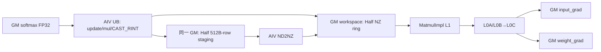

# FusedLinearCrossEntropyLossGrad A2/A3 ACLNN 算子知识

## 算子速览

| 项目 | 内容 |
|---|---|
| 实际入口 | CANN 9.1.0 公开两段式 API `aclnnFusedLinearCrossEntropyLossGradGetWorkspaceSize` / `aclnnFusedLinearCrossEntropyLossGrad`；固定仓没有 V2 或其它更新版本。 |
| 计算语义 | 对词汇表分片上的 softmax/logits 梯度做目标位置减一和上游梯度缩放，再计算 `input_grad=grad_logits·weight`、`weight_grad=grad_logits^T·input`。 |
| 输入输出 | `grad:[BT]` FP32，`input:[BT,H]`、`weight:[V,H]` 为同一 FP16/BF16，mask 为 BOOL/UINT8、target 为 INT32/INT64；输出 `[BT,H]` 与 `[V,H]` 为输入半精度，均为 ND。 |
| 执行类型 | 单 Kernel `MIX_CV`，`KERNEL_TYPE_MIX_AIC_1_2`；一个 AIC 对两个 AIV。两条 Route 均同时包含 AIC Matmul 与 AIV Vector。 |
| Kernel 路线 | R-001：key 100，高性能 `softmaxOptional!=nullptr`；R-002：key 101，省显存 `softmaxOptional==nullptr`。 |
| 核心资源 | R-001 使用输入 `softmax` 的 GM 存储、Half/NZ 用户 workspace、Matmul L1/L0 与 AIV 双缓冲 UB；R-002 使用三组双缓冲 FP32 Cube 结果、两块 FP32 累加 workspace、Matmul L1/L0 与分阶段 UB pool。 |
| 来源闭包 | `source_closed`：公开 API、L0 launcher、平台检查、Tiling/POD、两条 MIX_CV Route、AIC/AIV body、workspace、同步、尾块及 A2/A3 构建接线均闭合到固定 Commit；通用 `MatmulImpl` 的内部 L1/L0 调度作为明确库边界。 |
| 验证状态 | 已完成源码闭包检查；本次知识提取未执行编译、真机、数值或性能测试。 |

## 接口与语义

### 计算语义

令 `G=grad:[BT]`、`X=input:[BT,H]`、`W=weight:[V,H]`，`m` 为 target mask，`t` 为本地 target 索引。

高性能路线直接消费调用者给出的 `S=softmax:[BT,V]`：

```text
若 m[i]==false：S[i,t[i]] = S[i,t[i]] - 1
D[i,j] = S[i,j] * G[i]
input_grad  = cast_half(D) * W
weight_grad = cast_half(D)^T * X
```

省显存路线不物化完整 softmax 输入，而是按 `[baseBT,baseV]` 块执行：

```text
L = X * W^T
D = exp(L - logits_max[:,None]) / sum_exp_logits[:,None]
若 m[i]==false：D[i,t[i]] -= 1
D *= G[:,None]
input_grad  = sum_V(cast_half(D) * W)      # FP32 workspace 累加
weight_grad = sum_BT(cast_half(D)^T * X)   # FP32 workspace 累加
最终以 CAST_RINT 转回 FP16/BF16
```

两条路线都在送入 Cube 前把 FP32 `D` 以 `RoundMode::CAST_RINT` 降成输入半精度；R-001 的 Matmul 输出直接是 HalfType，R-002 的三个 Matmul 输出为 FP32，最后再降精度。`labelSmoothing` 只接受 0，Device 不消费该 attr。

### 输入、输出与属性

| 参数 | shape/layout | dtype | 约束、默认值与语义 |
|---|---|---|---|
| `grad` | `[BT]` / ND | FP32 | 必选；支持空 Tensor。 |
| `input` | `[BT,H]` / ND | FP16/BF16 | 必选；dtype 与 `weight`、两输出一致。 |
| `weight` | `[V,H]` / ND | FP16/BF16 | 必选；高性能 API 检查 `V>=128`，省显存分支不执行该下限。 |
| `targetMask` | `[BT]` BOOL，或至少 `ceil(BT/8)` 个 UINT8 / ND | BOOL/UINT8 | UINT8 按 bit 索引；0 表示需在目标列减一。 |
| `maskedTarget` | `[BT]` / ND | INT32/INT64 | 本地词表索引；API 只检查长度，不检查值域，Device 仅在 `targetMask==false` 时读取。 |
| `labelSmoothing` | 标量 | FP32 | 当前只能为 0。 |
| `logitsMaxOptional` | `[BT]` / ND | FP32 | R-002 必选；R-001 输入即使非空也不传给 L0 op。 |
| `sumExpLogitsOptional` | `[BT]` / ND | FP32 | R-002 必选；R-001 不消费。 |
| `softmaxOptional` | `[BT,V]` / ND | FP32 | 非空选择 R-001；Kernel 原地更新并复用其存储形成 HalfType staging。空指针选择 R-002。 |
| `inputGradOut` | `[BT,H]` / ND | FP16/BF16 | 必选输出。 |
| `weightGradOut` | `[V,H]` / ND | FP16/BF16 | 必选输出；公开文档参数表误写第二维等于 `grad` 长度，API 检查与 L0 分配均以 `H` 为第二维。 |

### 入口与版本

固定 Commit 只提供 `aclnnFusedLinearCrossEntropyLossGrad` 版本族。第一段创建 executor、完成校验和连续化、添加一个 `FusedLinearCrossEntropyLossGrad` AICore launcher，并返回 workspace；第二段 `CommonOpExecutorRun` 在调用者 stream 上执行。普通 `Contiguous`、`ViewCopy` 和 executor 内部调度是框架边界。

公开产品表明确 A2 与 A3 支持，Ascend 950PR/950DT 不支持；API `CheckPlatformSupported` 只接受 `ASCEND910B` 和 `ASCEND910_93`，OpDef 与两份内容相同的 binary config 也只注册 `ascend910b`、`ascend910_93`。八个 binary specialization 覆盖 `HalfType∈{BF16,FP16}`、`TargetMaskType∈{BOOL,UINT8}`、`MaskedTargetType∈{INT32,INT64}`。

## Host/Launcher 执行流程

### 参数校验与前处理

1. `CheckNotNull` 要求五个必选输入和两输出非空；`softmaxOptional==nullptr` 时还要求 `logitsMaxOptional`、`sumExpLogitsOptional` 均非空。
2. `CheckDtypeValid` 检查 dtype 组合；`CheckFormatValid` 要求所有有效 Tensor 的 storage format 为 ND；`CheckAttrValid` 要求 `labelSmoothing==0`。
3. `CheckShapeValid` 检查 rank、`input[0]==BT`、`weight[1]==H`、mask/target 长度、可选输入和输出 shape。仅 R-001 检查 `V>=128`。
4. 空域在 `input->IsEmpty() || weight->IsEmpty()` 时直接返回 workspace 0 和空 executor 流程，不做平台检查、不添加 Kernel，也不执行 ViewCopy。
5. 非空时依次对必选输入做 `Contiguous`，再按 Route 连续化 `softmax` 或 `logitsMax/sumExpLogits`；任何框架调用失败由 `CHECK_RET` 终止。
6. 连续化后检查平台，仅 A2/A3 通过；L0 创建两个内部输出 Tensor，添加唯一 AICore launcher，再用两次 `ViewCopy` 绑定用户输出。

### 参数、Workspace 与生命周期

L0 launcher 的一个节点持有八输入、两输出和 `labelSmoothing` attr。Tiling 取 `C=GetCoreNumAic()`、`2C` 个 AIV，设置 `blockDim=C`；task type 把每个逻辑 block 编码为 1 AIC:2 AIV。caller 提供的总 workspace 包含用户区与 `GetLibApiWorkSpaceSize()` 系统区，并须保持到 stream 完成。

R-001 设 `BM=128,BN=256,BK=64`；若 `BT>=23296` 则交换为 `BM=256,BN=128`。记：

```text
BT16 = ceil(BT/16)*16
Vh32 = ceil((2V)/32)*16        # Half 元素数
Vh512 = ceil((2V)/512)*256     # Half 元素数
wsNum = min(ceil((2C-1)/mm1BaseNCnt)+1, max(mm1BaseMCnt,mm2BaseMCnt))
slice_elems = BM * max(Vh32, BT16)
user_workspace_bytes = 2 * wsNum * slice_elems
workspace_total = user_workspace_bytes + system_workspace
```

`userWorkspaceSize` 以 Half 元素计；Device 按 `slice_elems=userWorkspaceSize/wsNum` 切为循环使用的 NZ 槽。

R-002 固定 `baseBT=128,baseV=256`。记 `S0=baseBT*baseV`、`S1=baseBT*H`、`S2=baseV*H`（均为 FP32 元素）：

```text
user_workspace_bytes = 4 * (2*C*S0 + 2*C*S1 + 2*C*S2 + BT*H + V*H)
workspace_total = user_workspace_bytes + system_workspace
offset(mm0[0],mm0[1]) = 0, 4*C*S0
offset(mm1[0],mm1[1]) = 8*C*S0, 8*C*S0 + 4*C*S1
offset(mm2[0],mm2[1]) = 8*C*S0 + 8*C*S1, + 4*C*S2
offset(mm1Accum) = 8*C*(S0+S1+S2)
offset(mm2Accum) = offset(mm1Accum) + 4*BT*H
```

AIV 0、1 分别用 `InitGlobalMemory` 清零 `mm1Accum`、`mm2Accum`；第一次 `SyncAllVecMTE3` 保证后续消费前清零完成。两个 ping-pong result 槽由 executor workspace 持有，Kernel 完成后统一失效。

### 启动图与失败传播

```text
aclnn...GetWorkspaceSize
  -> CheckParam -> Contiguous -> CheckPlatformSupported
  -> l0op::FusedLinearCrossEntropyLossGrad
  -> ADD_TO_LAUNCHER_LIST_AICORE -> Tiling key 100/101, blockDim=C
  -> ViewCopy(output0/output1)
aclnn...(workspace,executor,stream)
  -> CommonOpExecutorRun
  -> fused_linear_cross_entropy_loss_grad [单 Kernel, MIX_AIC_1_2]
     key 100: AIV update/scale/cast/NZ <-> AIC MM1/MM2
     key 101: AIC MM0 -> AIV softmax/update -> AIC MM1/MM2 -> AIV accumulation/cast
```

Tiling `GetTiling` 失败、shape/resource guard 失败返回 `GRAPH_FAILED`，阻止 launch。L0 添加或 ViewCopy 失败阻止 executor 交付。Kernel 对未知 key 没有显式错误分支，会静默结束；第二段 launch 错误由 `CommonOpExecutorRun` 返回。

## Route 与参数设计

### 分核与资源计算

R-001 的两次 Matmul 分块：MM1 为 `[BT,V]·[V,H]`，`M`/`N` 基块为 `BM`/`BN`；MM2 为 `[V,BT]·[BT,H]`，`M`/`N` 同样为 `BM`/`BN`，K 基块 64。两者 `stepKa=stepKb=4`、`depthA1=depthB1=8`。AIV 按 `ceil(BT/(2C))` 行更新 target；每轮 UB 可容纳的行数为 `floor((UB-32)/2/(V64*4))`，再重新均分到 `2C` AIV。该值为 0 时源码虽计算 partial 参数，随后明确 Tiling 失败。

R-002 以 `128×256` 滑窗覆盖 `[BT,V]`，窗口内以对角线顺序迭代；每轮最多 C 个块。MM0=`[baseBT,H]·[baseV,H]^T`，MM1=`D·W`，MM2=`D^T·X`。AIV V1 将一个 MM0 块按两个 AIV 分行；V2 分别按相同 row/col 的任务组累加到全局 FP32 accumulator。`CalcUBUsage` 决定一次处理多行还是把单行 H 分 cycle，最终 cast 同样分行/分 cycle。

### Route 选择

| 顺序 | Route | Key/模板 | 精确选择条件与优先级 | 不适用去向 |
|---:|---|---|---|---|
| 1 | R-001 高性能 | `100` / `FusedLinearCrossEntropyLossGradHighPerf<MM,...>` | 非空，平台 A2/A3，`softmaxOptional!=nullptr`，全部 API 检查及 R-001 Tiling guard 通过 | `softmaxOptional==nullptr` 去 R-002；guard 失败为 `GRAPH_FAILED`。 |
| 2 | R-002 省显存 | `101` / `FusedLinearCrossEntropyLossGradMemFriendly<...,MM0,MM1,MM2>` | 非空，平台 A2/A3，`softmaxOptional==nullptr`，两项统计输入非空，API 检查及 R-002 Tiling guard 通过 | 缺统计输入或 guard 失败为错误。 |

```text
if input.empty || weight.empty:
  workspace=0; no kernel
else if platform not in {ASCEND910B, ASCEND910_93}:
  ACLNN_ERR_RUNTIME_ERROR
else if softmaxOptional != nullptr:
  HighPerfTilingFunc -> key 100 -> R-001
else:
  MemFriendlyTilingFunc -> key 101 -> R-002
```

### 模板/实现执行矩阵

| Route | key/selector | dtype/shape/platform 完整命中条件 | 执行族与 kernel 节点 | 实际模板/body | 内存与同步特征 | tail/fallback |
|---|---|---|---|---|---|---|
| R-001 高性能 | `100`，softmax 非空 | A2/A3；八种 binary dtype 组合；`V>=128`、`BT<=65536`、`128<=V<=65280`、`H<=65535`、一行可入 UB | 单 MIX_CV：AIV update→scale/cast/NZ，AIC MM1→MM2 | 一个 `MatmulImpl<GM/NZ(trans),GM/ND,GM/ND,GM/ND,MM_MDL_CFG>` 对象类型，实例 `mm1/mm2`；`ProcessVecFull/ProcessCubeFull` | softmax 输入原地 FP32→Half staging；NZ 环形槽；flags 0/1/2/3 | M/N/K 尾块；UB partial 路线未实现而失败；unknown key 静默。 |
| R-002 省显存 | `101`，softmax 为空 | A2/A3；八种 dtype 组合；统计输入有效；`H<=65535`；三个 `GetTiling` 成功 | 单 MIX_CV：AIC MM0→AIV V1→AIC MM1/MM2→AIV V2/final cast | `MM0(ND×ND^T→FP32)`、`MM1(ND×ND→FP32)`、`MM2(ND^T×ND→FP32)`，均 `MM_MDL_CFG` | 三组 result ping-pong、两块 FP32 accumulator；flags 0..4 与 FIX/MTE/V-S events | BT/V 的 128/256 尾块；H 大时按 cycle；无替代 fallback。 |

### 隐藏性能 Guard

| Guard | Host/Tiling 条件 | Device/资源原因 | 影响 Route | 不满足时去向 | 源码符号 |
|---|---|---|---|---|---|
| Route 可选输入 | `softmax!=nullptr` | 决定是直接复用 D，还是重新计算 logits/softmax | 全部 | 另一 Route | `FusedLinearCrossEntropyLossGradTilingFunc` |
| 高性能 BT 上限 | `BT16-mm2TailK<=65535` | `DataCopyParams`/NZ stride 字段为 16-bit 范围 | R-001 | `GRAPH_FAILED` | `HighPerfTilingFunc` |
| 高性能 V 下限 | `4V>=512`，且 API 另有 `V>=128` | 每行至少 512B；copy/NZ specialization 不支持更小列 | R-001 | `GRAPH_FAILED` | `CheckShapeValid`、`HighPerfTilingFunc` |
| 高性能 V 上限 | `V<=255*256=65280` | Half 行 512B 对齐后的 stride 要小于 65536B | R-001 | `GRAPH_FAILED` | `HighPerfTilingFunc` |
| H 上限 | `H<=65535` | Matmul/copy shape 字段窄化边界 | R-001/R-002 | `GRAPH_FAILED` | 两个 Tiling 函数 |
| R-001 UB full-row | `floor((UB-32)/2/(V64*4))>0` | 双缓冲必须至少容纳一行 FP32 D；partial body 不可达 | R-001 | `GRAPH_FAILED` | `HighPerfTilingFunc` |
| base 交换 | `BT>=23296` | 固定源码选择 `BM=256,BN=128`，否则 `128,256` | R-001 | 使用另一 base，不是失败 | `HighPerfTilingFunc` |
| NZ 槽数 | `wsNum<=100` 是 Device 固定数组隐含要求 | `A1NZGMs[MAX_WS_NUM]` 与 `hasA1NZGMTask` 固定 100 | R-001 | Host 用公式通常受 `2C` 限制；无独立显式失败 | `HighPerfTilingFunc`、`Init` |
| R-002 AIC 数 | `aicNum==0` 时强制 1；Device 数组最多 30 | result 数组与 iterator cache 固定 30 | R-002 | 固定仓无 `aicNum<=30` 显式 guard | `MemFriendlyTilingFunc`、`SlidingWindowBlockIterator` |
| UB 多行/分 cycle | `CalcUBUsage(targetByteSize,H)` | H 行不能一次入 UB 时沿 H 切片 | R-002 | 切换 large helper，不失败 | `CalcUBUsage` |
| target 值域 | API 无 `0<=maskedTarget<V` 检查 | scalar `GetValue/SetValue` 直接组成 GM/UB offset | 两 Route | 固定仓无 fallback；调用者必须保证语义有效 | `ProcessUpdate`、`UpdateV1` |

### POD/ABI

`TILING_DATA_FIELD_DEF` 与 `TCubeTiling` 的最终生成 ABI 位于构建环境提供的头，固定仓未给出宏展开，因此无法可靠写 `sizeof/alignof/offsetof`。下表严格保持声明顺序；嵌套 `TCubeTiling` 记录本算子明确生产/覆盖、且 Device 明确读取的字段，其余布局不推测。

| 结构 | 字段 | 类型/位宽 | ABI 布局 | 单位 | Host/launcher producer | Device consumer | 边界 |
|---|---|---|---|---|---|---|---|
| `HighPerfTilingData` | `mm1Tiling` | `TCubeTiling` | 序号 0；精确 size/offset 不可见 | Matmul 参数 | `GetTiling`；覆盖 stepKa/stepKb=4、depthA1/depthB1=8 | `mm1.Init`、shape 字段 | ND/NZ、BM/BN/BK specialization |
| 同上 | `mm2Tiling` | `TCubeTiling` | 序号 1；精确 size/offset 不可见 | Matmul 参数 | `GetTiling`；另覆盖 baseM/baseN/baseK | `mm2.Init`、shape 字段 | A 转置，K tail |
| 同上 | `BT` | uint64/64 | 序号 2；精确 offset 不可见 | 元素/行 | `softmaxShape[0]` | GM extent、循环 | BT guard |
| 同上 | `V` | uint64/64 | 序号 3；精确 offset 不可见 | 元素/行 | `softmaxShape[1]` | GM extent、循环 | V guard |
| 同上 | `H` | uint64/64 | 序号 4；精确 offset 不可见 | 元素/行 | `inputShape[1]` | GM stride、Matmul | `<=65535` |
| 同上 | `BT_16ALIGNED` | uint64/64 | 序号 5；精确 offset 不可见 | 元素 | `ceil(BT/16)*16` | MM2 NZ stride | 向上对齐 |
| 同上 | `btPerCore` | uint64/64 | 序号 6；精确 offset 不可见 | 行/AIV | `ceil(BT/aivNum)` | update 分核 | 至少 1 |
| 同上 | `btLastCore` | uint64/64 | 序号 7；精确 offset 不可见 | 行 | `BT%btPerCore` | 尾 AIV update | 0 表示无尾任务 |
| 同上 | `V64BAlignedSize` | uint64/64 | 序号 8；精确 offset 不可见 | FP32 元素/行 | 64B 对齐公式 | UB stride/cast | 向上对齐 |
| 同上 | `VOut512BAlignedSize` | uint64/64 | 序号 9；精确 offset 不可见 | Half 元素/行 | 512B 对齐公式 | Half staging stride | 向上对齐 |
| 同上 | `VOut32BAlignedSize` | uint64/64 | 序号 10；精确 offset 不可见 | Half 元素/行 | 32B 对齐公式 | MM1 NZ copy | 向上对齐 |
| 同上 | `targetMaskSize` | uint64/64 | 序号 11；精确 offset 不可见 | 元素/byte tensor length | input tensor shape size | mask GM extent | BOOL/UINT8 物理长度 |
| 同上 | `userWorkspaceSize` | uint64/64 | 序号 12；精确 offset 不可见 | Half 元素 | NZ workspace 公式 | slot 切片 | 总字节再乘 2 |
| 同上 | `taskCntTotal` | uint64/64 | 序号 13；精确 offset 不可见 | partial task | partial 分支公式 | 可达 full body 不读取 | inactive |
| 同上 | `aicNum` | uint32/32 | 序号 14；精确 offset 不可见 | core | `GetCoreNumAic` | Cube/AIV 调度 | 平台值 |
| 同上 | `aivNum` | uint32/32 | 序号 15；精确 offset 不可见 | core | `2*aicNum` | AIV 分核/epoch | 固定 1:2 |
| 同上 | `btLastCoreId` | uint32/32 | 序号 16；精确 offset 不可见 | core id | `BT/btPerCore` | update 尾核 | 可等于 aivNum |
| 同上 | `copyOutDstStride` | uint32/32 | 序号 17；精确 offset 不可见 | byte | `VOut512Byte-2V` | Half staging DataCopy | 512B 行对齐 |
| 同上 | `btPerEpochSingle` | uint32/32 | 序号 18；精确 offset 不可见 | 行/AIV | UB full-row 公式 | V1 epoch | 必须非零 |
| 同上 | `additionalEndEpochId` | uint32/32 | 序号 19；精确 offset 不可见 | epoch | 固定 Host 未赋值 | 固定 Device 未读取 | inactive |
| 同上 | `additionalEndCoreId` | uint32/32 | 序号 20；精确 offset 不可见 | core id | 固定 Host 未赋值 | 固定 Device 未读取 | inactive |
| 同上 | `additionalBtTaskNum` | uint32/32 | 序号 21；精确 offset 不可见 | 行 | 固定 Host 未赋值 | 固定 Device 未读取 | inactive |
| 同上 | `btPerEpochTotal` | uint32/32 | 序号 22；精确 offset 不可见 | 行 | `btPerEpochSingle*aivNum` | epoch row offset | full-row Route |
| 同上 | `quebindSoftmaxByteSize` | uint32/32 | 序号 23；精确 offset 不可见 | byte/slot | UB 与 NZ max 公式 | Queue 初始化 | 双缓冲 |
| 同上 | `copyInDstStride` | uint32/32 | 序号 24；精确 offset 不可见 | 32B block | V FP32 行 64B 对齐判断 | `CopyInVecFull` | 0 或 1 |
| 同上 | `epochCnt` | uint32/32 | 序号 25；精确 offset 不可见 | epoch | `ceil(BM/btPerEpochTotal)` | full block loop | 至少 1 |
| 同上 | `lastEpochCnt` | uint32/32 | 序号 26；精确 offset 不可见 | epoch | `ceil(mm1TailM/btPerEpochTotal)` | tail block loop | 至少 1 |
| 同上 | `epochOutCoreId` | uint32/32 | 序号 27；精确 offset 不可见 | core id | 固定 Host 未赋值 | 固定 Device 未读取 | inactive |
| 同上 | `using32BlockCnt` | uint32/32 | 序号 28；精确 offset 不可见 | 32B block | partial UB 公式 | 可达 body 不读取 | partial 随后失败 |
| 同上 | `sizePerTask` | uint32/32 | 序号 29；精确 offset 不可见 | FP32 元素 | partial UB 公式 | 可达 body 不读取 | inactive |
| 同上 | `taskCntPerV` | uint32/32 | 序号 30；精确 offset 不可见 | task/row | `ceil(V/sizePerTask)` | 可达 body 不读取 | inactive |
| 同上 | `sizeLastTask` | uint32/32 | 序号 31；精确 offset 不可见 | 元素 | V partial tail | 可达 body 不读取 | inactive |
| 同上 | `mm1BaseMCnt` | uint32/32 | 序号 32；精确 offset 不可见 | block | `ceil(BT/baseM)` | MM1 outer loop | 至少 1 |
| 同上 | `mm1BaseNCnt` | uint32/32 | 序号 33；精确 offset 不可见 | block | `ceil(H/baseN)` | MM1 schedule/wsNum | 至少 1 |
| 同上 | `mm1TailM` | uint32/32 | 序号 34；精确 offset 不可见 | 元素 | `BT%baseM`，0→baseM | MM1 tail | 有效 M |
| 同上 | `mm1TailN` | uint32/32 | 序号 35；精确 offset 不可见 | 元素 | `H%baseN`，0→baseN | MM1 tail | 有效 N |
| 同上 | `mm2BaseMCnt` | uint32/32 | 序号 36；精确 offset 不可见 | block | `ceil(V/baseM)` | MM2 outer loop | 至少 1 |
| 同上 | `mm2BaseNCnt` | uint32/32 | 序号 37；精确 offset 不可见 | block | `ceil(H/baseN)` | MM2 schedule | 至少 1 |
| 同上 | `mm2BaseKCnt` | uint32/32 | 序号 38；精确 offset 不可见 | block | `ceil(BT/baseK)` | AIV ND2NZ | 至少 1 |
| 同上 | `mm2TailM` | uint32/32 | 序号 39；精确 offset 不可见 | 元素 | `V%baseM`，0→baseM | MM2 tail | 有效 M |
| 同上 | `mm2TailN` | uint32/32 | 序号 40；精确 offset 不可见 | 元素 | `H%baseN`，0→baseN | MM2 tail | 有效 N |
| 同上 | `mm2TailK` | uint32/32 | 序号 41；精确 offset 不可见 | 元素 | `BT%baseK`，0→baseK | MM2/ND2NZ tail | 有效 K |
| 同上 | `mm2BasePerVec` | uint32/32 | 序号 42；精确 offset 不可见 | K block/AIV | `ceil(mm2BaseKCnt/aivNum)` | ND2NZ 分核 | 至少 1 |
| 同上 | `mm2BaseLastVec` | uint32/32 | 序号 43；精确 offset 不可见 | K block | 商余分核 | 尾 AIV | 可为 0 |
| 同上 | `mm2BaseLastVecId` | uint32/32 | 序号 44；精确 offset 不可见 | core id | 商余分核 | ND2NZ 任务判断 | 尾核 id |
| 同上 | `mm2LastBaseK` | uint32/32 | 序号 45；精确 offset 不可见 | 元素 | `baseKCnt*baseK-BT` | 固定 Device 未读取 | inactive |
| 同上 | `wsNum` | uint32/32 | 序号 46；精确 offset 不可见 | slot | workspace 公式 | NZ 环形槽 | Device 容量 100 |
| `MemFriendlyTilingData` | `mm0Tiling` | `TCubeTiling` | 序号 0；精确 size/offset 不可见 | Matmul 参数 | MM0 `GetTiling` | `mm0.Init`/shape | ND×ND^T→FP32 |
| 同上 | `mm1Tiling` | `TCubeTiling` | 序号 1；精确 size/offset 不可见 | Matmul 参数 | MM1 `GetTiling` | `mm1.Init`/shape | ND×ND→FP32 |
| 同上 | `mm2Tiling` | `TCubeTiling` | 序号 2；精确 size/offset 不可见 | Matmul 参数 | MM2 `GetTiling` | `mm2.Init`/shape | ND^T×ND→FP32 |
| 同上 | `aicNum` | uint32/32 | 序号 3；精确 offset 不可见 | core | `GetCoreNumAic`，0→1 | 分核/result 数组 | 固定数组 30 |
| 同上 | `aivNum` | uint32/32 | 序号 4；精确 offset 不可见 | core | `2*aicNum` | V1/V2/final 分核 | 固定 1:2 |
| 同上 | `BT` | uint32/32 | 序号 5；精确 offset 不可见 | 元素/行 | grad shape 窄化 | GM/iterator | 固定 Host 无溢出 guard |
| 同上 | `V` | uint32/32 | 序号 6；精确 offset 不可见 | 元素/行 | weight shape 窄化 | GM/iterator | 固定 Host 无溢出 guard |
| 同上 | `H` | uint32/32 | 序号 7；精确 offset 不可见 | 元素/行 | weight shape 窄化 | stride/UB/Matmul | `<=65535` |
| 同上 | `targetMaskSize` | uint32/32 | 序号 8；精确 offset 不可见 | tensor 元素 | mask shape size 窄化 | mask GM extent | BOOL/UINT8 |
| 同上 | `baseBT` | uint32/32 | 序号 9；精确 offset 不可见 | 元素 | 固定 128 | iterator/MM | 固定值 |
| 同上 | `baseV` | uint32/32 | 序号 10；精确 offset 不可见 | 元素 | 固定 256 | iterator/MM/V1 | 固定值 |
| 同上 | `baseBTTail` | uint32/32 | 序号 11；精确 offset 不可见 | 元素 | `BT%128`，0→128 | MM/V1/V2 tail | 有效行 |
| 同上 | `baseVTail` | uint32/32 | 序号 12；精确 offset 不可见 | 元素 | `V%256`，0→256 | MM/V1/V2 tail | 有效列 |
| 同上 | `mm0ResultSize` | uint32/32 | 序号 13；精确 offset 不可见 | FP32 元素 | `baseBT*baseV` | per-core slot | uint32 乘法 |
| 同上 | `mm0ResultSizePerEpoch` | uint32/32 | 序号 14；精确 offset 不可见 | FP32 元素 | `mm0ResultSize*aicNum` | workspace slot stride | uint32 乘法 |
| 同上 | `V1MainSize` | uint32/32 | 序号 15；精确 offset 不可见 | FP32 元素 | `mm0ResultSize/2` | V1 queue/cast | 两 AIV 分块 |
| 同上 | `mm1ResultSize` | uint32/32 | 序号 16；精确 offset 不可见 | FP32 元素 | `baseBT*H` | MM1 result slice | uint32 乘法 |
| 同上 | `mm1ResultSizePerEpoch` | uint32/32 | 序号 17；精确 offset 不可见 | FP32 元素 | `mm1ResultSize*aicNum` | workspace stride | uint32 乘法 |
| 同上 | `mm2ResultSize` | uint32/32 | 序号 18；精确 offset 不可见 | FP32 元素 | `baseV*H` | MM2 result slice | uint32 乘法 |
| 同上 | `mm2ResultSizePerEpoch` | uint32/32 | 序号 19；精确 offset 不可见 | FP32 元素 | `mm2ResultSize*aicNum` | workspace stride | uint32 乘法 |
| 同上 | `V1InUBStride` | uint32/32 | 序号 20；精确 offset 不可见 | 32B block | V tail补齐 | V1 CopyIn | 仅尾 V block |
| 同上 | `V1OutUBStride` | uint32/32 | 序号 21；精确 offset 不可见 | 32B block | Half V tail补齐 | V1 CopyOut | 仅尾 V block |
| 同上 | `mmAccumRowOnetime` | uint32/32 | 序号 22；精确 offset 不可见 | 行 | `CalcUBUsage(UB/4,H)` | V2 row loop | 最小 1，H=0 特例为0 |
| 同上 | `mmAccumCyclePerRow` | uint32/32 | 序号 23；精确 offset 不可见 | cycle | 同上 | V2 large loop | 多行时 0 |
| 同上 | `mmAccumCntPerCycle` | uint32/32 | 序号 24；精确 offset 不可见 | FP32 元素 | 同上 | V2 large copy | 多行时 0 |
| 同上 | `mmAccumCntLastCycle` | uint32/32 | 序号 25；精确 offset 不可见 | FP32 元素 | 同上 | V2 last copy | 多行时 0 |
| 同上 | `V2MainSize` | uint32/32 | 序号 26；精确 offset 不可见 | FP32 元素 | `H*rows` 或 per-cycle | V2 queues | 32B 资源预算 |
| 同上 | `mmCastRowOnetime` | uint32/32 | 序号 27；精确 offset 不可见 | 行 | `CalcUBUsage(UB/2,H)` | final row loop | 最小 1，H=0 特例为0 |
| 同上 | `mmCastCyclePerRow` | uint32/32 | 序号 28；精确 offset 不可见 | cycle | 同上 | final large loop | 多行时 0 |
| 同上 | `mmCastCntPerCycle` | uint32/32 | 序号 29；精确 offset 不可见 | FP32 元素 | 同上 | final large copy | 多行时 0 |
| 同上 | `mmCastCntLastCycle` | uint32/32 | 序号 30；精确 offset 不可见 | FP32 元素 | 同上 | final last copy | 多行时 0 |
| 同上 | `castMainSize` | uint32/32 | 序号 31；精确 offset 不可见 | FP32 元素 | `H*rows` 或 per-cycle | cast queue | 源码 `CAST_RINT` |
| 同上 | `poolByteSize` | uint32/32 | 序号 32；精确 offset 不可见 | byte | pool max 公式 | 三个 pool 初始化 | 内部 layout 为库边界 |
| 同上 | `mm1CastRowPerVec` | uint32/32 | 序号 33；精确 offset 不可见 | 行/AIV | `BT/aivNum` | input grad final 分核 | 商 |
| 同上 | `mm1CastExtraRowCnt` | uint32/32 | 序号 34；精确 offset 不可见 | 行/core count | `BT%aivNum` | 前若干 AIV 多一行 | 余数 |
| 同上 | `mm2CastRowPerVec` | uint32/32 | 序号 35；精确 offset 不可见 | 行/AIV | `V/aivNum` | weight grad final 分核 | 商 |
| 同上 | `mm2CastExtraRowCnt` | uint32/32 | 序号 36；精确 offset 不可见 | 行/core count | `V%aivNum` | 前若干 AIV 多一行 | 余数 |

### Route 源码闭包

| Route | Key/selector | Host/Tiling producer | POD/参数 | Kernel entry/router | Kernel body/直接依赖 | 构建接线 |
|---|---|---|---|---|---|---|
| R-001 高性能 | softmax 非空 / 100 | `HighPerfTilingFunc` | `HighPerfTilingData` + mm1/mm2 `TCubeTiling` | `fused_linear_cross_entropy_loss_grad` key 100 | `FusedLinearCrossEntropyLossGradHighPerf` + `MatmulImpl` 当前实例 | OpDef `ascend910b/ascend910_93`；两份 binary JSON；Host CMake |
| R-002 省显存 | softmax 为空 / 101 | `MemFriendlyTilingFunc` | `MemFriendlyTilingData` + mm0/mm1/mm2 `TCubeTiling` | 同一 entry key 101 | `FusedLinearCrossEntropyLossGradMemFriendly`、`SlidingWindowBlockIterator` + 三个 `MatmulImpl` 实例 | 同上 |

## Kernel 实现

### 公共执行流程

唯一 entry 解析 tiling key，设置 `KERNEL_TYPE_MIX_AIC_1_2`，按 binary config 注入的三种 dtype 宏实例化 Route。`ASCEND_IS_AIV` 分支使用 `GetBlockIdx()` 的两个 AIV 与 `blockIdx/2` 配对，AIC 分支使用逻辑 `blockIdx`。两 Route 共享 `MM_MDL_CFG`：不开 `intrinsicsLimit`、不开 Vec ND2NZ、不开 unit flag、不开 K reorder；Matmul 通用库负责从 GM 到 L1/L0A/L0B、L0C 累加与 Fixpipe/GM 的内部实现，固定仓不展开其具体缓冲容量。

### Route R-001：高性能

#### 适用条件

##### 选择证据

| 层级 | 文件 | 符号 | 源码谓词/参数 | 结果/下一跳 |
|---|---|---|---|---|
| API | `op_api/aclnn_fused_linear_cross_entropy_loss_grad.cpp` | `CheckShapeValid` | softmax 非空时 `[BT,V]` 且 `V>=128` | 继续或参数错误 |
| Tiling | `fused_linear_cross_entropy_loss_grad_tiling.cpp` | `FusedLinearCrossEntropyLossGradTilingFunc` | `softmax!=nullptr` | `HighPerfTilingFunc`、key 100 |
| Tiling | 同上 | `HighPerfTilingFunc` | BT/V/H/UB guard 与两次 `GetTiling` 成功 | `blockDim=C`；否则 `GRAPH_FAILED` |
| Router | `op_kernel/fused_linear_cross_entropy_loss_grad.cpp` | entry key 100 | `TILING_KEY_IS(100)` | 实例化 HighPerf body |

#### Device 数据流

##### 函数级调用链

```text
fused_linear_cross_entropy_loss_grad(...)
  -> HighPerf::Init
  -> AIV ProcessVec
     -> ProcessUpdate -> ProcessVecFull
     -> CopyInVecFull -> MulVecFull -> CastVecFull -> CopyOutVecFull
     -> SuperviseMM1/SuperviseMM2
  -> AIC ProcessCube
     -> ListeningMM1 -> LaunchMM1 -> mm1.IterateAll
     -> ListeningMM2 -> LaunchMM2 -> mm2.IterateAll
```

##### 源码等价伪码

```text
# AIV
for owned row: if !mask: softmax[row,target]-=1
all_AIV_barrier(flag1)
for each BM row block:
  wait NZ slot if still owned by AIC
  read FP32 softmax rows -> multiply grad -> CAST_RINT Half
  write aligned Half staging into softmax GM and NZ slot
  all_AIV_barrier(flag0); notify paired AIC(flag2)
for each V-side BM block:
  wait released NZ slot(flag3)
  read Half staging -> ND2NZ into slot; notify AIC(flag2)

# AIC
for each ready MM1 block: wait flag2; NZ * weight -> input_grad; release slot flag3
mm1.End; FIX_MTE2 event
for each ready MM2 block: wait flag2; NZ(trans) * input -> weight_grad; release slot flag3
```

#### 内存与数据搬运

##### 资源与搬运表

| 层级/缓冲区 | offset/地址公式 | extent/容量公式 | dtype/layout | producer | consumer | owner/lifetime | 对齐/复用 |
|---|---|---|---|---|---|---|---|
| GM `softmax` 原区 | FP32 `[row*V]`；Half staging `[row*Vh512]` 同一地址 | 原分配 `4*BT*V` bytes；Half 视图 `2*BT*Vh512` bytes | FP32 ND→Half 行 512B 对齐 | caller/AIV | AIV update、ND2NZ | 输入 owner；Kernel 内原地改写 | 所有 update 完成后才覆盖为 Half |
| GM NZ workspace | `slot*slice_elems` | `wsNum*BM*max(Vh32,BT16)*2` bytes | Half NZ | AIV `DataCopy`/ND2NZ | AIC MM1/MM2 | caller workspace；slot 环形生命周期 | flag3 后可覆盖 |
| UB `updateBuf` | 0 | 32 bytes | FP32 scalar | AIV | scalar update writeback | 每 AIV；update phase | 单缓冲 |
| UB `queBindSoftmax` | Queue slot | `2*quebindSoftmaxByteSize` bytes（按 Queue depth 2 的源码参数） | FP32/重解释 Half | MTE2/AIV | Vector/MTE3 | 每 AIV；ProcessVec | 64B FP32 行；兼容两块 BM×64 Half ND2NZ |
| L1/L0A/L0B/L0C | `MatmulImpl` 当前 `TCubeTiling` | 由 `baseM/baseN/baseK,stepK=4,depthA1/B1=8` 决定；精确字节固定仓库边界不可见 | A: NZ，B: ND；C: ND Half | Matmul library | Matmul/Fixpipe | 每 AIC Matmul 实例 | mm1/mm2 顺序复用 |
| GM outputs | `[m*H+n]` / `[v*H+n]` | `2*BT*H` / `2*V*H` bytes | FP16/BF16 ND | AIC Matmul | caller | 输出 owner | M/N tail 由 `SetSingleShape` |

##### 分层内存布局



##### 字节账、交接边与复用顺序

```text
workspace_user = 2 * wsNum * BM * max(Vh32,BT16)
UB_declared = 32 + 2*quebindSoftmaxByteSize
L1/L0 = TCubeTiling/MatmulImpl 固定库边界；本算子显式 stepKa=stepKb=4, depthA1=depthB1=8
```

| 边/复用子区 | producer | offset/extent | dtype/layout | consumer | ordering/sync | owner/lifetime | 安全条件 |
|---|---|---|---|---|---|---|---|
| FP32 update→Half overwrite | `ProcessUpdate` | 全 `[BT,V]` | FP32→Half staging | `ProcessVecFull` | 全 AIV flag1/MTE3 barrier | softmax input | update 全部完成后覆盖 |
| AIV→AIC NZ slot | `CopyOutVecFull`/`CopyOutMM2Nd2nzFull` | `slot*slice + nzOffset` | Half NZ | `LaunchMM1/2` | flag2，AIC wait | workspace slot | AIV MTE3 完成后 notify |
| AIC→AIV slot release | `mm.IterateAll` | 同一 slot | Half NZ | 下一次 AIV 写 | AIC flag3/MTE2，AIV wait | 环形 slot | Matmul 已读完 A 后释放 |

#### 同步、精度与尾块

##### 同步与数值边界表

| 阶段 | primitive/机制 | producer | consumer/等待点 | 保护对象 | 精度/尾块 |
|---|---|---|---|---|---|
| target update | MTE3↔S events + flag1 AIV barrier | scalar update | 后续全 AIV | softmax FP32 | BOOL 或 UINT8 bit；未检查 target 值域 |
| epoch staging | flag0 MTE2 AIV barrier | 所有 AIV GM read | GM overwrite | softmax alias | rowCnt tail |
| CV ready | `CrossCoreSetFlag<2,PIPE_MTE3>(2)` | paired AIV | AIC wait flag2 | NZ slot | Half/NZ |
| CV release | `CrossCoreSetFlag<2,PIPE_MTE2>(3)` | AIC | AIV wait flag3 | NZ slot | MM 已读入 |
| Vector 精度 | `Muls`→`PipeBarrier`→`Cast(...CAST_RINT)` | FP32 D | Half Matmul | UB/GM | V64 padded cast；有效 copy 长度为 V |
| MM tail | `SetSingleShape` | Tiling tail | Matmul | output block | MM1 M/N、MM2 M/N/K tail |

#### 关键实现

##### 符号证据表

| 阶段 | 文件 | 符号/模板实例 | 实现事实 |
|---|---|---|---|
| Host/Tiling producer | `op_host/fused_linear_cross_entropy_loss_grad_tiling.cpp` | `HighPerfTilingFunc` | 生成两套 Cube tiling、UB/epoch、NZ workspace 与 key 100 |
| Kernel entry/router | `op_kernel/fused_linear_cross_entropy_loss_grad.cpp` | key 100 `MatmulImpl<GM/NZ,...>` | 唯一 MIX entry 到 HighPerf specialization |
| Device body/helper | `op_kernel/fused_linear_cross_entropy_loss_grad_high_perf.h` | `ProcessVecFull`、`ListeningMM1/2` | 原地 staging、NZ 环、CV flag、两次 Matmul 与 tail |

### Route R-002：省显存

#### 适用条件

##### 选择证据

| 层级 | 文件 | 符号 | 源码谓词/参数 | 结果/下一跳 |
|---|---|---|---|---|
| API | `op_api/aclnn_fused_linear_cross_entropy_loss_grad.cpp` | `CheckNotNull/CheckShapeValid` | softmax 空，logitsMax/sumExp 均非空且 `[BT]` | 继续或参数错误 |
| Tiling | `fused_linear_cross_entropy_loss_grad_tiling.cpp` | selector | `softmax==nullptr` | `MemFriendlyTilingFunc`、key 101 |
| Tiling | 同上 | `MemFriendlyTilingFunc` | H<=65535、三次 `GetTiling` 成功 | `blockDim=C`；否则失败 |
| Router | `op_kernel/fused_linear_cross_entropy_loss_grad.cpp` | entry key 101 | `TILING_KEY_IS(101)` | 三 Matmul 实例 + MemFriendly body |

#### Device 数据流

##### 函数级调用链

```text
entry -> MemFriendly::Init -> SlidingWindowBlockIterator
  AIC ProcessCube: ProcessC1/MM0 -> wait V1 -> ProcessC2/MM1/MM2
  AIV ProcessVec: ProcessV1(Sub/Exp/Div/Update/Mul/Cast)
                 -> ProcessV2MM1/ProcessV2MM2(group accumulation)
                 -> ProcessFinalCastMM1/MM2
```

##### 源码等价伪码

```text
clear accum_input_grad on AIV0; clear accum_weight_grad on AIV1
for diagonal-window epoch e:
  AIC C1: MM0 X_block * W_block^T -> mm0[e%2]; set flag0
  AIV V1: wait flag0; split rows over paired AIV; softmax/update/mul/cast in place; set flag1
  AIC C2: wait flag1; MM1 D*W and MM2 D^T*X -> result[e%2]; set flag2
  AIV V2: wait flag2; first owner of equal row/col group sums result blocks into FP32 accumulators
all AIV barrier flag3
split BT and V rows over 2C AIV; CAST_RINT accumulators -> final Half outputs
```

#### 内存与数据搬运

##### 资源与搬运表

| 层级/缓冲区 | offset/地址公式 | extent/容量公式 | dtype/layout | producer | consumer | owner/lifetime | 对齐/复用 |
|---|---|---|---|---|---|---|---|
| `mm0ResultWS[2]` | `0`, `4*C*S0` + per-core `4*block*S0` | `2*C*S0*4` bytes | FP32 ND；同区 Half reinterpret | MM0/AIV V1 | V1/MM1/MM2 | workspace；epoch parity | ping-pong |
| `mm1ResultWS[2][C]` | `8*C*S0` + slot/core | `2*C*S1*4` bytes | FP32 ND | MM1 | AIV V2 | workspace；至本 epoch V2 | ping-pong |
| `mm2ResultWS[2][C]` | 前区后 + slot/core | `2*C*S2*4` bytes | FP32 ND | MM2 | AIV V2 | 同上 | ping-pong |
| `mm1AccumWS` | `8*C*(S0+S1+S2)` | `4*BT*H` bytes | FP32 ND | InitGlobalMemory/V2 | final cast | workspace；全 Kernel | 单写 owner 按 row group |
| `mm2AccumWS` | 前者 + `4*BT*H` | `4*V*H` bytes | FP32 ND | InitGlobalMemory/V2 | final cast | 同上 | 按 col group |
| UB V1 pool | pool 0 | `V1MainSize*4 + baseV*4` 显式 buffer bytes | FP32/重解释 Half | MTE2 | Vector/MTE3 | 每 AIV，V1 phase | 无 DB；两 AIV 分行 |
| UB V2 pool | chained pool | target queue depth2 与 addition queue depth2，各槽 `V2MainSize*4` | FP32 | MTE2 | Vector/MTE3 | 每 AIV，V2 phase | 分行或 H-cycle |
| UB cast pool | chained pool | queue depth2，每槽 `castMainSize*4` | FP32/重解释 Half | MTE2 | cast/MTE3 | final phase | 分行或 H-cycle |
| L1/L0A/L0B/L0C | 三个 `MatmulImpl` | 由三个 `TCubeTiling` 决定；固定仓不展开精确字节 | GM ND；MM0/MM2 一侧转置；C FP32 | Matmul library | Matmul/Fixpipe | 每 AIC | mm0/mm1/mm2 对象分别持有 |
| GM outputs | `[row*H]` | `2*BT*H` / `2*V*H` | FP16/BF16 ND | final AIV cast | caller | 输出 owner | 行/周期 tail |

##### 分层内存布局


##### 字节账、交接边与复用顺序

```text
workspace_user = 4*(2*C*S0 + 2*C*S1 + 2*C*S2 + BT*H + V*H)
UB_V1_declared = V1MainSize*4 + baseV*4
UB_V2_declared = 2*V2MainSize*4 + 2*V2MainSize*4
UB_cast_declared = 2*castMainSize*4
L1/L0 = 三个 TCubeTiling/MatmulImpl 的固定库边界
```

| 边/复用子区 | producer | offset/extent | dtype/layout | consumer | ordering/sync | owner/lifetime | 安全条件 |
|---|---|---|---|---|---|---|---|
| C1→V1 | MM0 Fixpipe | 当前 core/slot 的 `S0` | FP32 ND | paired AIV V1 | AIC set flag0/PIPE_FIX；AIV wait | slot parity | C1 完成 |
| V1→C2 | `CopyOutV1` | 同 mm0 slot 的有效 tail | Half ND view | AIC MM1/MM2 | paired AIV group MTE2 sync，set flag1/MTE3；AIC wait | 同 slot | 两个 AIV 均完成 |
| C2→V2 | MM1/MM2 | 当前 slot/core 的 S1/S2 | FP32 ND | group-owner AIV | AIC set flag2/PIPE_FIX；AIV wait | result slot | 两 Matmul End 完成 |
| V2→accumulator | group add | row/col 对应 `[rows,H]` | FP32 ND | 后续 epoch/final cast | 全 AIV flag3 在 phase/epoch 边界 | accumulator 全 Kernel | 每组只首个 AIV 写，避免冲突 |

#### 同步、精度与尾块

##### 同步与数值边界表

| 阶段 | primitive/机制 | producer | consumer/等待点 | 保护对象 | 精度/尾块 |
|---|---|---|---|---|---|
| C1→V1 | flag0 `PIPE_FIX` | MM0 AIC | paired AIV | mm0 slot | FP32，BT/V tail shape |
| V1 pair | flag4 group MTE2 | 两个 AIV | 对方 AIV | Half rewrite | odd BT tail 由 vec0 多一行 |
| V1→C2 | flag1 `PIPE_MTE3` | AIV | AIC | mm0 Half view | CAST_RINT；V tail stride |
| C2→V2 | flag2 `PIPE_FIX` | MM1/MM2 AIC | paired AIV | result slots | FP32 |
| AIV phase | flag3 all-AIV MTE3 | V1/V2/init/final | 下一 phase | ping-pong/accumulator | 保证清零与覆盖顺序 |
| scalar/vector | V↔S events | vector exp/div | scalar target update | V1 UB | target 值域未检查 |
| H tail | per-row or per-cycle helpers | Tiling `CalcUBUsage` | V2/final cast | accumulator row | last cycle 使用 `CntLastCycle` |

#### 关键实现

##### 符号证据表

| 阶段 | 文件 | 符号/模板实例 | 实现事实 |
|---|---|---|---|
| Host/Tiling producer | `op_host/fused_linear_cross_entropy_loss_grad_tiling.cpp` | `MemFriendlyTilingFunc`、`CalcUBUsage` | 三次 Cube tiling、workspace/UB、key 101 |
| Kernel entry/router | `op_kernel/fused_linear_cross_entropy_loss_grad.cpp` | `MM0/MM1/MM2` key 101 实例 | ND/transpose/output dtype 与 MM config |
| Device body/helper | `op_kernel/fused_linear_cross_entropy_loss_grad_mem_friendly.h` | iterator、`ProcessC1/V1/C2/V2/FinalCast` | 对角滑窗、多阶段 CV pipeline、分组累加和 tail |

## 算子特定优化

### Trick T-001：输入 softmax 原地重用为 Half staging 与 NZ 环形槽

#### 触发与源码依据

- 适用 Route：R-001。
- 触发条件：`softmaxOptional!=nullptr`、key 100、full-row UB guard 通过。
- Golden 来源：[`fused_linear_cross_entropy_loss_grad_high_perf.h:54-58`](../../../../../../../cann-ops-raw/ascendc/ops-nn/955f8b33985b6d72989ebff341bb9c2c564a51bc/matmul/fused_linear_cross_entropy_loss_grad/op_kernel/fused_linear_cross_entropy_loss_grad_high_perf.h#L54-L58)

**官方源码（固定 Commit 连续逐字摘录）**：

```cpp
softmaxHalfGM.SetGlobalBuffer((__gm__ HalfType *)softmax, tilingData.BT * tilingData.VOut512BAlignedSize);
auto nzGMSize = tilingData.userWorkspaceSize / tilingData.wsNum;
```

#### 机制与设计原因

AIV 先在原 FP32 softmax 上完成目标更新，跨全部 AIV 同步后才把行乘 grad 并 `CAST_RINT`；Half staging 复用同一 GM 地址，随后转成 NZ 环形 workspace 供两次 Cube。这样 R-001 的用户 workspace 只保存若干 NZ 槽，而不再保存完整 FP32/FP16 `D` 副本。flag2/flag3 使 producer/consumer 对槽的所有权闭环。

#### 迁移边界

- 适用：允许修改 `softmax` 输入、且原分配字节能容纳 512B 行对齐 Half staging 的高性能路径。
- 前提：A2/A3、FP16/BF16、V/UB guard、同一 MIX launch 的全 AIV barrier 与 CV flag 协议。
- 失效：softmax 缺省时必须使用 R-002；UB 放不下一行时固定实现失败。
- 未验证：本次知识提取未执行编译、真机、数值或性能测试。

#### 错误做法

若在 flag1 全 AIV barrier 前覆盖某行，会破坏仍执行 target update 的 AIV；若在 AIC flag3 前复用 NZ 槽，会覆盖 Matmul 尚未读完的数据。

### Trick T-002：省显存路线的 C1→V1→C2→V2 对角滑窗流水

#### 触发与源码依据

- 适用 Route：R-002。
- 触发条件：`softmaxOptional==nullptr`、key 101、`baseBT=128/baseV=256`。
- Golden 来源：[`fused_linear_cross_entropy_loss_grad_mem_friendly.h:422-429`](../../../../../../../cann-ops-raw/ascendc/ops-nn/955f8b33985b6d72989ebff341bb9c2c564a51bc/matmul/fused_linear_cross_entropy_loss_grad/op_kernel/fused_linear_cross_entropy_loss_grad_mem_friendly.h#L422-L429)

**官方源码（固定 Commit 连续逐字摘录）**：

```cpp
for (uint32_t step = 0; step < baseTaskEpochCnt + SIZE_3; step++) {
    if (step >= SIZE_2 and step < baseTaskEpochCnt + SIZE_2) ProcessC2(step);
    if (step < baseTaskEpochCnt) ProcessC1(step);
}
```

#### 机制与设计原因

两个 parity workspace 槽让 MM0、Vector softmax、MM1/MM2 和 Vector 累加错开推进。`SlidingWindowBlockIterator` 以 8×8 block window 的对角顺序排列 `(BT block,V block)`，使同一轮中相同行或列的局部结果可由单个 AIV group owner 汇总到 FP32 accumulator，无需原子加。

#### 迁移边界

- 适用：无法提供完整 softmax、但有全局 max/sum 的词表分片梯度。
- 前提：单 MIX launch、AIC:AIV=1:2、C 不超过源码固定数组/iterator cache 可表达范围、workspace 足够。
- 失效：缺少 `logitsMax` 或 `sumExpLogits` 时 API/Tiling 失败；固定实现没有其它 fallback。
- 未验证：本次知识提取未执行编译、真机、数值或性能测试。

#### 错误做法

若省略 flag0/1/2 任一交接，consumer 会读取未完成的 FP32 result 或尚未完成 Half rewrite 的同一 slot；若多个 group member 同时写 accumulator，会产生写冲突。

## 模板与实现对比

| 对比维度 | R-001 高性能 | R-002 省显存 | 设计选择依据 |
|---|---|---|---|
| 命中条件/优先级 | softmax 非空，key 100 | softmax 空且 max/sum 有效，key 101 | 可选输入直接决定，没有 capability fallback |
| 执行族/节点图 | 单 MIX：AIV update/staging↔AIC MM1/MM2 | 单 MIX：AIC MM0→AIV V1→AIC MM1/MM2→AIV V2/cast | 两者均为 1 AIC:2 AIV |
| M/N/K、tile 与 scheduler | BM/BN 128/256，BT 大时交换；BK=64；显式 step/depth | 固定 128×256 业务块，三套 Matmul tiling；8×8 对角窗口 | 是否已有 softmax 决定是否需要 MM0/跨块归约 |
| workspace/L1/L0/UB | Half NZ ring；输入 softmax 原地 staging；双缓冲 UB | 三组 FP32 ping-pong result + 两块 FP32 accumulator；V1/V2/cast pools | R-002 用 workspace 换掉完整 softmax 输入 |
| AIC/AIV 或 kernel 交接 | flag2 ready、flag3 release；flags0/1 AIV barrier | flags0/1/2 CV pipeline、flag3/4 AIV 同步 | 防止 slot 覆盖并保证可见性 |
| 同步、精度与 tail | FP32 update/mul→CAST_RINT Half→Half Matmul；M/N/K tail | FP32 MM0/归一化/累加→CAST_RINT Half 输入与最终输出；BT/V/H cycle tail | R-002 保留 FP32 跨块累加 |
| fallback/失败边界 | UB partial、BT/V/H 超界失败 | H 超界/GetTiling 失败 | 两 Route 不互为资源失败 fallback |

## 平台差异

| 项目 | A2 | A3 | 950 |
|---|---|---|---|
| 支持状态 | 支持；`ASCEND910B` / `ascend910b` | 支持；`ASCEND910_93` / `ascend910_93` | 公开文档明确不支持 |
| Host/Launcher | 与 A3 共用 API、Tiling 与 key | 与 A2 共用 | 无正式入口链路 |
| Kernel/资源 | 与 A3 使用相同源码和内容相同的八 specialization binary config；资源数运行时从平台取得 | 同左 | 不生成 `_950` 卡 |

## 限制与失败边界

- 950 被公开产品表明确标为不支持，不能用不存在的 arch35/950 config 推断支持。
- 空 `input` 或 `weight` 在平台检查前直接成功返回 workspace 0；固定 API 没有显式填充输出，调用者不能把空域理解为自动清零。
- `maskedTarget` 只校验长度，不校验范围；mask 为 false 时越界值会参与 GM/UB 地址计算。
- R-001 会修改 `softmaxOptional` 的内容并复用其存储；接口将其声明为 const 输入，但固定 Device 行为不是只读。
- R-001 的 partial-row UB 变量虽被计算，随后 `btPerEpochSingle==0` 明确失败；不能把 dormant 变量当作可达 Route。
- R-001 的 `additionalEndEpochId/additionalEndCoreId/additionalBtTaskNum/epochOutCoreId` 没有 Host producer；`taskCntTotal/using32BlockCnt/sizePerTask/taskCntPerV/sizeLastTask` 在可达 full-row 路线中也没有初始化，却仍被序列化。当前 Device 不读取这些 inactive 字段，复用时不得依赖其值。
- R-002 把 BT/V/H 从 shape 窄化为 uint32，且多个 workspace size 中间量为 uint32；固定 Host 只显式限制 H，未给 BT/V 溢出 guard。
- R-002 Device 的 core/result/cache 数组固定为 30，但 Host 未显式检查 `aicNum<=30`；移植到更多 AIC 的平台前必须补约束或扩容。
- `TCubeTiling` 的完整 ABI、MatmulImpl 的精确 L1/L0 容量和内部 scheduler 位于固定仓外部库；本卡只陈述当前实例在算子源码中明确设置/读取的参数，不推测内部值。
- 本次知识提取未执行编译、真机、数值或性能测试。

## 源码索引

### 链路索引

| 链路阶段 | 文件 | 关键符号 | 支撑内容 |
|---|---|---|---|
| 入口声明/约束 | `op_host/op_api/aclnn_fused_linear_cross_entropy_loss_grad.h` | 两段式 API 原型 | 参数与入口公开性 |
| 入口声明/约束 | `docs/aclnnFusedLinearCrossEntropyLossGrad.md` | 产品表、公式、参数表 | A2/A3 支持、950 不支持与公开语义 |
| 入口实现 | `op_host/op_api/aclnn_fused_linear_cross_entropy_loss_grad.cpp` | `CheckParam`、两段 API | 校验、连续化、平台、executor、ViewCopy |
| 入口实现 | `op_host/op_api/fused_linear_cross_entropy_loss_grad.cpp` | `l0op::FusedLinearCrossEntropyLossGrad` | 输出分配与 launcher 添加 |
| Host/Tiling/Launcher | `op_host/fused_linear_cross_entropy_loss_grad_def.cpp` | OpDef | dtype 组合与两平台注册 |
| Host/Tiling/Launcher | `op_host/fused_linear_cross_entropy_loss_grad_tiling.h` | 两个 POD | key、字段声明 |
| Host/Tiling/Launcher | `op_host/fused_linear_cross_entropy_loss_grad_tiling.cpp` | selector、两个 Tiling 函数 | tile/core/workspace/guard/POD producer |
| Kernel entry/body | `op_kernel/fused_linear_cross_entropy_loss_grad.cpp` | `fused_linear_cross_entropy_loss_grad` | MIX entry、key router、四个 Matmul template |
| Kernel entry/body | `op_kernel/fused_linear_cross_entropy_loss_grad_config.h` | `MM_MDL_CFG` | Matmul config 与同步常量 |
| Kernel entry/body | `op_kernel/fused_linear_cross_entropy_loss_grad_high_perf.h` | HighPerf class | R-001 全 body |
| Kernel entry/body | `op_kernel/fused_linear_cross_entropy_loss_grad_mem_friendly.h` | MemFriendly class、iterator | R-002 全 body |
| 构建接线 | `op_host/config/ascend910b/fused_linear_cross_entropy_loss_grad_binary.json` | 8 个 binary specialization | A2 dtype 接线 |
| 构建接线 | `op_host/config/ascend910_93/fused_linear_cross_entropy_loss_grad_binary.json` | 8 个 binary specialization | A3 dtype 接线 |
| 构建接线 | `op_host/CMakeLists.txt` | `add_modules_sources` | Host 模块与 `mat_mul_v3` 依赖 |

每行只写一个文件，并确保该文件存在于 Frontmatter `sources`。

### 实现复用检查

| 检查项 | 可复用事实 | 不得改变的约束 | 源码符号 |
|---|---|---|---|
| ABI/POD | 两 key 的声明顺序、字段位宽和 producer/consumer | 不得读未赋值 inactive 字段；TCube ABI 必须使用同版本库定义 | 两个 Tiling struct、两个 Tiling 函数 |
| 调用顺序 | API→Contiguous→单 launcher→ViewCopy；MIX 内两条任务图 | 不得把 Route 101 的 C/V 阶段或 Route 100 的 update barrier 重排 | ACLNN impl、`Process*` |
| workspace/内存 | R-001 NZ 环；R-002 五段用户 workspace | offset、FP32/Half 单位、parity slot 与 owner 必须一致 | 两个 Tiling、两个 `Init` |
| 同步 | R-001 flags0..3；R-002 flags0..4 与 hard events | flag id、CV mode 2、PIPE 类型、wait/set 轮次不可混用 | sync helpers |
| 精度与尾块 | FP32 softmax/update，CAST_RINT，R-002 FP32 accumulator | 不得提前降精度；保持 M/N/K 与 H-cycle tail | Vector helpers、`SetSingleShape` |
| 失败边界 | 平台/shape/Tiling/UB guard 与 unknown key | 不得把失败分支补造成 fallback；950 不支持 | `CheckPlatformSupported`、Tiling、entry |