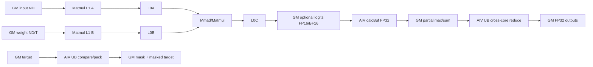
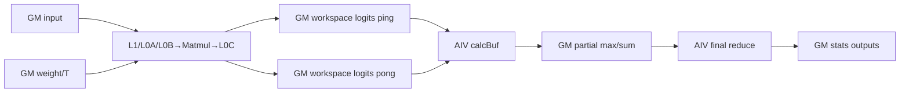
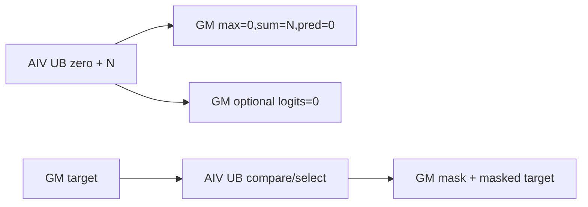
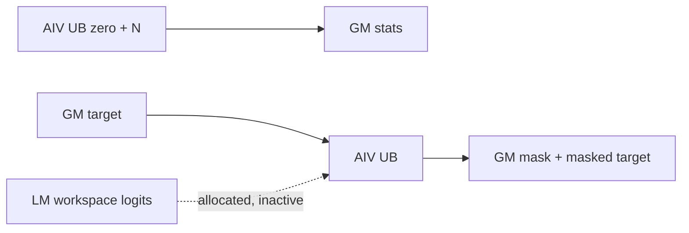

# FusedLinearOnlineMaxSum A2/A3 ACLNN 算子知识

## 算子速览

| 项目 | 内容 |
|---|---|
| 实际入口 | `aclnnFusedLinearOnlineMaxSumGetWorkspaceSize` + `aclnnFusedLinearOnlineMaxSum`，公开 ACLNN 两段式接口；固定源码未暴露额外版本号 |
| 计算语义 | `input[M,K] @ weight[N,K]^T`，按行在线合并局部 max/sum-exp，提取 target 对应 logit，并生成压缩 target mask 与 masked target |
| 输入输出 | input/weight 为 FP16 或 BF16 ND；target 为 INT32/INT64；三个统计输出 FP32，mask UINT8，masked target 同 target，可选完整 logits 同 input dtype |
| 执行类型 | 正常 `K>0`：单 Kernel `MIX_CV`，一 AIC 对两 AIV；`K=0`：同一 launch 内仅 AIV 路径有效；ACLNN 图外加框架 `Contiguous/ViewCopy` 节点 |
| Kernel 路线 | R-001 高性能/保留 logits；R-002 低显存/不保留 logits；R-003/R-004 为两 key 的 `K=0` 空乘法路径 |
| 核心资源 | GM、用户 workspace 的 online-max/online-sum 与低显存 ping-pong logits；Matmul 的 L1/L0A/L0B/L0C；AIV 单 `TBuf<VECCALC>` UB 与寄存器 Vector 流水 |
| 来源闭包 | source_closed：公开 ACLNN→参数校验/连续化→L0 launcher→Tiling/POD→MIX entry→Matmul/AIV body→A2/A3 binary config 和构建接线均在固定 Commit 内闭合；AscendC Matmul primitive 内部为标明的库边界 |
| 验证状态 | 已完成源码闭包检查；本次知识提取未执行编译、真机、数值或性能测试。 |

## 接口与语义

### 计算语义

令 `M=input.size(0)`、`K=input.size(1)`、`N=weight.size(0)`，`L=input @ weight^T`。正常 Device body 对 N tile 做稳定在线归并：

```text
tileMax = max(L_tile, axis=N)
newMax  = max(previousMax, tileMax)
newSum  = previousSum * exp(previousMax-newMax)
          + sum(exp(L_tile-newMax), axis=N)
globalMax = max(partialMax[0:cubeCoreNum])
globalSum = sum(partialSum[c] * exp(partialMax[c]-globalMax), c)
```

目标值由当前 N tile 内 `maskedTarget` 定位后以 `SetAtomicAdd<float>` 写入，最终输出 `predictedLogitsLocal = selectedRawLogit - globalMax`。`vocabParallelLogitsOutOptional` 非空时保存 `L`；为空时 `L` 只在 workspace 的两块 `[128,256]` FP16/BF16 区间轮转。

公开文档把 mask 写成 `(target < vocabStartIndex) || (target > vocabEndIndex)`；固定 Device 源码在 `TargetInnerProcess` 与 `AllReduceMaxSumCompute` 都使用 `CMPMODE::GE`，实际实现是半开区间 `[vocabStartIndex,vocabEndIndex)`。文档参数范围称 `vocabEndIndex` 为闭区间末端，但公开样例用 `N=256, start=0, end=64`，也与 Device 的排他上界更相符。本卡保留该冲突，不把其中一方改写成已确认契约。

`K=0` 时不调用 Matmul：三个统计输出依次写 `0、N、0`，target/mask 仍处理。key 1 还调用可选 logits 清零 helper，但完整块调用把“完整块个数 `mLoopNum`”误传为“本块行数”，因此固定源码只能证明每个完整行块起点之后清零 `mLoopNum*N` 个元素，不能证明整个 `[M,N]` 均被覆盖；尾行 `mLoopNumTail*N` 按实际尾长清零。`M=0` 在 ACLNN 第一段直接返回 workspace 0，未注册核心 Kernel 或 ViewCopy，固定源码没有写用户输出缓冲。

### 输入、输出与属性

| 参数 | shape/layout | dtype | 约束、默认值与语义 |
|---|---|---|---|
| input | `[M,K]`，ND | FP16/BF16 | 支持非连续与空 Tensor；`K<=65534` |
| weight | `[N,K]`，ND | 同 input | `N>0`，第二维等于 K；支持非连续；Device 以转置 B 参与 Matmul |
| target | `[M]`，ND | INT32/INT64 | 支持非连续；Device 先 Cast 到 FP32 参与范围比较与索引计算 |
| vocabStartIndex | Host 标量 | INT64 | ACLNN 仅校验 `>=0`；Tiling 窄化为 FP32 |
| vocabEndIndex | Host 标量 | INT64 | ACLNN 仅校验 `>=vocabStartIndex`；Tiling 窄化为 FP32；文档闭区间与 Device 半开区间冲突 |
| logitsMaxLocalOut | `[M]`，ND | FP32 | 行最大值 |
| sumExpLogitsLocalOut | `[M]`，ND | FP32 | 相对最终行最大值的指数和 |
| predictedLogitsLocalOut | `[M]`，ND | FP32 | mask 内目标的 raw logit 减行最大值；mask 外为 0 |
| targetMaskOut | `[ceil(M/8)]`，ND | UINT8 | 每字节压 8 个比较 bit；文档要求尾部 padding bit 为 1，但 Device 用值 0 pad 后执行同一比较，`start=0<end` 时尾 bit 会为 0，存在源码契约冲突 |
| maskedTargetOut | `[M]`，ND | 同 target | mask 外为 0，mask 内为 `target-vocabStartIndex` |
| vocabParallelLogitsOutOptional | `[M,N]` 或 nullptr，ND | 同 input | 非空选择 key 1 高性能路线；nullptr 选择 key 0 低显存路线 |
| workspaceSize/executor | 标量输出 | UINT64/句柄 | 第一段返回整个执行图所需 workspace 与一次性 executor |

### 入口与版本

固定 Commit 只有未带版本后缀的公开 `aclnnFusedLinearOnlineMaxSum`。文档明确公开支持 A2、A3；OpDef 注册 `ascend910b` 与 `ascend910_93`，两份 binary config 内容一致，各含 FP16/BF16 × INT32/INT64 × hp/lm 共 8 个 binary specialization；Kernel CMake 也只列这两个 compute unit。固定仓未出现同平台更高版本入口或旧 body 复用链，因此本卡记录该唯一、也即当前最新公开版本。

## Host/Launcher 执行流程

### 参数校验与前处理

第一段依次创建 executor，再执行 `CheckNotNull→CheckDtypeValid→CheckShapeValid→CheckAttrValid`。除可选 logits 外，所有输入输出均不得为空；检查 rank、dtype 一致性、`N>0`、`K<=65534`、input/weight K 相等、所有 M 轴输出 shape 与 mask shape。属性只检查 start 非负和 end 不小于 start。

`M==0` 立即返回 workspace 0。否则按 input、weight、target 顺序注册 `l0op::Contiguous`，再由 `l0op::FusedLinearOnlineMaxSum` 分配六个内部结果、以可选输出是否为空生成 bool 属性，并通过 `ADD_TO_LAUNCHER_LIST_AICORE` 注册一个核心节点。随后五个必选结果和可选第六结果依次 `ViewCopy` 到用户输出；任一分配或 ViewCopy 返回 nullptr 即停止组图。

### 参数、Workspace 与生命周期

核心节点的 Tiling workspace 为：

```text
system_workspace = 16 MiB
online_max  = M * cubeCoreNum * 4 bytes
online_sum  = M * cubeCoreNum * 4 bytes
normal_HP   = system_workspace + online_max + online_sum
normal_LM   = normal_HP + 128 * 256 * 2 bytes * cubeCoreNum * 2
```

`GetUserWorkspace(workspace)` 越过 system slice 后，`gmOnlineMax` 从 offset 0 开始，`gmOnlineSum` 从 `M*cubeCoreNum*4` bytes 开始；LM logits 从 `M*cubeCoreNum*8` bytes 开始，每个 AIC 逻辑核有两个各 `128*256` 元素的 16-bit slice。ACLNN 返回值还包含 Contiguous/ViewCopy 等框架节点所需空间，固定仓未展开这些框架 workspace，因此不能直接把上述核心公式当成第一段返回的完整数值。

workspace 由调用方持有并保持到 `CommonOpExecutorRun` 在传入 stream 上完成；executor 由第一段释放给调用方，第二段消费。核心 launch、Contiguous 与 ViewCopy 均在同一 executor/stream 中按注册顺序执行，任一节点执行失败由 `CommonOpExecutorRun` 返回并阻止可靠的后继结果提交。

### 启动图与失败传播

```text
aclnnFusedLinearOnlineMaxSumGetWorkspaceSize
  -> validate; M==0 -> workspace=0/executor（无核心节点）
  -> Contiguous(input) -> Contiguous(weight) -> Contiguous(target)
  -> FusedLinearOnlineMaxSum launcher
       -> TilingForFusedLinearOnlineMaxSum
       -> fused_linear_online_max_sum [MIX_AIC_1_2, blockDim=cubeCoreNum]
            AIV: init workspace/output -> target mask/masked target
            AIC+AIV: Matmul tile -> flag 5 -> online max/sum -> flag 6/7 reuse
            AIV: reduce cube-core partial max/sum -> final outputs
  -> ViewCopy(五个必选输出，及可选 logits)
aclnnFusedLinearOnlineMaxSum(workspace,executor,stream)
  -> CommonOpExecutorRun
```

`SetScheduleMode(1)` 选择 batch mode；entry 用 `KERNEL_TASK_TYPE_DEFAULT(KERNEL_TYPE_MIX_AIC_1_2)` 固定一 AIC 对两 AIV。未知 tiling key 不进入 key 0/1 分支，entry 直接返回且不会产生合法输出。

## Route 与参数设计

### 分核与资源计算

Host 固定 `baseM=128, baseN=256, baseK=64`。`mBlocks=ceil(M/128)`、`nBlocks=ceil(N/256)`、`totalTasks=mBlocks*nBlocks`；实际 AIC 数为 `min(platformAicNum,totalTasks)`，AIV 数同步设为 `2*AIC`。Device 将 tile 线性编号按普通 M-major 映射，`blockDimM<=5` 时 `mIdx=tile/blockDimN,nIdx=tile%blockDimN`；更大 M 时按 8×8 swizzle，尾 M/N 由 `min(128,M-mIdx*128)` 与 `min(256,N-nIdx*256)` 得到。每个逻辑核以 `tile += cubeCoreNum` 处理后续 tile。

Matmul 当前实例是：A=`GM/ND/inputT/no-transpose`，B=`GM/ND/inputT/transpose`，C=`GM/ND/inputT`，无 bias，`MatmulImpl<inputType,weightType,mmType,biasType,matmulCFGUnitFlag>`；Host `SetOrgShape(M,N,K)→SetShape(128,256,K)→SetFixSplit(128,256,64)→SetBufferSpace(-1,-1,-1)`。`TCubeTiling` 的 L1/L0 depth/step 与 primitive 内部 buffer 细节由固定仓之外的 AscendC Matmul 库生成和消费；本仓可确认 GM→Matmul→GM 以及 base/tail/布局/type traits，不能补造具体 depth 字段值。

AIV 资源顺序：

```text
bufSize = platformUB - 8192
initWorkspaceLength = min(floor((bufSize/4/2),8), ceil(floor((M+1)/2),8))
targetTasksPerLoop = min(floor(floor(bufSize/3,256)/sizeof(target)/8), 255*256/sizeof(target)/8)
```

在线 tile 每个 AIV 处理 `curSingleM` 的前半或后半，最多 64 行；AllReduce 每 AIV 按最多 64 行一批归并全部 `cubeCoreNum` 个 partial。

### Route 选择

| 顺序 | Route | Key/模板 | 精确选择条件与优先级 | 不适用去向 |
|---:|---|---|---|---|
| 1 | R-001 高性能 MIX | key 1，`FusedLinearOnlineMaxSumOp<inputT,targetT,inputT,1>` | `M>0 && K>0 && vocabParallelLogitsOutOptional!=nullptr`；dtype 由 binary specialization | optional 为空转 R-002；K=0 转 R-003 |
| 2 | R-002 低显存 MIX | key 0，`FusedLinearOnlineMaxSumOp<inputT,targetT,inputT,0>` | `M>0 && K>0 && vocabParallelLogitsOutOptional==nullptr` | K=0 转 R-004；无其它 Kernel fallback |
| 3 | R-003 高性能空 K | key 1，同模板，`matmulInputEmptyFlag=1` | `M>0 && K==0 && optional!=nullptr` | `M=0` ACLNN 直接终止；否则无 fallback |
| 4 | R-004 低显存空 K | key 0，同模板，`matmulInputEmptyFlag=1` | `M>0 && K==0 && optional==nullptr` | `M=0` ACLNN 直接终止；否则无 fallback |

```text
validate
if M == 0: return executor with workspace 0; no core route
flag = (optional logits != nullptr)
tilingKey = flag ? 1 : 0
if K == 0:
  key 1 -> R-003
  key 0 -> R-004
else:
  key 1 -> R-001
  key 0 -> R-002
unknown key -> kernel returns without output
```

### 模板/实现执行矩阵

| Route | key/selector | dtype/shape/platform 完整命中条件 | 执行族与 kernel 节点 | 实际模板/body | 内存与同步特征 | tail/fallback |
|---|---|---|---|---|---|---|
| R-001 高性能 | key 1 / hp binaries | A2/A3；input FP16/BF16；target INT32/INT64；M,K>0；optional 存在 | 单 MIX_CV：AIC Matmul + 两 AIV online/reduce | `MatmulImpl<GM ND,GM ND trans,GM ND,...>` + `CVProcess/AllReduceMaxSumProcess` | Matmul 直接写正式 logits；workspace 仅两组 FP32 partial；flag 5/6/7 与全核 barrier | M/N/K 由 Matmul tiling 处理；M/N Vector tail；无 fallback |
| R-002 低显存 | key 0 / lm binaries | 同上但 optional 为空 | 同一 MIX_CV 节点 | `mmOutFlag=0`，`IterateAll(...,enSequentialWrite=true)` | 额外每 AIC 两个 128×256×2-byte GM slice，ping-pong 复用 | 同上；workspace 不足则执行失败 |
| R-003 高性能空 K | key 1 / `matmulInputEmptyFlag=1` | M>0,K=0,optional 存在 | 同一 MIX launch，仅 AIV_VECTOR 可达，AIC 不执行 body | `MatmulInputEmptyProcess/MatmulInputEmptyMmOut/TargetProcess` | UB 生成 0/N；无 cross-core reduce；完整块 optional logits 清零范围存在实参错误 | M 与 M*N 分段尾；无 fallback |
| R-004 低显存空 K | key 0 / `matmulInputEmptyFlag=1` | M>0,K=0,optional 为空 | 同一 MIX launch，仅 AIV_VECTOR 可达 | `MatmulInputEmptyProcess/TargetProcess` | 不分配 LM logits workspace；无 cross-core reduce | M 尾；无 fallback |

### 隐藏性能 Guard

| Guard | Host/Tiling 条件 | Device/资源原因 | 影响 Route | 不满足时去向 | 源码符号 |
|---|---|---|---|---|---|
| Cube 任务数 | `AIC=min(platformAic,ceil(M/128)*ceil(N/256))` | 避免启动没有 tile 的逻辑 AIC，并保持 AIC:AIV=1:2 | R-001/R-002 | 自动缩核；M=0 已在 ACLNN 返回 | `RunKernelTiling` |
| UB 保留 | `bufSize=UB-8192` | 单 calcBuf 复用于初始化、target、online、final reduce | 全部 Route | 固定源码无显式 `UB>8192` 检查；平台资源不足无软件 fallback | `RunKernelTiling/Init` |
| Target repeat | `bytes=floor(bufSize/3,256)` 且不超过 `255*256` | Compare/Select repeat 上限与 target/mask 三分缓冲 | 全部 Route | 缩小 `targetTasksPerLoop`；若成为 0，固定源码没有安全 fallback | `TargetTiling` |
| Matmul K 上界 | ACLNN/Tiling 均要求 `K<=65534` | Host 明确限制；Matmul POD 字段/实现边界未进一步解释 | R-001/R-002 | 参数错误 | `CheckShapeValid/CheckShapeInfoValid` |
| LM 双缓冲 | `mmOutFlag==0` | AIC 可提前写下一个 128×256 tile，同时 AIV消费当前 tile | R-002 | optional 存在走 R-001；第 3 次复用前等 flag 6/7 | `CVProcess` |
| 在线 reduce repeat | 单 AIV 每 tile `loopNum<=64`、baseN=256 | `WholeReduceMax/Sum` 的两段 repeat 与四路 Sub 展开依赖固定 tile | R-001/R-002 | M/N tail 缩短有效数；无其它 base fallback | `OnlineMaxCompute/OnlineSumCompute` |
| final UB | `UB=2560*ceil(AIC,8)+6848` bytes（target INT32）或 `+7360`（INT64） | 两批×64 行、所有 AIC partial、reduce 临时同时驻留 UB | R-001/R-002 | 固定源码未显式校验该公式；资源不足无 fallback | `AllReduceMaxSumInitBuffer` |
| 索引精度 | start/end 与 target 均经 FP32 | FP32 不能精确表示所有 INT64 整数 | 全部 Route | 无高精度 route；调用方需限制可精确表示范围 | `GetAttrAndCheck/TargetInnerProcess` |

### POD/ABI

`FusedLinearOnlineMaxSumTilingData` 由 `BEGIN_TILING_DATA_DEF` 生成。固定仓提供字段声明顺序和类型，但未提供宏展开后的 `sizeof/alignof/offsetof` 常数；复用时必须由同一 CANN 9.1 生成头获得 ABI，不得手工紧凑重排。除嵌套 `TCubeTiling` 外，前 14 个标量按声明顺序排列；`cubeCoreNumAligned` 虽被 Host 类计算，但 `FillTilingData` 未调用 setter，Device 也不读取该 POD 字段，而是由 `cubeCoreNum` 重算。

| 结构 | 字段 | 类型/位宽 | ABI 布局 | 单位 | Host/launcher producer | Device consumer | 边界 |
|---|---|---|---|---|---|---|---|
| FusedLinearOnlineMaxSumTilingData | m | uint64/64 | 第 1 字段；具体 sizeof/alignof/offsetof 固定仓未展开 | 元素 | `FillTilingData:set_m(btSize_)` | `InitTilingData:m_`、地址与分核 | M>0 才 launch |
| 同上 | k | uint64/64 | 第 2 字段；offset 未展开 | 元素 | `set_k(hSize_)` | Matmul K 与空 K 分支 | 0..65534 |
| 同上 | n | uint64/64 | 第 3 字段 | 元素 | `set_n(vSize_)` | Matmul N、空 K sum=N | N>0 |
| 同上 | bufSize | uint64/64 | 第 4 字段 | bytes | `set_bufSize(UB-8192)` | `InitBuffer(calcBuf_,bufSize_)` | 固定源码未校验下溢 |
| 同上 | cubeCoreNum | uint64/64 | 第 5 字段 | AIC 核数 | `set_cubeCoreNum(aiCubeNum_)` | tile stride、workspace、final reduce | 1..totalTasks |
| 同上 | vecCoreNum | uint64/64 | 第 6 字段 | AIV 核数 | `set_vecCoreNum(2*aiCubeNum_)` | target、空 K、final reduce 分核 | 等于 2×AIC |
| 同上 | batchTaksPerVecCore | uint64/64 | 第 7 字段 | 8-element task/AIV | `TargetTiling` 商 | `InitTilingData` 计算 `curVecTasks_` | 可为 0 |
| 同上 | batchTaksTailVecCore | uint64/64 | 第 8 字段 | AIV 核数 | `TargetTiling` 余数 | `InitTilingData` former/tail 分配 | `<vecCoreNum` |
| 同上 | targetTasksPerLoop | uint64/64 | 第 9 字段 | 8-element task/loop | `TargetTiling` | `TargetProcess` loop 与 UB extent | 必须非 0；固定源码未显式保护 |
| 同上 | vocabStartIndex | float/32 | 第 10 字段 | 索引值 | INT64 attr `static_cast<float>` | target 比较与减法、final mask | 大整数可能失真 |
| 同上 | vocabEndIndex | float/32 | 第 11 字段 | 排他上界（按 Device） | INT64 attr `static_cast<float>` | 两处 `CMPMODE::GE` | 与公开闭区间文字冲突 |
| 同上 | initWorkspaceLength | uint64/64 | 第 12 字段 | FP32 元素/loop | `InitWorkspaceTiling` | init 与空 K output 分段 | 8 对齐；可见公式依赖 M/UB |
| 同上 | cubeCoreNumAligned | uint64/64 | 第 13 字段 | AIC 核数对齐 | Host 计算但未写 POD | 无；Device 自行 `ceil(AIC,8)*8` | inactive，不得作为 Device 输入 |
| 同上 | matmulInputEmptyFlag | uint64/64 | 第 14 字段 | bool | K>0 时置 0，否则默认 1 | `Process` 路由与 `mm_.Init` guard | 0/1 |
| 同上 | mmTiling | `TCubeTiling`/外部生成 POD | 尾部嵌套字段；内部 ABI 固定仓未声明 | Matmul 参数 | `MatmulApiTiling::GetTiling` | `mm_.Init`、Device 读取 baseM/baseN | K>0 有效；K=0 不读取 Matmul |

### Route 源码闭包

| Route | Key/selector | Host/Tiling producer | POD/参数 | Kernel entry/router | Kernel body/直接依赖 | 构建接线 |
|---|---|---|---|---|---|---|
| R-001 高性能 | optional 非空→key 1 | `aclnn...GetWorkspaceSize` + `TilingForFusedLinearOnlineMaxSum` | 主 POD + `TCubeTiling` | `fused_linear_online_max_sum` key 1 | `CVProcess/MMCompute/OnlineMaxSumProcess/AllReduceMaxSumProcess` + AscendC Matmul | hp 4 dtype binaries；910b/910_93 config；Host/Kernel CMake |
| R-002 低显存 | optional 空→key 0 | 同上 | 同上 + LM workspace 公式 | 同 entry key 0 | 同 body，`mmOutFlag=0` workspace specialization | lm 4 dtype binaries；同 Host/Kernel CMake |
| R-003 高性能空 K | key 1 + `K==0` | Tiling 不生成 `mmTiling`，empty flag=1 | 标量 POD；mmTiling inactive | 同 entry key 1 | `MatmulInputEmptyProcess/MatmulInputEmptyMmOut/TargetProcess` | 同 hp binaries与 Host/Kernel CMake |
| R-004 低显存空 K | key 0 + `K==0` | 同上 | 标量 POD；mmTiling inactive | 同 entry key 0 | `MatmulInputEmptyProcess/TargetProcess` | 同 lm binaries与 Host/Kernel CMake |

## Kernel 实现

### 公共执行流程

Entry 解析同一 POD；key 0/1 只改变 `mmOutFlag` 模板常量。AIC 的 `blockIdx` 是逻辑 Cube 核，AIV 的物理 `blockIdx` 经 `GetTaskRation()` 除法得到配对的 `coreIdx`，但 target 与全局归并仍以物理 AIV `blockIdx` 分核。正常路线先由全部 AIV 初始化 online workspace 与 predicted output，`SyncAll<false>` 后生成 target/mask，再次全核同步；然后进入 AIC/AIV tile 流，第三次全核同步保证 partial 写完，最后只由 AIV 做跨 Cube partial 的 max/sum 归并。

### Route R-001：高性能 MIX（保留完整 logits）

#### 适用条件

##### 选择证据

| 层级 | 文件 | 符号 | 源码谓词/参数 | 结果/下一跳 |
|---|---|---|---|---|
| ACLNN | `aclnn_fused_linear_online_max_sum.cpp` | `aclnnFusedLinearOnlineMaxSumGetWorkspaceSize` | optional 非 nullptr，M>0 | bool flag=true，注册核心节点 |
| Host | `fused_linear_online_max_sum_tiling.cpp` | `SetTilingKey/RunKernelTiling` | flag=1，K>0 | key 1，生成 Matmul tiling |
| Router | `fused_linear_online_max_sum.cpp` | `TILING_KEY_IS(1)` | 编译具备 input/target dtype | `FusedLinearOnlineMaxSumOp<inputT,targetT,inputT,1>` |
| Device | `fused_linear_online_max_sum.h` | `Process` | `matmulInputEmptyFlag==0` | 正常 CV 与 final reduce |

#### Device 数据流

##### 函数级调用链

```text
fused_linear_online_max_sum(key=1)
  -> FusedLinearOnlineMaxSumOp<inputT,targetT,inputT,1>::Init
  -> Process
    -> AIV InitOutputAndWorkspace -> TargetProcess
    -> CVProcess
       AIC MMCompute -> MatmulImpl::IterateAll -> GM logits
       AIV OnlineMaxSumProcess -> partial max/sum + atomic predicted
    -> AIV AllReduceMaxSumProcess -> final max/sum/predicted
```

##### 源码等价伪码

```text
// 伪码
AIV: partialMax=-inf; partialSum=0; predicted=0
barrier_all
AIV: mask=(target<start)||(target>=end); maskedTarget=mask?0:target-start
barrier_all
for tile = logicalCore; tile < ceil(M/128)*ceil(N/256); tile += cubeCoreNum:
  map tile -> mIdx,nIdx; rows split between paired AIV0/AIV1
  AIC: Matmul(input[Mtile,K], weight[Ntile,K]^T) -> official logits[Mtile,Ntile]
       set cross-core flag 5
  AIV: wait flag 5; copy/cast logits mmT->FP32
       merge online max and stable exp sum
       gather target column if it lies in this N tile; atomic-add raw logit
       write partialMax/partialSum; signal flag 6 or 7 before ping/pong reuse
barrier_all
AIV: for rows in chunks of 64, gather all cube-core partials
     globalMax=max(partialMax); globalSum=sum(partialSum*exp(partialMax-globalMax))
     predicted=(target outside [start,end)) ? 0 : atomicRaw-globalMax
     write three FP32 outputs
```

#### 内存与数据搬运

##### 资源与搬运表

| 层级/缓冲区 | offset/地址公式 | extent/容量公式 | dtype/layout | producer | consumer | owner/lifetime | 对齐/复用 |
|---|---|---|---|---|---|---|---|
| GM input/weight | `mIdx*128*K` / `nIdx*256*K` | M×K / N×K elements | inputT/ND；B transpose | ACLNN contiguous | MatmulImpl | executor temp through node | K tail由 TCubeTiling |
| Matmul L1 | 当前 TCubeTiling specialization | 固定仓外 Matmul primitive 决定 | inputT/内部 fractal | Matmul MTE2 | L0A/L0B load | kernel tile | `SetBufferSpace(-1...)` 自动选择；不可补造 depth |
| L0A/L0B | 当前 128×256×64 split 的内部 tile | TCubeTiling/平台资源决定 | inputT/Matmul internal | Matmul LoadData | Mmad | kernel K loop | baseK=64；K tail由 primitive |
| L0C | 当前 M×N tile accumulator | 累加类型/容量固定仓未暴露 | Matmul internal | Mmad | Matmul GM epilogue | tile lifetime | C 输出类型明确为 inputT，内部累加精度不可推测 |
| GM optional logits | `mIdx*128*N+nIdx*256` + row stride N | M×N×2 bytes | FP16/BF16 ND | AIC Matmul | AIV copy/cast +用户输出 | 用户输出；节点完成后保留 | AIC直接写，无临时物化 |
| workspace onlineMax | `(cubeLogical*M + row)*4` | `M*cubeCoreNum*4` bytes | FP32/partial-major | AIV online | final AIV reduce | caller workspace until final reduce | 每 logical cube 一行域 |
| workspace onlineSum | `onlineMax + M*cubeCoreNum*4` bytes | 同上 | FP32/partial-major | AIV online | final AIV reduce | 同上 | 与 max 不别名 |
| UB calcBuf | offset 0，阶段间整体复用 | `bufSize=UB-8192` | 多 dtype，见字节账 | GM copy/Vector | Vector/GM copy | 单 AIV；阶段生命周期 | 单 TBuf，无 TQue double buffer |
| GM final outputs | row offset | 各 M×4 bytes | FP32 ND | final AIV reduce | ViewCopy | executor output temp | 每 AIV 不重叠行段 |

##### 分层内存布局



##### 字节账、交接边与复用顺序

```text
core_workspace = 2*M*cubeCoreNum*4
OnlineMaxSum UB = 75104 bytes (target INT32) or 75360 bytes (target INT64)
FinalReduce UB = 2560*ceil(cubeCoreNum,8) + 6848 bytes (INT32)
              or 2560*ceil(cubeCoreNum,8) + 7360 bytes (INT64)
L1/L0 = current external TCubeTiling specialization; exact bytes unavailable in fixed repo
```

| 边/复用子区 | producer | offset/extent | dtype/layout | consumer | ordering/sync | owner/lifetime | 安全条件 |
|---|---|---|---|---|---|---|---|
| AIC→AIV official logits | `MMCompute` | formal output tile offset；有效 `curM*curN` | inputT/ND，row stride N | `OnlineCopyIn` | AIC `CrossCoreSetFlag<2,PIPE_FIX>(5)`；AIV wait 5 | 用户 output；不覆盖 | Matmul complete through PIPE_FIX |
| partial max/sum | `OnlineMaxSumProcess` | `(logicalCube*M+row)`，各 loopNum FP32 | FP32/partial-major | `AllReduceMaxSumCopyIn` | tile内 MTE3 event；全核 `SyncAll<false>` 后读取 | caller workspace；final reduce 后释放 | 每 logical cube/row 唯一 writer |
| predicted raw accumulation | `OnlineGetPredictedLogits` | row，loopNum FP32 | FP32 ND | final reduce | `SetAtomicAdd<float>`；初始化后全核 barrier，final 前全核 barrier | executor output temp | 只有包含 target column 的 N tile贡献非零 |
| calcBuf phase reuse | init→target→online→final | offset 0，各阶段 extent 如上 | phase-specific | 下一阶段 | `SyncAll` 与函数内 HardEvent/PipeBarrier | 单 AIV | 各阶段结束后才解释为新 layout |

#### 同步、精度与尾块

##### 同步与数值边界表

| 阶段 | primitive/机制 | producer | consumer/等待点 | 保护对象 | 精度/尾块 |
|---|---|---|---|---|---|
| 初始化→计算 | `SyncAll<false>` | 全 AIV init | target/CV | partial 与 predicted 初值 | K>0 才执行 |
| Cube→Vector | `CrossCoreSetFlag<2,PIPE_FIX>(5)` | AIC Matmul output | 两 AIV `WaitFlag(5)` | 当前正式 logits tile | curM/curN 有效域 |
| tile cadence | flags 6/7 | AIV MTE3 partial write | 第 3 次及以后 AIC下一轮前 | AIV消费与partial写回 | HP虽不覆盖正式输出，源码仍保留与LM相同的pp握手；不足3 tile不回传 |
| Vector pipeline | MTE2_V、V_MTE3、MTE3_MTE2 + `PipeBarrier<PIPE_V>` | GM/Vector/MTE3 | 下一流水阶段 | calcBuf 子区 | mmT `CAST_NONE`→FP32；Exp/累加 FP32 |
| predicted | FP32 AtomicAdd | 目标 N tile AIV | final reduce | row scalar | mask 外 Select 0；最终减 global max |
| M/N tail | `curSingleM/curSingleN`、DataCopyPad | Matmul/GM | Vector reduce | 尾 tile | N tail pad 为 FP16/BF16 `-inf`，只归并有效行 |

#### 关键实现

##### 符号证据表

| 阶段 | 文件 | 符号/模板实例 | 实现事实 |
|---|---|---|---|
| Host/Tiling producer | `op_host/fused_linear_online_max_sum_tiling.cpp` | `RunKernelTiling/GetMatmulTiling` | core、workspace、base 128×256×64、key 1 |
| Kernel entry/router | `op_kernel/fused_linear_online_max_sum.cpp` | `fused_linear_online_max_sum` / key 1 | MIX_AIC_1_2 与 `mmOutFlag=1` |
| Device body/helper | `op_kernel/fused_linear_online_max_sum.h` | `CVProcess/MMCompute` | tile swizzle、Matmul 与 flag 5/6/7 |
| Device body/helper | 同文件 | `OnlineMaxSumProcess/AllReduceMaxSumProcess` | 在线稳定归并与跨 partial 最终归并 |

### Route R-002：低显存 MIX（workspace logits）

#### 适用条件

##### 选择证据

| 层级 | 文件 | 符号 | 源码谓词/参数 | 结果/下一跳 |
|---|---|---|---|---|
| ACLNN | `aclnn_fused_linear_online_max_sum.cpp` | workspace-size entry | optional==nullptr，M>0 | flag=false |
| Host | `fused_linear_online_max_sum_tiling.cpp` | `SetTilingKey/RunKernelTiling` | flag=0，K>0 | key 0；增加 LM workspace |
| Router | `fused_linear_online_max_sum.cpp` | `TILING_KEY_IS(0)` | dtype specialization已编译 | `FusedLinearOnlineMaxSumOp<inputT,targetT,inputT,0>` |

#### Device 数据流

##### 函数级调用链

```text
fused_linear_online_max_sum(key=0)
  -> FusedLinearOnlineMaxSumOp<inputT,targetT,inputT,0>::Process
    -> CVProcess
       -> AIC MMCompute(enSequentialWrite=true) -> workspace ping/pong tile
       -> AIV OnlineMaxSumProcess(baseN=256) -> partial max/sum
    -> AIV AllReduceMaxSumProcess
```

##### 源码等价伪码

```text
// 伪码；初始化、target 与 final reduce 同 R-001
pp=0
for assigned tile count:
  AIC:
    if count>=2: wait flag[6+pp]
    ws = logitsBase + logicalAIC*2*(128*256) + pp*(128*256)
    Matmul tile -> ws, sequentialWrite=true
    set flag 5
  AIV:
    wait flag 5
    ws = logitsBase + pairedAIC*2*(128*256) + pp*(128*256)
    consume only curM*curN, using physical row stride 256
    write partial; if slot will be reused, set flag[6+pp]
  pp=1-pp
```

#### 内存与数据搬运

##### 资源与搬运表

| 层级/缓冲区 | offset/地址公式 | extent/容量公式 | dtype/layout | producer | consumer | owner/lifetime | 对齐/复用 |
|---|---|---|---|---|---|---|---|
| GM input/weight、L1/L0A/B/C | 同 R-001 | 同 R-001 | 同 R-001 | Matmul | Matmul | tile | 外部 primitive 边界 |
| workspace logits | `8*M*AIC + (logicalAIC*65536 + pp*32768)*2` bytes | `2*32768*2=131072` bytes/AIC | inputT/128×256 row-major | AIC Matmul | paired AIV | caller workspace | 两槽，固定 stride 256 |
| workspace partials | 前 `8*M*AIC` bytes | 两个 `M*AIC*4` slice | FP32 | AIV online | final reduce | caller workspace | 与 logits 不重叠 |
| UB online/final | 同 R-001 | 75104/75360 与 final公式 | phase-specific | GM copy | Vector | AIV | 单 calcBuf |
| 正式 optional output | N/A | 0 | N/A | N/A | N/A | 不存在 | ACLNN 不注册第六 ViewCopy |

##### 分层内存布局



##### 字节账、交接边与复用顺序

```text
core_workspace = 8*M*cubeCoreNum + 131072*cubeCoreNum bytes
logitsSlice = 128*256*2 = 65536 bytes
two slices per logical AIC = 131072 bytes
UB and Matmul L1/L0: same bounds as R-001
```

| 边/复用子区 | producer | offset/extent | dtype/layout | consumer | ordering/sync | owner/lifetime | 安全条件 |
|---|---|---|---|---|---|---|---|
| LM ping/pong | AIC `MMCompute` | per-AIC `pp*65536` bytes；有效 curM×curN | inputT/stride 256 | two paired AIV | first two writes无需回传；reuse 前 AIC wait 6/7；AIV write partial后 set 6/7 | caller workspace | pp 翻转且 count+2<loopCount 才回传 |
| partial/final | 同 R-001 | 同 R-001 | FP32 | final AIV | 全核 barrier | caller workspace | 同 R-001 |

#### 同步、精度与尾块

##### 同步与数值边界表

| 阶段 | primitive/机制 | producer | consumer/等待点 | 保护对象 | 精度/尾块 |
|---|---|---|---|---|---|
| LM producer | `IterateAll<false>(...,enSequentialWrite=true)` | AIC Matmul | AIV wait flag 5 | 当前固定 128×256 slice | C 仍为 inputT；tail有效域 curM/curN |
| 防覆盖 | CrossCore flag 6/7 | AIV partial MTE3 | AIC 第 3/4... tile | ping/pong slot | 只有未来会复用时 set |
| N tail pad | `SetDataCopyPadParamsAndInit` | workspace copy | Vector max/sum | 每行 256 宽 UB | tail右侧填 inputT `-inf`；src stride按 rowSize=256 |
| 其它同步/精度 | 同 R-001 | 同 R-001 | 同 R-001 | partial/final | FP32 online 与 M/N tail |

#### 关键实现

##### 符号证据表

| 阶段 | 文件 | 符号/模板实例 | 实现事实 |
|---|---|---|---|
| Host/Tiling producer | `op_host/fused_linear_online_max_sum_tiling.cpp` | `RunKernelTiling` | key 0 与 131072 bytes/AIC LM workspace |
| Kernel entry/router | `op_kernel/fused_linear_online_max_sum.cpp` | key 0 / `FusedLinearOnlineMaxSumOp<inputT,targetT,inputT,0>` | 选择 workspace specialization |
| Device body/helper | `op_kernel/fused_linear_online_max_sum.h` | `Init/CVProcess/MMCompute` | LM 基址、两槽和 sequential write |
| Device body/helper | 同文件 | `SetDataCopyPadParamsAndInit` | stride 256 与 N tail `-inf` pad |

### Route R-003：高性能空 K（仅 AIV）

#### 适用条件

##### 选择证据

| 层级 | 文件 | 符号 | 源码谓词/参数 | 结果/下一跳 |
|---|---|---|---|---|
| ACLNN | `CheckShapeValid` | shape checks | M>0,N>0,K=0,optional存在合法 | 允许进入 launcher |
| Tiling | `RunKernelTiling` | `if (hSize_>0)` | false | empty flag保持1，不生成 Matmul tiling，key 1 |
| Device | `Process` | `matmulInputEmptyFlag_==1` | AIV empty output + target 后 return | 不进入 CV/final reduce |

#### Device 数据流

##### 函数级调用链

```text
entry key 1 -> Init(no mm_.Init)
  -> AIV MatmulInputEmptyProcess
     -> MatmulInputEmptyMmOut
  -> AIV TargetProcess
  -> return
```

##### 源码等价伪码

```text
// 伪码
split M over 2*cubeCoreNum AIV
q = localRows/initWorkspaceLength; r = localRows%initWorkspaceLength
for each of q full row chunks:
  logitsMax=0; sumExp=N; predicted=0 for initWorkspaceLength rows
  helper(q,rowOffset) clears only q*N optional-logit elements from this chunk start
for tail r rows:
  write the same stats and helper(r,rowOffset) clears r*N optional-logit elements
process target and packed mask with the common half-open comparison
return without SyncAll/CV/final reduce
```

#### 内存与数据搬运

##### 资源与搬运表

| 层级/缓冲区 | offset/地址公式 | extent/容量公式 | dtype/layout | producer | consumer | owner/lifetime | 对齐/复用 |
|---|---|---|---|---|---|---|---|
| L1/L0A/B/C | N/A | 0 | N/A | N/A | N/A | N/A | Matmul未初始化 |
| UB zero/N | offsets 0 与 `4*initWorkspaceLength` | `2*initWorkspaceLength*4` bytes | FP32 | Duplicate | MTE3 | AIV phase | 8元素对齐 |
| GM stats | per-AIV M segment | 3*M*4 total | FP32 | AIV | ViewCopy | executor output | M tail按 DataCopyPad blockLen |
| GM optional logits | row-major M×N；每个完整块起点实际只覆盖 `q*N` 元素，尾部覆盖 `r*N` | 逻辑容量 M*N*2 bytes；实际写 extent 如左 | inputT ND | AIV zero reinterpret | ViewCopy/user | output | helper 参数错误，完整覆盖不可证明 |
| workspace partial/LM | 已分配 HP 公式但不读写 | `8*M*AIC` bytes | N/A | N/A | N/A | caller | empty route无 partial |

##### 分层内存布局



##### 字节账、交接边与复用顺序

```text
UB_empty = 2*initWorkspaceLength*4 <= bufSize
core_workspace_allocated = 8*M*cubeCoreNum bytes, but empty body does not consume it
optional_logits_written = q blocks * (q*N elements at each block start) + tail r*N elements
L1/L0 = 0
```

| 边/复用子区 | producer | offset/extent | dtype/layout | consumer | ordering/sync | owner/lifetime | 安全条件 |
|---|---|---|---|---|---|---|---|
| UB phase reuse | empty output | calcBuf entire phase | FP32/inputT reinterpret | TargetProcess | 同一 AIV程序顺序；无 cross-core barrier | AIV | output copies已发出并由 `PIPE_MTE3_MTE2`/pipeline order保护 |

#### 同步、精度与尾块

##### 同步与数值边界表

| 阶段 | primitive/机制 | producer | consumer/等待点 | 保护对象 | 精度/尾块 |
|---|---|---|---|---|---|
| 空 K output | `PIPE_V_MTE3` | Duplicate | GM DataCopyPad | zero/N UB | 统计 M tail正确；optional完整块实参为q而非initWorkspaceLength |
| target | MTE2_V/V_MTE3/MTE3_MTE2 | target copy/Vector | output copy/next input | calcBuf | 同公共 INT→FP32→INT 与 mask tail边界 |
| Cross-core | N/A | N/A | N/A | 无共享 partial | 各 AIV写不重叠 M 段 |

#### 关键实现

##### 符号证据表

| 阶段 | 文件 | 符号/模板实例 | 实现事实 |
|---|---|---|---|
| Host/Tiling producer | `op_host/fused_linear_online_max_sum_tiling.cpp` | `RunKernelTiling` | K=0保持 empty flag=1 |
| Kernel entry/router | `op_kernel/fused_linear_online_max_sum.cpp` | key 1 | 同 binary，Device runtime空 K分支 |
| Device body/helper | `op_kernel/fused_linear_online_max_sum.h` | `MatmulInputEmptyProcess/MatmulInputEmptyMmOut` | 统计值与 optional实际写范围；暴露完整块实参错误 |

### Route R-004：低显存空 K（仅 AIV）

#### 适用条件

##### 选择证据

| 层级 | 文件 | 符号 | 源码谓词/参数 | 结果/下一跳 |
|---|---|---|---|---|
| ACLNN | | workspace-size entry | M>0,K=0,optional为空 | flag=false |
| Tiling | | `RunKernelTiling` | K==0 + flag=0 | key 0，empty flag=1；仍按 flag 额外计算 LM workspace |
| Device | `Process` | empty flag=1 | AIV统计/target后 return | 不读取 LM workspace |

#### Device 数据流

##### 函数级调用链

```text
entry key 0 -> Init(no mm_.Init)
  -> AIV MatmulInputEmptyProcess（不调用 MatmulInputEmptyMmOut）
  -> AIV TargetProcess
  -> return
```

##### 源码等价伪码

```text
// 伪码
split M across AIV; write max=0,sum=N,predicted=0
skip optional logits because mmOutFlag==0
write mask/maskedTarget; return
```

#### 内存与数据搬运

##### 资源与搬运表

| 层级/缓冲区 | offset/地址公式 | extent/容量公式 | dtype/layout | producer | consumer | owner/lifetime | 对齐/复用 |
|---|---|---|---|---|---|---|---|
| L1/L0A/B/C | N/A | 0 | N/A | N/A | N/A | N/A | 空 K |
| UB 与 GM stats/target | 同 R-003 | 同 R-003（不含 optional logits） | FP32/targetT/UINT8 | AIV | ViewCopy | executor | 同 R-003 |
| LM workspace logits | Host仍分配 `131072*AIC` bytes，但 Device不访问 | 固定公式 | inactive | N/A | N/A | caller | 固定源码没有 empty K 特判省略分配 |

##### 分层内存布局



##### 字节账、交接边与复用顺序

```text
workspace_allocated = 8*M*cubeCoreNum + 131072*cubeCoreNum bytes
workspace_consumed_by_empty_body = 0 bytes
UB_empty = 2*initWorkspaceLength*4 bytes; target phase另按公共公式复用 calcBuf
```

| 边/复用子区 | producer | offset/extent | dtype/layout | consumer | ordering/sync | owner/lifetime | 安全条件 |
|---|---|---|---|---|---|---|---|
| calcBuf phase reuse | empty stats | phase-local | FP32 | target | 单 AIV程序顺序 | AIV | 同 R-003 |
| LM workspace | N/A | 全 slice | inactive | N/A | N/A | caller | 不得假定 Device会初始化该区 |

#### 同步、精度与尾块

##### 同步与数值边界表

| 阶段 | primitive/机制 | producer | consumer/等待点 | 保护对象 | 精度/尾块 |
|---|---|---|---|---|---|
| empty stats/target | 同 R-003 | AIV | GM | calcBuf | 同 R-003 |
| cross-core/Matmul | N/A | N/A | N/A | 无 | key 0 不改变空 K数值 |

#### 关键实现

##### 符号证据表

| 阶段 | 文件 | 符号/模板实例 | 实现事实 |
|---|---|---|---|
| Host/Tiling producer | `op_host/fused_linear_online_max_sum_tiling.cpp` | workspace公式 + empty flag | LM空间仍分配，Matmul tiling不生成 |
| Kernel entry/router | `op_kernel/fused_linear_online_max_sum.cpp` | key 0 | `mmOutFlag=0` |
| Device body/helper | `op_kernel/fused_linear_online_max_sum.h` | `MatmulInputEmptyProcess` | 跳过 optional logits清零 helper |

## 算子特定优化

### Trick T-001：可选完整 logits 决定正式输出或双槽 workspace

#### 触发与源码依据

- 适用 Route：R-001、R-002
- 触发条件：`vocabParallelLogitsOutOptional != nullptr` 生成 key 1；否则 key 0
- Golden 来源：[`op_kernel/fused_linear_online_max_sum.h:307-315`](../../../../../../../cann-ops-raw/ascendc/ops-nn/955f8b33985b6d72989ebff341bb9c2c564a51bc/matmul/fused_linear_online_max_sum/op_kernel/fused_linear_online_max_sum.h#L307-L315)

**官方源码（固定 Commit 连续逐字摘录）**：

```cpp
    if constexpr (mmOutFlag) {
        mmOutTensor_.SetGlobalBuffer(reinterpret_cast<__gm__ mmT *>(vocabParallelLogitsOut));
    } else {
        mmOutTensor_.SetGlobalBuffer(reinterpret_cast<__gm__ mmT *>(userWorkspace) + m_ * cubeCoreNum_ * NUM_FOUR);
    }

    gmOnlineMax_.SetGlobalBuffer(reinterpret_cast<__gm__ float *>(userWorkspace));
    gmOnlineSum_.SetGlobalBuffer(reinterpret_cast<__gm__ float *>(userWorkspace) + m_ * cubeCoreNum_);
```

#### 机制与设计原因

模板常量在编译期删除无关分支。key 1 复用调用方要求保留的正式 logits 作为 AIC→AIV 交接，不增加临时 logits；key 0 没有正式输出可承载交接，因此在两个 FP32 partial slice 后布置每 AIC 两个固定 128×256 的 16-bit buffer，并用 pp 轮转。两 route 都执行 flag 5/6/7 的统一 cadence，只有 key 0 的 6/7 同时承担防止 workspace 槽覆盖的必要性。这正对应 binary config 的 hp/lm 两组实例。

#### 迁移边界

- 适用：同一 Matmul 结果既可能是正式输出、也可能仅供融合后处理消费的单 Kernel MIX_CV。
- 前提：输出 dtype 与 Matmul C dtype一致；workspace offset保持 `8*M*AIC` bytes；tile固定不超过128×256。
- 失效：正式输出缺失且没有足够双槽 workspace 时不能走 R-002；K=0 改走 R-003/R-004。
- 未验证：本次知识提取未执行编译、真机、数值或性能测试。

#### 错误做法

不能在 key 0 仍按 row stride N 读取 workspace；LM 的物理 row stride固定为 baseN=256。固定源码通过 `rowSize=baseN` 与 `enSequentialWrite=true` 明确给出该反例。

### Trick T-002：在线稳定 max/sum 避免物化 FP32 logits

#### 触发与源码依据

- 适用 Route：R-001、R-002
- 触发条件：K>0；每个 AIV 消费一个 Matmul N tile
- Golden 来源：[`op_kernel/fused_linear_online_max_sum.h:853-887`](../../../../../../../cann-ops-raw/ascendc/ops-nn/955f8b33985b6d72989ebff341bb9c2c564a51bc/matmul/fused_linear_online_max_sum/op_kernel/fused_linear_online_max_sum.h#L853-L887)

**官方源码（固定 Commit 连续逐字摘录）**：

```cpp
    Brcb(brcbMaxTensor, maxTensor, mmTilingData_->baseM / NUM_TWO / DATA_PER_BLOCK_B32,
         {DEFAULT_BLK_STRIDE, DEFAULT_REPEAT_STRIDE});
    Sub(preMaxTensor, preMaxTensor, maxTensor, loopNum);
    PipeBarrier<PIPE_V>();
    uint64_t mask = DATA_PER_REPEAT_B32;
    uint8_t repeatTimesSub = loopNum * mmTilingData_->baseN / DATA_PER_REPEAT_B32 / NUM_FOUR;
```

#### 机制与设计原因

每次先用 `max(previousMax,tileMax)` 得到新基准，再对旧 sum 乘 `exp(oldMax-newMax)`，对当前 tile 做 `exp(logit-newMax)` 并归并。AIC 输出保持 16-bit，只有当前 64×256 子块在 UB Cast 成 FP32；因此无需将 M×N logits 整体扩为 FP32。最终再以相同 max-shift 公式合并各 Cube partial。

#### 迁移边界

- 适用：按 N tile 流式处理 softmax 统计，且允许 FP32 UB中间。
- 前提：新 max 必须在旧 sum rescale 和当前 exp 之前完成；partial max/sum workspace按 logical Cube×M 排列。
- 失效：若改变 baseN 或每 AIV 最大行数，repeat 拆分、UB字节账与四路 Sub 都需重算。
- 未验证：本次知识提取未执行编译、真机、数值或性能测试。

#### 错误做法

固定源码的 `preSum *= exp(preMax-newMax)` 表明不能把不同 N tile 的 exp-sum直接相加；那会混用不同归一化基准。

### Trick T-003：两 AIV 分半行与 AIC tile 生产同步

#### 触发与源码依据

- 适用 Route：R-001、R-002
- 触发条件：正常 K>0 的 `KERNEL_TYPE_MIX_AIC_1_2`
- Golden 来源：[`op_kernel/fused_linear_online_max_sum.h:437-467`](../../../../../../../cann-ops-raw/ascendc/ops-nn/955f8b33985b6d72989ebff341bb9c2c564a51bc/matmul/fused_linear_online_max_sum/op_kernel/fused_linear_online_max_sum.h#L437-L467)

**官方源码（固定 Commit 连续逐字摘录）**：

```cpp
    for (uint64_t count = 0; count < loopCount; count++, curBlock += cubeCoreNum_) {
        MNBlockIdxCompute(mnConfig, curBlock, 0, thresholdM_dimN);
        if ASCEND_IS_AIC {
            if (count >= ppCount) {
                CrossCoreWaitFlag(SYNC_AIV_AIC_FLAG_LIST[pp]);
            }
```

#### 机制与设计原因

两 AIV 使用相同 logical tile，但偶数 AIV处理前半行、奇数 AIV处理后半行；AIC 每轮只生产一次完整 tile。flag 5建立 PIPE_FIX→AIV 可见性，flag 6/7建立 AIV MTE3→AIC 下一轮许可；LM route 中该许可还防止槽第三次复用时覆盖未消费数据。HP route也执行相同 6/7 握手，但正式输出地址本身不做 ping/pong覆盖。

#### 迁移边界

- 适用：硬件 task ratio为1:2且每 tile M<=128。
- 前提：AIV `coreIdx=blockIdx/GetTaskRation()` 与行半区 `blockIdx%2` 保持一致；flag编号和 PIPE类型不得更换一侧而不改另一侧。
- 失效：AIC:AIV比例或 M tile 改变时必须重新设计分区与握手；空 K路线不使用这些 flag。
- 未验证：本次知识提取未执行编译、真机、数值或性能测试。

#### 错误做法

不能把 launch 顺序当成 Device 可见性；固定源码明确在消费前 `CrossCoreWaitFlag(5)`，并在可覆盖前等待 6/7。

## 模板与实现对比

| 对比维度 | R-001 高性能 | R-002 低显存 | 设计选择依据 |
|---|---|---|---|
| 命中条件/优先级 | optional非空、K>0、key1 | optional为空、K>0、key0 | 是否需要保留完整 logits |
| 执行族/节点图 | 单 MIX：AIC→正式 GM→AIV | 单 MIX：AIC→workspace双槽→AIV | 两者一 AIC:两 AIV |
| M/N/K、tile 与 scheduler | 128×256×64，GM row stride N | 同 tile，交接 row stride 256 | Matmul相同；C目的地不同 |
| workspace/L1/L0/UB | `8*M*AIC` + system；Matmul资源外部生成 | 再加131072 bytes/AIC | LM用空间换不保留正式输出 |
| AIC/AIV 或 kernel 交接 | flag5 + 源码保留的6/7 cadence；正式输出不覆盖 | flag5 + flag6/7双槽防覆盖 | 两 route 同步骨架相同，pp内存复用只对LM必要 |
| 同步、精度与 tail | 16-bit C→FP32 online；M/N tail | 同上，N tail pad -inf | 数值路径一致 |
| fallback/失败边界 | K=0→R-003；无资源fallback | K=0→R-004；无资源fallback | key由optional唯一确定 |

R-003 与 R-004 的数值统计和 target 路径相同；区别仅为 R-003 清零正式 optional logits，而 R-004 不存在该输出且 Host仍分配但 Device不消费 LM workspace。

## 平台差异

| 项目 | A2 | A3 | 950 |
|---|---|---|---|
| 支持状态 | 公开文档支持；source_closed | 公开文档支持；source_closed | 公开文档列为支持，但固定仓缺 Host/Kernel构建闭包，未生成正式卡 |
| Host/Launcher | `ascend910b` OpDef + 8 binaries | `ascend910_93` OpDef + 8 binaries；两 config逐字相同 | OpDef无 `ascend950` AddConfig，且无 950 binary config |
| Kernel/资源 | 共用 base128×256×64 与 MIX_AIC_1_2 body，资源由平台查询 | 同一源码与 CMake target | kernel CMake仅列 `ascend910b ascend910_93`；固定仓不可定位可达 950 entry/body |

## 限制与失败边界

- 公开契约写 `target>vocabEndIndex`，Device 实现 `target>=vocabEndIndex`；边界 target 的行为不能按文档闭区间推断。公开样例又使用排他上界式 end，固定仓自身不一致。
- 文档要求最后 target mask 字节的无效 bit 为 1；Device 将尾元素 pad 为 0 后参与比较，常见 `start=0<end` 下这些 bit 为 0。未执行数值测试，不能用文档覆盖源码事实。
- INT64 target/start/end 均经过 FP32；绝对值超过 FP32连续整数区间时比较、减法和 Gather 索引可能失真，固定源码无 INT64精确 route。
- `K=0` 且 key 1 时，`MatmulInputEmptyProcess` 在完整块循环调用 `MatmulInputEmptyMmOut(mLoopNum,mOffset)`，传入的是完整块个数而不是 `initWorkspaceLength` 行；因此 optional logits 的完整块只被部分清零。固定仓没有 fallback或后续修复节点。
- API只检查 `start>=0,end>=start`，未落实文档中相对 `max(target)` 与 `weight.size(0)` 的完整范围；错误属性可能导致 mask语义与词表 tile不一致。
- `TargetTiling`、final-reduce UB公式没有显式资源失败分支；`bufSize=UB-8192` 也未保护无符号下溢。只记录源码边界，不推测平台必然满足。
- Matmul primitive 的 `TCubeTiling` 内部字段布局、L1/L0具体字节和内部累加 dtype不在固定仓；可确认当前 GM type/layout、transpose、base split与GM输出 dtype，不能补造库内部实现。
- `M=0` 第一段不注册任何计算/ViewCopy节点，输出内容固定仓未定义；未知 tiling key与未编译 dtype组合的 entry也直接无输出。
- 本次知识提取未执行编译、真机、数值或性能测试。

## 源码索引

### 链路索引

| 链路阶段 | 文件 | 关键符号 | 支撑内容 |
|---|---|---|---|
| 入口声明/约束 | `docs/aclnnFusedLinearOnlineMaxSum.md` | 产品表、公式、两段式原型 | A2/A3/950公开声明与API契约 |
| 入口声明/约束 | `op_api/aclnn_fused_linear_online_max_sum.h` | 两个ACLNN符号 | 公开C ABI |
| 入口实现 | `op_api/aclnn_fused_linear_online_max_sum.cpp` | `CheckParam/aclnn...GetWorkspaceSize/ViewCopyTensors` | 校验、M=0、Contiguous、executor图 |
| 入口实现 | `op_api/fused_linear_online_max_sum.cpp` | `l0op::FusedLinearOnlineMaxSum` | 输出分配与AICore launcher |
| Host注册 | `op_host/fused_linear_online_max_sum_def.cpp` | `FusedLinearOnlineMaxSum` | dtype tuple与A2/A3 config |
| Host/Tiling/POD | `op_host/fused_linear_online_max_sum_tiling.h` | `FusedLinearOnlineMaxSumTilingData` | POD字段顺序 |
| Host/Tiling/POD | `op_host/fused_linear_online_max_sum_tiling.cpp` | `FusedLinearOnlineMaxSumTiling` | core、tile、workspace、key、Matmul tiling |
| Kernel entry/body | `op_kernel/fused_linear_online_max_sum.cpp` | `fused_linear_online_max_sum` | MIX task type与key router |
| Kernel entry/body | `op_kernel/fused_linear_online_max_sum.h` | `FusedLinearOnlineMaxSumOp` | 全部AIC/AIV body、workspace、同步与tail |
| 构建接线 | `op_host/config/ascend910b/fused_linear_online_max_sum_binary.json` | 8个binary项 | A2 dtype×hp/lm实例 |
| 构建接线 | `op_host/config/ascend910_93/fused_linear_online_max_sum_binary.json` | 8个binary项 | A3 dtype×hp/lm实例 |
| 构建接线 | `CMakeLists.txt` | `add_modules_sources` | Host模块接线、`ACLNNTYPE aclnn_exclude`原始参数与`mat_mul_v3`依赖 |
| 构建接线 | `op_kernel/CMakeLists.txt` | `add_kernel_sources` | 仅910b/910_93 compute units，simplified key 1 |

每行只写一个文件，并确保该文件存在于 Frontmatter `sources`。

### 实现复用检查

| 检查项 | 可复用事实 | 不得改变的约束 | 源码符号 |
|---|---|---|---|
| ABI/POD | 标量顺序、`TCubeTiling` 尾嵌套与key/empty字段 | 必须使用同版宏生成ABI；不能读取inactive `cubeCoreNumAligned`字段 | `FusedLinearOnlineMaxSumTilingData/FillTilingData` |
| 调用顺序 | init→barrier→target→barrier→CV→barrier→final reduce | K=0提前返回；不能在partial完成前final reduce | `Process` |
| workspace/内存 | online max/sum各 `4*M*AIC`；LM双槽131072 bytes/AIC | offset以字节/元素换算一致；LM row stride固定256 | `RunKernelTiling/Init/CVProcess` |
| 同步 | flag5生产完成、flag6/7槽复用、三次全核barrier | PIPE_FIX/PIPE_MTE3方向、pp轮次和AIC:AIV=1:2必须成对保持 | `CVProcess` |
| 精度与尾块 | 16-bit Matmul GM C→FP32在线统计；N tail `-inf`；M按两AIV分半 | 不得把文档闭区间替代Device `>=end`；INT64→FP32风险需保留 | `SetDataCopyPadParamsAndInit/TargetInnerProcess` |
| 失败边界 | M=0 Host终止；unknown key无输出；资源无fallback | 不得补造950构建或自动fallback | ACLNN entry/kernel entry/CMake |