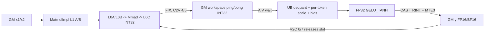
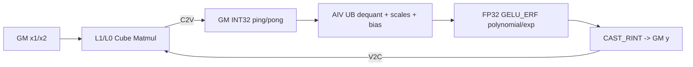

# FusedQuantMatmul A2/A3 ACLNN 算子知识

## 算子速览

| 项目 | 内容 |
|---|---|
| 实际入口 | `aclnnFusedQuantMatmulGetWorkspaceSize` + `aclnnFusedQuantMatmul`，公开 ACLNN 两段式入口 |
| 计算语义 | INT8×INT8 或 INT4×INT4 的 batch matmul；INT32 累加，逐 token `x1Scale` 与逐通道/逐 tensor `x2Scale` 反量化，可选 bias，随后融合 `gelu_tanh` 或 `gelu_erf` |
| 输入输出 | `x1[...,M,K]`、`x2[...,K,N]` 的 ND 逻辑视图；`x1Scale:[M]` FP32，`x2Scale:[N]`/`[1]` FP32/BF16；输出 `[...,M,N]` FP16/BF16 |
| 执行类型 | 单 Kernel `MIX_CV`，模板比 `ASCENDC_TPL_MIX_AIC_1_1`；AIC Cube matmul 与 AIV Vector 反量化/bias/GELU 同图交接 |
| Kernel 路线 | R-001 per-token basic + GELU_TANH；R-002 per-token basic + GELU_ERF |
| 核心资源 | GM 输入输出、每核双槽 INT32 workspace、L1/L0A/L0B/L0C、AIV UB 队列/临时区、C2V/V2C event |
| 来源闭包 | source_closed：公开 ACLNN→L0 launcher→A2/A3 unary tiling→POD→MIX_CV entry→basic matmul/epilogue→两平台二进制配置与默认源码接线闭合 |
| 验证状态 | 已完成源码闭包检查；本次知识提取未执行编译、真机、数值或性能测试。 |

## 接口与语义

### 计算语义

令 `A=x1`、`B=x2`，转置由输入最后两维的 view 推出，逻辑结果为 `S=A@B`，其中低比特乘法在 INT32 中累加。若 bias 为 INT32，Cube 在累加域先算 `S+bias`；若 bias 为 FP16/BF16/FP32，AIV 先反量化再以 FP32 加 bias：

```text
INT32 bias: z = (S + bias) * x2Scale[n] * x1Scale[m]
float bias: z = S * x2Scale[n] * x1Scale[m] + bias[n]
no bias:    z = S * x2Scale[n] * x1Scale[m]
y = GELU_TANH(z) 或 GELU_ERF(z)
```

设备 epilogue 先把 INT32 workspace 搬入 UB，通过 `AscendDequant` 施加 `x2Scale`，再广播 FP32 `x1Scale` 相乘；浮点 bias 在此后加入。GELU 在 FP32 UB 上完成，最终以 `RoundMode::CAST_RINT` 转为 FP16/BF16 并写回 GM。`gelu_tanh` 使用 `x/(1+exp(-sqrt(8/pi)*(x+0.044715*x^3)))` 的等价形式；`gelu_erf` 使用源码中的分段/截断多项式实现。

### 输入、输出与属性

| 参数 | shape/layout | dtype | 约束、默认值与语义 |
|---|---|---|---|
| x1 | 2～6 维 ND 逻辑视图 `[...,M,K]`；仅最后两维转置 view 可非连续 | INT8、INT4；公开层也接受 INT32 packed INT4 载体 | 与 x2 必须同为 A8W8 或 A4W4；最后一维不超过 65535；INT4/packed INT32 不转置、内轴为偶数，packed INT32 的 K 还须为 8 的倍数；前处理把载体解释为 INT4 |
| x2 | 普通入口为 2～6 维 ND 逻辑视图 `[...,K,N]` | INT8、INT4；公开层也接受 INT32 packed INT4 载体 | 本卡不包含 `aclnnFusedQuantMatmulWeightNz*`；最后一维不超过 65535；A4W4 的 x2 仅二维 ND、内轴为偶数且不支持转置；固定二进制配置均为 ND_ND |
| x1Scale | `[M]`、ND | FP32 | 必选，逐 token scale；长度必须等于转置解释后的 M |
| x2Scale | `[N]` 或 `[1]`、ND | FP32；BF16 仅 BF16 输出组合 | 必选，分别表示 per-channel/per-tensor scale |
| yScaleOptional | 空或 nullptr | 预留 | 当前不支持，非空即失败 |
| x1OffsetOptional | 空或 nullptr | 预留 | 当前不支持，非空即失败 |
| x2OffsetOptional | 空或 nullptr | 预留 | 当前不支持，非空即失败 |
| yOffsetOptional | 空或 nullptr | 预留 | 当前不支持，非空即失败 |
| biasOptional | `[N]` 或 `[batch,1,N]`、ND | INT32、FP32；FP16 仅 FP16 输出；BF16 仅 BF16 输出 | 可空；INT4 场景只支持一维；INT32 bias 在 Cube 累加域融合，浮点 bias 在 Vector 反量化后融合 |
| x3Optional | 空或 nullptr | 预留 | 当前 unary fusion 不支持，非空即失败 |
| fusedOpType | C 字符串 | `gelu_tanh` 或 `gelu_erf` | 必选，直接进入 tiling key 的 `FUSED_OPTYPE=3/4` |
| groupSizeOptional | 标量 | INT64 | 必须为 0；不是 tensor，不得按文档个别段落的“nullptr”字样解释 |
| out | 2～6 维 ND `[...,M,N]` | FP16/BF16 | shape 由 batch matmul infer shape 得到；公开文档列出的六组输入/scale/output 二进制组合可达 |

### 入口与版本

固定提交中的公开普通入口是 `aclnnFusedQuantMatmulGetWorkspaceSize`/`aclnnFusedQuantMatmul`。第一段构造 executor、推导 transpose 并加入一个 `FusedQuantMatMul` AICore launcher，第二段在调用者 stream 上执行。仓中另有 WeightNz 同名变体，但它具有独立公开入口和 storage-format 前置约束，本卡按逻辑算子边界排除。A2 的 `ascend910b` 与 A3 的 `ascend910_93` 均注册当前实现和同样六个最新公开二进制组合；不存在更高版本号的普通入口族需要替代。

## Host/Launcher 执行流程

### 参数校验与前处理

`aclnnFusedQuantMatmulGetWorkspaceSize` 先创建 executor，以 `IsTransposeLastTwoDims` 得到两输入转置属性，并用 `isWeightNz=false` 进入 common process。`CheckFusedOpType` 先拒绝非两种 GELU；`PreMatmulCalcProcess` 再检查必选/预留参数和 `groupSize==0`，依次 contiguous 化 x1、x1Scale、x2Scale、bias，普通入口对 x2 调 `WeightNZCaseProcess` 做所需的内部格式准备，然后检查 rank、把 packed INT32 转成 INT4 并修正 NZ storage shape。之后只接受 A8W8/A4W4，校验两种 scale 长度，统一输入的 ND 逻辑格式，并交给 `QuantMatmulChecker` 完成 batch、shape、dtype、format 约束。任一步返回非成功即停止构造 executor。

### 参数、Workspace 与生命周期

L0 `FusedQuantMatMul` 分配 ND 输出、执行 infer shape，并恰好调用一次 `ADD_TO_LAUNCHER_LIST_AICORE`。basic tiling 的用户 workspace 以 INT32 C tile 为主体：`2 * usedCoreNum * baseM * baseN * sizeof(int32_t)`，每核 ping/pong 两槽；总 workspace 还加平台 `GetLibApiWorkSpaceSize()`。本平台支持 L0C2Out，故不走另一个 atomic-clean workspace 分支。executor 在第一段返回 workspace 字节数并转移给调用者，调用者保证 workspace、executor 持续到第二段 stream 执行完成。

### 启动图与失败传播

```text
aclnnFusedQuantMatmulGetWorkspaceSize
  -> aclnnFusedQuantMatmulGetWorkspaceSizeCommonProcess
    -> l0op::FusedQuantMatMul
      -> INFER_SHAPE(FusedQuantMatMul)
      -> ADD_TO_LAUNCHER_LIST_AICORE(FusedQuantMatMul)
        -> FusedQuantMatMulTilingFunc -> FusedQuantMatMulUnaryTiling
        -> fused_quant_mat_mul<TRANS,1,1,0,FUSED_OPTYPE>
           AIC: MatmulImpl<int8/int4,int8/int4,int32> -> GM workspace
           AIV: dequant -> per-token scale -> floating bias -> GELU -> y
aclnnFusedQuantMatmul -> CommonOpExecutorRun(stream)
```

`PostTiling` 以 `matmulTiling.usedCoreNum` 写 blockDim、序列化 `QuantBatchMatmulV3TilingData` 并设置 workspace。空 context、资源不足、模板不 capable、POD 容量不足或 launcher 失败均向 ACLNN 状态码传播；kernel 自身还在 `workSpace` 或 user workspace 为空时直接返回。

## Route 与参数设计

### 分核与资源计算

unary tiling 从 x1/x2 最后两维及 trans 属性得到 M/K/N，并展开 batch；强制 `groupSize=0`、per-token x1 scale、per-channel/per-tensor x2 scale和 basic tiling。`ResetBase` 以 L0C 大小选择 `baseM=256`（L0C=256 KiB）或 128，初始 `baseN=256,baseK=64`；`CalcL0Tiling` 按转置与 L0 容量调整 tile、`dbL0C` 和迭代顺序，`CalcL1Tiling` 从扣除 bias/scale 保留区后的半 L1 推出 `depthA1/depthB1`、`stepKa/stepKb` 并乘双缓冲系数 2。L2 tiling 再产出 M/N tile block。

UB 计算以 `baseN` 对齐列宽；反量化源双缓冲、输出双缓冲、FP32 临时、scale、per-token 广播及可选浮点 bias 都计入 `needUbSize`，最后 `ubCalcM=min((UB-needUbSize)/ubCalcPerRow,baseM,M)`，并写 `needUbBuffer=ubCalcN*ubCalcM*8`。`PostTiling` 的 blockDim 就是实际 usedCoreNum。

### Route 选择

| 顺序 | Route | Key/模板 | 精确选择条件与优先级 | 不适用去向 |
|---:|---|---|---|---|
| 1 | R-001 Per-token Basic GELU_TANH | `TRANS∈{0,1,2,3}, KERNEL_TEMPLATE_TYPE=1, PERTOKEN=1, OPTION_ATTR=0, FUSED_OPTYPE=3` | `supportMmadS8S4=false && supportL0c2Out=true` 只尝试 registry priority 2；A8W8/A4W4、合法 scale/output/bias，`fusedOpType="gelu_tanh"` | selector 不满足或 basic tiling 失败即图失败；平台转到 950 分支不属于本卡 |
| 2 | R-002 Per-token Basic GELU_ERF | 同上，仅 `FUSED_OPTYPE=4` | 与 R-001 相同，但 `fusedOpType="gelu_erf"` | 同上 |

```text
supportMmadS8S4?
  yes -> priorities {1,0}（A5 路径，不在本卡）
  no -> supportL0c2Out?
          yes -> priority {2}/FusedQuantMatMulUnaryTiling
                   fused_op_type == gelu_tanh -> R-001
                   fused_op_type == gelu_erf  -> R-002
                   otherwise -> failure
          no -> 固定函数无返回路线，非本卡支持平台
```

### 模板/实现执行矩阵

| Route | key/selector | dtype/shape/platform 完整命中条件 | 执行族与 kernel 节点 | 实际模板/body | 内存与同步特征 | tail/fallback |
|---|---|---|---|---|---|---|
| R-001 Per-token Basic GELU_TANH | 4 个 TRANS 值 × `(1,1,0,3)` | A2/A3 `supportL0c2Out && !supportMmadS8S4`；A8W8 或 A4W4；x1Scale FP32 `[M]`；x2Scale `[N]/[1]`；输出 FP16/BF16；合法 bias | 单节点 MIX_CV，AIC:AIV=1:1 | `BmmDequantPertokenBasic<...,transA,transB,QuantBatchMatmulV3Update,EpilogueDequantGeluTanh>` | 每核双槽 INT32 GM workspace；AIC MatmulImpl 使用 L1/L0，AIV 使用 UB；C2V 4/5、V2C 6/7 | `QuantBatchMatmulV3BaseBlock` 裁剪 M/N；UB M-loop 裁剪末行，DataCopyPad/Ext 裁剪列尾；无后备 route |
| R-002 Per-token Basic GELU_ERF | 4 个 TRANS 值 × `(1,1,0,4)` | 同 R-001，`fusedOpType=gelu_erf` | 单节点 MIX_CV，AIC:AIV=1:1 | `BmmDequantPertokenBasic<...,transA,transB,QuantBatchMatmulV3Update,EpilogueDequantGeluErf>` | 与 R-001 相同，GELU 的 UB 指令序列不同 | 同 R-001；无后备 route |

### 隐藏性能 Guard

| Guard | Host/Tiling 条件 | Device/资源原因 | 影响 Route | 不满足时去向 | 源码符号 |
|---|---|---|---|---|---|
| 平台能力 | `!supportMmadS8S4 && supportL0c2Out` | 选择 DAV 220 unary basic 和 L0C→workspace 路线 | R-001/R-002 | 950 优先级 `{1,0}` 或无可达模板 | `FusedQuantMatMulTilingFunc` |
| basic 强制 | `CheckUseBasicTiling()==true` | 本 entry 仅编译 BASIC/PERTOKEN/OPTION_NONE | R-001/R-002 | basic 资源计算失败即 tiling 失败 | `FusedQuantMatMulUnaryTiling::CheckUseBasicTiling`、`GetTilingKey` |
| L0C 双缓冲 | `2*baseM*baseN*sizeof(int32)<=L0C` 且 bias/scale guard 允许 | ping/pong L0C 降低 AIC stall | R-001/R-002 | 同 route 关闭 `dbL0C` 或缩 tile | `CalcL0Tiling` |
| L1 深度 | A/B L1 bytes 不超过扣除 bias/scale 后的半 L1 | 同时驻留 stepK 与双缓冲 A/B tile | R-001/R-002 | 调整 depth/step；不可行则失败 | `CalcL1Tiling` |
| UB 容量 | `UB > needUbSize` 且计算出的 `ubCalcM>0` | 同时容纳 INT32 C、FP32 dequant/GELU、scale/bias和输出 | R-001/R-002 | tiling 失败 | `QuantBatchMatmulV3Tiling::CalcUbTiling(baseN,baseM)` |
| workspace 上界 | 每核双槽 `2*baseM*baseN*4`，总量由 usedCoreNum 放大 | 防止 AIC 写槽覆盖 AIV 尚未消费的数据 | R-001/R-002 | tiling 拆分/失败 | `GetUbDequantExtreSpace`、`SpiltForWorkSpaceLimit` |
| key 可编译集合 | TRANS 四值，BASIC，PERTOKEN，OPTION_NONE，GELU 3/4 | entry 的 `if constexpr` 仅实例化这些组合 | R-001/R-002 | 无匹配 body | `fused_quant_mat_mul_kernel_tilingkey.h::ASCENDC_TPL_SEL` |

### POD/ABI

`QuantBatchMatmulV3Params` 在 `#pragma pack(8)` 与 `alignas(8)` 下由 32 个连续 `uint32_t` 组成，故字段偏移依次每次加 4，结构 `sizeof=128,alignof=8`。下表中 basic route 未赋值且 device 不读取的遗留字段必须保留原位，不能删改以“精简”ABI。

| 结构 | 字段 | 类型/位宽 | ABI 布局 | 单位 | Host/launcher producer | Device consumer | 边界 |
|---|---|---|---|---|---|---|---|
| QuantBatchMatmulV3Params | batchA | uint32/32 | offsetof=0 | batch | `SetMatmulTilingFromBasicTiling(inputParams_.batchA)` | block/update 的 batch 偏移 | 至少 1 |
| QuantBatchMatmulV3Params | batchB | uint32/32 | offsetof=4 | batch | 同上，`batchB` | block/update | 广播后逻辑 batch |
| QuantBatchMatmulV3Params | batchC | uint32/32 | offsetof=8 | batch | 同上，`batchC` | `Process` batch 循环 | 输出 batch |
| QuantBatchMatmulV3Params | batchA1 | uint32/32 | offsetof=12 | 轴长 | basic route 未显式赋值 | 本 body 不读取 | inactive，保留 |
| QuantBatchMatmulV3Params | batchA2 | uint32/32 | offsetof=16 | 轴长 | basic route 未显式赋值 | 本 body 不读取 | inactive，保留 |
| QuantBatchMatmulV3Params | batchA3 | uint32/32 | offsetof=20 | 轴长 | basic route 未显式赋值 | 本 body 不读取 | inactive，保留 |
| QuantBatchMatmulV3Params | batchA4 | uint32/32 | offsetof=24 | 轴长 | basic route 未显式赋值 | 本 body 不读取 | inactive，保留 |
| QuantBatchMatmulV3Params | batchB1 | uint32/32 | offsetof=28 | 轴长 | basic route 未显式赋值 | 本 body 不读取 | inactive，保留 |
| QuantBatchMatmulV3Params | batchB2 | uint32/32 | offsetof=32 | 轴长 | basic route 未显式赋值 | 本 body 不读取 | inactive，保留 |
| QuantBatchMatmulV3Params | batchB3 | uint32/32 | offsetof=36 | 轴长 | basic route 未显式赋值 | 本 body 不读取 | inactive，保留 |
| QuantBatchMatmulV3Params | batchB4 | uint32/32 | offsetof=40 | 轴长 | basic route 未显式赋值 | 本 body 不读取 | inactive，保留 |
| QuantBatchMatmulV3Params | batchC1 | uint32/32 | offsetof=44 | 轴长 | basic route 未显式赋值 | 本 body 不读取 | inactive，保留 |
| QuantBatchMatmulV3Params | batchC2 | uint32/32 | offsetof=48 | 轴长 | basic route 未显式赋值 | 本 body 不读取 | inactive，保留 |
| QuantBatchMatmulV3Params | batchC3 | uint32/32 | offsetof=52 | 轴长 | basic route 未显式赋值 | 本 body 不读取 | inactive，保留 |
| QuantBatchMatmulV3Params | batchC4 | uint32/32 | offsetof=56 | 轴长 | basic route 未显式赋值 | 本 body 不读取 | inactive，保留 |
| QuantBatchMatmulV3Params | singleCoreBatch | uint32/32 | offsetof=60 | batch/核 | `InitTilingData/mm.GetTiling` 产生，basic 后处理不覆写 | 本 basic body 不读取 | inactive，保留 |
| QuantBatchMatmulV3Params | isPerTensor | uint32/32 | offsetof=64 | 0/1 | `DoOpTiling(inputParams_.isPerTensor)` | epilogue 选择 scalar/vector x2 scale | 0/1 |
| QuantBatchMatmulV3Params | isPertoken | uint32/32 | offsetof=68 | 0/1 | `DoOpTiling(inputParams_.isPertoken)` | 本 body 的 per-token路径 | 本 route 固定 1 |
| QuantBatchMatmulV3Params | isDoubleScale | uint32/32 | offsetof=72 | 0/1 | basic route 未显式赋值 | 本 body 不读取 | inactive，保留 |
| QuantBatchMatmulV3Params | biasThreeDim | uint32/32 | offsetof=76 | 0/1 | `batchBias>1` | batch bias offset | 0/1 |
| QuantBatchMatmulV3Params | ubCalcM | uint32/32 | offsetof=80 | 行/UB tile | `CalcUbTiling` | epilogue M-loop | `1..baseM` |
| QuantBatchMatmulV3Params | ubCalcN | uint32/32 | offsetof=84 | 列/UB tile | `CalcUbTiling` | epilogue N extent | 对齐后的 baseN |
| QuantBatchMatmulV3Params | needUbBuffer | uint32/32 | offsetof=88 | 字节 | `ubCalcN*ubCalcM*8` | `vecQueTmp_` init | 不超过 UB |
| QuantBatchMatmulV3Params | realSingleCoreM | uint32/32 | offsetof=92 | 行 | workspace split/tiling | block tail | 不小于有效 tile |
| QuantBatchMatmulV3Params | realSingleCoreN | uint32/32 | offsetof=96 | 列 | workspace split/tiling | block tail | 不小于有效 tile |
| QuantBatchMatmulV3Params | biasDtype | uint32/32 | offsetof=100 | dtype 枚举 | `inputParams_.biasDtype` | Cube INT32 bias或AIV浮点 bias 分支 | 无 bias 按框架枚举 |
| QuantBatchMatmulV3Params | ubSize | uint32/32 | offsetof=104 | 字节 | `CalcUbTiling` 记录平台 UB | 诊断/共享路径 | 平台值 |
| QuantBatchMatmulV3Params | isMClash | uint32/32 | offsetof=108 | 0/1 | basic L2 tiling | block scheduler | 0/1 |
| QuantBatchMatmulV3Params | isNClash | uint32/32 | offsetof=112 | 0/1 | basic L2 tiling | block scheduler | 0/1 |
| QuantBatchMatmulV3Params | groupSizeM | uint32/32 | offsetof=116 | 元素 | 本 route groupSize=0，未用 | 本 body 不读取 | inactive，保留 |
| QuantBatchMatmulV3Params | groupSizeN | uint32/32 | offsetof=120 | 元素 | 本 route groupSize=0，未用 | 本 body 不读取 | inactive，保留 |
| QuantBatchMatmulV3Params | groupSizeK | uint32/32 | offsetof=124；结构 sizeof=128/alignof=8 | 元素 | 本 route groupSize=0，未用 | 本 body 不读取 | inactive，保留 |
| QuantBatchMatmulV3TilingData | params | QuantBatchMatmulV3Params/1024 | offsetof=0 | aggregate | unary/basic tiling | entry、block、epilogue | 固定如上 |
| QuantBatchMatmulV3TilingData | matmulTiling | TCubeTiling/固定仓外部定义 | offsetof=128；精确 sizeof/alignof 固定仓不可见 | aggregate | `SetMatmulTilingFromBasicTiling` | `mm_.Init`、block/update | 外部 `kernel_tiling.h` ABI 不得猜测 |
| QuantBatchMatmulV3TilingData | matmulTiling.M/N/Ka/Kb | 外部字段/宽度不可见 | nested offsetof 不可见 | 元素 | 总 M/N/K | MatmulImpl、offset | shape 范围 |
| QuantBatchMatmulV3TilingData | matmulTiling.usedCoreNum | 外部字段/宽度不可见 | nested offsetof 不可见 | 核 | basic usedCoreNum | blockDim、block scheduler | `<=aicNum` |
| QuantBatchMatmulV3TilingData | matmulTiling.singleCoreM | 外部字段/宽度不可见 | nested offsetof 不可见 | 行 | basic baseM | block tile | 尾块裁剪 |
| QuantBatchMatmulV3TilingData | matmulTiling.singleCoreN | 外部字段/宽度不可见 | nested offsetof 不可见 | 列 | basic baseN | block tile | 尾块裁剪 |
| QuantBatchMatmulV3TilingData | matmulTiling.singleCoreK | 外部字段/宽度不可见 | nested offsetof 不可见 | K 元素 | `K` | MatmulImpl | 当前不 split K |
| QuantBatchMatmulV3TilingData | matmulTiling.baseM | 外部字段/宽度不可见 | nested offsetof 不可见 | 行 | `CalcL0Tiling` | MatmulImpl/workspace stride | 128/256 起点并可调整 |
| QuantBatchMatmulV3TilingData | matmulTiling.baseN | 外部字段/宽度不可见 | nested offsetof 不可见 | 列 | `CalcL0Tiling` | MatmulImpl/workspace stride | 256 起点并可调整 |
| QuantBatchMatmulV3TilingData | matmulTiling.baseK | 外部字段/宽度不可见 | nested offsetof 不可见 | K 元素 | `CalcL0Tiling` | MatmulImpl | 64 起点并可调整 |
| QuantBatchMatmulV3TilingData | matmulTiling.depthA1 | 外部字段/宽度不可见 | nested offsetof 不可见 | tile 深度 | `CalcL1Tiling` | MatmulImpl L1 A | 含双缓冲因子 |
| QuantBatchMatmulV3TilingData | matmulTiling.depthB1 | 外部字段/宽度不可见 | nested offsetof 不可见 | tile 深度 | `CalcL1Tiling` | MatmulImpl L1 B | 含双缓冲因子 |
| QuantBatchMatmulV3TilingData | matmulTiling.stepM | 外部字段/宽度不可见 | nested offsetof 不可见 | tile | L1 tiling | MatmulImpl | 容量 guard |
| QuantBatchMatmulV3TilingData | matmulTiling.stepN | 外部字段/宽度不可见 | nested offsetof 不可见 | tile | L1 tiling | MatmulImpl | 容量 guard |
| QuantBatchMatmulV3TilingData | matmulTiling.stepKa | 外部字段/宽度不可见 | nested offsetof 不可见 | tile | L1 tiling | MatmulImpl | K depth |
| QuantBatchMatmulV3TilingData | matmulTiling.stepKb | 外部字段/宽度不可见 | nested offsetof 不可见 | tile | L1 tiling | MatmulImpl | K depth |
| QuantBatchMatmulV3TilingData | matmulTiling.iterateOrder | 外部字段/宽度不可见 | nested offsetof 不可见 | 枚举 | `CalcL0Tiling` | MatmulImpl | M/N order |
| QuantBatchMatmulV3TilingData | matmulTiling.dbL0C | 外部字段/宽度不可见 | nested offsetof 不可见 | 1/2 | `CalcL0Tiling` | MatmulImpl | 1=off，2=on |
| QuantBatchMatmulV3TilingData | matmulTiling.isBias | 外部字段/宽度不可见 | nested offsetof 不可见 | 0/1 | `InitTilingData` 的 `mm.SetBias/mm.GetTiling` | `BmmDequantPertokenBasic::InitTilingData` 选择 Cube/AIV bias 路径 | 仅 bias 非空为 1 |
| QuantBatchMatmulV3TilingData | tileL2cacheTiling | L2cacheTileParam/192 | 位于外部 TCubeTiling 后，精确 offsetof 不可见；sizeof=24/alignof=8 | aggregate | basic L2 tiling | `QuantBatchMatmulV3BaseBlock` | 六字段均 uint32 |
| L2cacheTileParam | mTileCntL2 | uint32/32 | relative offsetof=0 | tile 数 | basic L2 tiling | block scheduler | 正值 |
| L2cacheTileParam | nTileCntL2 | uint32/32 | relative offsetof=4 | tile 数 | basic L2 tiling | block scheduler | 正值 |
| L2cacheTileParam | mTileBlock | uint32/32 | relative offsetof=8 | tile | basic L2 tiling | block scheduler | M 范围 |
| L2cacheTileParam | nTileBlock | uint32/32 | relative offsetof=12 | tile | basic L2 tiling | block scheduler | N 范围 |
| L2cacheTileParam | calOrder | uint32/32 | relative offsetof=16 | 枚举 | basic L2 tiling | block scheduler | M/N 顺序 |
| L2cacheTileParam | isBasicTiling | uint32/32 | relative offsetof=20；sizeof=24/alignof=8 | 0/1 | 固定写 1 | block scheduler | 本 route 固定 1 |
| QuantBatchMatmulV3TilingData | adaptiveSlidingWin | SlidingWindowParam/192 | 在 L2 struct 后；aggregate 精确 offsetof/总 sizeof 不可见 | aggregate | basic route 未赋值 | 本 basic body 不读取 | inactive，保留 |
| SlidingWindowParam | mTailTile | uint32/32 | relative offsetof=0 | tile | 未赋值 | 不读取 | inactive |
| SlidingWindowParam | nTailTile | uint32/32 | relative offsetof=4 | tile | 未赋值 | 不读取 | inactive |
| SlidingWindowParam | mBaseTailSplitCnt | uint32/32 | relative offsetof=8 | count | 未赋值 | 不读取 | inactive |
| SlidingWindowParam | nBaseTailSplitCnt | uint32/32 | relative offsetof=12 | count | 未赋值 | 不读取 | inactive |
| SlidingWindowParam | mTailMain | uint32/32 | relative offsetof=16 | 行 | 未赋值 | 不读取 | inactive |
| SlidingWindowParam | nTailMain | uint32/32 | relative offsetof=20；sizeof=24/alignof=8 | 列 | 未赋值 | 不读取 | inactive |

### Route 源码闭包

| Route | Key/selector | Host/Tiling producer | POD/参数 | Kernel entry/router | Kernel body/直接依赖 | 构建接线 |
|---|---|---|---|---|---|---|
| R-001 Per-token Basic GELU_TANH | TRANS 0/1/2/3，`1,1,0,3` | `fused_quant_matmul_tiling.cpp::FusedQuantMatMulTilingFunc` → `fused_quant_matmul_unary_tiling.cpp::GetTilingKey` → qmmv3 basic tiling | `QuantBatchMatmulV3TilingData` | `fused_quant_mat_mul.cpp::fused_quant_mat_mul` → `EpilogueTypeTraits<GELU_TANH>` | `quant_batch_matmul_v3_pertoken_basic.h::BmmDequantPertokenBasic`；`quant_batch_matmul_v3_basic_epilogue.h::EpilogueDequantGeluTanh` | `FusedQuantMatMul::AddConfig(ascend910b/ascend910_93)` + 两份 binary JSON；`ascendc_impl_build.py` 默认 `kernel_src=op_file` |
| R-002 Per-token Basic GELU_ERF | TRANS 0/1/2/3，`1,1,0,4` | 同上 | 同一 POD，`fusedOpType_=4` | 同一 entry → `EpilogueTypeTraits<GELU_ERF>` | 同一 basic body；`EpilogueDequantGeluErf` | 同上 |

## Kernel 实现

### 公共执行流程

entry 取得 user workspace 与 POD，按 TRANS 选择 `BmmDequantPertokenBasic` 的两个布尔模板实参，并按 `FUSED_OPTYPE` 选择 epilogue class。`Init` 把 MIX block index 按 task ratio 映射到同一 AIC/AIV 组，在每核 workspace 中建立两个 `baseM*baseN*int32` 槽，初始化 MatmulImpl、GM tensor和 UB buffer。`Process` 遍历 batch、L2 tile 与基本 M/N tile；同一 tile 的 AIC 写 INT32 workspace 后发 C2V，AIV 等待后完成反量化、per-token scale、可选浮点 bias、GELU、cast 与输出，再发 V2C 允许槽复用。

### Route R-001：Per-token Basic GELU_TANH

#### 适用条件

##### 选择证据

| 层级 | 文件 | 符号 | 源码谓词/参数 | 结果/下一跳 |
|---|---|---|---|---|
| API | `matmul/fused_quant_mat_mul/op_host/op_api/aclnn_fused_quant_matmul.cpp` | `CheckFusedOpType` | `strcmp(...,"gelu_tanh")==0` | 继续；否则仅 gelu_erf 可继续 |
| Tiling registry | `matmul/fused_quant_mat_mul/op_host/op_tiling/fused_quant_matmul_tiling.cpp` | `FusedQuantMatMulTilingFunc` | `!supportMmadS8S4 && supportL0c2Out` | 只调用 priority 2 unary tiling |
| Key producer | `matmul/fused_quant_mat_mul/op_host/op_tiling/fused_quant_matmul_unary_tiling.cpp` | `AnalyzeAttrs`/`GetTilingKey` | map 得 3；basic、pertoken、option=0 | TRANS + `(1,1,0,3)` |
| Router | `matmul/fused_quant_mat_mul/op_kernel/fused_quant_mat_mul.cpp` | `fused_quant_mat_mul` | key 的四种 TRANS constexpr 分支 | `BmmDequantPertokenBasic<...,EpilogueDequantGeluTanh>` |

#### Device 数据流

##### 函数级调用链

```text
fused_quant_mat_mul<TRANS,1,1,0,3>
  -> BmmDequantPertokenBasic::Init
  -> BmmDequantPertokenBasic::Process
    -> QuantBatchMatmulV3BaseBlock::Init/Update
    -> OneTileCompute -> BasicMMCVFusionCompute
      -> AIC BasicMMCompute -> MatmulImpl::Iterate/GetTensorC(workspace)
      -> AIV EpilogueDequantGeluTanh::Process
        -> EpilogueDequantCommon::DequantCompute
        -> ComputeGeluTanh
        -> CopyOutToGM
  -> End
```

##### 源码等价伪码

```text
伪码：
for batch in assigned_batch:
  for l2_tile in assigned_l2_tiles:
    for mn_tile in l2_tile:
      update M/N tail and offsets(A,B,C,scale,bias,pertoken)
      slot = loop & 1
      if AIC:
        if loop > 2: wait V2C[slot]
        MatmulImpl(A, B, optional_int32_bias) -> workspace[core,slot]
        notify C2V[slot]
      if AIV:
        wait C2V[slot]
        for m_ub_tile:
          copy padded INT32 workspace tile GM -> UB
          z_fp32 = AscendDequant(z_int32, x2Scale)
          z_fp32 *= broadcast(x1Scale)
          if bias is floating: z_fp32 += bias
          z_fp32 = z_fp32 / (1 + exp(-1.5957691*(z_fp32+0.044715*z_fp32^3)))
          y_ub = cast_rint<fp16/bf16>(z_fp32)
          copy valid MxN UB -> GM y
        notify V2C[slot]
```

#### 内存与数据搬运

##### 资源与搬运表

| 层级/缓冲区 | offset/地址公式 | extent/容量公式 | dtype/layout | producer | consumer | owner/lifetime | 对齐/复用 |
|---|---|---|---|---|---|---|---|
| GM x1 | `batchAOffset + offsetA`，trans 决定 `mOffset` 或 `mOffset*Ka` | 当前 M×K tile | INT8/INT4 ND | caller | MatmulImpl A | caller 至 stream 完成 | Cube block 对齐由 MatmulImpl/tiling保证 |
| GM x2 | `batchBOffset + offsetB`，trans 决定 ND stride | 当前 K×N tile | INT8/INT4 ND | caller/contiguous 前处理 | MatmulImpl B | executor/caller | 普通入口六个固定二进制均为 ND_ND |
| L1 A/B | MatmulImpl 内部，地址细节固定仓库外部库边界 | `depthA1/depthB1 × base tile` | Cube tile | MTE2 | L0A/L0B | tile lifetime | 双缓冲深度由 Host 计算 |
| L0A/L0B/L0C | MatmulImpl 内部 | baseM×baseK、baseK×baseN、baseM×baseN | INT8/INT4；L0C INT32 | MatmulImpl | Mmad/FIX | tile lifetime | `dbL0C` 受容量 guard |
| GM user workspace | `((2*blockIdx)+slot)*baseM*baseN*sizeof(int32)` | 每核 `2*baseM*baseN*4` 字节 | INT32 ND tile | AIC `GetTensorC` | AIV GM→UB | executor workspace；单 launch | ping/pong，V2C 防覆盖 |
| UB vecQueSrc | queue slot 0/1 | `2*ubCalcM*ubCalcN*4` | INT32 | GM copy | AscendDequant | AIV tile | 双缓冲 |
| UB vecQueTmp | TBuf | `needUbBuffer=ubCalcM*ubCalcN*8` | byte/FP32 scratch | dequant/GELU | GELU/cast | AIV tile | 多阶段复用 |
| UB outFp32Tmp | TBuf | `ubCalcM*ubCalcN*4` | FP32 | dequant或GELU temp | GELU | AIV tile | GELU 复用临时区 |
| UB output queue | queue slot 0/1 | `2*ubCalcM*ubCalcN*sizeof(y)` | FP16/BF16 | CAST_RINT | MTE3 | AIV tile | 双缓冲 |
| UB scale/per-token/bias | x2Scale N tile；`2*align(ubCalcM,8)*4` per-token；可选 bias N tile | 由 `CalcUbTiling` 汇总 | FP32/BF16/FP16 | GM copy/cast | broadcast/mul/add | AIV tile | 32B 对齐 |
| GM y | `offsetC + mUbLoop*ubCalcM*N + subBlockOffset*N` | 有效 `curAivM*curAivN` | FP16/BF16 ND | AIV MTE3 | caller | caller | DataCopyExt 只提交有效尾块 |

##### 分层内存布局



##### 字节账、交接边与复用顺序

```text
user_workspace = 2 * usedCoreNum * baseM * baseN * sizeof(int32)
workspace_total = library_api_workspace + user_workspace
UB_required = 2*C_int32 + dequant_tmp + fp32_out + 2*y + x2Scale + 2*pertoken + optional_bias + broadcast
needUbBuffer = ubCalcM * ubCalcN * 8
UB_required <= compileInfo.ubSize
```

| 边/复用子区 | producer | offset/extent | dtype/layout | consumer | ordering/sync | owner/lifetime | 安全条件 |
|---|---|---|---|---|---|---|---|
| C ping/pong | AIC `BasicMMCompute` | 每核 slot 0/1，各 `baseM*baseN*4` | INT32 ND tile | AIV epilogue | producer `NotifyEvent<PIPE_FIX>(4/5)`，consumer `WaitEvent(4/5)` | user workspace/launch | slot 与 `loop&1` 一致 |
| workspace 槽释放 | AIV epilogue | 同一 slot | 控制边 | 后续 AIC tile | AIV `NotifyEvent<PIPE_MTE2>(6/7)`；AIC 从第三次使用起等待 | MIX task pair | 首两次不等待，之后严格防覆盖 |
| outFp32Tmp 复用 | common dequant→GELU | `ubCalcM*ubCalcN*4` | FP32 | GELU temp | PIPE_V barrier | AIV tile | dequant完成后才复用 |

#### 同步、精度与尾块

##### 同步与数值边界表

| 阶段 | primitive/机制 | producer | consumer/等待点 | 保护对象 | 精度/尾块 |
|---|---|---|---|---|---|
| AIC→AIV | `NotifyEvent<PIPE_FIX>` / `WaitEvent`，flags 4/5 | MatmulImpl/GetTensorC | AIV epilogue | INT32 workspace slot | M/N tail 已写入 block state |
| AIV→AIC | `NotifyEvent<PIPE_MTE2>` / 延迟 `WaitEvent`，flags 6/7 | AIV copy-out 后 | AIC 第三次及以后复用 slot | ping/pong ownership | `End` 补偿等待 C2V 状态并结束 mm |
| workspace→UB | `DataCopyPad` | GM INT32 tile | AscendDequant | 列尾 padding | 32B 对齐，真实 N 另存 |
| 反量化 | `AscendDequant` + FP32 broadcast/mul | INT32 C、x2Scale、x1Scale | bias/GELU | FP32 z | per-tensor scalar或per-channel vector |
| bias | Cube bias 或 `Cast(CAST_NONE)+Add` | INT32 bias或浮点 bias | matmul/epilogue | bias 次序 | INT32 在 scale 前，float 在 scale 后 |
| GELU_TANH | FP32 Mul/Muls/Add/Exp/Div + PIPE_V | FP32 z | cast | GELU temp | 对齐长度 `curAivM*alignN` |
| 输出 | `Cast(...CAST_RINT)` + V_MTE3 flag | FP32 GELU | GM y | output queue | 仅有效 `curAivM*curAivN` 写回 |

#### 关键实现

##### 符号证据表

| 阶段 | 文件 | 符号/模板实例 | 实现事实 |
|---|---|---|---|
| Host/Tiling producer | `matmul/fused_quant_mat_mul/op_host/op_tiling/fused_quant_matmul_unary_tiling.cpp` | `AnalyzeAttrs`、`GetTilingKey` | GELU_TANH=3，组合 TRANS/basic/pertoken/option |
| Kernel entry/router | `matmul/fused_quant_mat_mul/op_kernel/fused_quant_mat_mul.cpp` | `fused_quant_mat_mul` | 四个 TRANS 均实例化同一 basic class 与 tanh epilogue |
| Device body/helper | `matmul/quant_batch_matmul_v3/op_kernel/quant_batch_matmul_v3_pertoken_basic.h` | `BasicMMCVFusionCompute`、`BasicMMCompute` | AIC/AIV 单 kernel 双槽流水与真实 MatmulImpl |
| Device body/helper | `matmul/quant_batch_matmul_v3/op_kernel/quant_batch_matmul_v3_basic_epilogue.h` | `EpilogueDequantGeluTanh::Process/ComputeGeluTanh` | FP32 反量化、bias、tanh GELU、RINT cast |

### Route R-002：Per-token Basic GELU_ERF

#### 适用条件

##### 选择证据

| 层级 | 文件 | 符号 | 源码谓词/参数 | 结果/下一跳 |
|---|---|---|---|---|
| API | `matmul/fused_quant_mat_mul/op_host/op_api/aclnn_fused_quant_matmul.cpp` | `CheckFusedOpType` | `strcmp(...,"gelu_erf")==0` | 继续 |
| Tiling registry | `matmul/fused_quant_mat_mul/op_host/op_tiling/fused_quant_matmul_tiling.cpp` | `FusedQuantMatMulTilingFunc` | A2/A3 capability 分支 | priority 2 unary tiling |
| Key producer | `matmul/fused_quant_mat_mul/op_host/op_tiling/fused_quant_matmul_unary_tiling.cpp` | `AnalyzeAttrs`/`GetTilingKey` | map 得 4 | TRANS + `(1,1,0,4)` |
| Router | `matmul/fused_quant_mat_mul/op_kernel/fused_quant_mat_mul.cpp` | `EpilogueTypeTraits` | `FUSED_OPTYPE=4` | `EpilogueDequantGeluErf` |

#### Device 数据流

##### 函数级调用链

```text
fused_quant_mat_mul<TRANS,1,1,0,4>
  -> BmmDequantPertokenBasic::Init/Process
    -> BasicMMCVFusionCompute -> BasicMMCompute
    -> EpilogueDequantGeluErf::Process
      -> EpilogueDequantCommon::DequantCompute
      -> ComputeGeluErf
      -> CopyOutToGM
  -> End
```

##### 源码等价伪码

```text
伪码：
沿用 R-001 的 batch/L2/MN tile、AIC Matmul 与 C2V/V2C 双槽流水；
AIV 得到 FP32 z 后：
  clamp/intermediate-domain according to ERF_MIN=-13.15 and ERF_MAX=5.751
  evaluate source polynomial/exponential approximation with ERF_PARAM1..7
  combine with z to form GELU_ERF(z)
  CAST_RINT to FP16/BF16
  copy only valid M/N tail to GM y
```

#### 内存与数据搬运

##### 资源与搬运表

| 层级/缓冲区 | offset/地址公式 | extent/容量公式 | dtype/layout | producer | consumer | owner/lifetime | 对齐/复用 |
|---|---|---|---|---|---|---|---|
| GM/L1/L0/workspace | 同 R-001 | 同 R-001 | A/B 低比特、C INT32 | AIC MatmulImpl | AIV epilogue | 同 R-001 | 同 R-001 |
| UB dequant/bias | 同 R-001 | 同一 Host UB 账 | FP32 | common dequant | ERF epilogue | AIV tile | 32B/alignN |
| UB ERF temp | `vecQueTmp` 与 `outFp32Tmp` | `needUbBuffer` 与 FP32 temp | FP32 | 多项式/Exp | 输出 cast | AIV tile | PIPE_V 后复用 |
| GM y | `offsetC + mUbLoop*ubCalcM*N + subBlockOffset*N` | 有效 M×N | FP16/BF16 | CAST_RINT/MTE3 | caller | caller | 尾块裁剪 |

##### 分层内存布局



##### 字节账、交接边与复用顺序

```text
workspace_total = library_api_workspace + 2*usedCoreNum*baseM*baseN*4
UB_total = 与 R-001 相同的 common dequant/GELU 预算 <= ubSize
```

| 边/复用子区 | producer | offset/extent | dtype/layout | consumer | ordering/sync | owner/lifetime | 安全条件 |
|---|---|---|---|---|---|---|---|
| C ping/pong | AIC | 每核两槽 | INT32 | AIV ERF route | C2V 4/5 | launch | slot 不被提前覆盖 |
| release | AIV | 同一槽 | event | AIC | V2C 6/7 | task pair | 从第三次写开始等待 |
| FP32 temp | dequant | UB tile | FP32 | ERF polynomial | PIPE_V barrier | tile | 有效长度含对齐 padding |

#### 同步、精度与尾块

##### 同步与数值边界表

| 阶段 | primitive/机制 | producer | consumer/等待点 | 保护对象 | 精度/尾块 |
|---|---|---|---|---|---|
| AIC/AIV 交接 | C2V/V2C flags 4/5/6/7 | AIC/AIV | 对端 WaitEvent | workspace slot | 同 R-001 |
| ERF GELU | FP32 vector polynomial、Exp、Min/Max/Abs 等源码序列 | common dequant | cast | UB FP32 tile | 常量范围 `[-13.15,5.751]`；对齐元素也参与但不写出 |
| 输出 | CAST_RINT + MTE3 | FP32 | GM | y tile | M/N 尾块按 DataCopy 参数裁剪 |

#### 关键实现

##### 符号证据表

| 阶段 | 文件 | 符号/模板实例 | 实现事实 |
|---|---|---|---|
| Host/Tiling producer | `matmul/fused_quant_mat_mul/op_host/op_tiling/fused_quant_matmul_unary_tiling.cpp` | `FUSED_UNARY_OP_TYPE_STR_TO_ENUM_MAP`、`GetTilingKey` | `gelu_erf` 编码为 4 |
| Kernel entry/router | `matmul/fused_quant_mat_mul/op_kernel/fused_quant_mat_mul.cpp` | `EpilogueTypeTraits<4>` | 映射到 ERF epilogue class |
| Device body/helper | `matmul/quant_batch_matmul_v3/op_kernel/quant_batch_matmul_v3_basic_epilogue.h` | `EpilogueDequantGeluErf::Process/ComputeGeluErf` | FP32 ERF 近似后 RINT cast |

## 算子特定优化

### Trick T-001：单 Kernel AIC/AIV 双槽反压流水

#### 触发与源码依据

- 适用 Route：R-001、R-002
- 触发条件：A2/A3 unary basic key，`ASCENDC_TPL_MIX_AIC_1_1`，每组 AIC/AIV 共用两槽 workspace
- Golden 来源：[`quant_batch_matmul_v3_pertoken_basic.h:266-281`](../../../../../../../cann-ops-raw/ascendc/ops-nn/955f8b33985b6d72989ebff341bb9c2c564a51bc/matmul/quant_batch_matmul_v3/op_kernel/quant_batch_matmul_v3_pertoken_basic.h#L266-L281)

**官方源码（固定 Commit 连续逐字摘录）**：

```cpp
if ASCEND_IS_AIC {
    if (++loop_ > 2) {
        WaitEvent(v2cSyncFlag);
    }
    BasicMMCompute(CurAicM, CurAicN);
    NotifyEvent<PIPE_FIX>(c2vSyncFlag);
}
if ASCEND_IS_AIV {
    WaitEvent(c2vSyncFlag);
    epilogue_.template Process<yType, scaleType>(epilogueParams_);
    NotifyEvent<PIPE_MTE2>(v2cSyncFlag);
}
```

#### 机制与设计原因

两个 slot 让 AIC 在 AIV 消费前一块时生成后一块。前两次写各占不同槽，无需等待；第三次起在重用相同槽前等待 AIV 的 V2C。C2V 由 FIX pipe 发出，V2C 由 MTE2 pipe 回送，既表达数据可见性也表达所有权，避免跨执行族用全核 barrier 抹掉重叠。

#### 迁移边界

- 适用：单 MIX_CV kernel、固定 AIC:AIV 1:1、Cube 产出 INT32 tile而Vector消费的 epilogue。
- 前提：workspace 每核至少两个完整 tile，双方用相同 `loop&1` 和 flags 4/5/6/7。
- 失效：任务比、槽数、tile extent 或 event pipe 任一改变时必须重做协议，不能直接复制。
- 未验证：本次知识提取未执行编译、真机、数值或性能测试。

#### 错误做法

取消第三次起的 V2C wait 会让 AIC 覆盖仍在反量化/GELU 的 workspace 槽；取消 C2V wait 会使 AIV 读取未完成的 INT32 C。

### Trick T-002：bias dtype 决定融合所处精度域

#### 触发与源码依据

- 适用 Route：R-001、R-002
- 触发条件：bias 非空；`biasDtype==DT_INT32` 或为 FP16/BF16/FP32
- Golden 来源：[`quant_batch_matmul_v3_basic_epilogue.h:210-235`](../../../../../../../cann-ops-raw/ascendc/ops-nn/955f8b33985b6d72989ebff341bb9c2c564a51bc/matmul/quant_batch_matmul_v3/op_kernel/quant_batch_matmul_v3_basic_epilogue.h#L210-L235)

**官方源码（固定 Commit 连续逐字摘录）**：

```cpp
if (biasDtype_ != DT_INT32) {
    BiasTensorInit(dstLocalFp32, biasFp32, oriBiasBf16, oriBiasFp16, oriBiasFp32);
    BiasGm2Ub(oriBiasBf16, oriBiasFp16, oriBiasFp32, padParams, curAicN_);
}
if (isPerTensor_) {
    AscendDequant(dstLocalFp32, srcLocal, scaleScalar_, tmpLocal, dequantParams);
} else {
    LocalTensor<scaleType> scaleLocal = vecQueScale_.AllocTensor<scaleType>();
    DequantBmm::Bf16ScaleGm2Ub<scaleType>(scaleLocal, scaleGm_, padParams, curAicN_, offset_.offsetScale);
    AscendDequant(dstLocalFp32, srcLocal, scaleLocal, tmpLocal, dequantParams);
    vecQueScale_.FreeTensor(scaleLocal);
}
```

#### 机制与设计原因

INT32 bias 直接作为 MatmulImpl bias 进入累加域，因此随 C 一起乘两类 scale；浮点 bias 则在 UB 转为/保持 FP32，并在 x2Scale 与 x1Scale 完成后相加。该分支正好维持公开公式，不是可互换的性能选项。

#### 迁移边界

- 适用：量化 matmul 同时支持整数 bias 和浮点 bias 的融合 epilogue。
- 前提：Host 的 `biasDtype`、Cube bias模板和 AIV UB 分支一致，且浮点 bias shape 能按 N/batch 定址。
- 失效：若把浮点 bias 提前到 INT32 域或把 INT32 bias 延后，数值语义改变。
- 未验证：本次知识提取未执行编译、真机、数值或性能测试。

#### 错误做法

把所有 bias 统一放到 dequant 后会把 INT32 bias 从 `(S+bias)*scale` 错改为 `S*scale+bias`。

### Trick T-003：激活类型进入编译期 epilogue 模板

#### 触发与源码依据

- 适用 Route：R-001、R-002
- 触发条件：`fusedOpType` 为 `gelu_tanh`/`gelu_erf`，Host 将其编码为 key 3/4
- Golden 来源：[`fused_quant_mat_mul.cpp:107-118`](../../../../../../../cann-ops-raw/ascendc/ops-nn/955f8b33985b6d72989ebff341bb9c2c564a51bc/matmul/fused_quant_mat_mul/op_kernel/fused_quant_mat_mul.cpp#L107-L118)

**官方源码（固定 Commit 连续逐字摘录）**：

```cpp
static constexpr FusedOpType fusedOpType = static_cast<FusedOpType>(FUSED_OPTYPE);
using epilogueClass = typename EpilogueTypeTraits<fusedOpType>::Type;

// 6bit from hight to low: needClean, pertoken, opt, basic, transX1, transX2
#if (ORIG_DTYPE_Y == DT_FLOAT16)  // ORIG_DTYPE_Y = fp16

#if (ORIG_DTYPE_X2_SCALE == DT_FLOAT)
    if constexpr (
        TRANS == QUANT_BATCH_MATMUL_V3_NOT_TRANS && KERNEL_TEMPLATE_TYPE == QUANT_BATCH_MATMUl_V3_KERNEL_TEMPLATE_TYPE_BASIC &&
        PERTOKEN == QUANT_BATCH_MATMUL_V3_IS_PERTOKEN && OPTIONATTR == QUANT_BATCH_MATMUL_V3_OPTION_ATTR_NONE) {
```

#### 机制与设计原因

激活不是运行时函数指针；tiling key 选择具体 `EpilogueTypeTraits`，使 tanh 和 erf 的 Vector 指令序列在编译期确定，同时两者复用相同 Cube、workspace、调度与公共反量化代码。TRANS 也编译期展开，避免热循环内判断地址模式。

#### 迁移边界

- 适用：少量、封闭、已注册的 fused epilogue 集合。
- 前提：Host enum、tiling-key 声明、entry traits 三处编码完全一致。
- 失效：新增激活只改 API 字符串而未补 key/traits/body 会生成无 body 的路线。
- 未验证：本次知识提取未执行编译、真机、数值或性能测试。

#### 错误做法

固定仓提供的反例就是 key 声明中的 NONE/RELU/SWIGLU：常量存在但当前 A2/A3 selector 明确不实例化，不能据枚举名宣称入口支持。

## 模板与实现对比

| 对比维度 | R-001 Per-token Basic GELU_TANH | R-002 Per-token Basic GELU_ERF | 设计选择依据 |
|---|---|---|---|
| 命中条件/优先级 | priority 2，key fused=3 | priority 2，key fused=4 | API 字符串 map |
| 执行族/节点图 | 单 MIX_CV AIC:AIV 1:1 | 同左 | 相同 kernel type selector |
| M/N/K、tile 与 scheduler | basic L0/L1/L2/UB tiling | 同左 | 激活不改变 matmul shape |
| workspace/L1/L0/UB | 双槽 INT32 workspace；tanh FP32 temp | 相同容量框架；erf 使用不同 FP32 指令序列 | 公共 epilogue buffer接口 |
| AIC/AIV 或 kernel 交接 | C2V 4/5，V2C 6/7 | 同左 | 公共 basic body |
| 同步、精度与 tail | FP32 tanh 近似，RINT 输出 | FP32 erf 多项式/exp，RINT 输出 | FUSED_OPTYPE 的 compile-time traits |
| fallback/失败边界 | 无其它 unary fallback | 无其它 unary fallback | registry 仅尝试 priority 2 |

## 平台差异

| 项目 | A2 | A3 | 950 |
|---|---|---|---|
| 支持状态 | 支持；公开文档 √ | 支持；公开文档 √ | 不支持；公开文档对 Ascend 950PR/950DT 明确 ×，因此未生成 `_950` 卡 |
| Host/Launcher | `ascend910b` AddConfig 与 binary JSON，普通 ACLNN 两段入口 | `ascend910_93` AddConfig 与 binary JSON，普通 ACLNN 两段入口 | 虽仓内有 arch35 Host/Kernel 源码，但公开 API 产品表不支持，不能发布 ACLNN 卡 |
| Kernel/资源 | DAV 220 unary basic，`supportL0c2Out && !supportMmadS8S4` | 同一 DAV 220 路线与源码；平台核数/UB/L1/L0由 runtime parse 注入 | tiling 会走 `supportMmadS8S4` 的 priorities `{1,0}`，不属于本卡且不构成公开 ACLNN source closure |

## 限制与失败边界

- 只支持 A8W8 或 A4W4 同型组合；混合 INT8/INT4、offset、yScale、x3、非零 groupSize、非 GELU_TANH/ERF 均失败。
- 本卡只描述 `aclnnFusedQuantMatmul` 普通入口；不包含 `aclnnFusedQuantMatmulWeightNz`，即使普通入口前处理可能把 x2 转为内部 NZ storage，也不得据此合并公开 WeightNz 变体语义。
- fixed repo 中 `TCubeTiling` 由外部 `kernel_tiling/kernel_tiling.h` 提供，精确 nested offsetof/sizeof/alignof 不可见；本卡只记录本 route 明确写入和读取的字段，不推测 ABI 数值。
- MatmulImpl 的内部 L1→L0 数据搬运和 Mmad 实现属于 AscendC library boundary；当前实例的模板 dtype/layout、Host tile、workspace 输出与调用点均已闭合。
- 950 公开产品表明确不支持；存在 arch35 源码不等价于公开 `aclnnFusedQuantMatmul` 支持。
- 未执行编译、真机、数值或性能测试；资源阈值取固定提交 Host 公式，不外推具体 SKU 容量。

## 源码索引

### 链路索引

| 链路阶段 | 文件 | 关键符号 | 支撑内容 |
|---|---|---|---|
| 入口声明/约束 | `matmul/fused_quant_mat_mul/docs/aclnnFusedQuantMatmul.md` | 产品表、约束表 | A2/A3 支持、950 不支持、公式与 dtype/shape |
| 入口声明/约束 | `matmul/fused_quant_mat_mul/op_host/op_api/aclnn_fused_quant_matmul.h` | ACLNN declarations | 普通两段公开 ABI |
| 入口实现 | `matmul/fused_quant_mat_mul/op_host/op_api/aclnn_fused_quant_matmul.cpp` | `aclnnFusedQuantMatmulGetWorkspaceSize`、`aclnnFusedQuantMatmul` | 校验、前处理、executor 生命周期；WeightNz 分界 |
| 入口实现 | `matmul/fused_quant_mat_mul/op_host/op_api/fused_quant_matmul.cpp` | `l0op::FusedQuantMatMul` | infer shape 与单 launcher 节点 |
| Host/Tiling/Launcher | `matmul/fused_quant_mat_mul/op_host/op_tiling/fused_quant_matmul_tiling.cpp` | `FusedQuantMatMulTilingFunc` | 平台 capability 与 registry 优先级 |
| Host/Tiling/Launcher | `matmul/fused_quant_mat_mul/op_host/op_tiling/fused_quant_matmul_unary_tiling.cpp` | `AnalyzeAttrs`、`GetTilingKey` | unary route、key、dtype/shape guard |
| Host/Tiling/Launcher | `matmul/quant_batch_matmul_v3/op_host/op_tiling/quant_batch_matmul_v3_basic_tiling.cpp` | `DoBasicTiling`、`CalcL0Tiling`、`CalcL1Tiling` | basic L0/L1/L2 与 TCubeTiling producer |
| Host/Tiling/Launcher | `matmul/quant_batch_matmul_v3/op_host/op_tiling/quant_batch_matmul_v3_tiling.cpp` | `GetWorkspaceSize`、`PostTiling`、`CalcUbTiling` | workspace、blockDim、UB POD |
| Host/Tiling/Launcher | `matmul/quant_batch_matmul_v3/op_kernel/quant_batch_matmul_v3_kernel_tiling_data.h` | `QuantBatchMatmulV3TilingData` | POD 字段顺序与 pack/alignment |
| Kernel entry/body | `matmul/fused_quant_mat_mul/op_kernel/fused_quant_mat_mul_kernel_tilingkey.h` | `ASCENDC_TPL_SEL` | MIX_CV 1:1 和可编译 key 集合 |
| Kernel entry/body | `matmul/fused_quant_mat_mul/op_kernel/fused_quant_mat_mul.cpp` | `fused_quant_mat_mul` | TRANS 与 epilogue router |
| Kernel entry/body | `matmul/quant_batch_matmul_v3/op_kernel/quant_batch_matmul_v3_pertoken_basic.h` | `BmmDequantPertokenBasic` | AIC Matmul、AIV epilogue、workspace 与同步 |
| Kernel entry/body | `matmul/quant_batch_matmul_v3/op_kernel/quant_batch_matmul_v3_basic_epilogue.h` | `EpilogueDequantCommon/GeluTanh/GeluErf` | 反量化、bias、激活、cast |
| Kernel entry/body | `matmul/quant_batch_matmul_v3/op_kernel/quant_batch_matmul_v3_update.h` | `QuantBatchMatmulV3Update` | trans/layout 地址与 M/N tail offset |
| 构建接线 | `matmul/fused_quant_mat_mul/op_host/fused_quant_mat_mul_def.cpp` | `FusedQuantMatMul::AddConfig` | ascend910b/ascend910_93 注册 |
| 构建接线 | `matmul/fused_quant_mat_mul/op_host/config/ascend910b/fused_quant_mat_mul_binary.json` | 六个 `bin_filename` | A2 dtype 二进制组合 |
| 构建接线 | `matmul/fused_quant_mat_mul/op_host/config/ascend910_93/fused_quant_mat_mul_binary.json` | 六个 `bin_filename` | A3 dtype 二进制组合 |
| 构建接线 | `scripts/util/ascendc_impl_build.py` | `AdpBuilder::write_adapt` | 未覆盖 kernelSrc 时使用 opFile 并解析常规 `opFile/opFile.cpp` |

### 实现复用检查

| 检查项 | 可复用事实 | 不得改变的约束 | 源码符号 |
|---|---|---|---|
| ABI/POD | qmmv3 basic POD、TCubeTiling 和 L2 tile 可复用 | 32 个 uint32 params 顺序、pack(8)、外部 TCubeTiling 边界、inactive 字段均不得改变 | `QuantBatchMatmulV3TilingData` |
| 调用顺序 | ACLNN 两段式和单 launcher可复用 | workspace query 产生的 executor 必须原样传到同 stream 执行 | `aclnnFusedQuantMatmul*`、`l0op::FusedQuantMatMul` |
| workspace/内存 | 每核双槽 INT32 C 交接可复用 | offset=`(2*blockIdx+slot)*baseM*baseN*4`，slot ownership 不能破坏 | `BmmDequantPertokenBasic::Init` |
| 同步 | C2V/V2C 双向反压可复用 | flags 4/5/6/7、pipe 类型、前两次免 wait与之后 wait 必须一致 | `BasicMMCVFusionCompute` |
| 精度与尾块 | common dequant + compile-time GELU可复用 | INT32/float bias 次序、FP32 GELU、CAST_RINT、M/N有效写回不能改 | `EpilogueDequantCommon`、两种 GELU class |
| 失败边界 | capability→priority 2→basic route链可复用 | 950、不支持 enum、mixed dtype、非零 groupSize不得静默落入此 route | `FusedQuantMatMulTilingFunc`、`AnalyzeAttrs` |